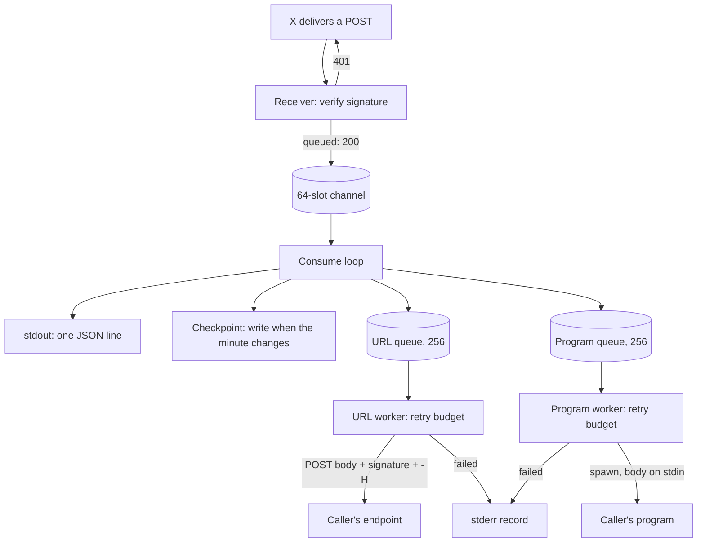
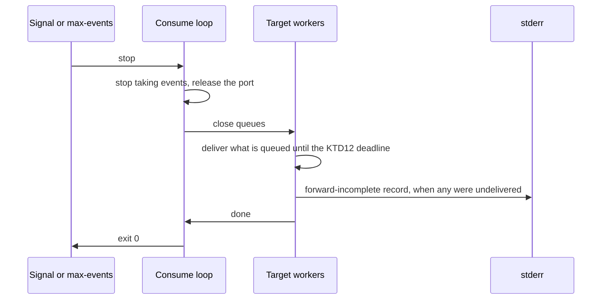
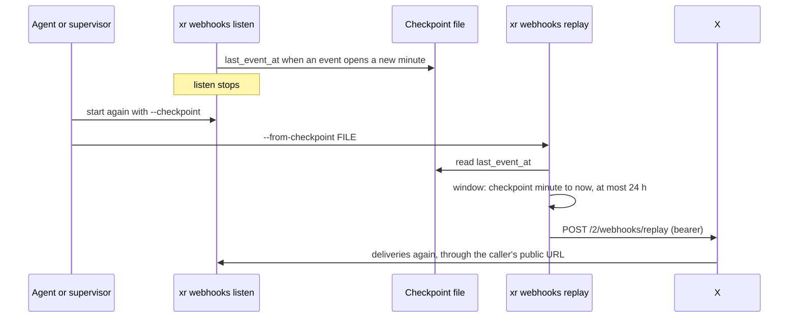

# Webhooks Listen Forwarding and Restart Replay - Plan

**Target repo:** brettdavies/xurl-rs. Every path is in it. **Base:** `docs/webhooks-06-documents` (#339, the top of the
webhooks stack, `docs/plans/2026-10-08-1745-feat-webhooks-family-plan.md`); the work here stacks above it.

---

## Goal Capsule

- **Objective:** An agent running `xr webhooks listen` gets every verified X event into its own app, an HTTP endpoint or
  a local program or both, and after a restart recovers the events it missed, seeing before it pays what the recovery
  will request.
- **Means:** `listen` forwards from one ordered queue per target after it acknowledges X (KTD3), and records a
  checkpoint that `xr webhooks replay --from-checkpoint` turns into a replay window (KTD7, KTD8).
- **Authority:** R-IDs win on behavior, KTDs on mechanism, and a unit overrides neither. `AGENTS.md` § "Where a change
  goes" decides which crate a piece lands in (KTD1).
- **Execution profile:** inline in one session, no subagents or worktrees, test-first with each red observed. One PR per
  unit, stacked on #339.
- **Stop conditions:** a test would need a request to X (R15); a design would make `listen` send a request to X (R9); a
  change would rename or retype an existing envelope key.
- **Who finishes:** Brett reviews and merges every PR.

---

## Product Contract

### Summary

`xr webhooks listen` gains `--forward <URL>` with repeatable `-H` headers and a program after `--`, each fed every
verified event in delivery order. It gains `--checkpoint <FILE>`, which
`xr webhooks replay <ID> --from-checkpoint <FILE>` reads to request the gap after a restart. A taken port answers with a
step that reruns `listen` on a free port. The library gains each piece an embedder needs to do the same.

### Problem Frame

`listen` answers X's CRC check, verifies each event's signature, and prints it as a JSON line. Anything past that is the
caller's to build: an agent that wants events in its own app writes a relay from stdout, and that relay owns retries,
ordering, and what happens when its target is down. X documents no redelivery (its webhook and Account Activity pages
name the 10-second answer window and an hourly CRC, and no retry), so every event that arrives while `listen` is down is
lost unless someone notices and calls `/2/webhooks/replay` by hand with the right window. That call is bearer-only and
replayed deliveries are billed, so an automatic recovery that guesses the window costs money the caller did not decide
to spend.

A taken port shows the same gap at a smaller scale: `listen` answers reason `io` with no command, so an agent that hits
it has nothing to run.

The request came from an agentic user of `xr` (2026-10-09) and was approved by Brett then; the flag shapes were left
open and are settled in this plan.

### Requirements

**Forwarding**

- R1. `listen --forward <URL>` sends each verified event to URL as a `POST` whose body is the event's bytes as X sent
  them, carrying the signature header X sent and each `-H 'Name: Value'` the caller gave.
- R2. Everything after `--` is a program and its arguments; `listen` runs it once per verified event with the event body
  on its stdin, never through a shell.
- R3. `--forward` and a program may be given together; each receives every event, in the order X delivered them to
  `listen`.
- R4. X's acknowledgment never waits for a forward to finish. An event is acknowledged once it verifies and is queued,
  as today; when a target falls far enough behind that its queue is full, deliveries slow until it catches up.
- R5. A forward that fails is retried within a bounded budget, then reported, and `listen` keeps running. A forward
  failure never changes `listen`'s exit status.
- R6. On shutdown, by signal or `--max-events`, `listen` finishes the forwards already queued before it exits, within
  one bounded drain deadline, and reports how many it could not deliver. A second signal exits at once.
- R7. Under a structured format, stdout carries the `listening` line and then one line per event, as today. Forward
  outcomes never reach stdout.

**Restart recovery**

- R8. `listen --checkpoint <FILE>` records, to the minute, when the most recent verified event arrived, and a crash
  mid-write leaves the previous record readable.
- R9. `listen` sends no request to X under any combination of flags.
- R10. `xr webhooks replay <WEBHOOK_ID> --from-checkpoint <FILE>` requests the window from the checkpoint's minute to
  the current minute, limited to the 24 hours X can replay, and says so when the limit cut part of the gap.
- R11. `--dry-run` on that command shows the window it would request and sends nothing. Events a replay delivers reach
  the forward targets like any other, including events the targets already received.

**Errors and contract**

- R12. A port another process holds answers with its own reason and a `next_step` that reruns `listen` with `--port 0`.
- R13. Every new error carries a reason from the closed set and a `next_step`, per `AGENTS.md` § Output formats.
- R14. `--dry-run` on `listen` reports its forward targets and checkpoint, and binds nothing, runs nothing, and writes
  nothing.
- R15. No test sends a request to X. Forward tests target local servers and local programs.

**Library**

- R16. An embedder can forward an event to a URL under the same budget, read an event's headers and arrival time, read
  and write the checkpoint, compute the replay window, and recognize the taken-port error, all from `xdk` without the
  binary.

### Key Decisions

- **Forwarding is built into `listen`.** (session-settled: user-approved — chosen over documenting a stdout pipe or
  leaving it out: the agentic user asked for it and Brett approved it on 2026-10-09.) Governs R1, R3.
- **A local app or script is a forward target too.** (session-settled: user-directed — chosen over URL-only forwarding:
  Brett added it to the approved forwarding on 2026-10-09.) Governs R2.
- **The program comes after `--`.** (session-settled: user-approved — chosen over `--exec` with one command string and
  over `--exec` with repeated `--exec-arg`: no quoting layer, so an agent passes words verbatim, and it reads the same
  on Windows.) Governs R2.
- **One process per event, with the event on stdin.** (session-settled: user-approved — chosen over one long-running
  program fed a line per event: piping stdout already serves that.) Governs R2.
- **X is acknowledged before forwarding; a failed forward is retried within a bound and then reported.**
  (session-settled: user-approved — chosen over holding X's answer until the forward succeeds: X waits 10 seconds and
  documents no redelivery.) Governs R4, R5.
- **Restart coverage is built into `xr`.** (session-settled: user-directed — chosen over documenting a supervisor
  recipe: Brett, 2026-10-09.) Governs R8, R10.
- **The replay is its own invocation that reads `listen`'s checkpoint.** (session-settled: user-approved — chosen over a
  `listen` flag that requests the replay on start: the billed request always comes from a command the caller runs on
  purpose, `AGENTS.md` says flags never select endpoints, and `listen` keeps sending nothing to X.) Governs R9, R10,
  R11.
- **Repeated events pass through after a replay.** (session-settled: user-approved — chosen over tracking event ids
  across restarts: a target must tolerate repeats, and dedupe would need a store of ids.) Governs R11.
- **The library and the binary are both held to best in class, and the binary builds on the library.** (session-settled:
  user-directed — chosen over a review of the CLI alone: Brett, 2026-10-09.) Governs R16.

### Success Criteria

- An in-process test runs `listen --max-events 1 --forward <local URL> -- <program>`, posts one signed event, and reads
  it byte for byte at both targets before `listen` exits 0.
- After `listen` stops with a checkpoint written, `xr --dry-run webhooks replay <ID> --from-checkpoint <FILE>` names a
  window starting at the checkpoint's minute.
- The `AGENTS.md` recipe walks and `crates/xurl-cli/tests/dry_run_guard.rs` pass with no walk's test edited.

### Scope Boundaries

- **No tunnel**, as in the webhooks plan. The caller exposes the address.
- **No typed event payloads.** Forwarding carries X's bytes.
- **No Account Activity to X Activity migration.** X's docs mark the Account Activity API deprecated; Brett deferred it
  on 2026-10-22.
- **Considered and not built:**
  - *Dedupe across restarts.* It needs a durable store of event ids, and a target must tolerate repeats anyway. Evidence
    that would change this: a target that cannot be made idempotent.
  - *A dead-letter file for failed forwards.* The failure record names the event's arrival time, and a replay within 24
    hours recovers it. Evidence: a gap longer than 24 hours that matters.
  - *Re-signing forwarded events with a key of `xr`'s own,* as Stripe CLI does. X's signature header already lets the
    target verify with the app's secret.
  - *More than one URL, more than one program, or concurrent forwards to one target.* One of each keeps order simple.
    Evidence: a fan-out need.
  - *An environment variable naming the signature scheme for the program.* It matters only under `--allow-unsigned`, a
    local-test flag.
  - *A flag to skip TLS verification on the forward.* Local targets are plain HTTP; nothing asks for it.

#### Deferred to Follow-Up Work

- The skill bundle documents the new flags after the release that carries them.
- X documents an Account Activity replay endpoint
  (`POST /2/account_activity/replay/webhooks/{webhook_id}/subscriptions/all`) that the vendored spec does not have, so
  `xr` cannot declare it. `/2/webhooks/replay` covers every event delivered or attempted to the webhook, Account
  Activity events included. Revisit when a spec refresh adds it.

### Sources

- X: `docs.x.com/x-api/webhooks/introduction` (answer within 10 seconds, a 200 acknowledges, CRC on registration and
  hourly); `docs.x.com/x-api/webhooks/create-replay-job-for-webhook` and the vendored spec's
  `CreateWebhookReplayJobRequest` (`from_date` and `to_date` inclusive, `yyyymmddhhmm` UTC, 24 hours, bearer only);
  `docs.x.com/x-api/account-activity/introduction` (the Account Activity replay endpoint). Read 2026-10-22.
- Stripe CLI `stripe listen`: `-f, --forward-to <url>`, `-H, --headers "Key1:Value1, Key2:Value2"`, a line per event,
  forwarded events re-signed with a CLI secret. smee-client: a source and a target URL. adnanh/webhook: a command per
  hook, with request values passed as arguments, environment, or a file. The `gh webhook` extension's flag documentation
  could not be retrieved.
- `docs/solutions/conventions/non-interactive-orchestrator-detach-stdin-and-re-gate.md` (a child's stdin must never be
  the operator's terminal), `docs/solutions/best-practices/rust-bounded-http-reads-with-take-2026-04-20.md` (cap a
  response read), `docs/solutions/best-practices/rust-url-validation-https-only-with-localhost-exception-2026-04-20.md`
  (validate a URL once, at load).

---

## Planning Contract

### Command grammar

Directional; clap's generated help is the authority once built.

```text
xr webhooks listen [--port N] [--bind ADDR] [--path P] [--secret oauth2|oauth1]
                   [--allow-unsigned] [--max-events N]
                   [--forward URL] [-H 'Name: Value']... [--forward-timeout SECS]
                   [--checkpoint FILE]
                   [-- PROGRAM [ARG]...]

xr webhooks replay WEBHOOK_ID (--from YYYYMMDDHHMM --to YYYYMMDDHHMM | --from-checkpoint FILE)
```

`-H` and `--forward-timeout` require a forward target. `--from-checkpoint` conflicts with `--from` and `--to`, which
stay required together.

### Key Technical Decisions

- KTD1. **Placement follows `AGENTS.md` § "Where a change goes".** The library owns the URL forward (network I/O), the
  event's headers and arrival time, the checkpoint file (file I/O), the replay window, and the taken-port
  classification. The binary owns argv, spawning the program (as `crates/xurl-cli/src/cli/skill_install/git.rs` spawns
  `git`), the per-target queues and their output, and composing each `next_step`. Governs R16.
- KTD2. **`Event` gains the headers a forward needs and its arrival time.** The signature headers and `Content-Type` as
  received, and a UTC arrival time. `Event` is `#[non_exhaustive]`, so the fields are additive.
- KTD3. **Acknowledge, then queue, then forward.** The consume loop prints the event line, writes the checkpoint, then
  puts the event on each target's bounded queue (capacity 256). A full queue blocks the loop, which fills the receiver's
  64-slot channel and then delays X's 200. Memory stays bounded and a stalled target slows deliveries instead of
  dropping events. Holding X's answer for the forward was rejected: one slow target would make X count every delivery
  failed. Governs R3, R4.
- KTD4. **One retry budget for both target kinds.** Up to four attempts, waiting 1, 2, then 4 seconds between them. Each
  attempt is cut off by `--forward-timeout` (default 30 seconds; a program target may run an agent). A URL attempt is
  retried on a connection failure, a timeout, 408, 429, or 5xx, and not on another 4xx. A program attempt is retried on
  a non-zero exit or a timeout. The budget is a library type so an embedder's own target runs under the same rule. The
  waits add up to 7 seconds, which covers a local server restarting, the common transient failure; a target down longer
  is reported and recovered by a replay, so a longer budget would only hold up every event queued behind it. Governs R5,
  R6.
- KTD5. **The URL request carries X's bytes and X's signature.** `POST`, the body unchanged, `Content-Type` as X sent
  it, the signature header as received, then the caller's `-H` headers, which may not set `Host` or `Content-Length`.
  The target verifies with the app's own secret, the same way `listen` does. The response body is read up to a cap and
  discarded. `--forward` takes `http` or `https` and is refused offline otherwise, with reason `validation`. Governs R1.
- KTD6. **The program target runs with no shell and no terminal.** Argv after `--` goes straight to the OS; stdin
  carries the body and is then closed; the child's stdout and stderr go to `listen`'s stderr, never its stdout (R7). An
  attempt past its timeout kills the child. `listen` checks before binding that the program resolves, by searching
  `PATH` itself (and `PATHEXT` on Windows) with no new dependency, or by checking a name with a path separator directly,
  and refuses with reason `validation` when it does not. Bytes from X reach the program only on stdin, never in its
  arguments, its environment, or a shell, so an event cannot become a command. Governs R2.
- KTD7. **The checkpoint is a one-field JSON file written atomically, once a minute at most.**
  `{"last_event_at": "<RFC 3339 UTC>"}`, written after an event's line prints when that event arrived in a later minute
  than the time last written, through the store's `write_atomically` in `crates/xdk/src/store/atomic.rs` (temp file,
  fsync, rename, fsync of the directory). A replay window is minute-granular and its start is inclusive, so a record
  from earlier in the same minute recovers exactly what a per-event record would, and a burst of deliveries costs one
  fsync a minute instead of one per event. `listen` only writes it; a missing file is created on the first event.
  Governs R8.
- KTD8. **The replay window is computed in the library from the checkpoint and the clock.** `from` is the checkpoint's
  minute, inclusive, so events from that minute come again; `to` is the current minute. A `from` older than 24 hours is
  moved up to the earliest minute X can replay, and the result says the window was clamped and from when events are
  unrecoverable. A missing or unparseable checkpoint is refused with reason `io` (exit 5, a local file that could not be
  read, step `fix-input`), and a checkpoint later than the clock with reason `validation`. Governs R10, R11.
- KTD9. **A taken port is its own error.** `Receiver::bind` maps `io::ErrorKind::AddrInUse` to a new
  `Error::AddressInUse` carrying the address, with kind `address-in-use`, next action `fix-input`, and exit code 5, the
  code the `io` error it replaces has today, so only the reason and the step change. `Error` is `#[non_exhaustive]`, so
  the variant is additive. The binary composes the step the way `resume_wait_hint` in `crates/xurl-cli/src/cli/hints.rs`
  does. It is the same invocation with `--port 0`, as a `command` when the caller gave no `-H`, and as a `template` with
  each header value replaced by `<value>` when they did, since a header often carries a credential and its value is
  never echoed. Governs R12, R13.
- KTD10. **A forward outcome is a stderr record.** A failed forward writes one stderr line: prose in text output, and
  under a structured format a JSON object with `status: "forward-failed"`, the target kind, the attempt count, the
  cause, and the event's arrival time. Shutdown with undelivered events writes one `status: "forward-incomplete"` record
  with the count. A successful forward is a `tracing` event only. Stderr, because stdout's contract is one line per
  event (R7) and `xr` already writes its structured error envelopes there; a consumer reading events from stdout never
  has to tell a status record from an event. Governs R5, R6, R7.
- KTD11. **Dry runs show the plan of action and nothing else.** `listen --dry-run` adds the forward URL, the header
  names (never values), the program and its arguments, the timeout, and the checkpoint path to its context.
  `replay --dry-run --from-checkpoint` adds `from`, `to`, and `clamped`. Governs R11, R14.
- KTD12. **Shutdown drains under one deadline, not one budget per event.** From the stop signal, the workers have one
  attempt timeout plus the budget's 7 seconds of waits to deliver what is queued; whatever is undelivered then is
  counted in the `forward-incomplete` record. A second signal exits at once. A per-event budget at drain time was
  rejected: with a target that never answers, 256 queued events at four 30-second attempts each would hold `listen` for
  hours after it was asked to stop. Governs R6.

### High-Level Technical Design

Event flow through a running `listen` (KTD3, KTD4, KTD10):



Shutdown, on SIGINT or the last of `--max-events` (R6):



Restart recovery, run by the caller (KTD7, KTD8):



What each flag combination does:

| Flags                                      | stdout          | URL target | Program target | Checkpoint    |
| ------------------------------------------ | --------------- | ---------- | -------------- | ------------- |
| none                                       | events          | none       | none           | none          |
| `--forward`                                | events          | each event | none           | none          |
| `-- PROGRAM`                               | events          | none       | each event     | none          |
| both                                       | events          | each event | each event     | none          |
| any of the above, plus `--checkpoint`      | events          | as above   | as above       | once a minute |
| `-H` or `--forward-timeout` with no target | refused by clap |            |                |               |

### System-Wide Impact

- **Library public API.** `Event` gains fields and `Error` a variant, both on `#[non_exhaustive]` types; `webhooks`
  gains the forward and checkpoint modules. Every change is additive, so `xdk-rs` takes the minor it is already due.
- **The error contract.** `address-in-use` joins the closed reason set, so the README's "Which Errors Carry a Step"
  table, `crates/xurl-cli/tests/next_step_tests.rs`, and a reason golden move together (U2).
- **The dry-run contract.** `listen` and `replay` gain context keys, additively, and `dry_run_guard.rs` must still see
  nothing sent, bound, run, or written for both.
- **Help, completions, and goldens.** The listen and replay pages, the examples page, and the completions move; no other
  fixture should.
- **Binary size.** The forward reuses the `reqwest` already linked; `tokio`'s process feature is the one likely
  addition, under the 12,000,000-byte ceiling.
- **The skill bundle** documents the released binary and follows the release (Deferred to Follow-Up Work).

### Risks & Dependencies

- **The stack beneath must land first or move with this work.** A change to #333 through #339 before they merge means
  rebasing these units with `--update-refs`.
- **X's replay behavior is taken from its spec and docs, not observed.** Whether minute bounds are inclusive as
  documented, and what a replay bills, are unverified, by R15.
- **The program target is exercised on Unix only.** Its tests use POSIX `sh`; Windows gets the cross-target clippy gate
  and no run. Accepted: the spawn goes through the same `tokio::process` API on both, and no test runner in CI runs
  Windows.

---

## Implementation Units

### U1. Library: event headers, arrival time, and the taken-port error

- **Goal:** An event carries what a forward and a checkpoint need, and a taken port is its own error.
- **Requirements:** R12, R16; KTD2, KTD9.
- **Dependencies:** none beyond #339.
- **Files:** `crates/xdk/src/webhooks/mod.rs`, `crates/xdk/src/error.rs`, `crates/xdk/tests/webhook_receiver_tests.rs`,
  `crates/xdk/tests/error_tests.rs`.
- **Approach:**
  1. Capture the signature headers and `Content-Type` in `receive_event`, and stamp the arrival time before the event is
     queued.
  2. Add `Error::AddressInUse` with its `kind`, `exit_code`, `next_action`, and `docs_url` arms, each matched
     exhaustively as rule 4 of "Where a change goes" requires.
  3. Map `AddrInUse` from `TcpListener::bind` in `Receiver::bind`; every other bind failure stays `io`.
- **Execution note:** Write the receiver test that binds a held port first and watch it report `io`.
- **Patterns to follow:** `Error::ProcessingTimeout` for a fact-carrying variant; the existing receiver tests for a
  bound receiver driven over loopback.
- **Test scenarios:**
  - A signed POST yields an event whose headers hold the OAuth2 signature header and `Content-Type` exactly as sent.
  - A legacy-signed POST yields an event holding the legacy header and not the OAuth2 one.
  - An event's arrival time lies between the times taken just before and just after the POST.
  - Binding a port another listener holds returns `AddressInUse` naming that address, with kind `address-in-use` and
    exit code 5.
  - Binding an address the host does not have stays an `io` error.
- **Verification:** The receiver and error tests pass, and `cargo-semver-checks` reports the additions as minor.

### U2. CLI: the taken-port step

- **Goal:** An agent that hits a taken port gets a step it can run.
- **Requirements:** R12, R13; KTD9.
- **Dependencies:** U1.
- **Files:** `crates/xurl-cli/src/cli/envelope.rs`, `crates/xurl-cli/src/cli/hints.rs`, `crates/xurl-cli/src/cli/runner.rs`,
  `crates/xurl-cli/src/cli/output/mod.rs`, `crates/xurl-cli/README.md` ("Which Errors Carry a Step"),
  `crates/xurl-cli/tests/next_step_tests.rs`, `crates/xurl-cli/tests/webhooks_tests.rs`, a `reason-address-in-use`
  golden under `crates/xurl-cli/tests/golden/`.
- **Approach:**
  1. Add `address-in-use` to the closed reason set and the README table.
  2. Add the hint to the runner's chain in `crates/xurl-cli/src/cli/runner.rs` beside `resume_wait_hint`, taking the
     invocation the runner already passes to `choose_hint`. Rewrite that invocation: drop any `--port`, `-p`, or
     `--port=` value, insert `--port 0` before a `--`, keep the program argv after `--` unchanged, and replace each `-H`
     value with `<value>`, which turns the step into a `template` (KTD9).
  3. Text output names the address and suggests a free port or stopping the other process.
- **Patterns to follow:** `resume_wait_hint` and `NextStep::resume_wait` in `crates/xurl-cli/src/cli/hints.rs` for the
  hint; `NextStep::confirm` in the same file for building the step's words from the invocation with `shell_word`; the
  reason-golden fixtures.
- **Test scenarios:**
  - `listen` on a held port under `--output json` exits 5 with reason `address-in-use`, `next_step.action` `fix-input`,
    and a `command` of `xr webhooks listen --port 0` plus the flags given.
  - The same with `-H 'Authorization: Bearer abc'` carries a `template` in which `abc` does not appear and `<value>`
    does.
  - With `--port 8080 -- ./handle.sh --port 9`, the step reads `--port 0 -- ./handle.sh --port 9`: the program's own
    `--port 9` is untouched and `8080` is gone.
  - `next_step_tests.rs` holds the README table to the new reason.
- **Verification:** The golden fixture shows the envelope, and the README row and `next_step_tests.rs` agree.

### U3. Library: forwarding to a URL under the retry budget

- **Goal:** An embedder can forward an event to a URL with the same request shape and retry rule `xr` uses.
- **Requirements:** R1, R5, R16; KTD4, KTD5.
- **Dependencies:** U1.
- **Files:** `crates/xdk/src/webhooks/forward.rs` (new; `mod.rs` is past the 200-line trigger),
  `crates/xdk/src/webhooks/mod.rs` (module and re-exports), `crates/xdk/tests/webhook_forward_tests.rs` (new).
- **Approach:**
  1. A retry-budget type holding the attempt count, the waits, and the per-attempt timeout, with a runner that takes any
     async attempt and returns the outcome and the attempts made, so the binary's program target reuses it.
  2. A URL target built once from the URL and headers: it validates the scheme, refuses `Host` and `Content-Length`
     among the headers, and owns an HTTP client built like the one at `crates/xdk/src/api/request/mod.rs:311`.
  3. Sending one event: the KTD5 request, the response read up to a cap, the status classified as retryable or final per
     KTD4.
  4. A forward emits `tracing` events on `xdk::webhooks` and prints nothing.
- **Execution note:** Start with the request-shape test against a local mock and see it fail before the target exists.
- **Patterns to follow:** the receiver's `tracing` kinds;
  `docs/solutions/best-practices/rust-bounded-http-reads-with-take-2026-04-20.md` for the capped read.
- **Test scenarios:**
  - A forward to a mock answering 200 sends one POST whose body equals the event bytes, with the signature header,
    `Content-Type`, and two caller headers.
  - A mock answering 503 twice and then 200 gets three attempts, and the outcome is delivered after three.
  - A mock answering 400 gets one attempt, and the outcome is a final failure naming 400.
  - A mock that never answers gets four attempts each cut at the timeout, and the outcome names the timeout.
  - A closed port gets four attempts and a connection-failure outcome.
  - A `ftp://` URL, and a header set naming `Host`, are refused when the target is built, before any request.
  - A response body larger than the cap is not read past the cap.
- **Verification:** The forward tests pass with paused tokio time where waits are involved, and no test exceeds a few
  seconds of real time.

### U4. CLI: `listen --forward` and the per-target queues

- **Goal:** `listen` delivers every verified event to the caller's endpoint, in order, and says when one did not arrive.
- **Requirements:** R1, R3 through R7, R14; KTD3, KTD4, KTD10, KTD11, KTD12; the Key Decision on acknowledging first.
- **Dependencies:** U3.
- **Files:** `crates/xurl-cli/src/cli/mod.rs` (`Listen` arguments), `crates/xurl-cli/src/cli/family_help.rs` (the listen
  page), `crates/xurl-cli/src/cli/commands/webhooks.rs` (argument mapping),
  `crates/xurl-cli/src/cli/commands/webhooks_listen.rs`, `crates/xurl-cli/src/cli/commands/webhooks_forward.rs` (new: a
  target worker over a bounded queue, the stderr records, and the shutdown drain), `crates/xurl-cli/tests/common/mod.rs`
  (the `listen_while` helper moves here from `webhooks_tests.rs`), `crates/xurl-cli/tests/webhooks_forward_tests.rs`
  (new), `crates/xurl-cli/tests/dry_run_guard.rs` if its synthesized arguments need an override,
  `crates/xurl-cli/tests/golden/help-webhooks-listen.golden`, the `completions/` files.
- **Approach:**
  1. Clap: `--forward`, repeatable `-H/--header`, and `--forward-timeout`, the last two requiring a target.
  2. Build the URL target before binding (U3); a refusal is reason `validation` with the `show-help` step.
  3. After each printed line, put the event on the target's queue (KTD3). The worker is generic over the kind of
     attempt, so U8 adds a second target without a second worker.
  4. On cancel or `--max-events`, close the queues, wait for the workers, and write the KTD10 records.
  5. The dry-run context gains the URL, the header names, and the timeout (KTD11).
- **Execution note:** Implement test-first, starting from the success criterion's URL half.
- **Patterns to follow:** the `listening` line in `webhooks_listen.rs` for structured output; the cancel token from
  `crates/xurl-cli/src/cli/shutdown.rs`.
- **Test scenarios:**
  - `--max-events 1 --forward <mock>` with one signed event: the mock holds the body byte for byte with the signature
    header, and `listen` exits 0.
  - Three events reach the mock in the order they were posted.
  - With the mock answering 500 to every attempt, X's POST is still answered 200, a `forward-failed` JSON line with 4
    attempts reaches stderr, the next event is still printed, and `listen` exits 0.
  - Under `--output jsonl`, stdout holds exactly the `listening` line and one line per event while forwards fail.
  - SIGINT with two events queued behind a slow mock delivers both before exit; with the mock down, the
    `forward-incomplete` record counts them.
  - With `--forward-timeout 1`, a mock that never answers, and three events queued, SIGINT ends `listen` within the
    KTD12 deadline of 8 seconds and the record counts 3; a second SIGINT during the drain exits at once.
  - `-H 'X: y'` without `--forward` is a clap usage error, exit 2.
  - `--forward ftp://x` is refused with reason `validation` before anything binds.
  - `--dry-run --forward <URL> -H 'Authorization: Bearer abc'` reports the URL and the header name, never `abc`, and
    binds no port.
- **Verification:** The forward tests and the dry-run guard pass, the listen help golden moves for the new flags only,
  and completions are regenerated.

### U8. CLI: a program after `--` as a forward target

- **Goal:** `listen` runs the caller's program once per verified event, with the event on stdin, beside or instead of
  the URL target.
- **Requirements:** R2, R3, R5, R7, R14; KTD4, KTD6, KTD11; the Key Decisions on the program shape and one process per
  event.
- **Dependencies:** U4.
- **Files:** `crates/xurl-cli/src/cli/mod.rs` (the trailing argv on `Listen`), `crates/xurl-cli/src/cli/family_help.rs`,
  `crates/xurl-cli/src/cli/commands/webhooks_forward.rs` (the program attempt beside the URL attempt),
  `crates/xurl-cli/src/cli/commands/webhooks_listen.rs`, `crates/xurl-cli/tests/webhooks_forward_tests.rs`,
  `crates/xurl-cli/tests/golden/help-webhooks-listen.golden`, the `completions/` files.
- **Approach:**
  1. Clap: trailing `-- PROGRAM ARGS`; `--forward-timeout` accepts it as a target.
  2. Resolve the program before binding (KTD6); a failure is reason `validation` with the `show-help` step.
  3. The attempt: a pure builder makes the command and a separate step spawns it with stdin piped, writes the body,
     closes stdin, sends stdout and stderr to `listen`'s stderr, and kills the child on timeout. It runs under the U3
     budget in the U4 worker.
  4. The dry-run context gains the program and its arguments.
- **Execution note:** Implement test-first, starting from the success criterion's program half.
- **Patterns to follow:** `crates/xurl-cli/src/cli/skill_install/git.rs` (a pure command builder separate from the
  spawn, with a typed reduction of spawn failures);
  `docs/solutions/conventions/non-interactive-orchestrator-detach-stdin-and-re-gate.md`.
- **Test scenarios:**
  - `--max-events 1 --forward <mock> -- sh -c 'cat > "$1"' sh <file>` with one signed event: the mock and the file each
    hold the body byte for byte, and `listen` exits 0.
  - Three events reach the file in the order they were posted, one process each.
  - Under `--output jsonl`, stdout holds exactly the `listening` line and one line per event while the program writes to
    its own stdout; the program's output appears on stderr.
  - A program that exits 3 is reported as failed after four attempts, and the next event still runs.
  - A program that outlives `--forward-timeout 1` is killed, and no child is left running afterwards.
  - An event body holding `$(touch pwned)` and `; rm` reaches the program's stdin as bytes and runs nothing.
  - A program that does not resolve is refused with reason `validation` before anything binds.
  - `--dry-run -- ./handle.sh --verbose` reports the program and its argument, binds no port, and runs nothing.
- **Verification:** The program-target tests pass, no child process outlives a test, and the listen help golden moves
  for the new argument only.

### U5. Library: the checkpoint and the replay window

- **Goal:** An embedder can keep a checkpoint and turn it into the window X can replay.
- **Requirements:** R8, R10, R16; KTD7, KTD8.
- **Dependencies:** U1.
- **Files:** `crates/xdk/src/webhooks/checkpoint.rs` (new), `crates/xdk/src/webhooks/mod.rs` (module and re-exports),
  `crates/xdk/src/store/atomic.rs` (reached from the webhooks module; it stays crate-private),
  `crates/xdk/tests/webhook_checkpoint_tests.rs` (new).
- **Approach:**
  1. Write: a checkpoint writer that takes each event's arrival time, writes the KTD7 record through `write_atomically`
     when the minute differs from the last one written, and skips the write otherwise.
  2. Read: parse the record, refusing a missing file, an unparseable one, or a time later than the clock passed in.
  3. Window: take the checkpoint time and the current time as arguments, so tests pass both, and return `from`, `to` as
     `yyyymmddhhmm`, whether it was clamped, and the first unrecoverable minute when it was.
- **Patterns to follow:** the store's error mapping for file failures; `validate_replay_time` in
  `crates/xdk/src/api/shortcuts.rs` for the twelve-digit form.
- **Test scenarios:**
  - A checkpoint at 2026-10-22T15:04:59Z with now at 15:31:10Z yields `from` 202610221504 and `to` 202610221531, not
    clamped.
  - A checkpoint 30 hours old yields a `from` 24 hours before now, clamped, naming the first unrecoverable minute.
  - A checkpoint and now in the same minute yield `from` equal to `to`.
  - A checkpoint ahead of now is refused with reason `validation`.
  - Arrivals at 15:04:10 and 15:05:02 leave the second time readable, and no temp file remains beside it.
  - Arrivals at 15:04:10 and 15:04:50 write once; the file holds 15:04:10.
  - A missing file, and a file holding `not json`, are each refused with reason `io` naming the path.
- **Verification:** The checkpoint tests pass with fixed times and need no clock.

### U6. CLI: `listen --checkpoint` and `replay --from-checkpoint`

- **Goal:** A restarted `listen` plus one replay command recovers the gap, and the dry run shows the window first.
- **Requirements:** R8 through R11, R14; KTD7, KTD8, KTD11; the Key Decision on replay as its own invocation.
- **Dependencies:** U4, U5.
- **Files:** `crates/xurl-cli/src/cli/mod.rs` (`Listen` and `Replay` arguments),
  `crates/xurl-cli/src/cli/family_help.rs`, `crates/xurl-cli/src/cli/commands/webhooks.rs` (`replay`),
  `crates/xurl-cli/src/cli/commands/webhooks_listen.rs`, `crates/xurl-cli/tests/webhooks_tests.rs`,
  `crates/xurl-cli/tests/dry_run_guard.rs`, `crates/xurl-cli/tests/golden/help-webhooks-replay.golden`,
  `crates/xurl-cli/tests/golden/help-webhooks-listen.golden`, the `completions/` files.
- **Approach:**
  1. `listen --checkpoint` hands each printed event's arrival time to the U5 writer (KTD7). A write failure is reported
     on stderr like a forward failure and does not stop `listen`.
  2. `replay`: `--from-checkpoint` in a clap group against `--from` with `--to`. The window comes from U5 with the
     current time, and goes through the existing `create_webhook_replay` call, so the request, the bearer requirement,
     and `send_or_report` stay as they are.
  3. The structured output of `replay` adds `clamped` and, when set, the first unrecoverable minute, beside X's
     response.
- **Patterns to follow:** the existing `replay` dispatch and its `validate_replay_time` checks; the `dry_run_guard.rs`
  override rows for `webhooks replay`.
- **Test scenarios:**
  - `listen --checkpoint <file> --max-events 2` with two events leaves a checkpoint naming the second event's minute.
  - `replay <id> --from-checkpoint <file>` against the mock posts `webhook_id`, a `from_date` equal to the checkpoint's
    minute, and a `to_date` equal to the current minute, under the bearer.
  - `--dry-run` on the same prints `from`, `to`, and `clamped: false`, and the mock receives nothing.
  - A checkpoint 30 hours old makes the dry run report `clamped: true` and the first unrecoverable minute.
  - `--from-checkpoint` with `--from` is a clap usage error; `--from` alone still demands `--to`.
  - A missing checkpoint file is refused with reason `io`, exit 5, and sends nothing.
  - `replay` with `--from-checkpoint` and no bearer is `auth-method-mismatch`, as it is with `--from` and `--to`.
- **Verification:** The webhooks tests and the dry-run guard pass, and the replay and listen help goldens move for the
  new flags only.

### U7. Documents

- **Goal:** A reader learns the forward flags, the recovery recipe, and its cost from the shipped docs.
- **Requirements:** R5, R10, R11.
- **Dependencies:** U2, U4, U6, U8.
- **Files:** `crates/xurl-cli/README.md` (the webhooks section), `crates/xurl-cli/src/cli/commands/examples.rs`,
  `crates/xurl-cli/tests/golden/examples.golden`, `KNOWN_DIFFERENCES.md`, `crates/xdk/README.md` (the `webhooks` module
  line, for forwarding and the checkpoint).
- **Approach:**
  1. README: forwarding, the program target and its stdin contract, the failure records, repeats after a replay, and the
     restart recipe with the dry run first and the billing note.
  2. Examples page: one forwarding line and the restart pair.
  3. `KNOWN_DIFFERENCES.md`: Go `xurl` neither forwards nor replays from a checkpoint.
- **Test expectation:** none beyond the examples golden; `agentic_tests.rs` already requires the family on the examples
  page.
- **Verification:** markdownlint passes, and every flag the docs name appears in `xr webhooks listen --help` or
  `xr webhooks replay --help`.

---

## Verification Contract

| Gate                       | Command                                                                                                | Applies to           |
| -------------------------- | ------------------------------------------------------------------------------------------------------ | -------------------- |
| Unit and integration tests | `cargo test --workspace --locked`                                                                      | every unit           |
| One suite while iterating  | `cargo test -p xdk-rs --test webhook_forward_tests`, and the matching `-p xurl-rs --test <name>`       | the unit's own tests |
| Lints                      | `cargo clippy --workspace --all-targets -- -D warnings`                                                | every unit           |
| Help and examples fixtures | `XURL_GOLDEN_BLESS=1 cargo test -p xurl-rs --test golden_tests`, only where a unit says the help moved | U2, U4, U6, U7, U8   |
| Completions                | `scripts/generate-completions.sh`                                                                      | U4, U6, U8           |
| Local CI mirror            | `scripts/hooks/pre-push` (it runs on every push)                                                       | every PR             |
| Public-API semver          | CI's semver gate; `Event` fields and the `Error` variant are additive on `#[non_exhaustive]` types     | U1, U3, U5           |
| Release binary size        | CI's agent-native audit against the 12,000,000-byte ceiling                                            | U3, U4, U8           |

No gate sends a request to X (R15).

---

## Definition of Done

- Every R-ID is covered by a passing test or, for R9 and R15, by the absence of any request to X in the suites and the
  dry-run guard.
- The recipe walks, the dry-run guard, and `next_step_tests.rs` pass with no walk's test edited.
- Each PR's CI rollup is green, with each check judged by its latest run.
- No code from an abandoned approach is left in the diff.

| Unit | Done when                                                                                                       |
| ---- | --------------------------------------------------------------------------------------------------------------- |
| U1   | A held port binds to `AddressInUse`, and an event exposes its headers and arrival time.                         |
| U2   | The envelope golden shows `address-in-use` with a `--port 0` command, and a template when headers were given.   |
| U3   | A forward's request shape, retries, and refusals pass against local mocks.                                      |
| U4   | One signed event reaches a URL byte for byte, and failures and shutdown produce their stderr records.           |
| U8   | One signed event reaches a program's stdin byte for byte, and a failing or hung program is reported and reaped. |
| U5   | Window, clamp, and refusals pass at fixed times; a write survives as the last record.                           |
| U6   | `replay --from-checkpoint` sends the computed window, and its dry run shows the window and sends nothing.       |
| U7   | The README, examples page, and `KNOWN_DIFFERENCES.md` describe what the binary does.                            |
