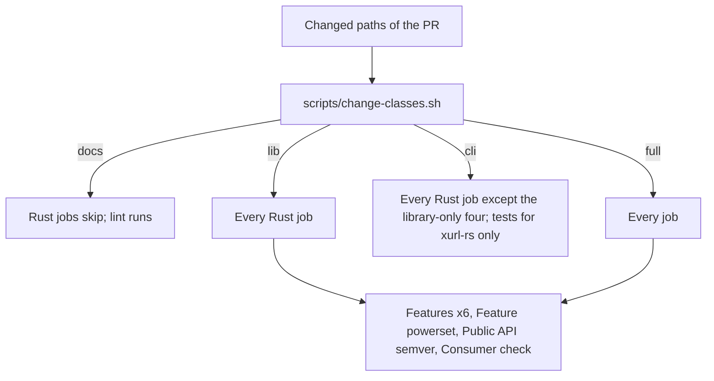
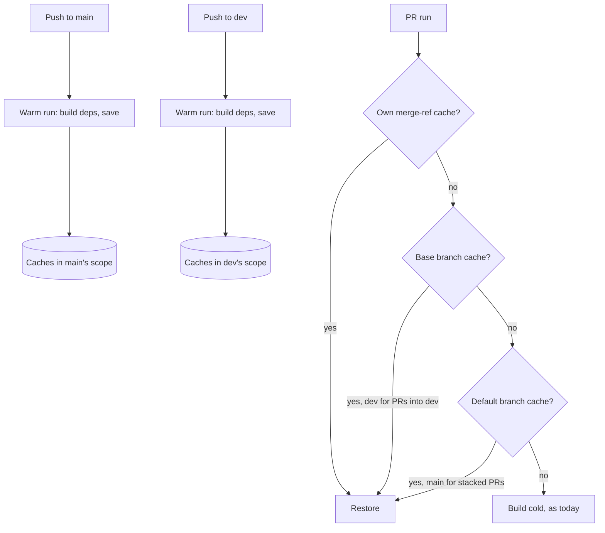
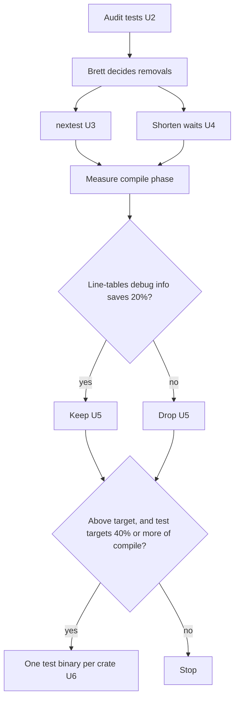

# CI Scoping and Speed - Plan

**Target repo:** brettdavies/xurl-rs. Paths are in it unless prefixed `brettdavies/.github:`. **Base:** `dev`.

## Goal Capsule

- **Objective:** a pull request's CI verdict arrives in about half today's time, fewer runs fail on downloads, every
  required check still reports on every PR, and no change skips a check that could have caught it.
- **Means:** warm dependency caches written by push runs on `dev` and `main` (KTD2), a faster test job after an audit of
  what its tests spend time on (KTD4 to KTD8), and change classes that skip the jobs a change's paths cannot affect
  (KTD9, KTD10).
- **Authority:** R-IDs win on behavior and KTDs on mechanism; a unit overrides neither.
  `docs/solutions/conventions/ci-triggers-once-per-change-under-squash-merges.md` governs CI triggers except where KD1
  adds warm-only push runs.
- **Execution profile:** inline in one session, no subagents or worktrees, long jobs in the background. Shared-workflow
  changes land as PRs to `brettdavies/.github` before the xurl-rs PR that opts in; xurl-rs changes go on `feat/`/`fix/`
  branches to `dev`.
- **Stop conditions:**
  - A required check would stop reporting on a PR.
  - A change class would skip a job its paths can affect.
  - The test audit proposes removing or weakening a test (stop for Brett's call on that test).
  - A lever measures below its keep-threshold (drop it, record why).
- **Who ships:** Brett merges every PR in both repos and applies any ruleset change.

---

## Product Contract

### Summary

CI on xurl-rs gets faster in three parts. PRs start from dependency caches that push runs on `dev` and `main` keep warm.
The test job builds and runs faster after an audit of where its time goes. Jobs a change's paths cannot affect skip,
reporting success so required checks keep passing.

### Problem Frame

Every PR that touches more than docs runs about twenty-five jobs, and each starts cold. CI runs on `pull_request` only,
so a run's caches live on its merge ref, where no other PR can restore them, and nothing writes a cache every PR can
read. Each cold job downloads the 301 registry crates in `Cargo.lock` and builds them again. crates.io's intermittent
`Error in the HTTP2 framing layer` failed ten checks during the 23-PR command-families stack, and every failure meant a
rerun. The repository's 46 caches total 11.8 GiB against GitHub's 10 GB budget, so least-recently-used eviction removes
even a PR's own cache.

The test job is the long pole. In 29 of the last 30 successful runs it restored no cache and took 4.7 to 9 minutes,
depending on the runner; six of them sampled spent 45 to 82 s in clippy and 97 to 177 s compiling the tests, and running
them took about 2.5 to 3 minutes. The one warm run took 4.5 minutes: clippy 16 s, compiling 77 s, running about 148 s
(Appendix). The compile links 101 integration-test binaries (58 in `crates/xurl-cli/tests`, 43 in `crates/xdk/tests`).
`cargo test` runs those binaries one at a time, and four of them hold 120 s of the 160 s spent inside binaries, mostly
waiting: real retry backoff, real timeouts, a per-command walk, and a script run twelve times.

Path scoping alone would help fewer PRs than it seems. Of the last 80 commits on `dev`, 41 touched both crates, 12 only
docs (which already skip), 7 only the library, 6 only the CLI, and about 14 workflows, dependencies, or scripts. Speed
helps every PR; scoping helps only the CLI-only ones, because a library change can break the CLI and so runs every Rust
job (KTD10).

### Requirements

**Warm start**

- R1. A PR's jobs restore dependency caches written from the latest `dev` or `main` tree whenever the toolchain and
  lockfile match, so a first run does not rebuild the dependency graph.
- R2. A PR whose lockfile or toolchain differs from `dev` and `main` still runs, building what it lacks, as today.

**Faster checks**

- R3. The test job's wall-clock on a warm cache drops to about half of today's warm run: 2 m 15 s or less, from about
  4.5 minutes.
- R4. No test is removed, skipped, or weakened for speed without Brett approving that specific test.
- R5. Doc tests keep running on every PR that runs tests.

**Scoping**

- R6. Each job runs when the PR's changed paths can affect its verdict and is skipped otherwise; a skipped required
  check reports success.
- R7. A path outside every known class, and any change to a workflow, the classifier, or a build input (`Cargo.toml`,
  `Cargo.lock`, `rust-toolchain.toml`, `.cargo/`, `deny.toml`), runs every job.
- R8. The pre-push hook and CI classify a change with one shared classifier, so their verdicts agree.
- R9. Repositories that call the shared reusable workflows see no change in behavior unless they opt in.

**Records**

- R10. AGENTS.md, RELEASES.md, CONTRIBUTING.md, and the workflow comments describe the warm runs, the test runner, and
  the scoping as built.
- R11. The set of required checks stays as it is; a check renamed by this work is a ruleset change Brett applies.

### Key Decisions

- KD1. **Warm caches come from push runs on `dev` and `main` that build only dependencies.** (session-settled:
  user-approved — chosen over keeping CI strictly pull_request-only with cold starts: a run that only builds
  dependencies re-checks nothing, so the convention's no-duplicate-check reason does not apply.) Governs R1, R2.
- KD2. **Wall-clock speed is in scope, and the tests' validity is audited before they run in parallel or in subsets.**
  (session-settled: user-directed — chosen over a scoping-only plan: Brett asked for "a faster PR" and to "spike the
  validity of the tests themselves, prior to running in parallel".) Governs R3, R4.
- KD3. **The shared reusable workflow gains opt-in inputs, defaulting to today's behavior.** (session-settled:
  user-approved — chosen over scoping only this repo's own jobs: the test job lives in the reusable.) Governs R6, R9.
- KD4. **An unclassified path, or a change to a workflow or the classifier, runs every job.** (session-settled:
  user-approved — chosen over scoping CI edits: a CI edit must not skip the jobs it can break.) Governs R7.

### Success Criteria

- The test job (`ci / Fmt, clippy, test`) on a warm cache finishes in 2 m 15 s or less, from about 4.5 minutes warm and
  4.7 to 9 cold (Appendix).
- Within that budget, about 40 s goes to setup, formatting, and clippy, so compiling the tests takes 50 s or less (from
  77 s) and running them 40 s or less (from about 148 s).
- A PR's first run, with no cache of its own, compiles no dependency crate when `dev` has a matching warm cache.
- A CLI-only PR shows the nine library-only checks as skipped, and every required check passes.
- No test fails intermittently under the new runner across the PRs that roll it out.

### Scope Boundaries

- Which checks are required does not change (R11).
- Other repositories' CI changes only if they opt in (R9).
- The jobs that take seconds are not scoped: the security audits, lint, shellcheck, `Change scope`, and the changelog
  workflow's surface check.
- Considered and not built:
  - **A faster linker.** Rust 1.90 made `rust-lld` the default on `x86_64-unknown-linux-gnu`, and the pin is 1.96, so
    `mold` would gain little. Revisit if a compile profile after U5 shows linking dominated even with `lld`.
  - **`CARGO_HTTP_MULTIPLEXING` in `ci.yml`** (KTD12).
  - **Splitting the crates further.** With CI's flags at 4 jobs, the library builds in 4 s and the CLI crate in 9 s,
    while the integration-test targets take 133 s of build time, about 33 of the 45 s the workspace takes once
    dependencies are built (Appendix). More crates would not shorten that; fewer test targets would (U6). Revisit if,
    after U6, compiling the workspace crates themselves dominates.
  - **Finer job scoping** (for example, `Windows program target` only on webhook-program paths). Four coarse classes are
    easier to keep correct; revisit if a measured job still runs often without cause.

#### Deferred to Follow-Up Work

- Sharding tests across runners with `cargo nextest run --partition` and an archive: only if the test-running phase
  stays above 40 s after U3 and U4.
- A weekly scheduled warm run on `main`: only if stacked PRs, which restore from `main`, keep missing after its entries
  expire.

### Open Questions

- Deferred to U4: the exact seam that lets in-process tests shorten the forwarder's retry schedule while production
  keeps its defaults (constraints in KTD6).
- Deferred to Brett, only if eviction thrash appears: raising the repository's cache budget above 10 GB, which GitHub
  bills.

---

## Planning Contract

### Key Technical Decisions

- KTD1. **Speed first, scoping second.** Scoping helps about one PR in thirteen, the CLI-only ones (Problem Frame); a
  warm cache and a faster test job help every PR. Units run warm start, then the audit and test speed, then scoping.
- KTD2. **Warm through the CI workflow itself, not a separate warm workflow.** `ci.yml` gains `push` on `dev` and `main`
  (and `workflow_dispatch`) and passes the reusable a `warm_cache` flag on push. Each caching job then builds its
  dependencies and runs no check. Because the push run uses the same job ids, `key` inputs, environment, and toolchain
  as a PR run, `Swatinem/rust-cache` derives the same keys by construction; a separate workflow would have to copy every
  job's key inputs by hand and drift. GitHub lets a PR run restore from its own ref, its base branch, and the default
  branch, and only `push`, `schedule`, and dispatch runs can write those scopes
  (`docs.github.com/en/actions/reference/workflows-and-actions/dependency-caching`).
- KTD3. **PR runs keep saving their caches.** `Swatinem/rust-cache` saves nothing after restoring an exact match (the
  warm run in the Appendix logged `Cache up-to-date.`), so a PR whose lockfile and toolchain match `dev` writes no
  entry. Only a PR that changes them saves its own set, and #408's `cache-on-failure` keeps that useful. One full set of
  this repo's caches is about 4.3 GiB (Appendix), so the `dev` and `main` warm sets hold about 8.7 GiB of the 10 GB
  budget, and a PR that saves its own set evicts the least recently used entries, likely `main`'s. U1 reads
  `gh cache list` after the first PR that changes `Cargo.lock`: if a current warm entry was evicted, PR runs stop saving
  (`save-if` on non-PR events).
- KTD4. **cargo-nextest runs the tests, behind an opt-in reusable input.** It runs every test in its own process across
  all binaries at once, where `cargo test` runs binaries one at a time. It does not run doc tests, so the job adds
  `cargo test --doc` (R5). The CI profile in `.config/nextest.toml` sets `retries = 0`, so a flaky test fails instead of
  hiding, and a `slow-timeout` that names slow tests and ends hung ones. The pre-push hook uses nextest when it is
  installed and `cargo test` otherwise.
- KTD5. **Audit before parallelizing.** The `test-audit` skill finds duplicate and low-value tests across both crates,
  and the per-binary times in the Appendix give each one's cost. Removals go to Brett test by test (R4, KD2).
- KTD6. **Shorten real waits through seams, keeping production defaults.** A wait the tests sit through (the forward
  retry schedule in `crates/xdk/src/webhooks/budget.rs`, timeouts set by test flags) becomes a value the in-process
  runner can set. There is no new environment variable outside the list AGENTS.md § "Where a change goes" names, and no
  public CLI flag that exists only for tests; library-first placement applies. A test that walks commands serially runs
  them concurrently within the test. Assertions do not change (R4).
- KTD7. **Lighter debug info for test builds, kept only if it pays.** Test builds compile with line-tables-only debug
  info (backtraces keep file and line). Keep it only if the compile phase drops by 20% or more.
- KTD8. **One integration-test binary per crate, only if the test targets dominate and the target is still missed.**
  Measure after KTD7 with `cargo test --no-run --timings`, which reports each target's compile-and-link time but does
  not split out linking. If the test job is still above its Success Criteria target and the 101 integration-test targets
  take 40% or more of the compile phase, fold each crate's `tests/*.rs` into a single binary; that removes each test
  crate's own compile as well as its link. The guards that read the tests directory by file (`recipe_guard`,
  `store_isolation_guard`, `cargo_inputs_tests`) must keep working.
- KTD9. **Four change classes from one classifier.** `scripts/change-classes.sh` reads changed paths and names the
  classes they reach, using `scripts/cargo-inputs.sh` for the docs verdict:
  - `docs`: nothing reaches cargo.
  - `lib`: `crates/xdk/`, plus every path outside it that the library's Rust source names in a string literal. Today
    those are `endpoint-decisions.json` and `crates/xurl-cli/README.md`, which `endpoint_decisions.rs`,
    `readme_stability_tests.rs`, and `readme_landing_tests.rs` read. The list is collected from the source on every run,
    as `scripts/cargo-inputs.sh` collects document names, so a library test that starts reading a file is covered the
    day it lands.
  - `cli`: `crates/xurl-cli/`, `completions/`, `schema/`, `.anc.toml`. A path can be both `cli` and `lib`.
  - `full`: everything else, including a document Rust source reads from outside `crates/` (its reader is not known),
    workflows, scripts, the classifier, and build inputs. Both the pre-push hook and the `Change scope` job call it
    (R8).
- KTD10. **Which jobs each class runs.** Owned by the job conditions in `ci.yml` and the reusable inputs.
  - Library-only jobs run on `lib` or `full`: `Features` (six cells), `Feature powerset`, `Public API semver`,
    `Consumer check`.
  - Every other Rust job runs on `lib`, `cli`, or `full`, because the CLI depends on the library.
  - On a CLI-only change, the test job tests only `xurl-rs`, so the library's 43 test binaries neither build nor run.
  - The matrix keeps its job-level `if: !cancelled()` and skips steps, since a matrix skipped whole never expands and
    its required cells would wait forever.
- KTD11. **The reusable gains three inputs and no more:** `warm_cache` (KTD2), `test_runner` (`cargo` or `nextest`,
  KTD4), and `test_packages` (KTD10). Each defaults to today's behavior (KD3).
- KTD12. **`ci.yml` sets no `CARGO_HTTP_MULTIPLEXING`.** (session-settled: user-directed — chosen over setting it on
  xurl-rs's own jobs: Brett declined it.) Conflict call-out: `brettdavies/.github#100` (2026-10-27) sets
  `CARGO_HTTP_MULTIPLEXING: "false"` in every reusable job, citing the same curl error 16. xurl-rs's own jobs still
  download over HTTP/2, and six of the ten stack failures were in them (`Doc build`, four `Features` cells,
  `Windows program target`). U1 cuts their downloads; if those jobs keep failing on downloads after U1, the decision is
  worth revisiting.

### High-Level Technical Design

Change classes and the jobs they run (KTD9, KTD10):

Where a warm cache comes from and where a PR finds it (KTD2, KTD3):

The test-speed levers, each gated on a measurement (KTD5 to KTD8):

### Risks & Dependencies

| Risk                                                                                          | Decision                                                                                                                                                             |
| --------------------------------------------------------------------------------------------- | -------------------------------------------------------------------------------------------------------------------------------------------------------------------- |
| A warm run's cache key differs from a PR run's, so nothing restores                           | Same job ids, inputs, and environment by construction (KTD2); U1's verification reads the PR test job's log for dependency compilation                               |
| Warm entries push the repository past 10 GB and eviction thrashes                             | The two warm sets hold about 8.7 GiB, and PR runs that match one save nothing; U1's check after the first lockfile change decides whether PR runs stop saving (KTD3) |
| Push runs spend Actions minutes, the convention doc's main concern                            | Accepted: the repository is public, so standard GitHub-hosted runners cost nothing; pushes to `dev` and `main` are a few a day                                       |
| Running tests in parallel exposes tests that depend on each other or on a shared port or file | `retries = 0` surfaces them; each is fixed or put in a nextest test group, never retried into silence (KTD4)                                                         |
| A change class skips a job that the change can break                                          | Unknown paths, workflows, and the classifier run everything (KD4); paths the library's source names are `lib` (KTD9); U7's fixture holds every rule                  |
| A reusable change alters other repositories' runs                                             | Every new input defaults to today's behavior (KD3); the reusable merges before xurl-rs opts in                                                                       |
| A shared-workflow PR in `brettdavies/.github` waits on review                                 | U1, U3, and U8 depend on it; the units without a reusable change (U2, U4, U5, U7) proceed meanwhile                                                                  |

### Sequencing

U1 first: it is independent and helps every later run. U2 precedes U3 and U4 (KD2). U5 and U6 come after U3 and U4,
because the gates measure what is left. U7 and U8 add scoping. U9 records the result.

---

## Implementation Units

### U1. Warm dependency caches from push runs

- **Goal:** PRs into `dev`, and stacked PRs, restore dependencies built by push runs instead of building them cold.
- **Requirements:** R1, R2, R9, R11; KD1, KTD2, KTD3, KTD11.
- **Dependencies:** none.
- **Files:**
  - `brettdavies/.github: .github/workflows/rust-ci.yml`: the `warm_cache` input.
  - `.github/workflows/ci.yml`: the triggers, the flag, and warm-mode steps in xurl-rs's own caching jobs.
- **Approach:**
  1. In the reusable, `warm_cache: true` makes each caching job compile its dependencies (a build of the targets it
     checks, with no test run, lint gate, or package check) and skip its checks; the default is `false`.
  2. In `ci.yml`, add `push` on `dev` and `main` and `workflow_dispatch`. Pass
     `warm_cache: ${{ github.event_name != 'pull_request' }}` to the reusable.
  3. Give each of the nine local rust-cache jobs a warm-mode step that builds what its check compiles, and gate its
     check steps on `pull_request`. The jobs that cache nothing (`lint`, `Output discipline`, `Public API semver`) and
     the reusable's security audit skip on push; `Change scope` answers "everything" there.
  4. Rewrite the header comment of `ci.yml`, which explains pull_request-only, to describe the warm runs (KD1).
- **Patterns to follow:** the reusable's existing opt-in inputs (`docs`, `msrv`, `cross_os_tests`), each defaulting to
  `false`; the `docs_only` skip.
- **Test scenarios:**
  - A push to `dev` runs every caching job in warm mode: each saves a cache, and no test, clippy, or audit result is
    reported.
  - A PR opened against `dev` right after that push restores in every caching job. The test job's log shows no
    `Compiling` line for a registry crate.
  - A PR that changes `Cargo.lock` restores the warm entry's partial match and compiles only the changed dependencies.
    After it saves its own set, `gh cache list` still holds the current `dev` and `main` warm entries, or PR runs stop
    saving (KTD3).
  - A stacked PR whose base is a feature branch restores from `main`'s warm entries when they exist.
  - A caller of the reusable that passes no `warm_cache` input sees the same jobs and steps as before.
- **Verification:** two consecutive PRs after the first warm run show restored caches and no dependency compilation in
  the test job; the reusable's own CI passes; actionlint passes.

### U2. Audit the test suites before changing how they run

- **Goal:** know which tests are duplicate, low-value, or slow, and what each costs, before parallelizing or subsetting
  them.
- **Requirements:** R4; KD2, KTD5.
- **Dependencies:** none.
- **Files:** findings go in the PR or issue that carries them to Brett; a removal Brett approves lands as its own PR
  touching `crates/*/tests/`.
- **Approach:**
  1. Run the `test-audit` skill over `crates/xdk/tests` and `crates/xurl-cli/tests`.
  2. Run the `optimize-builds-and-tests` detector for build-side patterns.
  3. Join the findings with the per-binary times (Appendix).
  4. For each of the four slow binaries, name what its time is spent on.
  5. Present the findings; remove nothing without Brett's per-test approval.
- **Execution note:** a spike; its output is a decision list, not code, unless Brett approves removals.
- **Test expectation:** none -- an audit; any approved removal is verified by the suite still passing and the removed
  test's coverage named elsewhere.
- **Verification:** Brett has the findings with costs and has decided each proposed removal.

### U3. Run the tests with nextest

- **Goal:** test binaries run in parallel instead of one after another.
- **Requirements:** R3, R5, R9; KTD4, KTD11.
- **Dependencies:** U2.
- **Files:**
  - `brettdavies/.github: .github/workflows/rust-ci.yml`: the `test_runner` input and the nextest install.
  - `.github/workflows/ci.yml`: opts in.
  - `.config/nextest.toml`: the `ci` profile.
  - `scripts/hooks/pre-push`: uses nextest when installed.
  - `CONTRIBUTING.md`.
- **Approach:**
  1. With `test_runner: nextest`, the reusable's test job installs `cargo-nextest` by `cargo binstall --force`, with the
     SHA-pinned binstall action the repo already uses. It then runs `cargo nextest run` with the `ci` profile and
     `cargo test --doc`.
  2. Tests that cannot share a machine concurrently go in a nextest test group with limited concurrency rather than
     serial runs of everything. Which tests need it is found while rolling out.
- **Patterns to follow:** the `cargo binstall ... --force` install steps in `ci.yml` (`cargo-hack`, `anc`).
- **Test scenarios:**
  - A PR runs the full suite under nextest with the same test count as `cargo test`, and doc tests still run.
  - A deliberately failing test fails the job and is named in the summary; it is not retried.
  - A test that hangs past the slow timeout is terminated and named.
  - The pre-push hook passes with nextest installed and without it.
- **Verification:** the test count matches `cargo test`; the test-running phase falls from about 175 s; no test fails
  intermittently across the rollout PRs.

### U4. Shorten the real waits in the slowest tests

- **Goal:** `webhooks_forward_tests`, `dry_run_guard`, `surface_bump_tests`, and `webhooks_program_tests` stop spending
  their time waiting.
- **Requirements:** R3, R4; KTD6.
- **Dependencies:** U2.
- **Files:**
  - `crates/xdk/src/webhooks/budget.rs`: the forward retry schedule.
  - `crates/xurl-cli/src/cli/runner.rs` or the in-process overrides it takes: the seam tests set.
  - The four test files in `crates/xurl-cli/tests/`.
  - `scripts/check-surface-bump.sh`, if its per-run cost is in the script.
- **Approach:**
  1. Make the retry schedule's first wait and the attempt timeout values the in-process runner can override, keeping
     production defaults.
  2. `dry_run_guard` runs its per-command checks concurrently with a bound.
  3. `surface_bump_tests` gets the cause U2 names (setup shared across runs, or runs concurrent).
  4. Each test keeps its assertions.
- **Execution note:** keep each test's assertions byte-identical, and compare its pass and fail behavior before and
  after on a deliberately broken input.
- **Patterns to follow:** explicit path and value injection over environment mutation (`run_with_store_path`,
  `EnvOverrides`).
- **Test scenarios:**
  - The forward test that expects four attempts still sees four, with the schedule shortened.
  - A forward timeout test still reports the timeout reason, with the short timeout.
  - `dry_run_guard` still fails, naming the command, when one command's dry run sends a request.
  - Production `xr webhooks listen --forward` keeps its documented retry schedule.
  - `surface_bump_tests` still fails for a schema change with no minor section.
- **Verification:** each of the four binaries finishes in a few seconds; the guards fail on a seeded violation;
  production defaults are unchanged.

### U5. Lighter debug info for test builds

- **Goal:** the test compile phase gets shorter without losing file-and-line backtraces.
- **Requirements:** R3; KTD7.
- **Dependencies:** U3, U4.
- **Files:** `Cargo.toml` (`[profile.test]`), or the reusable's test step environment if the profile cannot reach it.
- **Approach:** measure the compile phase with and without line-tables-only debug info on the same warm cache, and keep
  it only at 20% or more.
- **Test expectation:** none -- a build setting; the suite's pass state is the check.
- **Verification:** the compile phase falls by 20% or more and a panicking test still prints its file and line, or the
  change is dropped with the measurement recorded.

### U6. One integration-test binary per crate, if the test targets dominate

- **Goal:** the test build links two binaries instead of 101.
- **Requirements:** R3, R4; KTD8.
- **Dependencies:** U5.
- **Files:**
  - `crates/xdk/tests/` and `crates/xurl-cli/tests/`: each crate's tests become modules of one test target.
  - `crates/xurl-cli/tests/recipe_guard.rs`, `store_isolation_guard.rs`, and `cargo_inputs_tests.rs`: as their file
    reads require.
  - AGENTS.md § "Adding a command family", where it names test files.
- **Approach:**
  1. Run only if, after U5, the test job is above its target and the integration-test targets take 40% or more of the
     compile phase (KTD8).
  2. Move each file to a module under one target per crate, keeping test names, so nextest filters and the docs' test
     names stay valid.
- **Execution note:** prove the move keeps every test by comparing the sorted list of test names before and after.
- **Test scenarios:**
  - The sorted test-name list is identical before and after.
  - `store_isolation_guard` still fails on a test module that names `TokenStore::new()`.
  - `recipe_guard` still finds every walk AGENTS.md names.
- **Verification:** the compile phase drops further and the test-name list is unchanged, or the unit is skipped with the
  job time and the test targets' measured share recorded.

### U7. Classify changes into four classes

- **Goal:** one classifier names the classes a change reaches, for CI and the pre-push hook alike.
- **Requirements:** R6, R7, R8; KD4, KTD9.
- **Dependencies:** none.
- **Files:**
  - `scripts/change-classes.sh`, new.
  - `crates/xurl-cli/tests/change_classes_tests.rs`, new.
  - `crates/xurl-cli/tests/fixtures/change_classes/paths.tsv`, new.
- **Approach:** read paths on stdin and print the classes reached, one per line, using `scripts/cargo-inputs.sh` for the
  docs verdict. Any path no rule names is `full`; the script itself, `scripts/cargo-inputs.sh`, and `.github/` are
  `full` (KD4).
- **Patterns to follow:** `crates/xurl-cli/tests/cargo_inputs_tests.rs` and its TSV fixture.
- **Test scenarios:**
  - `crates/xdk/src/api/shortcuts.rs` alone gives `lib`.
  - `crates/xurl-cli/src/cli/mod.rs` alone gives `cli`.
  - `endpoint-decisions.json` gives `lib`; `.anc.toml`, `completions/xr.zsh`, and `schema/responses/posts.schema.json`
    give `cli`.
  - `crates/xurl-cli/README.md` gives `cli` and `lib`, because library tests read it.
  - A library path and a CLI path together give `lib` and `cli`.
  - `README.md` (read by a Rust test) gives `full`; `docs/plans/x.md` gives nothing (docs only).
  - `Cargo.lock`, `.github/workflows/ci.yml`, `scripts/change-classes.sh`, and a path in a new top-level directory each
    give `full`.
  - Empty input gives nothing, and the docs-only verdict matches `scripts/cargo-inputs.sh`.
- **Verification:** the fixture covers every rule and the unknown-path fallback; shellcheck passes.

### U8. Run each job only for the classes that can affect it

- **Goal:** a CLI-only PR skips the library-only checks and the library's tests, with every required check passing.
- **Requirements:** R6, R7, R8, R9, R11; KTD10, KTD11.
- **Dependencies:** U7, and U3 for the `test_packages` input to apply to nextest.
- **Files:**
  - `.github/workflows/ci.yml`: the `Change scope` job's outputs and each job's condition.
  - `brettdavies/.github: .github/workflows/rust-ci.yml`: the `test_packages` input.
  - `scripts/hooks/pre-push`: its library battery uses the shared classifier.
- **Approach:**
  1. `Change scope` runs the classifier on the PR's diff and outputs `lib`, `cli`, and `full`.
  2. The library-only jobs gain `lib || full` in their conditions, with the features matrix keeping its job-level
     `if: !cancelled()` and gating steps (KTD10).
  3. The test job passes `test_packages: xurl-rs` on a CLI-only change.
  4. A scope job that fails or never reports still runs everything, as today.
- **Patterns to follow:** the current `scope` job and its `rust` output; the features matrix's step-level gating.
- **Test scenarios:**
  - A CLI-only PR shows `Features` (six cells), `Feature powerset`, `Public API semver`, and `Consumer check` as passing
    without running, and the test job runs only `xurl-rs` tests.
  - A library-only PR runs every Rust job.
  - A PR touching `.github/workflows/ci.yml` runs every job.
  - A docs-only PR behaves as today.
  - Every required check in `.github/rulesets/protect-dev.json` reports on each of those PRs.
- **Verification:** each scenario observed on a real PR; the rulesets file is unchanged.

### U9. Record how CI behaves now

- **Goal:** the repo's docs and comments describe the warm runs, the test runner, and the scoping as built.
- **Requirements:** R10, R11.
- **Dependencies:** U1 to U8 (the parts that shipped).
- **Files:**
  - `AGENTS.md`: § "Testing" and its six CI gates paragraph.
  - `RELEASES.md`, where it describes CI.
  - `CONTRIBUTING.md`.
  - `.github/workflows/ci.yml` comments.
- **Approach:**
  1. State what runs when, in present tense.
  2. Capture the warm-run pattern and the measured gains as a solutions entry with `ce-compound`, because the fleet
     convention doc says pull_request-only.
- **Test expectation:** none -- documentation; `recipe_guard` and markdownlint check what they check.
- **Verification:** each doc names the classifier, the warm runs, and nextest where it describes CI, and no doc still
  says CI is pull_request-only.

---

## Verification Contract

| Gate                                                                            | Applies to         | Pass                                                          |
| ------------------------------------------------------------------------------- | ------------------ | ------------------------------------------------------------- |
| `cargo nextest run --workspace --profile ci` and `cargo test --doc --workspace` | U3 onward          | All pass; test count equals the `cargo test` count            |
| `cargo test -p xurl-rs --test change_classes_tests`                             | U7                 | All pass                                                      |
| `scripts/hooks/pre-push`                                                        | every xurl-rs unit | Passes, with and without nextest installed                    |
| actionlint on changed workflows, in both repos                                  | U1, U3, U8         | Clean                                                         |
| Test job wall-clock on a warm PR (`gh run view --json jobs`)                    | measured after U6  | 2 m 15 s or less                                              |
| Test compile phase (`Finished test profile`)                                    | U5, U6             | 50 s or less                                                  |
| Test-running phase                                                              | U3, U4             | 40 s or less                                                  |
| Dependency compilation in a fresh PR's test job                                 | U1                 | None when `dev` has a matching warm cache                     |
| Skipped checks on a CLI-only PR                                                 | U8                 | Nine library-only checks skipped, all required checks passing |

## Definition of Done

- Every unit's verification is met, or its gate decided it out with the measurement recorded (U5, U6).
- Every Success Criterion is met, or Brett has the measured shortfall and has decided what follows (the deferred
  follow-ups are the candidates).
- No test was removed or weakened without Brett's approval of that test.
- The reusable's defaults leave other repositories' runs unchanged.
- The rulesets are unchanged, or Brett has applied the change.
- No experimental workflow steps, unused inputs, or abandoned seams remain in either repo's diff.

---

## Appendix

Baseline, job `ci / Fmt, clippy, test` in two runs: `40442538636` (#397, cache restored, `full match: true`) and
`40447386979` (#407, `No cache found.`):

| Step                                       | Warm (#397) | Cold (#407) |
| ------------------------------------------ | ----------- | ----------- |
| Set up, checkout, toolchain, cache restore | 25 s        | ~20 s       |
| Clippy                                     | 16 s        | 50 s        |
| Tests: compile                             | 77 s        | 114 s       |
| Tests: running the binaries and doc tests  | ~148 s      | ~175 s      |
| Whole job                                  | 271 s       | 369 s       |

Cold runs on slower runners took up to 546 s (clippy 82 s, compile 177 s). One full set of the run's caches (the 17
`v0-rust-*` keys in `gh cache list`) is about 4.3 GiB.

Build-time split, measured locally with `RUSTFLAGS=-Dwarnings CARGO_INCREMENTAL=0 cargo test --no-run --timings -j 4` in
a fresh target directory (this machine builds faster than a CI runner, so the shares matter more than the seconds):
dependencies finish at 38 s and the workspace at 82 s. Within the workspace, the library takes 4 s, the CLI crate 9 s,
the two crates' unit-test targets 5 s and 10 s, and the 104 integration-test targets (the 101 test files plus the
consumer check's) 133 s of build time across the 4 jobs.

Slowest test binaries in the #407 run (time inside the binary, test count):

| Binary                                            | Time   | Tests |
| ------------------------------------------------- | ------ | ----- |
| `crates/xurl-cli/tests/webhooks_forward_tests.rs` | 48.3 s | 18    |
| `crates/xurl-cli/tests/dry_run_guard.rs`          | 34.4 s | 3     |
| `crates/xurl-cli/tests/surface_bump_tests.rs`     | 21.7 s | 12    |
| `crates/xurl-cli/tests/webhooks_program_tests.rs` | 15.3 s | 20    |
| `crates/xurl-cli/tests/store_tests.rs`            | 8.1 s  | 90    |
| `crates/xurl-cli/tests/golden_tests.rs`           | 6.9 s  | 7     |

All binaries: 2002 tests, 160 s inside binaries, run one binary at a time.

Change classes of the last 80 commits on `dev`: both crates 41; docs only 12; library only 7; CLI only 6; workflows,
dependencies, or scripts about 14.
