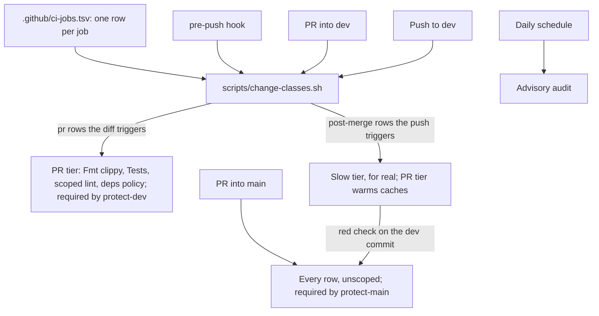
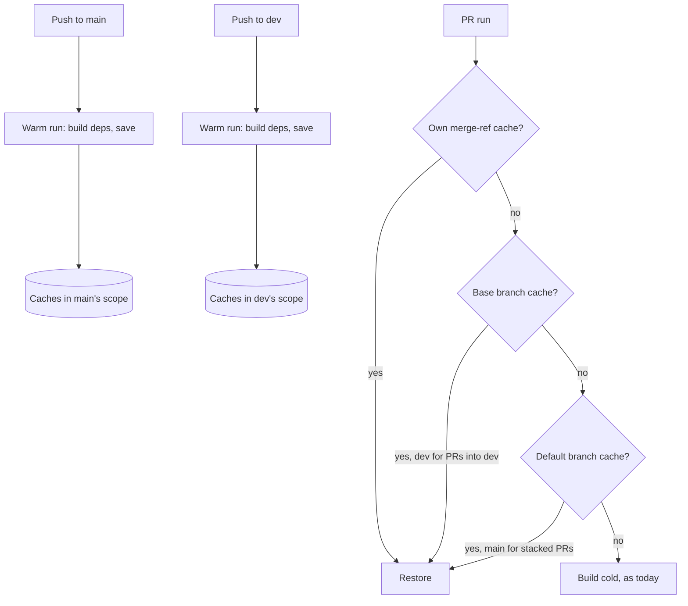
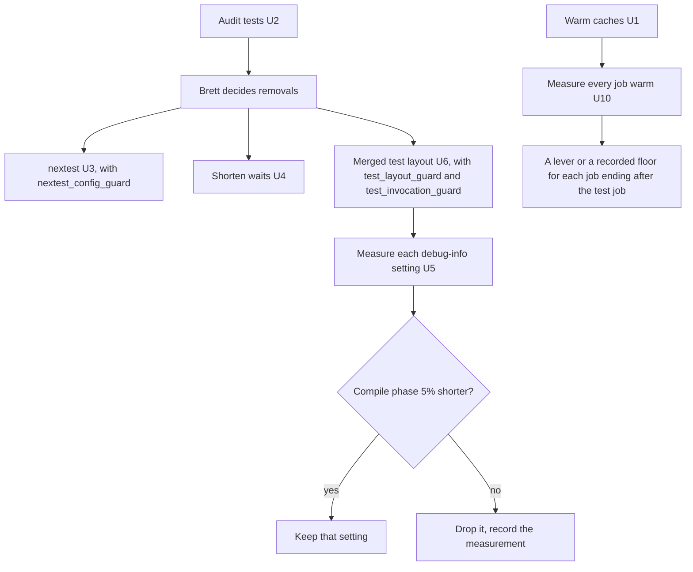

# CI Scoping and Speed - Plan

**Target repo:** brettdavies/xurl-rs. Paths are in it unless prefixed `brettdavies/.github:`. **Base:** `dev`.

## Goal Capsule

- **Objective:** a contributor's `git push` reaches a green PR verdict in under 2 minutes, hook included (KD5). Every CI
  job earns its place in one job table and runs only when a change can affect it. Slow checks gate the release PR
  instead of every PR. No speed measure can silently drop a test or hide a failure.
- **Means:** two tiers by ruleset (KD6): a fast PR tier, split into parallel jobs on GitHub's free runners (KD7), and a
  slow tier that runs on each push to `dev` and gates the release PR. Warm caches come from those push runs (KTD2). The
  test job gets faster after an audit of what its tests spend time on (KTD4 to KTD8). One job table drives CI and the
  pre-push hook (KTD9, KTD10). Guards hold every measure (R13).
- **Authority:** R-IDs win on behavior and KTDs on mechanism; a unit overrides neither.
  `docs/solutions/conventions/ci-triggers-once-per-change-under-squash-merges.md` governs CI triggers except where KD1
  adds push runs on `dev` and `main`.
- **Execution profile:** inline in one session, no subagents or worktrees, long jobs in the background. Shared-workflow
  changes land as PRs to `brettdavies/.github` before the xurl-rs PR that opts in; xurl-rs changes go on `feat/`/`fix/`
  branches to `dev`.
- **Stop conditions:**
  - A required check would stop reporting on a PR.
  - A job table row would skip a job its paths can affect.
  - The test audit proposes removing or weakening a test (stop for Brett's call on that test).
  - A lever measures below its keep-threshold (drop it, record why).
- **Who ships:** Brett merges every PR in both repos and applies both rulesets.

---

## Product Contract

### Summary

A push to a PR into `dev` runs a fast tier: format, clippy, nextest in parallel jobs, the guards, and whatever lint the
change's paths call for, about 9 jobs at most. The slow checks (release build and size ceiling, Windows, Go parity,
MSRV, the library's feature matrix, semver, packaging, the consumer check, completions) run after each merge to `dev`
and gate the release PR into `main`. One job table says why each job exists and which paths trigger it; CI, the pre-push
hook, and a `--jobs` preview all read it. Push runs keep dependency caches warm, and the tests build and run faster
after an audit.

### Problem Frame

Every PR that touches more than docs runs about twenty-five jobs, and each starts cold. CI runs on `pull_request` only,
so a run's caches live on its merge ref, where no other PR can restore them, and nothing writes a cache every PR can
read. Each cold job downloads the 301 registry crates in `Cargo.lock` and builds them again. crates.io's intermittent
`Error in the HTTP2 framing layer` failed ten checks during the 23-PR command-families stack, and every failure meant a
rerun. The repository's 46 caches total 11.8 GiB against GitHub's 10 GB budget, so least-recently-used eviction removes
even a PR's own cache.

The test job is the long pole. In 29 of the last 30 successful runs it restored no cache and took 4.7 to 9 minutes,
depending on the runner; six of them sampled spent 45 to 82 s in clippy and 97 to 177 s compiling the tests, and running
them took about 2.5 to 3 minutes. The one warm run took 4.5 minutes: clippy 16 s, compiling 77 s, running about 148 s
(Appendix). The compile links 101 integration-test binaries (58 in `crates/xurl-cli/tests`, 43 in `crates/xdk/tests`).
`cargo test` runs those binaries one at a time, and four of them hold 120 s of the 160 s spent inside binaries, mostly
waiting: real retry backoff, real timeouts, a per-command walk, and a script run twelve times.

The account is on GitHub Free, which runs 20 jobs at once, and a PR fires 25 CI jobs plus the changelog workflow, so
jobs queue even with nothing else running: in the warm baseline the test job waited 51 s for a runner, and during a
stack restack the slowest start was 511 s and the verdict took 787 s. Before CI starts, the pre-push hook sweeps the
whole battery serially: 370 s on a 16-core machine with warm caches. A contributor's push-to-verdict loop is 11 to 19
minutes.

Most jobs catch nothing most of the time. Over the last 300 CI runs, real failures came from the test job, the
agent-native audit (size ceiling 8, score 5), Public API semver (2), Doc build, Output discipline, and
`Windows program target` (on webhooks branches); `Security audit (advisories)` failed 11 times, all on a broken
toolchain install, never on an advisory; MSRV, Go parity, the consumer, package, and Windows checks, shellcheck, the
powerset, and four of the six feature cells caught nothing (Appendix).

### Requirements

**Warm start**

- R1. A PR's jobs restore dependency caches written from the latest `dev` or `main` tree whenever the toolchain and
  lockfile match, so a first run does not rebuild the dependency graph.
- R2. A PR whose lockfile or toolchain differs from `dev` and `main` still runs, building what it lacks, as today.

**Faster checks**

- R3. The PR tier's slowest job finishes in 90 s or less on a warm cache, from 271 s for today's test job, leaving the
  hook about 30 s of the 2-minute loop (R12).
- R4. No test is removed, skipped, or weakened for speed without Brett approving that specific test.
- R5. Doc tests keep running on every PR that runs tests.
- R12. A contributor's `git push`, pre-push hook included, reaches the PR's verdict (its last required check) in under 2
  minutes on warm caches (KD5).
- R13. Guards hold every speed measure that could silently drop a test or hide a failure: an undeclared test file, a
  retried flaky test, a command naming a test target that no longer exists, a CI job with no row in the job table.

**Tiers and the job table**

- R6. Each job runs only when a change's paths can affect its verdict, as its row in the job table says, and is skipped
  otherwise; a skipped required check reports success.
- R7. A path outside every row's triggers, and any change to a workflow, the classifier, the job table, or a build input
  (any `Cargo.toml`, `Cargo.lock`, `rust-toolchain.toml`, `.cargo/`, `deny.toml`), runs every job of the tier.
- R8. The pre-push hook and CI read the same job table, so their verdicts agree; the hook runs the PR tier only.
- R9. Repositories that call the shared reusable workflows see no change in behavior unless they opt in.
- R14. Every CI job has one row in the job table: what it alone protects, its trigger paths, and its tier. A guard fails
  for a job with no row and a row with no job.
- R15. The slow tier runs on each push to `dev`, scoped by the job table to the pushed diff, and runs in full on every
  PR into `main`. A post-merge failure shows as a red check on the `dev` commit, and the release PR cannot merge over it
  (KD8).
- R16. Every pre-push stop or skip and every guard failure starts with a stable kebab-case code matching a heading in
  AGENTS.md § "Testing", and names the file or tool, the reason, and the exact fix.
- R17. `scripts/dev-setup.sh` installs every tool the hooks need at the versions CI pins, and `--jobs` prints which jobs
  a diff runs in each tier.

**Records**

- R10. AGENTS.md, RELEASES.md, CONTRIBUTING.md, and the workflow comments describe the tiers, the job table, the warm
  runs, the test runner, the test layout and its guards, and the setup as built.
- R11. `protect-dev` requires the PR-tier jobs and `protect-main` requires every job; Brett applies both rulesets (KD6).

### Key Decisions

- KD1. **Push runs on `dev` run the slow tier for real and warm the PR tier's caches; push runs on `main` only warm
  caches.** (session-settled: user-approved — D5 of the DX review, chosen over every check gating every PR: each check
  still runs once per change, the slow ones after merge.) Governs R1, R2, R15.
- KD2. **Wall-clock speed is in scope, and the tests' validity is audited before they run in parallel or in subsets.**
  (session-settled: user-directed — chosen over a scoping-only plan: Brett asked for "a faster PR" and to "spike the
  validity of the tests themselves, prior to running in parallel".) Governs R3, R4.
- KD3. **The shared reusable workflow gains opt-in inputs, defaulting to today's behavior.** (session-settled:
  user-approved — chosen over scoping only this repo's own jobs: the test job lives in the reusable.) Governs R6, R9.
- KD4. **An unclassified path, or a change to a workflow, the classifier, or the job table, runs every job.**
  (session-settled: user-approved — chosen over scoping CI edits: a CI edit must not skip the jobs it can break.)
  Governs R7.
- KD5. **Push to verdict in under 2 minutes.** (session-settled: user-directed — D4, chosen over 5 minutes or the plan's
  trajectory.) Governs R12, R3.
- KD6. **Two tiers by ruleset.** (session-settled: user-approved — D5, chosen over a non-gating slow tier on every PR
  and over every check gating.) Governs R11, R15.
- KD7. **The fast tier runs on GitHub's free runners, split into parallel jobs.** (session-settled: user-directed — D6,
  chosen over Ubicloud 16-vCPU runners and a self-hosted runner; the estimate with free runners is 2 to 3 minutes, so
  the gap to KD5 is measured and Ubicloud is the lever if it holds.) Governs R3, R12.
- KD8. **A post-merge failure is a red check on `dev`, with no alert; the release PR gates it.** (session-settled:
  user-directed — D10, chosen over a comment on the merged PR and a tracking issue.) Governs R15.

### Success Criteria

- A push with a scoped change reaches a green PR verdict in under 2 minutes on warm caches, hook included, on two real
  PRs (`gtime scripts/hooks/pre-push`, then push to last required check from `gh run view --json createdAt,jobs`). With
  free runners (KD7) the estimate is 2 to 3 minutes; a measured miss is reported to Brett with the per-job times.
- The PR tier's slowest job takes 90 s or less on a warm cache, from 271 s, and the hook on a scoped change 30 s or
  less, from 370 s for the full sweep.
- A PR into `dev` runs at most 9 jobs, a docs-only PR 2, and none waits for a runner when no other PR is running.
- Every job has a job-table row, and the guard fails on a seeded job without a row and a row without a job.
- A PR's first run, with no cache of its own, compiles no dependency crate when `dev` has a matching warm cache.
- Every guard named in KTD4, KTD8, and KTD9 fails on a seeded violation and passes on the repo as merged.
- A fresh clone passes pre-push after `scripts/dev-setup.sh` alone.
- No test fails intermittently under the new runner across the PRs that roll it out.

### Scope Boundaries

- Other repositories' CI changes only if they opt in (R9).
- Considered and not built:
  - **Ubicloud 16-vCPU runners for the fast tier** (KD7): about $4 to $5 a month estimated; the lever if the measured
    loop stays above 2 minutes.
  - **A self-hosted runner** (KD7): a fork PR's code would run on Brett's machine.
  - **An alert on a post-merge failure** (KD8).
  - **A faster linker.** Rust 1.90 made `rust-lld` the default on `x86_64-unknown-linux-gnu`, and the pin is 1.96, so
    `mold` would gain little. Revisit if a compile profile after U5 shows linking dominated even with `lld`.
  - **`CARGO_HTTP_MULTIPLEXING` in `ci.yml`** (KTD12).
  - **Splitting the crates further.** With CI's flags at 4 jobs, the library builds in 4 s and the CLI crate in 9 s,
    while the integration-test targets take 133 s of build time, about 33 of the 45 s the workspace takes once
    dependencies are built (Appendix). More crates would not shorten that; fewer test targets would (U6). Revisit if,
    after U6, compiling the workspace crates themselves dominates.

#### Deferred to Follow-Up Work

- A weekly scheduled warm run on `main`: only if stacked PRs, which restore from `main`, keep missing after its entries
  expire.

### Open Questions

- Deferred to U4: the exact seam that lets in-process tests shorten the forwarder's retry schedule while production
  keeps its defaults (constraints in KTD6).
- Deferred to Brett, only if eviction thrash appears: raising the repository's cache budget above 10 GB, which GitHub
  bills.

---

## Planning Contract

### Key Technical Decisions

- KTD1. **Tiers first, then speed inside the PR tier.** The 2-minute loop (KD5) is out of reach while every one of the
  25 jobs gates every PR on a 20-job account; moving the slow checks to the post-merge and release tiers (KD6) is the
  largest single cut, and the PR tier's own jobs then get faster through warm caches, nextest, and the merged test
  layout. Scoping by the job table helps every PR, not only the CLI-only ones the four coarse classes reached.
- KTD2. **Warm through the CI workflow itself, not a separate warm workflow.** `ci.yml` gains `push` on `dev` and `main`
  (and `workflow_dispatch`) and passes the reusable a `warm_cache` flag on push. On `dev`, the slow-tier jobs run for
  real (KD1), and the PR-tier jobs build with execution off and save their caches, since they already ran on the PR. On
  `main`, every caching job builds with execution off. Because the push run uses the same job ids, `key` inputs,
  environment, and toolchain as a PR run, `Swatinem/rust-cache` derives the same keys by construction; a separate
  workflow would have to copy every job's key inputs by hand and drift. GitHub lets a PR run restore from its own ref,
  its base branch, and the default branch, and only `push`, `schedule`, and dispatch runs can write those scopes
  (`docs.github.com/en/actions/reference/workflows-and-actions/dependency-caching`).
- KTD3. **PR runs keep saving their caches.** `Swatinem/rust-cache` saves nothing after restoring an exact match (the
  warm run in the Appendix logged `Cache up-to-date.`), so a PR whose lockfile and toolchain match `dev` writes no
  entry. Only a PR that changes them saves its own set, and #408's `cache-on-failure` keeps that useful. One full set of
  this repo's caches is about 4.3 GiB (Appendix), so the `dev` and `main` warm sets hold about 8.7 GiB of the 10 GB
  budget, and a PR that saves its own set evicts the least recently used entries, likely `main`'s. U1 reads
  `gh cache list` after the first PR that changes `Cargo.lock`: if a current warm entry was evicted, PR runs stop saving
  (`save-if` on non-PR events).
- KTD4. **cargo-nextest runs the tests, behind an opt-in reusable input.** It runs every test in its own process across
  all binaries at once, where `cargo test` runs binaries one at a time. It does not run doc tests, so the job adds
  `cargo test --doc` (R5). The CI profile in `.config/nextest.toml` sets `retries = 1` with `flaky-result = "fail"`
  (nextest 0.9.131 and later): a failed test runs once more, and a test that passes only on the rerun still fails the
  run, labeled flaky, so the log says whether to hunt a race or a break (R2 in the Decision ledger). It also sets a
  `slow-timeout` that names slow tests and ends hung ones, sized so `period` × `terminate-after` × 2 plus the build
  stays under the test job's 20-minute `timeout-minutes`, or the runner would kill the job before nextest names the hung
  test. The suite mostly waits rather than computes, so U3 measures `test-threads` at one per CPU against twice that and
  keeps the faster setting that stays green. The pre-push hook requires nextest and stops at once with the install
  command when it is missing, so a local run and CI run the tests the same way; plain `cargo test` still passes (KTD8
  keeps it correct) but is not the documented path. `nextest_config_guard` fails when a profile sets `retries` above 0
  without `flaky-result = "fail"`, or drops the slow-timeout's termination (R13). On the free runners (KD7) the PR tier
  splits the reusable's one test job into parallel jobs: `Fmt, clippy` and `Tests`, with `Tests` run as one job or as
  two `--partition hash:N/2` jobs, whichever U3 measures faster (each partition builds the test binaries itself, so the
  split only pays when the run phase outweighs a second build). When a CLI path changes, the `Tests` job also runs `anc`
  on the debug `xr` it built, keeping the agent-native score before merge (D12); the release build and size ceiling stay
  in the slow tier.
- KTD5. **Audit before parallelizing.** The `test-audit` skill finds duplicate and low-value tests across both crates,
  and the per-binary times in the Appendix give each one's cost. Removals go to Brett test by test (R4, KD2).
- KTD6. **Shorten real waits through seams, keeping production defaults.** A wait the tests sit through (the forward
  retry schedule in `crates/xdk/src/webhooks/budget.rs`, timeouts set by test flags) becomes a value the in-process
  runner can set. There is no new environment variable outside the list AGENTS.md § "Where a change goes" names, and no
  public CLI flag that exists only for tests; library-first placement applies. A test that walks commands serially runs
  them concurrently within the test. Assertions do not change (R4).
- KTD7. **Lighter debug info for test builds, each setting kept on measurement.** Two candidates, measured separately on
  the merged layout (KTD8): line-tables-only debug info for the workspace's test builds (backtraces keep file and line),
  and no debug info for dependencies in test builds. Keep each that shortens the compile phase by 5% or more.
- KTD8. **Cargo's multi-file test layout: one test binary per crate, plus one for tests that change process state.**
  - Cargo documents a multi-file integration test as `tests/<name>/main.rs` with its modules beside it, and Cargo's own
    suite runs as one binary (`tests/testsuite/main.rs`). Each crate's test files move with `git mv` into `tests/all/`
    as modules of one binary, with `autotests` left on, so the layout stays Cargo's default discovery.
  - Tests that change process state go in `tests/isolated/`, a second binary: every test on `env_mutation_guard`'s
    allowlist and every test whose failure aborts the process (`parse_stack_tests`). Under a plain `cargo test` none of
    them can reach or end the rest of the crate's run. The shared `common` module serves both binaries.
  - `mock_endpoint_coverage`, which needs the `testing` feature, becomes a `#[cfg(feature = "testing")]` module. The
    consumer check's single test file stays as it is.
  - The measured split (Appendix) puts the integration-test targets at most of the workspace's compile, so the move is
    not gated; U6 records the gain with `cargo test --no-run --timings` before and after.
  - Cargo and rustc are silent about the two ways this layout fails: a file under `tests/all/` or `tests/isolated/` that
    no `mod` line declares is never compiled, and a new top-level `tests/*.rs` file becomes its own binary again. Two
    guards close them (R13). `test_layout_guard` fails for an undeclared module file, for a `.rs` file directly under a
    member's `tests/`, and for an allowlisted environment-mutating test outside `tests/isolated/`. It reads the same
    allowlist `env_mutation_guard` does, moved into `common` so the list has one owner. `test_invocation_guard` fails
    for a `cargo test --test <name>` or nextest filter that names no real test target or, with a `<module>::` filter, no
    real module. It scans the live surfaces: `.github/workflows/`, `scripts/` (the hooks included),
    `.config/nextest.toml` (every override and test-group filter), AGENTS.md, CONTRIBUTING.md, `RELEASES*.md`,
    KNOWN_DIFFERENCES.md, and the READMEs. Planning docs, `docs/solutions/`, and changelogs record history (18 plans
    name `--test` targets today) and are not scanned.
  - The guards that read the tests directory by path (`recipe_guard`, `store_isolation_guard`, `env_mutation_guard`,
    `cargo_inputs_tests`) follow the new paths, and AGENTS.md's file references move with them.
- KTD9. **One job table drives every tier.** `.github/ci-jobs.tsv` has one row per CI job: its check name, its tier
  (`pr`, `post-merge`, `release`, or `schedule`), its trigger paths, and one line on what it alone protects (R14).
  `scripts/change-classes.sh` reads changed paths and the table and prints the jobs those paths trigger in a tier;
  `--jobs` prints them for a person or agent before a push (D8). The `Change scope` job and the pre-push hook both call
  it (R8). Trigger paths are the narrowest that can change the job's verdict, as the Appendix's job table records;
  `scripts/cargo-inputs.sh` keeps the docs-only verdict, and a path that reaches cargo but matches no narrower row runs
  every Rust job of the tier. A path no row names, and any change to a workflow, the classifier, the table, or a build
  input, runs every job of the tier (KD4). `ci_jobs_table_guard` fails for a job in `ci.yml` or the reusable call with
  no row, a row naming no job, and a row with no trigger or no reason.
- KTD10. **Which tier runs where.** The workflow triggers own the tiers, and each job's condition reads the classifier's
  output for its tier.
  - `pull_request` into `dev` runs the `pr` rows the diff triggers; `protect-dev` requires them, and a skipped one
    reports success (R6).
  - `push` to `dev` runs the `post-merge` rows the pushed diff triggers, for real (KD1), and warms the `pr` rows'
    caches.
  - `pull_request` into `main` runs every row, unscoped; `protect-main` requires them all (R11).
  - `schedule` (daily, on `dev`) runs the advisory audit, since a new advisory arrives without any change to the repo.
  - A matrix keeps its job-level `if: !cancelled()` and skips steps, since a matrix skipped whole never expands and its
    required cells would wait forever.
- KTD11. **The reusable gains three inputs, in one PR that lands before U1:** `warm_cache` (KTD2), `test_runner`
  (`cargo` or `nextest`, which also splits the test job, KTD4), and `jobs`, a list of the reusable jobs to run, empty
  meaning all (KTD10). Each defaults to today's behavior (KD3), so landing them together changes no caller, and every
  xurl-rs unit after it opts in without another cross-repo wait (R1 in the Decision ledger). `jobs` replaces the
  narrower `test_packages`, because the tiers have to switch the reusable's Windows, package, audit, and shellcheck jobs
  on and off, not only scope the tests.
- KTD12. **`ci.yml` sets no `CARGO_HTTP_MULTIPLEXING`.** (session-settled: user-directed — chosen over setting it on
  xurl-rs's own jobs: Brett declined it.) Conflict call-out: `brettdavies/.github#100` (2026-10-27) sets
  `CARGO_HTTP_MULTIPLEXING: "false"` in every reusable job, citing the same curl error 16. xurl-rs's own jobs still
  download over HTTP/2, and six of the ten stack failures were in them (`Doc build`, four `Features` cells,
  `Windows program target`). U1 cuts their downloads; if those jobs keep failing on downloads after U1, the decision is
  worth revisiting.
- KTD13. **The PR verdict is the slowest PR-tier job, and every slow job sits in the post-merge tier.** U10 measures
  every job warm after U1. `Completions freshness` builds the release binary (fat LTO, one codegen unit, 88 s even with
  a full cache hit) only to print completions, which clap renders the same from a dev build. `Agent-native audit` keeps
  its release build for the size ceiling, because the ceiling measures the shipped profile. The two Windows jobs
  restored no cache in the baseline, so U1 is their first lever.
- KTD14. **Stable codes on every hook stop and guard failure (D11).** Each message starts with a kebab-case code
  (`pre-push/missing-tool`, `test-layout/undeclared-module`, `test-layout/stray-file`, `test-invocation/unknown-target`,
  `nextest-config/unsafe-retry`, `ci-jobs/missing-row`) followed by the file or tool, the reason, and the exact edit or
  command; each code is a heading in AGENTS.md § "Testing", and `recipe_guard`'s sibling check fails for a code with no
  heading (R16).
- KTD15. **One setup command from one version list (D9).** `.github/tool-versions` names the exact version of every tool
  CI installs by binstall or download (nextest, cargo-hack, anc) and of the linters the hooks run; CI's install steps
  and `scripts/dev-setup.sh` both read it, so a local tool never differs from CI's. The script installs what is missing
  or older, reports each tool, and reruns safely; a test fails when CI pins a tool the list does not name.
- KTD16. **Fold the library's feature matrix into one slow-tier job, and repair the advisory audit.** The six `Features`
  cells, the feature powerset, and the no-backend compile guard become one `Library features` job running each in
  sequence: in 300 runs their only unique catch (mock coverage) was also caught by the test job, so they keep their
  coverage after merge in one runner slot instead of seven. `Security audit (advisories)` failed 11 times on
  `override toolchain '1.96.0-x86_64-unknown-linux-musl' is not installed` and never on an advisory; it runs without the
  repository's toolchain override, on dependency changes, daily, and on the release PR.

### High-Level Technical Design

The tiers and the one job table (KTD9, KTD10):



Where a warm cache comes from and where a PR finds it (KTD2, KTD3):



The test-speed levers and the guards that hold them (KTD4 to KTD8, KTD13):



### Risks & Dependencies

| Risk                                                                                                  | Decision                                                                                                                                                             |
| ----------------------------------------------------------------------------------------------------- | -------------------------------------------------------------------------------------------------------------------------------------------------------------------- |
| A warm run's cache key differs from a PR run's, so nothing restores                                   | Same job ids, inputs, and environment by construction (KTD2); U1's verification reads the PR test job's log for dependency compilation                               |
| Warm entries push the repository past 10 GB and eviction thrashes                                     | The two warm sets hold about 8.7 GiB, and PR runs that match one save nothing; U1's check after the first lockfile change decides whether PR runs stop saving (KTD3) |
| Push runs spend Actions minutes, the convention doc's main concern                                    | Accepted: the repository is public, so standard GitHub-hosted runners cost nothing; pushes to `dev` and `main` are a few a day                                       |
| Running tests in parallel exposes tests that depend on each other or on a shared port or file         | A test that fails only some of the time is labeled flaky and still fails the run; each is fixed or put in a nextest test group, never retried into silence (KTD4)    |
| A change class skips a job that the change can break                                                  | Unknown paths, workflows, and the classifier run everything (KD4); paths the library's source names are `lib` (KTD9); U7's fixture holds every rule                  |
| A reusable change alters other repositories' runs                                                     | Every new input defaults to today's behavior (KD3); the reusable merges before xurl-rs opts in                                                                       |
| A shared-workflow PR in `brettdavies/.github` waits on review                                         | One PR carries all three inputs and lands first (KTD11), so only U1 waits on it; U2, U4, U5, U6, and U7 proceed meanwhile                                            |
| A test file under the merged layout is never compiled because no `mod` line declares it               | `test_layout_guard` fails naming the file (KTD8)                                                                                                                     |
| A flaky test passes on a retry and hides                                                              | `flaky-result = "fail"` fails it, and `nextest_config_guard` refuses any retry without that setting (KTD4)                                                           |
| A workflow, script, or document runs a test target the move renamed                                   | `test_invocation_guard` fails naming the command (KTD8)                                                                                                              |
| An environment-mutating or aborting test reaches the rest of a merged binary under plain `cargo test` | Those tests live in `tests/isolated/`, and `test_layout_guard` keeps them there (KTD8)                                                                               |
| The test job gets fast and the run still waits on a slower job                                        | U10 holds every job to R12 (KTD13)                                                                                                                                   |

### Sequencing

The shared-workflow PR lands first (KTD11). U1 follows: it helps every later run, and U10 follows it because it measures
warm jobs. U2 precedes U3, U4, and U6 (KD2), so no test is moved or parallelized before the audit settles which stay. U6
precedes U5, which measures debug info on the merged layout. U11 lands before U3, so the versions U3 pins come from
`.github/tool-versions`. U7 and U8 build the job table and the tiers. U9 records the result.

The PRs, by repository, in merge order:

1. `brettdavies/.github`: the `warm_cache`, `test_runner`, and `jobs` inputs, each defaulting to today's behavior, and
   every toolchain install switched to `rustup toolchain install` behind a `toolchain` input defaulting to `stable`
   (T1 in the Decision ledger), with the job-level debug-info setting that xurl-rs#431 measured.
2. xurl-rs U1: push triggers and warm mode.
3. xurl-rs U2: no code; its findings go to Brett, and each removal he approves lands as its own PR.
4. xurl-rs U11: `.github/tool-versions` and `scripts/dev-setup.sh`.
5. xurl-rs U3: nextest, its config and guard, the split PR-tier jobs, the pre-push hook, and the pinned installs.
6. xurl-rs U4: shorter waits.
7. xurl-rs U6: the merged test layout, its two guards, and their codes.
8. xurl-rs U5: each debug-info setting kept on measurement, or none.
9. xurl-rs U7: the job table, the classifier and its `--jobs` preview, and the table guard.
10. xurl-rs U8: the tiers: triggers, job conditions, the `jobs` opt-in, `Library features`, the advisory audit's repair,
    and the two rulesets for Brett to apply.
11. `brettdavies/agent-skills`: the completions template builds a dev binary.
12. xurl-rs U10: the completions script derived again, and the other jobs' levers.
13. xurl-rs U9: the docs.

Each xurl-rs PR targets `dev`, stacked on the one before it where it depends on it; Brett merges every PR.

---

## Implementation Units

### U1. Warm dependency caches from push runs

- **Goal:** PRs into `dev`, and stacked PRs, restore dependencies built by push runs instead of building them cold.
- **Requirements:** R1, R2, R9, R11; KD1, KTD2, KTD3, KTD11.
- **Dependencies:** none.
- **Files:**
  - `brettdavies/.github: .github/workflows/rust-ci.yml`: the `warm_cache` input, in the shared-workflow PR that carries
    all three inputs (KTD11).
  - `.github/workflows/ci.yml`: the triggers, the flag, and warm-mode steps in xurl-rs's own caching jobs.
- **Approach:**
  1. In the reusable, `warm_cache: true` makes each caching job compile its dependencies (a build of the targets it
     checks, with no test run, lint gate, or package check) and skip its checks; the default is `false`.
  2. In `ci.yml`, add `push` on `dev` and `main` and `workflow_dispatch`. Pass
     `warm_cache: ${{ github.event_name != 'pull_request' }}` to the reusable. On `dev`, U8 later turns the slow-tier
     jobs from warm mode to real checks (KD1); the PR-tier jobs stay in warm mode there, since they ran on the PR.
  3. Give each of the nine local rust-cache jobs a warm mode that runs the job's own build command with execution
     switched off: `--no-run` on a test command, and `cargo check` with the same target and feature flags in place of
     `cargo clippy`. The flags come from the same variable or step the check uses, so the cached set cannot drift from
     what the check compiles; `Swatinem/rust-cache` skips saving after an exact-key restore (KTD3), so a narrower warm
     entry would never be refilled while the lockfile holds. Gate the check steps on `pull_request`. Push runs save only
     on success: `cache-on-failure` applies to PR runs alone, so a warm run that fails partway leaves no partial entry
     under the exact key. The jobs that cache nothing (`lint`, `Output discipline`, `Public API semver`) and the
     reusable's security audit skip on push; `Change scope` answers "everything" there.
  4. Rewrite the header comment of `ci.yml`, which explains pull_request-only, to describe the warm runs (KD1).
- **Patterns to follow:** the reusable's existing opt-in inputs (`docs`, `msrv`, `cross_os_tests`), each defaulting to
  `false`; the `docs_only` skip.
- **Test scenarios:**
  - A push to `dev` runs every caching job in warm mode: each saves a cache, and no test, clippy, or audit result is
    reported.
  - A PR opened against `dev` right after that push restores in every caching job. The test job's log shows no
    `Compiling` line for a registry crate.
  - A PR that changes `Cargo.lock` restores the warm entry's partial match and compiles only the changed dependencies.
    After it saves its own set, `gh cache list` still holds the current `dev` and `main` warm entries, or PR runs stop
    saving (KTD3).
  - A stacked PR whose base is a feature branch restores from `main`'s warm entries when they exist.
  - A caller of the reusable that passes no `warm_cache` input sees the same jobs and steps as before.
  - A warm run that fails partway saves nothing, and the next push to `dev` builds and saves the full set.
- **Verification:** two consecutive PRs after the first warm run show restored caches and no dependency compilation in
  the test job; the reusable's own CI passes; actionlint passes.

### U2. Audit the test suites before changing how they run

- **Goal:** know which tests are duplicate, low-value, or slow, and what each costs, before parallelizing or subsetting
  them.
- **Requirements:** R4; KD2, KTD5.
- **Dependencies:** none.
- **Files:** findings go in the PR or issue that carries them to Brett; a removal Brett approves lands as its own PR
  touching `crates/*/tests/`.
- **Approach:**
  1. Run the `test-audit` skill over `crates/xdk/tests` and `crates/xurl-cli/tests`.
  2. Run the `optimize-builds-and-tests` detector for build-side patterns.
  3. Join the findings with the per-binary times (Appendix).
  4. For each of the four slow binaries, name what its time is spent on.
  5. Present the findings; remove nothing without Brett's per-test approval.
- **Execution note:** a spike; its output is a decision list, not code, unless Brett approves removals.
- **Test expectation:** none -- an audit; any approved removal is verified by the suite still passing and the removed
  test's coverage named elsewhere.
- **Verification:** Brett has the findings with costs and has decided each proposed removal.

### U3. Run the tests with nextest

- **Goal:** tests run in parallel, each in its own process, the same way locally and in CI.
- **Requirements:** R3, R5, R9, R13; KTD4, KTD11.
- **Dependencies:** U2.
- **Files:**
  - `brettdavies/.github: .github/workflows/rust-ci.yml`: the `test_runner` input and the nextest install, landed with
    the shared-workflow PR (KTD11).
  - `.github/workflows/ci.yml`: opts in.
  - `.config/nextest.toml`: the `default` and `ci` profiles.
  - `crates/xurl-cli/tests/nextest_config_guard.rs`, new (a module of `tests/all/` once U6 lands).
  - `scripts/hooks/pre-push`: runs nextest and stops with the install command when it is missing.
  - `CONTRIBUTING.md` and AGENTS.md § "Testing": nextest as the documented runner.
- **Approach:**
  1. With `test_runner: nextest`, the reusable's test job installs `cargo-nextest@<version>` by
     `cargo binstall --force`, with the SHA-pinned binstall action the repo already uses, at an exact version released
     at least 7 days earlier. It then runs `cargo nextest run` with the `ci` profile and `cargo test --doc`. The same PR
     pins `cargo-hack`, which `ci.yml` installs today with no version, the way `anc` is pinned (`ANC_VERSION`).
     `.config/nextest.toml` sets `nextest-version` to the pinned version as its minimum, so an older local nextest stops
     at once with nextest's own message.
  2. Tests that cannot share a machine concurrently go in a nextest test group with limited concurrency rather than
     serial runs of everything. Which tests need it is found while rolling out.
  3. Measure the run phase with `test-threads` at one per CPU and at twice that, on the same warm cache, and keep the
     faster setting that stays green across the rollout PRs.
  4. `nextest_config_guard` parses `.config/nextest.toml` and fails with `nextest-config/unsafe-retry` or
     `nextest-config/no-termination`, naming the profile and key, when any profile sets `retries` above 0 without
     `flaky-result = "fail"`, or a slow-timeout without `terminate-after`.
  5. Split the PR tier's test job into `Fmt, clippy` and `Tests` (KTD4), and measure `Tests` as one job against two
     `--partition hash:N/2` jobs on the same warm cache; keep the faster.
  6. When a CLI path changes, the `Tests` job installs `anc` at its pinned version and audits the debug `xr` it built
     against the score floor (D12); the release build and size ceiling stay in `Agent-native audit`.
- **Patterns to follow:** the `cargo binstall ... --force` install steps in `ci.yml` (`cargo-hack`, `anc`); a guard that
  reads repo files and names the offending entry (`env_mutation_guard`), without the `Cause:` marker `recipe_guard`
  reserves for the family recipe.
- **Test scenarios:**
  - A PR runs the full suite under nextest with the same test count as `cargo test`, and doc tests still run.
  - A deliberately failing test fails the job and is named in the summary; it is not retried.
  - A test that hangs past the slow timeout is terminated and named.
  - The pre-push hook passes with nextest installed and stops, naming the install command, without it.
  - `nextest_config_guard` fails on a seeded `retries = 1` with no `flaky-result = "fail"` and on a slow-timeout with no
    `terminate-after`.
  - A seeded test that fails on its first run and passes on its second fails the job, labeled flaky.
  - A CLI change that drops the agent-native score below the floor fails `Tests`, before merge.
  - Without nextest, pre-push stops with `pre-push/missing-tool` and the `scripts/dev-setup.sh` command.
- **Verification:** the test count matches `cargo test`; the test-running phase falls from about 148 s toward 40 s; no
  test fails intermittently across the rollout PRs; the guard fails on both seeded violations.

### U4. Shorten the real waits in the slowest tests

- **Goal:** `webhooks_forward_tests`, `dry_run_guard`, `surface_bump_tests`, and `webhooks_program_tests` stop spending
  their time waiting.
- **Requirements:** R3, R4; KTD6.
- **Dependencies:** U2.
- **Files:**
  - `crates/xdk/src/webhooks/budget.rs`: the forward retry schedule.
  - `crates/xurl-cli/src/cli/runner.rs` or the in-process overrides it takes: the seam tests set.
  - The four test files in `crates/xurl-cli/tests/`.
  - `scripts/check-surface-bump.sh`, if its per-run cost is in the script.
- **Approach:**
  1. Make the retry schedule's first wait and the attempt timeout values the in-process runner can override, keeping
     production defaults.
  2. `dry_run_guard` runs its per-command checks concurrently with a bound.
  3. `surface_bump_tests` gets the cause U2 names (setup shared across runs, or runs concurrent).
  4. Each test keeps its assertions.
- **Execution note:** keep each test's assertions byte-identical, and compare its pass and fail behavior before and
  after on a deliberately broken input.
- **Patterns to follow:** explicit path and value injection over environment mutation (`run_with_store_path`,
  `EnvOverrides`).
- **Test scenarios:**
  - The forward test that expects four attempts still sees four, with the schedule shortened.
  - A forward timeout test still reports the timeout reason, with the short timeout.
  - `dry_run_guard` still fails, naming the command, when one command's dry run sends a request.
  - Production `xr webhooks listen --forward` keeps its documented retry schedule.
  - `surface_bump_tests` still fails for a schema change with no minor section.
- **Verification:** each of the four binaries finishes in a few seconds; the guards fail on a seeded violation;
  production defaults are unchanged.

### U5. Lighter debug info for test builds

- **Goal:** the test compile phase gets shorter without losing file-and-line backtraces.
- **Requirements:** R3; KTD7.
- **Dependencies:** U6.
- **Files:** the shared workflow's job environment; `ci.yml`'s own jobs already build with
  `CARGO_PROFILE_DEV_DEBUG=line-tables-only` (xurl-rs#431).
- **Approach:** xurl-rs#431 measured debug info on cold builds (run 40780555611, medians of 3, Ubuntu / Windows): full
  169 / 436 s and 15.2 GB; `line-tables-only` 109 / 252 s and 6.8 GB with file-and-line backtraces kept; `0` 134 /
  268 s and 3.1 GB with them lost. `ci.yml` adopted `line-tables-only`. The setting does not reach the reusable's jobs
  from `ci.yml`'s workflow env, so the shared-workflow PR carries it to `Fmt, clippy, test`; after U6, measure whether
  no debug info for dependencies alone shortens the warm compile phase by 5% or more, and keep it only then.
- **Test expectation:** none -- a build setting; the suite's pass state is the check.
- **Verification:** each kept setting's measurement is recorded, and a panicking test still prints its file and line;
  each dropped setting has its measurement recorded.

### U6. Cargo's multi-file test layout, held by guards

- **Goal:** each crate's integration tests build as one binary, plus one for tests that change process state, with
  guards that keep any test from going uncompiled or any command from naming a target that moved.
- **Requirements:** R3, R4, R10, R13; KTD8.
- **Dependencies:** U2.
- **Files:**
  - `crates/xdk/tests/` and `crates/xurl-cli/tests/`: each file moves with `git mv` into `tests/all/` or
    `tests/isolated/`, each with a `main.rs` declaring its modules; `common/` serves both.
  - `crates/xdk/Cargo.toml`: the `mock_endpoint_coverage` target entry goes, replaced by a feature-gated module.
  - `crates/xurl-cli/tests/all/test_layout_guard.rs` and `test_invocation_guard.rs`, new.
  - `recipe_guard`, `store_isolation_guard`, `env_mutation_guard`, and `cargo_inputs_tests`: as their path reads
    require.
  - Every `--test <name>` command: `.github/workflows/ci.yml` (three), AGENTS.md (the golden refresh command),
    CONTRIBUTING.md (Go parity), `scripts/update-types.sh`, and `scripts/release/preflight.sh` (the live smoke run).
  - AGENTS.md § "Adding a command family" and § "Testing", where they name test files by path.
- **Approach:**
  1. Record `cargo test --no-run --timings` and the sorted list of every test, qualified by its file, before the move.
  2. Move the files: environment-mutating tests on the allowlist and `parse_stack_tests` into `tests/isolated/`,
     everything else into `tests/all/`. Split a file only where it mixes the two, keeping each test's name. The five
     relative paths in the library's tests (`#[path = "../codegen/..."]` in `spec_validation.rs`, `streaming_table.rs`,
     and `vocabulary_table.rs`; `include_str!("fixtures/...")` in `yaml_compat_tests.rs`) gain a `../` for the new
     depth.
  3. Write `test_layout_guard` and `test_invocation_guard` (KTD8), each failing with its code (KTD14:
     `test-layout/undeclared-module`, `test-layout/stray-file`, `test-layout/isolation`,
     `test-invocation/unknown-target`), the file or command, why it matters, and the exact edit (for an undeclared
     module, the `mod <name>;` line and the `main.rs` it goes in), and name both in AGENTS.md § "Testing". They avoid
     the `Cause:` marker, which `recipe_guard` reserves for the command-family recipe's walks.
  4. Update every command and document that names a test target or a test file's path.
  5. Record the timings and the test list again.
- **Execution note:** the move must keep every test: compare the before and after lists, mapping each file to its
  module, and they must match one for one. Commit the moves apart from the edits so `git log --follow` keeps each file's
  history.
- **Test scenarios:**
  - The before and after test lists match one for one.
  - `test_layout_guard` fails for a seeded undeclared file in `tests/all/`, for a seeded `tests/stray.rs`, and for an
    allowlisted environment-mutating test moved into `tests/all/`.
  - `test_invocation_guard` fails for a seeded `cargo test --test golden_tests` in a document and for a filter naming a
    module that does not exist.
  - `store_isolation_guard` still fails on a test module that names `TokenStore::new()`; `recipe_guard` still finds
    every walk AGENTS.md names.
  - `cargo test -p xdk-rs --features testing` still runs `mock_endpoint_coverage`, and a build without the feature skips
    it.
  - A plain `cargo test` passes, with the environment-mutating tests running in their own binary.
- **Verification:** the test lists match; each guard fails on its seeded violations and passes on the moved tree; the
  compile phase drop is recorded from the two timing runs.

### U7. One job table and the classifier that reads it

- **Goal:** every CI job has a row saying what it alone protects, which paths trigger it, and its tier, and one script
  turns a diff into the jobs it runs, for CI, the pre-push hook, and a person or agent before a push.
- **Requirements:** R6, R7, R8, R14, R16, R17; KD4, KTD9, KTD14.
- **Dependencies:** none.
- **Files:**
  - `.github/ci-jobs.tsv`, new: the rows in the Appendix's job table.
  - `scripts/change-classes.sh`, new: reads paths on stdin and the table; `--tier <pr|post-merge>` prints the jobs the
    paths trigger, and `--jobs` prints both tiers in plain lines.
  - `crates/xurl-cli/tests/change_classes_tests.rs` and `crates/xurl-cli/tests/fixtures/change_classes/paths.tsv`, new.
  - `crates/xurl-cli/tests/ci_jobs_table_guard.rs`, new.
- **Approach:**
  1. Write the table from the Appendix, one row per job, with its narrowest trigger paths and one line of reason.
  2. The classifier matches each path against every row's triggers; `scripts/cargo-inputs.sh` keeps the docs-only
     verdict, a path that reaches cargo but matches no narrower row runs every Rust job of the tier, and a path no row
     names, a workflow, the classifier, the table, or a build input runs every job of the tier (KD4).
  3. `ci_jobs_table_guard` reads the job names in `ci.yml` and the reusable call's `jobs` list, and fails with
     `ci-jobs/missing-row` or `ci-jobs/orphan-row` naming the job, or `ci-jobs/incomplete-row` for a row with no trigger
     or no reason.
- **Patterns to follow:** `crates/xurl-cli/tests/cargo_inputs_tests.rs` and its TSV fixture; `scripts/cargo-inputs.sh`.
- **Test scenarios:**
  - `crates/xdk/src/api/shortcuts.rs` alone triggers the PR tier's `Fmt, clippy` and `Tests`, and post-merge
    `Library features`, `Public API semver`, `Consumer check`, `Doc build`, `MSRV`, `Go parity`, and `Windows check`.
  - `crates/xurl-cli/src/cli/mod.rs` alone triggers `Fmt, clippy`, `Tests` (with the anc score step), and post-merge
    `Completions freshness`, `Agent-native audit`, `Go parity`, `Doc build`, `MSRV`, and `Windows check`, and not
    `Library features`, `Public API semver`, or `Consumer check`.
  - `crates/xdk/src/webhooks/program.rs` adds post-merge `Windows program target`; no other path does.
  - `docs/plans/x.md` triggers only `markdownlint`; `scripts/lint-stdio.sh` triggers `Shellcheck` and
    `Output discipline`; a script no row names triggers every job of the tier.
  - `Cargo.lock` triggers every job of the tier, including the dependency-policy audits.
  - `.github/workflows/ci.yml`, `.github/ci-jobs.tsv`, and a path in a new top-level directory each trigger every job.
  - `--jobs` prints the two tiers' lists for a diff, and an empty diff prints none.
  - The guard fails on a seeded job with no row, a row with no job, and a row with no reason.
- **Verification:** the fixture covers every row's triggers and the fallbacks; the guard fails on its seeded cases;
  shellcheck passes.

### U8. Run the tiers

- **Goal:** a PR into `dev` runs only the PR-tier jobs its diff triggers (9 at most, 2 for docs only), the slow tier
  runs after each merge and in full on the release PR, and both rulesets require the right jobs.
- **Requirements:** R6, R7, R8, R9, R11, R15; KD1, KD6, KD8, KTD10, KTD11, KTD16.
- **Dependencies:** U7, U1 (the push trigger), and U3 (the split PR-tier jobs).
- **Files:**
  - `.github/workflows/ci.yml`: the `Change scope` job's per-job outputs, each job's condition, the `schedule` trigger,
    the `jobs` list passed to the reusable, and `Library features` replacing the six `Features` cells, the powerset, and
    the no-backend guard.
  - `brettdavies/.github: .github/workflows/rust-ci.yml`: the `jobs` input, landed with the shared-workflow PR (KTD11);
    the advisory audit runs without the caller's toolchain override.
  - `.github/rulesets/protect-dev.json` and `protect-main.json`: the PR-tier jobs and every job, for Brett to apply.
  - `scripts/hooks/pre-push`: runs the PR-tier jobs the classifier names for the push, and prints `--jobs`'s lists.
- **Approach:**
  1. `Change scope` runs the classifier for the event's tier on the event's diff (the PR's diff, or the pushed range on
     `dev`) and outputs one boolean per job; on a PR into `main` every output is true.
  2. Each job's condition reads its own output; the `Library features` job and any matrix keep `if: !cancelled()` and
     skip steps.
  3. A scope job that fails or never reports runs everything, as today.
  4. The advisory audit runs on dependency changes, on the daily schedule, and on the release PR.
- **Patterns to follow:** the current `scope` job and its `rust` output; the features matrix's step-level gating.
- **Test scenarios:**
  - A CLI-only PR into `dev` runs `Change scope`, `Fmt, clippy`, and `Tests`, and every other required check reports
    success without running.
  - A docs-only PR runs `Change scope` and `markdownlint`.
  - A library PR runs the PR tier; after merge, the push to `dev` runs the post-merge rows it triggers, for real.
  - A PR into `main` runs every row, and `protect-main` requires them all.
  - A PR touching `.github/workflows/ci.yml` runs every job of the PR tier.
  - The scheduled run reports the advisory audit on `dev`.
  - A seeded slow-tier failure after merge shows as a red check on the `dev` commit, and the release PR cannot merge
    over it.
- **Verification:** each scenario observed on a real PR or push; Brett has applied both rulesets.

### U9. Record how CI behaves now

- **Goal:** the repo's docs and comments describe the tiers, the job table, the warm runs, the test runner, the test
  layout and its guards, and the setup as built.
- **Requirements:** R10, R11, R16.
- **Dependencies:** U1 to U8, U10, and U11 (the parts that shipped).
- **Files:**
  - `AGENTS.md`: § "Testing" (one heading per code in KTD14, the tiers, `--jobs`, and the job table by link) and its six
    CI gates paragraph, which becomes the post-merge and release tiers.
  - `RELEASES.md`, where it describes CI.
  - `CONTRIBUTING.md`.
  - `.github/workflows/ci.yml` comments.
- **Approach:**
  1. State what runs when, in present tense, linking `.github/ci-jobs.tsv` rather than copying its rows.
  2. Capture the warm-run pattern and the measured gains as a solutions entry with `ce-compound`, because the fleet
     convention doc says pull_request-only.
- **Test expectation:** none -- documentation; `recipe_guard` and markdownlint check what they check.
- **Verification:** each doc names the tiers, the job table, the warm runs, nextest, the `tests/all/` and
  `tests/isolated/` layout, the guards and their codes, and `scripts/dev-setup.sh` where it describes CI, testing, or
  setup; no doc still says CI is pull_request-only or that pre-push mirrors all of CI.

### U10. Shorten the slow tier's own jobs

- **Goal:** the post-merge and release tiers finish soon after their slowest unavoidable job, with no job slower than it
  has to be.
- **Requirements:** R15; KTD13.
- **Dependencies:** U1.
- **Files:**
  - `.github/workflows/ci.yml`: the slow-tier jobs.
  - `scripts/generate-completions.sh`, through its template, `rust-tool-release/scripts/generate-completions.sh` in
    `brettdavies/agent-skills`: the repo copy derives from it, so the template changes first (from a scratch clone, not
    the live skills checkout) and the repo copy is derived again.
- **Approach:**
  1. After U1 lands, read every job's duration from two warm push runs on `dev` (`gh run view --json jobs`).
  2. `Completions freshness` builds a dev-profile binary instead of the release one; clap prints the same completions
     from either.
  3. Each slow-tier job gets a lever of its own, or its floor is recorded with the measurement (the audit's release
     build, which the size ceiling requires).
- **Test scenarios:**
  - `scripts/generate-completions.sh --check` fails on a stale completion file and passes on a fresh one, built from the
    dev profile, in CI and in the pre-push hook.
  - `Completions freshness` finishes in about a third of its 112 s warm time once it builds the dev profile.
- **Verification:** every slow-tier job's warm duration is recorded with its lever or its floor.

### U11. One setup command from one version list

- **Goal:** a fresh clone passes pre-push after one command, with every tool at the version CI uses.
- **Requirements:** R16, R17; KTD15.
- **Dependencies:** none.
- **Files:**
  - `.github/tool-versions`, new: the exact versions of nextest, cargo-hack, anc, and the linters the hooks run.
  - `scripts/dev-setup.sh`, new.
  - `.github/workflows/ci.yml`: the binstall steps read their versions from `.github/tool-versions`.
  - `crates/xurl-cli/tests/dev_setup_tests.rs`, new: every tool CI pins is in the list.
  - `CONTRIBUTING.md`: the dev setup becomes clone, `scripts/dev-setup.sh`, `git config core.hooksPath scripts/hooks`.
- **Approach:** the script installs each missing or older tool by binstall (Rust tools) or the platform's package
  manager (linters), skips what is current, prints one line per tool, and exits non-zero with `dev-setup/<tool>` and the
  manual command when an install fails.
- **Patterns to follow:** the `cargo binstall ... --force` steps in `ci.yml`; the hook's skip hints in
  `scripts/hooks/_lib.sh`.
- **Test scenarios:**
  - A clone with none of the tools ends with each installed at the listed version, and pre-push passes.
  - A rerun changes nothing and says each tool is current.
  - A CI step that pins a tool missing from the list fails `dev_setup_tests`.
- **Verification:** a fresh clone on this machine and a scratch macOS or Linux environment passes pre-push after the
  script alone; shellcheck passes.

---

## Verification Contract

| Gate                                                                            | Applies to         | Pass                                                          |
| ------------------------------------------------------------------------------- | ------------------ | ------------------------------------------------------------- |
| `cargo nextest run --workspace --profile ci` and `cargo test --doc --workspace` | U3 onward          | All pass; test count equals the `cargo test` count            |
| The `change_classes_tests` module under nextest                                 | U7                 | All pass                                                      |
| `ci_jobs_table_guard` and `dev_setup_tests`                                     | U7, U11            | Each fails on its seeded violations and passes on the tree    |
| `scripts/hooks/pre-push`                                                        | every xurl-rs unit | Passes with nextest; without it, stops naming the install     |
| `nextest_config_guard`, `test_layout_guard`, `test_invocation_guard`            | U3, U6             | Each fails on its seeded violations and passes on the tree    |
| Test list before and after the move                                             | U6                 | Identical, file mapped to module                              |
| actionlint on changed workflows, in both repos                                  | U1, U3, U8         | Clean                                                         |
| Push to PR verdict, hook included, on two scoped PRs                            | after U3 and U8    | Under 2 minutes (KD5), or the per-job times go to Brett       |
| PR tier's slowest job on a warm PR (`gh run view --json jobs`)                  | after U6           | 90 s or less                                                  |
| `gtime scripts/hooks/pre-push` on a scoped change                               | after U8           | 30 s or less                                                  |
| Test compile phase (`Finished test profile`)                                    | U5, U6             | 50 s or less                                                  |
| Test-running phase                                                              | U3, U4             | 40 s or less                                                  |
| Dependency compilation in a fresh PR's test job                                 | U1                 | None when `dev` has a matching warm cache                     |
| Jobs on a PR into `dev`                                                         | U8                 | 9 at most, 2 for docs only, none queued when no other PR runs |
| A fresh clone after `scripts/dev-setup.sh`                                      | U11                | pre-push passes                                               |

## Definition of Done

- Every unit's verification is met, or its gate decided it out with the measurement recorded (U5).
- Every Success Criterion is met, or Brett has the measured shortfall and has decided what follows (the deferred
  follow-ups are the candidates).
- No test was removed or weakened without Brett's approval of that test.
- The reusable's defaults leave other repositories' runs unchanged.
- The rulesets are unchanged, or Brett has applied the change.
- No experimental workflow steps, unused inputs, or abandoned seams remain in either repo's diff.

---

## Appendix

Baseline, job `ci / Fmt, clippy, test` in two runs: `40442538636` (#397, cache restored, `full match: true`) and
`40447386979` (#407, `No cache found.`):

| Step                                       | Warm (#397) | Cold (#407) |
| ------------------------------------------ | ----------- | ----------- |
| Set up, checkout, toolchain, cache restore | 25 s        | ~20 s       |
| Clippy                                     | 16 s        | 50 s        |
| Tests: compile                             | 77 s        | 114 s       |
| Tests: running the binaries and doc tests  | ~148 s      | ~175 s      |
| Whole job                                  | 271 s       | 369 s       |

Cold runs on slower runners took up to 546 s (clippy 82 s, compile 177 s). One full set of the run's caches (the 17
`v0-rust-*` keys in `gh cache list`) is about 4.3 GiB.

Build-time split, measured locally with `RUSTFLAGS=-Dwarnings CARGO_INCREMENTAL=0 cargo test --no-run --timings -j 4` in
a fresh target directory (this machine builds faster than a CI runner, so the shares matter more than the seconds):
dependencies finish at 38 s and the workspace at 82 s. Within the workspace, the library takes 4 s, the CLI crate 9 s,
the two crates' unit-test targets 5 s and 10 s, and the 104 integration-test targets (the 101 test files plus the
consumer check's) 133 s of build time across the 4 jobs.

Slowest test binaries in the #407 run (time inside the binary, test count):

| Binary                                            | Time   | Tests |
| ------------------------------------------------- | ------ | ----- |
| `crates/xurl-cli/tests/webhooks_forward_tests.rs` | 48.3 s | 18    |
| `crates/xurl-cli/tests/dry_run_guard.rs`          | 34.4 s | 3     |
| `crates/xurl-cli/tests/surface_bump_tests.rs`     | 21.7 s | 12    |
| `crates/xurl-cli/tests/webhooks_program_tests.rs` | 15.3 s | 20    |
| `crates/xurl-cli/tests/store_tests.rs`            | 8.1 s  | 90    |
| `crates/xurl-cli/tests/golden_tests.rs`           | 6.9 s  | 7     |

All binaries: 2002 tests, 160 s inside binaries, run one binary at a time.

Job table: the initial rows of `.github/ci-jobs.tsv` (U7). Catches are each job's real failures in the last 300 CI runs
(2026-09-24 to 2026-10-27, latest attempt of each run; reruns hide earlier flakes); times are the warm baseline run.

| Job                         | Tier                   | Triggers (narrowest paths that can change its verdict)                                                                        | What only it protects                        | Catches                     | Warm  |
| --------------------------- | ---------------------- | ----------------------------------------------------------------------------------------------------------------------------- | -------------------------------------------- | --------------------------- | ----- |
| Change scope                | pr                     | every PR and push                                                                                                             | decides what runs                            | n/a                         | 4 s   |
| Fmt, clippy                 | pr                     | `crates/**/*.rs`, `rustfmt.toml`, `clippy.toml`                                                                               | formatting and lints                         | in the test job's 6         | ~40 s |
| Tests (anc score on CLI)    | pr                     | `crates/**`, files Rust tests read, `endpoint-decisions.json`, `completions/`, `schema/`, `.anc.toml`, `.config/nextest.toml` | every test; the agent-native score (D12)     | 6, plus anc score 5         | ~90 s |
| markdownlint                | pr                     | `**/*.md`                                                                                                                     | markdown style                               | 0                           | 6 s   |
| actionlint                  | pr                     | `.github/workflows/**`                                                                                                        | workflow syntax                              | 0                           | 10 s  |
| Shellcheck                  | pr                     | `**/*.sh`, `scripts/hooks/*`                                                                                                  | shell scripts                                | 0                           | 16 s  |
| Output discipline           | pr                     | `crates/xdk/src/**`, `.github/workflows/**`, its two scripts                                                                  | the library never prints; concurrency groups | 1                           | 11 s  |
| Security audit (bans etc.)  | pr                     | `Cargo.lock`, any `Cargo.toml`, `deny.toml`                                                                                   | dependency licenses, bans, sources           | 0                           | 40 s  |
| Security audit (advisories) | pr, schedule (daily)   | `Cargo.lock`, `deny.toml`                                                                                                     | known vulnerabilities                        | 0 (11 toolchain failures)   | 36 s  |
| Surface growth              | pr                     | `schema/**`, `completions/**`, the CLI's clap definitions                                                                     | a surface change carries a minor section     | not in the 300 CI runs      | ~10 s |
| Library features            | post-merge             | `crates/xdk/**`, dependency inputs                                                                                            | each TLS backend and feature combination     | 1, also caught by Tests     | ~5 m  |
| MSRV                        | post-merge             | `crates/**/*.rs`, dependency inputs                                                                                           | the declared `rust-version` holds            | 0                           | 43 s  |
| Doc build                   | post-merge             | `crates/*/src/**`, crate READMEs, dependency inputs                                                                           | rustdoc warnings, the docs.rs feature set    | 1                           | 45 s  |
| Package check               | post-merge             | every `Cargo.toml`, crate READMEs, `crates/xdk/build.rs`, `codegen/`, `vendor/`                                               | the crates still package                     | 0                           | 48 s  |
| Go parity                   | post-merge             | `crates/xurl-cli/src/**`, `crates/xdk/src/api/**`, `crates/xdk/src/auth/**`, the runner                                       | behavior matches Go `xurl`                   | 0                           | 56 s  |
| Public API semver           | post-merge             | `crates/xdk/src/**`, `crates/xdk/Cargo.toml`                                                                                  | the library's API against its last release   | 2                           | 68 s  |
| Consumer check              | post-merge             | `crates/xdk/src/**`, `crates/xdk-consumer-check/**`                                                                           | an outside embedder compiles                 | 0                           | 106 s |
| Completions freshness       | post-merge             | the CLI's clap definitions, `completions/**`, `scripts/generate-completions.sh`                                               | completions match the CLI                    | 1                           | 112 s |
| Windows check               | post-merge             | `crates/**/*.rs`, dependency inputs                                                                                           | compiles and lints on Windows                | 0                           | 154 s |
| Agent-native audit (size)   | post-merge             | `crates/*/src/**`, dependency inputs, `.anc.toml`, `[profile.release]`                                                        | the release binary's size ceiling            | 8                           | 189 s |
| Windows program target      | post-merge             | `crates/xdk/src/webhooks/**`, the CLI's webhooks commands, their program tests                                                | `webhooks listen` program runs on Windows    | 3, plus 2 off-path failures | 270 s |
| Release guards and matrix   | release                | every PR into `main`                                                                                                          | release provenance, docs, branch, targets    | not in the 300 CI runs      | —     |
| Spec drift                  | schedule; spec changes | `crates/xdk/vendor/**`                                                                                                        | the vendored X spec against upstream         | not in the 300 CI runs      | —     |

Every row also runs on a PR into `main`, and a path no row names runs every row of its tier.

Change classes of the last 80 commits on `dev`: both crates 41; docs only 12; library only 7; CLI only 6; workflows,
dependencies, or scripts about 14.

## Eng Review Record

Target: this plan, reviewed with `/plan-eng-review`.

Scope record: feature answers: none proposed (U5 and U7-U8 were considered for a cut and kept); structure: A, the
original arrangement (D1); accepted scope: the plan as written; pending remedies: none (R1 approved in D2, R2 in D3).

## Decision ledger

### R1: land the three shared-workflow inputs in one PR or one per unit

- **Finding:** 2, INFORMATIONAL, confidence 8/10, Sequencing and KTD11, plan-eng-review.
- **Plan baseline:** original proposal. U1, U3, and U8 each land their own `brettdavies/.github` PR for one input
  (`warm_cache`, `test_runner`, `test_packages`) before the xurl-rs PR that uses it (U1, U3, U8 Files; the
  shared-workflow row in Risks & Dependencies).
- **Runtime evidence:** KTD11 defines the three inputs, each defaulting to today's behavior (R9); the reusable's `check`
  job today runs `cargo clippy --all-targets` and `cargo test` with no such inputs
  (`brettdavies/.github: .github/workflows/rust-ci.yml:124-149`).
- **Comparison grid:**

| Choice                            | Current                 | A                                                     | B                       |
| --------------------------------- | ----------------------- | ----------------------------------------------------- | ----------------------- |
| R1 grouping of the reusable PRs   | three PRs, one per unit | one PR adding all three default-off inputs, before U1 | three PRs, one per unit |
| Sequencing lists every PR by repo | not stated              | yes                                                   | yes                     |
| Structure (D1, approved)          | original arrangement    | original arrangement                                  | original arrangement    |
| R2 flaky-test policy              | pending                 | pending                                               | pending                 |

```text
Question D2:
D2 — Land the three shared-workflow inputs in one PR or three
Project/branch/task: dev, the CI scoping and speed plan.
ELI10: U1, U3, and U8 each need a new input in the shared Rust workflow in brettdavies/.github, and each xurl-rs PR waits for that repo's PR to merge first. Putting all three inputs, each off by default so other repos see no change, in one PR up front means one cross-repo wait instead of three. Either way, the plan's Sequencing section will list every PR by repo.
Stakes if we pick wrong: three separate waits on the shared repo stall the xurl-rs units behind them, or one larger PR lands inputs before their callers.
Recommendation: A because the inputs are independent and default-off, so landing them together costs one review and removes two cross-repo stalls.
Note: options differ in kind, not coverage — no completeness score.
Pros / cons:
A) One shared-workflow PR first (recommended)
  ✅ one cross-repo wait instead of three, so U3 and U8 never stall on the shared repo
  ✅ the reusable's own CI checks all three defaults at once, so other repos' behavior is proven unchanged once
  ❌ the test_packages input sits unused in the shared workflow until U8 opts in
B) One PR per unit, as planned
  ✅ each shared-workflow change is reviewed beside the xurl-rs change that first uses it
  ✅ no input exists in the shared workflow before a caller uses it
  ❌ three cross-repo waits, each blocking its xurl-rs unit until Brett merges the shared PR
Net: fewer cross-repo stalls, against inputs that land only when first used.
Header: Reusable PRs
Options:
A) One shared-workflow PR first (recommended)
One brettdavies/.github PR adds warm_cache, test_runner, and test_packages, each defaulting to today's behavior, before U1; xurl-rs opts in unit by unit; Sequencing lists every PR by repo (human: ~2h / CC: ~15 min).
B) One PR per unit, as planned
U1, U3, and U8 each land their own brettdavies/.github PR before their xurl-rs PR; Sequencing lists every PR by repo (human: ~2h / CC: ~15 min).
```

- **State:** approved
- **Actual answer:** A) One shared-workflow PR first (D2, 2026-10-27)
- **Accepted scope:** one `brettdavies/.github` PR adds `warm_cache`, `test_runner`, and `test_packages`, each
  defaulting to today's behavior, before U1; xurl-rs opts in unit by unit; Sequencing lists every PR by repo (KTD11,
  Sequencing, U1, U3, U8, and the shared-workflow row in Risks & Dependencies).
- **History:** none

### R2: rerun a failing test once to tell flaky from broken

- **Finding:** Section 3 finding 1, INFORMATIONAL, confidence 8/10, KTD4 (`retries = 0`), plan-eng-review.
- **Plan baseline:** approved in session (KTD4 and R13, "yes, all"): the `ci` profile sets `retries = 0`, and
  `nextest_config_guard` fails when any profile sets `retries` above 0.
- **Runtime evidence:** cargo-nextest 0.9.150 is installed here; nextest's configuration reference documents
  `flaky-result = "fail"` (0.9.131 and later), which fails a run whose test passed only on a retry and labels it flaky;
  its default is `"pass"`.
- **Comparison grid:**

| Choice                         | Current               | A                                                    | B                     |
| ------------------------------ | --------------------- | ---------------------------------------------------- | --------------------- |
| R2 CI retry policy             | `retries = 0`         | `retries = 1` with `flaky-result = "fail"`           | `retries = 0`         |
| `nextest_config_guard` rule    | fails on `retries` >0 | fails on `retries` >0 unless `flaky-result = "fail"` | fails on `retries` >0 |
| Run verdict on a flaky test    | fails                 | fails, labeled flaky                                 | fails, unlabeled      |
| Extra time on a failing test   | none                  | one rerun of that test                               | none                  |
| R1 reusable PRs (approved, D2) | one PR first          | one PR first                                         | one PR first          |

```text
Question D3:
D3 — When a test fails in CI, rerun it once to tell flaky from broken?
Project/branch/task: dev, the CI scoping and speed plan, U3's nextest profile.
ELI10: The plan fails the run the first time any test fails, with no rerun. nextest can rerun a failed test once and still fail the run if it then passes, labeling it flaky. Either way nothing flaky can turn a PR green; the rerun only tells you whether you are chasing a race or a real break.
Stakes if we pick wrong: without the label, a racy test looks like a real regression and costs a debugging detour; with it, every real failure runs one more time.
Recommendation: A because the label says which bug to chase at the price of one rerun of a test that is already failing, and the guard still forbids any retry that could pass a flaky test.
Completeness: A=10/10, B=8/10
Pros / cons:
A) Rerun once, fail as flaky (recommended)
  ✅ a failure that passes on rerun is labeled flaky, so the next step is a race hunt, not a bisect
  ✅ the run still fails, so a flaky test can never turn a PR green
  ❌ a real failure runs twice, adding that test's runtime once more to a job that is already failing
B) Keep no reruns, as approved
  ✅ the simplest profile: the first failure ends that test, with nothing to explain
  ✅ a failing job finishes as fast as it can
  ❌ a flaky failure and a real break look the same in the log
Net: a flaky label, for one rerun of a test that already failed.
Header: Flaky policy
Options:
A) Rerun once, fail as flaky (recommended)
The ci profile sets retries = 1 and flaky-result = "fail"; nextest_config_guard fails any profile with retries above 0 unless flaky-result is "fail"; the nextest-version minimum is at least 0.9.131 (human: ~30 min / CC: ~5 min).
B) Keep no reruns, as approved
The ci profile keeps retries = 0, and nextest_config_guard fails any profile with retries above 0 (human: ~30 min / CC: ~5 min).
```

- **State:** approved
- **Actual answer:** A) Rerun once, fail as flaky (D3, 2026-10-27)
- **Accepted scope:** the `ci` profile sets `retries = 1` and `flaky-result = "fail"`; `nextest_config_guard` fails any
  profile with `retries` above 0 unless `flaky-result` is `"fail"`; the `nextest-version` minimum is at least 0.9.131
  (KTD4, U3, Risks & Dependencies).
- **History:** the session approval of KTD4 held `retries = 0`; reopened because nextest's `flaky-result` keeps every
  flaky test failing while labeling it.

### T1: pin the toolchain action in the shared workflow

- **Finding:** TODO candidate, INFORMATIONAL, confidence 10/10, `brettdavies/.github: .github/workflows/rust-ci.yml:133`
  (`uses: dtolnay/rust-toolchain@stable`, also at lines 160 and 214), plan-eng-review.
- **Plan baseline:** not in the plan; the shared-workflow PR (R1) edits this file.
- **Runtime evidence:** xurl-rs pins the same action by SHA (`.github/workflows/ci.yml:120`,
  `dtolnay/rust-toolchain@6bed0761d98439e5a578e2877258200ad565ba87 # stable`); the global supply-chain rule requires a
  SHA for every third-party action.
- **Comparison grid:**

| Choice                         | Current         | A                        | B            | C                                 |
| ------------------------------ | --------------- | ------------------------ | ------------ | --------------------------------- |
| T1 toolchain action pin        | `@stable` (tag) | TODO.md entry, no change | no change    | SHA pin in the shared-workflow PR |
| R1 reusable PRs (approved, D2) | one PR first    | one PR first             | one PR first | one PR first                      |

```text
Question D4:
D4 — Pin the shared workflow's toolchain action while its PR is open?
Project/branch/task: dev, the CI scoping and speed plan, the brettdavies/.github PR from D2.
ELI10: The shared Rust workflow installs Rust with dtolnay/rust-toolchain@stable, a tag its owner can move, in at least three jobs. xurl-rs's own workflow pins the same action to a commit, as your supply-chain rule requires for third-party actions. The shared-workflow PR from D2 already edits that file, so the pin can ride along.
Stakes if we pick wrong: every repo that calls the shared workflow keeps running whatever the tag points at, or the shared PR grows a change reviewers did not expect.
Recommendation: C because the PR already opens that file, the rule leaves no judgment in it, and xurl-rs already shows the pinned form to copy.
Note: options differ in kind, not coverage — no completeness score.
Pros / cons:
A) Add to TODO.md
  ✅ the shared PR stays about the three inputs, with nothing else to review
  ✅ the gap is written down for a later pass over the shared workflows
  ❌ every caller keeps running an unpinned third-party action until someone returns to it
B) Skip
  ✅ no work now and no change in any caller's runs
  ✅ the tag has been stable in practice for this action
  ❌ a standing rule stays broken in the workflow every brettdavies Rust repo calls
C) Build it now in the shared-workflow PR (recommended)
  ✅ closes the rule's gap in every caller at once, with the SHA form already used in xurl-rs
  ✅ the PR already edits the file, so there is no extra cross-repo wait
  ❌ the shared PR's diff grows by the pinned uses lines and their toolchain inputs
Net: a small, rule-required pin now, against keeping the shared PR to its three inputs.
Header: Toolchain pin
Options:
A) Add to TODO.md
Record the unpinned action in the local TODO.md for a later pass; the shared PR carries only the three inputs (human: ~5 min / CC: ~1 min).
B) Skip
Leave the action on @stable (human: none / CC: none).
C) Build it now in the shared-workflow PR (recommended)
Pin every dtolnay/rust-toolchain use in rust-ci.yml to a commit SHA with the version comment, passing the toolchain as an input, in the D2 PR (human: ~20 min / CC: ~5 min).
```

- **State:** approved
- **Actual answer:** C) Build it now in the shared-workflow PR (D4, 2026-10-27)
- **Accepted scope:** the D2 shared-workflow PR pins every `dtolnay/rust-toolchain` use in `rust-ci.yml` to a commit SHA
  with its version comment, passing the toolchain as an input (Sequencing, PR 1).
- **History:** reopened 2026-10-28 on measured evidence. xurl-rs#431 replaced every `dtolnay/rust-toolchain` step in
  `ci.yml` with `rustup`, after a 30-job benchmark (run 40777075643) showed setup time the same across every installer,
  and showed that a SHA pin of `dtolnay/rust-toolchain@stable` goes stale: the maintainer rebuilds `stable` whenever
  `master` moves, the pinned commit is orphaned within weeks, and Dependabot cannot follow it. The shared-workflow PR
  therefore installs with `rustup toolchain install "${toolchain:-stable}"` (a repo without `rust-toolchain.toml` needs
  the input) instead of a SHA pin, which removes the third-party action the D4 answer pinned.

### Corrections under existing approvals

- **Pinned installs** (Scope Challenge finding 1, INFORMATIONAL, confidence 9/10, `.github/workflows/ci.yml:425`):
  `cargo-nextest` and `cargo-hack` install at exact versions, and `.config/nextest.toml` names the minimum. Covered by
  the supply-chain pinning rule in the global instructions; `anc` already follows it (`ci.yml:489`). Applied to U3.
- **Warm mode cannot drift or save partial entries** (Architecture finding 1, confidence 8/10): rust-cache skips the
  save after an exact-key restore (`Cache up-to-date.` in run 40442538636), so warm mode reuses each job's build command
  with execution off and push runs save only on success. Necessary for R1. Applied to U1.
- **Guard scope** (Architecture finding 2, confidence 9/10): `test_invocation_guard` scans live surfaces and nextest
  config filters, not the 18 plans that name `--test` targets. Necessary for R13. Applied to KTD8.
- **One allowlist owner** (Code quality finding 1, confidence 9/10, `crates/xurl-cli/tests/env_mutation_guard.rs:28`):
  the allowlist moves to `common` for both guards. Applied to KTD8.
- **Relative paths in moved tests** (Code quality finding 2, confidence 10/10): five `#[path]` and `include_str!` paths
  gain a `../`. Applied to U6.
- **Slow-timeout under the job timeout** (Section 3, from nextest's documented CI pitfall): `period` × `terminate-after`
  × 2 plus the build stays under the test job's 20 minutes. Necessary for KTD4's hung-test naming. Applied to KTD4.

Approval readiness: PASS. R1 (D2), R2 (D3), and T1 (D4) cite their own answers; the corrections cite the approvals they
implement (R1, R13, KTD4, KTD8, and the supply-chain rule).

## Eng Review Body

### What already exists

- `scripts/cargo-inputs.sh` and the `scope` job decide docs-only changes; U7's classifier builds on them (D1 kept them
  separate).
- `env_mutation_guard` holds the allowlist and the guard shape the new guards follow.
- `anc` is installed at a pinned version (`ci.yml:489`); U3 copies that for nextest and `cargo-hack`.
- `Swatinem/rust-cache` already restores across lockfile changes through its restore key, and skips the save on an exact
  match; U1 relies on both.
- Cargo's multi-file test layout and nextest's CI profile keys are used as documented, not rebuilt.

### NOT in scope

- The completions template's pointer to a local skill file prints only for a binary that lacks a `completions`
  subcommand, which `xr` has; it is the template owner's concern, not this plan's.
- An outside-model review of this plan: skipped by the session's rule.
- JUnit test reports from nextest: nothing reads them today.

### Failure modes

| New path                         | Realistic failure                                  | Covered by                                          | Silent? |
| -------------------------------- | -------------------------------------------------- | --------------------------------------------------- | ------- |
| Warm run on `dev`                | crates.io fails mid-build                          | push runs save only on success (U1 scenario)        | no      |
| Warm set narrower than the check | a check gains a flag the warm build lacks          | warm mode reuses the check's own build command (U1) | no      |
| Classifier                       | the script errors                                  | the scope job runs everything on failure (U8)       | no      |
| nextest install                  | release asset fetch fails                          | two binstall attempts, pinned version (U3)          | no      |
| Merged binary under `cargo test` | an environment test races or a stack overflow ends | `tests/isolated/` and `test_layout_guard` (U6)      | no      |
| Shared-workflow inputs           | another repo's run changes                         | every input defaults to today's behavior (R9)       | no      |

Critical gaps: 0.

### Worktree parallelization strategy

| Step                    | Modules touched                          | Depends on      |
| ----------------------- | ---------------------------------------- | --------------- |
| Shared-workflow PR      | `brettdavies/.github` workflows          | —               |
| Completions template    | `brettdavies/agent-skills` release skill | —               |
| xurl-rs units U1 to U10 | `.github/`, `scripts/`, `crates/*/tests` | shared workflow |

Three lanes could run in parallel; this session runs them in sequence (one session, no worktrees).

### Implementation Tasks

- [ ] **T1 (P1, human: ~3h / CC: ~20 min)** — shared workflow — add the three inputs and pin the toolchain action
  - Surfaced by: Scope Challenge, R1 (D2) and T1 (D4)
  - Files: `brettdavies/.github: .github/workflows/rust-ci.yml`
  - Verify: the reusable's own CI passes; a caller passing no new input shows the same jobs and steps
- [ ] **T2 (P1, human: ~2h / CC: ~15 min)** — U1 warm mode — reuse each job's build command with execution off; push
  runs save only on success
  - Surfaced by: Architecture finding 1
  - Files: `.github/workflows/ci.yml`
  - Verify: a PR right after a warm run logs `full match: true` and no registry `Compiling` line
- [ ] **T3 (P1, human: ~3h / CC: ~20 min)** — U3 nextest — pinned installs, `nextest-version`, one rerun with
  `flaky-result = "fail"`, slow-timeout under the job timeout, `nextest_config_guard`
  - Surfaced by: Scope Challenge finding 1, R2 (D3), Section 3 timeout pitfall
  - Files: `.config/nextest.toml`, `.github/workflows/ci.yml`, `scripts/hooks/pre-push`, the new guard
  - Verify: the guard fails on its seeded violations; a seeded flaky test fails the job labeled flaky
- [ ] **T4 (P1, human: ~4h / CC: ~30 min)** — U6 guards — live-surface scope and nextest filters for
  `test_invocation_guard`, the allowlist in `common`, the five relative paths
  - Surfaced by: Architecture finding 2, Code quality findings 1 and 2
  - Files: `crates/xurl-cli/tests/`, `crates/xdk/tests/`
  - Verify: the before and after test lists match; each guard fails on its seeded violations

### Unresolved decisions

None.

### Completion summary

- Step 0: Scope Challenge — scope accepted as-is
- Reality rows: 7/7 applicable rows emitted (`PLAN_REALITY: phase=eng rows=7/7 verdict=complete`), 3 unverified premises
- Architecture Review: 2 issues found
- Code Quality Review: 2 issues found
- Test Review: diagram produced, 0 gaps identified (1 policy choice, R2, resolved)
- Performance Review: 0 issues found
- NOT in scope: written
- What already exists: written
- TODOS.md updates: 1 item proposed to user (built now, D4)
- Failure modes: 0 critical gaps flagged
- Unresolved decisions: 0 in this review
- Outside voice: codex, skipped (session rule: no outside model, no subagent fallback)
- Parallelization: 3 lanes, 0 parallel / 3 sequential
- Lake Score: 1/1 (D3 picked the 10/10 option; D1, D2, and D4 differ in kind)

### Suppressed findings

None.

## DX Review Record

Product type: contributor CI and test tooling (D1). Mode: DX expansion (D7). Base: `dev`.

### Developer Persona Card

```text
TARGET DEVELOPER PERSONA
========================
Who:       (1) an AI coding agent working in this repo; (2) a Rust contributor with one prior PR;
           (3, secondary) the maintainer reading PR checks (D2)
Context:   (1, 2) adding or changing code and tests, running pre-push, pushing a PR; (3) waiting on the verdict, merging
Tolerance: (1) reads hook and guard output literally, cannot ask mid-run, retries, pays per token and per wait;
           (2) follows CONTRIBUTING.md and expects failures that name the next action; (3) wants a fast verdict
Expects:   setup that names every tool, guard failures with the file, the code, and the exact fix, documented commands
           that still work after a move, and as little waiting as possible
```

### Developer Empathy Narrative

Confirmed by Brett (D3), with "a ton of waiting for jobs to finish: too many jobs that take too long, that fire when
they aren't needed" added. The agent adds tests for a new family; AGENTS.md sends it to the test files, now in
`tests/all/`. It forgets a `mod` line; today rustc would never compile that file and say nothing, and after the plan
`test_layout_guard` fails with the line to add. Pre-push stops because nextest is missing, where every other missing
tool skips with a hint. AGENTS.md's `--test golden_tests` command no longer exists after the move, so the docs must
already show the new form. Then it waits: 370 s for the local hook's full sweep, and 5 to 13 minutes for 25 jobs on a
20-job account. The outside contributor follows CONTRIBUTING.md's `cargo test`, passes locally, and hits the same stop
at push.

### Competitive DX Benchmark

Clock: `git push`, pre-push hook included, to the PR's last required check. Only the CI half compares with peers.

| Tool                      | Start → result      | Time and evidence                          | DX choice                       | Source                         |
| ------------------------- | ------------------- | ------------------------------------------ | ------------------------------- | ------------------------------ |
| xurl-rs today, quiet      | push → verdict      | 370 s hook + 322 s CI, observed            | every check gates every PR      | this review, run 40442538636   |
| xurl-rs today, stack      | push → verdict      | 370 s hook + 787 s CI, observed            | 25 jobs on a 20-job account     | run 40435911948                |
| zvec-grep                 | CI Ubuntu job, warm | 3.7 min, reported                          | nextest                         | zvec-ai/zvec-grep PR #272      |
| carrick                   | PR CI run, median   | 8.6 min, reported                          | nextest, two shards             | carrick-tools/carrick #2149    |
| ai-dynamo frontend-crates | Rust CI job         | 9 min, reported                            | nextest, faster runners         | ai-dynamo/frontend-crates #456 |
| xurl-rs after this plan   | push → verdict      | under 2 min target (D4); 2-3 min estimated | two tiers, job table, free runs | this plan                      |

### Magical Moment Specification

`git push`, and the PR is green before the diff has been read again: the PR tier gates on format, clippy, nextest, the
guards, and the lint its paths call for (D5), on GitHub's free runners split into parallel jobs (D6). The slow checks
run after merge and gate the release PR. Requirements: R3, R12, R15; KD5 to KD7; U3, U7, U8.

### Developer Journey Map

```text
STAGE        | DEVELOPER DOES                               | FRICTION                                      | STATUS
-------------|----------------------------------------------|-----------------------------------------------|---------
1 Discover   | reads CONTRIBUTING/AGENTS.md; runs --jobs     | which jobs a change triggers was invisible    | fixed (D8)
2 Setup      | clone, scripts/dev-setup.sh, hooksPath        | tools found missing one push at a time        | fixed (D9)
3 First push | pre-push (PR tier, scoped), then the PR tier  | 370 s hook + 5-13 min CI; 25 jobs, 20 slots   | fixed toward 2-3 min (D4-D6)
4 Real usage | adds tests/all/<name>.rs and its mod line     | a forgotten mod line was silent               | fixed (test_layout_guard)
5 Debug      | reads a coded guard failure or a flaky label  | prose-only messages; post-merge break silent  | fixed (D11); red X accepted (D10)
6 Upgrade    | rebases an in-flight branch over the move     | a stray old-path test file                    | ok (test-layout/stray-file)
```

### First-Time Developer Confusion Report

```text
FIRST-TIME DEVELOPER REPORT (agent persona, predicted from the plan)
T+0:00  fresh clone; scripts/dev-setup.sh installs nextest and the linters at CI's pins      (addressed: D9)
T+0:40  adds tests/all/foo_tests.rs and forgets the mod line
T+1:10  pre-push: test-layout/undeclared-module names the line and main.rs; one edit         (addressed: D11, U6)
T+1:40  git diff | scripts/change-classes.sh --jobs: PR tier = Fmt clippy, Tests, markdownlint (addressed: D8)
T+2:10  pre-push green, scoped to the change; push
T+4:30  PR verdict green on free runners, about 2 to 3 minutes estimated                     (gap to D4: measured, KD7)
```

### What already exists

- `scripts/cargo-inputs.sh` (docs verdict) and the `scope` job; the hook's skip hints in `scripts/hooks/_lib.sh`.
- Two rulesets, `protect-dev` and `protect-main`, which the tiers follow.
- `env_mutation_guard`'s allowlist and guard shape; `recipe_guard`'s doc-anchor checks, which the code headings extend.
- The pinned `anc` install, which the tool-version list generalizes.

### NOT in scope

- Ubicloud or self-hosted runners (D6): the lever if the measured loop stays above 2 minutes.
- An alert on a post-merge failure (D10): the release PR gates it.
- Codes on xr's own errors: they already carry a stable `reason`.

### DX Implementation Checklist

```text
[ ] Push to verdict under 2 minutes (D4), measured on two scoped PRs
[ ] Setup is one command: scripts/dev-setup.sh
[ ] --jobs shows what CI will run before a push
[ ] Every guard failure and hook stop carries a code, the file, and the exact fix
[ ] Documented test commands work after the move (test_invocation_guard)
[ ] Every CI job has a job-table row with its reason, triggers, and tier
[ ] A PR into dev runs 9 jobs at most; docs only, 2
[ ] Works for fork PRs on free runners
```

### Implementation Tasks

- [ ] **T1 (P1, human: ~1 day / CC: ~1 h)** — CI — build the job table, the classifier's tiers, and `--jobs`
  - Surfaced by: D5, D8, and Brett's request that every job justify itself
  - Files: `.github/ci-jobs.tsv`, `scripts/change-classes.sh`, `ci_jobs_table_guard.rs`
  - Verify: the fixture and the guard's seeded cases; `--jobs` on a sample diff
- [ ] **T2 (P1, human: ~1 day / CC: ~1 h)** — CI — run the tiers and hand Brett both rulesets
  - Surfaced by: D5 and KTD16
  - Files: `.github/workflows/ci.yml`, `.github/rulesets/*.json`, the reusable's `jobs` input
  - Verify: U8's scenarios on real PRs and a push to `dev`
- [ ] **T3 (P1, human: ~3 h / CC: ~20 min)** — tests — split the PR tier and keep the anc score before merge
  - Surfaced by: D6 and D12
  - Files: the reusable's test job, `.github/workflows/ci.yml`
  - Verify: the PR tier's slowest job at 90 s or less; a seeded score drop fails `Tests`
- [ ] **T4 (P2, human: ~4 h / CC: ~30 min)** — setup — `.github/tool-versions` and `scripts/dev-setup.sh`
  - Surfaced by: D9
  - Files: as U11 lists
  - Verify: a fresh clone passes pre-push after the script alone
- [ ] **T5 (P2, human: ~3 h / CC: ~20 min)** — errors — codes on every guard failure and hook stop, with headings
  - Surfaced by: D11
  - Files: the guards, `scripts/hooks/`, AGENTS.md § "Testing"
  - Verify: the heading check fails on a code with no heading

### Unresolved decisions

None.

## DX Review Scorecard

```text
+====================================================================+
|              DX PLAN REVIEW — SCORECARD                             |
+====================================================================+
| Dimension            | Score  | Prior  | Trend  |
|----------------------|--------|--------|--------|
| Getting Started      |  7/10  |  4/10  |  +3    |
| API/CLI/SDK          |  8/10  |  6/10  |  +2    |
| Error Messages       |  8/10  |  6/10  |  +2    |
| Documentation        |  8/10  |  6/10  |  +2    |
| Upgrade Path         |  7/10  |  5/10  |  +2    |
| Dev Environment      |  8/10  |  5/10  |  +3    |
| Community            |  8/10  |  7/10  |  +1    |
| DX Measurement       |  7/10  |  3/10  |  +4    |
+--------------------------------------------------------------------+
| Push to verdict      | <2 min target, 2-3 est. | 11.5-19 min | down |
| Competitive Rank     | Champion target; Competitive on free runners |
| Magical Moment       | designed via two tiers on split free runners |
| Product Type         | contributor CI and test tooling              |
| Mode                 | EXPANSION                                    |
| Overall DX           |  7/10  |  5/10  |  +2    |
+====================================================================+
| DX PRINCIPLE COVERAGE                                               |
| Zero Friction      | covered (dev-setup, scoped hook)               |
| Learn by Doing     | covered (--jobs preview)                       |
| Fight Uncertainty  | covered (codes, exact fixes, flaky label)      |
| Opinionated + Escape Hatches | covered (plain cargo test still works) |
| Code in Context    | covered (guards name the exact edit)           |
| Magical Moments    | covered (green PR in minutes)                  |
| Agents Are Users   | covered (codes with AGENTS.md anchors)         |
+====================================================================+
```

Verdict: no dimension below 7. The open risk is the free-runner gap to the 2-minute target (KD7), which U3 and U8
measure.

Unresolved decisions: none.

## GSTACK REVIEW REPORT

| Review         | Trigger               | Why                             | Runs | Status      | Findings                                              |
| -------------- | --------------------- | ------------------------------- | ---- | ----------- | ----------------------------------------------------- |
| CEO Review     | `/plan-ceo-review`    | Scope & strategy                | 0    | —           | —                                                     |
| Outside Review | codex, plan review    | Independent 2nd opinion         | 20   | skipped     | session rule: no outside model                        |
| Eng Review     | `/plan-eng-review`    | Architecture & tests (required) | 14   | ISSUES OPEN | 5 issues, 0 critical gaps (all fixed)                 |
| Design Review  | `/plan-design-review` | UI/UX gaps                      | 0    | —           | —                                                     |
| DX Review      | `/plan-devex-review`  | Developer experience gaps       | 7    | ISSUES OPEN | score: 5/10 → 7/10, push to verdict: 11.5-19 min → <2 |

- **OUTSIDE COVERAGE:** codex, plan review phase, skipped by the session's rule in both reviews; no outside findings.
- **VERDICT:** no review CLEAR; the DX review moved the slow checks to new tiers, changed the required checks, and added
  units U7, U8, and U11, so the eng review predates them — eng review required.

NO UNRESOLVED DECISIONS
