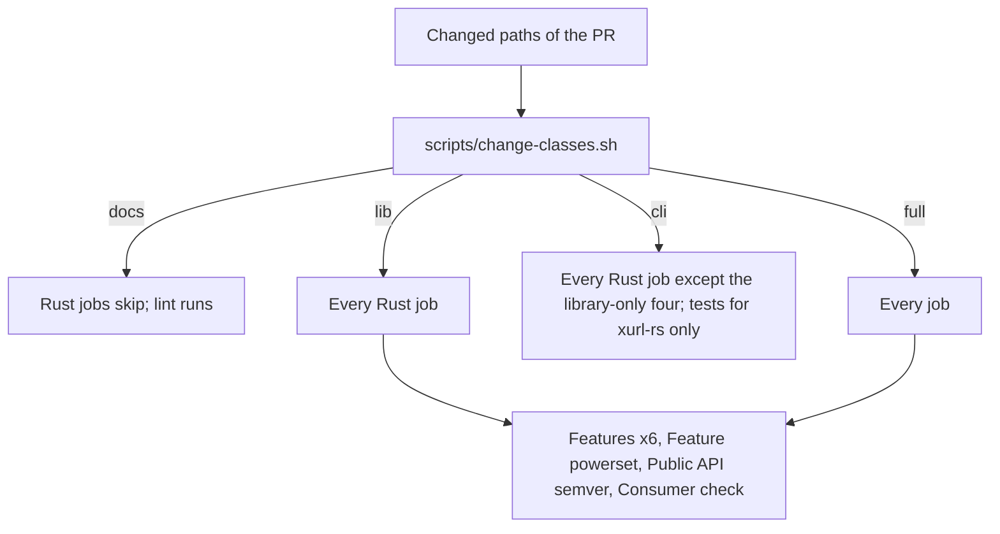
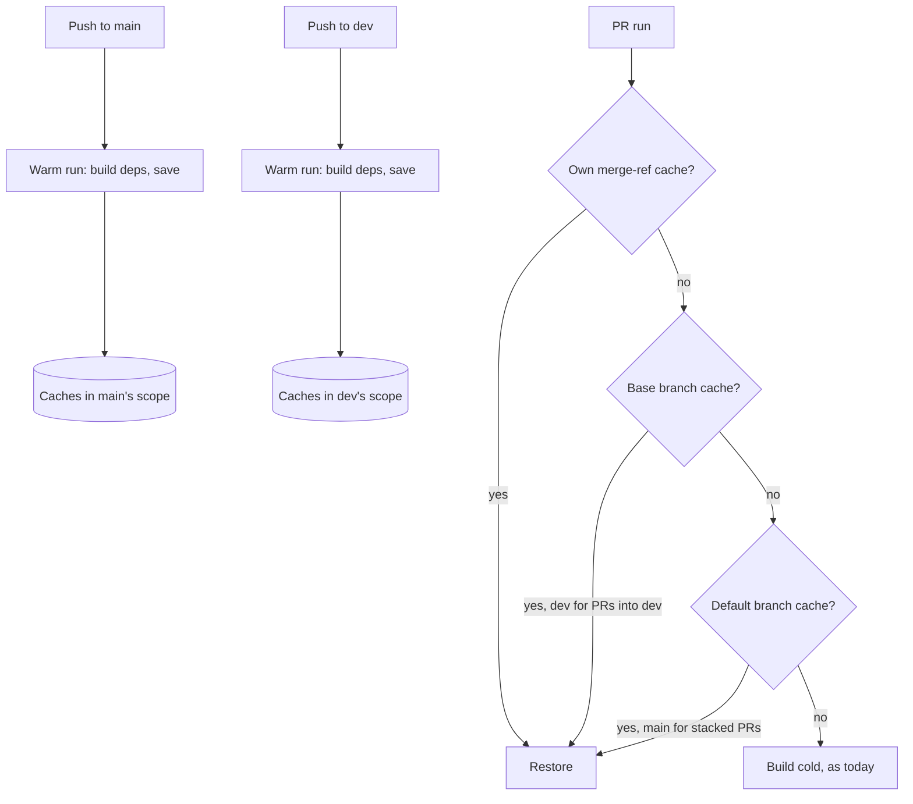
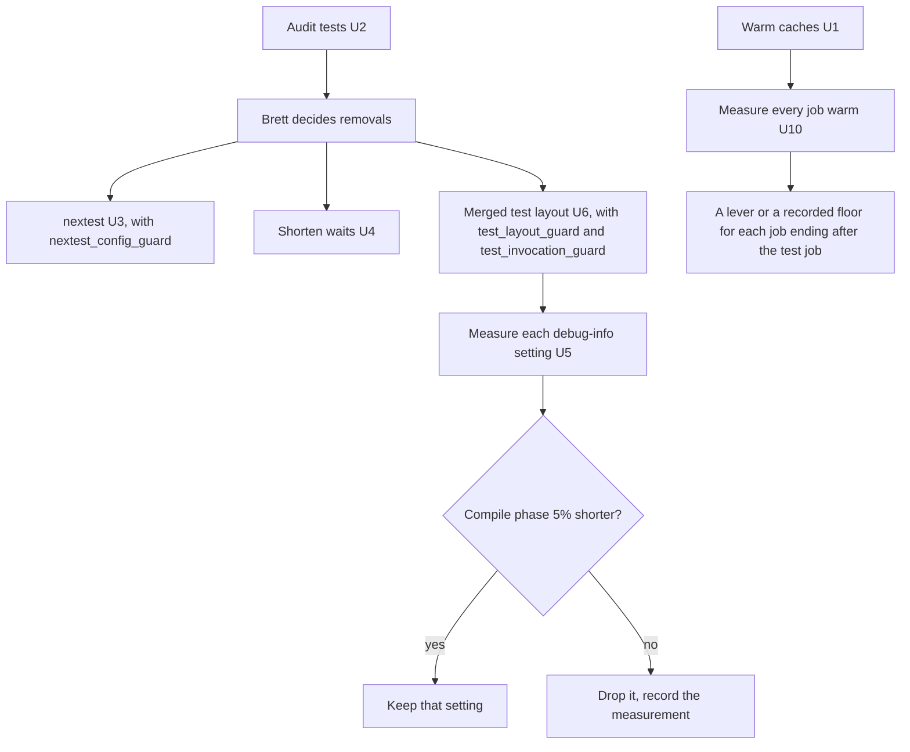

# CI Scoping and Speed - Plan

**Target repo:** brettdavies/xurl-rs. Paths are in it unless prefixed `brettdavies/.github:`. **Base:** `dev`.

## Goal Capsule

- **Objective:** a pull request's CI verdict arrives within 3 minutes on warm caches, fewer runs fail on downloads,
  every required check still reports on every PR, no change skips a check that could have caught it, and no speed
  measure can silently drop a test.
- **Means:** warm dependency caches written by push runs on `dev` and `main` (KTD2), a faster test job after an audit of
  what its tests spend time on (KTD4 to KTD8), guards on every measure that could lose a test or hide a failure (R13),
  every other job held to the same budget (KTD13), and change classes that skip the jobs a change's paths cannot affect
  (KTD9, KTD10).
- **Authority:** R-IDs win on behavior and KTDs on mechanism; a unit overrides neither.
  `docs/solutions/conventions/ci-triggers-once-per-change-under-squash-merges.md` governs CI triggers except where KD1
  adds warm-only push runs.
- **Execution profile:** inline in one session, no subagents or worktrees, long jobs in the background. Shared-workflow
  changes land as PRs to `brettdavies/.github` before the xurl-rs PR that opts in; xurl-rs changes go on `feat/`/`fix/`
  branches to `dev`.
- **Stop conditions:**
  - A required check would stop reporting on a PR.
  - A change class would skip a job its paths can affect.
  - The test audit proposes removing or weakening a test (stop for Brett's call on that test).
  - A lever measures below its keep-threshold (drop it, record why).
- **Who ships:** Brett merges every PR in both repos and applies any ruleset change.

---

## Product Contract

### Summary

CI on xurl-rs gets faster in three parts. PRs start from dependency caches that push runs on `dev` and `main` keep warm.
The test job builds and runs faster after an audit of where its time goes. Jobs a change's paths cannot affect skip,
reporting success so required checks keep passing.

### Problem Frame

Every PR that touches more than docs runs about twenty-five jobs, and each starts cold. CI runs on `pull_request` only,
so a run's caches live on its merge ref, where no other PR can restore them, and nothing writes a cache every PR can
read. Each cold job downloads the 301 registry crates in `Cargo.lock` and builds them again. crates.io's intermittent
`Error in the HTTP2 framing layer` failed ten checks during the 23-PR command-families stack, and every failure meant a
rerun. The repository's 46 caches total 11.8 GiB against GitHub's 10 GB budget, so least-recently-used eviction removes
even a PR's own cache.

The test job is the long pole. In 29 of the last 30 successful runs it restored no cache and took 4.7 to 9 minutes,
depending on the runner; six of them sampled spent 45 to 82 s in clippy and 97 to 177 s compiling the tests, and running
them took about 2.5 to 3 minutes. The one warm run took 4.5 minutes: clippy 16 s, compiling 77 s, running about 148 s
(Appendix). The compile links 101 integration-test binaries (58 in `crates/xurl-cli/tests`, 43 in `crates/xdk/tests`).
`cargo test` runs those binaries one at a time, and four of them hold 120 s of the 160 s spent inside binaries, mostly
waiting: real retry backoff, real timeouts, a per-command walk, and a script run twelve times.

Path scoping alone would help fewer PRs than it seems. Of the last 80 commits on `dev`, 41 touched both crates, 12 only
docs (which already skip), 7 only the library, 6 only the CLI, and about 14 workflows, dependencies, or scripts. Speed
helps every PR; scoping helps only the CLI-only ones, because a library change can break the CLI and so runs every Rust
job (KTD10).

### Requirements

**Warm start**

- R1. A PR's jobs restore dependency caches written from the latest `dev` or `main` tree whenever the toolchain and
  lockfile match, so a first run does not rebuild the dependency graph.
- R2. A PR whose lockfile or toolchain differs from `dev` and `main` still runs, building what it lacks, as today.

**Faster checks**

- R3. The test job's wall-clock on a warm cache drops to about half of today's warm run: 2 m 15 s or less, from about
  4.5 minutes.
- R4. No test is removed, skipped, or weakened for speed without Brett approving that specific test.
- R5. Doc tests keep running on every PR that runs tests.
- R12. On warm caches, a PR's last check finishes within 3 minutes of the run's start, so no other job gives back what
  the test job gains.
- R13. Guards hold every speed measure that could silently drop a test or hide a failure: an undeclared test file, a
  retried flaky test, a command naming a test target that no longer exists.

**Scoping**

- R6. Each job runs when the PR's changed paths can affect its verdict and is skipped otherwise; a skipped required
  check reports success.
- R7. A path outside every known class, and any change to a workflow, the classifier, or a build input (`Cargo.toml`,
  `Cargo.lock`, `rust-toolchain.toml`, `.cargo/`, `deny.toml`), runs every job.
- R8. The pre-push hook and CI classify a change with one shared classifier, so their verdicts agree.
- R9. Repositories that call the shared reusable workflows see no change in behavior unless they opt in.

**Records**

- R10. AGENTS.md, RELEASES.md, CONTRIBUTING.md, and the workflow comments describe the warm runs, the test runner, the
  test layout and its guards, and the scoping as built.
- R11. The set of required checks stays as it is; a check renamed by this work is a ruleset change Brett applies.

### Key Decisions

- KD1. **Warm caches come from push runs on `dev` and `main` that build only dependencies.** (session-settled:
  user-approved — chosen over keeping CI strictly pull_request-only with cold starts: a run that only builds
  dependencies re-checks nothing, so the convention's no-duplicate-check reason does not apply.) Governs R1, R2.
- KD2. **Wall-clock speed is in scope, and the tests' validity is audited before they run in parallel or in subsets.**
  (session-settled: user-directed — chosen over a scoping-only plan: Brett asked for "a faster PR" and to "spike the
  validity of the tests themselves, prior to running in parallel".) Governs R3, R4.
- KD3. **The shared reusable workflow gains opt-in inputs, defaulting to today's behavior.** (session-settled:
  user-approved — chosen over scoping only this repo's own jobs: the test job lives in the reusable.) Governs R6, R9.
- KD4. **An unclassified path, or a change to a workflow or the classifier, runs every job.** (session-settled:
  user-approved — chosen over scoping CI edits: a CI edit must not skip the jobs it can break.) Governs R7.

### Success Criteria

- The test job (`ci / Fmt, clippy, test`) on a warm cache finishes in 2 m 15 s or less, from about 4.5 minutes warm and
  4.7 to 9 cold (Appendix).
- Within that budget, about 40 s goes to setup, formatting, and clippy, so compiling the tests takes 50 s or less (from
  77 s) and running them 40 s or less (from about 148 s).
- On warm caches, a PR's last check finishes within 3 minutes of the run's start. In the warm baseline run the jobs
  after the test job were `Windows program target` (270 s), `Agent-native audit` (189 s), `Windows check` (154 s), and
  `Completions freshness` (112 s); in the cold one the audit took 355 s and completions 251 s.
- A PR's first run, with no cache of its own, compiles no dependency crate when `dev` has a matching warm cache.
- Every guard named in KTD4 and KTD8 fails on a seeded violation and passes on the repo as merged.
- A CLI-only PR shows the nine library-only checks as skipped, and every required check passes.
- No test fails intermittently under the new runner across the PRs that roll it out.

### Scope Boundaries

- Which checks are required does not change (R11).
- Other repositories' CI changes only if they opt in (R9).
- The jobs that take seconds are not scoped: the security audits, lint, shellcheck, `Change scope`, and the changelog
  workflow's surface check.
- Considered and not built:
  - **A faster linker.** Rust 1.90 made `rust-lld` the default on `x86_64-unknown-linux-gnu`, and the pin is 1.96, so
    `mold` would gain little. Revisit if a compile profile after U5 shows linking dominated even with `lld`.
  - **`CARGO_HTTP_MULTIPLEXING` in `ci.yml`** (KTD12).
  - **Splitting the crates further.** With CI's flags at 4 jobs, the library builds in 4 s and the CLI crate in 9 s,
    while the integration-test targets take 133 s of build time, about 33 of the 45 s the workspace takes once
    dependencies are built (Appendix). More crates would not shorten that; fewer test targets would (U6). Revisit if,
    after U6, compiling the workspace crates themselves dominates.
  - **Finer job scoping** (for example, `Windows program target` only on webhook-program paths). Four coarse classes are
    easier to keep correct; revisit if a measured job still runs often without cause.

#### Deferred to Follow-Up Work

- Sharding tests across runners with `cargo nextest run --partition` and an archive: only if the test-running phase
  stays above 40 s after U3 and U4.
- A weekly scheduled warm run on `main`: only if stacked PRs, which restore from `main`, keep missing after its entries
  expire.

### Open Questions

- Deferred to U4: the exact seam that lets in-process tests shorten the forwarder's retry schedule while production
  keeps its defaults (constraints in KTD6).
- Deferred to Brett, only if eviction thrash appears: raising the repository's cache budget above 10 GB, which GitHub
  bills.

---

## Planning Contract

### Key Technical Decisions

- KTD1. **Speed first, scoping second.** Scoping helps about one PR in thirteen, the CLI-only ones (Problem Frame); a
  warm cache and a faster test job help every PR. Units run warm start, then the audit and test speed, then scoping.
- KTD2. **Warm through the CI workflow itself, not a separate warm workflow.** `ci.yml` gains `push` on `dev` and `main`
  (and `workflow_dispatch`) and passes the reusable a `warm_cache` flag on push. Each caching job then builds its
  dependencies and runs no check. Because the push run uses the same job ids, `key` inputs, environment, and toolchain
  as a PR run, `Swatinem/rust-cache` derives the same keys by construction; a separate workflow would have to copy every
  job's key inputs by hand and drift. GitHub lets a PR run restore from its own ref, its base branch, and the default
  branch, and only `push`, `schedule`, and dispatch runs can write those scopes
  (`docs.github.com/en/actions/reference/workflows-and-actions/dependency-caching`).
- KTD3. **PR runs keep saving their caches.** `Swatinem/rust-cache` saves nothing after restoring an exact match (the
  warm run in the Appendix logged `Cache up-to-date.`), so a PR whose lockfile and toolchain match `dev` writes no
  entry. Only a PR that changes them saves its own set, and #408's `cache-on-failure` keeps that useful. One full set of
  this repo's caches is about 4.3 GiB (Appendix), so the `dev` and `main` warm sets hold about 8.7 GiB of the 10 GB
  budget, and a PR that saves its own set evicts the least recently used entries, likely `main`'s. U1 reads
  `gh cache list` after the first PR that changes `Cargo.lock`: if a current warm entry was evicted, PR runs stop saving
  (`save-if` on non-PR events).
- KTD4. **cargo-nextest runs the tests, behind an opt-in reusable input.** It runs every test in its own process across
  all binaries at once, where `cargo test` runs binaries one at a time. It does not run doc tests, so the job adds
  `cargo test --doc` (R5). The CI profile in `.config/nextest.toml` sets `retries = 1` with `flaky-result = "fail"`
  (nextest 0.9.131 and later): a failed test runs once more, and a test that passes only on the rerun still fails the
  run, labeled flaky, so the log says whether to hunt a race or a break (R2 in the Decision ledger). It also sets a
  `slow-timeout` that names slow tests and ends hung ones, sized so `period` × `terminate-after` × 2 plus the build
  stays under the test job's 20-minute `timeout-minutes`, or the runner would kill the job before nextest names the hung
  test. The suite mostly waits rather than computes, so U3 measures `test-threads` at one per CPU against twice that and
  keeps the faster setting that stays green. The pre-push hook requires nextest and stops at once with the install
  command when it is missing, so a local run and CI run the tests the same way; plain `cargo test` still passes (KTD8
  keeps it correct) but is not the documented path. `nextest_config_guard` fails when a profile sets `retries` above 0
  without `flaky-result = "fail"`, or drops the slow-timeout's termination (R13).
- KTD5. **Audit before parallelizing.** The `test-audit` skill finds duplicate and low-value tests across both crates,
  and the per-binary times in the Appendix give each one's cost. Removals go to Brett test by test (R4, KD2).
- KTD6. **Shorten real waits through seams, keeping production defaults.** A wait the tests sit through (the forward
  retry schedule in `crates/xdk/src/webhooks/budget.rs`, timeouts set by test flags) becomes a value the in-process
  runner can set. There is no new environment variable outside the list AGENTS.md § "Where a change goes" names, and no
  public CLI flag that exists only for tests; library-first placement applies. A test that walks commands serially runs
  them concurrently within the test. Assertions do not change (R4).
- KTD7. **Lighter debug info for test builds, each setting kept on measurement.** Two candidates, measured separately on
  the merged layout (KTD8): line-tables-only debug info for the workspace's test builds (backtraces keep file and line),
  and no debug info for dependencies in test builds. Keep each that shortens the compile phase by 5% or more.
- KTD8. **Cargo's multi-file test layout: one test binary per crate, plus one for tests that change process state.**
  - Cargo documents a multi-file integration test as `tests/<name>/main.rs` with its modules beside it, and Cargo's own
    suite runs as one binary (`tests/testsuite/main.rs`). Each crate's test files move with `git mv` into `tests/all/`
    as modules of one binary, with `autotests` left on, so the layout stays Cargo's default discovery.
  - Tests that change process state go in `tests/isolated/`, a second binary: every test on `env_mutation_guard`'s
    allowlist and every test whose failure aborts the process (`parse_stack_tests`). Under a plain `cargo test` none of
    them can reach or end the rest of the crate's run. The shared `common` module serves both binaries.
  - `mock_endpoint_coverage`, which needs the `testing` feature, becomes a `#[cfg(feature = "testing")]` module. The
    consumer check's single test file stays as it is.
  - The measured split (Appendix) puts the integration-test targets at most of the workspace's compile, so the move is
    not gated; U6 records the gain with `cargo test --no-run --timings` before and after.
  - Cargo and rustc are silent about the two ways this layout fails: a file under `tests/all/` or `tests/isolated/` that
    no `mod` line declares is never compiled, and a new top-level `tests/*.rs` file becomes its own binary again. Two
    guards close them (R13). `test_layout_guard` fails for an undeclared module file, for a `.rs` file directly under a
    member's `tests/`, and for an allowlisted environment-mutating test outside `tests/isolated/`. It reads the same
    allowlist `env_mutation_guard` does, moved into `common` so the list has one owner. `test_invocation_guard` fails
    for a `cargo test --test <name>` or nextest filter that names no real test target or, with a `<module>::` filter, no
    real module. It scans the live surfaces: `.github/workflows/`, `scripts/` (the hooks included),
    `.config/nextest.toml` (every override and test-group filter), AGENTS.md, CONTRIBUTING.md, `RELEASES*.md`,
    KNOWN_DIFFERENCES.md, and the READMEs. Planning docs, `docs/solutions/`, and changelogs record history (18 plans
    name `--test` targets today) and are not scanned.
  - The guards that read the tests directory by path (`recipe_guard`, `store_isolation_guard`, `env_mutation_guard`,
    `cargo_inputs_tests`) follow the new paths, and AGENTS.md's file references move with them.
- KTD9. **Four change classes from one classifier.** `scripts/change-classes.sh` reads changed paths and names the
  classes they reach, using `scripts/cargo-inputs.sh` for the docs verdict:
  - `docs`: nothing reaches cargo.
  - `lib`: `crates/xdk/`, plus every path outside it that the library's Rust source names in a string literal. Today
    those are `endpoint-decisions.json` and `crates/xurl-cli/README.md`, which `endpoint_decisions.rs`,
    `readme_stability_tests.rs`, and `readme_landing_tests.rs` read. The list is collected from the source on every run,
    as `scripts/cargo-inputs.sh` collects document names, so a library test that starts reading a file is covered the
    day it lands.
  - `cli`: `crates/xurl-cli/`, `completions/`, `schema/`, `.anc.toml`. A path can be both `cli` and `lib`.
  - `full`: everything else, including a document Rust source reads from outside `crates/` (its reader is not known),
    workflows, scripts, the classifier, and build inputs. Both the pre-push hook and the `Change scope` job call it
    (R8).
- KTD10. **Which jobs each class runs.** Owned by the job conditions in `ci.yml` and the reusable inputs.
  - Library-only jobs run on `lib` or `full`: `Features` (six cells), `Feature powerset`, `Public API semver`,
    `Consumer check`.
  - Every other Rust job runs on `lib`, `cli`, or `full`, because the CLI depends on the library.
  - On a CLI-only change, the test job tests only `xurl-rs`, so the library's 43 test binaries neither build nor run.
  - The matrix keeps its job-level `if: !cancelled()` and skips steps, since a matrix skipped whole never expands and
    its required cells would wait forever.
- KTD11. **The reusable gains three inputs and no more, in one PR that lands before U1:** `warm_cache` (KTD2),
  `test_runner` (`cargo` or `nextest`, KTD4), and `test_packages` (KTD10). Each defaults to today's behavior (KD3), so
  landing them together changes no caller, and every xurl-rs unit after it opts in without another cross-repo wait (R1
  in the Decision ledger).
- KTD12. **`ci.yml` sets no `CARGO_HTTP_MULTIPLEXING`.** (session-settled: user-directed — chosen over setting it on
  xurl-rs's own jobs: Brett declined it.) Conflict call-out: `brettdavies/.github#100` (2026-10-27) sets
  `CARGO_HTTP_MULTIPLEXING: "false"` in every reusable job, citing the same curl error 16. xurl-rs's own jobs still
  download over HTTP/2, and six of the ten stack failures were in them (`Doc build`, four `Features` cells,
  `Windows program target`). U1 cuts their downloads; if those jobs keep failing on downloads after U1, the decision is
  worth revisiting.
- KTD13. **The verdict is the slowest job, so every job is held to R12.** With the test job at 2 m 15 s, the run ends
  when its slowest other job does (Success Criteria). U10 measures every job warm after U1 and gives each one that ends
  after the test job a lever of its own or a recorded floor. `Completions freshness` builds the release binary (fat LTO,
  one codegen unit, 88 s even with a full cache hit) only to print completions, which clap renders the same from a dev
  build. `Agent-native audit` keeps its release build, because the size ceiling measures the shipped profile. The two
  Windows jobs restored no cache in the baseline, so U1 is their first lever.

### High-Level Technical Design

Change classes and the jobs they run (KTD9, KTD10):



Where a warm cache comes from and where a PR finds it (KTD2, KTD3):



The test-speed levers and the guards that hold them (KTD4 to KTD8, KTD13):



### Risks & Dependencies

| Risk                                                                                                  | Decision                                                                                                                                                             |
| ----------------------------------------------------------------------------------------------------- | -------------------------------------------------------------------------------------------------------------------------------------------------------------------- |
| A warm run's cache key differs from a PR run's, so nothing restores                                   | Same job ids, inputs, and environment by construction (KTD2); U1's verification reads the PR test job's log for dependency compilation                               |
| Warm entries push the repository past 10 GB and eviction thrashes                                     | The two warm sets hold about 8.7 GiB, and PR runs that match one save nothing; U1's check after the first lockfile change decides whether PR runs stop saving (KTD3) |
| Push runs spend Actions minutes, the convention doc's main concern                                    | Accepted: the repository is public, so standard GitHub-hosted runners cost nothing; pushes to `dev` and `main` are a few a day                                       |
| Running tests in parallel exposes tests that depend on each other or on a shared port or file         | A test that fails only some of the time is labeled flaky and still fails the run; each is fixed or put in a nextest test group, never retried into silence (KTD4)    |
| A change class skips a job that the change can break                                                  | Unknown paths, workflows, and the classifier run everything (KD4); paths the library's source names are `lib` (KTD9); U7's fixture holds every rule                  |
| A reusable change alters other repositories' runs                                                     | Every new input defaults to today's behavior (KD3); the reusable merges before xurl-rs opts in                                                                       |
| A shared-workflow PR in `brettdavies/.github` waits on review                                         | One PR carries all three inputs and lands first (KTD11), so only U1 waits on it; U2, U4, U5, U6, and U7 proceed meanwhile                                            |
| A test file under the merged layout is never compiled because no `mod` line declares it               | `test_layout_guard` fails naming the file (KTD8)                                                                                                                     |
| A flaky test passes on a retry and hides                                                              | `flaky-result = "fail"` fails it, and `nextest_config_guard` refuses any retry without that setting (KTD4)                                                           |
| A workflow, script, or document runs a test target the move renamed                                   | `test_invocation_guard` fails naming the command (KTD8)                                                                                                              |
| An environment-mutating or aborting test reaches the rest of a merged binary under plain `cargo test` | Those tests live in `tests/isolated/`, and `test_layout_guard` keeps them there (KTD8)                                                                               |
| The test job gets fast and the run still waits on a slower job                                        | U10 holds every job to R12 (KTD13)                                                                                                                                   |

### Sequencing

The shared-workflow PR lands first (KTD11). U1 follows: it helps every later run, and U10 follows it because it measures
warm jobs. U2 precedes U3, U4, and U6 (KD2), so no test is moved or parallelized before the audit settles which stay. U6
precedes U5, which measures debug info on the merged layout. U7 and U8 add scoping. U9 records the result.

The PRs, by repository, in merge order:

1. `brettdavies/.github`: the `warm_cache`, `test_runner`, and `test_packages` inputs, each defaulting to today's
   behavior, and every `dtolnay/rust-toolchain` use pinned to a commit SHA (T1 in the Decision ledger).
2. xurl-rs U1: push triggers and warm mode.
3. xurl-rs U2: no code; its findings go to Brett, and each removal he approves lands as its own PR.
4. xurl-rs U3: nextest, its config and guard, the pre-push hook, and the pinned installs.
5. xurl-rs U4: shorter waits.
6. xurl-rs U6: the merged test layout and its two guards.
7. xurl-rs U5: each debug-info setting kept on measurement, or none.
8. xurl-rs U7: the classifier.
9. xurl-rs U8: job conditions and the `test_packages` opt-in.
10. `brettdavies/agent-skills`: the completions template builds a dev binary.
11. xurl-rs U10: the completions script derived again, and the other jobs' levers.
12. xurl-rs U9: the docs.

Each xurl-rs PR targets `dev`, stacked on the one before it where it depends on it; Brett merges every PR.

---

## Implementation Units

### U1. Warm dependency caches from push runs

- **Goal:** PRs into `dev`, and stacked PRs, restore dependencies built by push runs instead of building them cold.
- **Requirements:** R1, R2, R9, R11; KD1, KTD2, KTD3, KTD11.
- **Dependencies:** none.
- **Files:**
  - `brettdavies/.github: .github/workflows/rust-ci.yml`: the `warm_cache` input, in the shared-workflow PR that carries
    all three inputs (KTD11).
  - `.github/workflows/ci.yml`: the triggers, the flag, and warm-mode steps in xurl-rs's own caching jobs.
- **Approach:**
  1. In the reusable, `warm_cache: true` makes each caching job compile its dependencies (a build of the targets it
     checks, with no test run, lint gate, or package check) and skip its checks; the default is `false`.
  2. In `ci.yml`, add `push` on `dev` and `main` and `workflow_dispatch`. Pass
     `warm_cache: ${{ github.event_name != 'pull_request' }}` to the reusable.
  3. Give each of the nine local rust-cache jobs a warm mode that runs the job's own build command with execution
     switched off: `--no-run` on a test command, and `cargo check` with the same target and feature flags in place of
     `cargo clippy`. The flags come from the same variable or step the check uses, so the cached set cannot drift from
     what the check compiles; `Swatinem/rust-cache` skips saving after an exact-key restore (KTD3), so a narrower warm
     entry would never be refilled while the lockfile holds. Gate the check steps on `pull_request`. Push runs save only
     on success: `cache-on-failure` applies to PR runs alone, so a warm run that fails partway leaves no partial entry
     under the exact key. The jobs that cache nothing (`lint`, `Output discipline`, `Public API semver`) and the
     reusable's security audit skip on push; `Change scope` answers "everything" there.
  4. Rewrite the header comment of `ci.yml`, which explains pull_request-only, to describe the warm runs (KD1).
- **Patterns to follow:** the reusable's existing opt-in inputs (`docs`, `msrv`, `cross_os_tests`), each defaulting to
  `false`; the `docs_only` skip.
- **Test scenarios:**
  - A push to `dev` runs every caching job in warm mode: each saves a cache, and no test, clippy, or audit result is
    reported.
  - A PR opened against `dev` right after that push restores in every caching job. The test job's log shows no
    `Compiling` line for a registry crate.
  - A PR that changes `Cargo.lock` restores the warm entry's partial match and compiles only the changed dependencies.
    After it saves its own set, `gh cache list` still holds the current `dev` and `main` warm entries, or PR runs stop
    saving (KTD3).
  - A stacked PR whose base is a feature branch restores from `main`'s warm entries when they exist.
  - A caller of the reusable that passes no `warm_cache` input sees the same jobs and steps as before.
  - A warm run that fails partway saves nothing, and the next push to `dev` builds and saves the full set.
- **Verification:** two consecutive PRs after the first warm run show restored caches and no dependency compilation in
  the test job; the reusable's own CI passes; actionlint passes.

### U2. Audit the test suites before changing how they run

- **Goal:** know which tests are duplicate, low-value, or slow, and what each costs, before parallelizing or subsetting
  them.
- **Requirements:** R4; KD2, KTD5.
- **Dependencies:** none.
- **Files:** findings go in the PR or issue that carries them to Brett; a removal Brett approves lands as its own PR
  touching `crates/*/tests/`.
- **Approach:**
  1. Run the `test-audit` skill over `crates/xdk/tests` and `crates/xurl-cli/tests`.
  2. Run the `optimize-builds-and-tests` detector for build-side patterns.
  3. Join the findings with the per-binary times (Appendix).
  4. For each of the four slow binaries, name what its time is spent on.
  5. Present the findings; remove nothing without Brett's per-test approval.
- **Execution note:** a spike; its output is a decision list, not code, unless Brett approves removals.
- **Test expectation:** none -- an audit; any approved removal is verified by the suite still passing and the removed
  test's coverage named elsewhere.
- **Verification:** Brett has the findings with costs and has decided each proposed removal.

### U3. Run the tests with nextest

- **Goal:** tests run in parallel, each in its own process, the same way locally and in CI.
- **Requirements:** R3, R5, R9, R13; KTD4, KTD11.
- **Dependencies:** U2.
- **Files:**
  - `brettdavies/.github: .github/workflows/rust-ci.yml`: the `test_runner` input and the nextest install, landed with
    the shared-workflow PR (KTD11).
  - `.github/workflows/ci.yml`: opts in.
  - `.config/nextest.toml`: the `default` and `ci` profiles.
  - `crates/xurl-cli/tests/nextest_config_guard.rs`, new (a module of `tests/all/` once U6 lands).
  - `scripts/hooks/pre-push`: runs nextest and stops with the install command when it is missing.
  - `CONTRIBUTING.md` and AGENTS.md § "Testing": nextest as the documented runner.
- **Approach:**
  1. With `test_runner: nextest`, the reusable's test job installs `cargo-nextest@<version>` by
     `cargo binstall --force`, with the SHA-pinned binstall action the repo already uses, at an exact version released
     at least 7 days earlier. It then runs `cargo nextest run` with the `ci` profile and `cargo test --doc`. The same PR
     pins `cargo-hack`, which `ci.yml` installs today with no version, the way `anc` is pinned (`ANC_VERSION`).
     `.config/nextest.toml` sets `nextest-version` to the pinned version as its minimum, so an older local nextest stops
     at once with nextest's own message.
  2. Tests that cannot share a machine concurrently go in a nextest test group with limited concurrency rather than
     serial runs of everything. Which tests need it is found while rolling out.
  3. Measure the run phase with `test-threads` at one per CPU and at twice that, on the same warm cache, and keep the
     faster setting that stays green across the rollout PRs.
  4. `nextest_config_guard` parses `.config/nextest.toml` and fails, naming the profile and key, when any profile sets
     `retries` above 0 without `flaky-result = "fail"`, or a slow-timeout without `terminate-after`.
- **Patterns to follow:** the `cargo binstall ... --force` install steps in `ci.yml` (`cargo-hack`, `anc`); a guard that
  reads repo files and names the offending entry (`env_mutation_guard`), without the `Cause:` marker `recipe_guard`
  reserves for the family recipe.
- **Test scenarios:**
  - A PR runs the full suite under nextest with the same test count as `cargo test`, and doc tests still run.
  - A deliberately failing test fails the job and is named in the summary; it is not retried.
  - A test that hangs past the slow timeout is terminated and named.
  - The pre-push hook passes with nextest installed and stops, naming the install command, without it.
  - `nextest_config_guard` fails on a seeded `retries = 1` with no `flaky-result = "fail"` and on a slow-timeout with no
    `terminate-after`.
  - A seeded test that fails on its first run and passes on its second fails the job, labeled flaky.
- **Verification:** the test count matches `cargo test`; the test-running phase falls from about 148 s toward 40 s; no
  test fails intermittently across the rollout PRs; the guard fails on both seeded violations.

### U4. Shorten the real waits in the slowest tests

- **Goal:** `webhooks_forward_tests`, `dry_run_guard`, `surface_bump_tests`, and `webhooks_program_tests` stop spending
  their time waiting.
- **Requirements:** R3, R4; KTD6.
- **Dependencies:** U2.
- **Files:**
  - `crates/xdk/src/webhooks/budget.rs`: the forward retry schedule.
  - `crates/xurl-cli/src/cli/runner.rs` or the in-process overrides it takes: the seam tests set.
  - The four test files in `crates/xurl-cli/tests/`.
  - `scripts/check-surface-bump.sh`, if its per-run cost is in the script.
- **Approach:**
  1. Make the retry schedule's first wait and the attempt timeout values the in-process runner can override, keeping
     production defaults.
  2. `dry_run_guard` runs its per-command checks concurrently with a bound.
  3. `surface_bump_tests` gets the cause U2 names (setup shared across runs, or runs concurrent).
  4. Each test keeps its assertions.
- **Execution note:** keep each test's assertions byte-identical, and compare its pass and fail behavior before and
  after on a deliberately broken input.
- **Patterns to follow:** explicit path and value injection over environment mutation (`run_with_store_path`,
  `EnvOverrides`).
- **Test scenarios:**
  - The forward test that expects four attempts still sees four, with the schedule shortened.
  - A forward timeout test still reports the timeout reason, with the short timeout.
  - `dry_run_guard` still fails, naming the command, when one command's dry run sends a request.
  - Production `xr webhooks listen --forward` keeps its documented retry schedule.
  - `surface_bump_tests` still fails for a schema change with no minor section.
- **Verification:** each of the four binaries finishes in a few seconds; the guards fail on a seeded violation;
  production defaults are unchanged.

### U5. Lighter debug info for test builds

- **Goal:** the test compile phase gets shorter without losing file-and-line backtraces.
- **Requirements:** R3; KTD7.
- **Dependencies:** U6.
- **Files:** `Cargo.toml` (`[profile.test]` and a dependency override for it), or the reusable's test step environment
  if the profile cannot reach it.
- **Approach:** on the merged layout and the same warm cache, measure the compile phase with each candidate alone:
  line-tables-only debug info for the workspace's test builds, and no debug info for dependencies in test builds. Keep
  each that shortens the phase by 5% or more.
- **Test expectation:** none -- a build setting; the suite's pass state is the check.
- **Verification:** each kept setting's measurement is recorded, and a panicking test still prints its file and line;
  each dropped setting has its measurement recorded.

### U6. Cargo's multi-file test layout, held by guards

- **Goal:** each crate's integration tests build as one binary, plus one for tests that change process state, with
  guards that keep any test from going uncompiled or any command from naming a target that moved.
- **Requirements:** R3, R4, R10, R13; KTD8.
- **Dependencies:** U2.
- **Files:**
  - `crates/xdk/tests/` and `crates/xurl-cli/tests/`: each file moves with `git mv` into `tests/all/` or
    `tests/isolated/`, each with a `main.rs` declaring its modules; `common/` serves both.
  - `crates/xdk/Cargo.toml`: the `mock_endpoint_coverage` target entry goes, replaced by a feature-gated module.
  - `crates/xurl-cli/tests/all/test_layout_guard.rs` and `test_invocation_guard.rs`, new.
  - `recipe_guard`, `store_isolation_guard`, `env_mutation_guard`, and `cargo_inputs_tests`: as their path reads
    require.
  - Every `--test <name>` command: `.github/workflows/ci.yml` (three), AGENTS.md (the golden refresh command),
    CONTRIBUTING.md (Go parity), `scripts/update-types.sh`, and `scripts/release/preflight.sh` (the live smoke run).
  - AGENTS.md § "Adding a command family" and § "Testing", where they name test files by path.
- **Approach:**
  1. Record `cargo test --no-run --timings` and the sorted list of every test, qualified by its file, before the move.
  2. Move the files: environment-mutating tests on the allowlist and `parse_stack_tests` into `tests/isolated/`,
     everything else into `tests/all/`. Split a file only where it mixes the two, keeping each test's name. The five
     relative paths in the library's tests (`#[path = "../codegen/..."]` in `spec_validation.rs`, `streaming_table.rs`,
     and `vocabulary_table.rs`; `include_str!("fixtures/...")` in `yaml_compat_tests.rs`) gain a `../` for the new
     depth.
  3. Write `test_layout_guard` and `test_invocation_guard` (KTD8), each failing with the file or command, why it
     matters, and the fix, and name both in AGENTS.md § "Testing". They avoid the `Cause:` marker, which `recipe_guard`
     reserves for the command-family recipe's walks.
  4. Update every command and document that names a test target or a test file's path.
  5. Record the timings and the test list again.
- **Execution note:** the move must keep every test: compare the before and after lists, mapping each file to its
  module, and they must match one for one. Commit the moves apart from the edits so `git log --follow` keeps each file's
  history.
- **Test scenarios:**
  - The before and after test lists match one for one.
  - `test_layout_guard` fails for a seeded undeclared file in `tests/all/`, for a seeded `tests/stray.rs`, and for an
    allowlisted environment-mutating test moved into `tests/all/`.
  - `test_invocation_guard` fails for a seeded `cargo test --test golden_tests` in a document and for a filter naming a
    module that does not exist.
  - `store_isolation_guard` still fails on a test module that names `TokenStore::new()`; `recipe_guard` still finds
    every walk AGENTS.md names.
  - `cargo test -p xdk-rs --features testing` still runs `mock_endpoint_coverage`, and a build without the feature skips
    it.
  - A plain `cargo test` passes, with the environment-mutating tests running in their own binary.
- **Verification:** the test lists match; each guard fails on its seeded violations and passes on the moved tree; the
  compile phase drop is recorded from the two timing runs.

### U7. Classify changes into four classes

- **Goal:** one classifier names the classes a change reaches, for CI and the pre-push hook alike.
- **Requirements:** R6, R7, R8; KD4, KTD9.
- **Dependencies:** none.
- **Files:**
  - `scripts/change-classes.sh`, new.
  - `crates/xurl-cli/tests/change_classes_tests.rs`, new.
  - `crates/xurl-cli/tests/fixtures/change_classes/paths.tsv`, new.
- **Approach:** read paths on stdin and print the classes reached, one per line, using `scripts/cargo-inputs.sh` for the
  docs verdict. Any path no rule names is `full`; the script itself, `scripts/cargo-inputs.sh`, and `.github/` are
  `full` (KD4).
- **Patterns to follow:** `crates/xurl-cli/tests/cargo_inputs_tests.rs` and its TSV fixture.
- **Test scenarios:**
  - `crates/xdk/src/api/shortcuts.rs` alone gives `lib`.
  - `crates/xurl-cli/src/cli/mod.rs` alone gives `cli`.
  - `endpoint-decisions.json` gives `lib`; `.anc.toml`, `completions/xr.zsh`, and `schema/responses/posts.schema.json`
    give `cli`.
  - `crates/xurl-cli/README.md` gives `cli` and `lib`, because library tests read it.
  - A library path and a CLI path together give `lib` and `cli`.
  - `README.md` (read by a Rust test) gives `full`; `docs/plans/x.md` gives nothing (docs only).
  - `Cargo.lock`, `.github/workflows/ci.yml`, `scripts/change-classes.sh`, and a path in a new top-level directory each
    give `full`.
  - Empty input gives nothing, and the docs-only verdict matches `scripts/cargo-inputs.sh`.
- **Verification:** the fixture covers every rule and the unknown-path fallback; shellcheck passes.

### U8. Run each job only for the classes that can affect it

- **Goal:** a CLI-only PR skips the library-only checks and the library's tests, with every required check passing.
- **Requirements:** R6, R7, R8, R9, R11; KTD10, KTD11.
- **Dependencies:** U7, and U3 for the `test_packages` input to apply to nextest.
- **Files:**
  - `.github/workflows/ci.yml`: the `Change scope` job's outputs and each job's condition.
  - `brettdavies/.github: .github/workflows/rust-ci.yml`: the `test_packages` input, landed with the shared-workflow PR
    (KTD11).
  - `scripts/hooks/pre-push`: its library battery uses the shared classifier.
- **Approach:**
  1. `Change scope` runs the classifier on the PR's diff and outputs `lib`, `cli`, and `full`.
  2. The library-only jobs gain `lib || full` in their conditions, with the features matrix keeping its job-level
     `if: !cancelled()` and gating steps (KTD10).
  3. The test job passes `test_packages: xurl-rs` on a CLI-only change.
  4. A scope job that fails or never reports still runs everything, as today.
- **Patterns to follow:** the current `scope` job and its `rust` output; the features matrix's step-level gating.
- **Test scenarios:**
  - A CLI-only PR shows `Features` (six cells), `Feature powerset`, `Public API semver`, and `Consumer check` as passing
    without running, and the test job runs only `xurl-rs` tests.
  - A library-only PR runs every Rust job.
  - A PR touching `.github/workflows/ci.yml` runs every job.
  - A docs-only PR behaves as today.
  - Every required check in `.github/rulesets/protect-dev.json` reports on each of those PRs.
- **Verification:** each scenario observed on a real PR; the rulesets file is unchanged.

### U9. Record how CI behaves now

- **Goal:** the repo's docs and comments describe the warm runs, the test runner, the test layout and its guards, and
  the scoping as built.
- **Requirements:** R10, R11.
- **Dependencies:** U1 to U8 and U10 (the parts that shipped).
- **Files:**
  - `AGENTS.md`: § "Testing" and its six CI gates paragraph.
  - `RELEASES.md`, where it describes CI.
  - `CONTRIBUTING.md`.
  - `.github/workflows/ci.yml` comments.
- **Approach:**
  1. State what runs when, in present tense.
  2. Capture the warm-run pattern and the measured gains as a solutions entry with `ce-compound`, because the fleet
     convention doc says pull_request-only.
- **Test expectation:** none -- documentation; `recipe_guard` and markdownlint check what they check.
- **Verification:** each doc names the classifier, the warm runs, nextest, the `tests/all/` and `tests/isolated/`
  layout, and the guards where it describes CI or testing, and no doc still says CI is pull_request-only.

### U10. Hold every other job inside the verdict budget

- **Goal:** with the test job at 2 m 15 s, no other job keeps a PR waiting more than 3 minutes on warm caches.
- **Requirements:** R12; KTD13.
- **Dependencies:** U1.
- **Files:**
  - `.github/workflows/ci.yml`: the jobs that end after the test job.
  - `scripts/generate-completions.sh`, through its template, `rust-tool-release/scripts/generate-completions.sh` in
    `brettdavies/agent-skills`: the repo copy derives from it, so the template changes first (from a scratch clone, not
    the live skills checkout) and the repo copy is derived again.
- **Approach:**
  1. After U1 lands, read every job's duration from two warm PR runs (`gh run view --json jobs`).
  2. `Completions freshness` builds a dev-profile binary instead of the release one; clap prints the same completions
     from either.
  3. Each job still ending after the test job gets a lever of its own, or its floor is recorded with the measurement
     (the audit's release build, which the size ceiling requires).
- **Test scenarios:**
  - `scripts/generate-completions.sh --check` fails on a stale completion file and passes on a fresh one, built from the
    dev profile, in CI and in the pre-push hook.
  - Two warm PR runs end with their last required check within 3 minutes of the run's start.
- **Verification:** both warm runs meet R12, or the job that misses it is named with its measured floor for Brett to
  decide on.

---

## Verification Contract

| Gate                                                                            | Applies to         | Pass                                                          |
| ------------------------------------------------------------------------------- | ------------------ | ------------------------------------------------------------- |
| `cargo nextest run --workspace --profile ci` and `cargo test --doc --workspace` | U3 onward          | All pass; test count equals the `cargo test` count            |
| The `change_classes_tests` module under nextest                                 | U7                 | All pass                                                      |
| `scripts/hooks/pre-push`                                                        | every xurl-rs unit | Passes with nextest; without it, stops naming the install     |
| `nextest_config_guard`, `test_layout_guard`, `test_invocation_guard`            | U3, U6             | Each fails on its seeded violations and passes on the tree    |
| Test list before and after the move                                             | U6                 | Identical, file mapped to module                              |
| actionlint on changed workflows, in both repos                                  | U1, U3, U8         | Clean                                                         |
| Test job wall-clock on a warm PR (`gh run view --json jobs`)                    | measured after U6  | 2 m 15 s or less                                              |
| Test compile phase (`Finished test profile`)                                    | U5, U6             | 50 s or less                                                  |
| Test-running phase                                                              | U3, U4             | 40 s or less                                                  |
| Dependency compilation in a fresh PR's test job                                 | U1                 | None when `dev` has a matching warm cache                     |
| Last required check on a warm PR run                                            | U10                | Within 3 minutes of the run's start                           |
| Skipped checks on a CLI-only PR                                                 | U8                 | Nine library-only checks skipped, all required checks passing |

## Definition of Done

- Every unit's verification is met, or its gate decided it out with the measurement recorded (U5).
- Every Success Criterion is met, or Brett has the measured shortfall and has decided what follows (the deferred
  follow-ups are the candidates).
- No test was removed or weakened without Brett's approval of that test.
- The reusable's defaults leave other repositories' runs unchanged.
- The rulesets are unchanged, or Brett has applied the change.
- No experimental workflow steps, unused inputs, or abandoned seams remain in either repo's diff.

---

## Appendix

Baseline, job `ci / Fmt, clippy, test` in two runs: `40442538636` (#397, cache restored, `full match: true`) and
`40447386979` (#407, `No cache found.`):

| Step                                       | Warm (#397) | Cold (#407) |
| ------------------------------------------ | ----------- | ----------- |
| Set up, checkout, toolchain, cache restore | 25 s        | ~20 s       |
| Clippy                                     | 16 s        | 50 s        |
| Tests: compile                             | 77 s        | 114 s       |
| Tests: running the binaries and doc tests  | ~148 s      | ~175 s      |
| Whole job                                  | 271 s       | 369 s       |

Cold runs on slower runners took up to 546 s (clippy 82 s, compile 177 s). One full set of the run's caches (the 17
`v0-rust-*` keys in `gh cache list`) is about 4.3 GiB.

Build-time split, measured locally with `RUSTFLAGS=-Dwarnings CARGO_INCREMENTAL=0 cargo test --no-run --timings -j 4` in
a fresh target directory (this machine builds faster than a CI runner, so the shares matter more than the seconds):
dependencies finish at 38 s and the workspace at 82 s. Within the workspace, the library takes 4 s, the CLI crate 9 s,
the two crates' unit-test targets 5 s and 10 s, and the 104 integration-test targets (the 101 test files plus the
consumer check's) 133 s of build time across the 4 jobs.

Slowest test binaries in the #407 run (time inside the binary, test count):

| Binary                                            | Time   | Tests |
| ------------------------------------------------- | ------ | ----- |
| `crates/xurl-cli/tests/webhooks_forward_tests.rs` | 48.3 s | 18    |
| `crates/xurl-cli/tests/dry_run_guard.rs`          | 34.4 s | 3     |
| `crates/xurl-cli/tests/surface_bump_tests.rs`     | 21.7 s | 12    |
| `crates/xurl-cli/tests/webhooks_program_tests.rs` | 15.3 s | 20    |
| `crates/xurl-cli/tests/store_tests.rs`            | 8.1 s  | 90    |
| `crates/xurl-cli/tests/golden_tests.rs`           | 6.9 s  | 7     |

All binaries: 2002 tests, 160 s inside binaries, run one binary at a time.

Change classes of the last 80 commits on `dev`: both crates 41; docs only 12; library only 7; CLI only 6; workflows,
dependencies, or scripts about 14.

## Eng Review Record

Target: this plan, reviewed with `/plan-eng-review`.

Scope record: feature answers: none proposed (U5 and U7-U8 were considered for a cut and kept); structure: A, the
original arrangement (D1); accepted scope: the plan as written; pending remedies: none (R1 approved in D2, R2 in D3).

## Decision ledger

### R1: land the three shared-workflow inputs in one PR or one per unit

- **Finding:** 2, INFORMATIONAL, confidence 8/10, Sequencing and KTD11, plan-eng-review.
- **Plan baseline:** original proposal. U1, U3, and U8 each land their own `brettdavies/.github` PR for one input
  (`warm_cache`, `test_runner`, `test_packages`) before the xurl-rs PR that uses it (U1, U3, U8 Files; the
  shared-workflow row in Risks & Dependencies).
- **Runtime evidence:** KTD11 defines the three inputs, each defaulting to today's behavior (R9); the reusable's `check`
  job today runs `cargo clippy --all-targets` and `cargo test` with no such inputs
  (`brettdavies/.github: .github/workflows/rust-ci.yml:124-149`).
- **Comparison grid:**

| Choice                            | Current                 | A                                                     | B                       |
| --------------------------------- | ----------------------- | ----------------------------------------------------- | ----------------------- |
| R1 grouping of the reusable PRs   | three PRs, one per unit | one PR adding all three default-off inputs, before U1 | three PRs, one per unit |
| Sequencing lists every PR by repo | not stated              | yes                                                   | yes                     |
| Structure (D1, approved)          | original arrangement    | original arrangement                                  | original arrangement    |
| R2 flaky-test policy              | pending                 | pending                                               | pending                 |

```text
Question D2:
D2 — Land the three shared-workflow inputs in one PR or three
Project/branch/task: dev, the CI scoping and speed plan.
ELI10: U1, U3, and U8 each need a new input in the shared Rust workflow in brettdavies/.github, and each xurl-rs PR waits for that repo's PR to merge first. Putting all three inputs, each off by default so other repos see no change, in one PR up front means one cross-repo wait instead of three. Either way, the plan's Sequencing section will list every PR by repo.
Stakes if we pick wrong: three separate waits on the shared repo stall the xurl-rs units behind them, or one larger PR lands inputs before their callers.
Recommendation: A because the inputs are independent and default-off, so landing them together costs one review and removes two cross-repo stalls.
Note: options differ in kind, not coverage — no completeness score.
Pros / cons:
A) One shared-workflow PR first (recommended)
  ✅ one cross-repo wait instead of three, so U3 and U8 never stall on the shared repo
  ✅ the reusable's own CI checks all three defaults at once, so other repos' behavior is proven unchanged once
  ❌ the test_packages input sits unused in the shared workflow until U8 opts in
B) One PR per unit, as planned
  ✅ each shared-workflow change is reviewed beside the xurl-rs change that first uses it
  ✅ no input exists in the shared workflow before a caller uses it
  ❌ three cross-repo waits, each blocking its xurl-rs unit until Brett merges the shared PR
Net: fewer cross-repo stalls, against inputs that land only when first used.
Header: Reusable PRs
Options:
A) One shared-workflow PR first (recommended)
One brettdavies/.github PR adds warm_cache, test_runner, and test_packages, each defaulting to today's behavior, before U1; xurl-rs opts in unit by unit; Sequencing lists every PR by repo (human: ~2h / CC: ~15 min).
B) One PR per unit, as planned
U1, U3, and U8 each land their own brettdavies/.github PR before their xurl-rs PR; Sequencing lists every PR by repo (human: ~2h / CC: ~15 min).
```

- **State:** approved
- **Actual answer:** A) One shared-workflow PR first (D2, 2026-10-27)
- **Accepted scope:** one `brettdavies/.github` PR adds `warm_cache`, `test_runner`, and `test_packages`, each
  defaulting to today's behavior, before U1; xurl-rs opts in unit by unit; Sequencing lists every PR by repo (KTD11,
  Sequencing, U1, U3, U8, and the shared-workflow row in Risks & Dependencies).
- **History:** none

### R2: rerun a failing test once to tell flaky from broken

- **Finding:** Section 3 finding 1, INFORMATIONAL, confidence 8/10, KTD4 (`retries = 0`), plan-eng-review.
- **Plan baseline:** approved in session (KTD4 and R13, "yes, all"): the `ci` profile sets `retries = 0`, and
  `nextest_config_guard` fails when any profile sets `retries` above 0.
- **Runtime evidence:** cargo-nextest 0.9.150 is installed here; nextest's configuration reference documents
  `flaky-result = "fail"` (0.9.131 and later), which fails a run whose test passed only on a retry and labels it flaky;
  its default is `"pass"`.
- **Comparison grid:**

| Choice                         | Current               | A                                                    | B                     |
| ------------------------------ | --------------------- | ---------------------------------------------------- | --------------------- |
| R2 CI retry policy             | `retries = 0`         | `retries = 1` with `flaky-result = "fail"`           | `retries = 0`         |
| `nextest_config_guard` rule    | fails on `retries` >0 | fails on `retries` >0 unless `flaky-result = "fail"` | fails on `retries` >0 |
| Run verdict on a flaky test    | fails                 | fails, labeled flaky                                 | fails, unlabeled      |
| Extra time on a failing test   | none                  | one rerun of that test                               | none                  |
| R1 reusable PRs (approved, D2) | one PR first          | one PR first                                         | one PR first          |

```text
Question D3:
D3 — When a test fails in CI, rerun it once to tell flaky from broken?
Project/branch/task: dev, the CI scoping and speed plan, U3's nextest profile.
ELI10: The plan fails the run the first time any test fails, with no rerun. nextest can rerun a failed test once and still fail the run if it then passes, labeling it flaky. Either way nothing flaky can turn a PR green; the rerun only tells you whether you are chasing a race or a real break.
Stakes if we pick wrong: without the label, a racy test looks like a real regression and costs a debugging detour; with it, every real failure runs one more time.
Recommendation: A because the label says which bug to chase at the price of one rerun of a test that is already failing, and the guard still forbids any retry that could pass a flaky test.
Completeness: A=10/10, B=8/10
Pros / cons:
A) Rerun once, fail as flaky (recommended)
  ✅ a failure that passes on rerun is labeled flaky, so the next step is a race hunt, not a bisect
  ✅ the run still fails, so a flaky test can never turn a PR green
  ❌ a real failure runs twice, adding that test's runtime once more to a job that is already failing
B) Keep no reruns, as approved
  ✅ the simplest profile: the first failure ends that test, with nothing to explain
  ✅ a failing job finishes as fast as it can
  ❌ a flaky failure and a real break look the same in the log
Net: a flaky label, for one rerun of a test that already failed.
Header: Flaky policy
Options:
A) Rerun once, fail as flaky (recommended)
The ci profile sets retries = 1 and flaky-result = "fail"; nextest_config_guard fails any profile with retries above 0 unless flaky-result is "fail"; the nextest-version minimum is at least 0.9.131 (human: ~30 min / CC: ~5 min).
B) Keep no reruns, as approved
The ci profile keeps retries = 0, and nextest_config_guard fails any profile with retries above 0 (human: ~30 min / CC: ~5 min).
```

- **State:** approved
- **Actual answer:** A) Rerun once, fail as flaky (D3, 2026-10-27)
- **Accepted scope:** the `ci` profile sets `retries = 1` and `flaky-result = "fail"`; `nextest_config_guard` fails any
  profile with `retries` above 0 unless `flaky-result` is `"fail"`; the `nextest-version` minimum is at least 0.9.131
  (KTD4, U3, Risks & Dependencies).
- **History:** the session approval of KTD4 held `retries = 0`; reopened because nextest's `flaky-result` keeps every
  flaky test failing while labeling it.

### T1: pin the toolchain action in the shared workflow

- **Finding:** TODO candidate, INFORMATIONAL, confidence 10/10, `brettdavies/.github: .github/workflows/rust-ci.yml:133`
  (`uses: dtolnay/rust-toolchain@stable`, also at lines 160 and 214), plan-eng-review.
- **Plan baseline:** not in the plan; the shared-workflow PR (R1) edits this file.
- **Runtime evidence:** xurl-rs pins the same action by SHA (`.github/workflows/ci.yml:120`,
  `dtolnay/rust-toolchain@6bed0761d98439e5a578e2877258200ad565ba87 # stable`); the global supply-chain rule requires a
  SHA for every third-party action.
- **Comparison grid:**

| Choice                         | Current          | A                           | B                | C                                   |
| ------------------------------ | ---------------- | --------------------------- | ---------------- | ----------------------------------- |
| T1 toolchain action pin        | `@stable` (tag)  | TODO.md entry, no change    | no change        | SHA pin in the shared-workflow PR   |
| R1 reusable PRs (approved, D2) | one PR first     | one PR first                | one PR first     | one PR first                        |

```text
Question D4:
D4 — Pin the shared workflow's toolchain action while its PR is open?
Project/branch/task: dev, the CI scoping and speed plan, the brettdavies/.github PR from D2.
ELI10: The shared Rust workflow installs Rust with dtolnay/rust-toolchain@stable, a tag its owner can move, in at least three jobs. xurl-rs's own workflow pins the same action to a commit, as your supply-chain rule requires for third-party actions. The shared-workflow PR from D2 already edits that file, so the pin can ride along.
Stakes if we pick wrong: every repo that calls the shared workflow keeps running whatever the tag points at, or the shared PR grows a change reviewers did not expect.
Recommendation: C because the PR already opens that file, the rule leaves no judgment in it, and xurl-rs already shows the pinned form to copy.
Note: options differ in kind, not coverage — no completeness score.
Pros / cons:
A) Add to TODO.md
  ✅ the shared PR stays about the three inputs, with nothing else to review
  ✅ the gap is written down for a later pass over the shared workflows
  ❌ every caller keeps running an unpinned third-party action until someone returns to it
B) Skip
  ✅ no work now and no change in any caller's runs
  ✅ the tag has been stable in practice for this action
  ❌ a standing rule stays broken in the workflow every brettdavies Rust repo calls
C) Build it now in the shared-workflow PR (recommended)
  ✅ closes the rule's gap in every caller at once, with the SHA form already used in xurl-rs
  ✅ the PR already edits the file, so there is no extra cross-repo wait
  ❌ the shared PR's diff grows by the pinned uses lines and their toolchain inputs
Net: a small, rule-required pin now, against keeping the shared PR to its three inputs.
Header: Toolchain pin
Options:
A) Add to TODO.md
Record the unpinned action in the local TODO.md for a later pass; the shared PR carries only the three inputs (human: ~5 min / CC: ~1 min).
B) Skip
Leave the action on @stable (human: none / CC: none).
C) Build it now in the shared-workflow PR (recommended)
Pin every dtolnay/rust-toolchain use in rust-ci.yml to a commit SHA with the version comment, passing the toolchain as an input, in the D2 PR (human: ~20 min / CC: ~5 min).
```

- **State:** approved
- **Actual answer:** C) Build it now in the shared-workflow PR (D4, 2026-10-27)
- **Accepted scope:** the D2 shared-workflow PR pins every `dtolnay/rust-toolchain` use in `rust-ci.yml` to a commit
  SHA with its version comment, passing the toolchain as an input (Sequencing, PR 1).
- **History:** none

### Corrections under existing approvals

- **Pinned installs** (Scope Challenge finding 1, INFORMATIONAL, confidence 9/10, `.github/workflows/ci.yml:425`):
  `cargo-nextest` and `cargo-hack` install at exact versions, and `.config/nextest.toml` names the minimum. Covered by
  the supply-chain pinning rule in the global instructions; `anc` already follows it (`ci.yml:489`). Applied to U3.
- **Warm mode cannot drift or save partial entries** (Architecture finding 1, confidence 8/10): rust-cache skips the
  save after an exact-key restore (`Cache up-to-date.` in run 40442538636), so warm mode reuses each job's build
  command with execution off and push runs save only on success. Necessary for R1. Applied to U1.
- **Guard scope** (Architecture finding 2, confidence 9/10): `test_invocation_guard` scans live surfaces and nextest
  config filters, not the 18 plans that name `--test` targets. Necessary for R13. Applied to KTD8.
- **One allowlist owner** (Code quality finding 1, confidence 9/10, `crates/xurl-cli/tests/env_mutation_guard.rs:28`):
  the allowlist moves to `common` for both guards. Applied to KTD8.
- **Relative paths in moved tests** (Code quality finding 2, confidence 10/10): five `#[path]` and `include_str!`
  paths gain a `../`. Applied to U6.
- **Slow-timeout under the job timeout** (Section 3, from nextest's documented CI pitfall): `period` ×
  `terminate-after` × 2 plus the build stays under the test job's 20 minutes. Necessary for KTD4's hung-test naming.
  Applied to KTD4.

Approval readiness: PASS. R1 (D2), R2 (D3), and T1 (D4) cite their own answers; the corrections cite the approvals
they implement (R1, R13, KTD4, KTD8, and the supply-chain rule).

## Eng Review Body

### What already exists

- `scripts/cargo-inputs.sh` and the `scope` job decide docs-only changes; U7's classifier builds on them (D1 kept them
  separate).
- `env_mutation_guard` holds the allowlist and the guard shape the new guards follow.
- `anc` is installed at a pinned version (`ci.yml:489`); U3 copies that for nextest and `cargo-hack`.
- `Swatinem/rust-cache` already restores across lockfile changes through its restore key, and skips the save on an
  exact match; U1 relies on both.
- Cargo's multi-file test layout and nextest's CI profile keys are used as documented, not rebuilt.

### NOT in scope

- The completions template's pointer to a local skill file prints only for a binary that lacks a `completions`
  subcommand, which `xr` has; it is the template owner's concern, not this plan's.
- An outside-model review of this plan: skipped by the session's rule.
- JUnit test reports from nextest: nothing reads them today.

### Failure modes

| New path                          | Realistic failure                                   | Covered by                                          | Silent? |
| --------------------------------- | --------------------------------------------------- | --------------------------------------------------- | ------- |
| Warm run on `dev`                 | crates.io fails mid-build                           | push runs save only on success (U1 scenario)        | no      |
| Warm set narrower than the check  | a check gains a flag the warm build lacks           | warm mode reuses the check's own build command (U1) | no      |
| Classifier                        | the script errors                                   | the scope job runs everything on failure (U8)       | no      |
| nextest install                   | release asset fetch fails                           | two binstall attempts, pinned version (U3)          | no      |
| Merged binary under `cargo test`  | an environment test races or a stack overflow ends  | `tests/isolated/` and `test_layout_guard` (U6)      | no      |
| Shared-workflow inputs            | another repo's run changes                          | every input defaults to today's behavior (R9)       | no      |

Critical gaps: 0.

### Worktree parallelization strategy

| Step                    | Modules touched                          | Depends on      |
| ----------------------- | ---------------------------------------- | --------------- |
| Shared-workflow PR      | `brettdavies/.github` workflows          | —               |
| Completions template    | `brettdavies/agent-skills` release skill | —               |
| xurl-rs units U1 to U10 | `.github/`, `scripts/`, `crates/*/tests` | shared workflow |

Three lanes could run in parallel; this session runs them in sequence (one session, no worktrees).

### Implementation Tasks

- [ ] **T1 (P1, human: ~3h / CC: ~20 min)** — shared workflow — add the three inputs and pin the toolchain action
  - Surfaced by: Scope Challenge, R1 (D2) and T1 (D4)
  - Files: `brettdavies/.github: .github/workflows/rust-ci.yml`
  - Verify: the reusable's own CI passes; a caller passing no new input shows the same jobs and steps
- [ ] **T2 (P1, human: ~2h / CC: ~15 min)** — U1 warm mode — reuse each job's build command with execution off; push
  runs save only on success
  - Surfaced by: Architecture finding 1
  - Files: `.github/workflows/ci.yml`
  - Verify: a PR right after a warm run logs `full match: true` and no registry `Compiling` line
- [ ] **T3 (P1, human: ~3h / CC: ~20 min)** — U3 nextest — pinned installs, `nextest-version`, one rerun with
  `flaky-result = "fail"`, slow-timeout under the job timeout, `nextest_config_guard`
  - Surfaced by: Scope Challenge finding 1, R2 (D3), Section 3 timeout pitfall
  - Files: `.config/nextest.toml`, `.github/workflows/ci.yml`, `scripts/hooks/pre-push`, the new guard
  - Verify: the guard fails on its seeded violations; a seeded flaky test fails the job labeled flaky
- [ ] **T4 (P1, human: ~4h / CC: ~30 min)** — U6 guards — live-surface scope and nextest filters for
  `test_invocation_guard`, the allowlist in `common`, the five relative paths
  - Surfaced by: Architecture finding 2, Code quality findings 1 and 2
  - Files: `crates/xurl-cli/tests/`, `crates/xdk/tests/`
  - Verify: the before and after test lists match; each guard fails on its seeded violations

### Unresolved decisions

None.

### Completion summary

- Step 0: Scope Challenge — scope accepted as-is
- Reality rows: 7/7 applicable rows emitted (`PLAN_REALITY: phase=eng rows=7/7 verdict=complete`), 3 unverified
  premises
- Architecture Review: 2 issues found
- Code Quality Review: 2 issues found
- Test Review: diagram produced, 0 gaps identified (1 policy choice, R2, resolved)
- Performance Review: 0 issues found
- NOT in scope: written
- What already exists: written
- TODOS.md updates: 1 item proposed to user (built now, D4)
- Failure modes: 0 critical gaps flagged
- Unresolved decisions: 0 in this review
- Outside voice: codex, skipped (session rule: no outside model, no subagent fallback)
- Parallelization: 3 lanes, 0 parallel / 3 sequential
- Lake Score: 1/1 (D3 picked the 10/10 option; D1, D2, and D4 differ in kind)

### Suppressed findings

None.

## GSTACK REVIEW REPORT

| Review         | Trigger              | Why                             | Runs | Status       | Findings                              |
| -------------- | -------------------- | ------------------------------- | ---- | ------------ | ------------------------------------- |
| CEO Review     | `/plan-ceo-review`   | Scope & strategy                | 0    | —            | —                                     |
| Outside Review | codex, plan review   | Independent 2nd opinion         | 19   | skipped      | session rule: no outside model        |
| Eng Review     | `/plan-eng-review`   | Architecture & tests (required) | 14   | ISSUES OPEN  | 5 issues, 0 critical gaps (all fixed) |
| Design Review  | `/plan-design-review`| UI/UX gaps                      | 0    | —            | —                                     |
| DX Review      | `/plan-devex-review` | Developer experience gaps       | 6    | not run yet  | next, per Brett                       |

- **OUTSIDE COVERAGE:** codex, plan review phase, skipped by the session's rule; no outside findings.
- **VERDICT:** no review CLEAR yet; ENG has 5 findings, every one resolved in the plan — eng review required
  (re-run clears it).

NO UNRESOLVED DECISIONS
