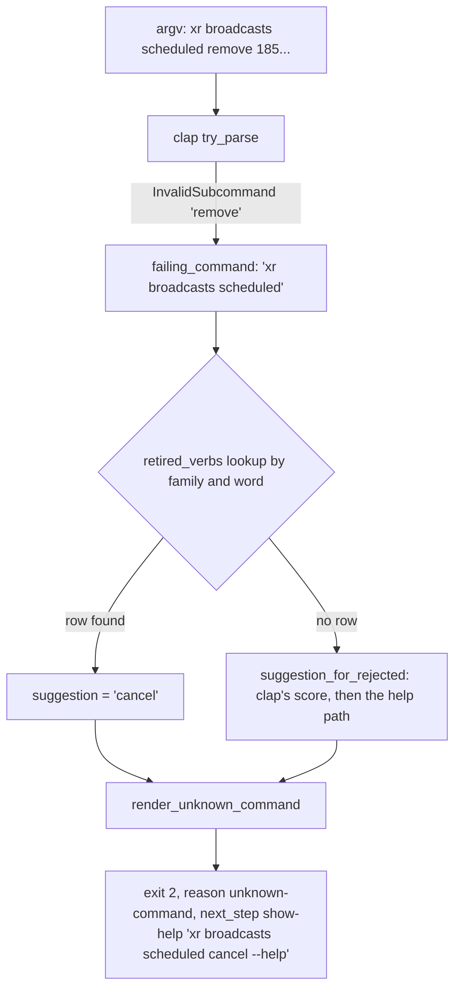

# Sibling Verb Alignment - Plan

**Target repo:** brettdavies/xurl-rs. Every path is in it. **Base:** `dev`. **Issue:** #421.

---

## Goal Capsule

- **Objective:** A caller who learned one of `xr`'s scheduled, broadcast, or call subtrees can type the matching command
  in its sibling on the first try, and a script or agent that still types a renamed command is told the new one.
- **Means:** rename the two verbs that break the sibling pattern, drop the command that starts a scheduled broadcast,
  leave `history` as it is, and answer each renamed word with its replacement through the existing `unknown-command`
  envelope (KTD1, KTD2, KTD6).
- **Authority:** R-IDs win on behavior and KTDs on mechanism; a unit overrides neither. Brett set the names, the
  retired-name behavior, and the version on 2026-10-29 (Decision Record D1 to D3).
- **Execution profile:** inline in one session, no subagents or worktrees. A stack of two PRs, the bottom one targeting
  `dev` (KTD5). Brett merges.
- **Stop conditions:** a change would touch a public item of `xdk-rs`; a change would add a `reason` or a
  `next_step.action`; a retired word would run a request instead of refusing.

---

## Product Contract

### Summary

`xr broadcasts scheduled remove` becomes `cancel`, the verb `xr calls scheduled` uses, and
`xr broadcasts sources rename <ID> <NAME>` becomes `update <ID> --name <NAME>`. `xr broadcasts scheduled live` goes,
with the `--manual-publish` flag on `add` and `update` that made it necessary, so every scheduled broadcast goes live at
its start time. `xr conversations history` and `xr broadcasts chat history` keep their names. A renamed word refuses at
exit 2 as an unknown command whose `suggestion` and help pointer name its replacement. `AGENTS.md` gains the verb rule
so the next family follows it. The release is `xr` 4.5.0.

### Problem Frame

Issue #421 found four places where sibling subtrees name one action with different words. The reproduction against a
development `xr` at `b50850d` (offline: scratch `XURL_TOKEN_STORE`, `API_BASE_URL` at a closed port) confirms each spot
as written, with three corrections:

- **Spot 1 is not one wire operation.** X's spec names them differently: `DELETE /2/calls/scheduled/{id}` is
  `cancelScheduledCall`, takes `scope`, `occurrence_start_time`, and `notify_invitees`, answers `{"cancelled": true}`,
  and succeeds again on a call already cancelled. `DELETE /2/broadcasts/scheduled/{id}` is `deleteScheduledBroadcast`
  and answers `{"deleted": true}`. To the caller both take a scheduled event off the calendar, and `xr` already
  describes the broadcast one as cancelling: its help ("Cancel a scheduled broadcast"), its family's about line ("change
  or cancel them"), and its prompt ("Cancel scheduled broadcast {id}?").
- **Spot 3's premise does not hold.** The issue says the rest of the CLI lists with `list` or `messages`. No command
  named `messages` exists anywhere in the tree (walked from `xr --help` down). Reads are routinely named for what they
  return: `lists followed`, `lists memberships`, `lists pinned`, `notes written`, `notes eligible`, `trends personal`,
  `spaces by-creator`, `conversations with`, `media analytics`. The issue's own proposal (item 4) keeps
  `xr conversations history`.
- **An agent's `list` guess already lands.** Today `xr conversations list <ID>` and `xr broadcasts chat list <ID>` exit
  2 with `"suggestion": "history"` and a `next_step` of `xr conversations history --help` (clap's Jaro score 0.726
  against `history`, above its 0.7 bar).

Every renamed command shipped first in `xr` 4.4.0, released 2026-10-28; 4.3.0 has none of them. No first-party consumer
names them: `xurl-rs-skill` and `agent-skills` hold no reference.

What an old name gets after a plain rename, scored with clap's method (`strsim::jaro`, best match above 0.7) against the
siblings that remain:

| Retired word                  | Nearest sibling after a plain rename | What the caller would see                                  |
| ----------------------------- | ------------------------------------ | ---------------------------------------------------------- |
| `broadcasts scheduled remove` | `get`, 0.500                         | no suggestion; `Try 'xr broadcasts scheduled --help'`      |
| `broadcasts sources rename`   | `remove`, 0.778                      | `Did you mean 'remove'?`, the help page of the delete verb |
| `broadcasts scheduled live`   | `list`, 0.667                        | no suggestion; `Try 'xr broadcasts scheduled --help'`      |

The `rename` row is the hazard: a plain rename steers the caller to the destructive sibling's help.

### Requirements

**Sibling alignment**

- R1. `xr calls scheduled` and `xr broadcasts scheduled` take a scheduled event off the calendar with the same verb.
- R2. `xr broadcasts sources` changes a source's label with the same verb as every other subtree that changes a resource
  (`lists update`, `broadcasts scheduled update`, `calls scheduled update`, `auth apps update`); its argument shape is
  D1's.
- R3. `xr` does not start a scheduled broadcast: `xr broadcasts scheduled live` and `--manual-publish` on `add` and
  `update` are gone, and every schedule `xr` creates goes live at its start time.
- R4. `xr conversations history` and `xr broadcasts chat history` keep their names.

**Retired names**

- R5. A renamed word, typed in any form that reaches the unknown-command path (the invocation, the same with `--help`,
  `xr help <family> <word>`, and under `--dry-run`), exits 2 with reason `unknown-command`, its `suggestion` the
  replacing word, and a `next_step` of `show-help` for the replacing command's help. `live` exits 2 as any unknown
  command does, with no suggestion and the family's help as its step. Neither sends a request.
- R6. No retired word runs as an alias, appears in `--help`, completions, the schema registry, or the examples page.

**Contract and records**

- R7. The renamed commands keep their inputs, responses, exit codes, confirmation behavior, and `--dry-run` answers
  apart from the command name and spot 2's `--name`, and the `xdk-rs` public API does not change.
- R8. The release notes name each rename and its replacement; `AGENTS.md` § "Command grammar" states the verb rule the
  renames follow.
- R9. Every document that defines `suggestion` says it also names the command that replaced a retired word: the field's
  description in `schema/output.schema.json` and `AGENTS.md` § "Running xr".

### Key Decisions

- **Spot 1 is `cancel` on both.** Governs R1. `broadcasts scheduled remove` moves; Brett, 2026-10-29 (D1).
- **Spot 2 is `update <ID> --name <NAME>`.** Governs R2. Brett, 2026-10-29 (D1).
- **xr does not start a broadcast.** Governs R3. The encoder supplies the video and X publishes at the start time;
  Brett, 2026-10-29 (D1).
- **`history` stays.** Governs R4. Brett, 2026-10-29, on the evidence in the Problem Frame (D1).
- **Renamed words refuse naming the replacement; nothing aliases.** Governs R5, R6. Brett, 2026-10-29 (D2).

### Scope Boundaries

- The library's shortcut names stay as X names the operations (`delete_scheduled_broadcast`, `rename_stream_source`,
  `go_live`, `cancel_scheduled_call`). Renaming them would break `xdk-rs` for no caller benefit (R7).
- The library keeps `go_live` and the request structs keep `manual_publish`: an embedder that drives the stream can
  still start a manual schedule. Because the operation keeps a shortcut, it gets no `endpoint-decisions.json` entry
  (`crates/xdk/tests/endpoint_decisions.rs` fails a decision for an operation with a shortcut), and raw mode still
  reaches `POST /2/broadcasts/scheduled/{id}/live`.
- `ScheduledBroadcast` keeps reporting `manual_publish`, which a schedule made by 4.4.0 or by X's own tools can carry.
- The response types and their keys stay: `xr broadcasts scheduled cancel` still answers `{"deleted": true}`, since the
  key reports what X did.
- `.anc.toml` does not change. anc's `p6-may-standard-names` audit reads only the root `--help` (`audit_standard_names`
  over `project.help_output()` in agentnative-cli `src/audits/behavioral/standard_names.rs`), and every renamed word
  sits two levels down.
- The validate aliases do not change. They name response types (`delete`, `stream-source`, `scheduled-broadcast`,
  `scheduled-call-cancelled`), not commands.
- Considered and not built: a deprecation alias that still runs the old name and warns. The issue asks for no aliases,
  `xr` has no deprecation channel to carry the warning, and Brett chose refusal (D2).
- Considered and not built: an expiry for retired-name rows. A row is one line and costs nothing to keep; a later rename
  that collides with a row fails the guard test (U1).
- Considered and not built: retired-name handling for `xr schema <slug>`. Its unknown-name error already lists every
  valid name, and issue #424 replaces the slug argument with command words (see Dependencies).

### Deferred to Follow-Up Work

- `xr schema <command words>` (issue #424) should resolve a retired word through the same lookup once its path
  resolution exists; a note goes to the `issues-schema-ergonomics` slot.

### Dependencies

- **Issue #424 and #426 (`issues-schema-ergonomics`)** rekey `SCHEMA_ENTRIES` from hyphen slugs to space-separated
  command paths and change `xr schema`'s arguments and default output. Each renamed spot edits one `SCHEMA_ENTRIES`
  string and one `schema/responses/` file name, so the two stacks conflict on three rows and on
  `crates/xurl-cli/tests/golden/schema-list.golden`. Proposed order: this stack merges first and #424 rekeys the names
  it finds; if #424 is ready first, this stack rebases and edits three space-separated keys instead. Either way the
  conflict is three lines plus a re-bless.
- **Issues #415 and #425 (`issues-help-accuracy`)** re-bless most `help-*.golden` fixtures, including the eight this
  plan moves, replaces, or deletes. The PR that lands second re-blesses only the fixtures its own change moves.
- **Issues #419, #420, #422 (`issues-dry-run-envelopes`)** touch dry-run envelopes and `calls scheduled` user-id input.
  No overlap with the renamed arms: R4 keeps `conversations history`, whose dry-run fixture
  (`dry-run-invalid-conversation-id.golden`) stays, and spot 1 renames the broadcast command, not
  `calls scheduled cancel`.
- **PR #409 (spec refresh to 2.173)** does not touch the affected endpoints (`gh pr diff 409` names no scheduled,
  sources, or chat path).

---

## Decision Record

Each decision records the choice and the evidence it rested on. Brett answered D1 to D3 on 2026-10-29; D4 to D7 are
settled from evidence.

### D1. The names (Brett)

- **Spot 1: `cancel` on both, renaming `broadcasts scheduled remove`.** It moves only the command whose own help, about
  line, and prompt already say "cancel", and keeps the domain verb where X's operation is a cancellation (invitees
  notified, occurrences scoped, `cancelled` reported). Rejected: `remove` on both, which misdescribes a call X keeps as
  cancelled; no change, which leaves `xr broadcasts scheduled cancel` with no suggestion at all.
- **Spot 2: `update <ID> --name <NAME>`, with `--name` required.** X's operation is `updateSource`, and every other
  change verb is `update` with the changed fields as flags (`lists update --name`; `broadcasts scheduled update` already
  requires `--start` and `--end`). Accepted cost: a script that swaps only the word gets one more refusal, as
  `xr lists update 123 Rust` answers `unexpected argument 'Rust' found`, before the help shows `--name`. Rejected:
  `update <ID> <NAME>` and keeping `rename`.
- **Spot 4: drop `broadcasts scheduled live` and `--manual-publish`.** The encoder (OBS, ffmpeg, a hardware box) sends
  the video to the stream source; `POST /2/broadcasts/scheduled/{id}/live` only publishes a schedule made with
  `manual_publish: true` ("Without that flag the coordinator auto-publishes at start and this call is rejected"). Going
  live belongs to the app that drives the broadcast, as joining a call does under the `calls-live` not-supported entry
  in `endpoint-decisions.json`. The flag goes with the command, or `xr` would create schedules it cannot start.
  Rejected: renaming to `go-live`, `start`, or `publish`, and keeping `live`.
- **Spot 3: `history` stays on both.** The evidence is in the Problem Frame.

### D2. What a retired name does (Brett)

A renamed word refuses with the `unknown-command` envelope as today, its `suggestion` the new word and
`next_step.command` its help (KTD1). No new `reason`, `action`, or key. `live` has no replacement and takes the plain
unknown-command answer: exit 2, no suggestion, `xr broadcasts scheduled --help` as its step. `--manual-publish` takes
clap's `unexpected argument` refusal (`invalid-args`). Rejected: letting the old names disappear, which steers the
`rename` caller to `remove`, and a hidden deprecated alias, which the issue rules out.

### D3. The version call (Brett)

`xr` 4.5.0, a minor, on blast radius: the changed commands first shipped in 4.4.0 on 2026-10-28, and no first-party
consumer names them. This departs from `RELEASES.md` § "The three bumps" ("Major: anything in the contract removed,
renamed, or retyped"), so each PR body states the minor call and that reason. Each PR files its entry under `### Added`:
the required check `Surface growth needs a minor section` (`scripts/check-surface-bump.sh`) fails a new command without
a bullet under `### Added`, `### Deprecated`, or `### Breaking changes`, and the PR template keeps a contract change out
of `### Changed`. The removal of `live` and `--manual-publish` rides in the `cancel` bullet, in the same PR. `xdk-rs`
gets no release (R7).

### D4. Retired names reuse `unknown-command` (settled)

The renderer, reason, exit code, and step stay those of `render_unknown_command` in `crates/xurl-cli/src/cli/runner.rs`;
the `suggestion` source and the text sentence change. Evidence: `AGENTS.md` § "Output formats" ("A new error picks an
existing action where one fits"), `RELEASES.md` § "Closed sets" (a new member is a minor and needs a consumer default),
and
`docs/solutions/design-patterns/unknown-command-needs-two-detectors-one-renderer-and-the-scorer-that-saw-the-word.md`
(one renderer for every unknown-command path). The text names the rename instead of guessing at a typo:
`Error: unknown command 'remove': 'cancel' replaced it. Try 'xr broadcasts scheduled cancel --help'.`, and the JSON
`message` carries the same sentence. The renderer stays one function and learns which source gave the suggestion.
Suggestion wording is not contract (`RELEASES.md` § "What the contract is"); `suggestion` keeps its key and type, and
its description gains the replacement case (R9).

### D5. The library keeps X's names (settled)

`AGENTS.md` § "Where a change goes": the library states X's facts; the binary owns names a caller types. The shortcut
functions follow X's operation ids, and renaming them is an `xdk-rs` break (`cargo semver-checks`) with no caller
benefit.

### D6. `.anc.toml` and the validate aliases stay (settled)

Evidence in Scope Boundaries.

### D7. Review questions answered inline (settled)

Nobody watches this session, so every review question the evidence settles is answered here with its source; the review
records below list them.

---

## Planning Contract

### Key Technical Decisions

- KTD1. **A retired-verb table in its own module, consulted before clap's score.** A new
  `crates/xurl-cli/src/cli/retired_verbs.rs` holds rows of family path, retired word, replacing word, and one lookup.
  The clap rejection path in `crates/xurl-cli/src/cli/runner.rs` computes the failing family (`failing_command`) and
  asks the table before `suggestion_for_rejected`, so `xr <family> <old>`, its `--help` form, `xr help <family> <old>`,
  and `--dry-run` all resolve the same way (each already reaches that branch; reproduced for a missing verb). A row keys
  on the family string `failing_command` returns (`xr broadcasts scheduled`), which already names the binary `xr` under
  any `argv[0]`, so the table holds no second spelling of a family. A module of its own keeps `classify.rs` (334 lines)
  from growing past the refactor trigger. The root classifier path needs no row, since no top-level word is renamed.
- KTD2. **Each rename is a variant rename, not an alias.** The clap variant, its `family_help` verb constant, its
  dispatch arm, its `--dry-run` context name, its `SCHEMA_ENTRIES` string, and its `schema/responses/` file all move
  together; nothing keeps the old spelling (R6).
- KTD3. **The `--dry-run` context names the new slug.** `"command": "broadcasts-scheduled-cancel"` and the others follow
  the schema registry's slug, as every arm does today. If #424 lands first and the context moves to space-separated
  paths, the arm follows whatever form it set.
- KTD4. **The table's guard is a plain test, not a recipe walk.** It walks `Cli::command()` and fails when a row's
  family is gone, its replacing word is not a subcommand there, or its retired word is one again. `recipe_guard.rs`
  counts any test file containing `Cause:` as a recipe walk (`walk_files`), so the guard lives in
  `crates/xurl-cli/tests/unknown_command_tests.rs`, which has none, and its message carries none either.
- KTD5. **Two PRs.** The bottom PR carries everything under `broadcasts scheduled`: U1's table and `cancel`, and U3's
  removal, since the removal's changelog line rides in the `cancel` bullet (D3). The top PR carries U2's `update` and
  U4's grammar text as separate commits; a third PR would add one more run of CI's jobs to the account's 20-job queue.
  The stack lands with `gh stack merge --squash`, one atomic merge, so no restack re-runs CI.
- KTD6. **`live` and `--manual-publish` go from the binary only.** The variant, its arm, its `family_help` verb, its
  `SCHEMA_ENTRIES` string, its schema file, and its help fixture go; the two `manual_publish` args leave `add` and
  `update`, whose arms then pass no `manual_publish`, the value they pass today when the flag is absent. `live` gets no
  table row (D2).

### High-Level Technical Design

How a retired word reaches the caller. Directional, not an implementation spec.



### Assumptions

- Brett's answers of 2026-10-29 are final for this plan; a later change to a name re-plans that unit only.

---

## Implementation Units

### U1. `broadcasts scheduled remove` becomes `cancel`, with the retired-verb table

- **Goal:** The two scheduled subtrees cancel with one verb, and `remove` under `broadcasts scheduled` names `cancel`.
- **Requirements:** R1, R5, R6, R7, R9.
- **Dependencies:** none.
- **Files:**
  - Create `crates/xurl-cli/src/cli/retired_verbs.rs`; modify `crates/xurl-cli/src/cli/mod.rs` (module declaration,
    `ScheduledBroadcastsCommands::Remove` to `Cancel`) and `crates/xurl-cli/src/cli/runner.rs` (lookup before
    `suggestion_for_rejected`).
  - Modify `crates/xurl-cli/src/cli/family_help.rs` (`broadcasts_scheduled::REMOVE` to `CANCEL`),
    `crates/xurl-cli/src/cli/commands/broadcast_scheduled.rs` (arm and context name),
    `crates/xurl-cli/src/cli/commands/schema.rs` (row string).
  - Rename `schema/responses/broadcasts-scheduled-remove.schema.json` to `broadcasts-scheduled-cancel.schema.json`
    through `scripts/generate-response-schemas.sh`.
  - Replace `crates/xurl-cli/tests/golden/help-broadcasts-scheduled-remove.golden` with
    `help-broadcasts-scheduled-cancel.golden`; re-bless `help-broadcasts-scheduled.golden` and `schema-list.golden`.
  - Modify `crates/xurl-cli/tests/agentic_tests.rs` (`CONFIRMED_COMMANDS`),
    `crates/xurl-cli/tests/broadcasts_family_tests.rs` (the confirmed-verb loop),
    `crates/xurl-cli/tests/unknown_command_tests.rs` (retired-name cases and the KTD4 guard).
  - Regenerate `completions/` through `scripts/generate-completions.sh`; modify `crates/xurl-cli/README.md` §
    "Broadcasts".
  - Modify the `suggestion` doc comment on `ErrorBody` in `crates/xurl-cli/src/cli/envelope.rs` and regenerate
    `schema/output.schema.json` (its drift guard is in `crates/xurl-cli/tests/schema_tests.rs`); modify `AGENTS.md` §
    "Running xr" (R9).
- **Approach:**
  1. Add the module and its lookup per KTD1, with the row (`broadcasts scheduled`, `remove`, `cancel`), and the
     replacement sentence in `render_unknown_command` (D4).
  2. Rename the variant per KTD2; the prompt, help, and about line already say "cancel" and stay.
  3. Regenerate the schema file and completions, then bless only the fixtures named above.
- **Patterns to follow:** `calls scheduled cancel` in `crates/xurl-cli/src/cli/commands/calls.rs` for a confirmed
  cancel; `nearest_command` in `crates/xurl-cli/src/cli/classify.rs` for a lookup the renderer consumes.
- **Test scenarios:**
  - `xr broadcasts scheduled cancel 1850000000000000001 --force --no-interactive` sends
    `DELETE /2/broadcasts/scheduled/1850000000000000001` against the mock and prints the `deleted` answer.
  - `xr broadcasts scheduled cancel 1850000000000000001 --no-interactive` without `--force` exits 1 with
    `confirmation-required`.
  - `xr --dry-run --output json broadcasts scheduled cancel 1850000000000000001` answers
    `"command": "broadcasts-scheduled-cancel"` and `confirmation_required: true`, and sends nothing.
  - `xr --output json broadcasts scheduled remove 1850000000000000001` exits 2 with reason `unknown-command`, `command`
    `remove`, `suggestion` `cancel`, and `next_step.command` `xr broadcasts scheduled cancel --help`, and the mock
    records no request.
  - The same holds for `xr broadcasts scheduled remove --help`, `xr help broadcasts scheduled remove`, and
    `xr --dry-run broadcasts scheduled remove 1`.
  - Text mode: `xr broadcasts scheduled remove 1` prints
    `Error: unknown command 'remove': 'cancel' replaced it. Try 'xr broadcasts scheduled cancel --help'.`
  - A plain typo keeps its sentence: `xr broadcasts scheduled cancle 1` still prints `Did you mean 'cancel'?`.
  - `xr lists remove 1 --force --no-interactive` still runs: a row keyed by family does not touch another family's
    `remove`.
  - Guard: a row whose replacing word is not a subcommand of its family, or whose retired word is one, fails the walk.
  - Run as `xurl-rs` (the in-process entrypoint with that `argv[0]`), `broadcasts scheduled remove` still names
    `cancel`.
  - Regression contract (R7): every existing `broadcasts scheduled remove` test moves to `cancel` with its assertions
    unchanged; only the command word in argv and the dry-run `command` value differ.
- **Verification:** the suites above pass; `xr broadcasts scheduled --help` lists `cancel` and not `remove`;
  `xr schema --list` names `broadcasts-scheduled-cancel`.

### U2. `broadcasts sources rename` becomes `update --name`

- **Goal:** A source's label changes with `update`, as every other resource's does, and `rename` names `update` instead
  of `remove`.
- **Requirements:** R2, R5, R6, R7.
- **Dependencies:** U1.
- **Files:**
  - Modify `crates/xurl-cli/src/cli/mod.rs` (`SourcesCommands::Rename` to `Update` with a required `--name`),
    `crates/xurl-cli/src/cli/family_help.rs` (`broadcast_sources::RENAME` to `UPDATE`, example
    `1x2y3z4w5v6u --name "Studio B"`), `crates/xurl-cli/src/cli/commands/broadcasts.rs` (arm and context name),
    `crates/xurl-cli/src/cli/commands/schema.rs`, `crates/xurl-cli/src/cli/retired_verbs.rs` (row).
  - Rename `schema/responses/broadcasts-sources-rename.schema.json` to `broadcasts-sources-update.schema.json`.
  - Replace `help-broadcasts-sources-rename.golden` with `help-broadcasts-sources-update.golden`; re-bless
    `help-broadcasts-sources.golden` and `schema-list.golden`.
  - Modify `crates/xurl-cli/tests/broadcast_sources_tests.rs` and `crates/xurl-cli/tests/unknown_command_tests.rs`;
    check `crates/xurl-cli/tests/dry_run_guard.rs`, which synthesizes arguments from clap and needs an `OVERRIDES` row
    only if the synthesized `--name` fails the name check; regenerate `completions/`; modify `crates/xurl-cli/README.md`
    § "Broadcasts".
- **Approach:** The arm still calls `rename_stream_source` with the same validation (`validate_source_name`); only the
  argument moves from a positional to `--name` (D5, KTD2).
- **Patterns to follow:** `ListsCommands::Update` in `crates/xurl-cli/src/cli/mod.rs` for `--name`;
  `ScheduledBroadcastsCommands::Update` for a required flag on `update`.
- **Test scenarios:**
  - `xr broadcasts sources update 1x2y3z4w5v6u --name "Studio B"` sends `PUT /2/sources/1x2y3z4w5v6u` with
    `{"name":"Studio B"}`.
  - `xr broadcasts sources update 1x2y3z4w5v6u` without `--name` exits 2 (`invalid-args`) and sends nothing.
  - `xr broadcasts sources update 1x2y3z4w5v6u --name ""` is refused by the existing name check, as `rename` refused it.
  - `xr --dry-run --output json broadcasts sources update 1x2y3z4w5v6u --name "Studio B"` answers
    `"command": "broadcasts-sources-update"` with `source_id` and `name`.
  - `xr --output json broadcasts sources rename 1x2y3z4w5v6u "Studio B"` exits 2 with `suggestion` `update`, never
    `remove`, and `next_step.command` `xr broadcasts sources update --help`.
  - Regression contract (R7): the existing `rename` tests move to `update --name` with the same request and answer
    assertions.
- **Verification:** the suites pass; `xr broadcasts sources --help` lists `update`; no `rename` remains in the tree.

### U3. `xr` stops starting a scheduled broadcast

- **Goal:** `broadcasts scheduled live` and `--manual-publish` are gone, and every schedule `xr` makes goes live at its
  start time.
- **Requirements:** R3, R5, R6.
- **Dependencies:** U1; ships in U1's PR (KTD5).
- **Files:**
  - Modify `crates/xurl-cli/src/cli/mod.rs` (drop `ScheduledBroadcastsCommands::Live` and `manual_publish` on `Add` and
    `Update`; the `Scheduled` about line drops "and start them early"), `crates/xurl-cli/src/cli/family_help.rs` (drop
    `broadcasts_scheduled::LIVE`; `page()` shows another example in its place),
    `crates/xurl-cli/src/cli/commands/broadcast_scheduled.rs` (drop the arm and the two `manual_publish` reads),
    `crates/xurl-cli/src/cli/commands/schema.rs` (drop the `broadcasts-scheduled-live` string from its row).
  - Delete `schema/responses/broadcasts-scheduled-live.schema.json` and
    `crates/xurl-cli/tests/golden/help-broadcasts-scheduled-live.golden`; re-bless `help-broadcasts-scheduled.golden`,
    `help-broadcasts-scheduled-add.golden`, `help-broadcasts-scheduled-update.golden`, `help-broadcasts.golden`, and
    `schema-list.golden`.
  - Modify `crates/xurl-cli/tests/agentic_tests.rs` (`CONFIRMED_COMMANDS`),
    `crates/xurl-cli/tests/broadcasts_family_tests.rs` (the confirmed-verb loop and any `--manual-publish` case),
    `crates/xurl-cli/tests/unknown_command_tests.rs`; regenerate `completions/`; modify `crates/xurl-cli/README.md` §
    "Broadcasts".
- **Approach:** KTD6. The library is untouched (D5).
- **Patterns to follow:** any command removed from the tree leaves no help fixture, schema file, or registry string, as
  the golden, schema, and completions walks require.
- **Test scenarios:**
  - `xr --output json broadcasts scheduled live 1850000000000000001` exits 2 with reason `unknown-command`, `command`
    `live`, no `suggestion`, `next_step.command` `xr broadcasts scheduled --help`, and the mock records no request.
  - `xr broadcasts scheduled add --source S --start 2026-11-02T16:00:00Z --manual-publish` exits 2 with `invalid-args`
    and sends nothing.
  - `xr broadcasts scheduled add --source S --start 2026-11-02T16:00:00Z` sends a body with no `manual_publish` key, as
    today.
  - `xr broadcasts scheduled --help` lists `list`, `get`, `add`, `update`, and `cancel`, and nothing else.
- **Verification:** the suites pass; no `live` verb or `--manual-publish` flag remains in the tree, the completions, or
  the README.

### U4. The verb rule in `AGENTS.md`

- **Goal:** The next command family picks its verbs by the rule these renames follow.
- **Requirements:** R8.
- **Dependencies:** U1, U2, U3 (the text describes their end state). Ships as its own commit in U2's PR (KTD5).
- **Files:** Modify `AGENTS.md` § "Command grammar: flags vs subcommands".
- **Approach:** Add one bullet group stating present rules only:
  1. An action is a verb, and sibling subtrees name the same action with the same verb.
  2. A read may be named for what it returns (`history`, `followed`, `pinned`, `written`).
  3. A resource change is `update`, its fields given as flags.
  4. A delete is `remove`; taking a scheduled event off the calendar is `cancel`.
- **Test expectation:** none -- prose in a contributor document; `crates/xurl-cli/tests/recipe_guard.rs` reads a
  different section and must still pass.
- **Verification:** markdownlint passes; the bullets match the tree as U1 to U3 leave it.

---

## Verification Contract

| Gate               | Command                                                                                                                                                                         | When             |
| ------------------ | ------------------------------------------------------------------------------------------------------------------------------------------------------------------------------- | ---------------- |
| Format             | `cargo fmt --check`                                                                                                                                                             | every PR         |
| Lint               | `cargo clippy --all-targets --all-features -- -D warnings`                                                                                                                      | every PR         |
| Suite              | `cargo test --workspace --no-fail-fast`, in the background                                                                                                                      | every PR         |
| Fixtures           | `XURL_GOLDEN_BLESS=1 cargo test -p xurl-rs --test golden_tests`, then `git diff --stat` names only the fixtures the unit lists                                                  | U1 to U3         |
| Schemas            | `scripts/generate-response-schemas.sh`, then `crates/xurl-cli/tests/schema_tests.rs`                                                                                            | U1 to U3         |
| Completions        | `scripts/generate-completions.sh`, the tree clean after                                                                                                                         | U1 to U3         |
| Library untouched  | `git diff --stat origin/dev -- crates/xdk` is empty                                                                                                                             | every PR         |
| Local CI mirror    | `scripts/hooks/pre-push`, in the background                                                                                                                                     | before each push |
| Agent-native audit | `anc audit . --bin xr` keeps its `p6-may-standard-names` verdict                                                                                                                | top PR           |
| Real binary        | the offline reproduction script run against the built `xr`: each renamed word exits 2 naming its replacement, `live` exits 2 with no suggestion, each new word reaches the mock | U1 to U3         |

A new test counts once it has been observed failing against the unfixed code: run each retired-name case before the row
exists and quote the failure.

---

## Definition of Done

- Spots 1 and 2 are renamed per their units, and every surface in KTD2 carries the new word and none the old.
- `live` and `--manual-publish` are gone from every surface KTD6 names.
- Every renamed word and `live` refuse as R5 states, in text and JSON, and send nothing.
- `history` is unchanged (R4).
- No `crates/xdk` change; no new `reason`, `action`, or envelope key.
- Each PR body's Related Issues names #421, states the 4.5.0 minor call with its reason, and files its Changelog entry
  under `### Added` (D3).
- Only the fixtures a unit lists moved; no stray re-bless.
- No abandoned experiment code remains in the diff.

---

## Sources

- Reproduction transcripts: the offline runs of each command named in issue #421, the proposed names, and the
  retired-name paths, against `xr` built at `b50850d`.
- X API spec `crates/xdk/vendor/x-api-openapi.json`: operation ids and summaries for `/2/broadcasts/scheduled/{id}`,
  `/2/broadcasts/scheduled/{id}/live`, `/2/calls/scheduled/{id}`, `/2/sources/{id}`; `UpdateSourceRequest`;
  `CancelScheduledCallResponseData`; `DeleteScheduledBroadcastResponseData`.
- Endpoint rows: `crates/xdk/build.rs` (`DELETE_SCHEDULED_BROADCAST`, `GO_LIVE`, `RENAME_STREAM_SOURCE`,
  `CANCEL_SCHEDULED_CALL`).
- clap's suggestion method: `clap_builder` 4.6.7 `src/parser/features/suggestions.rs` (`strsim::jaro`, above 0.7).
- anc's verb list and scope: agentnative-cli `src/audits/behavioral/standard_names.rs` at `72d253a`.
- `docs/solutions/design-patterns/unknown-command-needs-two-detectors-one-renderer-and-the-scorer-that-saw-the-word.md`.
- `docs/solutions/conventions/renaming-an-overloaded-domain-noun.md`: a rename's failures are over-applications in the
  source repo, so sweep for bystander uses of `remove`, `live`, and `rename` (`--state live` in `spaces search` stays).
- `RELEASES.md` § "Versioning"; `AGENTS.md` § "Command grammar", § "Adding a command family", § "Where a change goes".

---

## Engineering Review Record

`/plan-eng-review` of this plan on 2026-10-28, run inline in one session with no subagent and no outside model (Brett's
standing rule for this repo). Nobody watches the session, so each choice below was settled from the cited evidence under
the session brief's authorization, and Brett's own questions (D1 to D3) went to him as one brief instead.

**Scope Challenge.** The plan touches about 25 files and adds one module, so the complexity gate tripped. Structure:
original arrangement (a `retired_verbs.rs` module) kept over the smaller arrangement (rows inside `classify.rs`),
because `classify.rs` is already 334 lines and the rows are their own concern. PR count: four PRs became fewer, with U4
as a commit in another unit's PR (KTD5 holds the shape Brett's answers left: two); each `xr` PR fires about 25 CI jobs
against the account's 20-job cap. Result: scope accepted as-is.

**Reality rows.**

- REALITY: premise-table pass. Every factual claim cites a receipt: X's operation ids
  `crates/xdk/vendor/x-api-openapi.json:21571` (`deleteScheduledBroadcast`), `:21766` (`goLiveScheduledBroadcast`),
  `:22466` (`cancelScheduledCall`), `:30623` (`updateSource`); `xr`'s own wording `crates/xurl-cli/src/cli/mod.rs:2709`,
  `:2824`, `:2837`, `crates/xurl-cli/src/cli/commands/broadcast_scheduled.rs:112`, `:125`; anc's root-only scope
  agentnative-cli `src/audits/behavioral/standard_names.rs:188`, `:241`. unverified=1: the post-rename clap scores come
  from a reimplementation of `strsim::jaro` that matched clap's live answer on both cases it could check (`list` to
  `history` at 0.726; `cancel` with no suggestion); re-measure on the built binary in U1 to U3.
- REALITY: already-done pass. `git log origin/dev --since=2026-10-27` over the touched files shows only #427 and #428,
  both in the base; no retired-name work exists.
- REALITY: surface-check pass. Every existing command the plan names was checked against the walked `--help` tree; the
  new names are proposals.
- REALITY: binding-decisions pass. No branch decision governs these names. #407 (`142030e`) audited the families before
  4.4.0 and changed other names; it neither chose nor rejected these.
- REALITY: numbers pass. Fourteen `remove` verbs [measured: tree walk]; `classify.rs` 334 lines [measured: `wc -l`];
  Jaro values [measured: reimplementation, two live cross-checks]; about 25 CI jobs per PR [estimated: prior learning,
  re-measure on the first push].
- REALITY: deferred-asks pass. Issue #421 asks for spots 1, 2, and 4 (U1 to U3) and flags spot 3, which its own proposal
  keeps; R4 keeps it, with the evidence in the Problem Frame. "No aliases" holds under D2's recommendation.
- REALITY: pr-count finding. Four PRs became two after Brett's answers (KTD5).

**Section 1, Architecture.**

- [INFORMATIONAL] (confidence: 8/10) `crates/xurl-cli/src/cli/runner.rs:516`,
  `let command = failing_command(error, args);`. The rows needed one family spelling; `failing_command` yields
  `xr broadcasts scheduled` and already names `xr` under any `argv[0]`. Accepted: KTD1 keys rows on that string, and U1
  tests the `xurl-rs` name.
- Design-twice. Shape A, a row table with a walk test over `Cli::command()`. Shape B, rows declared on each
  `family_help` `Family` and pointing at its `Verb` constants, so the replacement word checks at compile time. Shape B
  needs a registry of every family, which does not exist, and would be a hand-synced list (red flag 8). Picked A: one
  table behind one lookup, its drift caught by the walk. Red flags screened: no pass-through, one owner of the
  suggestion order, no importable internals (`pub(crate)`).

**Section 2, Code quality.**

- [INFORMATIONAL] (confidence: 9/10) `crates/xurl-cli/tests/recipe_guard.rs:65`,
  `.filter(|file| std::fs::read_to_string(file).is_ok_and(|source| source.contains("Cause:")))`. The walk set is any
  test file containing `Cause:`, not any message. Accepted: KTD4 names the file and its rule.
- [INFORMATIONAL] (confidence: 7/10) `crates/xurl-cli/tests/dry_run_guard.rs:42`,
  `const OVERRIDES: &[(&str, &[&str])] = &[`. The guard synthesizes each command's arguments from clap, so the new
  required `--name` gets a sample value. Accepted: U2 checks the file.
- No shared-code extraction proposed.

**Section 3, Tests.**

```text
CODE PATHS                                         USER FLOWS
[+] runner.rs clap rejection branch                [+] Caller types a retired word
  ├── retired row found  -> suggestion = new         ├── [GAP→U1-U3] JSON envelope names the new word
  │   [GAP→U1-U3] JSON, text, --help, help, dry-run  ├── [GAP→U2] rename never suggests remove
  ├── no row -> clap score  [★★★ unknown_command_tests] └── [GAP→U1] other families' remove still run
  └── guard walk over Cli::command()  [GAP→U1]
[+] renamed arms (cancel, update)                  [+] Caller runs the new name
  ├── request path and body  [★★★ family tests, moved]  ├── [★★★ moved] confirmation gate
  └── dry-run command value  [GAP→U1-U3]                └── [★★★ moved] dry run sends nothing
COVERAGE after the plan: every path has a planned or moved test; no E2E or eval scope.
```

- Value: protects=a retired word names its replacement in every format; fails_when=the row is missing or keyed wrong;
  why_new=no test covers a renamed verb; seam=none; no_claim=X's acceptance of the new request (mock only)
- Value: protects=the table never names a word clap does not parse; fails_when=a later rename leaves a row stale;
  why_new=nothing walks the table; seam=none; no_claim=none beyond protects
- Regression contract: each existing test of an old name moves with its assertions unchanged (R7, U1 to U3). Tests to
  retire: none.

**Section 4, Performance.** No issues found: one table lookup on an error path that exits 2.

**Outside voice.** Skipped: the session rule forbids an outside model and a subagent. An inline challenge raised three
points. Is the table worth building? Yes: without it the `rename` caller is pointed at `remove`. Should `remove` win
spot 1 on count? That is D1, already with Brett. Should a day-old rename take a major? That is D3, already with Brett.

**NOT in scope.** Library renames (D5); response keys; `.anc.toml`; validate aliases; a deprecation alias; row expiry;
retired names for `xr schema <slug>` (Scope Boundaries).

**What already exists.** `render_unknown_command` and the `unknown-command` envelope (reused as is); `failing_command`
(reused for the family); clap's own score (kept as the fallback); the golden, schema, dry-run, and confirmed-command
walks (each catches a missed surface).

**Failure modes.** A stale row: the guard walk fails. A row keyed wrong: the retired-name tests fail, and the caller
falls back to clap's score with no silent harm. A renamed arm that drops behavior: the moved tests fail. A missed
fixture, schema file, or completion: the golden, schema, and completions gates fail. No critical gaps.

**Parallelization.** Sequential implementation, no parallelization opportunity: every unit edits `mod.rs`,
`family_help.rs`, and `schema.rs`.

**Implementation tasks.**

- [ ] T1 (P1, human: ~3h / CC: ~30 min). `retired_verbs.rs` with the guard walk and the `remove` row, plus the `cancel`
  rename. Surfaced by: KTD1, Architecture finding 1. Verify: `cargo test -p xurl-rs --test unknown_command_tests`.
- [ ] T2 (P1, human: ~2h / CC: ~20 min). `sources update --name`, its row, and the `dry_run_guard.rs` check. Surfaced
  by: Code quality finding 2. Verify: `cargo test -p xurl-rs --test broadcast_sources_tests --test dry_run_guard`.
- [ ] T3 (P1, human: ~2h / CC: ~20 min). Drop `live` and `--manual-publish` in T1's PR; the AGENTS.md commit rides in
  T2's PR. Surfaced by: KTD5, KTD6. Verify: `cargo test -p xurl-rs --test broadcasts_family_tests --test golden_tests`.

**Decision ledger.** Every choice above was settled from evidence and accepted. Brett answered D1 to D3 on 2026-10-29.
Approval readiness: PASS (Scope structure, PR count, Architecture 1, Code quality 1 and 2; each cites its evidence
above).

**Completion summary.** Step 0: scope accepted as-is. Reality rows: 7/7 emitted, 1 unverified premise. Architecture: 1
issue. Code quality: 2 issues. Tests: diagram produced, 3 gaps planned. Performance: 0. NOT in scope: written. What
already exists: written. TODOS.md: 0 proposed. Failure modes: 0 critical gaps. Unresolved decisions: 3 (D1 to D3,
Brett's). Outside voice: codex, skipped (session rule). Parallelization: 1 lane, sequential. Lake Score: N/A.

## Developer Experience Review Record

`/plan-devex-review` of this plan on 2026-10-28, inline in one session with no subagent and no outside model. Each
choice below was settled from the cited evidence; D1 to D3 stay with Brett. Mode: DX POLISH, the default for an
enhancement to an existing product.

**Persona.** Primary: an AI coding agent that scripts `xr` (AGENTS.md § "Output formats": structured errors exist so an
agent branches on stable fields; issue #421 § "Agent-native considerations"). It reads the envelope literally, cannot
ask, and pays per retry. Secondary: a person whose shell script names a 4.4.0 command.

**Empathy narrative.** I upgraded `xr`, and my nightly job that cancels a scheduled broadcast fails at exit 2. In JSON I
get `unknown-command` with `command: remove`. With a plain rename that is all: no `suggestion`, and a pointer to the
family help, so I read the page, find `cancel`, and retry, two extra calls. If my job renamed a stream source, I get
`suggestion: remove` and the delete verb's help page, which reads like the fix. With the plan, the same failure carries
`suggestion: cancel` and `xr broadcasts scheduled cancel --help`; one help read and one retry and the job runs.

**Competitive benchmark.** Endpoint: a caller with a call to an old name reaches a working call.

| Tool               | Start to result               | Evidence                      | DX choice                                                   |
| ------------------ | ----------------------------- | ----------------------------- | ----------------------------------------------------------- |
| `gh`               | `gh pr lsit` to a pointer     | observed locally              | `Did you mean this? edit`: a scored guess, here a wrong one |
| cargo              | `cargo biuld` to a pointer    | observed locally              | `a command with a similar name exists: build`               |
| git                | `git comit` to a pointer      | observed locally              | `The most similar command is commit`                        |
| git, docker        | a renamed workflow            | in-distribution, not verified | keep the old command beside the new one                     |
| `xr` today         | `rename` after a plain rename | predicted from clap's score   | `Did you mean 'remove'?`, the delete verb                   |
| `xr` with the plan | any retired word              | planned (U1 to U3)            | the replacing word, its help, and the reason it moved       |

Target: Champion, one retry. Chosen because the issue rules out an alias, so the refusal is the whole migration path.

**Magical moment.** The failure names its fix: the old call's error carries the new word and its help, so an agent
repairs it without opening a changelog. Vehicle: the retired-verb table (KTD1) with the replacement sentence (D4).

**Journey map.**

| Stage       | Developer does                      | Friction                                               | Status                   |
| ----------- | ----------------------------------- | ------------------------------------------------------ | ------------------------ |
| Discover    | reads `--help`, completions, README | old names in help and completions                      | fixed (U1 to U3)         |
| Install     | upgrades through Homebrew or cargo  | nothing warns before the first run                     | ok: refusal is immediate |
| Hello world | first run of an old script          | no pointer, or the `remove` pointer                    | fixed (KTD1, D4)         |
| Real usage  | runs the new names                  | `rename` to `update --name` changes the argument shape | with Brett (D1 spot 2)   |
| Debug       | reads the envelope                  | `suggestion`'s documented meaning omits replacements   | fixed (R9)               |
| Upgrade     | reads release notes                 | none once each PR names old and new                    | ok (R8)                  |

**First-time report.** T+0:00 the agent runs `xr --output json broadcasts sources rename 1x2y3z4w5v6u "Studio B"`.
T+0:01 exit 2, `suggestion: update`, `next_step.command: xr broadcasts sources update --help`. T+0:02 it reads the help
and sees `--name`. T+0:03 `xr broadcasts sources update 1x2y3z4w5v6u --name "Studio B"` succeeds. An agent that skips
the help and keeps the positional takes one more refusal (`invalid-args`), the cost D1 spot 2 option (b) avoids.

**Pass scores (initial to amended).**

| Pass               | Score  | Evidence and gap                                                                                     |
| ------------------ | ------ | ---------------------------------------------------------------------------------------------------- |
| 1. Getting started | 7 to 8 | Endpoint is the first working call after an upgrade; one retry once the table exists                 |
| 2. CLI design      | 6 to 8 | Siblings share verbs after U1 to U3; spot 2's argument shape stays with Brett                        |
| 3. Errors          | 7 to 8 | Matrix below; no cap; the text names the rename instead of a typo guess                              |
| 4. Docs            | 6 to 8 | `suggestion`'s description and AGENTS.md now cover replacements (R9); README examples move           |
| 5. Upgrade         | 5 to 7 | No alias by the issue's choice; the refusal and the changelog line carry the migration               |
| 6. Environment     | 8 to 8 | Completions regenerate; `--dry-run` of an old name refuses the same way at exit 2                    |
| 7. Community       | 7 to 7 | Release notes and the issue thread; nothing new needed                                               |
| 8. Measurement     | 6 to 7 | The offline reproduction script measures the endpoint per retired word; `/devex-review` can rerun it |

**Error path matrix (agent-ready-v1).**

```text
Path                                  | Class | what | fix  | recovery | code | context | trace | redaction | channel | Cap
retired word (live, remove, rename)   | usage | pass | pass | N/A      | pass | N/A     | N/A   | pass      | pass    | none
update without --name                 | usage | pass | pass | N/A      | pass | N/A     | N/A   | pass      | pass    | none
update ID NAME (positional kept)      | usage | pass | pass | N/A      | pass | N/A     | N/A   | pass      | pass    | none
cancel without --force                | usage | pass | pass | N/A      | pass | N/A     | N/A   | pass      | pass    | none
unexpected failure on these paths     | n/a   | no new path: a table lookup on the error branch; panics keep the run_argv hook (reason internal)
```

Every usage path exits 2 or 1 with a stable `reason`, echoes the offending word, and names a help page or a `--force`
template as its fix. No path prompts without a TTY alternative, and none carries a secret.

**Findings and dispositions.**

- [INFORMATIONAL] (confidence: 9/10) `crates/xurl-cli/src/cli/envelope.rs:214`,
  `/// The nearest real command, when one is within the threshold.` The field's documented meaning, also in
  `schema/output.schema.json:361` and `AGENTS.md:50`, would not cover a replacement. Accepted as review work: R9 and
  U1's files.
- [INFORMATIONAL] (confidence: 8/10) `crates/xurl-cli/src/cli/runner.rs:672`,
  `format!("unknown command '{word}'. Did you mean '{nearest}'? Try '{target} --help'.")`. For a rename the sentence
  guesses at a typo the caller did not make. Accepted: D4's replacement sentence, text and `message` only.
- [INFORMATIONAL] (confidence: 9/10) `.github/workflows/changelog-bump.yml:47`,
  `bash scripts/check-surface-bump.sh check ...`. The required check fails a renamed command filed under `### Changed`,
  so D3's 4.5.0 option was misstated. Accepted: D3 corrected; the correction goes to Brett.
- [INFORMATIONAL] (confidence: 8/10) observed `xr lists update 123 Rust` answers `unexpected argument 'Rust' found`.
  Spot 2 option (a) costs a positional caller one more retry. Recorded under D1; Brett accepted it.
- Outside this plan, observed: `xr --output json lists update 123` answers `"message": "no-list-changes"`, the bare code
  where text mode prints a sentence (`crates/xurl-cli/src/cli/output/validation.rs:77`). Reported to the coordinating
  session for the slot that owns validation messages; not built here.

**NOT in scope.** A deprecation alias, a `docs` URL on `show-help`, an additive key marking a replacement, and telemetry
on old-name use: the issue rules out aliases, and an agent's next action is the same with or without a marker.

**What already exists.** The `unknown-command` envelope and its single renderer; the `--force` confirmation template;
the completions and help goldens; `--dry-run`.

**Implementation tasks.** T1 gains the `suggestion` doc comment, the regenerated `schema/output.schema.json`, the
AGENTS.md sentence, and the replacement sentence with its typo-path test (P1). No other new tasks.

## Document Review Record

`/ce-doc-review` of this plan on 2026-10-28 in non-interactive mode, classified `unified-plan`. Every lens ran inline in
this session, with no subagent and no cross-model pass (session rule), so no agreement promotion applies.

| Lens        | Why it ran                                               | Findings                                        |
| ----------- | -------------------------------------------------------- | ----------------------------------------------- |
| coherence   | always on                                                | 3 applied                                       |
| feasibility | always on                                                | 0 retained; 1 FYI                               |
| scope       | every plan (mechanism sizing)                            | 0 retained: the table and R9 each pass the test |
| adversarial | `product_contract_source: ce-plan-bootstrap`, new module | 1 applied                                       |
| product     | the plan stakes positions on names and on keeping one    | 1 decision for Brett                            |

**Applied.**

- R2 required "the same argument shape" as the other `update` verbs, which pre-decided D1 spot 2 against Brett's option
  (b). R2 now leaves the shape to D1.
- The Key Decision on `history` read as settled, while command names are Brett's and D1 says he may override. It now
  reads as recommended, pending him.
- D4 said only the `suggestion` source changes, while the same paragraph changes the text sentence. It now names both.
- The help-fixture count in Dependencies said six; it now counts every fixture U1 to U3 move, replace, or delete.

**Decision for Brett.** A no-break alternative to the renames: keep every name and add sibling-verb hint rows. Brett
chose the renames and the drop instead (D1).

**FYI.** U1 regenerates `schema/output.schema.json` with `xr schema envelope`, the positional #426 replaces with
`--envelope`; use whichever form `dev` has when U1 is built.

## GSTACK REVIEW REPORT

| Review         | Trigger               | Why                             | Runs | Status      | Findings                                        |
| -------------- | --------------------- | ------------------------------- | ---- | ----------- | ----------------------------------------------- |
| CEO Review     | `/plan-ceo-review`    | Scope & strategy                | 0    | not run     | n/a                                             |
| Outside Review | codex (plan review)   | Independent 2nd opinion         | 0    | skipped     | session rule: no outside model                  |
| Eng Review     | `/plan-eng-review`    | Architecture & tests (required) | 1    | ISSUES OPEN | 6 issues, 0 critical gaps, all folded           |
| Design Review  | `/plan-design-review` | UI/UX gaps                      | 0    | not run     | n/a                                             |
| DX Review      | `/plan-devex-review`  | Developer experience gaps       | 1    | ISSUES OPEN | score: 6/10 → 8/10, TTHW: 2-3 retries → 1 retry |

- **OUTSIDE COVERAGE:** codex, plan-review phase, skipped under the session rule for both reviews; no findings.
- **VERDICT:** Eng, DX, and document reviews done; every finding folded into the plan; Brett answered D1 to D3 on
  2026-10-29. Ready to build.

NO UNRESOLVED DECISIONS
