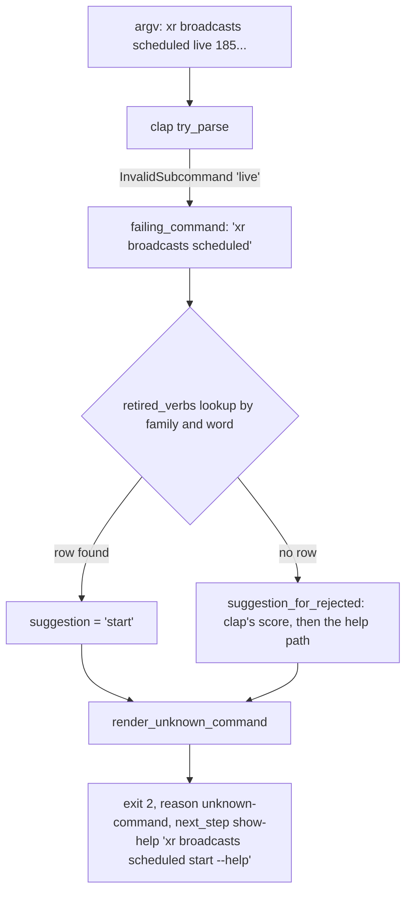

# Sibling Verb Alignment - Plan

**Target repo:** brettdavies/xurl-rs. Every path is in it. **Base:** `dev`. **Issue:** #421.

---

## Goal Capsule

- **Objective:** A caller who learned one of `xr`'s scheduled, broadcast, or call subtrees can type the matching command
  in its sibling on the first try, and a script or agent that still types a retired name is told the new one.
- **Means:** rename the three verbs that break the sibling pattern, leave `history` as it is, and answer each retired
  word with the name that replaced it through the existing `unknown-command` envelope (KTD1, KTD2).
- **Authority:** R-IDs win on behavior and KTDs on mechanism; a unit overrides neither. Every command and flag name, the
  retired-name behavior, and the version call are Brett's (AGENTS.md § "Command grammar"); this plan records
  recommendations, and the Decision Record names what is still his to answer.
- **Execution profile:** inline in one session, no subagents or worktrees. A stack of PRs, one per renamed spot plus one
  for the grammar text, the bottom PR targeting `dev`. Brett merges.
- **Stop conditions:** a change would touch a public item of `xdk-rs`; a change would add a `reason` or a
  `next_step.action`; a retired word would run a request instead of refusing; Brett's answer drops or renames a spot
  differently than the units assume (re-plan that unit, keep the others).

---

## Product Contract

### Summary

Three nested commands take the verb their siblings use: `xr broadcasts scheduled remove` becomes `cancel`,
`xr broadcasts sources rename <ID> <NAME>` becomes `update <ID> --name <NAME>`, and `xr broadcasts scheduled live`
becomes `start`. `xr conversations history` and `xr broadcasts chat history` keep their names. A retired word refuses at
exit 2 as an unknown command whose `suggestion` and help pointer name its replacement. `AGENTS.md` gains the verb rule
so the next family follows it.

### Problem Frame

Issue #421 found four places where sibling subtrees name one action with different words. The reproduction against a
development `xr` at `b50850d` (offline: scratch `XURL_TOKEN_STORE`, `API_BASE_URL` at a closed port) confirms each spot
as written, with three corrections:

- **Spot 1 is not one wire operation.** X's spec names them differently: `DELETE /2/calls/scheduled/{id}` is
  `cancelScheduledCall`, takes `scope`, `occurrence_start_time`, and `notify_invitees`, answers `{"cancelled": true}`,
  and succeeds again on a call already cancelled. `DELETE /2/broadcasts/scheduled/{id}` is `deleteScheduledBroadcast`
  and answers `{"deleted": true}`. To the caller both take a scheduled event off the calendar, and `xr` already
  describes the broadcast one as cancelling: its help ("Cancel a scheduled broadcast"), its family's about line ("change
  or cancel them"), and its prompt ("Cancel scheduled broadcast {id}?").
- **Spot 3's premise does not hold.** The issue says the rest of the CLI lists with `list` or `messages`. No command
  named `messages` exists anywhere in the tree (walked from `xr --help` down). Reads are routinely named for what they
  return: `lists followed`, `lists memberships`, `lists pinned`, `notes written`, `notes eligible`, `trends personal`,
  `spaces by-creator`, `conversations with`, `media analytics`. The issue's own proposal (item 4) keeps
  `xr conversations history`.
- **An agent's `list` guess already lands.** Today `xr conversations list <ID>` and `xr broadcasts chat list <ID>` exit
  2 with `"suggestion": "history"` and a `next_step` of `xr conversations history --help` (clap's Jaro score 0.726
  against `history`, above its 0.7 bar).

Every renamed command shipped first in `xr` 4.4.0, released 2026-10-28; 4.3.0 has none of them. No first-party consumer
names them: `xurl-rs-skill` and `agent-skills` hold no reference.

What an old name gets after a plain rename, scored with clap's method (`strsim::jaro`, best match above 0.7) against the
siblings that remain:

| Retired word                  | Nearest sibling after a plain rename | What the caller would see                                  |
| ----------------------------- | ------------------------------------ | ---------------------------------------------------------- |
| `broadcasts scheduled remove` | `get`, 0.500                         | no suggestion; `Try 'xr broadcasts scheduled --help'`      |
| `broadcasts sources rename`   | `remove`, 0.778                      | `Did you mean 'remove'?`, the help page of the delete verb |
| `broadcasts scheduled live`   | `list`, 0.667                        | no suggestion; `Try 'xr broadcasts scheduled --help'`      |

The `rename` row is the hazard: a plain rename steers the caller to the destructive sibling's help.

### Requirements

**Sibling alignment**

- R1. `xr calls scheduled` and `xr broadcasts scheduled` take a scheduled event off the calendar with the same verb.
- R2. `xr broadcasts sources` changes a source's label with the same verb, and the same argument shape, as every other
  subtree that changes a resource (`lists update`, `broadcasts scheduled update`, `calls scheduled update`,
  `auth apps update`).
- R3. Every action word under `xr broadcasts scheduled` is a verb; the one that starts a scheduled broadcast now names
  that action.
- R4. `xr conversations history` and `xr broadcasts chat history` keep their names.

**Retired names**

- R5. A retired word, typed in any form that reaches the unknown-command path (the invocation, the same with `--help`,
  `xr help <family> <word>`, and under `--dry-run`), exits 2 with reason `unknown-command`, its `suggestion` the
  replacing word, and a `next_step` of `show-help` for the replacing command's help. It never sends a request.
- R6. No retired word runs as an alias, appears in `--help`, completions, the schema registry, or the examples page.

**Contract and records**

- R7. The renamed commands keep their inputs, responses, exit codes, confirmation behavior, and `--dry-run` answers
  apart from the command name, and the `xdk-rs` public API does not change.
- R8. The release notes name each rename and its replacement; `AGENTS.md` § "Command grammar" states the verb rule the
  renames follow.

### Key Decisions

- **`history` stays.** Governs R4. The evidence in the Problem Frame settles it; see the Decision Record for the full
  case.
- **Old names refuse with the new name; they never alias.** Governs R5, R6. Recommended, pending Brett (Decision Record
  D2).
- **The names below are recommendations.** Governs R1, R2, R3. Spot 1 `cancel`, spot 2 `update --name`, spot 4 `start`,
  pending Brett (Decision Record D1).

### Scope Boundaries

- The library's shortcut names stay as X names the operations (`delete_scheduled_broadcast`, `rename_stream_source`,
  `go_live`, `cancel_scheduled_call`). Renaming them would break `xdk-rs` for no caller benefit (R7).
- The response types and their keys stay: `xr broadcasts scheduled cancel` still answers `{"deleted": true}`, since the
  key reports what X did.
- `.anc.toml` does not change. anc's `p6-may-standard-names` audit reads only the root `--help` (`audit_standard_names`
  over `project.help_output()` in agentnative-cli `src/audits/behavioral/standard_names.rs`), and every renamed word
  sits two levels down.
- The validate aliases do not change. They name response types (`delete`, `stream-source`, `scheduled-broadcast`,
  `scheduled-call-cancelled`), not commands.
- Considered and not built: a deprecation alias that still runs the old name and warns. The issue asks for no aliases,
  and `xr` has no deprecation channel to carry the warning; a Brett choice of D2's alias option would change this.
- Considered and not built: an expiry for retired-name rows. A row is one line and costs nothing to keep; a later rename
  that collides with a row fails the guard test (U1).
- Considered and not built: retired-name handling for `xr schema <slug>`. Its unknown-name error already lists every
  valid name, and issue #424 replaces the slug argument with command words (see Dependencies).

### Deferred to Follow-Up Work

- `xr schema <command words>` (issue #424) should resolve a retired word through the same lookup once its path
  resolution exists; a note goes to the `issues-schema-ergonomics` slot.

### Dependencies

- **Issue #424 and #426 (`issues-schema-ergonomics`)** rekey `SCHEMA_ENTRIES` from hyphen slugs to space-separated
  command paths and change `xr schema`'s arguments and default output. Each renamed spot edits one `SCHEMA_ENTRIES`
  string and one `schema/responses/` file name, so the two stacks conflict on three rows and on
  `crates/xurl-cli/tests/golden/schema-list.golden`. Proposed order: this stack merges first and #424 rekeys the names
  it finds; if #424 is ready first, this stack rebases and edits three space-separated keys instead. Either way the
  conflict is three lines plus a re-bless.
- **Issues #415 and #425 (`issues-help-accuracy`)** re-bless most `help-*.golden` fixtures, including the six this plan
  moves. The PR that lands second re-blesses only the fixtures its own change moves.
- **Issues #419, #420, #422 (`issues-dry-run-envelopes`)** touch dry-run envelopes and `calls scheduled` user-id input.
  No overlap with the renamed arms: R4 keeps `conversations history`, whose dry-run fixture
  (`dry-run-invalid-conversation-id.golden`) stays, and spot 1 renames the broadcast command, not
  `calls scheduled cancel`.
- **PR #409 (spec refresh to 2.173)** does not touch the affected endpoints (`gh pr diff 409` names no scheduled,
  sources, or chat path).

---

## Decision Record

Each decision lists the options, the evidence, and the recommendation. D1 to D3 are Brett's and go to him as one brief
before any build; D4 to D7 are settled from evidence.

### D1. The names (Brett)

**Spot 1, cancelling a scheduled event.** Options:

- `cancel` on both, renaming `broadcasts scheduled remove`. **Recommended.** Moves only the command whose own help,
  about line, and prompt already say "cancel". Keeps the domain verb where X's operation is a cancellation (invitees
  notified, occurrences scoped, `cancelled` reported). `cancel` is not in anc's standard list, which does not matter two
  levels down.
- `remove` on both, renaming `calls scheduled cancel`. Matches the fourteen `remove` verbs in the other subtrees and
  anc's list. But X keeps a cancelled call as cancelled and answers a second cancel with success, so `remove`
  misdescribes it, and `remove --scope this --occurrence <T>` reads as deleting one occurrence.
- Neither. Leaves the issue's agent-inference miss: today `xr broadcasts scheduled cancel` gets no suggestion at all.

**Spot 2, changing a source's label.** Options:

- `update <ID> --name <NAME>`, with `--name` required. **Recommended.** X's operation is `updateSource`; every other
  change verb is `update` with the changed fields as flags (`lists update --name`, `calls scheduled update --title`);
  `broadcasts scheduled update` already requires flags (`--start`, `--end`). Survives X adding a field to
  `UpdateSourceRequest`.
- `update <ID> <NAME>`. Same verb, keeps the positional, but no other `update` takes a positional value.
- Keep `rename`. X's request takes only `name` (required, `additionalProperties: false`) and its summary says "Rename a
  stream source", so the word is exact; it stays the one `rename` in the tree.

**Spot 4, starting a scheduled broadcast now.** Options:

- `start`. **Recommended.** Names the action as `xr`'s help ("Start a scheduled broadcast now"), about line ("start them
  early"), and prompt ("Start scheduled broadcast {id} now?") already do; anc counts it standard; `conversations start`
  is precedent. `add` and `update` take a `--start <TIME>` flag in the same subtree, which reads as "start at" beside
  "start now".
- `publish`. X's own description of the operation is "Publishes a schedule that was created or updated with
  `manual_publish: true`", the flag `--manual-publish` already names the mode it pairs with, `articles publish` is the
  same draft-to-public move, and anc counts it standard. Less plain for a person than "start".
- `go-live`, X's operation id (`goLiveScheduledBroadcast`). No other `xr` verb is a hyphenated phrase.

**Spot 3, `history`.** No rename (Key Decisions). Brett may still override; the evidence is in the Problem Frame.

### D2. What a retired name does (Brett)

- **Refuses with the new name. Recommended.** The `unknown-command` envelope as today, with `suggestion` the new word
  and `next_step.command` its help (KTD1). Additive: no new `reason`, `action`, or key. Without it the `rename` caller
  is steered to `remove` (Problem Frame table).
- Disappears. The plain clap path: family help for `remove` and `live`, `Did you mean 'remove'?` for `rename`.
- Runs as a hidden, deprecated alias until a later major. The route `RELEASES.md` § "X API changes" describes for a
  contract rename, but the issue asks for no aliases and `xr` has no deprecation warning to carry.

### D3. The version call (Brett)

`RELEASES.md` § "The three bumps": "Major: anything in the contract removed, renamed, or retyped"; command names are
contract (§ "What the contract is").

- **`xr` 5.0.0, batched with the schema-ergonomics breaks. Recommended.** Issue #424 drops `xr schema`'s hyphen-slug
  argument and #426 drops the `xr schema envelope` positional and changes what `xr schema <command>` prints, both
  contract breaks, so one major can carry all three, which is the "major that batches removals" `RELEASES.md` describes.
  Each PR files its entry under `### Breaking changes`.
- `xr` 4.5.0 on blast radius: the renamed commands are hours old and no first-party consumer names them. Departs from
  the written rule; each PR would file under `### Changed` and its body would state the minor call.
- `xdk-rs`: no release; nothing in the library changes (R7).

### D4. Retired names reuse `unknown-command` (settled)

The renderer, reason, exit code, and step stay those of `render_unknown_command` in `crates/xurl-cli/src/cli/runner.rs`;
only the `suggestion` source changes. Evidence: `AGENTS.md` § "Output formats" ("A new error picks an existing action
where one fits"), `RELEASES.md` § "Closed sets" (a new member is a minor and needs a consumer default), and
`docs/solutions/design-patterns/unknown-command-needs-two-detectors-one-renderer-and-the-scorer-that-saw-the-word.md`
(one renderer for every unknown-command path). The text keeps the "Did you mean" sentence; suggestion wording is not
contract (`RELEASES.md` § "What the contract is").

### D5. The library keeps X's names (settled)

`AGENTS.md` § "Where a change goes": the library states X's facts; the binary owns names a caller types. The shortcut
functions follow X's operation ids, and renaming them is an `xdk-rs` break (`cargo semver-checks`) with no caller
benefit.

### D6. `.anc.toml` and the validate aliases stay (settled)

Evidence in Scope Boundaries.

### D7. Review questions answered inline (settled)

Nobody watches this session, so every review question the evidence settles is answered here with its source; the review
records below list them.

---

## Planning Contract

### Key Technical Decisions

- KTD1. **A retired-verb table in its own module, consulted before clap's score.** A new
  `crates/xurl-cli/src/cli/retired_verbs.rs` holds rows of family path, retired word, replacing word, and one lookup.
  The clap rejection path in `crates/xurl-cli/src/cli/runner.rs` computes the failing family (`failing_command`) and
  asks the table before `suggestion_for_rejected`, so `xr <family> <old>`, its `--help` form, `xr help <family> <old>`,
  and `--dry-run` all resolve the same way (each already reaches that branch; reproduced for a missing verb). A module
  of its own keeps `classify.rs` (334 lines) from growing past the refactor trigger. The root classifier path needs no
  row, since no top-level word is renamed.
- KTD2. **Each rename is a variant rename, not an alias.** The clap variant, its `family_help` verb constant, its
  dispatch arm, its `--dry-run` context name, its `SCHEMA_ENTRIES` string, and its `schema/responses/` file all move
  together; nothing keeps the old spelling (R6).
- KTD3. **The `--dry-run` context names the new slug.** `"command": "broadcasts-scheduled-cancel"` and the others follow
  the schema registry's slug, as every arm does today. If #424 lands first and the context moves to space-separated
  paths, the arm follows whatever form it set.
- KTD4. **The table's guard is a plain test, not a recipe walk.** It walks `Cli::command()` and fails when a row's
  family is gone, its replacing word is not a subcommand there, or its retired word is one again. Its failure message
  carries no `Cause:` line, so `crates/xurl-cli/tests/recipe_guard.rs` does not require `AGENTS.md` to name it.
- KTD5. **One PR per spot.** Each rename is separable and Brett may take some and not others; each PR carries its own
  retired-verb row, fixtures, schema file, completions, and README lines. U1 introduces the module with the first row.

### High-Level Technical Design

How a retired word reaches the caller. Directional, not an implementation spec.

### Assumptions

- The units below assume D1's recommended names and D2's refusal. A different D1 answer changes the words in a unit, not
  its shape; D2 "disappears" drops KTD1, KTD4, and every row; D2 "alias" replaces U1's table with hidden clap aliases
  plus a deprecation notice and needs its own plan.
- D3 changes only each PR's changelog section and whether its title carries `!`.

---

## Implementation Units

### U1. `broadcasts scheduled remove` becomes `cancel`, with the retired-verb table

- **Goal:** The two scheduled subtrees cancel with one verb, and `remove` under `broadcasts scheduled` names `cancel`.
- **Requirements:** R1, R5, R6, R7.
- **Dependencies:** Brett's D1 to D3 answers.
- **Files:**
  - Create `crates/xurl-cli/src/cli/retired_verbs.rs`; modify `crates/xurl-cli/src/cli/mod.rs` (module declaration,
    `ScheduledBroadcastsCommands::Remove` to `Cancel`) and `crates/xurl-cli/src/cli/runner.rs` (lookup before
    `suggestion_for_rejected`).
  - Modify `crates/xurl-cli/src/cli/family_help.rs` (`broadcasts_scheduled::REMOVE` to `CANCEL`),
    `crates/xurl-cli/src/cli/commands/broadcast_scheduled.rs` (arm and context name),
    `crates/xurl-cli/src/cli/commands/schema.rs` (row string).
  - Rename `schema/responses/broadcasts-scheduled-remove.schema.json` to `broadcasts-scheduled-cancel.schema.json`
    through `scripts/generate-response-schemas.sh`.
  - Replace `crates/xurl-cli/tests/golden/help-broadcasts-scheduled-remove.golden` with
    `help-broadcasts-scheduled-cancel.golden`; re-bless `help-broadcasts-scheduled.golden` and `schema-list.golden`.
  - Modify `crates/xurl-cli/tests/agentic_tests.rs` (`CONFIRMED_COMMANDS`),
    `crates/xurl-cli/tests/broadcasts_family_tests.rs` (the confirmed-verb loop),
    `crates/xurl-cli/tests/unknown_command_tests.rs` (retired-name cases and the KTD4 guard).
  - Regenerate `completions/` through `scripts/generate-completions.sh`; modify `crates/xurl-cli/README.md` §
    "Broadcasts".
- **Approach:**
  1. Add the module and its lookup per KTD1, with the row (`broadcasts scheduled`, `remove`, `cancel`).
  2. Rename the variant per KTD2; the prompt, help, and about line already say "cancel" and stay.
  3. Regenerate the schema file and completions, then bless only the fixtures named above.
- **Patterns to follow:** `calls scheduled cancel` in `crates/xurl-cli/src/cli/commands/calls.rs` for a confirmed
  cancel; `nearest_command` in `crates/xurl-cli/src/cli/classify.rs` for a lookup the renderer consumes.
- **Test scenarios:**
  - `xr broadcasts scheduled cancel 1850000000000000001 --force --no-interactive` sends
    `DELETE /2/broadcasts/scheduled/1850000000000000001` against the mock and prints the `deleted` answer.
  - `xr broadcasts scheduled cancel 1850000000000000001 --no-interactive` without `--force` exits 1 with
    `confirmation-required`.
  - `xr --dry-run --output json broadcasts scheduled cancel 1850000000000000001` answers
    `"command": "broadcasts-scheduled-cancel"` and `confirmation_required: true`, and sends nothing.
  - `xr --output json broadcasts scheduled remove 1850000000000000001` exits 2 with reason `unknown-command`, `command`
    `remove`, `suggestion` `cancel`, and `next_step.command` `xr broadcasts scheduled cancel --help`, and the mock
    records no request.
  - The same holds for `xr broadcasts scheduled remove --help`, `xr help broadcasts scheduled remove`, and
    `xr --dry-run broadcasts scheduled remove 1`.
  - Text mode: `xr broadcasts scheduled remove 1` prints
    `Error: unknown command 'remove'. Did you mean 'cancel'? Try 'xr broadcasts scheduled cancel --help'.`
  - `xr lists remove 1 --force --no-interactive` still runs: a row keyed by family does not touch another family's
    `remove`.
  - Guard: a row whose replacing word is not a subcommand of its family, or whose retired word is one, fails the walk.
- **Verification:** the suites above pass; `xr broadcasts scheduled --help` lists `cancel` and not `remove`;
  `xr schema --list` names `broadcasts-scheduled-cancel`.

### U2. `broadcasts sources rename` becomes `update --name`

- **Goal:** A source's label changes with `update`, as every other resource's does, and `rename` names `update` instead
  of `remove`.
- **Requirements:** R2, R5, R6, R7.
- **Dependencies:** U1.
- **Files:**
  - Modify `crates/xurl-cli/src/cli/mod.rs` (`SourcesCommands::Rename` to `Update` with a required `--name`),
    `crates/xurl-cli/src/cli/family_help.rs` (`broadcast_sources::RENAME` to `UPDATE`, example
    `1x2y3z4w5v6u --name "Studio B"`), `crates/xurl-cli/src/cli/commands/broadcasts.rs` (arm and context name),
    `crates/xurl-cli/src/cli/commands/schema.rs`, `crates/xurl-cli/src/cli/retired_verbs.rs` (row).
  - Rename `schema/responses/broadcasts-sources-rename.schema.json` to `broadcasts-sources-update.schema.json`.
  - Replace `help-broadcasts-sources-rename.golden` with `help-broadcasts-sources-update.golden`; re-bless
    `help-broadcasts-sources.golden` and `schema-list.golden`.
  - Modify `crates/xurl-cli/tests/broadcast_sources_tests.rs` and `crates/xurl-cli/tests/unknown_command_tests.rs`;
    regenerate `completions/`; modify `crates/xurl-cli/README.md` § "Broadcasts".
- **Approach:** The arm still calls `rename_stream_source` with the same validation (`validate_source_name`); only the
  argument moves from a positional to `--name` (D5, KTD2).
- **Patterns to follow:** `ListsCommands::Update` in `crates/xurl-cli/src/cli/mod.rs` for `--name`;
  `ScheduledBroadcastsCommands::Update` for a required flag on `update`.
- **Test scenarios:**
  - `xr broadcasts sources update 1x2y3z4w5v6u --name "Studio B"` sends `PUT /2/sources/1x2y3z4w5v6u` with
    `{"name":"Studio B"}`.
  - `xr broadcasts sources update 1x2y3z4w5v6u` without `--name` exits 2 (`invalid-args`) and sends nothing.
  - `xr broadcasts sources update 1x2y3z4w5v6u --name ""` is refused by the existing name check, as `rename` refused it.
  - `xr --dry-run --output json broadcasts sources update 1x2y3z4w5v6u --name "Studio B"` answers
    `"command": "broadcasts-sources-update"` with `source_id` and `name`.
  - `xr --output json broadcasts sources rename 1x2y3z4w5v6u "Studio B"` exits 2 with `suggestion` `update`, never
    `remove`, and `next_step.command` `xr broadcasts sources update --help`.
- **Verification:** the suites pass; `xr broadcasts sources --help` lists `update`; no `rename` remains in the tree.

### U3. `broadcasts scheduled live` becomes `start`

- **Goal:** Every action under `broadcasts scheduled` is a verb, and `live` names `start`.
- **Requirements:** R3, R5, R6, R7.
- **Dependencies:** U1.
- **Files:**
  - Modify `crates/xurl-cli/src/cli/mod.rs` (`ScheduledBroadcastsCommands::Live` to `Start`; the `--manual-publish` help
    on `add` and `update` names `xr broadcasts scheduled start`), `crates/xurl-cli/src/cli/family_help.rs`
    (`broadcasts_scheduled::LIVE` to `START`, its JSON caption, and `page()`),
    `crates/xurl-cli/src/cli/commands/broadcast_scheduled.rs`, `crates/xurl-cli/src/cli/commands/schema.rs`,
    `crates/xurl-cli/src/cli/retired_verbs.rs`.
  - Rename `schema/responses/broadcasts-scheduled-live.schema.json` to `broadcasts-scheduled-start.schema.json`.
  - Replace `help-broadcasts-scheduled-live.golden` with `help-broadcasts-scheduled-start.golden`; re-bless
    `help-broadcasts-scheduled.golden`, `help-broadcasts-scheduled-add.golden`,
    `help-broadcasts-scheduled-update.golden`, and `schema-list.golden`.
  - Modify `crates/xurl-cli/tests/agentic_tests.rs`, `crates/xurl-cli/tests/broadcasts_family_tests.rs`,
    `crates/xurl-cli/tests/unknown_command_tests.rs`; regenerate `completions/`; modify `crates/xurl-cli/README.md` §
    "Broadcasts".
- **Approach:** The arm still calls `go_live` behind the same confirmation (D5, KTD2).
- **Patterns to follow:** U1's arm and row.
- **Test scenarios:**
  - `xr broadcasts scheduled start 1850000000000000001 --force --no-interactive` sends
    `POST /2/broadcasts/scheduled/1850000000000000001/live`.
  - Without `--force` under `--no-interactive` it exits 1 with `confirmation-required`.
  - `xr --dry-run --output json broadcasts scheduled start 1850000000000000001` answers
    `"command": "broadcasts-scheduled-start"`.
  - `xr --output json broadcasts scheduled live 1850000000000000001` exits 2 with `suggestion` `start` and no request.
  - `xr broadcasts scheduled add --help` describes `--manual-publish` with `xr broadcasts scheduled start`.
- **Verification:** the suites pass; no `live` verb remains; the `--manual-publish` text names a command that exists.

### U4. The verb rule in `AGENTS.md`

- **Goal:** The next command family picks its verbs by the rule these renames follow.
- **Requirements:** R8.
- **Dependencies:** U1, U2, U3 (the text describes their end state; adjust to Brett's D1).
- **Files:** Modify `AGENTS.md` § "Command grammar: flags vs subcommands".
- **Approach:** Add one bullet group stating present rules only:
  1. An action is a verb; sibling subtrees name the same action with the same verb.
  2. A read may be named for what it returns (`history`, `followed`, `pinned`, `written`).
  3. A resource change is `update`, its fields given as flags.
  4. A delete is `remove`; taking a scheduled event off the calendar is `cancel`.
- **Test expectation:** none -- prose in a contributor document; `crates/xurl-cli/tests/recipe_guard.rs` reads a
  different section and must still pass.
- **Verification:** markdownlint passes; the bullets match the tree as U1 to U3 leave it.

---

## Verification Contract

| Gate               | Command                                                                                                                                      | When             |
| ------------------ | -------------------------------------------------------------------------------------------------------------------------------------------- | ---------------- |
| Format             | `cargo fmt --check`                                                                                                                          | every PR         |
| Lint               | `cargo clippy --all-targets --all-features -- -D warnings`                                                                                   | every PR         |
| Suite              | `cargo test --workspace --no-fail-fast`, in the background                                                                                   | every PR         |
| Fixtures           | `XURL_GOLDEN_BLESS=1 cargo test -p xurl-rs --test golden_tests`, then `git diff --stat` names only the fixtures the unit lists               | U1 to U3         |
| Schemas            | `scripts/generate-response-schemas.sh`, then `crates/xurl-cli/tests/schema_tests.rs`                                                         | U1 to U3         |
| Completions        | `scripts/generate-completions.sh`, the tree clean after                                                                                      | U1 to U3         |
| Library untouched  | `git diff --stat origin/dev -- crates/xdk` is empty                                                                                          | every PR         |
| Local CI mirror    | `scripts/hooks/pre-push`, in the background                                                                                                  | before each push |
| Agent-native audit | `anc audit . --bin xr` keeps its `p6-may-standard-names` verdict                                                                             | U3 (last rename) |
| Real binary        | the offline reproduction script run against the built `xr`: each retired word exits 2 naming its replacement, each new word reaches the mock | U1 to U3         |

A new test counts once it has been observed failing against the unfixed code: run each retired-name case before the row
exists and quote the failure.

---

## Definition of Done

- Each spot Brett approved is renamed per its unit, and every surface in KTD2 carries the new word and none the old.
- Every retired word refuses as R5 states, in text and JSON, and sends nothing.
- `history` is unchanged (R4).
- No `crates/xdk` change; no new `reason`, `action`, or envelope key.
- Each PR body's Related Issues names #421, and its Changelog section follows D3.
- Only the fixtures a unit lists moved; no stray re-bless.
- No abandoned experiment code remains in the diff.

---

## Sources

- Reproduction transcripts: the offline runs of each command named in issue #421, the proposed names, and the
  retired-name paths, against `xr` built at `b50850d`.
- X API spec `crates/xdk/vendor/x-api-openapi.json`: operation ids and summaries for `/2/broadcasts/scheduled/{id}`,
  `/2/broadcasts/scheduled/{id}/live`, `/2/calls/scheduled/{id}`, `/2/sources/{id}`; `UpdateSourceRequest`;
  `CancelScheduledCallResponseData`; `DeleteScheduledBroadcastResponseData`.
- Endpoint rows: `crates/xdk/build.rs` (`DELETE_SCHEDULED_BROADCAST`, `GO_LIVE`, `RENAME_STREAM_SOURCE`,
  `CANCEL_SCHEDULED_CALL`).
- clap's suggestion method: `clap_builder` 4.6.7 `src/parser/features/suggestions.rs` (`strsim::jaro`, above 0.7).
- anc's verb list and scope: agentnative-cli `src/audits/behavioral/standard_names.rs` at `72d253a`.
- `docs/solutions/design-patterns/unknown-command-needs-two-detectors-one-renderer-and-the-scorer-that-saw-the-word.md`.
- `docs/solutions/conventions/renaming-an-overloaded-domain-noun.md`: a rename's failures are over-applications in the
  source repo, so sweep for bystander uses of `remove`, `live`, and `rename` (`--state live` in `spaces search` stays).
- `RELEASES.md` § "Versioning"; `AGENTS.md` § "Command grammar", § "Adding a command family", § "Where a change goes".
