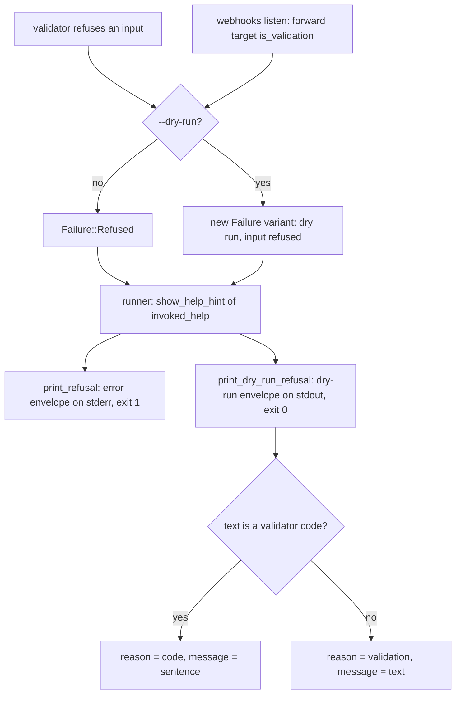
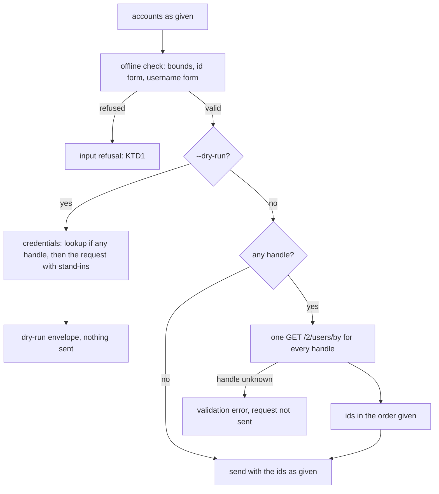

# Dry-Run Envelopes and Handle Arguments - Plan

**Issues:** #419, #420, #422.

---

## Goal Capsule

- **Objective:** An agent that dry-runs an `xr` command gets the same human `message` and the same recovery `next_step`
  in JSON that the real run gives, and can name an account by handle wherever `xr` takes an account to act on; a dry run
  still sends nothing.
- **Means:** route a dry run's input refusal through the runner the way a real run's refusal goes (KTD1, KTD2), give
  `notes evaluate` the note-text check `notes write` runs (KTD5), and resolve handles with the batched lookup
  `spaces by-creator` already uses (KD1, KTD6).
- **Authority:** Requirements outrank Key Technical Decisions, which outrank unit text. `AGENTS.md` § "Output formats"
  and `CONTRIBUTING.md` own the error contract; `AGENTS.md` § "Where a change goes" decides which crate a change lands
  in.
- **Stop conditions:**
  - Stop and send a decision brief before renaming or retyping any key an envelope carries today, before changing a
    command or flag name, and before touching the real run's validation envelope (Open Questions).
  - Stop if a dry run would send a request or a lookup to make any requirement pass.
- **Execution profile:** a stack of three PRs, bottom PR to `dev`: U1 (#420), then U2 (#419), then U5, U3, and U4
  (#422), one commit per unit; no subagents or worktrees; jobs over about 30 seconds run in the background; no request
  to the X API (tests use the in-crate mock and wiremock; manual runs use a scratch `XURL_TOKEN_STORE` and
  `API_BASE_URL=http://127.0.0.1:9`).
- **Who finishes:** the executing agent opens every PR and verifies each rollup green. Brett merges.

---

## Product Contract

### Summary

A dry run that refuses its inputs gains the `message` and `next_step` its real run's error carries, through one change
in the shared dry-run path and a walk that holds every refusing dry run to its real run. `notes evaluate` checks its
text with the validator `notes write` uses. `calls scheduled add` and `update --invite`, and
`webhooks subscriptions remove`, take handles as well as numeric ids, resolved in one lookup the way `spaces by-creator`
and `conversations start` resolve theirs.

### Problem Frame

`AGENTS.md` § "Output formats" and `CONTRIBUTING.md` require every structured error to carry a human `message` and,
wherever a step exists, a `next_step`. A dry run that refuses its inputs carries neither: `DryRun::answer` in
`crates/xurl-cli/src/cli/commands/mod.rs` writes the validator code into `reason` and prints the envelope, while the
real run's refusal goes back to the runner as `Failure::Refused` and picks up `show-help`. An agent that dry-runs first
has no prose to show and no step to follow.

`notes evaluate` and `notes write` both document `--text` as "The note's text; X requires a source URL in it", but only
`write` checks it, so `evaluate --dry-run` reports `would_succeed: true` for text `write` refuses.

The three commands in #422 take a user only as a numeric id. Every other command that acts on another account takes a
handle, so a caller holding `@jack` has to find the id-only commands by failing on them.

### Reproduction and Corrections to the Issues

Each command ran against a development build of `dev` at `b50850d` (`xr 4.4.0`), with `XURL_TOKEN_STORE` at a scratch
store holding one `OAuth2` login and `API_BASE_URL=http://127.0.0.1:9`.

- **#419 reproduces as filed.** `xr --dry-run --output json notes evaluate 1585341984679469056 --text "No link here"`
  answers `would_succeed: true`, `exit_code: 0`; the same `--text` on `notes write` answers
  `reason: note-needs-source-url`, `exit_code: 1`. The real `evaluate` run goes on to send the request. The vendored
  spec's `EvaluateCommunityNotesRequest.note_text` declares no URL pattern, while the create request's text carries
  `^(?=[\s\S]*https?://\S+)[\s\S]+$`; KD2 records why the check applies anyway.
- **#420 reproduces, and the real run differs from what the issue implies.** The dry run of
  `webhooks add https://example.com:8443/hook`, `webhooks replay ... --from 2026-10-27 --to 2026-10-27`, and
  `users 12345 @jack` under `--output json` carries `reason: <validator code>` with no `message` and no `next_step`. The
  real run's JSON envelope carries `reason: "validation"`, `message: "<validator code>"` (the code, not prose), and
  `next_step: {"action": "show-help", "command": "xr <command> --help"}`. Text mode prints the sentence in both runs.
- **#420 has a second gap the issue does not name.**
  `xr --dry-run --output json webhooks listen --forward ftp://example.com/x` carries `message` but
  `next_step: {"action": "fix-input"}`, while the real run carries `show-help` with `xr webhooks listen --help`. The dry
  run goes through `Failure::DryRunRefusal`, whose `recovery_hint` maps a validation error to `fix-input`.
- **#422's "no `next_step`" holds only for the dry run.** The real run of
  `calls scheduled add --start 2026-10-28T15:00:00Z --invite @jack --output json` carries `show-help` with
  `xr calls scheduled add --help`. Neither run names a lookup.
- **#422's precedent list is partly wrong.** `follow`, `block`, `mute`, and `lists members add` (not `lists add-member`)
  take a handle only, through `act_on_user` and `act_from_me_on_user`; a numeric argument is looked up as a username.
  The commands that take ids and handles in one argument are `users`, `spaces by-creator`, and `conversations start`.
  The issue's premise that `xr` "favors request primitives over hidden multi-call workflows" does not hold either:
  `act_from_me_on_user` sends up to three requests (the caller's id, the target's id, the action).

### Requirements

**Envelope contract (#420)**

- R1. A dry run whose inputs a command refuses carries `message` in every structured format: the sentence text mode
  prints for a validator code, and the refusal's own text for any other refusal.
- R2. That dry run carries the `next_step` the real run's error carries for the same invocation.
- R3. No key a refusing dry run carries today is renamed or retyped: `reason` stays the validator code where it is one
  today. `next_step` changes value only where it named a different step than the real run (`webhooks listen --forward`).
- R4. A walk fails for any refusing JSON dry run in the golden matrix whose envelope lacks `message`, or whose
  `next_step` or `exit_code` differs from its real run's.
- R5. A text dry run that refuses its inputs prints the real run's help pointer after the refusal line, and `--quiet`
  leaves it out.

**Community Notes (#419)**

- R6. `notes evaluate` refuses note text that holds no `http://` or `https://` URL as `note-needs-source-url`, in a dry
  run and a real run, before any request.
- R7. `notes write` and `notes evaluate` check the post and the note text with one validator.

**Handle arguments (#422)**

- R8. `calls scheduled add --invite` and `calls scheduled update --invite` take each invitee as a handle (`@jack` or
  `jack`) or a numeric user id, in any mix.
- R9. `webhooks subscriptions remove` takes the subscribed account as a handle or a numeric user id.
- R10. Every handle among one invocation's accounts resolves in one lookup request, and an invocation that names only
  numeric ids sends no lookup.
- R11. A dry run of these commands sends nothing and reports the lookup's credential among the requests it checks.
- R12. Inputs are checked offline before any lookup: the invitee bounds, a malformed handle as `invalid-username`, and a
  malformed numeric id as `invalid-user-id`.
- R13. A handle X does not know fails the real run before the command's own request, with the error `spaces by-creator`
  gives for one.

### Key Decisions

- KD1. **#422 takes shape (a): resolve handles.** Precedent settles it: `spaces by-creator` and `conversations start`
  already take mixed ids and handles, resolve every handle in one `GET /2/users/by` request, send nothing extra for ids,
  and report the lookup's credential under `--dry-run`. Shape (b) costs the same paid lookup, moved to a second
  invocation (`xr user @jack` per handle), and needs either a new `next_step.action` or a retyped step on an existing
  reason; shape (a) adds no action and changes no envelope. Governs R8, R9, R10, R11, R12, R13.
- KD2. **`notes evaluate` checks for a source URL although the spec does not require one there.** Both `--help` pages
  already promise the requirement, evaluate exists to score a draft before writing it, and a draft without a URL cannot
  be written, so refusing it offline saves a paid request that leads nowhere. Governs R6.
- KD3. **A refusing dry run's `message` is the human sentence, not the validator code.** The code already sits in
  `reason`, the contract asks for a human message, and #420's expected output asks for the text mode's sentence. Governs
  R1.
- KD4. **Text dry runs gain the help pointer.** One `Hint` carries both renderings, and a credential refusal's dry run
  already prints the real run's advice, so an input refusal printing its advice too keeps text and JSON naming the same
  step. Governs R5.

### Scope Boundaries

Considered and not built:

- **The real run's validation envelope** keeps `reason: "validation"` with the validator code in `message`. Changing it
  alters an envelope agents branch on today; Open Questions carries it for Brett.
- **A `resolve-handle` step** (shape (b)): not needed once handles resolve (KD1).
- **Caching a handle's id:** `AGENTS.md` § "Token store" rules out caching another user's handle, since a handle can
  pass to another account.
- **Rewording `notes evaluate --help`:** the help already states the rule this plan enforces.
- **Declaring `message` and `next_step` on the dry-run variant of `schema/output.schema.json`:** the variant is
  `additionalProperties: true` and names only its mandatory keys (KTD10).

### Deferred to Follow-Up Work

- `send_confirmed` and `webhooks subscriptions remove` ask for confirmation before they validate, so a real run under
  `--no-interactive` without `--force` reports `confirmation-required` for an input its dry run refuses. Both answers
  are correct for their run; aligning the order is a separate change.
- The xurl-rs-skill bundle's account of the dry-run envelope can name the new keys once this ships; the keys are
  additive, so its scripts keep working. Its `scripts/dry-run-gate.sh` prints only `reason` when a dry run refuses
  (lines 186-188); printing `message` and `next_step.command` there would hand the agent the rule and the step.

### Open Questions

- OQ1 (Brett's, does not block this plan). The real run's JSON envelope for an input refusal carries
  `reason: "validation"` and puts the validator code in `message`, so its `message` is not human prose either. The
  options: leave it; make `message` the sentence and add a key carrying the code, which changes a value agents may match
  on today; or make `message` the sentence alone, which drops the code. Recommendation: a separate issue, since every
  option changes an envelope agents read.

---

## Planning Contract

### Key Technical Decisions

- KTD1. **A dry run's input refusal returns to the runner, as a real run's does.** `DryRun::answer` hands its refusal
  back as a new `Failure` variant beside `DryRunRefusal`, and the runner answers it with
  `show_help_hint(&invoked_help(&args))`, the hint `Failure::Refused` gets. Only the runner holds argv, and sharing the
  builder makes the dry run's step equal the real run's by construction (R2).
- KTD2. **One printer serves every refusing dry run.** `OutputConfig::print_dry_run_refusal` already merges a credential
  refusal's error keys over the context; it takes input refusals too. An `Error::Validation` whose text
  `validation::sentence` recognizes becomes `reason: <code>` with `message: <sentence>`; any other text keeps
  `reason: "validation"` with the text as `message`. Both shapes the envelope has today survive (R3), and text mode
  prints the hint's lines unless `--quiet` (R5), as the printer does for credentials. `dry_run::CredentialRefusal`
  becomes a refusal of either kind.
- KTD3. **`webhooks listen` sends its forward-target validation errors through the same variant.** Its real run already
  maps `is_validation()` to `Failure::refused`; the dry run mirrors that rule, which moves its step from `fix-input` to
  `show-help`. Other target errors (`io`) keep `DryRunRefusal`.
- KTD4. **The walk lives in `crates/xurl-cli/tests/golden_tests.rs`, over `dry_run_cases()`.** For each JSON case whose
  envelope says `would_succeed: false`, it spawns the real run with `--dry-run` removed and `--force` added when the
  envelope says `confirmation_required`, then compares `message`, `exit_code`, and `next_step` with `--dry-run` stripped
  from a step's command. Every validator code already has a case there
  (`every_reason_the_source_emits_is_documented_and_pinned`), so the walk covers each one; a `webhooks listen --forward`
  case joins the matrix. Its failure message is a plain sentence with no `Cause:` line, since
  `crates/xurl-cli/tests/recipe_guard.rs` reserves that marker for command-family walks.
- KTD5. **`notes.rs` holds one draft validator for both arms.** It composes the library's `validate_post_id` and
  `validate_note_text`; no library change, since the rule already lives in `crates/xdk/src/api/shortcuts.rs` and only
  the composition is per command.
- KTD6. **One helper in `crates/xurl-cli/src/cli/commands/mod.rs` sends a request that names accounts.** It validates
  offline, builds the dry run's credential list from the lookup (when a handle is present) and the request, and in the
  real run resolves with `resolve_account_ids` and sends. `spaces by-creator` and `conversations start` move onto it, so
  the pattern has one copy; `webhooks subscriptions remove` uses its parts after its confirmation gate.
- KTD7. **The call is validated as it would be sent, with each handle standing in as `UNRESOLVED_ID`.** The library
  validators `validate_new_scheduled_call` and `validate_scheduled_call_changes` stay ids-only, which is right for an
  embedder sending to X; the binary adds each handle's `validate_username` check (R12). The real run validates before it
  looks anything up, so an invalid input costs no request.
- KTD8. **Context keys stay as they are.** `invitee_ids` and `user_id` echo the accounts as given, as the dry run
  already echoes `@jack` today; renaming them would be an envelope change.
- KTD9. **The value names become `ACCOUNT`.** `--invite <USER_ID>` and the `subscriptions remove` positional take the
  name `users` and `spaces by-creator` use; the flag and command names do not change. The help lines follow
  `spaces by-creator`'s wording: "A handle (@jack or jack) or numeric user id of someone to invite; repeat for each
  person" and "The subscribed account: a handle (@jack or jack), or the numeric user id `subscriptions list` prints".
  The help examples keep their numeric ids, which stay valid.
- KTD10. **`schema/output.schema.json` does not change.** The dry-run variant admits any key, and leaving it alone
  avoids a collision with #424, which adds a key to the same variant.

### High-Level Technical Design

A refused input takes the same hint builder in both runs; only the printer differs.



A command that names accounts:



### Assumptions

- The dry run's JSON `message` is the sentence text mode prints (KD3).
- Text dry runs gain the help pointer line (KD4).
- `ACCOUNT` is an acceptable value name; it names no flag or command (KTD9).
- An unknown handle under `calls` and `webhooks subscriptions remove` fails the way it does under `spaces by-creator`: a
  validation error naming the handle, with `fix-input` (R13).

### Dependencies and Collisions

- **#424 (`issues-schema-ergonomics`)** adds `response_schema` to dry-run envelopes and a line to the text summary. Both
  plans move every `dry-run-*.golden` fixture and touch `crates/xurl-cli/src/cli/output/dry_run.rs`; whichever lands
  second rebases on `dev` and re-blesses. The walk compares only `message`, `exit_code`, and `next_step`, so a new key
  does not break it.
- **#415, #416, #417 (`issues-help-accuracy`)** move help fixtures; #415 reorders `calls scheduled add --help`, which U3
  also moves. Rebase and re-bless the fixtures U3 and U4 change.
- **#421 (`issues-verb-alignment`)** may rename verbs in `crates/xurl-cli/src/cli/commands/calls.rs`; that is a textual
  conflict only, since none of the renamed verbs is one this plan changes.
- **#409 (spec refresh)** may change `crates/xdk/src/api/shortcuts.rs` and the auth matrix; rebase before each push.
- **CI queue.** Each xurl-rs PR starts about 25 jobs against the account's 20-job concurrency cap, so three PRs queue
  behind each other and a restack runs them again. Push the stack once every unit is built, and land it with one
  `gh stack merge`, so each head runs CI once.

### Changelog Entries

Each PR's `## Changelog` names what a caller of `xr` sees change, since `generate-changelog.sh` copies those bullets
into `CHANGELOG.md`:

- **U1:** under Fixed, a dry run that refuses an input carries `message` and the real run's `next_step` in every
  structured format, and text dry runs print the real run's help line. Under Changed, the `webhooks listen --forward`
  dry run's `next_step` becomes `show-help`, as its real run's is, in place of `fix-input`.
- **U2:** under Fixed, `notes evaluate` refuses text without a source URL before sending, as `notes write` does.
- **U5, U3, U4:** under Added, `calls scheduled add` and `update --invite`, and `webhooks subscriptions remove`, take a
  handle as well as a numeric user id, resolved in one lookup. U5 is a refactor and adds no entry.

---

## Implementation Units

### U1. Input refusals in dry runs carry `message` and the real run's step

- **Goal:** every refusing dry run carries `message`, and the `next_step` and `exit_code` of its real run, held by a
  walk.
- **Requirements:** R1, R2, R3, R4, R5.
- **Dependencies:** none.
- **Files:**
  - `crates/xurl-cli/src/cli/failure.rs`
  - `crates/xurl-cli/src/cli/commands/mod.rs`
  - `crates/xurl-cli/src/cli/commands/webhooks_listen.rs`
  - `crates/xurl-cli/src/cli/runner.rs`
  - `crates/xurl-cli/src/cli/output/mod.rs`
  - `crates/xurl-cli/src/cli/output/dry_run.rs`
  - `crates/xurl-cli/tests/golden_tests.rs`
  - `crates/xurl-cli/tests/golden/dry-run-*.golden` (re-blessed), and a new fixture for the `webhooks listen --forward`
    case
  - `crates/xurl-cli/README.md` (§ "Dry Runs")
  - `AGENTS.md` (§ "Output formats", the `--dry-run` paragraph)
- **Approach:**
  1. Write the walk (KTD4) and the listen case first, and keep the failure it prints against `dev`.
  2. Add the variant (KTD1) and return it from `DryRun::answer` and from the listen dry run (KTD3).
  3. Extend the printer (KTD2) and the text summary's refusal type.
  4. Re-bless, then confirm with `git status` that only `dry-run-*` fixtures moved, and that each moved fixture gained
     `message` and `next_step` and lost nothing.
  5. State in both docs that an input refusal carries `message` and the real run's `next_step`, and that text prints the
     real run's advice for either refusal. The README's text example (`xr --dry-run bookmark-folders add ""`) gains its
     `Try 'xr bookmark-folders add --help'.` line.
- **Execution note:** the walk must be observed failing against unfixed code before the fix lands; quote that output in
  the PR.
- **Patterns to follow:** `Failure::DryRunRefusal` and its runner arm; `print_refusal`, which attaches the `show-help`
  step to a real run's refusal; `a_dry_run_refusal_carries_the_step_of_its_real_run` in
  `crates/xurl-cli/tests/next_step_tests.rs`.
- **Test scenarios:**
  - `xr --dry-run --output json webhooks add https://example.com:8443/hook` exits 0 with
    `reason: "webhook-url-has-port"`, `message: "The webhook URL names a port; X takes one without a port."`,
    `next_step: {"action": "show-help", "command": "xr webhooks add --help"}`, and `exit_code: 1`.
  - `xr --dry-run --output json users 12345 @jack` carries `reason: "mixed-ids-and-handles"`, the sentence as `message`,
    and `show-help` with `xr users --help`.
  - `xr --dry-run --output json webhooks listen --forward ftp://example.com/x` carries `reason: "validation"`,
    `message: "--forward takes an http or https URL"`, and `show-help` with `xr webhooks listen --help`.
  - `xr --dry-run --output yaml webhooks add https://example.com:8443/hook` carries `message` and `next_step` too.
  - `xr --dry-run webhooks add https://example.com:8443/hook` prints the summary, then `Try 'xr webhooks add --help'.`
    (the moved `dry-run-text-invalid` fixture pins it).
  - With `--quiet` the same summary prints without that line, pinned by a new `dry-run-text-invalid-quiet` golden case;
    `dry-run-text-quiet` covers only a credential refusal.
  - The credential-refusal fixtures (`dry-run-no-credential`, `dry-run-scheme-not-accepted`) do not move.
  - A unit test in `crates/xurl-cli/src/cli/output/dry_run.rs` covers an input refusal with advice lines.
  - The walk passes over every JSON case in `dry_run_cases()`, and fails when it checked fewer refusing cases than
    `validator_reasons()` names, so a broken filter cannot pass it empty.
- **Verification:** the walk fails on `dev` for a missing `message` and for the listen step, and passes after the
  change; the golden suite passes with only `dry-run-*` fixtures moved.

### U2. `notes evaluate` checks its text like `notes write`

- **Goal:** `notes evaluate` refuses note text with no source URL, through the validator `notes write` uses.
- **Requirements:** R6, R7.
- **Dependencies:** U1, for the stack order only; the unit's tests do not depend on U1's keys.
- **Files:**
  - `crates/xurl-cli/src/cli/commands/notes.rs`
  - `crates/xurl-cli/tests/notes_tests.rs`
- **Approach:** add the draft validator (KTD5) and call it from both the `Write` and `Evaluate` arms.
- **Execution note:** write the evaluate tests first and observe them fail against `dev`.
- **Patterns to follow:** the `Write` arm's validator closure in `notes.rs`; `evaluate_scores_a_draft` in
  `notes_tests.rs`.
- **Test scenarios:**
  - `notes evaluate <POST> --text "No link here"` under `--dry-run --output json` answers `would_succeed: false`,
    `reason: "note-needs-source-url"`, `exit_code: 1`.
  - The same invocation without `--dry-run` exits 1 and the mock receives no request at `/2/notes/evaluate`.
  - `--text "From 2019: https://example.com"` dry-runs to `would_succeed: true` and, in a real run, reaches the mock
    once.
  - `--text "see https:// later"` (a scheme with nothing after it) is refused, as `notes write` refuses it.
  - The `notes write` tests pass unchanged.
- **Verification:** both arms call one function, and the notes tests pass.

### U5. One helper for requests that name accounts

- **Goal:** `spaces by-creator` and `conversations start` send through one helper that owns account resolution, with no
  change to what either command does.
- **Requirements:** R10, R11 (as the shared path U3 and U4 build on).
- **Dependencies:** U2, for the stack order.
- **Files:**
  - `crates/xurl-cli/src/cli/commands/mod.rs`
  - `crates/xurl-cli/src/cli/commands/spaces.rs`
  - `crates/xurl-cli/src/cli/commands/conversations.rs`
- **Approach:** extract the helper (KTD6) from `spaces::by_creator` and `conversations::start` and move both onto it, in
  its own commit, so the behavior change in U3 lands on a path whose existing tests already pass.
- **Patterns to follow:** `act_on_user_with`, a helper over one request that takes a validator and a context.
- **Test expectation:** no new tests; the change preserves behavior, and the existing tests hold it:
  `by_creator_resolves_every_handle_in_one_lookup`, `by_creator_takes_ids_and_handles_together`,
  `by_creator_sends_ids_alone_without_a_lookup`, and `by_creator_names_a_handle_x_could_not_find` in
  `crates/xurl-cli/tests/spaces_tests.rs`; `start_resolves_every_handle_in_one_lookup_and_creates_a_group` in
  `crates/xurl-cli/tests/dm_conversations_tests.rs`; and `crates/xurl-cli/tests/dry_run_guard.rs`.
- **Verification:** those tests pass unchanged, no fixture moves, and the dry-run and resolution code for account lists
  exists once.

### U3. `--invite` takes handles

- **Goal:** `calls scheduled add` and `update --invite` take handles and ids in any mix, through the U5 helper.
- **Requirements:** R8, R10, R11, R12, R13.
- **Dependencies:** U5.
- **Files:**
  - `crates/xurl-cli/src/cli/commands/calls.rs`
  - `crates/xurl-cli/src/cli/mod.rs` (the `--invite` value name and help)
  - `crates/xurl-cli/src/cli/family_help.rs` and `crates/xurl-cli/src/cli/commands/examples.rs`, if an example gains a
    handle
  - `crates/xurl-cli/tests/golden/help-calls-scheduled-add.golden`,
    `crates/xurl-cli/tests/golden/help-calls-scheduled-update.golden`
  - the completions `scripts/generate-completions.sh` writes, if the value name reaches them
  - `crates/xurl-cli/README.md` (the `calls` section's `--invite` sentence)
  - `AGENTS.md` (§ "Adding a command family", the dispatch-arm helper list)
  - `crates/xurl-cli/tests/calls_tests.rs`
- **Approach:**
  1. Route `add` and `update` through the U5 helper, validating with stand-ins (KTD7) while the context keeps the
     accounts as given (KTD8). Build the call once from the flags, then derive the validated and the sent call from it
     by substituting `invitee_ids` alone, so the context, the check, and the request cannot differ in any other field.
  2. Rename the value name (KTD9), re-bless the two help fixtures, and regenerate completions.
  3. Replace the README's "`--invite` takes a numeric user ID (`xr user @handle` prints one)" with the new rule, and
     name the helper in the `AGENTS.md` recipe.
- **Patterns to follow:** `spaces::by_creator` after U5; `handles_lookup_call` and `resolve_account_ids`;
  `UNRESOLVED_ID`.
- **Test scenarios:**
  - `calls scheduled add --start <T> --invite @jack --invite 2244994945` sends one `GET /2/users/by` with
    `usernames=jack`, then `POST /2/calls/scheduled` whose `invitee_ids` are jack's id and `2244994945`, in that order.
  - `--invite 783214` alone sends no lookup.
  - Under `--dry-run --output json`, `--invite @jack` answers `would_succeed: true`, `invitee_ids: ["@jack"]`, and
    nothing reaches the mock.
  - A lookup that answers `@nosuchuser` in `errors` fails with exit 1 naming the handle, and no `POST` is sent.
  - `--invite "bad-handle!"` is refused offline as `invalid-username`, and a 20-digit id as `invalid-user-id`; neither
    sends a request.
  - 26 invitees on `add`, mixed handles and ids, are refused offline as `too-many-invitees`.
  - `update <ID> --invite @jack` sends the lookup, then `PUT /2/calls/scheduled/<ID>` with the resolved list;
    `update <ID> --title x` sends no lookup.
  - `add --start <T> --invite @jack --no-notify` sends `notify_invitees: false` with jack's id, so the derived call
    keeps every field but `invitee_ids`.
  - `crates/xurl-cli/tests/dry_run_guard.rs` passes, so no new path sends under `--dry-run`.
- **Verification:** the calls tests and the dry-run guard pass, the two help fixtures and completions move only by the
  value name and help line, and the pattern exists once.

### U4. `webhooks subscriptions remove` takes a handle

- **Goal:** the subscribed account can be named by handle, resolved only after the confirmation gate.
- **Requirements:** R9, R10, R11, R12, R13.
- **Dependencies:** U3.
- **Files:**
  - `crates/xurl-cli/src/cli/commands/webhooks.rs`
  - `crates/xurl-cli/src/cli/mod.rs` (the positional's value name and help)
  - `crates/xurl-cli/tests/golden/help-webhooks-subscriptions-remove.golden`
  - the completions, if the value name reaches them
  - `crates/xurl-cli/tests/webhooks_tests.rs`
- **Approach:** validate the account's form with the webhook id, gate, then resolve with the helper's parts (KTD6) and
  send; the dry run builds its credentials from the lookup and the delete. The prompt names the account as given.
- **Patterns to follow:** `unsubscribe` in `webhooks.rs`; the helper from U5.
- **Test scenarios:**
  - `webhooks subscriptions remove <WEBHOOK_ID> @jack --force` sends the lookup, then
    `DELETE /2/account_activity/webhooks/<WEBHOOK_ID>/subscriptions/<jack's id>/all`.
  - A numeric account sends no lookup.
  - Under `--no-interactive` without `--force`, the run answers `confirmation-required` and sends no lookup.
  - `--dry-run --output json` with `@jack` sends nothing and answers `confirmation_required: true`.
  - An unknown handle fails with exit 1, and no `DELETE` is sent.
  - `@` alone is refused offline as `invalid-username`.
- **Verification:** the webhooks tests and the dry-run guard pass, and the help fixture moves only by the value name and
  help line.

---

## Verification Contract

| Gate                         | Command                                                                                                                                           | Applies to     |
| ---------------------------- | ------------------------------------------------------------------------------------------------------------------------------------------------- | -------------- |
| Golden fixtures and the walk | `cargo test -p xurl-rs --test golden_tests`                                                                                                       | U1, U3, U4     |
| Re-bless, local only         | `XURL_GOLDEN_BLESS=1 cargo test -p xurl-rs --test golden_tests`, then `git status` lists only the intended fixtures                               | U1, U3, U4     |
| Step parity                  | `cargo test -p xurl-rs --test next_step_tests`                                                                                                    | U1             |
| Dry runs send nothing        | `cargo test -p xurl-rs --test dry_run_guard`                                                                                                      | U1, U3, U4     |
| Family tests                 | `cargo test -p xurl-rs --test notes_tests`, `--test calls_tests`, `--test webhooks_tests`, `--test spaces_tests`, `--test dm_conversations_tests` | U2, U5, U3, U4 |
| Recipe and examples walks    | `cargo test -p xurl-rs --test recipe_guard --test agentic_tests`                                                                                  | U3             |
| Whole suite                  | `cargo test --workspace --no-fail-fast`, in the background                                                                                        | each PR        |
| Lints                        | `cargo fmt --check`, `cargo clippy --all-targets -- -D warnings`                                                                                  | each PR        |
| Completions freshness        | `scripts/generate-completions.sh`, then an empty `git diff` on a second run                                                                       | U3, U4         |
| Local CI mirror              | `scripts/hooks/pre-push`, in the background                                                                                                       | each PR        |
| Manual repro                 | the commands under "Reproduction" against `target/debug/xr`, scratch store, closed port                                                           | each PR        |

---

## Definition of Done

- Every requirement R1 to R13 holds, and each unit's test scenarios exist and pass.
- The U1 walk and the U2 evaluate tests were observed failing against unfixed code, with the output quoted in their PR.
- Only fixtures a unit names moved, each for the reason the unit gives.
- `README.md`, `AGENTS.md`, and the help describe the shipped behavior.
- No dry run sends a request; no test or manual run reached the X API or the real token store.
- Three PRs stacked, bottom on `dev`; each names its issues under Related Issues and has every rollup check `SUCCESS`.
- No dead-end or experimental code is left in the diff.

---

## Eng Review

Review of this plan at `396e4d1`, run inline with no subagents. Nobody watches the session, so each choice below was
decided from the evidence it cites, under the brief's instruction to answer review questions where the evidence settles
them; the decisions that are Brett's alone stay in Open Questions.

### Scope record

- **Complexity gate:** tripped. The plan changes about 22 files (source, tests, two docs, help and dry-run fixtures,
  completions) and adds one `Failure` variant and one helper.
- **Feature cuts:** none. Each requirement answers one of the three issues, and the brief asks for all three.
- **Structure (D2):** original arrangement kept. The smaller one leaves `spaces by-creator` and `conversations start` on
  their own copies of account resolution, so the repo would hold two ways to do one task.
- **Accepted scope:** the plan as written plus the amendments below; **pending remedies:** none.
- **Result:** scope accepted as-is.

### Reality rows

| Premise                                                                          | Receipt                                                                           | Verdict |
| -------------------------------------------------------------------------------- | --------------------------------------------------------------------------------- | ------- |
| A dry run's input refusal writes the code into `reason` and prints, with no step | `crates/xurl-cli/src/cli/commands/mod.rs:204` `ctx["reason"] = json!(reason);`    | true    |
| A real run's refusal takes `show-help` from the runner                           | `crates/xurl-cli/src/cli/runner.rs:356-359` `Failure::Refused` → `show_help_hint` | true    |
| `recovery_hint` gives a validation error `fix-input`                             | `crates/xurl-cli/src/cli/hints.rs:636-660` `general_hint`, `NextAction::FixInput` | true    |
| The listen dry run sends target errors as `DryRunRefusal`                        | `crates/xurl-cli/src/cli/commands/webhooks_listen.rs:95-97`                       | true    |
| The listen real run maps `is_validation()` to `Failure::refused`                 | `crates/xurl-cli/src/cli/commands/webhooks_listen.rs:106-111`                     | true    |
| `notes evaluate` validates only the post id                                      | `crates/xurl-cli/src/cli/commands/notes.rs:49-50`                                 | true    |
| The evaluate request declares no URL pattern                                     | `crates/xdk/vendor/x-api-openapi.json`, `EvaluateCommunityNotesRequest.note_text` | true    |
| Invitees validate as numeric ids                                                 | `crates/xdk/src/api/shortcuts.rs:1378-1383` `check_invitees`                      | true    |
| Mixed accounts resolve in one lookup                                             | `crates/xurl-cli/src/cli/commands/mod.rs:1016-1041`                               | true    |
| Every validator code has a dry-run case                                          | `crates/xurl-cli/tests/golden_tests.rs:1962-1979`                                 | true    |
| The dry-run schema variant admits any key                                        | `schema/output.schema.json:127` `"additionalProperties": true`                    | true    |
| Invitee bounds are 25 new and 100 changed                                        | `crates/xdk/src/api/shortcuts.rs:1190`, `:1193`                                   | true    |

`unverified=0`.

- `REALITY: premise-table pass 12 premises, unverified=0 crates/xurl-cli/src/cli/commands/mod.rs:204`
- `REALITY: already-done pass dev since 2026-10-27 has only #427, #428 crates/xurl-cli/src/cli/runner.rs:356`
- `REALITY: surface-check pass 16 named commands answer --help crates/xurl-cli/src/cli/mod.rs:3177`
- `REALITY: binding-decisions pass none covers this work crates/xurl-cli/src/cli/failure.rs:32`
- `REALITY: numbers pass bounds read from constants crates/xdk/src/api/shortcuts.rs:1190`
- `REALITY: deferred-asks pass resolve-handle not built, KD1 crates/xurl-cli/src/cli/commands/mod.rs:1031`
- `REALITY: pr-count finding 3 PRs docs/plans/2026-10-28-1851-fix-dry-run-envelopes-and-handles-plan.md:267`

### Findings

Scope Challenge:

- S1. `[INFORMATIONAL] (confidence: 9/10)` plan U3 Approach step 1, "Extract the helper (KTD6) from `spaces::by_creator`
  and `conversations::start`, and move both onto it" — a behavior-preserving extraction shared a unit with the
  `--invite` behavior change. Disposition: accepted (D1); the extraction is U5, its own commit ahead of U3.
- S2. Complexity gate (see Scope record). Disposition: original arrangement kept (D2).
- S3. `[INFORMATIONAL] (confidence: 8/10)` plan Goal Capsule, "a stack of three PRs" — each PR starts about 25 jobs
  against a 20-job cap (learning `free-plan-20-job-cap-queues-prs`). Disposition: accepted as a recorded process note;
  push the stack once and land it with `gh stack merge`.

Section 1, Architecture:

- A1. `[INFORMATIONAL] (confidence: 7/10)` `crates/xurl-cli/src/cli/commands/calls.rs:165`
  `fn context(command: &str, scheduled_call_id: Option<&str>, request: &impl Serialize)` — the context is serialized
  from the request, so a plan that builds one call with handles for the context and another with ids for the request can
  let them differ. Disposition: accepted as a correction to U3: build the call once and derive the others by
  substituting `invitee_ids`, with a `--no-notify` test.
- The plan adds no public surface (the helper and the variant are crate-private), so no second shape is required. Red
  flags screened: two ways to do one task (resolved by U5), hand-synced lists (the walk reads `dry_run_cases()`, which
  `every_reason_the_source_emits_is_documented_and_pinned` already ties to the validator codes).
- The three `forward-url-*` codes live in `crates/xdk/src/webhooks/forward.rs`, outside `validator_reasons()`, but all
  reach the dry run through one mapping (`url_target` in `webhooks_listen.rs`), so the plan's one listen case holds that
  route. No change.

Section 2, Code quality:

- C1. `[INFORMATIONAL] (confidence: 9/10)` `crates/xurl-cli/README.md:784` `$ xr --dry-run bookmark-folders add ""` —
  the README's text example would go stale once text dry runs print the help line. Disposition: accepted as a correction
  to U1 step 5.
- Shared-code rubric for the U5 helper: existing callers `spaces::by_creator` (`spaces.rs:64-93`) and
  `conversations::start` (`conversations.rs:97-138`); proposed callers `calls scheduled add`, `update`, and
  `unsubscribe` (U3, U4). About 24 lines removed and 36 avoided, against about 30 for the helper and 6 per call site,
  for roughly even line counts `[estimated]`; the gain is one place for the rule that a dry run checks the lookup's
  credential. Blast radius: a helper bug breaks five commands at once, held by the spaces, conversations, calls,
  webhooks, and dry-run guard tests.

Section 3, Tests:

```text
CODE PATHS                                              USER FLOWS
[+] DryRun::answer, input refused (commands/mod.rs)      [+] Agent dry-runs a refused input (JSON)
  ├── [GAP→U1] new Failure variant to runner               ├── [GAP→U1] message present: walk
  ├── [GAP→U1] show_help_hint(invoked_help)                ├── [GAP→U1] next_step == real run: walk
  └── [GAP→U1] printer: code→sentence, prose→validation    └── [GAP→U1] exit_code == real run: walk
[+] webhooks listen target error (dry run)               [+] Person dry-runs a refused input (text)
  └── [GAP→U1] validation→input variant, io→unchanged      ├── [GAP→U1] help line: dry-run-text-invalid
[+] print_dry_run_refusal, credential refusal              └── [GAP→U1] --quiet: dry-run-text-invalid-quiet
  └── [★★★ TESTED] next_step_tests.rs:282, goldens       [+] notes evaluate
[+] notes Evaluate arm                                     ├── [GAP→U2] no URL: refused, nothing sent
  └── [GAP→U2] shared draft validator                     └── [GAP→U2] URL: sent once
[+] account helper (U5)                                  [+] --invite / subscriptions remove with a handle
  ├── [★★★ TESTED] spaces_tests.rs:74, :103, :129, :146   ├── [GAP→U3] one lookup, ids in order
  └── [★★  TESTED] dm_conversations_tests.rs:44           ├── [GAP→U3] unknown handle: no POST
[+] calls add/update with accounts                         ├── [GAP→U4] gate before lookup
  ├── [GAP→U3] stand-in validation, offline refusals      └── [GAP→U4] dry run sends nothing
  └── [GAP→U3] derived call keeps other fields
[+] unsubscribe with an account
  └── [GAP→U4] resolve after gate

COVERAGE: 4/24 paths tested today; every gap has a planned test in its unit.
QUALITY: ★★★:2 ★★:1  |  GAPS: 21, each mapped to U1-U4
```

- T1. `[INFORMATIONAL] (confidence: 8/10)` plan U1 Test scenarios, "The walk passes over every JSON case in
  `dry_run_cases()`" — a walk whose filter broke would pass with nothing checked. Disposition: accepted; the walk fails
  when it checked fewer refusing cases than `validator_reasons()` names.
- T2. `[INFORMATIONAL] (confidence: 8/10)` plan U1 Test scenarios, "with `--quiet` the summary prints without that line"
  — no test was named, and `dry-run-text-quiet` covers a credential refusal only. Disposition: accepted; a new
  `dry-run-text-invalid-quiet` golden case.
- Regression rule: U5 moves two existing commands onto a new helper. The behavior to preserve is the one their existing
  tests hold (one lookup for every handle, ids without a lookup, an unknown handle named in the error, nothing sent
  under `--dry-run`); no difference is intended. The real run's validation envelope must not move;
  `validation-code-json.golden` pins it.
- Test plan artifact: `~/.gstack/projects/brettdavies-xurl-rs/brett-dev-eng-review-test-plan-20261028-190017.md`.

Section 4, Performance: no issues. A handle costs one lookup per invocation whatever the count (at most 100 per
`GET /2/users/by`), and an id costs none. The walk adds one process spawn per refusing dry-run case, about 65 spawns of
the debug binary, a few seconds `[estimated]`.

Outside voice: disabled in gstack config (`codex_reviews: disabled`); no outside or native fallback reviewer ran.

### Decision ledger

- D1, S1. Split the extraction into U5? A) separate unit and commit before U3 (recommended); B) keep it in U3. Answer:
  A, decided under the brief from Beck's "make the change easy first" and the learning
  `unit-ordering-breaks-zero-broken-tests`. Accepted scope: U5 added; U3 depends on U5.
- D2, S2. Arrangement? A) original, with U5 migrating both existing callers (recommended); B) smaller, leaving their
  copies. Answer: A, decided under the brief from the two-ways-to-do-one-task red flag. Accepted scope: unchanged.
- Corrections recorded without a choice, since each only fixes how an approved behavior is built or proved: A1 (derived
  call), C1 (README example), T1 (non-empty walk), T2 (quiet golden), S3 (stack push and merge).

Approval readiness: PASS (D1 and D2, decided under the brief's instruction to settle review questions from evidence).

### NOT in scope

- The real run's validation envelope: Brett's call (OQ1).
- Per-code dry-run cases for the three `forward-url-*` codes: one route, held by one case.
- Reordering confirmation and validation in `send_confirmed`: listed under Deferred to Follow-Up Work.

### What already exists

- `Failure::DryRunRefusal`, `print_dry_run_refusal`, `show_help_hint`, and `invoked_help` carry the dry-run refusal
  path; U1 reuses all four and adds one variant.
- `validate_note_text` already holds the URL rule; U2 only calls it.
- `handles_lookup_call`, `resolve_account_ids`, `validate_accounts`, `user_ids_for_accounts`, and `UNRESOLVED_ID`
  already resolve mixed accounts; U5 gathers their use into one helper, and U3 and U4 build on it.

### Failure modes

- A refusing dry run whose runner route picks the wrong help: the walk compares it with the real run. Visible.
- A lookup that fails on the network or a 429: the existing transport error, before the command's request. Visible.
- A handle X does not know: a validation error naming it, with no request sent. Tested in U3 and U4.
- A dry run that sends the lookup: `dry_run_guard.rs` fails. Tested.

No failure mode is silent and untested: 0 critical gaps.

### Parallelization

Sequential implementation, no parallelization opportunity: the brief rules out worktrees, and U1, U5, U3, and U4 share
`crates/xurl-cli/src/cli/commands/mod.rs`.

### Implementation Tasks

- [ ] **T1 (P2, human: ~2h / CC: ~15min)** — commands — Extract the account helper in its own commit (U5)
  - Surfaced by: Scope Challenge, S1
  - Files: `crates/xurl-cli/src/cli/commands/mod.rs`, `spaces.rs`, `conversations.rs`
  - Verify: `cargo test -p xurl-rs --test spaces_tests --test dm_conversations_tests --test dry_run_guard`
- [ ] **T2 (P2, human: ~1h / CC: ~10min)** — calls — Derive the validated and sent call from one built call (U3)
  - Surfaced by: Architecture, A1
  - Files: `crates/xurl-cli/src/cli/commands/calls.rs`, `crates/xurl-cli/tests/calls_tests.rs`
  - Verify: the `--no-notify` scenario in `calls_tests.rs`
- [ ] **T3 (P2, human: ~30min / CC: ~5min)** — golden tests — Fail the walk when it checked too few cases (U1)
  - Surfaced by: Tests, T1
  - Files: `crates/xurl-cli/tests/golden_tests.rs`
  - Verify: `cargo test -p xurl-rs --test golden_tests`
- [ ] **T4 (P2, human: ~30min / CC: ~5min)** — golden tests — Add the `dry-run-text-invalid-quiet` case (U1)
  - Surfaced by: Tests, T2
  - Files: `crates/xurl-cli/tests/golden_tests.rs`, the new fixture
  - Verify: `cargo test -p xurl-rs --test golden_tests`
- [ ] **T5 (P3, human: ~10min / CC: ~2min)** — docs — Update the README's text dry-run example (U1)
  - Surfaced by: Code quality, C1
  - Files: `crates/xurl-cli/README.md`
  - Verify: the example matches `xr --dry-run bookmark-folders add ""`
- [ ] **T6 (P3, human: ~15min / CC: ~2min)** — process — Push the stack once and land it with `gh stack merge`
  - Surfaced by: Scope Challenge, S3
  - Files: none
  - Verify: each PR head runs CI once before review

### Completion summary

- Step 0: Scope Challenge — scope accepted as-is
- Reality rows: 7/7 applicable rows emitted, 0 unverified premises
- Architecture Review: 1 issue found
- Code Quality Review: 1 issue found
- Test Review: diagram produced, 2 gaps identified
- Performance Review: 0 issues found
- NOT in scope: written
- What already exists: written
- TODOS.md updates: 0 items proposed (the repo keeps no `TODOS.md`)
- Failure modes: 0 critical gaps flagged
- Unresolved decisions: 1 (OQ1, Brett's; it blocks no unit)
- Outside voice: codex, disabled
- Parallelization: 0 lanes, 0 parallel / 4 sequential
- Lake Score: 2/2

---

## DX Review

Review of this plan at `93eebc3`, run inline with no subagents, in DX POLISH mode. Each Step 0 choice below was decided
from the evidence it cites, under the brief's instruction to settle review questions where the evidence does; none was
asked. Product type: CLI tool (`xr`), with the `xdk` library behind it. Web research was unavailable (no Aside, no
search tool loaded), so peer behavior below is from in-distribution knowledge and marked unverified.

### Developer persona

```text
TARGET DEVELOPER PERSONA
========================
Who:       an AI coding agent driving xr unattended, often through the xurl-rs skill bundle's dry-run gate
Context:   it dry-runs a write before sending it, and acts on the envelope it gets back
Tolerance: one envelope; it cannot ask what a code means, and every extra xr call can cost a paid request
Expects:   a human message, a stable reason, and a next_step on every refusal, as AGENTS.md promises
```

Evidence: `AGENTS.md` § "Output formats" writes structured output "for agents"; #422's "Agent-native considerations";
the skill bundle's `scripts/dry-run-gate.sh` runs every write as `--dry-run --output json` first. Second lens: a
contributor adding a validator, who should get the message and step without writing any.

### Developer perspective

I am an agent about to register a webhook. I run `xr --dry-run --output json webhooks add https://example.com:8443/hook`
and get `reason: "webhook-url-has-port"`, `would_succeed: false`, and nothing else. I can guess this one. For
`webhooks replay ... --from 2026-10-27` the code is `invalid-replay-time`, and the envelope does not say what a replay
time looks like, so I run the real command to learn more: it answers `reason: "validation"` with the same code as its
`message`, plus `show-help`. I read the help to find "12 digits, yyyymmddhhmm". Three calls for a format the text mode
prints on the first one. Then I try to invite `@jack` to a call: the dry run refuses `invalid-user-id` with no step, and
the help says a numeric id, so I run `xr user @jack --output json`, which costs a paid read, pull the id, and retry.
`spaces by-creator` took `@jack` an hour ago. After this plan, the first dry run carries the sentence and the step, and
`--invite @jack` works, with one lookup inside the real run.

### Competitive DX benchmark

Clock: from the agent's first refused dry run to its next invocation being the corrected one.

| Tool                               | Start → result                   | Time + evidence type         | DX choice                                           | Source                    |
| ---------------------------------- | -------------------------------- | ---------------------------- | --------------------------------------------------- | ------------------------- |
| `xr` today                         | refused dry run → corrected call | 3 calls, one paid; estimated | code only on a dry run                              | reproduction in this plan |
| `xr` after this plan               | refused dry run → corrected call | 1 call; estimated            | message and step in the envelope                    | R1, R2                    |
| `kubectl --dry-run=server -o json` | refused apply → fix              | 1 call; reported, unverified | `Status` with `message`, `reason`, `details.causes` | in-distribution knowledge |
| `aws ... --dry-run`                | refused call → fix               | 1 call; reported, unverified | every outcome is an error code with a message       | in-distribution knowledge |
| `terraform validate -json`         | invalid config → fix             | 1 call; reported, unverified | diagnostics with `summary`, `detail`, range         | in-distribution knowledge |

Target: Champion (under 2 minutes, one envelope). Decided because the peers above answer in one call and the fix needs
no new capability, only the keys the real run already computes.

### Magical moment

`xr --dry-run --output json calls scheduled add --start 2026-11-02T16:00:00Z --invite @jack` answers
`would_succeed: true` without sending anything, and the real run invites jack with one lookup. Vehicle: the existing dry
run and the existing batched lookup (R8, R11); nothing new is built for it.

### Developer journey

```text
STAGE           | DEVELOPER DOES                                  | FRICTION POINTS                 | STATUS
----------------|-------------------------------------------------|---------------------------------|---------
1. Discover     | reads `--help` for --invite / subscriptions rm  | help said numeric id only       | fixed (KTD9)
2. Install      | already has xr                                  | none                            | ok
3. Hello World  | dry-runs a write with --output json             | refusal had no message or step  | fixed (U1)
4. Real Usage   | invites @jack, removes a subscription by handle | handle refused                  | fixed (U3, U4)
5. Debug        | follows next_step after a refusal               | listen step disagreed with real | fixed (U1)
6. Upgrade      | reads the changelog for the new keys            | entries were unspecified        | fixed (Changelog Entries)
```

### First-time developer confusion report

```text
FIRST-TIME DEVELOPER REPORT
============================
Persona: AI coding agent
Attempting: a guarded write through --dry-run --output json

CONFUSION LOG:
T+0:00  Dry-runs webhooks replay with --from 2026-10-27; gets reason invalid-replay-time, no message. [addressed: U1]
T+0:30  Runs the real command to learn more; its message is the same code. [not addressed: OQ1, Brett's]
T+1:00  Reads xr webhooks replay --help, finds yyyymmddhhmm, retries. [addressed: the dry run's step names that help]
T+2:00  Dry-runs calls scheduled add --invite @jack; invalid-user-id, no step. [addressed: U3]
T+3:00  Looks jack up with xr user, a paid read, and retries with the id. [addressed: U3 resolves inside the run]
```

### Pass scores and findings

| Pass               | Before | After | Evidence and remaining gap                                                                              |
| ------------------ | ------ | ----- | ------------------------------------------------------------------------------------------------------- |
| 1. Getting Started | 6      | 8     | the first refused dry run now says what to change; the help still opens on numeric-id examples          |
| 2. API/CLI design  | 6      | 8     | handles match `users` and `spaces by-creator`; `follow` and its siblings stay handle-only, out of scope |
| 3. Error messages  | 5      | 7     | dry-run refusals meet the contract; the real run's `message` is still the code (OQ1)                    |
| 4. Documentation   | 7      | 8     | README, `AGENTS.md`, help, and changelog entries now named per unit                                     |
| 5. Upgrade path    | 6      | 8     | additive keys; the one changed value (the listen step) is named in the changelog                        |
| 6. Dev environment | 8      | 8     | offline dry runs, wiremock tests, a walk that needs no fixture edits for a new validator                |
| 7. Community       | 7      | 7     | issues referenced from each PR; no change needed                                                        |
| 8. Measurement     | 6      | 7     | the walk is a standing check on the contract; the repro commands rerun the clock                        |

Pass 3 error path matrix (agent-ready-v1, after the plan):

```text
Path                                   | Class      | what | fix  | recovery | code | context | trace | redaction | channel | Cap
dry run, validator refusal (JSON)      | validation | pass | pass | N/A      | pass | N/A     | N/A   | pass      | pass    | none
dry run, listen --forward refusal      | validation | pass | pass | N/A      | pass | N/A     | N/A   | pass      | pass    | none
real run, handle X does not know       | validation | pass | pass | N/A      | pass | N/A     | N/A   | pass      | pass    | none
real run, lookup fails on the network  | dependency | pass | pass | pass     | pass | pass    | N/A   | pass      | pass    | none
```

- Fix: the dry run's `message` states the rule and `next_step.command` names the help that documents it.
- Channel: a dry run exits 0 by its documented contract and signals refusal with `would_succeed: false` and the real
  run's `exit_code`.
- Recovery: the lookup failure keeps today's `retry` step. The command's own request is not sent, so a retry is safe.
- Unexpected failures (a panic) keep today's `internal` envelope with `report-issue`; the plan adds no new crash path.

Findings and dispositions:

- DX-F1, Upgrade. The plan named no changelog entries, and one existing value changes (the listen dry run's step).
  Disposition: accepted as documentation work for the declared contract; § "Changelog Entries" names each unit's
  entries.
- DX-F2, Discover. The help lines for the two value names were unspecified. Disposition: accepted; KTD9 gives the
  wording, following `spaces by-creator`. The examples keep numeric ids, which stay valid and leave the help fixtures
  the help-accuracy slot also moves smaller.
- DX-F3, Debug, cross-repo. The skill bundle's dry-run gate prints only `reason` on a refusal. Disposition: deferred to
  the xurl-rs-skill repo (§ "Deferred to Follow-Up Work"); it is outside this repo and this plan's issues.
- DX-F4, Error messages. The real run's validation envelope puts the code in `message`. Disposition: existing behavior,
  Brett's call (OQ1).

### Decision record

- Product type CLI tool; persona AI coding agent; empathy narrative as written; target Champion; vehicle the existing
  dry run and lookup; mode DX POLISH (an enhancement to a shipped CLI, scope fixed by the brief). Each decided from the
  evidence cited in its section.
- DX-F2's examples: keep the numeric-id examples. Chosen over adding a handle example because a numeric id stays valid,
  the help line already says a handle works, and new example lines would move more fixtures that another slot also
  moves.

### NOT in scope

- Letting `follow`, `block`, `mute`, and `lists members add` take numeric ids: no issue asks for it.
- The real run's validation envelope: OQ1.
- Printing `message` in the skill bundle's gate: another repo, deferred.

### What already exists

- `validation::sentence` already words every validator code for text output; U1 reuses it for the dry run's `message`.
- `show_help_hint` already builds the real run's step and its text line; the dry run takes the same hint.
- `spaces by-creator` already documents the handle-or-id wording KTD9 copies.

### TODOS.md updates

None proposed: the repo keeps no `TODOS.md`, and the one follow-up (DX-F3) is recorded under Deferred to Follow-Up Work.

### DX Implementation Checklist

```text
[x] Time to a corrected call under the Champion target: one envelope
[x] Installation is one command: unchanged, already shipped
[x] First run produces meaningful output: the refused dry run carries the rule
[x] Magical moment delivered via the existing dry run and lookup
[ ] Every error message meets the agent-ready error contract: the real run's message is the code (OQ1)
[x] CLI naming is guessable without docs: ACCOUNT, as users and spaces by-creator use
[x] Every parameter has a sensible default: no new parameters
[x] Docs have copy-paste examples that work: existing examples stay valid
[x] Upgrade path documented: changelog entries per unit
[x] Works in CI without special configuration: dry runs are offline
```

### DX Implementation Tasks

- [ ] **T1 (P2, human: ~20min / CC: ~3min)** — PR bodies — Write each PR's Changelog from § "Changelog Entries"
  - Surfaced by: Pass 5, DX-F1
  - Files: the three PR bodies
  - Verify: each entry names the user-visible change, including the listen step
- [ ] **T2 (P2, human: ~15min / CC: ~3min)** — CLI help — Use KTD9's help lines for the two value names
  - Surfaced by: Pass 1, DX-F2
  - Files: `crates/xurl-cli/src/cli/mod.rs`, the two help fixtures
  - Verify: the re-blessed help fixtures show the wording and nothing else moved
- [ ] **T3 (P3, human: ~30min / CC: ~5min)** — xurl-rs-skill — Print `message` and `next_step.command` in the gate
  - Surfaced by: Pass 3, DX-F3
  - Files: `scripts/dry-run-gate.sh` in xurl-rs-skill
  - Verify: a refused dry run through the gate prints the rule and the step

---

## DX Review Scorecard

```text
+====================================================================+
|              DX PLAN REVIEW — SCORECARD                             |
+====================================================================+
| Dimension            | Score  | Prior  | Trend  |
|----------------------|--------|--------|--------|
| Getting Started      |  8/10  |  6/10  |   ↑    |
| API/CLI/SDK          |  8/10  |  6/10  |   ↑    |
| Error Messages       |  7/10  |  5/10  |   ↑    |
| Documentation        |  8/10  |  7/10  |   ↑    |
| Upgrade Path         |  8/10  |  6/10  |   ↑    |
| Dev Environment      |  8/10  |  8/10  |   =    |
| Community            |  7/10  |  7/10  |   =    |
| DX Measurement       |  7/10  |  6/10  |   ↑    |
+--------------------------------------------------------------------+
| TTHW                 | 1 call | 3 calls|   ↑    |
| Competitive Rank     | Champion                                    |
| Magical Moment       | designed via the existing dry run + lookup  |
| Product Type         | CLI tool                                    |
| Mode                 | POLISH                                      |
| Overall DX           |  8/10  |  6/10  |   ↑    |
+====================================================================+
| DX PRINCIPLE COVERAGE                                               |
| Zero Friction      | covered                                        |
| Learn by Doing     | covered                                        |
| Fight Uncertainty  | covered, except the real run's message (OQ1)   |
| Opinionated + Escape Hatches | covered: ids still work              |
| Code in Context    | covered                                        |
| Magical Moments    | covered                                        |
| Agents Are Users   | covered                                        |
+====================================================================+
```

"Prior" is this plan before the DX review; the earlier DX rows in the review log belong to other plans. No dimension is
below 6. TTHW is one envelope, under the 10-minute flag.

Unresolved decisions: OQ1 (Brett's), carried from the plan.

## GSTACK REVIEW REPORT

| Review         | Trigger                                        | Why                             | Runs | Status      | Findings                                   |
| -------------- | ---------------------------------------------- | ------------------------------- | ---- | ----------- | ------------------------------------------ |
| CEO Review     | `/plan-ceo-review`                             | Scope & strategy                | 0    | —           | —                                          |
| Outside Review | codex, outside voice of the Eng and DX reviews | Independent 2nd opinion         | 2    | disabled    | —                                          |
| Eng Review     | `/plan-eng-review`                             | Architecture & tests (required) | 1    | issues_open | 4 issues, 0 critical gaps                  |
| Design Review  | `/plan-design-review`                          | UI/UX gaps                      | 0    | —           | —                                          |
| DX Review      | `/plan-devex-review`                           | Developer experience gaps       | 1    | issues_open | score: 6/10 → 8/10, TTHW: 3 calls → 1 call |

- **OUTSIDE COVERAGE:** codex, plan-review phase of both reviews, disabled by config; no findings.
- **VERDICT:** no review CLEAR; every Eng and DX finding is folded into the plan or recorded as deferred.

**UNRESOLVED DECISIONS:**

- OQ1 (Brett's): whether the real run's validation envelope keeps the validator code in `message`
