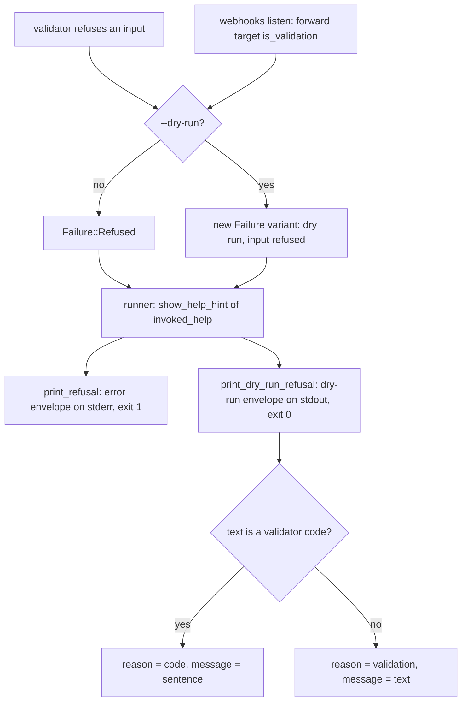
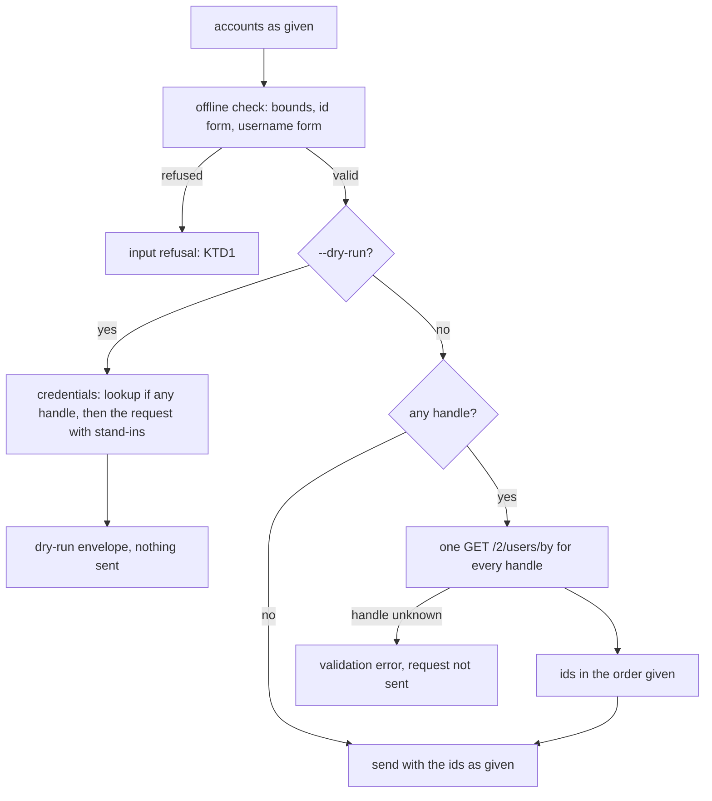

# Dry-Run Envelopes and Handle Arguments - Plan

**Issues:** #419, #420, #422.

---

## Goal Capsule

- **Objective:** An agent that dry-runs an `xr` command gets the same human `message` and the same recovery `next_step`
  in JSON that the real run gives, and can name an account by handle wherever `xr` takes an account to act on; a dry run
  still sends nothing.
- **Means:** route a dry run's input refusal through the runner the way a real run's refusal goes (KTD1, KTD2), give
  `notes evaluate` the note-text check `notes write` runs (KTD5), and resolve handles with the batched lookup
  `spaces by-creator` already uses (KD1, KTD6).
- **Authority:** Requirements outrank Key Technical Decisions, which outrank unit text. `AGENTS.md` § "Output formats"
  and `CONTRIBUTING.md` own the error contract; `AGENTS.md` § "Where a change goes" decides which crate a change lands
  in.
- **Stop conditions:**
  - Stop and send a decision brief before renaming or retyping any key an envelope carries today, before changing a
    command or flag name, and before touching the real run's validation envelope (Open Questions).
  - Stop if a dry run would send a request or a lookup to make any requirement pass.
- **Execution profile:** a stack of three PRs, bottom PR to `dev`; no subagents or worktrees; jobs over about 30 seconds
  run in the background; no request to the X API (tests use the in-crate mock and wiremock; manual runs use a scratch
  `XURL_TOKEN_STORE` and `API_BASE_URL=http://127.0.0.1:9`).
- **Who finishes:** the executing agent opens every PR and verifies each rollup green. Brett merges.

---

## Product Contract

### Summary

A dry run that refuses its inputs gains the `message` and `next_step` its real run's error carries, through one change
in the shared dry-run path and a walk that holds every refusing dry run to its real run. `notes evaluate` checks its
text with the validator `notes write` uses. `calls scheduled add` and `update --invite`, and
`webhooks subscriptions remove`, take handles as well as numeric ids, resolved in one lookup the way `spaces by-creator`
and `conversations start` resolve theirs.

### Problem Frame

`AGENTS.md` § "Output formats" and `CONTRIBUTING.md` require every structured error to carry a human `message` and,
wherever a step exists, a `next_step`. A dry run that refuses its inputs carries neither: `DryRun::answer` in
`crates/xurl-cli/src/cli/commands/mod.rs` writes the validator code into `reason` and prints the envelope, while the
real run's refusal goes back to the runner as `Failure::Refused` and picks up `show-help`. An agent that dry-runs first
has no prose to show and no step to follow.

`notes evaluate` and `notes write` both document `--text` as "The note's text; X requires a source URL in it", but only
`write` checks it, so `evaluate --dry-run` reports `would_succeed: true` for text `write` refuses.

The three commands in #422 take a user only as a numeric id. Every other command that acts on another account takes a
handle, so a caller holding `@jack` has to find the id-only commands by failing on them.

### Reproduction and Corrections to the Issues

Each command ran against a development build of `dev` at `b50850d` (`xr 4.4.0`), with `XURL_TOKEN_STORE` at a scratch
store holding one `OAuth2` login and `API_BASE_URL=http://127.0.0.1:9`.

- **#419 reproduces as filed.** `xr --dry-run --output json notes evaluate 1585341984679469056 --text "No link here"`
  answers `would_succeed: true`, `exit_code: 0`; the same `--text` on `notes write` answers
  `reason: note-needs-source-url`, `exit_code: 1`. The real `evaluate` run goes on to send the request. The vendored
  spec's `EvaluateCommunityNotesRequest.note_text` declares no URL pattern, while the create request's text carries
  `^(?=[\s\S]*https?://\S+)[\s\S]+$`; KD2 records why the check applies anyway.
- **#420 reproduces, and the real run differs from what the issue implies.** The dry run of
  `webhooks add https://example.com:8443/hook`, `webhooks replay ... --from 2026-10-27 --to 2026-10-27`, and
  `users 12345 @jack` under `--output json` carries `reason: <validator code>` with no `message` and no `next_step`. The
  real run's JSON envelope carries `reason: "validation"`, `message: "<validator code>"` (the code, not prose), and
  `next_step: {"action": "show-help", "command": "xr <command> --help"}`. Text mode prints the sentence in both runs.
- **#420 has a second gap the issue does not name.**
  `xr --dry-run --output json webhooks listen --forward ftp://example.com/x` carries `message` but
  `next_step: {"action": "fix-input"}`, while the real run carries `show-help` with `xr webhooks listen --help`. The dry
  run goes through `Failure::DryRunRefusal`, whose `recovery_hint` maps a validation error to `fix-input`.
- **#422's "no `next_step`" holds only for the dry run.** The real run of
  `calls scheduled add --start 2026-10-28T15:00:00Z --invite @jack --output json` carries `show-help` with
  `xr calls scheduled add --help`. Neither run names a lookup.
- **#422's precedent list is partly wrong.** `follow`, `block`, `mute`, and `lists members add` (not `lists add-member`)
  take a handle only, through `act_on_user` and `act_from_me_on_user`; a numeric argument is looked up as a username.
  The commands that take ids and handles in one argument are `users`, `spaces by-creator`, and `conversations start`.
  The issue's premise that `xr` "favors request primitives over hidden multi-call workflows" does not hold either:
  `act_from_me_on_user` sends up to three requests (the caller's id, the target's id, the action).

### Requirements

**Envelope contract (#420)**

- R1. A dry run whose inputs a command refuses carries `message` in every structured format: the sentence text mode
  prints for a validator code, and the refusal's own text for any other refusal.
- R2. That dry run carries the `next_step` the real run's error carries for the same invocation.
- R3. No key a refusing dry run carries today is renamed or retyped: `reason` stays the validator code where it is one
  today. `next_step` changes value only where it named a different step than the real run (`webhooks listen --forward`).
- R4. A walk fails for any refusing JSON dry run in the golden matrix whose envelope lacks `message`, or whose
  `next_step` or `exit_code` differs from its real run's.
- R5. A text dry run that refuses its inputs prints the real run's help pointer after the refusal line, and `--quiet`
  leaves it out.

**Community Notes (#419)**

- R6. `notes evaluate` refuses note text that holds no `http://` or `https://` URL as `note-needs-source-url`, in a dry
  run and a real run, before any request.
- R7. `notes write` and `notes evaluate` check the post and the note text with one validator.

**Handle arguments (#422)**

- R8. `calls scheduled add --invite` and `calls scheduled update --invite` take each invitee as a handle (`@jack` or
  `jack`) or a numeric user id, in any mix.
- R9. `webhooks subscriptions remove` takes the subscribed account as a handle or a numeric user id.
- R10. Every handle among one invocation's accounts resolves in one lookup request, and an invocation that names only
  numeric ids sends no lookup.
- R11. A dry run of these commands sends nothing and reports the lookup's credential among the requests it checks.
- R12. Inputs are checked offline before any lookup: the invitee bounds, a malformed handle as `invalid-username`, and a
  malformed numeric id as `invalid-user-id`.
- R13. A handle X does not know fails the real run before the command's own request, with the error `spaces by-creator`
  gives for one.

### Key Decisions

- KD1. **#422 takes shape (a): resolve handles.** Precedent settles it: `spaces by-creator` and `conversations start`
  already take mixed ids and handles, resolve every handle in one `GET /2/users/by` request, send nothing extra for ids,
  and report the lookup's credential under `--dry-run`. Shape (b) costs the same paid lookup, moved to a second
  invocation (`xr user @jack` per handle), and needs either a new `next_step.action` or a retyped step on an existing
  reason; shape (a) adds no action and changes no envelope. Governs R8, R9, R10, R11, R12, R13.
- KD2. **`notes evaluate` checks for a source URL although the spec does not require one there.** Both `--help` pages
  already promise the requirement, evaluate exists to score a draft before writing it, and a draft without a URL cannot
  be written, so refusing it offline saves a paid request that leads nowhere. Governs R6.
- KD3. **A refusing dry run's `message` is the human sentence, not the validator code.** The code already sits in
  `reason`, the contract asks for a human message, and #420's expected output asks for the text mode's sentence. Governs
  R1.
- KD4. **Text dry runs gain the help pointer.** One `Hint` carries both renderings, and a credential refusal's dry run
  already prints the real run's advice, so an input refusal printing its advice too keeps text and JSON naming the same
  step. Governs R5.

### Scope Boundaries

Considered and not built:

- **The real run's validation envelope** keeps `reason: "validation"` with the validator code in `message`. Changing it
  alters an envelope agents branch on today; Open Questions carries it for Brett.
- **A `resolve-handle` step** (shape (b)): not needed once handles resolve (KD1).
- **Caching a handle's id:** `AGENTS.md` § "Token store" rules out caching another user's handle, since a handle can
  pass to another account.
- **Rewording `notes evaluate --help`:** the help already states the rule this plan enforces.
- **Declaring `message` and `next_step` on the dry-run variant of `schema/output.schema.json`:** the variant is
  `additionalProperties: true` and names only its mandatory keys (KTD10).

### Deferred to Follow-Up Work

- `send_confirmed` and `webhooks subscriptions remove` ask for confirmation before they validate, so a real run under
  `--no-interactive` without `--force` reports `confirmation-required` for an input its dry run refuses. Both answers
  are correct for their run; aligning the order is a separate change.
- The xurl-rs-skill bundle's account of the dry-run envelope can name the new keys once this ships; the keys are
  additive, so its scripts keep working.

### Open Questions

- OQ1 (Brett's, does not block this plan). The real run's JSON envelope for an input refusal carries
  `reason: "validation"` and puts the validator code in `message`, so its `message` is not human prose either. The
  options: leave it; make `message` the sentence and add a key carrying the code, which changes a value agents may match
  on today; or make `message` the sentence alone, which drops the code. Recommendation: a separate issue, since every
  option changes an envelope agents read.

---

## Planning Contract

### Key Technical Decisions

- KTD1. **A dry run's input refusal returns to the runner, as a real run's does.** `DryRun::answer` hands its refusal
  back as a new `Failure` variant beside `DryRunRefusal`, and the runner answers it with
  `show_help_hint(&invoked_help(&args))`, the hint `Failure::Refused` gets. Only the runner holds argv, and sharing the
  builder makes the dry run's step equal the real run's by construction (R2).
- KTD2. **One printer serves every refusing dry run.** `OutputConfig::print_dry_run_refusal` already merges a credential
  refusal's error keys over the context; it takes input refusals too. An `Error::Validation` whose text
  `validation::sentence` recognizes becomes `reason: <code>` with `message: <sentence>`; any other text keeps
  `reason: "validation"` with the text as `message`. Both shapes the envelope has today survive (R3), and text mode
  prints the hint's lines unless `--quiet` (R5), as the printer does for credentials. `dry_run::CredentialRefusal`
  becomes a refusal of either kind.
- KTD3. **`webhooks listen` sends its forward-target validation errors through the same variant.** Its real run already
  maps `is_validation()` to `Failure::refused`; the dry run mirrors that rule, which moves its step from `fix-input` to
  `show-help`. Other target errors (`io`) keep `DryRunRefusal`.
- KTD4. **The walk lives in `crates/xurl-cli/tests/golden_tests.rs`, over `dry_run_cases()`.** For each JSON case whose
  envelope says `would_succeed: false`, it spawns the real run with `--dry-run` removed and `--force` added when the
  envelope says `confirmation_required`, then compares `message`, `exit_code`, and `next_step` with `--dry-run`
  stripped from a step's command. Every validator code already has a case there
  (`every_reason_the_source_emits_is_documented_and_pinned`), so the walk covers each one; a `webhooks listen --forward`
  case joins the matrix. Its failure message is a plain sentence with no `Cause:` line, since
  `crates/xurl-cli/tests/recipe_guard.rs` reserves that marker for command-family walks.
- KTD5. **`notes.rs` holds one draft validator for both arms.** It composes the library's `validate_post_id` and
  `validate_note_text`; no library change, since the rule already lives in `crates/xdk/src/api/shortcuts.rs` and only
  the composition is per command.
- KTD6. **One helper in `crates/xurl-cli/src/cli/commands/mod.rs` sends a request that names accounts.** It validates
  offline, builds the dry run's credential list from the lookup (when a handle is present) and the request, and in the
  real run resolves with `resolve_account_ids` and sends. `spaces by-creator` and `conversations start` move onto it, so
  the pattern has one copy; `webhooks subscriptions remove` uses its parts after its confirmation gate.
- KTD7. **The call is validated as it would be sent, with each handle standing in as `UNRESOLVED_ID`.** The library
  validators `validate_new_scheduled_call` and `validate_scheduled_call_changes` stay ids-only, which is right for an
  embedder sending to X; the binary adds each handle's `validate_username` check (R12). The real run validates before it
  looks anything up, so an invalid input costs no request.
- KTD8. **Context keys stay as they are.** `invitee_ids` and `user_id` echo the accounts as given, as the dry run
  already echoes `@jack` today; renaming them would be an envelope change.
- KTD9. **The value names become `ACCOUNT`.** `--invite <USER_ID>` and the `subscriptions remove` positional take the
  name `users` and `spaces by-creator` use, with help that says a handle or a numeric id; the flag and command names do
  not change.
- KTD10. **`schema/output.schema.json` does not change.** The dry-run variant admits any key, and leaving it alone
  avoids a collision with #424, which adds a key to the same variant.

### High-Level Technical Design

A refused input takes the same hint builder in both runs; only the printer differs.

A command that names accounts:

### Assumptions

- The dry run's JSON `message` is the sentence text mode prints (KD3).
- Text dry runs gain the help pointer line (KD4).
- `ACCOUNT` is an acceptable value name; it names no flag or command (KTD9).
- An unknown handle under `calls` and `webhooks subscriptions remove` fails the way it does under `spaces by-creator`: a
  validation error naming the handle, with `fix-input` (R13).

### Dependencies and Collisions

- **#424 (`issues-schema-ergonomics`)** adds `response_schema` to dry-run envelopes and a line to the text summary. Both
  plans move every `dry-run-*.golden` fixture and touch `crates/xurl-cli/src/cli/output/dry_run.rs`; whichever lands
  second rebases on `dev` and re-blesses. The walk compares only `message`, `exit_code`, and `next_step`, so a new key
  does not break it.
- **#415, #416, #417 (`issues-help-accuracy`)** move help fixtures; #415 reorders `calls scheduled add --help`, which U3
  also moves. Rebase and re-bless the fixtures U3 and U4 change.
- **#421 (`issues-verb-alignment`)** may rename verbs in `crates/xurl-cli/src/cli/commands/calls.rs`; that is a textual
  conflict only, since none of the renamed verbs is one this plan changes.
- **#409 (spec refresh)** may change `crates/xdk/src/api/shortcuts.rs` and the auth matrix; rebase before each push.

---

## Implementation Units

### U1. Input refusals in dry runs carry `message` and the real run's step

- **Goal:** every refusing dry run carries `message`, and the `next_step` and `exit_code` of its real run, held by a
  walk.
- **Requirements:** R1, R2, R3, R4, R5.
- **Dependencies:** none.
- **Files:**
  - `crates/xurl-cli/src/cli/failure.rs`
  - `crates/xurl-cli/src/cli/commands/mod.rs`
  - `crates/xurl-cli/src/cli/commands/webhooks_listen.rs`
  - `crates/xurl-cli/src/cli/runner.rs`
  - `crates/xurl-cli/src/cli/output/mod.rs`
  - `crates/xurl-cli/src/cli/output/dry_run.rs`
  - `crates/xurl-cli/tests/golden_tests.rs`
  - `crates/xurl-cli/tests/golden/dry-run-*.golden` (re-blessed), and a new fixture for the `webhooks listen --forward`
    case
  - `crates/xurl-cli/README.md` (§ "Dry Runs")
  - `AGENTS.md` (§ "Output formats", the `--dry-run` paragraph)
- **Approach:**
  1. Write the walk (KTD4) and the listen case first, and keep the failure it prints against `dev`.
  2. Add the variant (KTD1) and return it from `DryRun::answer` and from the listen dry run (KTD3).
  3. Extend the printer (KTD2) and the text summary's refusal type.
  4. Re-bless, then confirm with `git status` that only `dry-run-*` fixtures moved, and that each moved fixture gained
     `message` and `next_step` and lost nothing.
  5. State in both docs that an input refusal carries `message` and the real run's `next_step`, and that text prints the
     real run's advice for either refusal.
- **Execution note:** the walk must be observed failing against unfixed code before the fix lands; quote that output in
  the PR.
- **Patterns to follow:** `Failure::DryRunRefusal` and its runner arm; `print_refusal`, which attaches the `show-help`
  step to a real run's refusal; `a_dry_run_refusal_carries_the_step_of_its_real_run` in
  `crates/xurl-cli/tests/next_step_tests.rs`.
- **Test scenarios:**
  - `xr --dry-run --output json webhooks add https://example.com:8443/hook` exits 0 with
    `reason: "webhook-url-has-port"`, `message: "The webhook URL names a port; X takes one without a port."`,
    `next_step: {"action": "show-help", "command": "xr webhooks add --help"}`, and `exit_code: 1`.
  - `xr --dry-run --output json users 12345 @jack` carries `reason: "mixed-ids-and-handles"`, the sentence as `message`,
    and `show-help` with `xr users --help`.
  - `xr --dry-run --output json webhooks listen --forward ftp://example.com/x` carries `reason: "validation"`,
    `message: "--forward takes an http or https URL"`, and `show-help` with `xr webhooks listen --help`.
  - `xr --dry-run --output yaml webhooks add https://example.com:8443/hook` carries `message` and `next_step` too.
  - `xr --dry-run webhooks add https://example.com:8443/hook` prints the summary, then `Try 'xr webhooks add --help'.`;
    with `--quiet` the summary prints without that line.
  - The credential-refusal fixtures (`dry-run-no-credential`, `dry-run-scheme-not-accepted`) do not move.
  - A unit test in `crates/xurl-cli/src/cli/output/dry_run.rs` covers an input refusal with advice lines.
  - The walk passes over every JSON case in `dry_run_cases()`.
- **Verification:** the walk fails on `dev` for a missing `message` and for the listen step, and passes after the
  change; the golden suite passes with only `dry-run-*` fixtures moved.

### U2. `notes evaluate` checks its text like `notes write`

- **Goal:** `notes evaluate` refuses note text with no source URL, through the validator `notes write` uses.
- **Requirements:** R6, R7.
- **Dependencies:** U1, for the stack order only; the unit's tests do not depend on U1's keys.
- **Files:**
  - `crates/xurl-cli/src/cli/commands/notes.rs`
  - `crates/xurl-cli/tests/notes_tests.rs`
- **Approach:** add the draft validator (KTD5) and call it from both the `Write` and `Evaluate` arms.
- **Execution note:** write the evaluate tests first and observe them fail against `dev`.
- **Patterns to follow:** the `Write` arm's validator closure in `notes.rs`; `evaluate_scores_a_draft` in
  `notes_tests.rs`.
- **Test scenarios:**
  - `notes evaluate <POST> --text "No link here"` under `--dry-run --output json` answers `would_succeed: false`,
    `reason: "note-needs-source-url"`, `exit_code: 1`.
  - The same invocation without `--dry-run` exits 1 and the mock receives no request at `/2/notes/evaluate`.
  - `--text "From 2019: https://example.com"` dry-runs to `would_succeed: true` and, in a real run, reaches the mock
    once.
  - `--text "see https:// later"` (a scheme with nothing after it) is refused, as `notes write` refuses it.
  - The `notes write` tests pass unchanged.
- **Verification:** both arms call one function, and the notes tests pass.

### U3. `--invite` takes handles, through one helper for requests that name accounts

- **Goal:** `calls scheduled add` and `update --invite` take handles and ids in any mix, through a helper
  `spaces by-creator` and `conversations start` share.
- **Requirements:** R8, R10, R11, R12, R13.
- **Dependencies:** U2, for the stack order.
- **Files:**
  - `crates/xurl-cli/src/cli/commands/mod.rs`
  - `crates/xurl-cli/src/cli/commands/calls.rs`
  - `crates/xurl-cli/src/cli/commands/spaces.rs`
  - `crates/xurl-cli/src/cli/commands/conversations.rs`
  - `crates/xurl-cli/src/cli/mod.rs` (the `--invite` value name and help)
  - `crates/xurl-cli/src/cli/family_help.rs` and `crates/xurl-cli/src/cli/commands/examples.rs`, if an example gains a
    handle
  - `crates/xurl-cli/tests/golden/help-calls-scheduled-add.golden`,
    `crates/xurl-cli/tests/golden/help-calls-scheduled-update.golden`
  - the completions `scripts/generate-completions.sh` writes, if the value name reaches them
  - `crates/xurl-cli/README.md` (the `calls` section's `--invite` sentence)
  - `AGENTS.md` (§ "Adding a command family", the dispatch-arm helper list)
  - `crates/xurl-cli/tests/calls_tests.rs`
- **Approach:**
  1. Extract the helper (KTD6) from `spaces::by_creator` and `conversations::start`, and move both onto it.
  2. Route `add` and `update` through it, validating with stand-ins (KTD7) while the context keeps the accounts as given
     (KTD8).
  3. Rename the value name (KTD9), re-bless the two help fixtures, and regenerate completions.
  4. Replace the README's "`--invite` takes a numeric user ID (`xr user @handle` prints one)" with the new rule, and
     name the helper in the `AGENTS.md` recipe.
- **Patterns to follow:** `spaces::by_creator`; `handles_lookup_call` and `resolve_account_ids`; `UNRESOLVED_ID`.
- **Test scenarios:**
  - `calls scheduled add --start <T> --invite @jack --invite 2244994945` sends one `GET /2/users/by` with
    `usernames=jack`, then `POST /2/calls/scheduled` whose `invitee_ids` are jack's id and `2244994945`, in that order.
  - `--invite 783214` alone sends no lookup.
  - Under `--dry-run --output json`, `--invite @jack` answers `would_succeed: true`, `invitee_ids: ["@jack"]`, and
    nothing reaches the mock.
  - A lookup that answers `@nosuchuser` in `errors` fails with exit 1 naming the handle, and no `POST` is sent.
  - `--invite "bad-handle!"` is refused offline as `invalid-username`, and a 20-digit id as `invalid-user-id`; neither
    sends a request.
  - 26 invitees on `add`, mixed handles and ids, are refused offline as `too-many-invitees`.
  - `update <ID> --invite @jack` sends the lookup, then `PUT /2/calls/scheduled/<ID>` with the resolved list;
    `update <ID> --title x` sends no lookup.
  - The existing `spaces by-creator` and `conversations start` tests pass unchanged.
  - `crates/xurl-cli/tests/dry_run_guard.rs` passes, so no new path sends under `--dry-run`.
- **Verification:** the calls tests and the dry-run guard pass, the two help fixtures and completions move only by the
  value name and help line, and the pattern exists once.

### U4. `webhooks subscriptions remove` takes a handle

- **Goal:** the subscribed account can be named by handle, resolved only after the confirmation gate.
- **Requirements:** R9, R10, R11, R12, R13.
- **Dependencies:** U3.
- **Files:**
  - `crates/xurl-cli/src/cli/commands/webhooks.rs`
  - `crates/xurl-cli/src/cli/mod.rs` (the positional's value name and help)
  - `crates/xurl-cli/tests/golden/help-webhooks-subscriptions-remove.golden`
  - the completions, if the value name reaches them
  - `crates/xurl-cli/tests/webhooks_tests.rs`
- **Approach:** validate the account's form with the webhook id, gate, then resolve with the helper's parts (KTD6) and
  send; the dry run builds its credentials from the lookup and the delete. The prompt names the account as given.
- **Patterns to follow:** `unsubscribe` in `webhooks.rs`; the helper from U3.
- **Test scenarios:**
  - `webhooks subscriptions remove <WEBHOOK_ID> @jack --force` sends the lookup, then
    `DELETE /2/account_activity/webhooks/<WEBHOOK_ID>/subscriptions/<jack's id>/all`.
  - A numeric account sends no lookup.
  - Under `--no-interactive` without `--force`, the run answers `confirmation-required` and sends no lookup.
  - `--dry-run --output json` with `@jack` sends nothing and answers `confirmation_required: true`.
  - An unknown handle fails with exit 1, and no `DELETE` is sent.
  - `@` alone is refused offline as `invalid-username`.
- **Verification:** the webhooks tests and the dry-run guard pass, and the help fixture moves only by the value name and
  help line.

---

## Verification Contract

| Gate                         | Command                                                                                                                                           | Applies to |
| ---------------------------- | ------------------------------------------------------------------------------------------------------------------------------------------------- | ---------- |
| Golden fixtures and the walk | `cargo test -p xurl-rs --test golden_tests`                                                                                                       | U1, U3, U4 |
| Re-bless, local only         | `XURL_GOLDEN_BLESS=1 cargo test -p xurl-rs --test golden_tests`, then `git status` lists only the intended fixtures                               | U1, U3, U4 |
| Step parity                  | `cargo test -p xurl-rs --test next_step_tests`                                                                                                    | U1         |
| Dry runs send nothing        | `cargo test -p xurl-rs --test dry_run_guard`                                                                                                      | U1, U3, U4 |
| Family tests                 | `cargo test -p xurl-rs --test notes_tests`, `--test calls_tests`, `--test webhooks_tests`, `--test spaces_tests`, `--test dm_conversations_tests` | U2, U3, U4 |
| Recipe and examples walks    | `cargo test -p xurl-rs --test recipe_guard --test agentic_tests`                                                                                  | U3         |
| Whole suite                  | `cargo test --workspace --no-fail-fast`, in the background                                                                                        | each PR    |
| Lints                        | `cargo fmt --check`, `cargo clippy --all-targets -- -D warnings`                                                                                  | each PR    |
| Completions freshness        | `scripts/generate-completions.sh`, then an empty `git diff` on a second run                                                                       | U3, U4     |
| Local CI mirror              | `scripts/hooks/pre-push`, in the background                                                                                                       | each PR    |
| Manual repro                 | the commands under "Reproduction" against `target/debug/xr`, scratch store, closed port                                                           | each PR    |

---

## Definition of Done

- Every requirement R1 to R13 holds, and each unit's test scenarios exist and pass.
- The U1 walk and the U2 evaluate tests were observed failing against unfixed code, with the output quoted in their PR.
- Only fixtures a unit names moved, each for the reason the unit gives.
- `README.md`, `AGENTS.md`, and the help describe the shipped behavior.
- No dry run sends a request; no test or manual run reached the X API or the real token store.
- Three PRs stacked, bottom on `dev`; each names its issues under Related Issues and has every rollup check `SUCCESS`.
- No dead-end or experimental code is left in the diff.
