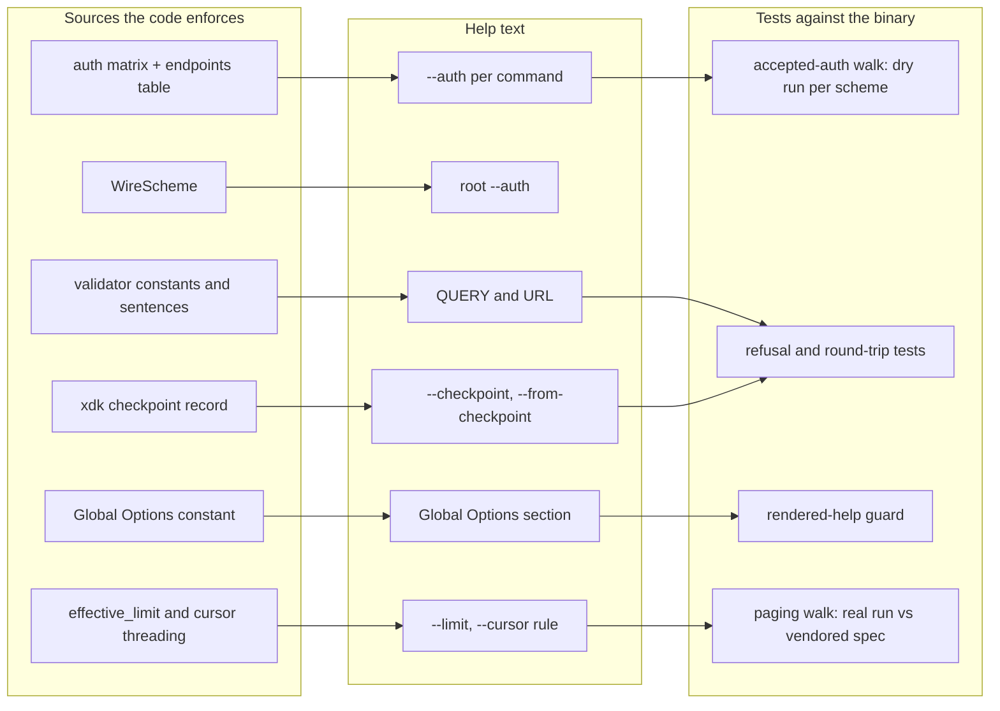

# Help Text That Matches the Code - Plan

## Goal Capsule

- **Objective:** A person or an agent reading `xr <command> --help` learns, without a trial run, which auth schemes the
  command accepts, which options are its own, which global flags apply to it, and the input rules its validators
  enforce. Every one of those statements stays true as the code changes.
- **Means:** Build each statement from the declaration the code already enforces (the auth matrix, the validators'
  constants and sentences, the checkpoint record, clap's help headings) and hold each one to the binary with a test
  (KTD1 to KTD8).
- **Authority:** The code and the binary outrank the issue text where they disagree; the plan records each disagreement
  with its evidence. `AGENTS.md` conventions govern placement, walks, and fixtures. Brett alone decides a command or
  flag name, a breaking change to the CLI surface, an envelope, or a schema file, a version call, and a scope cut.
- **Execution profile:** Four units ship as a stack of four PRs, bottom PR to `dev`: U1 (#415), U2 (#416, #417, #418),
  U4 with U3 (#425), U5 (#414). Each PR re-blesses the golden fixtures and completions it moves. Each PR runs about 25
  CI jobs against a 20-job account cap, so the stack lands in one `gh stack merge`, which restacks nothing.
- **Stop conditions:** Stop and report when the local `anc audit` score falls below the CI floor (98) or a MUST row
  fails; when a golden diff touches a line its unit does not name; when a change would alter an envelope's keys,
  `reason`, or `exit_code`; when the walk finds a command whose dry run accepts no scheme.
- **Who finishes:** This slot builds the stack and opens the PRs. Brett merges.

---

## Product Contract

### Summary

Six help defects get fixed at their source. `--auth` lists the schemes the command's own endpoints accept. Global flags
move under their own heading so they never split a command's options. Three argument and flag descriptions gain the rule
their validator enforces. `--limit` and `--cursor` describe their scope by a rule the code keeps, and the one command
that breaks the rule is fixed.

### Problem Frame

`xr` is built for agents that read `--help` before they build an invocation. Six places in that help say something the
binary does not do, or leave out a rule the binary enforces. Each was reproduced on `xr` 4.4.0 at `dev` `b50850d` with
`XURL_TOKEN_STORE` at a scratch path and `API_BASE_URL=http://127.0.0.1:9`.

- **#414.** Every command's `--auth` reads `Authentication type (oauth1, oauth2, app)`. Of the 140 commands that take
  `--auth`, 12 accept only `app`, 98 only `oauth1` and `oauth2`, 7 `oauth2` and `app`, 3 only `oauth2`, and 20 all
  three. `xr webhooks replay --help` and `xr notes write --help` both print the generic line.
- **#415.** `xr webhooks listen --help` prints `-v, --verbose` between `--max-events` and `--forward`, and `--app`
  between `--forward-timeout` and `--checkpoint`. clap copies each global flag into every subcommand with the display
  position it holds on the root (`-v` is 5th, `--app` 9th, `--output` 10th), while a subcommand numbers its own flags
  from 0. Any command with six or more options of its own interleaves. The root page does the same: `-v` sits between
  `-u` and `-t`, `--app` after `-F`.
- **#416.** `xr webhooks add --help` describes `<URL>` as
  `The public HTTPS URL X delivers events to (200 characters at most)`. A URL with a port is refused offline with
  `webhook-url-has-port`.
- **#417.** `<QUERY>` under Arguments says only `Search query`. The rule
  `A query is 1 to 50 letters, digits, underscores, apostrophes, or spaces.` is the last line of the Examples block,
  hand-written with a literal 50.
- **#418.** `--from-checkpoint <FILE>` never names the file's shape. The shape appears only in the `io` error a bad file
  produces.
- **#425.** `--limit` and `--cursor` name ten commands and say every other command ignores them. 36 commands honor
  `--limit` (37 take `-n`) and 34 honor `--cursor` today.

The root cause of #425 is a hand list. `PAGING_COMMANDS` in `crates/xurl-cli/tests/cli_tests.rs` pins the help to ten
names, and nothing proves the list complete, so each command family added in 4.4.0 paged without the help or the test
noticing. #414, #416, #417, and #418 have the same shape: a hand-written statement beside a rule the code owns.

**Where the issues and the binary disagree.**

- #425 lists `spaces search`, `broadcasts moderators list`, and `calls scheduled list` among commands that honor
  `--limit`, `--cursor`, and `--after`. `spaces search` honors `--limit` and ignores `--cursor`, correctly:
  `GET /2/spaces/search` declares `max_results` and no page token. `broadcasts moderators list` takes no `-n` and its
  endpoint does not page, so it rightly ignores both. `calls scheduled list` ignores both: its `-n` has
  `default_value_t = 20` and bypasses `effective_limit`, and `GET /2/calls/scheduled` declares no page token. `--cursor`
  is right to skip it; ignoring `--limit` is the defect (KTD5).
- #414 shows the mismatch with an empty store. With an empty store a dry run stops on the first request's
  `auth-required` and never checks a later request, so `dm`, `dm-block`, `lists members add`,
  `broadcasts moderators add`, and five others look as if they accept `app`. With every credential kind stored they
  answer `auth-method-mismatch` for `app` at their action endpoint. The real run behaves the same way, so this is no
  defect, but it decides the test oracle (KTD8).
- #415's "more than six options" is the clap mechanism above, not a count of options.

### Requirements

**Auth schemes (#414)**

- R1. Each command's `--auth` help lists exactly the schemes its requests accept, read from the auth matrix, and states
  the second set where `--of` changes it.
- R2. The root raw-mode `--auth` help, and the `CommonFlags` default a command without a row would show, list every
  scheme value `xr` accepts, read from the wire-scheme type rather than written out.

**Layout (#415)**

- R3. On every help page, the root included, a command's own options appear together in declaration order, and the
  global flags appear under a separate heading.

**Input rules (#416, #417, #418)**

- R4. `xr webhooks add --help` states on `<URL>` that the URL names no port and its length limit, the limit read from
  the validator's constant.
- R5. `xr search-users --help` states the validator's rule on `<QUERY>` under Arguments, as the sentence text output
  prints for `invalid-user-query`, and the Examples block no longer repeats it.
- R6. `xr webhooks replay --help` on `--from-checkpoint` and `xr webhooks listen --help` on `--checkpoint` name the
  checkpoint file's JSON shape, owned by the library that reads and writes it.

**Paging flags (#425)**

- R7. `--limit` help states that it is the page size of every command with `-n/--max-results` when `-n` is absent, and
  that other commands and raw requests ignore it. Every command with `-n` honors it.
- R8. `--cursor` help states that it applies to every command whose endpoint pages, whose response carries
  `meta.next_token`, and that other commands and raw requests ignore it; a raw request carries its token in its URL.
- R10. The first line of the `--limit` and `--cursor` help, the only line `-h` prints, carries each rule on its own.
- R11. Each `-n/--max-results` help states no maximum above the page size the command sends. `stream rules list` and
  `broadcasts chat history` state 1-100, the clamp `effective_limit` applies; Brett chose narrowing the help over
  raising the clamp per endpoint.

**Drift**

- R9. A test fails when R1, R3, R4, R5, R6, R7, R8, R10, or R11 stops matching the binary.

### Success Criteria

- Each issue's reproduction command prints the expected output: `webhooks replay` lists `app`, `notes write` lists
  `oauth2, oauth1`, `webhooks listen` keeps its listener flags contiguous, `webhooks add` says no port, `search-users`
  states its rule under Arguments, `webhooks replay` names the checkpoint shape, and `user-posts` no longer says it
  ignores `--limit`.
- A command family added later without its accepted-auth row, or a paged command that drops the cursor, fails a walk
  that names the command, the cause, and the file to edit.

### Scope Boundaries

- No command or flag is renamed, added, or removed. `--limit`, `--cursor`, `--page`, and `--after` stay global.
- No envelope gains, loses, or retypes a key; no `reason` or `exit_code` changes. The `io` message for an unreadable
  checkpoint changes its wording to name the shape (KTD3).
- The dry-run validation messages that #420 brings into JSON keep their wording, apart from the checkpoint one.
- Not built: a per-command `--limit` or `--cursor` note on each help page. The global rule plus the walk keeps the
  statement true, and a per-command note would need a global flag mutated after clap's propagation. Evidence that would
  change this: agents still misjudge which commands page after the rule ships.
- Not built: modeling optional flags that add a request with fewer schemes. Across all 140 commands only `--of` changes
  the accepted set, measured by dry-running each command with each scheme. A future flag that adds such a request would
  show in the walk only if the synthesized invocation used it.

---

## Planning Contract

### Key Technical Decisions

- KTD1. **A `Global Options` help heading on every global flag (#415).** Each `global = true` argument on `Cli` in
  `crates/xurl-cli/src/cli/mod.rs` takes `help_heading` from one shared constant. clap renders headed arguments in their
  own section after `Options`, so the copies it propagates into subcommands leave the command's list, and `-h, --help`
  stays last under `Options`. Rejected: a display-order offset (one section, but globals stay visually mixed and each
  flag still needs an attribute); a flattened global-args struct with `next_help_heading` (renames every `cli.<flag>`
  read in the dispatcher); de-globalizing flags, which
  `docs/plans/2026-09-20-0924-refactor-scope-help-to-consumed-flags-plan.md` proposes and which breaks
  `xr --limit 5 search x`.
- KTD2. **Webhook URL and user-search help built from the validator's own sources (#416, #417).** `<QUERY>` help is the
  `invalid-user-query` sentence from `crates/xurl-cli/src/cli/output/validation.rs`, which reads
  `USER_SEARCH_QUERY_MAX_CHARS`. The sentence moves into a function that both `sentence()` and the clap declaration
  call, so neither returns an `Option` the help would have to unwrap. `<URL>` help reads `WEBHOOK_URL_MAX_CHARS` and
  states the no-port rule. The `webhook-url-has-port` sentence is phrased as a refusal ("names a port"), so it does not
  serve as help; the test in U2 ties the help's no-port claim to that refusal instead.
- KTD3. **The checkpoint shape lives beside the record in `xdk` (#418).** A `#[doc(hidden)] pub` constant in
  `crates/xdk/src/webhooks/checkpoint.rs`, `{"last_event_at": <Unix seconds>}`, re-exported doc-hidden from
  `xdk::webhooks` with a comment naming the `xr` help that reads it (AGENTS.md "Where a change goes", rule 3). The
  library's "not a checkpoint" message uses it, and so do both CLI flags. An `xdk` test holds the constant to what
  `CheckpointWriter` writes and `read_checkpoint` reads. Rejected: a CLI-only constant, which could drift from the
  private `Record` with only a CLI behavior test to notice.
- KTD4. **`--limit` and `--cursor` state a rule, not a list (#425).** `--limit` is the page size of every command with
  `-n/--max-results` when `-n` is absent; `--cursor` applies to every command whose endpoint declares a page token
  (`pagination_token`, or `next_token` on `/2/users/search`). Both rules already hold for every command but
  `calls scheduled list` (KTD5), measured over all 140 commands against the vendored spec. A list of nearly 40 names on
  all 190 help pages would bury the flags, and a hand list is what drifted. Raw mode reads neither flag (`run_raw_mode`
  in `crates/xurl-cli/src/cli/commands/mod.rs` never touches `cli.limit` or the cursor), so both texts say a raw request
  ignores them, and the walk pins that with one raw invocation.
- KTD5. **`calls scheduled list` honors `--limit`.** Its `-n` becomes optional and resolves as `-n`, then `--limit`,
  then 20, clamped to 1..=100. A run with neither flag still sends `max_results=20`, and the dry-run context reports the
  resolved value, so no existing invocation changes. The command gains a behavior: `--limit` now reaches it. Its
  endpoint declares no page token, so it keeps ignoring `--cursor`.
- KTD6. **Accepted schemes come from one table of endpoints, applied at the root (#414).**
  `crates/xurl-cli/src/cli/accepted_auth.rs` maps each command path to the endpoints its requests reach, named by the
  `xdk::api::auth_matrix::endpoints` constants, plus the endpoints it reaches under `--of` for the five commands that
  take `--of`. The root `Cli` derive calls clap's `mut_subcommands` with a function that walks the tree and sets each
  command's `--auth` help from the table, so every `Cli::command()` caller (parsing, `--help`, `xr help`, completions)
  renders it with no wrapper to bypass. Rejected: a `mut_arg` attribute on each of about 140 variants in `cli/mod.rs`,
  where the verb-alignment and schema-ergonomics slots edit the same variants; a wrapper around `Cli::command()`, which
  clap's own `try_parse_from` help path would skip.
- KTD7. **The accepted set is an intersection, in preference order.** A command accepts a scheme when every endpoint in
  its row accepts it (`supported_auth`, deduplicated by wire scheme). The list follows `WireScheme::ALL_BY_PREFERENCE`
  (oauth2, oauth1, app), which is also the order `xr` picks a stored credential in, and reads "Authentication type (this
  command accepts: oauth2, oauth1). Unset, xr uses the first of these it holds a credential for"; a command whose `--of`
  set differs adds `; with --of: oauth2, oauth1, app` inside the parentheses. The second sentence states what
  `detect_scheme` does, in the house style of the "Unset, 30" that `--forward-timeout` prints. The root raw-mode line
  lists `WireScheme::ALL_BY_PREFERENCE` whole, because raw mode bypasses the matrix, and so does the `CommonFlags` doc
  default, built by the same function in `accepted_auth.rs`. The order is the one `detect_scheme` in
  `crates/xdk/src/api/request/auth_header.rs` walks; the mismatch envelope's `supported` keeps the spec's order and does
  not change.
- KTD8. **The dry run, with every credential kind stored, is the oracle.** The accepted-auth walk dry-runs each command
  once per scheme over a store holding a live `OAuth2` login, an `OAuth1` pair, and a bearer, and counts a scheme
  accepted unless the answer is `auth-method-mismatch`. An empty store would stop on the first request's `auth-required`
  and hide a later request's mismatch (Problem Frame). This walk and the paging walk (U4) share one test file,
  `crates/xurl-cli/tests/help_claims_guard.rs`, with `Cause:` lines, named in the AGENTS.md recipe per
  `crates/xurl-cli/tests/recipe_guard.rs`. One file is one more test binary to link in each CI job instead of two.
- KTD9. **Shared invocation helpers move to `crates/xurl-cli/tests/common/invoke.rs`.** `SAMPLE`, `OVERRIDES`,
  `arguments_for`, `runnable_paths`, `takes_a_credential`, `run_xr`, and the store fills leave
  `crates/xurl-cli/tests/dry_run_guard.rs` unchanged in content, so the dry-run guard and both new walks synthesize
  invocations one way. The move is its own commit, made on a fresh rebase of `dev` when U4 is built. #438 and #409, open
  now, each add an `OVERRIDES` row; if either is still open when the stack goes up, its row conflicts with the move, and
  the resolution is to re-apply the row in the new file. The PR body says so.

### High-Level Technical Design

Each help statement has one source the code already enforces, and one test that holds the rendered help to the binary.



### Assumptions

- The heading reads `Global Options`, matching clap's own `Options` heading. A section label is not a command or flag
  name.
- `--of` is the only input that changes a command's accepted schemes, per the 140-command measurement in Scope
  Boundaries.
- `calls scheduled list` keeps 20 as its page size when neither `-n` nor `--limit` is given.
- Text output stays prose for humans; nothing here adds a structured field.

### Dependencies and Collisions

| Other work                                    | Overlap                                                                                                                                                                          | Handling                                                                                                                                                                   |
| --------------------------------------------- | -------------------------------------------------------------------------------------------------------------------------------------------------------------------------------- | -------------------------------------------------------------------------------------------------------------------------------------------------------------------------- |
| `issues-schema-ergonomics` (#424, #426)       | Adds a schema pointer to help pages; every `help-*.golden` moves                                                                                                                 | Rebase on `dev` before each push; re-bless only what this stack moves                                                                                                      |
| `issues-verb-alignment` (#421)                | Renames commands keyed in the accepted-auth table                                                                                                                                | Whichever lands second updates the rows; the walk names each stale or missing row                                                                                          |
| `issues-dry-run-envelopes` (#437, #438, #439) | #439 adds a handle lookup to `calls scheduled add`/`update --invite` and `webhooks subscriptions remove` and edits `calls.rs` and `calls_tests.rs`; #438 adds an `OVERRIDES` row | The lookup endpoint accepts all three schemes, so those commands' accepted sets hold; rows should still list it. KTD5 edits another arm of `calls.rs`. KTD9 covers the row |
| #409 spec refresh                             | Adds commands and an `OVERRIDES` row                                                                                                                                             | Each new `--auth` command needs a row; the walk says so. KTD9 covers the row                                                                                               |
| `xr` 4.4.1 cut from `dev`                     | `dev` moves under the stack                                                                                                                                                      | Rebase the bottom PR; restack the rest                                                                                                                                     |

### Changelog per PR

Each PR body's `## Changelog` carries the user-visible change, so the generated changelog says what moved:

| PR       | Section | Entry                                                                                                                                    |
| -------- | ------- | ---------------------------------------------------------------------------------------------------------------------------------------- |
| U1       | Changed | Help pages list global flags under their own `Global Options` heading                                                                    |
| U2       | Fixed   | `webhooks add`, `search-users`, `webhooks replay`, and `webhooks listen` help state their input rules                                    |
| U4 (+U3) | Fixed   | `--limit` and `--cursor` help describe every command that pages; `calls scheduled list` takes `--limit`; two `-n` help lines state 1-100 |
| U5       | Added   | Each command's `--auth` help lists the schemes that command accepts                                                                      |

---

## Implementation Units

### U1. Global flags under their own heading

- **Goal:** Global flags never interleave with a command's own options on any help page (#415).
- **Requirements:** R3, R9
- **Dependencies:** none
- **Files:**
  - Modify: `crates/xurl-cli/src/cli/mod.rs`
  - Modify: `crates/xurl-cli/tests/cli_tests.rs`
  - Modify: `crates/xurl-cli/tests/golden/help-*.golden` (re-blessed), `completions/*`
- **Approach:** Per KTD1, a shared heading constant beside `Cli`, applied to each of the 18 `global = true` arguments.
  Raw-mode flags and `CommonFlags` keep no heading.
- **Patterns to follow:** The `CommonFlags` doc comments; existing global-flag guards in
  `crates/xurl-cli/tests/cli_tests.rs` near `xr --help must advertise --limit globally`.
- **Test scenarios:**
  - On the root command, an argument is global exactly when it carries the heading; a new global without it fails with
    the flag's name.
  - For every command path from `common::command_paths()`, the rendered long help of the built command (global flags
    propagate only at build) has no global flag between `Options:` and `Global Options:`.
  - `xr webhooks listen --help` lists `--port` through `--checkpoint` contiguously under `Options:`, and `-v`, `--app`,
    `--output` under `Global Options:`.
  - `xr calls scheduled add --help` lists `--start` through `--no-notify`, then `--auth`, `-u`, `-t`, `-h`, before
    `Global Options:`.
  - The root page lists `-X` through `-F`, `-h`, and `-V` under `Options:` and every global flag under
    `Global Options:`.
- **Verification:** Every `help-*.golden` diff adds the heading and moves global flags below it, with no flag text
  changed; the local `anc audit` score holds at its baseline of 98.

### U2. Argument and flag help from the validators' rules

- **Goal:** `<URL>`, `<QUERY>`, `--from-checkpoint`, and `--checkpoint` state the rules their validators enforce
  (#416, #417, #418).
- **Requirements:** R4, R5, R6, R9
- **Dependencies:** U1
- **Files:**
  - Modify: `crates/xurl-cli/src/cli/mod.rs`, `crates/xurl-cli/src/cli/output/validation.rs`
  - Modify: `crates/xdk/src/webhooks/checkpoint.rs`, `crates/xdk/src/webhooks/mod.rs`
  - Test: `crates/xdk/tests/webhook_checkpoint_tests.rs`, `crates/xurl-cli/tests/users_search_tests.rs`,
    `crates/xurl-cli/tests/webhooks_tests.rs`
  - Modify: `help-search-users`, `help-webhooks-add`, `help-webhooks-replay`, `help-webhooks-listen` goldens;
    `completions/*`
- **Approach:**
  1. Per KTD2, the `invalid-user-query` sentence moves into a function `sentence()` and the `<QUERY>` declaration share;
     `SEARCH_USERS_HELP` drops its last line.
  2. `<URL>` on `webhooks add` reads `WEBHOOK_URL_MAX_CHARS` and says the URL names no port.
  3. Per KTD3, the checkpoint shape constant lands in `xdk`, its error message uses it, and both CLI flags append it to
     their help.
- **Patterns to follow:** `crates/xurl-cli/src/cli/output/validation.rs` reading limits from `xdk::api::shortcuts`
  constants; doc-hidden machinery in `crates/xdk/src/api/auth_matrix.rs` (`endpoints`).
- **Test scenarios:**
  - `xr search-users --help`: the `<QUERY>` entry under Arguments contains the rule with 50 read from
    `USER_SEARCH_QUERY_MAX_CHARS`; the Examples block does not.
  - `xr --dry-run --output json search-users @foo` answers `would_succeed: false`, `reason: invalid-user-query`, as
    today.
  - `xr webhooks add --help`: the `<URL>` entry says no port and names `WEBHOOK_URL_MAX_CHARS`.
  - A URL with a port still refuses with `webhook-url-has-port`.
  - The shape in `webhooks replay --help` equals the shape in `webhooks listen --help`.
  - A file built from that shape, with the placeholder replaced by a time a minute ago, makes
    `xr --dry-run --output json webhooks replay <id> --from-checkpoint <file> --auth app` answer `would_succeed: true`
    over a bearer store.
  - In `xdk`: the constant with its placeholder replaced reads back through `read_checkpoint`; a `CheckpointWriter`
    record has the constant's keys and no other; a file that is not a checkpoint yields an `io` error whose message
    contains the constant.
- **Verification:** Only the four named help goldens move; `cargo semver-checks` reports no break for `xdk-rs`.

### U3. Shared invocation helpers for the walks

- **Goal:** One way to synthesize and run any command in-process, for the dry-run guard and the help-claims walks.
- **Requirements:** R9
- **Dependencies:** none (lands in U4's PR)
- **Files:**
  - Create: `crates/xurl-cli/tests/common/invoke.rs`
  - Modify: `crates/xurl-cli/tests/common/mod.rs`, `crates/xurl-cli/tests/dry_run_guard.rs`
- **Approach:** Per KTD9, a pure move with the module re-exported from `common`, as `common::listen` is.
- **Test expectation:** none, as a pure move; `dry_run_guard.rs` passes unchanged.
- **Verification:** `dry_run_guard.rs` keeps every test and assertion; the helpers' bodies match the originals.

### U4. Paging flags state a rule the code keeps

- **Goal:** `--limit` and `--cursor` describe exactly the commands that honor them, now and after the next family lands
  (#425).
- **Requirements:** R7, R8, R9, R10, R11
- **Dependencies:** U1, U3
- **Files:**
  - Modify: `crates/xurl-cli/src/cli/mod.rs`, `crates/xurl-cli/src/cli/commands/calls.rs`
  - Create: `crates/xurl-cli/tests/help_claims_guard.rs`
  - Modify: `crates/xurl-cli/tests/cli_tests.rs`, `crates/xurl-cli/tests/calls_tests.rs`, `AGENTS.md`
  - Modify: every `help-*.golden` (the two paragraphs), `help-calls-scheduled-list.golden`, `completions/*`
- **Approach:**
  1. Rewrite the `--limit` and `--cursor` doc comments to the KTD4 rules, naming no command.
  2. Make `calls scheduled list` resolve its page size per KTD5. Its `-n` help says what every other `-n` says, that it
     overrides `--limit`, and that the page size is 20 when neither is given.
  3. Add the paging walk: for every runnable command that takes `--auth`, a real run against `MockX` with
     `--limit 37 --cursor CURSOR-TOKEN`. Each request is matched to its vendored-spec path template, read from
     `crates/xdk/vendor/x-api-openapi.json`, and failures carry `Cause:` lines. One raw invocation to a paged path with
     both flags is the raw-mode row.
  4. Delete `every_paging_command_sends_the_limit_and_cursor` and
     `the_limit_and_cursor_help_name_exactly_the_commands_that_page`, which the walk supersedes. `PAGING_COMMANDS` stays
     for the empty-page test, with its doc comment saying it samples paged commands.
  5. Name the walk in AGENTS.md's "Dispatch arm" bullet.
  6. State 1-100 in the `-n` help of `stream rules list` and `broadcasts chat history` (R11), and add the page-size
     walk: every command whose `-n` help states a range runs at that range's maximum, and the request must send it.
- **Patterns to follow:** `a_dry_run_reports_the_credential_the_real_run_uses` in
  `crates/xurl-cli/tests/dry_run_guard.rs`; `Cause:` walks such as `crates/xurl-cli/tests/dispatch_guard.rs`.
- **Test scenarios:**
  - A command that declares `max_results` sends 37 under `--limit 37`, in the size parameter its endpoint declares
    (`max_results`, or `max_trends` for `trends place`); one that does not sends no 37. Every range admits 37: 1-50,
    5-100, 10-100, 1-100.
  - A request whose endpoint declares `pagination_token` or `next_token` carries `CURSOR-TOKEN` in that parameter; a
    request to any other endpoint does not.
  - `xr --limit 37 --cursor CURSOR-TOKEN /2/users/me/followers` sends neither value.
  - `search-users` carries the token as `next_token`; `search-counts`, with no `-n`, carries it.
  - `spaces search`, `news search`, and `trends place` take `--limit` and send no cursor.
  - `calls scheduled list` sends `max_results=50` under `--limit 50`, 20 with no flag, and 30 under `-n 30 --limit 50`;
    its dry run reports the same values.
  - `--limit` long help mentions `-n/--max-results`, `--cursor` long help mentions `meta.next_token`, and neither names
    a command.
  - Every command whose `-n` help states a range sends that range's maximum under `-n <max>`; on the 1-1000 and 1-200
    help the walk names `stream rules list` and `broadcasts chat history`.
  - `xr search -h` prints, for each flag, a first line that states its rule and names raw requests (R10).
- **Verification:** The walk passes at `dev` plus this unit, and it fails, naming `calls scheduled list`, when KTD5 is
  reverted.

### U5. Each command's `--auth` lists the schemes it accepts

- **Goal:** `--auth` help on every command names the schemes its requests accept, read from the auth matrix (#414).
- **Requirements:** R1, R2, R9
- **Dependencies:** U1, U3, U4
- **Files:**
  - Create: `crates/xurl-cli/src/cli/accepted_auth.rs`
  - Modify: `crates/xurl-cli/src/cli/mod.rs`, `crates/xdk/src/api/auth_matrix.rs` (the `endpoints` comment names the
    `xr` path that reads it)
  - Modify: `crates/xurl-cli/tests/help_claims_guard.rs` (the accepted-auth walk)
  - Modify: `AGENTS.md` (a new "Accepted auth" surface in "Adding a command family")
  - Modify: about 140 `help-*.golden` fixtures, `help.golden` (the root page), `completions/*`
- **Approach:**
  1. Per KTD6, the table with one row per command, and the walk applied through `mut_subcommands` on `Cli`. clap's
     `mut_arg` panics on an argument the command does not declare, so the walk sets `--auth` help only where the
     command declares `auth_type`; a row for any other command fails the guard test, never `Cli::command()`.
  2. Per KTD7, the set computed by intersection and the line formatted from it; the root `--auth` built from
     `WireScheme`.
  3. Per KTD8, the walk beside the paging walk.
- **Execution note:** Generate the first draft of the table from a run of the walk's oracle, then review each row
  against the dispatch arm it describes.
- **Patterns to follow:** `crates/xurl-cli/src/cli/family_help.rs` for help assembled from declarations;
  `crates/xurl-cli/tests/dry_run_guard.rs` for walking clap's tree.
- **Test scenarios:**
  - A command that takes `--auth` with no row fails with a `Cause:` line naming the command and `accepted_auth.rs`; a
    row naming no such command, or a command without `--auth`, fails the same way.
  - For each command, the schemes its help lists equal the schemes its dry run does not refuse with
    `auth-method-mismatch` over a store holding every kind. A failure prints both sets and the endpoint the dry run
    refused, so the contributor sees which row to change.
  - For each command that takes `--of`, the `with --of` list equals the dry-run-accepted set with `--of 1234567890`; a
    command whose `--of` set matches its default set prints no suffix.
  - `xr webhooks replay --help` reads `(this command accepts: app)`; `xr notes write --help` reads
    `(this command accepts: oauth2, oauth1)`; `xr bookmark --help` reads `(this command accepts: oauth2)`.
  - `xr followers --help` reads `(this command accepts: oauth2, oauth1; with --of: oauth2, oauth1, app)`.
  - `xr --help` lists `oauth2, oauth1, app` for raw mode.
  - No row yields an empty set (unit test in `accepted_auth.rs`).
- **Verification:** `recipe_guard.rs` passes with the new walk named; completions regenerate; each moved golden changes
  only its `--auth` line.

---

## Verification Contract

| Gate                       | Command                                                                                                                                                                                   | Applies to                   |
| -------------------------- | ----------------------------------------------------------------------------------------------------------------------------------------------------------------------------------------- | ---------------------------- |
| Unit and integration suite | `cargo test --workspace --no-fail-fast`                                                                                                                                                   | every PR                     |
| One walk while iterating   | `cargo test -p xurl-rs --test help_claims_guard`                                                                                                                                          | U4, U5                       |
| Startup cost               | `gtime -f '%e s %M KB' target/release/xr version`, before and after U5; no visible change                                                                                                 | U5                           |
| Golden fixtures            | `XURL_GOLDEN_BLESS=1 cargo test -p xurl-rs --test golden_tests`, then the same without the variable; review `git diff --stat crates/xurl-cli/tests/golden` against the unit's named lines | every PR                     |
| Completions                | `scripts/generate-completions.sh`                                                                                                                                                         | every PR                     |
| Lint and format            | `cargo clippy --workspace --all-targets -- -D warnings`, `cargo fmt --check`                                                                                                              | every PR                     |
| Local CI mirror            | `scripts/hooks/pre-push`, in the background                                                                                                                                               | every PR                     |
| Library API                | `cargo semver-checks` on `xdk-rs`                                                                                                                                                         | U2, U5                       |
| Agent-native audit         | `anc audit --command target/debug/xr --output json`; score at or above 98, no MUST failure                                                                                                | U1, and the top of the stack |
| Reproduction               | each issue's commands against `target/debug/xr`, `XURL_TOKEN_STORE` at a scratch path, `API_BASE_URL=http://127.0.0.1:9`                                                                  | each PR, for its issues      |

No test sends a request to the X API; the walks run against `MockX` in-process.

---

## Definition of Done

- Every requirement R1 to R9 holds, shown by the tests each unit names, and each new walk was observed failing against
  the unfixed code before it passed.
- Every golden fixture diff in each PR is limited to the lines its unit names.
- AGENTS.md names the help-claims walks; `recipe_guard.rs` passes.
- Each PR names its issues under Related Issues and carries a Changelog section.
- No scratch tests, experiment files, or abandoned approaches remain in the diff.

---

## Sources

- Reproduction outputs and the 140-command measurement: dry runs per scheme over every credential kind, and real runs
  with `--limit` and `--cursor` against `MockX`, cross-checked with the vendored spec's parameters.
- clap 4.6.7: `Command::_propagate_global_args` clones each global argument with its root display order;
  `HelpTemplate::write_all_args` renders headed arguments after `Options`; `Command::mut_subcommands` exists; derive
  applies command attributes after field augmentation (`clap_derive` `args::gen_augment`).
- `docs/plans/2026-09-20-0924-refactor-scope-help-to-consumed-flags-plan.md`: the de-globalizing alternative and the
  history of `PAGING_COMMANDS`.
- `docs/solutions/best-practices/cli-env-vars-must-appear-in-help-2026-04-20.md`: help as the agent's contract.

---

## Review Record

Questions in this record were answered from evidence, not by a person: nobody answers questions in the slot that ran
these reviews. Each choice names its evidence. Reviewer passes ran inline, with no subagents.

### Engineering review (2026-10-29)

**Scope Challenge.** The plan touches 8 or more files and adds two modules, so the complexity gate applied.

- S1. One test file for both walks instead of two (`help_claims_guard.rs`): the smaller arrangement keeps every
  requirement and test and saves one test binary link per CI job. Accepted; folded into KTD8, U4, U5.
- S2. Four PRs: each runs about 25 CI jobs against the account's 20-job cap. Kept. The brief asks for a stack, and
  `gh stack merge` lands it without restacking. The queue cost is in the Goal Capsule.
- Already done: nothing on `origin/dev` since 2026-10-27 touches the planned help text. Surface check: every named
  command, flag, file, and script exists.

**Premises.** Each factual claim the plan rests on, with its receipt; unverified=0.

| Premise                                                   | Receipt                                                                          | Verdict |
| --------------------------------------------------------- | -------------------------------------------------------------------------------- | ------- |
| `--auth` help is one hand-written line on every command   | `crates/xurl-cli/src/cli/mod.rs:3600`, `:980`                                    | true    |
| Global flags keep their root display order in subcommands | clap_builder 4.6.7 `Command::_propagate_global_args`; reproduced `#415` pages    | true    |
| `--limit`/`--cursor` name ten commands from a hand list   | `crates/xurl-cli/src/cli/mod.rs:1183`; `crates/xurl-cli/tests/cli_tests.rs:3605` | true    |
| `calls scheduled list` ignores `--limit`                  | `crates/xurl-cli/src/cli/mod.rs:3070`; measured request `max_results=20`         | true    |
| Raw mode reads neither paging flag                        | `crates/xurl-cli/src/cli/commands/mod.rs:477`                                    | true    |
| Auto-detect walks oauth2, oauth1, app                     | `crates/xdk/src/api/request/auth_header.rs:261`                                  | true    |
| The user-search rule excludes `@` and operators           | `crates/xdk/src/api/shortcuts.rs:632`                                            | true    |
| An empty-store dry run hides a later request's mismatch   | measured: `dm @jack hi --auth app` with and without a stored bearer              | true    |

```text
REALITY: premise-table pass 8 premises, unverified=0 crates/xurl-cli/src/cli/mod.rs:3600
REALITY: already-done pass nothing on origin/dev since 2026-10-27 changes this help crates/xurl-cli/src/cli/mod.rs:980
REALITY: surface-check pass every named command, flag, file, script exists scripts/generate-completions.sh:1
REALITY: binding-decisions pass try_get_matches_from still sees KTD6 crates/xurl-cli/src/cli/runner.rs:289
REALITY: numbers pass 140/37/36/34/18/190 [measured: runs, ls, rg] crates/xurl-cli/src/cli/mod.rs:1183
REALITY: deferred-asks finding #417 "no @ or operators" implied by the rule crates/xdk/src/api/shortcuts.rs:632
REALITY: pr-count finding 4 PRs x ~25 jobs vs a 20-job cap; one gh stack merge .github/workflows/ci.yml:491
```

**Section 1, Architecture.**

- A1 [INFORMATIONAL] (confidence: 9/10) `crates/xurl-cli/src/cli/commands/mod.rs` `run_raw_mode`: reads neither
  `cli.limit` nor the cursor, so a rule that says "every command whose endpoint pages" could be read as covering
  `xr --cursor T /2/users/me/followers`. Accepted: R7, R8, KTD4, and U4 now say raw requests ignore both, and the walk
  pins it.
- A2 [INFORMATIONAL] (confidence: 8/10) `crates/xurl-cli/src/cli/mod.rs` `CommonFlags`:
  `/// Authentication type (oauth1, oauth2, app)` spells the same list as the root `--auth`. Accepted: both come from
  one `WireScheme` function (R2, KTD7).
- A3 [INFORMATIONAL] (confidence: 9/10) Open PRs #438 and #409 add `OVERRIDES` rows to
  `crates/xurl-cli/tests/dry_run_guard.rs`, and #439 edits `calls.rs` and `calls_tests.rs`. Accepted: KTD9 and the
  collisions table name them and the resolution.
- Design twice. Shape A, chosen: one table and one `annotate` function at the root, which hides the matrix lookup, the
  intersection, the formatting, and the tree walk behind one call in the derive. Shape B: a `mut_arg` attribute on each
  of about 140 variants, which leaves the same command-to-endpoint fact in the same file as the other slots' edits.
  Shape C: a wrapper around `Cli::command()`, which `try_parse_from`'s help path skips. Red flags: a hand-synced list
  (table against clap's tree) and leakage (endpoints named both in dispatch and the table). The walk closes both: it
  fails on a missing or stale row and on any scheme disagreement. An endpoint swapped for one with the same schemes goes
  unseen, and the help stays true.

**Section 2, Code quality.**

- C1 [INFORMATIONAL] (confidence: 8/10) `crates/xdk/src/api/auth_matrix.rs` `schemes_to_wire_list`: the mismatch
  envelope's `supported` keeps the spec's order, while the help uses preference order. Accepted as documentation in
  KTD7. No envelope changes, and the help order is the order `detect_scheme` picks in.

**Section 3, Tests.** Every new statement has a test that fails when the code stops matching it: the rendered-help guard
(R3), the U2 refusal and round-trip tests (R4 to R6), and the two walks (R1, R7, R8). The Definition of Done requires
each walk to be seen failing first.

- T1 [INFORMATIONAL] (confidence: 8/10) The planned "any query value 37" check is weaker than the test it replaces,
  which named `max_results` and `pagination_token`. Accepted: the walk asserts the parameter names the spec declares
  (U4).
- T2 [INFORMATIONAL] (confidence: 8/10) clap propagates global flags only when a command is built, so the layout guard
  renders built commands. Accepted (U1).
- Tests made obsolete: `every_paging_command_sends_the_limit_and_cursor` and
  `the_limit_and_cursor_help_name_exactly_the_commands_that_page` in `crates/xurl-cli/tests/cli_tests.rs` (U4).

```text
CODE PATHS                                           USER FLOWS
[+] accepted_auth::annotate (U5)                     [+] Agent reads `xr <cmd> --help`, picks --auth
  ├── row found, one endpoint      [walk]              ├── [walk] scheme listed == dry run accepts
  ├── row found, several endpoints [walk]              └── [walk] `--of` variant suffix
  ├── row with --of variant        [walk]            [+] Agent pages a list
  └── no row (generic default)     [walk: Cause:]      ├── [walk] --limit reaches size param
[+] --limit / --cursor rule (U4)                       ├── [walk] --cursor reaches token param
  ├── command with -n              [walk]              └── [walk] raw request ignores both
  ├── paged endpoint               [walk vs spec]    [+] Agent writes a checkpoint by hand
  └── calls scheduled list         [calls_tests]       └── [U2] shape from help is accepted
[+] Global Options heading (U1)    [layout guard]
COVERAGE: every planned path has a planned test
```

**Section 4, Performance.**

- P1 [INFORMATIONAL] (confidence: 6/10) `Cli::command()` is built several times per run (`classify.rs`, `reparse.rs`,
  `misplaced_flags.rs`, `runner.rs`), and KTD6 adds a tree walk with about 140 short strings to each build. The estimate
  is microseconds, unmeasured. Accepted: a `gtime` check before and after U5 in the Verification Contract.

**Failure modes.** A missing or stale row, a paged arm that drops the cursor, a global flag without the heading, and
checkpoint drift each fail a test that names the cause. `anc` reading the new heading is checked locally against the
score baseline of 98. Critical gaps: 0.

**Outside voice.** Disabled by `codex_reviews: disabled`. No outside or native challenge ran.

**Parallelization.** Sequential implementation, no parallelization opportunity: the units share `cli/mod.rs` and the
golden fixtures, and the slot runs no worktrees.

### Developer-experience review (2026-10-29)

Product type: CLI tool, from the plan's subject (`xr` help pages). Mode: DX POLISH, the default for an enhancement to an
existing product, with the six issues as the fixed scope. Web research did not run (Aside unavailable); the benchmark
uses help pages observed on this machine and labels the rest.

**Persona.** The issues, `AGENTS.md`, and the repo's earlier DX reviews all name the same primary reader.

```text
TARGET DEVELOPER PERSONA
Who:       An AI coding agent driving xr in a shell, unattended; a human X API developer second
Context:   Reads `xr <command> --help` (often `-h`) before building an invocation
Tolerance: One help read and one call; every refused call costs a turn and tokens
Expects:   Help that names the accepted values, the scope of each flag, and the input rules
```

**Empathy narrative (observed on `xr` 4.4.0).** I need to replay a webhook's missed window. `xr webhooks replay --help`
lists `--auth <AUTH_TYPE>` as `(oauth1, oauth2, app)`, so I pass `--auth oauth2`, the login I have. The run exits 2 with
`auth-method-mismatch` and `supported: ["app"]`; only now do I learn this command takes the bearer alone. Next I want
the window from a checkpoint, but the help never says what the file holds, so I learn the shape from an `io` error.
Paging `xr user-posts`, I read that `--limit` applies to ten other commands and "other commands ignore it", so I either
skip it or try it and wonder whether it worked. On `xr webhooks listen --help`, `--verbose` and `--app` sit between the
listener's own flags, and I cannot tell which flags are this command's.

**Benchmark.** Equivalent boundary: one help page read to one correct invocation.

| Tool                   | Start to result                         | Evidence                                   | DX choice                                         |
| ---------------------- | --------------------------------------- | ------------------------------------------ | ------------------------------------------------- |
| `gh pr list --help`    | help read to call                       | observed on this machine                   | Inherited flags under their own `INHERITED FLAGS` |
| `cargo build --help`   | help read to call                       | observed on this machine                   | Options grouped under named headings              |
| `kubectl <cmd> --help` | help read to call                       | reported, not verified here                | Globals moved to `kubectl options`                |
| `xr` 4.4.0             | help read, refused call, corrected call | observed (`webhooks replay --auth oauth2`) | One generic `--auth` line; globals interleaved    |
| `xr` after this plan   | help read to call                       | estimated until U5 is built                | Per-command schemes; `Global Options` heading     |

Target, decided from evidence: Champion, one help read and one correct call. The plan's own measurement is the
Reproduction row of the Verification Contract.

**Magical moment.** `xr webhooks replay -h` answers "which `--auth`?" in the line the agent already reads:
`(this command accepts: app)`. Vehicle: the existing help page; nothing new to install or call.

**Journey map.**

```text
STAGE           | DEVELOPER DOES                    | FRICTION POINT                         | STATUS
1. Discover     | xr --help, xr <cmd> --help        | globals split command options (#415)   | fixed (U1)
2. Install      | brew / cargo install              | none in scope                          | ok
3. Hello World  | first call with --auth            | generic scheme list (#414)             | fixed (U5)
4. Real Usage   | page a list; replay from a file   | stale paging scope; no file shape      | fixed (U4, U2)
5. Debug        | read a refusal                    | rule only in the refusal (#416, #417)  | fixed (U2)
6. Upgrade      | read the changelog                | none; entries planned per PR           | ok
```

**Confusion report (agent, on 4.4.0).** T+0:00 reads `webhooks replay --help`, sees three schemes. T+0:05 calls with
`--auth oauth2`, exit 2. T+0:10 rereads the envelope's `supported`, calls with `--auth app`. T+0:20 writes a checkpoint
by guessing its shape, exit 5, learns it from the message. T+0:40 pages `user-posts` and cannot tell whether `--limit`
took effect. All four points are planned fixes; none is left for this review to decide.

**Findings, decided from evidence and folded in.**

- DX1. `-h` prints only the first line of a flag's help: `xr search -h` shows
  `Global result-set limit, clamped to 1..=100` and nothing of the scope. The rule must sit on that line. Added R10 and
  a U4 scenario.
- DX2. The `--auth` line did not say what happens without the flag. `detect_scheme` takes the first scheme in list order
  that the store holds, so the line now says so (KTD7), in the "Unset, 30" style `--forward-timeout` uses.
- DX3. A contributor who trips the accepted-auth walk needs the two sets and the refused endpoint to fix the row. Added
  to the U5 scenario.
- DX4. The help moves on every page, so each PR's changelog says what moved. Added "Changelog per PR".

**Error paths touched (agent-ready-v1).**

```text
Path                              | Class   | what | fix  | recovery | code | context | trace | redaction | channel | Cap
auth-method-mismatch (real, dry)  | usage   | pass | pass | N/A      | pass | N/A     | N/A   | pass      | pass    | -
checkpoint not readable (io)      | runtime | pass | pass | pass     | pass | pass    | N/A   | pass      | pass    | -
invalid-user-query (dry run)      | usage   | pass | pass | N/A      | pass | N/A     | N/A   | pass      | pass    | -
help_claims_guard walk failure    | test    | pass | pass | N/A      | N/A  | pass    | N/A   | pass      | pass    | -
```

The mismatch's message names the fix (`Use --auth app.`); its envelope carries no `next_step` by the documented design
in `crates/xurl-cli/README.md` ("none otherwise"). Pull request #437 adds the `message` that the dry-run JSON lacks for
an input refusal today.

**NOT in scope.** A `next_step` on `auth-method-mismatch` (an envelope change outside these issues); a paging example in
`xr examples` (new content); a per-command paging note (Scope Boundaries).

**What already exists.** `family_help.rs` assembles help from declarations; `validation.rs` holds the refusal sentences
with their constants; `detect_scheme` already walks the preference order; the README's comparison row already documents
`--cursor`.

### Document review (2026-10-29)

Lenses: coherence and feasibility (always on), scope-guardian (every plan), adversarial (a bootstrap plan that adds a
new table and walk). Each ran inline in this session, with no subagents. The cross-model pass did not run: the slot's
standing rule allows no subagents, and gstack's outside reviews are disabled in this checkout.

Applied, as corrections the plan's own decisions require:

- U5: clap 4.6.7's `Command::mut_arg` panics with "Argument `{id}` is undefined" when the command lacks the argument,
  and `AGENTS.md` allows no panicking production path. The walk now sets `--auth` help only where `auth_type` exists,
  and a row for any other command fails the guard test (feasibility).
- U4: KTD5 makes `calls scheduled list` honor `--limit`, but its `-n` help still read "Number of calls (1-100)". It now
  says what every other `-n` says, and names the default of 20 (coherence).

FYI, no change made:

- Where a help string becomes an expression, a field that keeps a multi-paragraph doc comment would still show that
  comment's long help under `--help`; the implementer drops the doc comment on those fields (feasibility).
- The U2 changelog entry could also name the reworded checkpoint error; the Scope Boundaries already record it
  (coherence).

Not retained: the premise (helpful help for agents) holds against the issues and `AGENTS.md`; each new mechanism is
asked for by the brief or required by a stated rule (scope-guardian, adversarial).

## DX Review Scorecard

```text
+====================================================================+
|              DX PLAN REVIEW: SCORECARD                              |
+====================================================================+
| Dimension            | Score  | Prior  | Trend                      |
|----------------------|--------|--------|----------------------------|
| Getting Started      |  8/10  |  7/10  | up                         |
| API/CLI/SDK          |  8/10  |  6/10  | up                         |
| Error Messages       |  7/10  |  7/10  | flat                       |
| Documentation        |  8/10  |  5/10  | up                         |
| Upgrade Path         |  8/10  |  8/10  | flat                       |
| Dev Environment      |  8/10  |  7/10  | up                         |
| Community            |  7/10  |  7/10  | flat                       |
| DX Measurement       |  8/10  |  6/10  | up                         |
+--------------------------------------------------------------------+
| TTHW                 | 1 read + 1 call | was 1 read + 2 calls      |
| Competitive Rank     | Champion (target, estimated)                 |
| Magical Moment       | designed, via the existing help page         |
| Product Type         | CLI tool                                     |
| Mode                 | POLISH                                       |
| Overall DX           |  8/10  |  6/10  | up                         |
+====================================================================+
| Zero Friction covered | Learn by Doing covered | Fight Uncertainty covered |
| Opinionated + Escape Hatches covered | Code in Context covered        |
| Magical Moments covered | Agents Are Users covered                  |
+====================================================================+
```

"Prior" scores the plan as first written; the rubric is agent-ready-v1. No dimension is below 6.

## GSTACK REVIEW REPORT

| Review         | Trigger               | Why                             | Runs | Status      | Findings                                 |
| -------------- | --------------------- | ------------------------------- | ---- | ----------- | ---------------------------------------- |
| CEO Review     | `/plan-ceo-review`    | Scope & strategy                | 0    | -           | -                                        |
| Outside Review | codex (plan review)   | Independent 2nd opinion         | 2    | disabled    | -                                        |
| Eng Review     | `/plan-eng-review`    | Architecture & tests (required) | 1    | issues_open | 7 issues, 0 critical gaps, all folded in |
| Design Review  | `/plan-design-review` | UI/UX gaps                      | 0    | -           | -                                        |
| DX Review      | `/plan-devex-review`  | Developer experience gaps       | 1    | issues_open | score: 6/10 to 8/10, TTHW: 2 calls to 1  |

- **OUTSIDE COVERAGE:** codex, plan-review phase, disabled by config for both reviews; no findings.
- **VERDICT:** Eng, DX, and document reviews ran once each; every finding is folded into the plan with evidence or
  recorded as FYI. Ready to build.

NO UNRESOLVED DECISIONS
