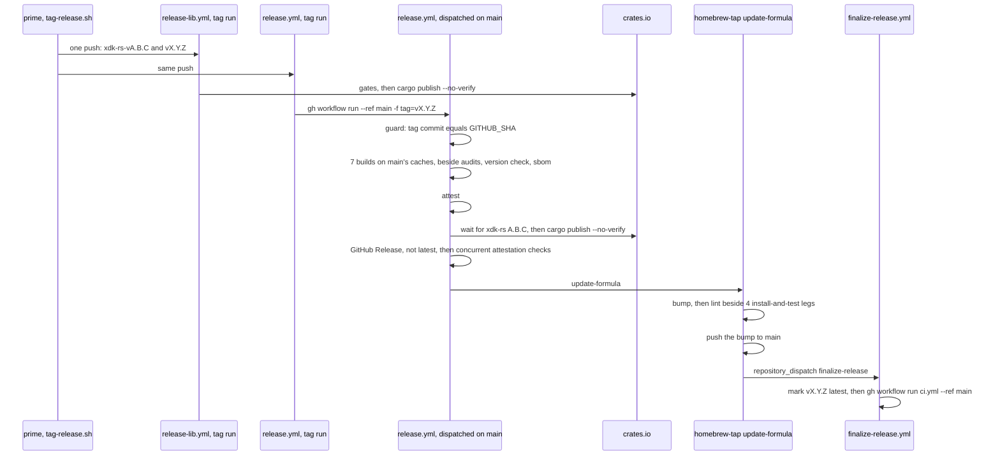
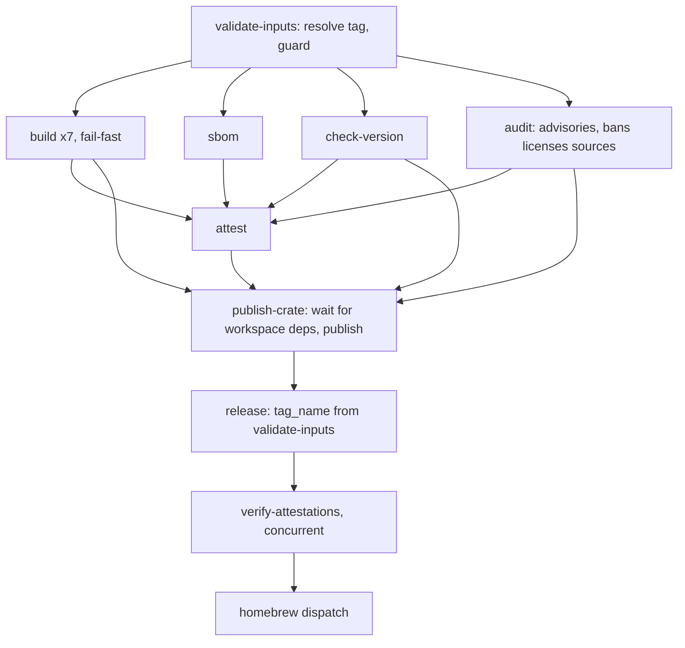

# Release Pipeline Under 8 Minutes - Plan

**Target repos:** `brettdavies/xurl-rs` (unprefixed paths), `brettdavies/.github`, and `brettdavies/homebrew-tap` (paths
prefixed with the repo name). **Bases:** `dev` in xurl-rs and the tap, `main` in `brettdavies/.github`, which has no
`dev`.

## Goal Capsule

- **Objective:** after Brett merges a dual-crate release PR, both crates are on crates.io, the `xurl-rs` GitHub Release
  is marked latest, and `brew upgrade xurl-rs` installs it, within 8 minutes (a soft target, R1), and nothing has
  published before it was built, attested, and checked (R2).
- **Means:** Tier 1 of the wall-clock analysis (KD1, Appendix), plus the release run moved onto `main` so its builds
  restore the previous release's dependency caches, and a weekly matrix build (KD3, KTD8, KTD11).
- **Authority:** R-IDs win on behavior and KTDs on mechanism; a unit overrides neither. `RELEASES-RATIONALE.md` §
  "Cross-compile target matrix" (a release compiles its rows once, in the release run) and the attestation design in the
  header of `brettdavies/.github: .github/workflows/rust-release.yml` hold except where a KTD here changes them.
- **Execution profile:** inline in one session, no subagents or worktrees, long jobs in the background.
  `brettdavies/.github` and the tap are worked from scratch clones. Three PRs, one per repo, grouped under
  Implementation Units.
- **Stop conditions:**
  - A probe shows `publish-crate`, `release`, or `homebrew` running after a gate failed or was skipped (R2).
  - The measured release misses 8 minutes for a reason no unit covers: the per-phase times go to Brett.
  - Keeping the release caches alive needs a paid cache limit (Q1).
- **Who ships:** dot-github-prime owns `brettdavies/.github` and lands its PR. Brett merges into `main` in xurl-rs and
  the tap. Prime merges xurl-rs `dev` PRs once they are reviewed and green, and pushes the release tags.

---

## Product Contract

### Summary

A release cut pushes the library and binary tags together, from a script that first checks that the account's runners
are free. The binary's tag run hands the release to a run on `main`, whose builds restore the previous release's
dependency caches and start as soon as the tag checks out, beside the audits and the version check. Its crates.io
publish waits for the library, skips the verify compile the release PR already ran, and the attestation checks run
concurrently. A failed required build, or a cross cell that fell back to host cargo, ends the run at once. Homebrew
lands through one tap workflow with no pull request, and a weekly matrix build on `main` catches a retired runner label
before a release needs it. CI's warm run on `main` starts once the release is marked latest, so the release has the
account's runners to itself.

### Problem Frame

v4.6.0 took 31:07 from merge to latest, 21:32 without its failed attempt. The 4.3.0 to 4.6.0 dual-crate releases took
28:53 to 45:46, not counting 4.5.0's runner-label outage. The time goes to:

- the library and binary running in series, with an agent hop between them;
- builds waiting about a minute for audits;
- a single-threaded fat-LTO link, which #541 replaces;
- verify compiles and audits that repeat the release PR's checks on the same tree;
- three workflow hops in the tap around 8 to 22 s of actual testing;
- a cross cell that fell back to host cargo and cost a 9:35 rerun;
- runner queues of up to 10 minutes.

Every tag also starts cold. A tag's run restores caches only from its own ref and from `main`, and `main`'s caches do
not last: the caches the 06:04 UTC push to `main` saved on 2026-11-07 were evicted by 17:48 UTC, with the repository at
14.9 GB of caches against GitHub's 10 GB limit, 5.5 GB of them dev caches for superseded lockfiles.

### Requirements

**Outcome**

- R1. A dual-crate release reaches latest, with crates.io and Homebrew done, within 8 minutes of the release PR's merge,
  on cold caches.
- R2. A hand-made tag starts the release, its binaries compile once in the release run, and nothing publishes until
  every required build, the blocking `bans licenses sources` audit, the version check, and the attestations have passed.

**Release start**

- R3. One push carries both tags, and the binary's publish waits a bounded time for the library to reach crates.io,
  failing with a message that names the library release.
- R4. The tag script refuses to push while the account has a workflow run queued or in progress, naming each one;
  `--force` pushes anyway.

**Release run**

- R5. Builds start once the tag is resolved; the audits and the version check run beside them and gate attestation and
  publishing.
- R6. A failed required build row ends the run at once, and rerunning the failed jobs recovers it.
- R7. A cross cell whose `cross` fell back to host cargo fails, with a message naming the fallback.
- R8. Both crates publish without `cargo publish`'s verify compile.
- R9. Attestation checks run concurrently, with the same checks and the same failure behavior.

**Homebrew**

- R10. A prebuilt formula lands through one tap workflow: bump, lint, install and test on the four platforms, push to
  `main`, dispatch finalize, with no pull request.

**Warm caches**

- R11. The binary release's builds restore the previous release's dependency caches.
- R12. The release run refuses to build unless the tag's commit is the commit the run checked out.
- R13. Dev and `main` keep one set of caches per job, for the current lockfile.
- R14. A weekly run builds the release matrix on `main`, and its failure reaches Brett before tag day.
- R15. CI's warm run on `main` starts after the release is marked latest, not at the release PR's merge.

### Key Decisions

- KD1. **Every Tier 1 row ships** (session-settled: user-directed — chosen over a subset of the rows: Brett asked for
  every pipeline optimization discussed, not only the build profile). Governs R1, R3–R10.
- KD2. **The release profile is thin LTO, 4 codegen units, `opt-level = "z"`** (session-settled: user-approved — chosen
  over `opt-level = "s"`: the fastest build and smallest binary, and the few milliseconds of CPU per call do not matter
  to agents against an X round trip). Governs R1. It ships in #541.
- KD3. **Warm caches come from dispatching the release onto `main`, with the hand-made tag still the trigger, and a
  weekly release-matrix check runs on a schedule** (session-settled: user-directed — chosen over marking the release
  latest before Homebrew and over automating the backport). Governs R11–R14.
- KD4. **The shared workflows carry no backward compatibility; bird and agentnative-cli may fail until their fast
  follow** (session-settled: user-directed — chosen over opt-in inputs that kept their behavior: they are converted once
  xurl-rs proves the pipeline). Governs R8, R10, R12.

### Success Criteria

- The first dual-crate release after PR3 reaches latest under 8:00 from the merge, measured from REST run timestamps as
  the Appendix measures v4.6.0, with each phase's time recorded.
- From the second such release on, every build row logs a cache restore from the previous release, and merge to latest
  is under 6:15.

### Scope Boundaries

Considered and not built:

- Marking the release latest before Homebrew lands, and automating the backport: Brett did not choose them (KD3).
- A rehearsal mode on `rust-release.yml`: `release-matrix-check.yml`'s manual dispatch already builds the rows on any
  ref without publishing. Revisit if a release fails in a job the matrix check does not run.
- A host `rustup target add` for cross cells: a host fallback would ship a binary the cross image did not build, so the
  cell fails instead (KTD6). Revisit if `cross` itself proves unreliable for a target.
- sccache on an external bucket: it adds a credentialed service to the workflow that signs the release.
- A Windows Dev Drive or `rust-lld` on MSVC: unmeasured. Revisit if Windows is still the slowest row after PR3's first
  release.
- Building the release on the release PR and promoting it: that reopens the builds-once rule and needs the full
  provenance design first.

#### Deferred to Follow-Up Work

- bird and agentnative-cli pass `tag`, dispatch onto `main`, and gain a required package check before their next release
  (KD4, KTD4).
- xurl-rs's `release.yml`, `release-matrix-check.yml`, `finalize-release.yml`, `scripts/release/tag-release.sh`, and its
  bats suite go upstream into the `github-repo-setup` templates in `brettdavies/agent-skills` through skills-prime, with
  the fast follow.
- The tap's bottle path for source-built formulae (`tests.yml` bottles, `publish.yml`) has no caller once
  `update-formula` lands prebuilt formulae directly, and no formula is source-built; removing it is cleanup for later.
- About 28 ms of CPU per networked `xr` call sits between the TCP connect and the TLS ClientHello, from aws-lc's first
  use; naming it needs `perf`, which `perf_event_paranoid=4` blocks.

### Open Questions

- Q1 (does not gate a merge). If the release caches are still evicted between releases once U11 prunes the superseded
  ones, does the repository's cache limit go above 10 GB, which GitHub bills? The second release after PR3 answers
  whether eviction still happens. The arithmetic says it likely does: one set of CI caches is about 4.3 to 4.6 GB (dev's
  current set 4.4 GB, PR #541's 4.3 GB), so dev's set plus one PR that changes a Cargo input is about 8.9 GB before the
  release's seven build caches, and GitHub evicts the least recently used first, which is the release's, last read by
  the weekly run. The CI plan's KTD3 names this trigger, and its remedy (pull request runs stop saving, through
  `save-if`) belongs to that plan, so it goes to skills-prime.

---

## Planning Contract

### Key Technical Decisions

- KTD1. **Builds need only `validate-inputs`; `attest` and `publish-crate` wait for the gates.** `build` and `sbom` need
  `validate-inputs`. `attest` needs `build`, `sbom`, `check-version`, and `audit`, so nothing is signed for a tree whose
  blocking audit failed. `publish-crate` needs those four and `attest` and states each one's result in its `if:`, as it
  does today. The advisories audit stays `continue-on-error`. An echo-step probe proves the graph with one run per
  failing ancestor (U1).
- KTD2. **The library wait sits at the start of `publish-crate`.** The scratch-manifest bound probe moves out of
  `check-version` and retries every 10 s for up to 10 minutes; the library run took 1:52 to 5:30 on the twelve
  dual-crate releases, queue included. On timeout the error names the crate and bound, says nothing has published, and
  says that rerunning the failed jobs after the library release goes green continues the release. `check-version` keeps
  the tag-to-manifest version check.
- KTD3. **The build matrix sets `fail-fast: true`.** GitHub cancels the rest of a matrix when a row without
  `continue-on-error` fails, and a soft-fail musl row (one whose caller leaves `linux_musl_required` off) does not
  trigger it. Recovery is `gh run rerun <id> --failed`; the U1 probe confirms that it reruns the cancelled rows as well.
- KTD4. **Both reusables publish with `--no-verify` and no dependency cache.** xurl-rs's `ci / Package check`, which
  runs `cargo publish --dry-run --workspace`, is required in `.github/rulesets/protect-main.json`, and the release PR's
  head tree has equalled its squash-merge commit's tree on all twelve dual-crate releases. `rust-lib-release.yml`'s
  `dry_run` still verifies, since a rehearsal is its purpose. Callers without such a check gain one in the fast follow
  (KD4).
- KTD5. **Attestation checks run as concurrent background processes in one step.** Each file's `gh attestation verify`
  call keeps its flags. The step waits for all of them, prints each failure with its file, and fails when any failed, so
  the Homebrew dispatch waits for it as before.
- KTD6. **Cross cells fetch first and fail on a host fallback.** A host `cargo fetch --locked` runs before `cross`. It
  installs the pinned toolchain and downloads every crate before `cross` asks `cargo metadata`, which removes two
  plausible causes of v4.6.0's failed metadata call. The build step then fails, naming the fallback, whenever its output
  holds `cross`'s `Falling back to` note, also when the host build succeeded, since that archive would not be the cross
  image's build. The cross installer becomes the `cargo-bins/cargo-binstall` action pinned by commit, as xurl-rs's own
  CI pins it, and `dtolnay/rust-toolchain` in `build` and `publish-crate` pins to the commit `sbom` already uses, per
  the supply-chain pinning rule.
- KTD7. **`update-formula` lands a prebuilt formula itself.** It keeps its trigger and payload, so no source repository
  changes. Its bump job (allowlist, the attestation check of each archive, the checksum pin, `brew audit`) uploads the
  bumped formula. A lint job and four install-and-test legs, the prebuilt steps of `tests.yml`, then run in parallel on
  it. A last job commits the bump, pushes it to `main` with `Homebrew/actions/git-try-push` in the `publish-formula`
  concurrency group, and dispatches `finalize-release` as `publish.yml` does. It refuses a source-built formula, and
  none exists. `brew style --fix` leaves the path: the lint job runs `brew style` and fails a bump the sed left
  unstyled. The lint job and the legs run plain `brew` commands without `brew test-bot --only-cleanup-before`, the
  bubblewrap install, or `brew test-bot --only-setup`, which serve `brew doctor` and the bottle build; they keep
  `brew trust --tap`. The bump downloads and verifies the archives concurrently, as KTD5 does. With those setup steps
  kept as `tests.yml` runs them, the tap row takes about 3:10 against the Budget's 2:00.
- KTD8. **The tag's run dispatches the release onto `main`.** `rust-release.yml` takes a required `tag` input and reads
  no ref. `validate-inputs` resolves the tag, peels it to its commit, refuses unless that commit is `GITHUB_SHA` (R12),
  and exports the tag as the output every later job reads: the version check, the release notes, the GitHub Release's
  `tag_name`, the attestation downloads, and the Homebrew payload. xurl-rs's `release.yml` runs one job on the tag push,
  `gh workflow run release.yml --ref main -f tag=<tag>` under `GITHUB_TOKEN` with `actions: write`; GitHub lets that
  token start a `workflow_dispatch` run. On dispatch, the caller passes the tag to the reusable. The dispatched run's
  caches live in `main`'s scope, which the next release's dispatched run restores (Appendix, cache-scope probe). When
  `main` has moved past the tag, the guard refuses, and `gh workflow run release.yml --ref <tag> -f tag=<tag>` releases
  from the tag's own ref on cold caches.
- KTD9. **The attestations name `main` as their source ref.** In a dispatched run, the certificate's
  `sourceRepositoryRef` becomes `refs/heads/main` and `buildTrigger` becomes `workflow_dispatch`.
  `sourceRepositoryDigest` stays the tagged commit, which the guard enforces, and the signer stays
  `brettdavies/.github/.github/workflows/rust-release.yml@refs/heads/main` (v4.6.0's certificate, Appendix).
  `gh attestation verify --signer-workflow`, which the release and the tap run, checks the signer, not the source ref,
  and no document here tells a user to pass `--source-ref`. `RELEASES-RATIONALE.md` records the change.
- KTD10. **No step in `rust-release.yml` reads the ref.** A lint script in `brettdavies/.github` fails when the workflow
  names `github.ref_name`, `github.ref`, or `GITHUB_REF_NAME`. In a dispatched run they name `main`, and a GitHub
  Release created with `tag_name: main` would create a tag called `main`.
- KTD11. **The weekly check shares the release's cache key.** `rust-release-matrix-check.yml` keys its cache
  `${{ matrix.target }}` in its job `build`, as `rust-release.yml` does, with the same `env-vars`, so a scheduled run on
  `main` restores the release's caches, a read that GitHub's seven-day retention counts. A run that finds them gone,
  evicted or expired at the week's edge, rebuilds them and saves them under the same key, so the next release restores
  them either way. `scripts/check-release-matrix-parity.sh` holds the two `Cache dependencies` steps' `key` and
  `env-vars` equal, since a difference in either gives the check a cache the release never reads. xurl-rs's
  `release-matrix-check.yml` adds a weekly `schedule`, and GitHub emails a scheduled run's failure to whoever last
  edited its cron line.
- KTD12. **Dev and `main` prune caches for superseded lockfiles.** After a warm run on `dev` or `main` saves its caches
  (a push on `dev`, KTD14's dispatch on `main`), a job deletes that ref's caches whose key, apart from its last segment
  (the hash rust-cache takes over the manifests, the lockfile, and the toolchain), matches a newer cache's. Dev's caches
  hold only dependencies (rust-cache saves with `cache-workspace-crates: false`), and they are what PRs into `dev`
  restore, so they stay; on 2026-11-07 pruning frees 5.5 GB of dev's 9.9 GB. It follows
  `.github/workflows/pr-cache-cleanup.yml`.
- KTD13. **`scripts/release/tag-release.sh` cuts both tags in one push.** It refuses unless the working tree is clean
  and local `main` equals `origin/main`. It tags each crate whose manifest version has no tag yet (`xdk-rs-v<version>`,
  `v<version>`), with `git tag -a`, so the repo's signing configuration applies. It checks the account's runners over
  REST (the repositories the account owns, `type=owner`, pushed in the last day, and their `queued` and `in_progress`
  runs) and refuses while any run is listed, unless `--force`; only the account's own runs hold its 20 concurrent jobs.
  With KTD14 the release merge starts no CI run on `main`, so a cut right after the merge finds the runners free. It
  pushes the tags with one `git push`: GitHub creates no events for a push of more than three tags, so two is safe.
  `--dry-run` prints the tags and the runner check and creates nothing. Output and exit codes follow the other
  `scripts/release/` scripts.
- KTD14. **CI warms `main` after finalize, not at the merge.** `ci.yml`'s push trigger names `dev` alone.
  `finalize-release.yml` gains a `warm-main` job that needs `finalize`, holds `actions: write`, and runs
  `gh workflow run ci.yml --ref main`; `GITHUB_TOKEN` may start a `workflow_dispatch` run, and `ci.yml` already treats a
  dispatch as a warm run. Its 20 jobs, the account's whole concurrency limit on GitHub Free, then start after the
  release is marked latest instead of beside it: on v4.6.0 the library release's jobs queued 2:50 behind them (Decision
  ledger, R1). Stacked PRs restore `main`'s CI caches as before, about eight minutes later. The CI plan's KD1 warm run
  on `main` moves with it, disclosed to skills-prime. `finalize-release.yml` is a copy of the `github-repo-setup`
  template, so the job goes upstream with the other release files.

### High-Level Technical Design

A dual-crate release after all three PRs merge:



The job graph of `rust-release.yml` after PR1:



How xurl-rs's `release.yml` runs:

| Event                                      | Job that runs         | Tag comes from | Caches restored from      | When it refuses                       |
| ------------------------------------------ | --------------------- | -------------- | ------------------------- | ------------------------------------- |
| Tag push                                   | the dispatch job only | the pushed ref | none, it compiles nothing | never                                 |
| `workflow_dispatch --ref main`             | the pipeline          | `tag` input    | `main`'s scope, warm      | the tag's commit is not `main`'s head |
| `workflow_dispatch --ref <tag>` (recovery) | the pipeline          | `tag` input    | the tag's scope, cold     | the input names another tag           |

### Budget

Projected from v4.6.0's measured phases, scaling its build steps by the local ratios for "z" (cold 44.2 s against 122.6
s, warm 18.0 s against 92.2 s); the ratio is measured on Linux, and Windows and macOS are assumed to scale the same.

| Phase                                                  | Cold caches    | Warm caches    |
| ------------------------------------------------------ | -------------- | -------------- |
| Merge to both tags pushed: prime's hop and the script  | 0:35           | 0:35           |
| Tag to builds started, dispatch hop included           | 0:35           | 0:35           |
| Windows build job: about 0:45 of setup, then the build | 3:20           | 1:40           |
| attest, publish, release, attestation checks, dispatch | 1:15           | 1:15           |
| Tap: bump, lint beside the four legs, push, finalize   | 2:00           | 2:00           |
| **Merge to latest**                                    | **about 7:45** | **about 6:05** |

The first row is v4.6.0's measured merge to its first tag, 0:34, which is prime's own hop; the script adds seconds. The
tap row holds only with KTD7's plain `brew` legs. The library release runs beside the binary's and takes about 2:00
without its verify compile, so it is on crates.io before `publish-crate` starts at about 4:25.

### Risks & Dependencies

| Risk                                                    | Mitigation                                                                                                                                                         |
| ------------------------------------------------------- | ------------------------------------------------------------------------------------------------------------------------------------------------------------------ |
| The gate reorder lets a job publish after a failed gate | U1's probe runs once per failing ancestor before PR1 merges                                                                                                        |
| Fail-fast cancels rows a rerun has to rebuild           | the probe confirms `--failed` reruns them; the cold Windows build step under "z" is about 2:30 of its 3:20 job                                                     |
| The library release fails or queues past 10 minutes     | `publish-crate` fails with nothing published; rerun the failed jobs once the library is on crates.io                                                               |
| crates.io Trusted Publishing refuses the dispatched run | U9's probe exchanges a token from a dispatched run before PR3 merges; `publish-crate` is the first job that publishes, so a refusal at a release publishes nothing |
| `main` moves between the tag push and the dispatch      | the guard refuses; dispatch onto the tag's ref (KTD8)                                                                                                              |
| The release caches are evicted before the next release  | U11 prunes 5.5 GB; the weekly run refreshes or rebuilds them; Q1 if that is not enough                                                                             |
| A broken bump reaches the tap's `main`                  | the lint and install checks the PR flow ran gate the push                                                                                                          |
| A library-only release leaves `main`'s CI caches cold   | accepted: it has no finalize, and stacked PRs build cold until their own run saves                                                                                 |
| bird and agentnative-cli fail at their next release     | accepted (KD4); their callers fail at startup on the missing `tag` input, before anything builds                                                                   |
| Runners queue the release                               | the release merge starts no CI run (KTD14), and the tag script refuses while runs are listed (KTD13)                                                               |

### System-Wide Impact

- bird and agentnative-cli call `rust-release.yml` at `@main`, so PR1 reaches them on merge and their callers fail at
  startup until the fast follow (KD4). All three formulae are prebuilt, so PR2's direct landing serves them unchanged.
- Users verifying archives run the same command; the attestation's source ref changes (KTD9).
- The weekly matrix build costs seven jobs a week on a public repository's runners.
- `.github/workflows/ci.yml` is shared ground with the CI plan
  (`docs/plans/2026-10-27-0058-perf-ci-scoping-and-speed-plan.md`, U1), whose planning skills-prime holds. U8 adds a
  job, U11 a pruning step beside its warm runs, and U12 moves its KD1 warm run on `main` from the merge to after
  finalize. All three go to skills-prime, with the evidence that the CI plan's KTD3 trigger has fired (Q1).

### Sequencing

PR1 and PR2 can merge in either order. PR3 merges after PR1, because its caller passes `tag`, an input only PR1's
reusable takes. Every caller pins the reusable at `@main`, so from PR1's merge until PR3's, xurl-rs's own release fails
at startup like bird's and agentnative-cli's. PR3 is therefore reviewed and green before PR1 merges, merges right after
it, and no release is cut between them. PR2 ships alone: the current pipeline sends `update-formula` the same payload.
The first dual-crate release after PR3 measures R1, and the second measures R11 and Q1.

---

## Implementation Units

| U-ID | Title                                                  | Files touched                                                                        | Depends on |
| ---- | ------------------------------------------------------ | ------------------------------------------------------------------------------------ | ---------- |
| U1   | Builds start beside the gates; required rows fail fast | `brettdavies/.github: .github/workflows/rust-release.yml`                            | none       |
| U2   | The library wait moves into `publish-crate`            | `brettdavies/.github: .github/workflows/rust-release.yml`                            | U1         |
| U3   | Publish without the verify compile                     | both release reusables                                                               | U1         |
| U4   | Concurrent attestation checks                          | `brettdavies/.github: .github/workflows/rust-release.yml`                            | none       |
| U5   | Cross cells fetch first and fail on a host fallback    | both build reusables, the parity script                                              | none       |
| U6   | The release reads one tag and refuses a moved `main`   | `rust-release.yml`, the matrix-check reusable, a lint script                         | U1         |
| U7   | `update-formula` lands prebuilt formulae directly      | `brettdavies/homebrew-tap: .github/workflows/update-formula.yml`                     | none       |
| U8   | One script pushes both tags                            | `scripts/release/tag-release.sh` and its bats, a CI job, `RELEASES*.md`, `AGENTS.md` | none       |
| U9   | The tag's run dispatches the release onto `main`       | `.github/workflows/release.yml`                                                      | U6         |
| U10  | Weekly release-matrix check                            | `.github/workflows/release-matrix-check.yml`                                         | U6         |
| U11  | Prune caches for superseded lockfiles                  | `.github/workflows/ci.yml`                                                           | none       |
| U12  | CI warms `main` after finalize                         | `.github/workflows/ci.yml`, `.github/workflows/finalize-release.yml`                 | none       |

### PR1: Shared release workflows (brettdavies/.github)

Waits on: nothing.

### U1. Builds start beside the gates; required rows fail fast

- **Goal:** builds start seconds after the run does, and a failed required row ends the run.
- **Requirements:** R2, R5, R6; KTD1, KTD3, KTD6 (the toolchain pin).
- **Dependencies:** none.
- **Files:**
  - `brettdavies/.github: .github/workflows/rust-release.yml`
  - `brettdavies/.github: RELEASES.md`, `brettdavies/.github: RELEASES-RATIONALE.md`
- **Approach:**
  1. Rewire `needs:` and the publishing `if:` conditions as KTD1 states.
  2. Set `fail-fast: true`, keeping the `continue-on-error` expression and the soft-fail annotation.
  3. Pin `dtolnay/rust-toolchain` in `build` and `publish-crate`.
  4. Rewrite the header's pipeline description and the two documents' gate and recovery sections.
- **Execution note:** prove the graph before merge with an echo-step probe: the job graph copied onto a scratch branch
  with steps that echo, each job failing on demand, run once per scenario below; then delete the branch and its runs.
- **Patterns to follow:** the explicit-result `if:` on `publish-crate`, `release`, and `homebrew`.
- **Test scenarios:**
  - Every gate passes: builds start before `check-version` finishes, and `publish-crate` runs after `attest`.
  - `check-version` fails: builds finish, and `attest`, `publish-crate`, `release`, and `homebrew` are skipped.
  - The `bans licenses sources` audit fails: the same jobs are skipped.
  - The advisories audit fails: publishing proceeds, as today.
  - A required build row fails: the other rows are cancelled, nothing after `build` runs, and `gh run rerun --failed`
    reruns the failed row and the cancelled ones.
  - A soft musl row fails with `linux_musl_required` off: the other rows finish and the release proceeds without its
    archives.
  - `sbom` fails with `attest` on: `attest` is skipped and nothing publishes.
  - `attest` off: `publish-crate` runs when the builds and gates pass.
- **Verification:** every probe run matches its scenario; actionlint and the repo's lint workflow pass.

### U2. The library wait moves into `publish-crate`

- **Goal:** the binary's run builds while the library publishes, and publishes once the library is on crates.io.
- **Requirements:** R3; KTD2.
- **Dependencies:** U1.
- **Files:** `brettdavies/.github: .github/workflows/rust-release.yml`, `brettdavies/.github: RELEASES.md`
- **Approach:**
  1. Move the bound step from `check-version` to the start of `publish-crate`, inside the retry loop.
  2. Log the missing bounds once a minute while waiting.
  3. Take the timeout from a step variable, so U1's probe can shorten it.
- **Test scenarios:**
  - The library is already on crates.io at the bound: the step passes on its first probe.
  - The library lands three minutes in: publishing starts within about 10 s of the index showing it.
  - The library never lands: the step fails at the timeout with the message KTD2 names, and `release` and `homebrew` are
    skipped.
  - A crate with no workspace dependency: the loop has nothing to probe and passes at once.
- **Verification:** the probe covers the three wait outcomes against crates.io, using a version that exists and one that
  does not.

### U3. Publish without the verify compile

- **Goal:** both crates publish in seconds.
- **Requirements:** R8; KTD4.
- **Dependencies:** U1.
- **Files:**
  - `brettdavies/.github: .github/workflows/rust-release.yml`
  - `brettdavies/.github: .github/workflows/rust-lib-release.yml`
  - `brettdavies/.github: RELEASES-RATIONALE.md`
- **Approach:** add `--no-verify` to each real publish, drop the `Cache dependencies` step from both `publish-crate`
  jobs, and leave `rust-lib-release.yml`'s dry run verifying.
- **Test scenarios:**
  - A real publish logs no `Verifying` line and no cache restore.
  - `rust-lib-release.yml` with `dry_run` still logs `Verifying xdk-rs`.
- **Verification:** actionlint passes; the first release after PR3 shows both publish steps under 30 s.

### U4. Concurrent attestation checks

- **Goal:** the check of every published file takes about as long as one check.
- **Requirements:** R9; KTD5.
- **Dependencies:** none.
- **Files:** `brettdavies/.github: .github/workflows/rust-release.yml`
- **Test scenarios:**
  - Every file verifies: the step passes in about the time of the slowest single call.
  - One file has no attestation: the step fails, names that file, and `homebrew` is skipped.
- **Evidence:** on 2026-11-07, 24 concurrent `gh attestation verify` calls against v4.6.0's published files all passed,
  so the attestation API takes the concurrency.
- **Verification:** the step's script, run locally against v4.6.0's published files, passes; with an unattested file
  added to the set, it fails naming that file.

### U5. Cross cells fetch first and fail on a host fallback

- **Goal:** a cross cell that would build on the host fails at once and says why.
- **Requirements:** R7; KTD6.
- **Dependencies:** none.
- **Files:**
  - `brettdavies/.github: .github/workflows/rust-release.yml`
  - `brettdavies/.github: .github/workflows/rust-release-matrix-check.yml`
  - `brettdavies/.github: scripts/check-release-matrix-parity.sh`
  - `docs/solutions/build-errors/rustup-target-add-pinned-toolchain-2026-04-16.md` (the solutions repo, published with
    `sd-commit-doc`)
- **Approach:**
  1. Install `cross` through the pinned `cargo-bins/cargo-binstall` action.
  2. Run `cargo fetch --locked` on cross rows before `Build release`.
  3. Keep the build output and fail the step when it holds the fallback note, whatever the build's own status.
  4. Extend the parity script to hold the cross steps equal in both workflows.
  5. Rewrite the solutions entry's recovery advice for the fail-fast run (KTD3).
- **Test scenarios:**
  - A cross row that pulls its image and builds passes, with no fallback note.
  - A build whose output holds the note and fails: the error names the fallback.
  - A build whose output holds the note and succeeds: the step fails.
  - The parity script fails on a seeded difference between the two workflows' cross steps, and passes on the tree.
- **Verification:** a manual `release-matrix-check.yml` run from a scratch xurl-rs branch whose caller names this PR's
  branch passes all seven rows, and the branch and its runs are deleted afterwards.

### U6. The release reads one tag and refuses a moved `main`

- **Goal:** the release can run on `main` for a tag, and only for the tag at `main`'s head.
- **Requirements:** R11, R12; KTD8, KTD9, KTD10, KTD11.
- **Dependencies:** U1.
- **Files:**
  - `brettdavies/.github: .github/workflows/rust-release.yml`
  - `brettdavies/.github: .github/workflows/rust-release-matrix-check.yml`
  - `brettdavies/.github: scripts/check-release-tag-source.sh` (new), `brettdavies/.github: .github/workflows/lint.yml`
  - `brettdavies/.github: scripts/check-release-matrix-parity.sh`
  - `brettdavies/.github: RELEASES.md`, `brettdavies/.github: RELEASES-RATIONALE.md`
- **Approach:**
  1. Add the required `tag` input and resolve it in `validate-inputs`, peeled to its commit.
  2. Refuse when the tag is missing or its commit is not `GITHUB_SHA`, naming both commits and the recovery dispatch.
  3. Replace every ref read with the job output.
  4. Key the matrix check's cache `${{ matrix.target }}`, and extend the parity script to compare the two
     `Cache dependencies` steps' `key` and `env-vars` (KTD11).
  5. Wire the KTD10 lint into `lint.yml`.
  6. Record the attestation's source-ref change in `RELEASES-RATIONALE.md` (KTD9).
- **Execution note:** observe the lint failing on a seeded `github.ref_name` in a job, and the parity script failing on
  a seeded cache-key difference, before trusting either.
- **Test scenarios:**
  - A dispatch onto `main` with the tag at `main`'s head: the guard passes, and the version check, release notes,
    `tag_name`, downloads, and Homebrew payload all name the tag.
  - A dispatch onto `main` with a tag behind it: the run refuses before any build, naming both commits and the
    `--ref <tag>` recovery.
  - A dispatch naming a tag that does not exist: the run refuses.
  - A dispatch onto the tag's own ref: the guard passes.
  - The lint fails on a seeded ref read and passes on the tree.
  - The parity script fails when the two `Cache dependencies` steps differ in `key` or `env-vars`, and passes on the
    tree.
- **Verification:** U1's echo-step probe, extended with a dispatch caller, covers the four dispatch scenarios, each job
  echoing the tag it read.

### PR2: The tap lands prebuilt formulae directly (brettdavies/homebrew-tap)

Waits on: nothing.

The tap is its own repository, so this is its own PR.

### U7. `update-formula` lands prebuilt formulae directly

- **Goal:** Homebrew serves the release about two minutes after its dispatch, with no pull request.
- **Requirements:** R2, R10; KTD7.
- **Dependencies:** none.
- **Files:**
  - `brettdavies/homebrew-tap: .github/workflows/update-formula.yml`
  - `brettdavies/homebrew-tap: tests/` (bats for any step that moves into a script)
  - `brettdavies/homebrew-tap: RELEASES.md`
- **Approach:**
  1. Keep the `repository_dispatch` and `workflow_dispatch` triggers and the input checks; add a `dry_run` input to the
     manual trigger, shaped like `publish.yml`'s.
  2. Bump job: refuse a source-built formula, verify each archive's attestation, pin the checksums, drop the bottle
     block, run `brew audit`, upload the formula.
  3. A lint job (`brew style`, `readall`, `audit`, bats, as `tests.yml` runs them) and the four install-and-test legs
     (`tests.yml`'s prebuilt steps, `fail-fast: false`) run on the uploaded formula.
  4. A land job needs both: it commits the bump, pushes it to `main`, and dispatches `finalize-release`, skipped under
     `dry_run`.
- **Patterns to follow:** `publish.yml`'s push and finalize steps and its concurrency group; `tests.yml`'s matrix and
  prebuilt steps.
- **Test scenarios:**
  - An `xurl-rs` bump: the formula is updated, the four legs pass, `main` gets one commit, and `finalize-release` is
    dispatched, with no branch or PR.
  - A source-built formula name: the bump refuses and names the reason.
  - An archive with no attestation: the bump fails and nothing is pushed.
  - One test leg fails: the land job is skipped and `main` is unchanged.
  - The lint job fails: the land job is skipped.
  - `dry_run`: every job but the land job's push and dispatch runs.
- **Verification:** a `dry_run` dispatch for `xurl-rs` 4.6.0 verifies the archives, passes all four legs, and pushes
  nothing; the tap's CI passes.

### PR3: xurl-rs runs the new pipeline (brettdavies/xurl-rs)

Waits on: PR1 (merge order: the caller passes `tag`, which only PR1's reusable takes). PR2 (merge order: the first
release under PR3 lands Homebrew through it).

xurl-rs is a third repository, so this is its own PR.

### U8. One script pushes both tags

- **Goal:** a release cut is one command that pushes both tags into free runners.
- **Requirements:** R3, R4; KTD13.
- **Dependencies:** none.
- **Files:**
  - `scripts/release/tag-release.sh` (new)
  - `scripts/release/tests/tag-release.bats` (new), with `git push` and `gh` stubbed on `PATH`, run by
    `scripts/hooks/pre-push` when a file under `scripts/release/` changes and by a `Release scripts` job in
    `.github/workflows/ci.yml` on every pull request, since every pre-push step has a CI counterpart; it moves to
    `brettdavies/agent-skills` with the upstream follow-up
  - `.github/tool-versions` and `scripts/dev-setup.sh` gain bats-core, and the CI job installs it at that version, which
    `crates/xurl-cli/tests/dev_setup_tests.rs` holds it to
  - `RELEASES.md` (the cut, the recovery reruns), `RELEASES-PREFLIGHT.md` (the "library first, CLI second" item),
    `RELEASES-RATIONALE.md` § "Why `xdk-rs` ships on its own tag" (its order paragraph), `AGENTS.md` § "Releasing"
- **Patterns to follow:** `scripts/release/_lib.sh` and the other `scripts/release/` scripts for flags, output, and exit
  codes.
- **Test scenarios:**
  - A dual-crate release with idle runners: two annotated tags in one push.
  - A binary-only release, whose library version is already tagged: one tag.
  - A run in progress in another repository the account owns: the script refuses and names the repository and run URL;
    `--force` pushes.
  - A run in a repository the account does not own: the check does not list it.
  - Local `main` behind `origin/main`: the script refuses and says to pull.
  - The binary tag already exists: the script refuses.
  - `--dry-run`: tags and the runner check are printed, and nothing is created.
- **Verification:** the tests pass, and the first release after PR3 meets the first Success Criterion.

### U9. The tag's run dispatches the release onto `main`

- **Goal:** release builds restore the previous release's caches.
- **Requirements:** R11, R12; KTD8.
- **Dependencies:** U6.
- **Files:** `.github/workflows/release.yml`, `RELEASES.md`, `RELEASES-RATIONALE.md` § "Annotated tags + Trusted
  Publishing" and a new section on the dispatched run
- **Approach:**
  1. Trigger on the tag push and on `workflow_dispatch` with a required `tag` input.
  2. On the push, one job with `actions: write` dispatches `release.yml` on `main` with the tag and links the workflow's
     runs in its summary.
  3. On dispatch, the pipeline calls the reusable with the tag; the caller's other inputs stay.
  4. `RELEASES.md` gives the recovery for a failed dispatch job: nothing has built, and
     `gh workflow run release.yml --ref main -f tag=<tag>` by hand continues the release.
- **Execution note:** before PR3 merges, prove that crates.io Trusted Publishing accepts a dispatched run. A scratch
  xurl-rs branch whose `release.yml` runs only `rust-lang/crates-io-auth-action` (the token exchange, then the action's
  own revoke) is dispatched with `--ref <branch>`; nothing publishes. If crates.io refuses it, the same probe dispatched
  onto a scratch tag's ref decides whether the tag-ref recovery is the release path, and a refusal there too stops PR3
  and goes to Brett. The branch and its runs are deleted afterwards.
- **Test scenarios:**
  - A tag push: the tag run ends within seconds, and a run on `main` starts with the tag.
  - The dispatch job fails: no build starts, and the hand dispatch `RELEASES.md` gives continues the release.
  - The second release under PR3: each build row logs `Cache restored from key`, with a key the first release saved.
  - A manual dispatch for a tag behind `main`: the guard refuses.
  - The recovery dispatch onto the tag's ref completes a release.
- **Verification:** the second Success Criterion; the tap's attestation check passes on a dispatched run's archives.

### U10. Weekly release-matrix check

- **Goal:** a retired runner label or a broken cross target fails a scheduled run, not a release.
- **Requirements:** R14; KTD11.
- **Dependencies:** U6.
- **Files:** `.github/workflows/release-matrix-check.yml`, `RELEASES-RATIONALE.md` § "Cross-compile target matrix"
- **Approach:** add a weekly `schedule` off the hour; the job's `if:` and the concurrency group already admit it.
- **Test scenarios:**
  - A scheduled run on `main` builds all seven rows and restores the release's caches.
  - A row on a retired label fails, and GitHub emails the failure.
- **Verification:** a manual dispatch on `main` passes, and the next week shows a run with event `schedule`.

### U11. Prune caches for superseded lockfiles

- **Goal:** dev's and `main`'s caches fit beside the release's, so the release's survive between releases.
- **Requirements:** R13; KTD12.
- **Dependencies:** none.
- **Files:** `.github/workflows/ci.yml`, following `.github/workflows/pr-cache-cleanup.yml`
- **Test scenarios:**
  - A dev push run after a lockfile change: the older lockfile's caches are deleted and the new ones kept.
  - A dev push run with no lockfile change: nothing is deleted.
  - A failed push run: nothing is deleted.
  - PR caches are untouched; `pr-cache-cleanup.yml` owns them.
  - U12's warm run on `main`: `main`'s caches for an older lockfile are deleted the same way.
- **Verification:** `gh cache list --ref refs/heads/dev` lists one lockfile hash per job, and the repository total is
  under 10 GB at the next release.

### U12. CI warms `main` after finalize

- **Goal:** the release has the account's runners to itself, and `main`'s CI caches still fill after each release.
- **Requirements:** R1, R4, R15; KTD13, KTD14.
- **Dependencies:** none.
- **Files:**
  - `.github/workflows/ci.yml` (the push trigger, and the header that names a push to `main` as a warm run)
  - `.github/workflows/finalize-release.yml`
  - `RELEASES.md` (what follows finalize), `RELEASES-RATIONALE.md` (why `main` warms after finalize)
- **Approach:**
  1. Drop `main` from `ci.yml`'s push branches and rewrite the header's warm-run sentence.
  2. Add `warm-main` to `finalize-release.yml`: `needs: finalize`, job-level `permissions: actions: write`, one step
     that runs `gh workflow run ci.yml --ref main` with `GH_TOKEN` from `github.token`.
- **Test scenarios:**
  - The first release after PR3: no CI run starts on `main` at the merge, and a CI run with event `workflow_dispatch`
    starts on `main` after `finalize` succeeds, followed by U11's prune.
  - `finalize` fails: `warm-main` is skipped.
  - A push to `dev` still starts the warm run and its prune.
- **Verification:** after the first release under PR3, `gh run list --workflow ci.yml --branch main` shows one run, with
  event `workflow_dispatch`, created after finalize.

---

## Verification Contract

| Gate                                                                                           | Applies to | Pass                                                                |
| ---------------------------------------------------------------------------------------------- | ---------- | ------------------------------------------------------------------- |
| actionlint on every changed workflow                                                           | all units  | Clean                                                               |
| `brettdavies/.github` lint workflow (parity, runner labels, concurrency, job names, ref reads) | U1–U6      | Passes; each new check observed failing on a seeded violation first |
| Echo-step probe of the job graph                                                               | U1, U2, U6 | Each scenario's run matches                                         |
| The attestation step's script against v4.6.0's files                                           | U4         | Passes; an unattested file fails it                                 |
| Matrix check from a scratch caller on PR1's branch                                             | U5         | All seven rows pass with no fallback                                |
| The tap's CI and a `dry_run` of `update-formula`                                               | U7         | Passes, nothing pushed                                              |
| `scripts/hooks/pre-push`                                                                       | U8–U12     | Passes                                                              |
| Trusted Publishing token exchange from a dispatched scratch run                                | U9         | crates.io issues the token; nothing publishes                       |
| CI runs on `main` at the first release after PR3                                               | U12        | None at the merge; one `workflow_dispatch` run after finalize       |
| First dual-crate release after PR3                                                             | U1–U9      | Merge to latest under 8:00, per-phase times recorded                |
| Second dual-crate release after PR3                                                            | U9–U12     | Every build row restores the first release's cache; under 6:15      |
| `gh cache list` at each release                                                                | U11        | One lockfile hash per job on `dev` and `main`                       |

## Definition of Done

- Every unit's verification is met.
- Both Success Criteria are met, or Brett has the measured shortfall per phase.
- Every probe branch and its runs are deleted, and `brettdavies/cache-scope-probe` stays archived.
- `RELEASES.md`, `RELEASES-PREFLIGHT.md`, `RELEASES-RATIONALE.md`, `AGENTS.md`, the `brettdavies/.github` and tap
  `RELEASES` documents, and the solutions entry describe the pipeline as it runs.
- No probe workflow, experimental step, or unused input remains in any repository's diff.

---

## Appendix

**v4.6.0 baseline (run 42345825865), merge 06:04:00 UTC.**

| Phase                                                                                                        | Wall                       |
| ------------------------------------------------------------------------------------------------------------ | -------------------------- |
| Merge to `xdk-rs-v0.5.0` pushed                                                                              | 0:34                       |
| `release-lib.yml`                                                                                            | 5:30, of which 2:50 queued |
| To `v4.6.0` pushed                                                                                           | 0:32                       |
| `release.yml` attempt 1: cold, the x86_64 musl cell fell back to host cargo, the run waited 7:18 for Windows | 9:07                       |
| Full rerun, then attempt 2                                                                                   | 0:28, then 9:49            |
| Tap `update-formula`, its PR's CI, `publish.yml` and finalize                                                | 1:22, 3:06, 0:39           |
| **Merge to latest**                                                                                          | **31:07**                  |

Inside attempt 2: gates 0:11 to 1:05, builds 3:10 to 5:40 (Windows the slowest), `publish-crate` 1:15 (51 s of it the
verify compile), attestation checks 1:03 (15 calls in series).

**Release profile, local, 4 pinned cores, building `xr` alone.** fat LTO, 1 unit, O3: 122.6 s cold, 92.2 s warm,
12,787,416 bytes. thin LTO, 4 units, "z": 44.2 s cold, 18.0 s warm, 9,169,280 bytes.

**Cache scope probe, `brettdavies/cache-scope-probe` (private, archived).** A run dispatched on `main` restored the
cache an earlier dispatched run on `main` saved. A tag push's run found no cache. A run dispatched on `main` for a tag
on an older commit reported `GITHUB_SHA` as `main`'s head while checking out the tag's commit, which is why KTD8 needs
its guard.

**Cache use, 2026-11-07 17:48 UTC.** 59 caches, 14.9 GB, against a 10 GB limit and 7-day retention
(`actions/cache/storage-limit`, `retention-limit`). Dev: 18 caches for the current lockfile (4.4 GB), 24 for two
superseded ones (5.5 GB). PR #541: 18 caches (4.3 GB), since it changes `Cargo.toml`. `main`: none, though CI's push run
at 06:04 saved a full set.

**v4.6.0 attestation certificate.** `buildSignerURI` and the SAN are
`https://github.com/brettdavies/.github/.github/workflows/rust-release.yml@refs/heads/main`, `sourceRepositoryRef` is
`refs/tags/v4.6.0`, `buildTrigger` is `push`, and `sourceRepositoryDigest` is the tagged commit.

---

## Eng Review Record

Target: this plan, reviewed with `/plan-eng-review` at commit 147d846.

Scope record: feature answers: none proposed (U4, U6's lint, and U11 were considered for a cut and kept); structure: the
original arrangement plus U12, settled from evidence, since no arrangement with fewer files keeps every requirement (the
lint script stays its own file because the parity script compares two workflows and the lint reads one); accepted scope:
the plan as written plus R1's accepted scope (R15, KTD14, U12); pending remedies: none.

## Decision ledger

### R1: when CI warms `main`'s caches

- **Finding:** Scope Challenge finding S1, CRITICAL, confidence 9/10, `.github/workflows/ci.yml:32-33`
  (`push: branches: [dev, main]`) against R1, R4, and KTD13, plan-eng-review.
- **Plan baseline:** R4 and KTD13 refuse the tag push while any run on the account is queued or in progress; the Budget
  counts no runner queue. The CI plan's KD1 (user-approved): "push runs on `main` only warm caches", for stacked PRs,
  which restore from `main`.
- **Runtime evidence:** the v4.6.0 merge started CI run 42345347645 on `main` at 06:04:03 UTC; it ran 20 jobs from
  06:04:06 to 06:08:22, the account's whole 20-job concurrency limit on GitHub Free. `release-lib.yml`'s five jobs in
  run 42345383734 queued 2:50 in that window (check-version created 06:05:03, started 06:06:04). Every release merge
  starts this run, so the tag script would find it in progress at every cut. The Dependabot runs at 06:04:06 came from
  v4.6.0's own edit to `.github/dependabot.yml` and are not a per-release load.
- **Comparison grid:**

| Choice                                  | Current                      | A                                         | B                             | C                                                 |
| --------------------------------------- | ---------------------------- | ----------------------------------------- | ----------------------------- | ------------------------------------------------- |
| R1 when CI warms `main`                 | on the push, at the merge    | on a dispatch from `finalize-release.yml` | never                         | on the push, at the merge                         |
| Runners when the release starts         | 20 of 20 held for about 4:20 | free                                      | free                          | 20 of 20 held for about 4:20                      |
| Stacked PRs restoring `main`'s CI cache | warm until evicted           | warm until evicted, about 8 minutes later | cold                          | warm until evicted                                |
| Dev's caches (every PR into `dev`)      | saved after every dev merge  | unchanged                                 | unchanged                     | unchanged                                         |
| Release build caches (KD3, KTD11)       | none yet (PR3 adds them)     | unchanged                                 | unchanged                     | unchanged                                         |
| KTD13 runner check                      | refuses every cut            | unchanged                                 | unchanged                     | skips this repository's run for the tagged commit |
| U11 prune on `main`                     | after a push run             | after the dispatched warm run             | none for CI's caches          | after a push run                                  |
| Structure (scope record)                | original arrangement         | original arrangement plus U12             | original plus a `ci.yml` edit | original arrangement                              |

```text
Question D2:
D2 — When CI warms main's caches (D1 again, with the three cache sets explained)
Project/branch/task: dev, eng review of the release-pipeline plan; ci.yml's push trigger on main (ci.yml:32-33) against R1, R4, and KTD13.
ELI10: Three cache sets are in play, and this question touches only the third. (1) Dev's caches: CI saves them after every merge to dev, and every PR into dev starts from them, so dev stays warm however often it merges; no option here changes that. (2) The release's build caches: the release run on main saves them and the weekly matrix check refreshes them, so the next release starts warm; that is the warming of main ahead of a release, and no option here changes it either. (3) CI's own caches on main: a 20-job CI run saves them the moment the release PR merges. The release never reads them; only stacked PRs (PRs onto a feature branch) do, and the set v4.6.0 saved at 06:04 UTC was evicted by 17:48. That run takes all 20 of the account's runners just as the release starts (the library release's jobs waited 2:50), and the plan's tag script would refuse every cut while it runs.
Stakes if we pick wrong: leaving the run at the merge costs every release about 3 minutes of queue; dropping it means stacked PRs never restore main's CI caches.
Recommendation: A because it keeps the CI plan's KD1 (main's CI caches for stacked PRs) for about 10 minutes of work and moves the 20 jobs to after the release is marked latest; B is close, since those caches lasted under 12 hours on v4.6.0.
Completeness: A=9/10, B=8/10, C=4/10
Pros / cons:
A) Warm main after the release (recommended)
  ✅ the release gets the account's runners to itself, and the tag script finds no run at the merge
  ✅ keeps the CI plan's KD1: stacked PRs get main's CI caches in the hours after each release
  ❌ adds a job to finalize-release.yml for caches that lasted under 12 hours on v4.6.0
B) Stop warming main
  ✅ the release gets the account's runners to itself, as in A, with a one-line change
  ✅ dev's caches and the release's build caches are untouched; dev stays warm after every merge
  ❌ stacked PRs never restore main's CI caches, where today they can in the hours before eviction
C) Keep it; the release competes
  ✅ no change to ci.yml or to the CI plan's decision
  ✅ stacked PRs can restore main's CI caches from the moment of the merge
  ❌ the release queues behind 20 jobs (2:50 on v4.6.0), and the tag script must skip that run or every cut needs --force
Net: A and B both free the release's runners and leave dev and the release caches alone; A keeps a short-lived cache for stacked PRs for one job, B drops it.
Header: Warm main
Options:
A) Warm main after the release (recommended)
ci.yml's push trigger names dev alone, and finalize-release.yml gains a job after finalize that runs `gh workflow run ci.yml --ref main` with actions: write, a warm run under ci.yml's existing workflow_dispatch. U11's prune runs on that run as on a push. It lands in PR3 as U12 and goes to skills-prime with U11, since it moves the CI plan's KD1 warm run from the merge to after finalize (human: ~1 h / CC: ~10 min).
B) Stop warming main
ci.yml's push trigger names dev alone, and nothing replaces main's warm run. Dev's caches and the release's build caches are unchanged. Stacked PRs whose base is a feature branch restore nothing until their own run saves, and the CI plan's KD1 narrows to dev, disclosed to skills-prime (human: ~20 min / CC: ~5 min).
C) Keep it; the release competes
ci.yml is unchanged. KTD13's runner check skips runs on this repository's main for the commit being tagged, and the Budget gains the measured 2:50 queue, so the cold total becomes about 10:30 (human: ~20 min / CC: ~5 min).
```

- **State:** approved
- **Actual answer:** A) Warm main after the release (D2, 2026-11-07)
- **Accepted scope:** `ci.yml`'s push trigger names `dev` alone, and `finalize-release.yml` gains a job after `finalize`
  that runs `gh workflow run ci.yml --ref main` with `actions: write`, a warm run under `ci.yml`'s existing
  `workflow_dispatch`. U11's prune runs on that run as on a push. It lands in PR3 as U12 and goes to skills-prime with
  U11, since it moves the CI plan's KD1 warm run from the merge to after finalize.
- **History:** D1 (2026-11-07) asked the same choice with A recommended, the same options, and an ELI10 that did not
  separate the three cache sets. Brett asked what is being warmed, whether this warms dev after a release, and how warm
  dev stays given far more merges to dev than releases; he chose no option. Reopened as D2, with the cache sets and the
  measured 12-hour life of `main`'s CI caches in the brief, and the grid gaining the dev and release-cache rows.

### Corrections under existing approvals

Each item is settled by the evidence named and is necessary for the requirement named; each is applied where it says.

- **The tap row** (Performance P1, confidence 9/10): KTD7 as written keeps `tests.yml`'s `brew test-bot` cleanup and
  setup in every leg, which holds the tap at about 3:10. The legs and the lint job run plain `brew` commands and the
  bump verifies archives concurrently. Necessary for R1. Applied to KTD7; U7's `dry_run` verification times it.
- **The tag hop** (Performance P2, confidence 9/10, Appendix): the Budget's 0:20 was not measured; v4.6.0 measured 0:34
  from merge to the first tag. The Budget becomes about 7:45 cold and 6:05 warm, and the second Success Criterion 6:15.
  Necessary for R1's measurement. Applied to the Budget, the Success Criteria, and the Verification Contract.
- **The release caches' odds** (Performance P3, confidence 7/10): the Q1 arithmetic. Applied to Q1 and System-Wide
  Impact; the remedy goes to skills-prime.
- **The Windows figure** (Performance P4, confidence 9/10): the Risks table's cold Windows build of about 2:30 is the
  build step of a 3:20 job. Applied to the Risks table.
- **Trusted Publishing on a dispatched run** (Architecture A1, confidence 6/10): unverified, and the whole dispatch
  design rests on it. U9's probe exchanges a token from a dispatched scratch run before PR3 merges. Necessary for R8 and
  R11. Applied to U9, the Risks table, and the Verification Contract.
- **One cache key in two workflows** (Architecture A2, red flag 8, confidence 8/10): the release and the matrix check
  each write the `Cache dependencies` step. The parity script fails when their `key` or `env-vars` differ. Necessary for
  R11. Applied to KTD11 and U6.
- **A failed dispatch job** (Architecture A3, confidence 8/10): U9 named no recovery. `RELEASES.md` gives the hand
  dispatch. Necessary for R2's "nothing published" reading of a failure. Applied to U9.
- **PR1 breaks xurl-rs's own release** (Architecture A4, confidence 9/10): xurl-rs pins the reusable at `@main` like the
  other callers. PR3 is ready before PR1 merges and merges right after it. Necessary for R3. Applied to Sequencing.
- **The cache key's last segment** (Code quality C1, confidence 9/10): rust-cache hashes the manifests, the lockfile,
  and the toolchain into it. Applied to KTD12.
- **The weekly check and retention** (Code quality C2, confidence 8/10): a weekly read can land just after the seven-day
  mark; the run then rebuilds and saves under the same key. Applied to KTD11.
- **The bats suite in CI** (Code quality C3, confidence 9/10, `scripts/hooks/pre-push:244-245`): every pre-push step
  mirrors a CI job, so a suite only the hook runs would be the first exception. U8 adds a `Release scripts` job. Applied
  to U8.
- **The runner check's scope** (Code quality C4, confidence 8/10): only the account's own repositories hold its 20 jobs.
  Applied to KTD13 and U8.
- **The attestation API under concurrency** (evidence for U4): 24 concurrent calls on 2026-11-07, no failure. Applied to
  U4.

Approval readiness: PASS. Checked: R1 (actual answer: D2, A, 2026-11-07). The corrections above change no outcome and
need no approval.

## Eng Review Body

### Scope Challenge

1. **S1** [CRITICAL] (confidence: 9/10) `.github/workflows/ci.yml:32-33` — a release merge starts CI's 20-job warm run
   on `main`, the account's whole concurrency limit; v4.6.0's library jobs queued 2:50 behind it, and KTD13's runner
   check would refuse every cut. Disposition: accepted, D2 answer A (R1): U12, R15, KTD14.

Result: scope accepted as-is (U12 adds a unit without reducing scope).

### 1. Architecture review

1. **A1** [HIGH] (confidence: 6/10) Risks table, Trusted Publishing row — crates.io acceptance of a dispatched run is
   assumed, and the first release would be the test.
2. **A4** [MEDIUM] (confidence: 9/10) Sequencing — PR1's merge breaks xurl-rs's release until PR3 merges.
3. **A2** [MEDIUM] (confidence: 8/10) KTD11 — the shared cache key lives in two workflows with nothing holding them
   equal.
4. **A3** [MEDIUM] (confidence: 8/10) U9 — no recovery for a dispatch job that fails.

Dispositions: A1 to A4 accepted as corrections (Decision ledger, Corrections).

Two shapes: the plan's one new public surface is the reusable's `tag` input, which three repositories call. Shape A
(chosen): a required `tag` input and no ref read anywhere (KTD8, KTD10). Shape B: read `github.ref_name` on a push and
the input on a dispatch. B keeps the callers working unchanged but puts two sources for one fact in every job, the
red-flag-6 shape, and KD4 rules out the compatibility it buys. A hides the event behind one output that every job reads,
so A. Red flags: 8 (hand-synced list) is A2; no other flag applies.

Cache scopes after the plan:

```text
ref                 written by                         read by
refs/heads/dev      CI push runs (U11 prunes)          PRs into dev
refs/heads/main     release run on main (KTD8)         next release run, weekly check (KTD11)
                    weekly matrix check (KTD11)
                    CI warm run after finalize (U12)   stacked PRs
refs/pull/<n>/merge the PR's own runs                  that PR; deleted on close
refs/tags/<tag>     recovery dispatch only             nothing later
```

### 2. Code quality review

1. **C3** [MEDIUM] (confidence: 9/10) U8 Files — the bats suite ran only in the hook.
2. **C1** [LOW] (confidence: 9/10) KTD12 — the cache key's last segment was described as lockfile and toolchain only.
3. **C2** [LOW] (confidence: 8/10) KTD11 — "resets their seven-day expiry" left out the read that lands after it.
4. **C4** [LOW] (confidence: 8/10) KTD13 — the runner check did not say whose repositories it lists.

Shared code: `tag-release.sh` reuses `scripts/release/_lib.sh`; `warm-main` and `pr-cache-cleanup.yml` each run one `gh`
command, and no helper would hide more than it adds. No extraction proposed. Dispositions: C1 to C4 accepted as
corrections.

### 3. Test review

Frameworks: actionlint and the `brettdavies/.github` lint workflow; echo-step probe runs; bats (U8, and the tap's
`tests/`); the release itself for R1 and R11. Rust tests are untouched.

```text
path                                  covered by
build/gate graph, fail-fast           U1 probe: 8 scenarios, one run each
library wait                          U2 probe: present, late, never, none
--no-verify                           U3 logs; dry run still verifies
concurrent attestation checks         U4 local run against v4.6.0 files, plus an unattested file
cross fetch, fallback note            U5 scenarios; matrix check on a scratch caller
tag input, guard, ref lint, parity    U6 probe with a dispatch caller; seeded lint and parity failures
tap direct landing                    U7 dry_run and six scenarios
tag-release.sh                        U8 bats: 8 scenarios, pre-push and CI
dispatch onto main                    U9 Trusted Publishing probe; first and second release
weekly check                          U10 manual dispatch, then the scheduled run
cache pruning                         U11 four scenarios plus main's warm run
warm run after finalize               U12 first release after PR3
```

Gaps found and filled: **T1** U12 had no scenarios (new unit); **T2** U6 had no scenario for the cache-step parity;
**T3** U9 had none for Trusted Publishing or a failed dispatch job. Regression rule: the tap's pull request checks move
into `update-formula` unchanged (U7's scenarios), and nothing else stops being tested. Test plan:
`~/.gstack/projects/brettdavies-xurl-rs/brett-dev-eng-review-test-plan-20261107-152605.md`. Dispositions: T1 to T3
accepted.

### 4. Performance review

1. **P1** [HIGH] (confidence: 9/10) KTD7 — the tap row is about 3:10 with `tests.yml`'s setup steps, against 2:00.
2. **P2** [MEDIUM] (confidence: 9/10) Budget, first row — 0:20 unmeasured against v4.6.0's 0:34.
3. **P3** [MEDIUM] (confidence: 7/10) Q1 — the release caches are likely evicted by least-recent use with one
   Cargo-touching PR open.
4. **P4** [LOW] (confidence: 9/10) Risks table — the Windows figure is the build step, not the job.

Dispositions: P1 to P4 accepted as corrections.

### Reality rows

Premises:

| premise | claim                                                       | file:line receipt                                                                                       | verdict    |
| ------- | ----------------------------------------------------------- | ------------------------------------------------------------------------------------------------------- | ---------- |
| P1      | CI's push trigger names `dev` and `main`                    | `.github/workflows/ci.yml:32-33`                                                                        | true       |
| P2      | CI takes `workflow_dispatch`, and a dispatch is a warm run  | `.github/workflows/ci.yml:34`, `.github/workflows/ci.yml:58`                                            | true       |
| P3      | `ci / Package check` is required on `main`                  | `.github/rulesets/protect-main.json:108`                                                                | true       |
| P4      | `finalize-release.yml` is a copy of the canonical template  | `.github/workflows/finalize-release.yml:1`                                                              | true       |
| P5      | the PR cache cleanup deletes by ref with `gh cache delete`  | `.github/workflows/pr-cache-cleanup.yml:25`                                                             | true       |
| P6      | every pre-push step mirrors a CI job                        | `scripts/hooks/pre-push:244-245`, `AGENTS.md:406`                                                       | true       |
| P7      | CI installs are held to `.github/tool-versions`             | `crates/xurl-cli/tests/dev_setup_tests.rs:1`                                                            | true       |
| P8      | the release-cut merge started 20 CI jobs on `main` (v4.6.0) | run 42345347645, Decision ledger R1                                                                     | true       |
| P9      | GitHub lets `GITHUB_TOKEN` start a `workflow_dispatch` run  | GitHub's "Triggering a workflow from a workflow" docs                                                   | true       |
| P10     | crates.io Trusted Publishing accepts a dispatched run       | none; U9's probe                                                                                        | unverified |
| P11     | `gh run rerun --failed` reruns the rows fail-fast cancelled | none; U1's probe                                                                                        | unverified |
| P12     | every `gh` flag the plan names exists in gh 2.103.3         | `--help` of `workflow run`, `cache list`, `cache delete`, `run rerun`, `attestation verify`, `run list` | true       |

```text
REALITY: premise-table finding 12 premises, 2 unverified (P10 Trusted Publishing, P11 rerun of cancelled rows), each with a probe before its PR merges .github/workflows/ci.yml:32-33
REALITY: already-done pass git log origin/dev since 2026-11-06 over the named workflows, scripts/release, and RELEASES docs shows only dependency bumps (55f770a, 9f3fda9); no commits on brettdavies/.github main or the tap since then 55f770a
REALITY: surface-check pass gh 2.103.3 --help lists --ref, --raw-field, --failed, --all, --succeed-on-no-caches, --signer-workflow, --branch, --event; the cleanup's delete runs today .github/workflows/pr-cache-cleanup.yml:25
REALITY: binding-decisions pass gstack-decision-search --scope branch --recent 50 holds nothing this plan reverses; KD1 to KD4 and D2 are kept .github/workflows/ci.yml:32-33
REALITY: numbers finding the Budget's tag hop was 0:20 unmeasured and is now 0:35, from v4.6.0's measured 0:34 [measured: docs/plans/2026-11-07-1206-perf-release-pipeline-under-8-minutes-plan.md:711]; the tap row's 2:00 holds only with KTD7's plain legs [estimated]; totals 7:45 and 6:05 [estimated] docs/plans/2026-11-07-1206-perf-release-pipeline-under-8-minutes-plan.md:711
REALITY: deferred-asks pass no linked issue; Brett's unchosen items (latest before Homebrew, backport automation) are listed in Scope Boundaries with KD3 .github/workflows/finalize-release.yml:1
REALITY: pr-count pass no .gstack/ship-policy.json, so the default is one PR per wave; three repositories need three PRs, and each extra gate is one review and one merge by its owner .github/workflows/release.yml:17
REALITY: prior-art pass adopt rust-cache's documented key (job id, `key` input, env prefixes, then the manifest and lockfile hash) as ci.yml already relies on it; adopt cross's documented host fallback note as the failure signal; adopt crates-io-auth-action's exchange-and-revoke for the U9 probe; nothing is patched or vendored .github/workflows/ci.yml:19-23
REALITY: contract-assumptions pass brettdavies/.github's one open PR, 119, touches only rust-ci.yml; callers pin @main, so PR1's merge reaches them at once (Sequencing) .github/workflows/finalize-release.yml:1
REALITY: units pass no input changes units: the Budget scales build steps by the local cold and warm ratios, and its consumers (R1's 8:00, the 6:15 criterion, KTD2's 10-minute bound and 10 s retry) stay in m:ss and seconds docs/plans/2026-11-07-1206-perf-release-pipeline-under-8-minutes-plan.md:722
REALITY: perf-table pass the base is v4.6.0's measured run and the local profile's cold and warm builds on 4 pinned cores; the release itself re-measures both .github/workflows/release.yml:17
REALITY: dependency-fallback pass PR2 ships alone; PR1 alone breaks every caller's release until it passes tag; PR3 needs PR1 and is ready before it merges .github/workflows/release.yml:17
REALITY: obligation-tiers pass must-ship: every unit; next PR: the bird and agentnative-cli fast follow and the canon move; deferred: the tap's bottle path and the aws-lc finding .github/workflows/finalize-release.yml:1
```

### What already exists

- `.github/workflows/pr-cache-cleanup.yml` deletes a closed PR's caches; U11 follows its shape for dev and `main`.
- `ci.yml`'s `workflow_dispatch` and its warm mode (`TEST_NO_RUN`); U12 starts that run instead of adding one.
- `scripts/release/_lib.sh` and the other release scripts; U8's script reuses their flags, output, and exit codes.
- `scripts/check-release-matrix-parity.sh` already holds the two build workflows' rows equal; U5 and U6 extend it.
- `tests.yml`'s prebuilt steps and `publish.yml`'s push and finalize steps; U7 moves them, it does not rewrite them.
- `release-matrix-check.yml`'s manual dispatch already builds every row without publishing; no rehearsal mode is added.

### NOT in scope

- A paid cache limit: Q1 waits for the second release's evidence.
- The CI plan's `save-if` remedy for PR caches: that plan's KTD3, sent to skills-prime.
- A warm run after a library-only release: it has no finalize, and stacked PRs build cold until their own run saves.
- An outside-model review: `codex_reviews` is disabled.

### Failure modes

| New path                | Realistic failure                           | Covered by                                                 | Silent? |
| ----------------------- | ------------------------------------------- | ---------------------------------------------------------- | ------- |
| Dispatch onto `main`    | `main` moved after the tag                  | the guard refuses, naming the tag-ref recovery (U6)        | no      |
| Dispatch job            | token or API error                          | the job fails; `RELEASES.md` gives the hand dispatch (U9)  | no      |
| Trusted Publishing      | crates.io refuses the dispatched run        | U9's probe before PR3; at a release, nothing has published | no      |
| Library wait            | the library never lands                     | timeout names the crate and the rerun (U2)                 | no      |
| Fail-fast               | a rerun leaves cancelled rows unbuilt       | U1's probe of `--failed`                                   | no      |
| Cross cell              | host fallback builds a good-looking archive | the note fails the step (U5)                               | no      |
| Tap direct landing      | a broken bump                               | lint and four legs gate the push (U7)                      | no      |
| Weekly check            | the caches were evicted                     | it rebuilds and saves them (KTD11)                         | no      |
| Weekly check            | a retired runner label                      | the run fails and GitHub emails it (U10)                   | no      |
| Cache pruning           | deletes the current lockfile's caches       | only keys a newer cache supersedes go (U11 scenarios)      | no      |
| Warm run after finalize | finalize fails                              | `warm-main` is skipped; finalize's own failure is visible  | no      |
| Tag script              | a foreign repository's runs block a cut     | the check lists only the account's own (U8)                | no      |

Critical gaps: 0.

### Worktree parallelization strategy

| Step | Modules touched                                  | Depends on |
| ---- | ------------------------------------------------ | ---------- |
| PR1  | `brettdavies/.github` workflows and scripts      | none       |
| PR2  | `brettdavies/homebrew-tap` workflows             | none       |
| PR3  | xurl-rs `.github/workflows/`, `scripts/release/` | PR1        |

Lane A: PR1 → PR3. Lane B: PR2. Sequential implementation in this session, per the no-worktrees rule for xurl-rs: PR1,
then PR2, then PR3. Conflict flags: `ci.yml` is shared with the CI plan (skills-prime).

### Implementation Tasks

- [ ] **T1 (P1, human: ~1h / CC: ~10 min)** xurl-rs — warm `main` after finalize (U12)
  - Surfaced by: Scope Challenge S1, R1 (D2)
  - Files: `.github/workflows/ci.yml`, `.github/workflows/finalize-release.yml`, `RELEASES.md`, `RELEASES-RATIONALE.md`
  - Verify: the first release after PR3 shows no CI run on `main` at the merge and one `workflow_dispatch` run after
    finalize
- [ ] **T2 (P1, human: ~1h / CC: ~10 min)** xurl-rs — Trusted Publishing probe from a dispatched scratch run (U9)
  - Surfaced by: Architecture A1
  - Files: a scratch branch's `.github/workflows/release.yml`, deleted afterwards
  - Verify: crates.io issues the token; nothing publishes
- [ ] **T3 (P1, human: ~1h / CC: ~10 min)** `.github` — parity script compares the cache steps' `key` and `env-vars`
  (U6)
  - Surfaced by: Architecture A2
  - Files: `brettdavies/.github: scripts/check-release-matrix-parity.sh`
  - Verify: fails on a seeded difference, passes on the tree
- [ ] **T4 (P1, human: ~2h / CC: ~15 min)** tap — legs and lint without test-bot setup; concurrent archive checks (U7)
  - Surfaced by: Performance P1
  - Files: `brettdavies/homebrew-tap: .github/workflows/update-formula.yml`
  - Verify: the `dry_run` passes all four legs, and its timing supports the 2:00 row
- [ ] **T5 (P1, human: ~2h / CC: ~15 min)** xurl-rs — bats in CI and bats-core in the tool list; owner-only runner check
  (U8)
  - Surfaced by: Code quality C3, C4
  - Files: `.github/workflows/ci.yml`, `.github/tool-versions`, `scripts/dev-setup.sh`, `scripts/release/`
  - Verify: the `Release scripts` job passes; `dev_setup_tests` passes; the bats owner-scope scenarios pass
- [ ] **T6 (P2, human: ~20 min / CC: ~5 min)** xurl-rs — the failed-dispatch recovery in `RELEASES.md` (U9)
  - Surfaced by: Architecture A3
  - Files: `RELEASES.md`
  - Verify: the U9 scenario's hand dispatch continues a release
- [ ] **T7 (P2, human: ~10 min / CC: ~2 min)** all — PR3 green before PR1 merges; no cut between (Sequencing)
  - Surfaced by: Architecture A4
  - Files: none
  - Verify: PR1's and PR3's merge times sit minutes apart, with no tag between
- [ ] **T8 (P2, human: ~20 min / CC: ~5 min)** coordination — send skills-prime U8's CI job, U11, U12, and the fired
  KTD3 trigger
  - Surfaced by: Performance P3, Scope Challenge S1
  - Files: none
  - Verify: skills-prime acknowledges

Carried from the 2026-10-29 eng review of another plan on this branch (run 20261029T153158Z-3610771), not shipped and
not this plan's work: its T1 to T4 (raw requests and `--limit`, the `--auth` default from `WireScheme`, the paging
walk's parameter names, timing `xr version`), kept in the rows file as T9 to T12.

### Unresolved decisions

None.

### Completion summary

- Step 0: Scope Challenge, scope accepted as-is
- Reality rows: 13/13 applicable rows emitted (`PLAN_REALITY: phase=eng rows=13/13 missing=none verdict=complete`), 2
  unverified premises
- Architecture Review: 4 issues found
- Code Quality Review: 4 issues found
- Test Review: diagram produced, 3 gaps identified
- Performance Review: 4 issues found
- NOT in scope: written
- What already exists: written
- TODOS.md updates: 0 items proposed (every finding is in a unit)
- Failure modes: 0 critical gaps flagged
- Unresolved decisions: 0 in this review
- Outside voice: codex, disabled (`codex_reviews`)
- Parallelization: 2 lanes, 0 parallel / 3 sequential
- Lake Score: 0/1 (D2's answer, A, scored 9/10, the highest of its options)

### Suppressed findings

None.

## GSTACK REVIEW REPORT

| Review         | Trigger               | Why                             | Runs | Status      | Findings                                                                      |
| -------------- | --------------------- | ------------------------------- | ---- | ----------- | ----------------------------------------------------------------------------- |
| CEO Review     | `/plan-ceo-review`    | Scope & strategy                | 0    | n/a         | n/a                                                                           |
| Outside Review | codex, plan review    | Independent 2nd opinion         | 31   | disabled    | `codex_reviews: disabled`; no outside findings                                |
| Eng Review     | `/plan-eng-review`    | Architecture & tests (required) | 21   | ISSUES OPEN | 15 issues, 0 critical gaps (all resolved: R1 D2, 12 corrections, 3 test gaps) |
| Design Review  | `/plan-design-review` | UI/UX gaps                      | 0    | n/a         | n/a                                                                           |
| DX Review      | `/plan-devex-review`  | Developer experience gaps       | 12   | stale       | not run on this plan; the latest run, 2026-10-29, reviewed another plan       |

- **OUTSIDE COVERAGE:** codex, plan review phase, disabled by `codex_reviews`; no outside findings.
- **VERDICT:** no review CLEAR. The eng review's 15 findings and S1 are resolved in the plan and mapped to T1 to T8, and
  its stored status is ISSUES OPEN; eng review required.

NO UNRESOLVED DECISIONS
