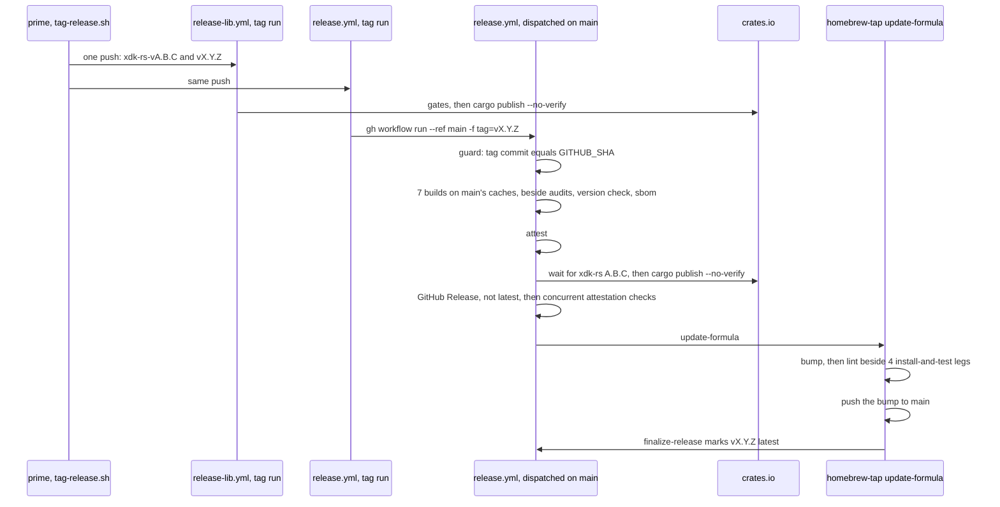
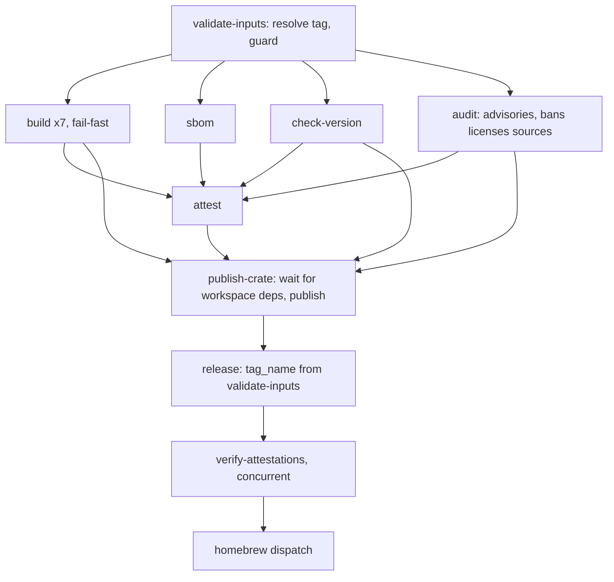

# Release Pipeline Under 8 Minutes - Plan

**Target repos:** `brettdavies/xurl-rs` (unprefixed paths), `brettdavies/.github`, and `brettdavies/homebrew-tap` (paths
prefixed with the repo name). **Bases:** `dev` in xurl-rs and the tap, `main` in `brettdavies/.github`, which has no
`dev`.

## Goal Capsule

- **Objective:** after Brett merges a dual-crate release PR, both crates are on crates.io, the `xurl-rs` GitHub Release
  is marked latest, and `brew upgrade xurl-rs` installs it, within 8 minutes (a soft target, R1), and nothing has
  published before it was built, attested, and checked (R2).
- **Means:** Tier 1 of the wall-clock analysis (KD1, Appendix), plus the release run moved onto `main` so its builds
  restore the previous release's dependency caches, and a weekly matrix build (KD3, KTD8, KTD11).
- **Authority:** R-IDs win on behavior and KTDs on mechanism; a unit overrides neither. `RELEASES-RATIONALE.md` §
  "Cross-compile target matrix" (a release compiles its rows once, in the release run) and the attestation design in the
  header of `brettdavies/.github: .github/workflows/rust-release.yml` hold except where a KTD here changes them.
- **Execution profile:** inline in one session, no subagents or worktrees, long jobs in the background.
  `brettdavies/.github` and the tap are worked from scratch clones. Three PRs, one per repo, grouped under
  Implementation Units.
- **Stop conditions:**
  - A probe shows `publish-crate`, `release`, or `homebrew` running after a gate failed or was skipped (R2).
  - The measured release misses 8 minutes for a reason no unit covers: the per-phase times go to Brett.
  - Keeping the release caches alive needs a paid cache limit (Q1).
- **Who ships:** dot-github-prime owns `brettdavies/.github` and lands its PR. Brett merges into `main` in xurl-rs and
  the tap. Prime merges xurl-rs `dev` PRs once they are reviewed and green, and pushes the release tags.

---

## Product Contract

### Summary

A release cut pushes the library and binary tags together, from a script that first checks that the account's runners
are free. The binary's tag run hands the release to a run on `main`, whose builds restore the previous release's
dependency caches and start as soon as the tag checks out, beside the audits and the version check. Its crates.io
publish waits for the library, skips the verify compile the release PR already ran, and the attestation checks run
concurrently. A failed required build, or a cross cell that fell back to host cargo, ends the run at once. Homebrew
lands through one tap workflow with no pull request, and a weekly matrix build on `main` catches a retired runner label
before a release needs it.

### Problem Frame

v4.6.0 took 31:07 from merge to latest, 21:32 without its failed attempt. The 4.3.0 to 4.6.0 dual-crate releases took
28:53 to 45:46, not counting 4.5.0's runner-label outage. The time goes to:

- the library and binary running in series, with an agent hop between them;
- builds waiting about a minute for audits;
- a single-threaded fat-LTO link, which #541 replaces;
- verify compiles and audits that repeat the release PR's checks on the same tree;
- three workflow hops in the tap around 8 to 22 s of actual testing;
- a cross cell that fell back to host cargo and cost a 9:35 rerun;
- runner queues of up to 10 minutes.

Every tag also starts cold. A tag's run restores caches only from its own ref and from `main`, and `main`'s caches do
not last: the caches the 06:04 UTC push to `main` saved on 2026-11-07 were evicted by 17:48 UTC, with the repository at
14.9 GB of caches against GitHub's 10 GB limit, 5.5 GB of them dev caches for superseded lockfiles.

### Requirements

**Outcome**

- R1. A dual-crate release reaches latest, with crates.io and Homebrew done, within 8 minutes of the release PR's merge,
  on cold caches.
- R2. A hand-made tag starts the release, its binaries compile once in the release run, and nothing publishes until
  every required build, the blocking `bans licenses sources` audit, the version check, and the attestations have passed.

**Release start**

- R3. One push carries both tags, and the binary's publish waits a bounded time for the library to reach crates.io,
  failing with a message that names the library release.
- R4. The tag script refuses to push while the account has a workflow run queued or in progress, naming each one;
  `--force` pushes anyway.

**Release run**

- R5. Builds start once the tag is resolved; the audits and the version check run beside them and gate attestation and
  publishing.
- R6. A failed required build row ends the run at once, and rerunning the failed jobs recovers it.
- R7. A cross cell whose `cross` fell back to host cargo fails, with a message naming the fallback.
- R8. Both crates publish without `cargo publish`'s verify compile.
- R9. Attestation checks run concurrently, with the same checks and the same failure behavior.

**Homebrew**

- R10. A prebuilt formula lands through one tap workflow: bump, lint, install and test on the four platforms, push to
  `main`, dispatch finalize, with no pull request.

**Warm caches**

- R11. The binary release's builds restore the previous release's dependency caches.
- R12. The release run refuses to build unless the tag's commit is the commit the run checked out.
- R13. Dev and `main` keep one set of caches per job, for the current lockfile.
- R14. A weekly run builds the release matrix on `main`, and its failure reaches Brett before tag day.

### Key Decisions

- KD1. **Every Tier 1 row ships** (session-settled: user-directed — chosen over a subset of the rows: Brett asked for
  every pipeline optimization discussed, not only the build profile). Governs R1, R3–R10.
- KD2. **The release profile is thin LTO, 4 codegen units, `opt-level = "z"`** (session-settled: user-approved — chosen
  over `opt-level = "s"`: the fastest build and smallest binary, and the few milliseconds of CPU per call do not matter
  to agents against an X round trip). Governs R1. It ships in #541.
- KD3. **Warm caches come from dispatching the release onto `main`, with the hand-made tag still the trigger, and a
  weekly release-matrix check runs on a schedule** (session-settled: user-directed — chosen over marking the release
  latest before Homebrew and over automating the backport). Governs R11–R14.
- KD4. **The shared workflows carry no backward compatibility; bird and agentnative-cli may fail until their fast
  follow** (session-settled: user-directed — chosen over opt-in inputs that kept their behavior: they are converted once
  xurl-rs proves the pipeline). Governs R8, R10, R12.

### Success Criteria

- The first dual-crate release after PR3 reaches latest under 8:00 from the merge, measured from REST run timestamps as
  the Appendix measures v4.6.0, with each phase's time recorded.
- From the second such release on, every build row logs a cache restore from the previous release, and merge to latest
  is under 6:00.

### Scope Boundaries

Considered and not built:

- Marking the release latest before Homebrew lands, and automating the backport: Brett did not choose them (KD3).
- A rehearsal mode on `rust-release.yml`: `release-matrix-check.yml`'s manual dispatch already builds the rows on any
  ref without publishing. Revisit if a release fails in a job the matrix check does not run.
- A host `rustup target add` for cross cells: a host fallback would ship a binary the cross image did not build, so the
  cell fails instead (KTD6). Revisit if `cross` itself proves unreliable for a target.
- sccache on an external bucket: it adds a credentialed service to the workflow that signs the release.
- A Windows Dev Drive or `rust-lld` on MSVC: unmeasured. Revisit if Windows is still the slowest row after PR3's first
  release.
- Building the release on the release PR and promoting it: that reopens the builds-once rule and needs the full
  provenance design first.

#### Deferred to Follow-Up Work

- bird and agentnative-cli pass `tag`, dispatch onto `main`, and gain a required package check before their next release
  (KD4, KTD4).
- xurl-rs's `release.yml`, `release-matrix-check.yml`, and `scripts/release/tag-release.sh` go upstream into the
  `github-repo-setup` templates in `brettdavies/agent-skills` through skills-prime, with the fast follow.
- The tap's bottle path for source-built formulae (`tests.yml` bottles, `publish.yml`) has no caller once
  `update-formula` lands prebuilt formulae directly, and no formula is source-built; removing it is cleanup for later.
- About 28 ms of CPU per networked `xr` call sits between the TCP connect and the TLS ClientHello, from aws-lc's first
  use; naming it needs `perf`, which `perf_event_paranoid=4` blocks.

### Open Questions

- Q1 (does not gate a merge). If the release caches are still evicted between releases once U11 prunes the superseded
  ones, does the repository's cache limit go above 10 GB, which GitHub bills? The second release after PR3 answers
  whether eviction still happens.

---

## Planning Contract

### Key Technical Decisions

- KTD1. **Builds need only `validate-inputs`; `attest` and `publish-crate` wait for the gates.** `build` and `sbom` need
  `validate-inputs`. `attest` needs `build`, `sbom`, `check-version`, and `audit`, so nothing is signed for a tree whose
  blocking audit failed. `publish-crate` needs those four and `attest` and states each one's result in its `if:`, as it
  does today. The advisories audit stays `continue-on-error`. An echo-step probe proves the graph with one run per
  failing ancestor (U1).
- KTD2. **The library wait sits at the start of `publish-crate`.** The scratch-manifest bound probe moves out of
  `check-version` and retries every 10 s for up to 10 minutes; the library run took 1:52 to 5:30 on the twelve
  dual-crate releases, queue included. On timeout the error names the crate and bound, says nothing has published, and
  says that rerunning the failed jobs after the library release goes green continues the release. `check-version` keeps
  the tag-to-manifest version check.
- KTD3. **The build matrix sets `fail-fast: true`.** GitHub cancels the rest of a matrix when a row without
  `continue-on-error` fails, and a soft-fail musl row (one whose caller leaves `linux_musl_required` off) does not
  trigger it. Recovery is `gh run rerun <id> --failed`; the U1 probe confirms that it reruns the cancelled rows as well.
- KTD4. **Both reusables publish with `--no-verify` and no dependency cache.** xurl-rs's `ci / Package check`, which
  runs `cargo publish --dry-run --workspace`, is required in `.github/rulesets/protect-main.json`, and the release PR's
  head tree has equalled its squash-merge commit's tree on all twelve dual-crate releases. `rust-lib-release.yml`'s
  `dry_run` still verifies, since a rehearsal is its purpose. Callers without such a check gain one in the fast follow
  (KD4).
- KTD5. **Attestation checks run as concurrent background processes in one step.** Each file's `gh attestation verify`
  call keeps its flags. The step waits for all of them, prints each failure with its file, and fails when any failed, so
  the Homebrew dispatch waits for it as before.
- KTD6. **Cross cells fetch first and fail on a host fallback.** A host `cargo fetch --locked` runs before `cross`. It
  installs the pinned toolchain and downloads every crate before `cross` asks `cargo metadata`, which removes two
  plausible causes of v4.6.0's failed metadata call. The build step then fails, naming the fallback, whenever its output
  holds `cross`'s `Falling back to` note, also when the host build succeeded, since that archive would not be the cross
  image's build. The cross installer becomes the `cargo-bins/cargo-binstall` action pinned by commit, as xurl-rs's own
  CI pins it, and `dtolnay/rust-toolchain` in `build` and `publish-crate` pins to the commit `sbom` already uses, per
  the supply-chain pinning rule.
- KTD7. **`update-formula` lands a prebuilt formula itself.** It keeps its trigger and payload, so no source repository
  changes. Its bump job (allowlist, the attestation check of each archive, the checksum pin, `brew audit`) uploads the
  bumped formula. A lint job and four install-and-test legs, the prebuilt steps of `tests.yml`, then run in parallel on
  it. A last job commits the bump, pushes it to `main` with `Homebrew/actions/git-try-push` in the `publish-formula`
  concurrency group, and dispatches `finalize-release` as `publish.yml` does. It refuses a source-built formula, and
  none exists. `brew style --fix` leaves the path: the lint job runs `brew style` and fails a bump the sed left
  unstyled.
- KTD8. **The tag's run dispatches the release onto `main`.** `rust-release.yml` takes a required `tag` input and reads
  no ref. `validate-inputs` resolves the tag, peels it to its commit, refuses unless that commit is `GITHUB_SHA` (R12),
  and exports the tag as the output every later job reads: the version check, the release notes, the GitHub Release's
  `tag_name`, the attestation downloads, and the Homebrew payload. xurl-rs's `release.yml` runs one job on the tag push,
  `gh workflow run release.yml --ref main -f tag=<tag>` under `GITHUB_TOKEN` with `actions: write`; GitHub lets that
  token start a `workflow_dispatch` run. On dispatch, the caller passes the tag to the reusable. The dispatched run's
  caches live in `main`'s scope, which the next release's dispatched run restores (Appendix, cache-scope probe). When
  `main` has moved past the tag, the guard refuses, and `gh workflow run release.yml --ref <tag> -f tag=<tag>` releases
  from the tag's own ref on cold caches.
- KTD9. **The attestations name `main` as their source ref.** In a dispatched run, the certificate's
  `sourceRepositoryRef` becomes `refs/heads/main` and `buildTrigger` becomes `workflow_dispatch`.
  `sourceRepositoryDigest` stays the tagged commit, which the guard enforces, and the signer stays
  `brettdavies/.github/.github/workflows/rust-release.yml@refs/heads/main` (v4.6.0's certificate, Appendix).
  `gh attestation verify --signer-workflow`, which the release and the tap run, checks the signer, not the source ref,
  and no document here tells a user to pass `--source-ref`. `RELEASES-RATIONALE.md` records the change.
- KTD10. **No step in `rust-release.yml` reads the ref.** A lint script in `brettdavies/.github` fails when the workflow
  names `github.ref_name`, `github.ref`, or `GITHUB_REF_NAME`. In a dispatched run they name `main`, and a GitHub
  Release created with `tag_name: main` would create a tag called `main`.
- KTD11. **The weekly check shares the release's cache key.** `rust-release-matrix-check.yml` keys its cache
  `${{ matrix.target }}` in its job `build`, as `rust-release.yml` does, with the same `env-vars`, so a scheduled run on
  `main` restores the release's caches, which resets their seven-day expiry, or rebuilds and saves them when they were
  evicted. xurl-rs's `release-matrix-check.yml` adds a weekly `schedule`, and GitHub emails a scheduled run's failure to
  whoever last edited its cron line.
- KTD12. **Dev and `main` prune caches for superseded lockfiles.** After a push run on `dev` or `main` saves its caches,
  a job deletes that ref's caches whose key, apart from its last segment (the hash rust-cache takes over the lockfile
  and toolchain), matches a newer cache's. Dev's caches hold only dependencies (rust-cache saves with
  `cache-workspace-crates: false`), and they are what PRs into `dev` restore, so they stay; on 2026-11-07 pruning frees
  5.5 GB of dev's 9.9 GB. It follows `.github/workflows/pr-cache-cleanup.yml`.
- KTD13. **`scripts/release/tag-release.sh` cuts both tags in one push.** It refuses unless the working tree is clean
  and local `main` equals `origin/main`. It tags each crate whose manifest version has no tag yet (`xdk-rs-v<version>`,
  `v<version>`), with `git tag -a`, so the repo's signing configuration applies. It checks the account's runners over
  REST (the repositories pushed in the last day, their `queued` and `in_progress` runs) and refuses while any run is
  listed, unless `--force`. It pushes the tags with one `git push`: GitHub creates no events for a push of more than
  three tags, so two is safe. `--dry-run` prints the tags and the runner check and creates nothing. Output and exit
  codes follow the other `scripts/release/` scripts.

### High-Level Technical Design

A dual-crate release after all three PRs merge:

The job graph of `rust-release.yml` after PR1:

How xurl-rs's `release.yml` runs:

| Event                                      | Job that runs         | Tag comes from | Caches restored from      | When it refuses                       |
| ------------------------------------------ | --------------------- | -------------- | ------------------------- | ------------------------------------- |
| Tag push                                   | the dispatch job only | the pushed ref | none, it compiles nothing | never                                 |
| `workflow_dispatch --ref main`             | the pipeline          | `tag` input    | `main`'s scope, warm      | the tag's commit is not `main`'s head |
| `workflow_dispatch --ref <tag>` (recovery) | the pipeline          | `tag` input    | the tag's scope, cold     | the input names another tag           |

### Budget

Projected from v4.6.0's measured phases, scaling its build steps by the local ratios for "z" (cold 44.2 s against 122.6
s, warm 18.0 s against 92.2 s); the ratio is measured on Linux, and Windows and macOS are assumed to scale the same.

| Phase                                                  | Cold caches    | Warm caches    |
| ------------------------------------------------------ | -------------- | -------------- |
| Merge to both tags pushed: script and runner check     | 0:20           | 0:20           |
| Tag to builds started, dispatch hop included           | 0:35           | 0:35           |
| Windows build job: about 0:45 of setup, then the build | 3:20           | 1:40           |
| attest, publish, release, attestation checks, dispatch | 1:15           | 1:15           |
| Tap: bump, lint beside the four legs, push, finalize   | 2:00           | 2:00           |
| **Merge to latest**                                    | **about 7:30** | **about 5:50** |

The library release runs beside the binary's and takes about 2:00 without its verify compile, so it is on crates.io
before `publish-crate` starts at about 4:10.

### Risks & Dependencies

| Risk                                                    | Mitigation                                                                                                                                                                                              |
| ------------------------------------------------------- | ------------------------------------------------------------------------------------------------------------------------------------------------------------------------------------------------------- |
| The gate reorder lets a job publish after a failed gate | U1's probe runs once per failing ancestor before PR1 merges                                                                                                                                             |
| Fail-fast cancels rows a rerun has to rebuild           | the probe confirms `--failed` reruns them; a cold Windows build under "z" is about 2:30                                                                                                                 |
| The library release fails or queues past 10 minutes     | `publish-crate` fails with nothing published; rerun the failed jobs once the library is on crates.io                                                                                                    |
| crates.io Trusted Publishing refuses the dispatched run | assumed to match on repository and caller workflow file, `release.yml` in both events; `publish-crate` is the first job that publishes, so a refusal publishes nothing, and the first release proves it |
| `main` moves between the tag push and the dispatch      | the guard refuses; dispatch onto the tag's ref (KTD8)                                                                                                                                                   |
| The release caches are evicted before the next release  | U11 prunes 5.5 GB; the weekly run refreshes or rebuilds them; Q1 if that is not enough                                                                                                                  |
| A broken bump reaches the tap's `main`                  | the lint and install checks the PR flow ran gate the push                                                                                                                                               |
| bird and agentnative-cli fail at their next release     | accepted (KD4); their callers fail at startup on the missing `tag` input, before anything builds                                                                                                        |
| Runners queue the release                               | the tag script refuses while runs are listed (KTD13)                                                                                                                                                    |

### System-Wide Impact

- bird and agentnative-cli call `rust-release.yml` at `@main`, so PR1 reaches them on merge and their callers fail at
  startup until the fast follow (KD4). All three formulae are prebuilt, so PR2's direct landing serves them unchanged.
- Users verifying archives run the same command; the attestation's source ref changes (KTD9).
- The weekly matrix build costs seven jobs a week on a public repository's runners.
- `.github/workflows/ci.yml` is shared ground with the CI plan
  (`docs/plans/2026-10-27-0058-perf-ci-scoping-and-speed-plan.md`, U1), whose planning skills-prime holds; U11 adds a
  pruning step beside its warm runs and is disclosed to skills-prime.

### Sequencing

PR1 and PR2 can merge in either order. PR3 merges after PR1, because its caller passes `tag`, an input only PR1's
reusable takes. The first dual-crate release after PR3 measures R1, and the second measures R11 and Q1.

---

## Implementation Units

| U-ID | Title                                                  | Files touched                                                    | Depends on |
| ---- | ------------------------------------------------------ | ---------------------------------------------------------------- | ---------- |
| U1   | Builds start beside the gates; required rows fail fast | `brettdavies/.github: .github/workflows/rust-release.yml`        | none       |
| U2   | The library wait moves into `publish-crate`            | `brettdavies/.github: .github/workflows/rust-release.yml`        | U1         |
| U3   | Publish without the verify compile                     | both release reusables                                           | U1         |
| U4   | Concurrent attestation checks                          | `brettdavies/.github: .github/workflows/rust-release.yml`        | none       |
| U5   | Cross cells fetch first and fail on a host fallback    | both build reusables, the parity script                          | none       |
| U6   | The release reads one tag and refuses a moved `main`   | `rust-release.yml`, the matrix-check reusable, a lint script     | U1         |
| U7   | `update-formula` lands prebuilt formulae directly      | `brettdavies/homebrew-tap: .github/workflows/update-formula.yml` | none       |
| U8   | One script pushes both tags                            | `scripts/release/tag-release.sh`, `RELEASES*.md`, `AGENTS.md`    | none       |
| U9   | The tag's run dispatches the release onto `main`       | `.github/workflows/release.yml`                                  | U6         |
| U10  | Weekly release-matrix check                            | `.github/workflows/release-matrix-check.yml`                     | U6         |
| U11  | Prune caches for superseded lockfiles                  | `.github/workflows/ci.yml`                                       | none       |

### PR1: Shared release workflows (brettdavies/.github)

Waits on: nothing.

### U1. Builds start beside the gates; required rows fail fast

- **Goal:** builds start seconds after the run does, and a failed required row ends the run.
- **Requirements:** R2, R5, R6; KTD1, KTD3, KTD6 (the toolchain pin).
- **Dependencies:** none.
- **Files:**
  - `brettdavies/.github: .github/workflows/rust-release.yml`
  - `brettdavies/.github: RELEASES.md`, `brettdavies/.github: RELEASES-RATIONALE.md`
- **Approach:**
  1. Rewire `needs:` and the publishing `if:` conditions as KTD1 states.
  2. Set `fail-fast: true`, keeping the `continue-on-error` expression and the soft-fail annotation.
  3. Pin `dtolnay/rust-toolchain` in `build` and `publish-crate`.
  4. Rewrite the header's pipeline description and the two documents' gate and recovery sections.
- **Execution note:** prove the graph before merge with an echo-step probe: the job graph copied onto a scratch branch
  with steps that echo, each job failing on demand, run once per scenario below; then delete the branch and its runs.
- **Patterns to follow:** the explicit-result `if:` on `publish-crate`, `release`, and `homebrew`.
- **Test scenarios:**
  - Every gate passes: builds start before `check-version` finishes, and `publish-crate` runs after `attest`.
  - `check-version` fails: builds finish, and `attest`, `publish-crate`, `release`, and `homebrew` are skipped.
  - The `bans licenses sources` audit fails: the same jobs are skipped.
  - The advisories audit fails: publishing proceeds, as today.
  - A required build row fails: the other rows are cancelled, nothing after `build` runs, and `gh run rerun --failed`
    reruns the failed row and the cancelled ones.
  - A soft musl row fails with `linux_musl_required` off: the other rows finish and the release proceeds without its
    archives.
  - `sbom` fails with `attest` on: `attest` is skipped and nothing publishes.
  - `attest` off: `publish-crate` runs when the builds and gates pass.
- **Verification:** every probe run matches its scenario; actionlint and the repo's lint workflow pass.

### U2. The library wait moves into `publish-crate`

- **Goal:** the binary's run builds while the library publishes, and publishes once the library is on crates.io.
- **Requirements:** R3; KTD2.
- **Dependencies:** U1.
- **Files:** `brettdavies/.github: .github/workflows/rust-release.yml`, `brettdavies/.github: RELEASES.md`
- **Approach:**
  1. Move the bound step from `check-version` to the start of `publish-crate`, inside the retry loop.
  2. Log the missing bounds once a minute while waiting.
  3. Take the timeout from a step variable, so U1's probe can shorten it.
- **Test scenarios:**
  - The library is already on crates.io at the bound: the step passes on its first probe.
  - The library lands three minutes in: publishing starts within about 10 s of the index showing it.
  - The library never lands: the step fails at the timeout with the message KTD2 names, and `release` and `homebrew` are
    skipped.
  - A crate with no workspace dependency: the loop has nothing to probe and passes at once.
- **Verification:** the probe covers the three wait outcomes against crates.io, using a version that exists and one that
  does not.

### U3. Publish without the verify compile

- **Goal:** both crates publish in seconds.
- **Requirements:** R8; KTD4.
- **Dependencies:** U1.
- **Files:**
  - `brettdavies/.github: .github/workflows/rust-release.yml`
  - `brettdavies/.github: .github/workflows/rust-lib-release.yml`
  - `brettdavies/.github: RELEASES-RATIONALE.md`
- **Approach:** add `--no-verify` to each real publish, drop the `Cache dependencies` step from both `publish-crate`
  jobs, and leave `rust-lib-release.yml`'s dry run verifying.
- **Test scenarios:**
  - A real publish logs no `Verifying` line and no cache restore.
  - `rust-lib-release.yml` with `dry_run` still logs `Verifying xdk-rs`.
- **Verification:** actionlint passes; the first release after PR3 shows both publish steps under 30 s.

### U4. Concurrent attestation checks

- **Goal:** the check of every published file takes about as long as one check.
- **Requirements:** R9; KTD5.
- **Dependencies:** none.
- **Files:** `brettdavies/.github: .github/workflows/rust-release.yml`
- **Test scenarios:**
  - Every file verifies: the step passes in about the time of the slowest single call.
  - One file has no attestation: the step fails, names that file, and `homebrew` is skipped.
- **Verification:** the step's script, run locally against v4.6.0's published files, passes; with an unattested file
  added to the set, it fails naming that file.

### U5. Cross cells fetch first and fail on a host fallback

- **Goal:** a cross cell that would build on the host fails at once and says why.
- **Requirements:** R7; KTD6.
- **Dependencies:** none.
- **Files:**
  - `brettdavies/.github: .github/workflows/rust-release.yml`
  - `brettdavies/.github: .github/workflows/rust-release-matrix-check.yml`
  - `brettdavies/.github: scripts/check-release-matrix-parity.sh`
  - `docs/solutions/build-errors/rustup-target-add-pinned-toolchain-2026-04-16.md` (the solutions repo, published with
    `sd-commit-doc`)
- **Approach:**
  1. Install `cross` through the pinned `cargo-bins/cargo-binstall` action.
  2. Run `cargo fetch --locked` on cross rows before `Build release`.
  3. Keep the build output and fail the step when it holds the fallback note, whatever the build's own status.
  4. Extend the parity script to hold the cross steps equal in both workflows.
  5. Rewrite the solutions entry's recovery advice for the fail-fast run (KTD3).
- **Test scenarios:**
  - A cross row that pulls its image and builds passes, with no fallback note.
  - A build whose output holds the note and fails: the error names the fallback.
  - A build whose output holds the note and succeeds: the step fails.
  - The parity script fails on a seeded difference between the two workflows' cross steps, and passes on the tree.
- **Verification:** a manual `release-matrix-check.yml` run from a scratch xurl-rs branch whose caller names this PR's
  branch passes all seven rows, and the branch and its runs are deleted afterwards.

### U6. The release reads one tag and refuses a moved `main`

- **Goal:** the release can run on `main` for a tag, and only for the tag at `main`'s head.
- **Requirements:** R11, R12; KTD8, KTD9, KTD10, KTD11.
- **Dependencies:** U1.
- **Files:**
  - `brettdavies/.github: .github/workflows/rust-release.yml`
  - `brettdavies/.github: .github/workflows/rust-release-matrix-check.yml`
  - `brettdavies/.github: scripts/check-release-tag-source.sh` (new), `brettdavies/.github: .github/workflows/lint.yml`
  - `brettdavies/.github: RELEASES.md`, `brettdavies/.github: RELEASES-RATIONALE.md`
- **Approach:**
  1. Add the required `tag` input and resolve it in `validate-inputs`, peeled to its commit.
  2. Refuse when the tag is missing or its commit is not `GITHUB_SHA`, naming both commits and the recovery dispatch.
  3. Replace every ref read with the job output.
  4. Key the matrix check's cache `${{ matrix.target }}`.
  5. Wire the KTD10 lint into `lint.yml`.
  6. Record the attestation's source-ref change in `RELEASES-RATIONALE.md` (KTD9).
- **Execution note:** observe the lint failing on a seeded `github.ref_name` in a job before trusting it.
- **Test scenarios:**
  - A dispatch onto `main` with the tag at `main`'s head: the guard passes, and the version check, release notes,
    `tag_name`, downloads, and Homebrew payload all name the tag.
  - A dispatch onto `main` with a tag behind it: the run refuses before any build, naming both commits and the
    `--ref <tag>` recovery.
  - A dispatch naming a tag that does not exist: the run refuses.
  - A dispatch onto the tag's own ref: the guard passes.
  - The lint fails on a seeded ref read and passes on the tree.
- **Verification:** U1's echo-step probe, extended with a dispatch caller, covers the four dispatch scenarios, each job
  echoing the tag it read.

### PR2: The tap lands prebuilt formulae directly (brettdavies/homebrew-tap)

Waits on: nothing.

The tap is its own repository, so this is its own PR.

### U7. `update-formula` lands prebuilt formulae directly

- **Goal:** Homebrew serves the release about two minutes after its dispatch, with no pull request.
- **Requirements:** R2, R10; KTD7.
- **Dependencies:** none.
- **Files:**
  - `brettdavies/homebrew-tap: .github/workflows/update-formula.yml`
  - `brettdavies/homebrew-tap: tests/` (bats for any step that moves into a script)
  - `brettdavies/homebrew-tap: RELEASES.md`
- **Approach:**
  1. Keep the `repository_dispatch` and `workflow_dispatch` triggers and the input checks; add a `dry_run` input to the
     manual trigger, shaped like `publish.yml`'s.
  2. Bump job: refuse a source-built formula, verify each archive's attestation, pin the checksums, drop the bottle
     block, run `brew audit`, upload the formula.
  3. A lint job (`brew style`, `readall`, `audit`, bats, as `tests.yml` runs them) and the four install-and-test legs
     (`tests.yml`'s prebuilt steps, `fail-fast: false`) run on the uploaded formula.
  4. A land job needs both: it commits the bump, pushes it to `main`, and dispatches `finalize-release`, skipped under
     `dry_run`.
- **Patterns to follow:** `publish.yml`'s push and finalize steps and its concurrency group; `tests.yml`'s matrix and
  prebuilt steps.
- **Test scenarios:**
  - An `xurl-rs` bump: the formula is updated, the four legs pass, `main` gets one commit, and `finalize-release` is
    dispatched, with no branch or PR.
  - A source-built formula name: the bump refuses and names the reason.
  - An archive with no attestation: the bump fails and nothing is pushed.
  - One test leg fails: the land job is skipped and `main` is unchanged.
  - The lint job fails: the land job is skipped.
  - `dry_run`: every job but the land job's push and dispatch runs.
- **Verification:** a `dry_run` dispatch for `xurl-rs` 4.6.0 verifies the archives, passes all four legs, and pushes
  nothing; the tap's CI passes.

### PR3: xurl-rs runs the new pipeline (brettdavies/xurl-rs)

Waits on: PR1 (merge order: the caller passes `tag`, which only PR1's reusable takes). PR2 (merge order: the first
release under PR3 lands Homebrew through it).

xurl-rs is a third repository, so this is its own PR.

### U8. One script pushes both tags

- **Goal:** a release cut is one command that pushes both tags into free runners.
- **Requirements:** R3, R4; KTD13.
- **Dependencies:** none.
- **Files:**
  - `scripts/release/tag-release.sh` (new)
  - `scripts/release/tests/tag-release.bats` (new), with `git push` and `gh` stubbed on `PATH`, run by
    `scripts/hooks/pre-push` when a file under `scripts/release/` changes; it moves to `brettdavies/agent-skills` with
    the upstream follow-up
  - `RELEASES.md` (the cut, the recovery reruns), `RELEASES-PREFLIGHT.md` (the "library first, CLI second" item),
    `RELEASES-RATIONALE.md` § "Why `xdk-rs` ships on its own tag" (its order paragraph), `AGENTS.md` § "Releasing"
- **Patterns to follow:** `scripts/release/_lib.sh` and the other `scripts/release/` scripts for flags, output, and exit
  codes.
- **Test scenarios:**
  - A dual-crate release with idle runners: two annotated tags in one push.
  - A binary-only release, whose library version is already tagged: one tag.
  - A run in progress in another repository: the script refuses and names the repository and run URL; `--force` pushes.
  - Local `main` behind `origin/main`: the script refuses and says to pull.
  - The binary tag already exists: the script refuses.
  - `--dry-run`: tags and the runner check are printed, and nothing is created.
- **Verification:** the tests pass, and the first release after PR3 meets the first Success Criterion.

### U9. The tag's run dispatches the release onto `main`

- **Goal:** release builds restore the previous release's caches.
- **Requirements:** R11, R12; KTD8.
- **Dependencies:** U6.
- **Files:** `.github/workflows/release.yml`, `RELEASES.md`, `RELEASES-RATIONALE.md` § "Annotated tags + Trusted
  Publishing" and a new section on the dispatched run
- **Approach:**
  1. Trigger on the tag push and on `workflow_dispatch` with a required `tag` input.
  2. On the push, one job with `actions: write` dispatches `release.yml` on `main` with the tag and links the workflow's
     runs in its summary.
  3. On dispatch, the pipeline calls the reusable with the tag; the caller's other inputs stay.
- **Test scenarios:**
  - A tag push: the tag run ends within seconds, and a run on `main` starts with the tag.
  - The second release under PR3: each build row logs `Cache restored from key`, with a key the first release saved.
  - A manual dispatch for a tag behind `main`: the guard refuses.
  - The recovery dispatch onto the tag's ref completes a release.
- **Verification:** the second Success Criterion; the tap's attestation check passes on a dispatched run's archives.

### U10. Weekly release-matrix check

- **Goal:** a retired runner label or a broken cross target fails a scheduled run, not a release.
- **Requirements:** R14; KTD11.
- **Dependencies:** U6.
- **Files:** `.github/workflows/release-matrix-check.yml`, `RELEASES-RATIONALE.md` § "Cross-compile target matrix"
- **Approach:** add a weekly `schedule` off the hour; the job's `if:` and the concurrency group already admit it.
- **Test scenarios:**
  - A scheduled run on `main` builds all seven rows and restores the release's caches.
  - A row on a retired label fails, and GitHub emails the failure.
- **Verification:** a manual dispatch on `main` passes, and the next week shows a run with event `schedule`.

### U11. Prune caches for superseded lockfiles

- **Goal:** dev's and `main`'s caches fit beside the release's, so the release's survive between releases.
- **Requirements:** R13; KTD12.
- **Dependencies:** none.
- **Files:** `.github/workflows/ci.yml`, following `.github/workflows/pr-cache-cleanup.yml`
- **Test scenarios:**
  - A dev push run after a lockfile change: the older lockfile's caches are deleted and the new ones kept.
  - A dev push run with no lockfile change: nothing is deleted.
  - A failed push run: nothing is deleted.
  - PR caches are untouched; `pr-cache-cleanup.yml` owns them.
- **Verification:** `gh cache list --ref refs/heads/dev` lists one lockfile hash per job, and the repository total is
  under 10 GB at the next release.

---

## Verification Contract

| Gate                                                                                           | Applies to | Pass                                                                |
| ---------------------------------------------------------------------------------------------- | ---------- | ------------------------------------------------------------------- |
| actionlint on every changed workflow                                                           | all units  | Clean                                                               |
| `brettdavies/.github` lint workflow (parity, runner labels, concurrency, job names, ref reads) | U1–U6      | Passes; each new check observed failing on a seeded violation first |
| Echo-step probe of the job graph                                                               | U1, U2, U6 | Each scenario's run matches                                         |
| The attestation step's script against v4.6.0's files                                           | U4         | Passes; an unattested file fails it                                 |
| Matrix check from a scratch caller on PR1's branch                                             | U5         | All seven rows pass with no fallback                                |
| The tap's CI and a `dry_run` of `update-formula`                                               | U7         | Passes, nothing pushed                                              |
| `scripts/hooks/pre-push`                                                                       | U8–U11     | Passes                                                              |
| First dual-crate release after PR3                                                             | U1–U9      | Merge to latest under 8:00, per-phase times recorded                |
| Second dual-crate release after PR3                                                            | U9–U11     | Every build row restores the first release's cache; under 6:00      |
| `gh cache list` at each release                                                                | U11        | One lockfile hash per job on `dev` and `main`                       |

## Definition of Done

- Every unit's verification is met.
- Both Success Criteria are met, or Brett has the measured shortfall per phase.
- Every probe branch and its runs are deleted, and `brettdavies/cache-scope-probe` stays archived.
- `RELEASES.md`, `RELEASES-PREFLIGHT.md`, `RELEASES-RATIONALE.md`, `AGENTS.md`, the `brettdavies/.github` and tap
  `RELEASES` documents, and the solutions entry describe the pipeline as it runs.
- No probe workflow, experimental step, or unused input remains in any repository's diff.

---

## Appendix

**v4.6.0 baseline (run 42345825865), merge 06:04:00 UTC.**

| Phase                                                                                                        | Wall                       |
| ------------------------------------------------------------------------------------------------------------ | -------------------------- |
| Merge to `xdk-rs-v0.5.0` pushed                                                                              | 0:34                       |
| `release-lib.yml`                                                                                            | 5:30, of which 2:50 queued |
| To `v4.6.0` pushed                                                                                           | 0:32                       |
| `release.yml` attempt 1: cold, the x86_64 musl cell fell back to host cargo, the run waited 7:18 for Windows | 9:07                       |
| Full rerun, then attempt 2                                                                                   | 0:28, then 9:49            |
| Tap `update-formula`, its PR's CI, `publish.yml` and finalize                                                | 1:22, 3:06, 0:39           |
| **Merge to latest**                                                                                          | **31:07**                  |

Inside attempt 2: gates 0:11 to 1:05, builds 3:10 to 5:40 (Windows the slowest), `publish-crate` 1:15 (51 s of it the
verify compile), attestation checks 1:03 (15 calls in series).

**Release profile, local, 4 pinned cores, building `xr` alone.** fat LTO, 1 unit, O3: 122.6 s cold, 92.2 s warm,
12,787,416 bytes. thin LTO, 4 units, "z": 44.2 s cold, 18.0 s warm, 9,169,280 bytes.

**Cache scope probe, `brettdavies/cache-scope-probe` (private, archived).** A run dispatched on `main` restored the
cache an earlier dispatched run on `main` saved. A tag push's run found no cache. A run dispatched on `main` for a tag
on an older commit reported `GITHUB_SHA` as `main`'s head while checking out the tag's commit, which is why KTD8 needs
its guard.

**Cache use, 2026-11-07 17:48 UTC.** 59 caches, 14.9 GB, against a 10 GB limit and 7-day retention
(`actions/cache/storage-limit`, `retention-limit`). Dev: 18 caches for the current lockfile (4.4 GB), 24 for two
superseded ones (5.5 GB). PR #541: 18 caches (4.3 GB), since it changes `Cargo.toml`. `main`: none, though CI's push run
at 06:04 saved a full set.

**v4.6.0 attestation certificate.** `buildSignerURI` and the SAN are
`https://github.com/brettdavies/.github/.github/workflows/rust-release.yml@refs/heads/main`, `sourceRepositoryRef` is
`refs/tags/v4.6.0`, `buildTrigger` is `push`, and `sourceRepositoryDigest` is the tagged commit.
