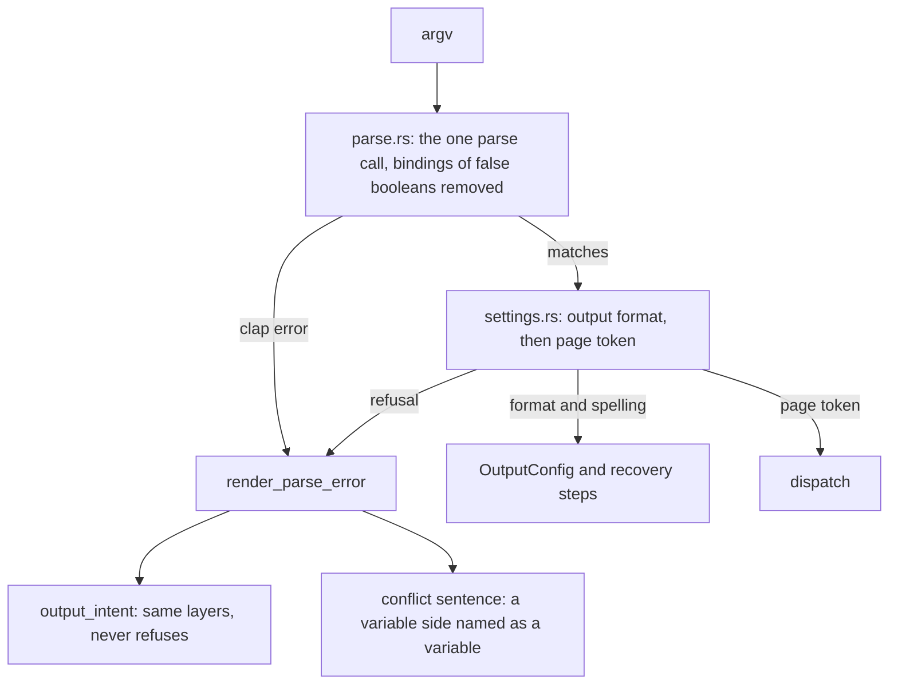
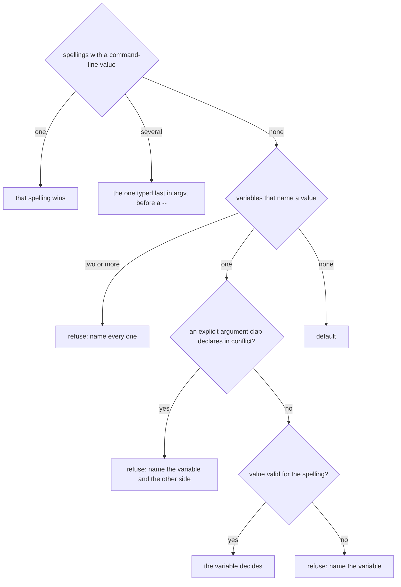

# Flag and Variable Precedence - Plan

## Goal Capsule

- **Objective:** a caller who types an output-format or page-token flag gets that flag's value whatever `XURL_*`
  variables the environment holds, and when `xr` refuses a combination, the message names what the caller actually set.
- **Means:** the two settings with several spellings resolve by layer in `xr`'s own code, with their variables read as
  data (KTD8). Clap keeps refusing conflicts between different settings, and one renderer names a variable as a variable
  (KTD12). Guards read clap's relationships, not a list of today's flags (KTD16).
- **Authority:** R-IDs win on behavior and KTDs on mechanism. A unit overrides neither. KTD1 to KTD7 are settled and are
  not reopened.
- **Execution profile:** one pull request from a `fix/` branch cut from `dev`, under the branch, commit, and review
  rules in `AGENTS.md` and the contributor's global instructions. It ships in `xr` 4.9.0 (KTD1).
- **Stop conditions:** stop and report when the work needs a change under `crates/xdk`, a new flag, reason, action,
  envelope key, exit code, or environment variable (R12), when a golden fixture other than `help-*.golden` moves, or
  when evidence contradicts KTD1 to KTD7.
- **Who finishes:** the implementing slot opens the pull request and runs its reviews. The prime merges it to `dev`.
  Release PR #622 is outside this plan.

---

## Product Contract

### Summary

`xr` resolves the output format and the page token by layer: a typed flag first, the last one typed when there are
several, then the setting's variables, then the default. A conflict between two different settings is still refused at
exit 2, and the refusal names an environment variable as an environment variable. A boolean variable that reads false
counts as unset. A guard fails when a later declaration would let a variable refuse a typed flag of its own setting.

### Problem Frame

On `dev` and on released 4.8.0, an `XURL_*` variable bound to a global flag with clap's `env =` refuses a typed flag it
conflicts with. The refusal exits 2 with `invalid-args` and names a flag the caller never typed. Measured on 4.8.0:

- `XURL_OUTPUT=yaml xr --json schema --list` answers `the argument '--json' cannot be used with '--output <OUTPUT>'`.
- `XURL_JSON=0 xr --output json schema --list` is refused the same way, though the variable is false.
- `XURL_OUTPUT=yaml XURL_JSON=0 xr schema --list` is refused with no flag typed at all.
- `XURL_OUTPUT=toml xr --output json schema --list` is refused for the variable's value, though a format is typed.

The cause is upstream [clap-rs/clap#5591](https://github.com/clap-rs/clap/issues/5591), open since 2024. Clap's
validator counts a value read from an `env` binding as explicit (`check_explicit` in `parser/matches/matched_arg.rs`),
so it enters conflict checks, even when its falsey parser reads it as false. A maintainer's proposal in that thread is
the direction this plan takes: a variable counts as given, except a boolean one that reads false.

Typed format flags refuse each other too: `xr --json --output=yaml` exits 2. A wrapper that appends its own format flag
cannot be overridden by its caller.

Clap checks conflicts and overrides one command level at a time and merges global values afterwards
(`ArgMatcher::propagate_globals`). So today the same two flags are refused on one side of the command word and silently
resolved on both: `xr --json schema --list --output yaml` exits 0 and prints JSON, because `effective_output()` ranks
the alias first.

### Requirements

**Spellings of one setting**

- R1. Two settings have several spellings. The output format is `--output`, `--json`, and `--jsonl`, with `XURL_OUTPUT`,
  `XURL_JSON`, and `XURL_JSONL`. The page token is `--cursor` and `--after`, with `XURL_CURSOR` and `XURL_AFTER`.
- R2. A typed spelling beats every variable of its setting.
- R3. Several typed spellings of one setting resolve last-wins, wherever in the invocation each one sits.
- R4. When no spelling of a setting is typed, the setting's variables decide it, and the default applies when none names
  a value.
- R5. Two variables of one setting that both name a value are refused at exit 2 with `invalid-args`, and the message
  names both variables.

**Conflicts between settings**

- R6. Two different settings that conflict are refused at exit 2 with `invalid-args`, whichever layer each came from.
- R7. When a side of a refusal came from a variable, the message names that variable as an environment variable and does
  not name its flag.

**False variables**

- R8. A boolean variable that reads false is unset: it names no value and causes no refusal. The flag's own value parser
  decides what reads false.

**What a caller sees next**

- R9. A recovery step runs in the output format that won.
- R10. A parse-error or refusal envelope renders in the format the same layers pick.

**Protection and surface**

- R11. A new declaration that would bring the defect back fails a guard, and the guard needs no edit.
- R12. The change adds no flag, reason, action, envelope key, exit code, or environment variable. A refusal stays
  `invalid-args` at exit 2. `crates/xdk` is not touched.

### Acceptance Examples

Each row runs offline. `whoami` rows use a store file that cannot be loaded, so the run ends on an `inspect-store` step
and sends nothing.

| ID   | Invocation                                        | Outcome                                                                                       | Covers  |
| ---- | ------------------------------------------------- | --------------------------------------------------------------------------------------------- | ------- |
| AE1  | `XURL_OUTPUT=yaml xr --json schema --list`        | exit 0, JSON                                                                                  | R2      |
| AE2  | `XURL_JSONL=1 xr --output yaml schema --list`     | exit 0, YAML                                                                                  | R2      |
| AE3  | `XURL_JSON=0 xr --output json schema --list`      | exit 0, JSON                                                                                  | R2, R8  |
| AE4  | `XURL_OUTPUT=yaml XURL_JSON=0 xr schema --list`   | exit 0, YAML                                                                                  | R4, R8  |
| AE5  | `XURL_CURSOR=abc xr --page 2 schema --list`       | exit 2, `invalid-args`; names `XURL_CURSOR` as a variable and `--page <N>`; no `--cursor`     | R6, R7  |
| AE6  | `XURL_PAGE=2 xr --after 5 schema --list`          | exit 2, `invalid-args`; names `XURL_PAGE` as a variable and `--after <TOKEN>`; no `--page`    | R6, R7  |
| AE7  | `xr --json --output=yaml schema --list`           | exit 0, YAML                                                                                  | R3      |
| AE8  | `xr --output yaml --json schema --list`           | exit 0, JSON                                                                                  | R3      |
| AE9  | `xr --cursor a --after b` on a command that pages | the request carries page token `b`                                                            | R1, R3  |
| AE10 | `XURL_PAGE=2 xr --cursor abc schema --list`       | exit 2, `invalid-args`; names `XURL_PAGE` as a variable                                       | R6, R7  |
| AE11 | `XURL_OUTPUT=json XURL_JSON=1 xr schema --list`   | exit 2, `invalid-args`; names `XURL_OUTPUT` and `XURL_JSON`; JSON envelope                    | R5, R10 |
| AE12 | `xr --json schema --list --output yaml`           | exit 0, YAML                                                                                  | R3      |
| AE13 | `xr --json --output yaml whoami`                  | `next_step.command` begins `xr --output yaml`                                                 | R9      |
| AE14 | `XURL_OUTPUT=yaml xr --json whoami`               | `next_step.command` begins `xr --json`, and running it in the same environment is not refused | R2, R9  |
| AE15 | `XURL_CURSOR=a XURL_AFTER=b xr schema --list`     | exit 2, `invalid-args`; names both variables                                                  | R5      |
| AE16 | `XURL_JSON=0 XURL_JSONL=0 xr schema --list`       | exit 0, text                                                                                  | R8      |
| AE17 | `XURL_OUTPUT=json xr --output text --bogus`       | exit 2, the text `Error:` line                                                                | R10     |
| AE18 | `XURL_AFTER=x xr --page 2 schema --list`          | exit 2, `invalid-args`; names `XURL_AFTER` as a variable and `--page <N>`; no `--after`       | R6, R7  |

AE1 to AE11 are the brief's cases: its defect list and the examples in its settled decisions. On 4.8.0 every example
except AE12 and AE17 exits 2, and where a variable is set the message names its flag. AE12 prints JSON, and AE17 renders
its error as JSON.

### Scope Boundaries

- Only conflict refusals name their source. A value clap rejects from a variable it still binds, such as
  `XURL_TIMEOUT=abc`, keeps clap's message. Evidence that would change the call: a report of a caller misled by it.
- A typed conflict split across the command word, `xr --cursor a whoami --page 2`, is not refused by clap today and
  stays that way. `--page` is refused at dispatch as `unsupported-pagination` on either side of the word.
- Flags outside the two settings keep clap's rule for a repeat: `xr --app a --app b` is still refused.
- `xr --help` run with a boolean variable set false omits that flag's `[env: ...]` line, because the binding is gone
  before the parse (KTD10). The root help's `ENVIRONMENT VARIABLES` block still names the variable. Considered and not
  built: a second parse to render help from the untouched command.
- The fix does not wait for clap#5591. When clap changes how an `env` value counts, the guards in U5 show what moved.

### Sources

- The brief for this plan, from the coordinating session, with the user's decisions (KTD1 to KTD7).
- [clap-rs/clap#5591](https://github.com/clap-rs/clap/issues/5591): the upstream defect and the maintainer's proposal.
- [astral-sh/uv#17321](https://github.com/astral-sh/uv/pull/17321), read at merge commit
  `cd55d1ce120f3c4dfe37a9df563e97e25914e1ba`: the policy source (KTD4). This plan takes its policy, a resolved value
  that carries its source (`Flag` and `FlagSource` in `crates/uv-cli/src/options.rs`), and a refusal that names a
  variable by kind. It does not take the rest, because `xr`'s codebase differs: uv calls `check_conflicts` at each
  command's call site, where `xr` checks once at the parse (KTD13); uv refuses with `eprintln!` and `process::exit(2)`,
  where `xr` renders the `invalid-args` envelope; uv copies clap's boolish literals, where `xr` runs each flag's own
  parser (KTD10); uv drops `env =` from every boolean flag, where `xr` drops it from the five spellings only (KTD8); and
  uv rewrites help to place hand-written `[env: ...]` text, where `xr` names the variable in prose (KTD17). uv has no
  guard.
- ctl-core #130 and mlxcel #2612, #2622, #2664, #2668: prior art read for the brief. This plan relies on the brief's
  account of both and did not read them again.
- clap_builder 4.6.7 source, the version `Cargo.lock` pins, for every fact under "Clap facts".
- `xr` 4.8.0, run offline against a scratch token store, for every "today" claim in Problem Frame and Acceptance
  Examples.

---

## Planning Contract

### Key Technical Decisions

KTD1 to KTD7 are the brief's settled decisions. Where the brief names no alternative, the one written is the behavior
the decision rules out.

- KTD1. **The fix ships in `xr` 4.9.0, and release PR #622 stays in draft until it lands.** (session-settled:
  user-directed, chosen over releasing 4.9.0 without the fix: the release waits for the fix.)
- KTD2. **Typed `--output`, `--json`, and `--jsonl` resolve last-wins.** (session-settled: user-directed, chosen over
  keeping the exit-2 refusal: POSIX `ls -C -1` resolves this way and clap's `overrides_with` gives it.) Governs R3.
- KTD3. **A guard protects future flags and new flag categories with no edit to the guard.** (session-settled:
  user-directed, chosen over fixing only today's flags: a new declaration must not bring the defect back.) Governs R11.
- KTD4. **The policy is uv's (astral-sh/uv#17321).** Spellings of one setting resolve by layer, different settings that
  conflict are refused whatever layer each came from with the real source named, and a false variable is unset.
  (session-settled: user-directed, chosen over the ctl-core and mlxcel policy: both let a typed flag silence a variable
  for a different setting.) Governs R2, R4, R6, R7, R8.
- KTD5. **`--cursor` and `--after` are one setting.** (session-settled: user-approved, chosen over keeping the pair a
  refused conflict: `--after` is a documented alias that sends the same page token.) Governs R1, R3.
- KTD6. **A variable for a different setting that conflicts with a typed flag stays refused, and the message names the
  variable.** (session-settled: user-approved, chosen over the typed flag silencing the variable: uv refuses different
  settings whatever layer each came from.) Governs R6, R7.
- KTD7. **Two variables that set one setting are refused, both named, even when they agree.** (session-settled:
  user-approved, chosen over accepting the pair: the refusal clap gives today is kept, with the variables named.)
  Governs R5.
- KTD8. **The two settings resolve in `xr`'s code, and their variables leave clap.** `--output`, `--json`, `--jsonl`,
  `--cursor`, and `--after` drop `env =`. `crates/xurl-cli/src/cli/env.rs` reads the five variables as data, and one
  module applies the layers. This is the brief's mechanism, and it is uv's shape. It was weighed once against keeping
  the bindings declared and removing them before each parse (see Alternative Approaches Considered), and it stays for
  three reasons. The defect cannot return at a parse site that skips a shared path, because the declaration holds no
  binding. The variable side becomes testable in process with injected data, which is how this repo's tests take their
  environment. And the variables are read where `AGENTS.md` says the CLI reads its environment.
- KTD9. **Typed order across the command word comes from argv.** Clap applies `overrides_with` inside one command level,
  then `propagate_globals` merges levels per argument, so after a parse `--json` typed before the word and
  `--output yaml` typed after it both hold a command-line value, with nothing to order them. The resolver takes the
  typed spellings from the matches. Only when more than one survives does it read argv for the last token, before a
  `--`, that spells one of them. That read is exact while every spelling is a long flag with no short form or alias and
  no argument accepts a hyphen-led value, and U5 holds both conditions. The same reader gives the parse-error path its
  typed layer (KTD15). A per-level probe that rebuilds the tree with local copies of the globals was rejected: it
  re-implements clap's propagation to answer one question argv already answers.
- KTD10. **One step removes the binding of any boolean flag whose variable reads as the flag's absent value.** It walks
  every command, takes each argument with an `env` binding and a `SetTrue` or `SetFalse` action, and parses the
  variable's value with the argument's own value parser. `ValueParser::parse_ref` is crate-private, so the step runs the
  parser through a one-argument probe command and reads the boolean back. When the result equals what the flag holds
  when absent (false for `SetTrue`, which is every boolean `xr` binds today), the step removes the binding with
  `Arg::env` reset. A value the parser rejects keeps its binding, so clap reports it. The step names no flag and no
  variable. It analyses a built clone and rewrites the unbuilt command, because `Command::build()` expands the help tree
  where a parse does not. When no bound variable is set it returns the command untouched and builds nothing.
- KTD11. **Every argv parse goes through one function.** `crates/xurl-cli/src/cli/parse.rs` owns the only calls that
  hand argv to clap. Each site passes the customization it needs: inert display flags, room for stray words,
  `ignore_errors`. A source guard fails for a parse call anywhere else in production code. Today's tree has no boolean
  variable in a conflict once KTD8 lands, so the funnel changes no behavior now. It is what makes KTD10 hold for a flag
  added later.
- KTD12. **One function writes the conflict sentence, for clap's conflicts and for the resolver's.** It takes each side
  as a flag or a variable. For a clap `ArgumentConflict` it reads the `InvalidArg` and `PriorArg` context, finds each
  argument in the failing command by comparing `Arg::to_string()`, and asks the lenient matches for its `value_source`.
  A side whose source is the environment is written as its variable, from `Arg::get_env()`. A string that maps to no
  argument, and the repeat form where both contexts are equal, keep clap's sentence. Clap's usage line and the help
  pointer stay as `render_invalid_args` writes them.
- KTD13. **A setting decided by a variable is checked against clap's declared conflicts.** Once the five variables leave
  clap, clap cannot see `XURL_CURSOR` beside `--page`. When a variable decides a setting, the resolver looks for an
  argument that holds an explicit value (command line or environment) and that clap declares in conflict with the
  winning spelling, in either direction. It refuses through KTD12. The check runs once, right after the parse and before
  dispatch, for every command, and reads one view of each argument's source: clap's `value_source` for an argument clap
  binds, and the resolver's own source for the two settings it owns. So `XURL_CURSOR=abc xr --page 2` and
  `XURL_AFTER=x xr --page 2` stay `invalid-args` at exit 2 naming the variable, and neither reaches
  `unsupported-pagination`. A resolver that skips this check would need a conflict call at each command, the wiring this
  plan designs out. The relationship reader is production code, and the guards in U5 use the same one, so a conflict
  declared later is refused without a resolver edit.
- KTD14. **The four new variables travel as data beside `SkillEnv`.** `XURL_JSON`, `XURL_JSONL`, `XURL_CURSOR`, and
  `XURL_AFTER` are read by literal name in `env.rs` into a CLI-owned value. `run_with_env` takes it as a parameter, and
  `run_with_overrides` and `run_with_hooks` pass an empty one. `XURL_OUTPUT` stays on `EnvOverrides.output`, which the
  library already documents as the runner's, so `crates/xdk` is not touched. An in-process run through a data entrypoint
  therefore reads none of the five from the process.
- KTD15. **The parse-error path picks its format from the same layers and never refuses.** `output_intent` takes the
  typed layer from argv: the last format named before a `--`, with a typed `text` counting as typed. Then it takes the
  variable layer: an alias variable that reads true, `XURL_JSONL` before `XURL_JSON`, then `XURL_OUTPUT`. A resolver
  refusal renders under the same pick. Clap's lenient matches no longer carry the alias variables, so that read goes.
- KTD16. **The guards read relationships and prove it on a fixture.** `crates/xurl-cli/tests/flag_env_guard.rs` holds
  two walks over `xr`'s tree and one test over a `clap::Command` built in the test with categories `xr` lacks. Each walk
  fails when it finds no case. No message carries a `Cause:` line, which `crates/xurl-cli/tests/recipe_guard.rs`
  reserves for recipe walks. Relationship discovery and the false-variable step run in process. A refusal that depends
  on a variable clap binds runs the built binary through `common::xr()` with the variable set on the child, because clap
  reads a binding when `Arg::env()` is called.
- KTD17. **Help names each variable in prose, and the help fixtures are re-blessed.** Dropping `env =` removes clap's
  `[env: ...]` line from five global flags, which every command's help prints. Each of the five flags' long help names
  its variable, and the root help's `ENVIRONMENT VARIABLES` block gains `XURL_AFTER` and states the precedence rule. All
  198 `help-*.golden` fixtures move, each only inside those five flags' blocks.

### Assumptions

Bets the planner made without a person's confirmation. The plan reviews confirm or correct each one.

- A1. A repeated spelling follows last-wins too: `xr --output json --output yaml` answers in YAML, and
  `--cursor a --cursor b` sends `b`. Today both are refused as "cannot be used multiple times". A wrapper that appends
  `--output json` is the case KTD2's precedent, an alias for `ls`, exists for.
- A2. An empty variable is unset. Today `XURL_OUTPUT=` is refused with `a value is required for '--output <OUTPUT>'`.
  `env.rs` already reads `NO_COLOR` and `XURL_TOKEN_STORE` this way.
- A3. R5 applies where R4 reads the variables. A typed spelling skips its setting's variables altogether (R2), so
  `XURL_OUTPUT=json XURL_JSON=1 xr --output yaml` and `XURL_OUTPUT=toml xr --output json` both succeed.
- A4. The refusal keeps clap's sentence and writes a variable side as `the environment variable 'XURL_PAGE'`:
  `the argument '--cursor <TOKEN>' cannot be used with the environment variable 'XURL_PAGE'`. A refusal with a variable
  on every side carries no usage line, since no typed flag is at fault.
- A5. A variable that names an invalid value is refused only when it decides the setting, and the message names the
  variable with the possible values: `XURL_OUTPUT=toml xr schema --list` exits 2 naming `XURL_OUTPUT`.
- A6. The per-flag `[env: ...]` line is a fair trade for KTD8. The prose that replaces it also states when the variable
  applies, which the line never did.

### Clap facts

Verified against clap_builder 4.6.7. Each of the brief's facts is used or corrected here.

| Fact                                                                                                                                                                                                                                                                                                                                                          | Where it is in clap                                                                        | Used by                                                                                                                    |
| ------------------------------------------------------------------------------------------------------------------------------------------------------------------------------------------------------------------------------------------------------------------------------------------------------------------------------------------------------------- | ------------------------------------------------------------------------------------------ | -------------------------------------------------------------------------------------------------------------------------- |
| `Arg.overrides` is crate-private with no getter                                                                                                                                                                                                                                                                                                               | `builder/arg.rs`                                                                           | U5 finds overrides with a parse probe                                                                                      |
| `Command::get_arg_conflicts_with` reads only the argument's own `conflicts`, one direction. For a non-global argument it unrolls a group named there into its members; it misses the siblings of a non-multiple group the argument belongs to and every conflict declared on the other side. For a global argument it panics on a conflict id that is a group | `builder/command.rs`                                                                       | KTD13's reader looks up `arg.clone().global(false)`, reads both directions, and adds group siblings and `exclusive` itself |
| `get_groups()`, `ArgGroup::get_args`, and `Arg::is_exclusive_set` read groups and `exclusive`. `ArgGroup::is_multiple` takes `&mut self`                                                                                                                                                                                                                      | `builder/arg_group.rs`                                                                     | the reader clones a group to ask it                                                                                        |
| `Arg::env()` reads the variable when it is called                                                                                                                                                                                                                                                                                                             | `builder/arg.rs`                                                                           | KTD16: a clap-bound variable is tested through the binary                                                                  |
| `Command::build()` builds with the help tree expanded, and a parse builds without it                                                                                                                                                                                                                                                                          | `builder/command.rs`                                                                       | KTD10 analyses a clone                                                                                                     |
| An override removes its partner only for a command-line value, and an override also counts as a conflict                                                                                                                                                                                                                                                      | `parser/parser.rs` `start_custom_arg`, `parser/validator.rs` `gather_arg_direct_conflicts` | why an override participant must hold no binding (U5)                                                                      |
| A value from the environment counts as explicit                                                                                                                                                                                                                                                                                                               | `parser/matches/matched_arg.rs` `check_explicit`                                           | the upstream defect                                                                                                        |
| Conflicts and overrides run per command level, and global values merge afterwards: the higher source wins, and a tie goes to the deeper level                                                                                                                                                                                                                 | `builder/command.rs` `_do_parse`, `parser/arg_matcher.rs` `fill_in_global_values`          | KTD9                                                                                                                       |
| A repeated `Set` or `SetTrue` argument is refused unless it overrides itself                                                                                                                                                                                                                                                                                  | `parser/parser.rs` `react`                                                                 | A1: each spelling lists itself in its overrides                                                                            |
| `ValueParser::parse_ref` is crate-private                                                                                                                                                                                                                                                                                                                     | `builder/value_parser.rs`                                                                  | KTD10's probe command                                                                                                      |
| An `ArgumentConflict` carries `InvalidArg` as a string and `PriorArg` as a string, a list, or nothing (`exclusive`)                                                                                                                                                                                                                                           | `error/mod.rs` `argument_conflict`                                                         | KTD12                                                                                                                      |

The brief's fifth fact, that `build()` on the parsed command moved nine help fixtures, is consistent with the source.
This plan did not rerun it.

### High-Level Technical Design

A run, from argv to an answer:

How one setting resolves:

Who decides each combination:

| One side                     | Other side                        | Same setting | Decided by                          | Outcome                 |
| ---------------------------- | --------------------------------- | ------------ | ----------------------------------- | ----------------------- |
| typed                        | typed, same level                 | yes          | clap `overrides_with`               | last wins               |
| typed                        | typed, across the command word    | yes          | resolver, argv order                | last wins               |
| typed                        | variable                          | yes          | resolver                            | typed wins              |
| variable                     | variable                          | yes          | resolver                            | refused, both named     |
| typed                        | clap-bound variable               | no           | clap, then the conflict sentence    | refused, variable named |
| typed or clap-bound variable | resolver-read variable            | no           | resolver, clap's declared conflicts | refused, variable named |
| any                          | boolean variable that reads false | either       | false-variable step or resolver     | the variable is unset   |

### Alternative Approaches Considered

- **Keep `env =` on the five flags and remove bindings before each parse.** A first parse with the settings' bindings
  removed says what is typed. A second parse keeps the one binding the variable layer picks, and clap then applies the
  value and finds conflicts with other settings natively. Help and its 198 fixtures do not move, and KTD13 and KTD14 are
  not needed. It lost to KTD8 because the declared binding brings the defect back at any parse site that skips the
  shared path, the variable side stays untestable in process, and a declaration that sometimes applies is harder to read
  than one that holds no binding.
- **Strip the binding of every argument a typed flag conflicts with**, which is ctl-core's step. Excluded by KTD4: it
  lets a typed flag silence a variable for a different setting.
- **Derive the settings from clap's override graph at run time.** It would need no table of settings, but
  `Arg.overrides` has no getter, and probing every pair on each run costs hundreds of parses. The table lives in
  production code and U5 holds it to the override relation.

No bake-off ran. The choice between KTD8 and the first alternative rests on evidence already gathered, and it can be
reversed later without changing the contract a caller sees.

### Risks & Dependencies

| Risk                                                                | Mitigation                                                                                                                          |
| ------------------------------------------------------------------- | ----------------------------------------------------------------------------------------------------------------------------------- |
| 198 fixtures move at once, and an unrelated change could ride along | U3 checks by script that each fixture's diff sits inside the five flags' blocks. No other golden may move (stop condition)          |
| The argv read in KTD9 misreads a value as a flag                    | U5 fails for an argument that accepts hyphen-led values, and for a setting spelling with a short form or an alias                   |
| A later parse site calls clap directly                              | U1's source guard                                                                                                                   |
| A clap upgrade changes a crate-private fact above                   | the guards probe through public API, so they fail where behavior moves                                                              |
| An in-process caller relied on the process's `XURL_JSON`            | none found: tests never set process variables, and `tests/common/invoke.rs` is the only caller of `run_with_env` outside the runner |

### System-Wide Impact

- Every command's `--help` changes inside the five flags' blocks, and the root help's environment block changes. Shell
  completions may move with the flag descriptions.
- Invocations that exit 2 today start to succeed. Scripts that relied on the refusal to detect a conflicting environment
  lose that signal.
- In-process runs through `run_with_overrides` and `run_with_hooks` stop reading the five variables from the process.
- `AGENTS.md` and `crates/xurl-cli/README.md` both state that clap refuses `--output` beside an alias. Both sentences
  change (U6).

### Sequencing

U1 comes first, and U2 builds on its parse path. Neither changes a declared flag. U3 is the fix and depends on both. U4
depends on U3 and shares its commit boundary: the alias variables leave clap in U3, and `output_intent` learns them in
U4, so the suite is green only with both. U5 depends on U1 to U3. U6 is last.

---

## Implementation Units

### U1. One parse path, with the false-variable step

- **Goal:** every argv parse in production code goes through one function that first removes the binding of any boolean
  flag whose variable reads as the flag's absent value.
- **Requirements:** R8, R11. KTD10, KTD11.
- **Dependencies:** none.
- **Files:**
  - create `crates/xurl-cli/src/cli/parse.rs`
  - modify `crates/xurl-cli/src/cli/mod.rs` (module line), `crates/xurl-cli/src/cli/env.rs` (a lookup of a variable by
    the name a declaration gives), `crates/xurl-cli/src/cli/runner.rs`, `crates/xurl-cli/src/cli/reparse.rs`,
    `crates/xurl-cli/src/cli/classify.rs`, `crates/xurl-cli/src/cli/misplaced_flags.rs`
  - create `crates/xurl-cli/tests/parse_path_guard.rs`
- **Approach:**
  1. `parse.rs` exposes the parse call. It takes argv and the caller's customization of the command, applies the step
     from KTD10, and returns clap's matches or error.
  2. The step takes its variable lookup as a parameter. Production passes the one in `env.rs`, and a test passes its
     own.
  3. Move each parse site onto it: the runner's main parse and `help_command_page`, the schema scope probe in
     `render_schema_refusal`, the three builders and `lenient_matches` in `reparse.rs`, `invoked_help`,
     `requested_login`, and `parsed_leaf` in `classify.rs`, and both parses in `misplaced_flags.rs`.
  4. Sites that read the tree without parsing argv (`render_help`, completions, `takes_value_after_equals`, the schema
     word list) keep calling `Cli::command()`.
- **Patterns to follow:** `command_with_inert_display_flags` in `reparse.rs` for a command customized before a parse.
  `crates/xurl-cli/tests/store_isolation_guard.rs` and `common::production_source::up_to_inline_tests` for a source
  guard that skips inline tests.
- **Test scenarios:**
  - A `SetTrue` flag with a falsey parser, bound to a variable the lookup gives as `0`: the binding is gone, and a parse
    that types a flag it conflicts with succeeds.
  - The same flag with the lookup giving `1`: the binding stays.
  - The lookup giving an empty string under a falsey parser: the binding is gone.
  - A boolish parser with the lookup giving `maybe`: the binding stays, so clap reports the value.
  - A `SetFalse` flag: `true` removes the binding and `false` keeps it.
  - An option that takes a value, with its variable equal to its default: the binding stays.
  - A boolean flag declared on a subcommand: handled like a root one.
  - No bound variable set: the command comes back with every binding intact.
  - Integration, through the binary: `XURL_QUIET=0 xr schema --list` exits 0 and prints the list.
  - Source guard: a production file other than `parse.rs` that calls `try_get_matches_from`, `get_matches_from`,
    `try_parse_from`, or `parse_from` fails it. The guard fails when it scans no file, and when `parse.rs` holds no such
    call.
- **Verification:** the suite passes with no fixture moved, and the source guard reports `parse.rs` as the only file
  that parses argv.

### U2. Conflict refusals name the real source

- **Goal:** a conflict clap raises names a side that came from a variable as that variable.
- **Requirements:** R6, R7, R12. KTD6, KTD12.
- **Dependencies:** U1.
- **Files:**
  - create `crates/xurl-cli/src/cli/conflict_source.rs`
  - modify `crates/xurl-cli/src/cli/mod.rs` (module line), `crates/xurl-cli/src/cli/runner.rs` (`render_invalid_args`)
  - create `crates/xurl-cli/tests/flag_env_precedence_tests.rs`
- **Approach:**
  1. One function writes the sentence from two or more sides, each a flag's display string or a variable's name (A4).
  2. A second function turns a clap `ArgumentConflict` into sides. It walks to the failing command through the lenient
     matches' subcommand chain, maps each context string to an argument there, and takes each source from those matches
     through an injected function, so a test can supply sources.
  3. `render_invalid_args` uses the rewritten first line and keeps the rest of clap's body.
- **Patterns to follow:** `context_string` in `classify.rs` for reading clap's error context. `equals_form_hint` in
  `reparse.rs` for a rendering that edits clap's body in place.
- **Test scenarios:**
  - Covers AE6. `XURL_PAGE=2 xr --after 5 schema --list`, through the binary.
  - Covers AE10. `XURL_PAGE=2 xr --cursor abc schema --list`, through the binary.
  - `XURL_PAGE=2 xr schema --list --cursor abc`, with the flag after the command word: the same refusal, and the help
    pointer names `xr schema --help`.
  - `xr --cursor a --page 2 schema --list`, both typed: clap's sentence unchanged, both sides as flags.
  - A conflict with two prior arguments, one typed and one from a variable (fixture command, injected sources): each
    side is named by its own source.
  - An `exclusive` argument's conflict, which carries no prior argument (fixture): the subject is named by its source
    and nothing else changes.
  - `xr --app a --app b whoami`: the "cannot be used multiple times" sentence is untouched.
  - A context string that maps to no argument: clap's sentence unchanged.
  - Under `--output json`, AE10's envelope has `reason` `invalid-args`, `exit_code` 2, `next_step.action` `show-help`,
    and no key it lacks today.
- **Verification:** AE6 and AE10 pass against the built binary, and each is first observed failing on `dev`.

### U3. The two settings resolve by layer

- **Goal:** the output format and the page token come from the resolver, the five variables are read as data, and the
  declarations give last-wins.
- **Requirements:** R1, R2, R3, R4, R5, R6, R7, R8, R12. KTD2, KTD4, KTD5, KTD7, KTD8, KTD9, KTD13, KTD14, KTD17. A1,
  A2, A3, A5.
- **Dependencies:** U1, U2.
- **Files:**
  - create `crates/xurl-cli/src/cli/settings.rs`
  - modify `crates/xurl-cli/src/cli/mod.rs` (the five declarations, `ROOT_HELP`, `effective_output`),
    `crates/xurl-cli/src/cli/env.rs`, `crates/xurl-cli/src/cli/runner.rs`, `crates/xurl-cli/src/cli/commands/mod.rs`
    (the token `GlobalFlags.cursor` holds), `crates/xurl-cli/tests/common/invoke.rs` (the `run_with_env` caller)
  - modify `crates/xurl-cli/tests/flag_env_precedence_tests.rs`
  - re-bless `crates/xurl-cli/tests/golden/help-*.golden`, and regenerate `completions/` when it moves
- **Approach:**
  1. Declarations. The five flags drop `env =`. `--output`, `--json`, and `--jsonl` drop their conflicts with each
     other, and each overrides all three, itself included. `--cursor` and `--after` do the same as a pair. `--page`
     keeps `env = "XURL_PAGE"` and its conflict with `--cursor`, and `--after` keeps its conflict with `--page`.
  2. `env.rs` reads `XURL_JSON`, `XURL_JSONL`, `XURL_CURSOR`, and `XURL_AFTER` by literal name into the value KTD14
     describes. `run` and `run_with_store_path` read it from the process.
  3. `settings.rs` holds the table of the two settings (each spelling's clap id and its variable), the layer resolution
     in the flowchart above, the argv order read (KTD9), and the conflict reader (KTD13). A boolean variable is read
     with the flag's own parser through the probe from U1.
  4. The runner resolves the output format right after the parse and builds `OutputConfig` from the answer. It then
     resolves the page token, before the meta-commands, so a refusal comes on every command as it does today. A refusal
     renders through U2's sentence as `invalid-args`, under the format KTD15 picks, with the help pointer `invoked_help`
     gives.
  5. The output resolver takes over `Cli::effective_output`'s role and `effective_output` is removed. It ranks an alias
     above `--output`, which KTD2's last-wins contradicts (AE8 and AE12). Its one caller, the `OutputConfig`
     construction in `runner.rs`, reads the resolver.
  6. Each of the five flags' long help names its variable and when it applies. `ROOT_HELP` gains `XURL_AFTER`, and its
     "Flags override env vars" line states the rule in R2 to R6.
- **Execution note:** write the acceptance tests first and run them against `dev`. Each example this unit covers fails
  there, and the failure output goes in the pull request.
- **Patterns to follow:** `from_process` in `env.rs` for a variable read by literal name, which
  `test_help_advertises_every_env_var_the_source_reads` in `crates/xurl-cli/tests/agentic_tests.rs` finds. `SkillEnv`
  for a CLI-owned environment value passed beside `EnvOverrides`. `app_from_env` in `runner.rs` for reading
  `value_source` from the matches.
- **Test scenarios:** in process through `run_with_env` with injected variables, unless marked.
  - Covers AE1, AE2, AE3, AE4, AE7, AE8, AE11, AE12, AE15, AE16.
  - Covers AE5 and AE18. Also `XURL_CURSOR=a XURL_PAGE=2 xr schema --list`, through the binary: refused, both variables
    named. None of the three ends at `unsupported-pagination`.
  - `XURL_JSON=maybe xr schema --list` answers in JSON, as it does today: the flag's own `FalseyValueParser` reads an
    unknown value as true.
  - Covers AE9, against the mock: the request's page-token parameter is `b`. `xr --after b --cursor a` sends `a`, and
    `xr --cursor a <command> --after b` sends `b`.
  - `xr --output yaml schema --list --json` answers in JSON.
  - `xr --output json --output yaml schema --list` answers in YAML, and `xr --json --json schema --list` in JSON (A1).
  - `XURL_JSON=1 xr --output text schema --list` answers in text.
  - `XURL_OUTPUT=toml xr schema --list` exits 2 naming `XURL_OUTPUT` and the possible values.
    `XURL_OUTPUT=toml xr --json schema --list` exits 0 in JSON (A3, A5).
  - `XURL_OUTPUT=` with nothing typed answers in text (A2).
  - `XURL_OUTPUT=json XURL_JSON=1 xr --output yaml schema --list` exits 0 in YAML (A3).
  - `XURL_OUTPUT=text XURL_JSON=1 xr schema --list` is refused, both named.
  - `XURL_AFTER=b` alone sends `b`. `XURL_CURSOR=` with `XURL_AFTER=b` sends `b`.
  - The argv order read, as a unit test: a spelling after a `--` is not counted, and `--output=yaml` counts as
    `--output`.
  - Through the binary, once per variable: `XURL_JSON=1`, `XURL_JSONL=1`, `XURL_CURSOR=a`, and `XURL_AFTER=b` each take
    effect, which proves `env.rs` reads the real name.
  - Every `help-*.golden` diff sits inside the five flags' blocks or the root environment block, checked by script.
    `xr --help` names `XURL_AFTER`.
- **Verification:** the acceptance examples above pass against the built binary run with `XURL_TOKEN_STORE` on a scratch
  path. `git diff --stat -- crates/xdk` is empty. No golden outside `help-*` moved.

### U4. The parse-error path and recovery steps read the same answer

- **Goal:** an envelope for a failed parse renders in the format the layers pick, and a step is spelled from the
  resolver's winner.
- **Requirements:** R9, R10. KTD15.
- **Dependencies:** U3, in the same commit boundary.
- **Files:**
  - modify `crates/xurl-cli/src/cli/reparse.rs` (`output_intent`), `crates/xurl-cli/src/cli/classify.rs`
    (`structured_intent`), `crates/xurl-cli/src/cli/rerun.rs` (`FormatSpelling`), `crates/xurl-cli/src/cli/runner.rs`
  - modify `crates/xurl-cli/tests/rerun_env_tests.rs`, `crates/xurl-cli/tests/unknown_command_tests.rs`
- **Approach:**
  1. The argv reader reports a typed `text` as typed and stops at a `--`.
  2. `output_intent` takes the variables as data and applies KTD15.
  3. `FormatSpelling` is the spelling of the resolver's winner: `Alias` when `--json`, `--jsonl`, or one of their
     variables decided, `Output` otherwise. `FormatSpelling::of(&Cli)` goes.
  4. The doc comments in `rerun.rs` that explain the spelling by clap's refusal describe the present rule.
- **Patterns to follow:** the existing `output_intent` chain, and the `carry` tests in `rerun.rs`.
- **Test scenarios:**
  - Covers AE13, AE14, AE17.
  - `XURL_JSON=true xr auth zzz` renders the `unknown-command` envelope in JSON, and `XURL_JSONL=true` in JSONL (the
    existing test keeps passing).
  - `XURL_OUTPUT=yaml XURL_JSONL=1 xr auth zzz` renders the `unknown-command` envelope in JSONL, and not the variable
    refusal.
  - `xr --json --output text --bogus` renders the text `Error:` line.
  - `xr webhooks listen --bogus -- prog --json` renders in text: a format after the `--` belongs to the child program.
  - `XURL_JSON=1 xr whoami` on an unreadable store carries a step that begins `xr --json` (the existing test keeps
    passing).
  - `xr --json whoami --output json` carries a step that begins `xr --output json`, the spelling that won.
  - AE11's refusal renders as JSON. AE15 under `XURL_OUTPUT=yaml` renders as YAML.
- **Verification:** `crates/xurl-cli/tests/rerun_walk.rs` and `crates/xurl-cli/tests/rerun_env_tests.rs` pass, and every
  step in the new scenarios reruns without a refusal in the environment that made it.

### U5. Guards that read relationships

- **Goal:** a later declaration that would let a variable refuse a typed flag of its own setting, or leave a conflict
  unnamed, fails the suite.
- **Requirements:** R11. KTD3, KTD16.
- **Dependencies:** U1, U2, U3.
- **Files:**
  - create `crates/xurl-cli/tests/flag_env_guard.rs`
- **Approach:**
  1. Override walk. For every command, probe each ordered pair of flags: type the first and then the second, and see
     whether the first lost its command-line value. A participant that holds a clap `env` binding fails the walk, with a
     message that names the argument and points at the settings table in `settings.rs`. Every override pair must sit
     inside one setting of that table, and every setting's spellings must override one another.
  2. Conflict walk. With the reader from U3, pair every flag with every variable-backed argument it conflicts with,
     where variable-backed means a clap binding or a spelling in the settings table. Each pair runs through the binary
     with the flag typed and the variable set, and must exit 2 with a message that names the variable as a variable and
     not its flag. Where the variable-backed argument is boolean, a second run with the variable false must not be
     refused.
  3. Fixture. A `clap::Command` built in the test holds a non-multiple group of three flags that each bind a variable,
     an `exclusive` flag, and an override pair in which one side binds a variable. The reader must report the group's
     six ordered pairs and the exclusive flag against every other argument. The override probe must find the pair, and
     the first walk's check must flag it. The false-variable step, given an injected lookup, must remove a false
     member's binding.
  4. Argv-read conditions. No argument in `xr`'s tree accepts hyphen-led values or is a trailing variable argument, and
     no setting spelling has a short form or an alias.
  5. Each walk counts its cases and fails at zero.
  6. Probe values. A flag that takes a value is typed with its first `get_possible_values` entry, or with the `SAMPLE`
     value the walks in `crates/xurl-cli/tests/common/invoke.rs` use when it declares none. A variable takes the same
     value its flag would, and a boolean variable takes `1` for true and `0` for false.
- **Patterns to follow:** `TREE` and `command_at` in `crates/xurl-cli/tests/common/invoke.rs` for a tree built once.
  `crates/xurl-cli/tests/help_claims_guard.rs` for a walk that reads clap's declarations. `common::xr()` for a spawn
  with variables set on the child.
- **Test scenarios:**
  - On `xr`'s tree the override walk finds the pairs of the two settings and no participant with a binding.
  - On `xr`'s tree the conflict walk finds `--cursor` and `--after` against `XURL_PAGE`, and `--page` against
    `XURL_CURSOR` and `XURL_AFTER`, and each is refused with the variable named.
  - On the fixture, each expectation in step 3 holds.
  - Putting `env =` back on `--json` in a scratch edit fails the override walk with a message that names `--json`.
    Observed once during the work and quoted in the pull request, not kept as a test.
  - No message in the file contains `Cause:`, so `recipe_guard` does not count it as a recipe walk.
- **Verification:** the file passes on the fixed tree, and the scratch edit above fails it.

### U6. Documents state the rule

- **Goal:** `AGENTS.md` and the README describe the precedence rule, the refusals, and the guard.
- **Requirements:** R1 to R8, as documentation.
- **Dependencies:** U1 to U5.
- **Files:**
  - modify `AGENTS.md` (§ "Output formats": the paragraph on how a step spells its format, and a paragraph on flag and
    variable precedence that names `settings.rs`, the false-variable step, and `flag_env_guard.rs`. § "Where a change
    goes" rule 2: the variables `env.rs` reads)
  - modify `crates/xurl-cli/README.md` (the environment section near `export XURL_OUTPUT=json`, and the sentence that
    says clap refuses `--output` beside an alias)
- **Approach:** present tense, no history. A contributor adding a flag learns from `AGENTS.md` that a variable-backed
  flag with a second spelling goes in the settings table.
- **Test scenarios:** Test expectation: none -- prose only. `crates/xurl-cli/tests/recipe_guard.rs` and the markdown
  hook still pass.
- **Verification:** both documents match what the built binary does for AE1 to AE17.

---

## Verification Contract

| Gate              | Command                                                                                       | Applies to       |
| ----------------- | --------------------------------------------------------------------------------------------- | ---------------- |
| Tests             | `cargo nextest run --workspace`, read from its summary line                                   | every unit       |
| Doc tests         | `cargo test --doc --workspace`                                                                | U1 to U4         |
| Lint and format   | `cargo clippy -- -D warnings`, `cargo fmt --check`                                            | every unit       |
| Help fixtures     | `XURL_GOLDEN_BLESS=1 cargo test -p xurl-rs --test golden_tests`, then the scripted diff check | U3               |
| Completions       | `scripts/generate-completions.sh`, committed when it changes                                  | U3               |
| Local CI mirror   | `scripts/hooks/pre-push`                                                                      | before the push  |
| Built binary      | each acceptance example run against the built `xr` with `XURL_TOKEN_STORE` on a scratch path  | U2 to U4         |
| Library untouched | `git diff --stat origin/dev -- crates/xdk` prints nothing                                     | the pull request |

A new test counts once it has been seen failing against `dev`, and every acceptance example fails there today. The four
CI gates with no hook (completions freshness, the package check, the semver gate, the agent-native audit) run on the
pull request. No run sends a request to X.

---

## Definition of Done

- AE1 to AE17 pass in the suite and against the built binary.
- `crates/xurl-cli/tests/flag_env_guard.rs` and `crates/xurl-cli/tests/parse_path_guard.rs` pass, and each was seen
  failing on a scratch edit that breaks its rule.
- `crates/xdk` is unchanged, and the change adds no flag, reason, action, envelope key, exit code, or environment
  variable.
- Only `help-*.golden` fixtures moved, each inside the five flags' blocks or the root environment block.
- `AGENTS.md` and `crates/xurl-cli/README.md` state the rule in the present tense.
- The pull request body's Changelog lists the fix and the last-wins change under `xurl-rs`, and nothing under `xdk-rs`.
- The reviews the change needs have run and are recorded on the pull request: the code review, and the
  developer-experience review for changed flag behavior and output.
- No probe code, scratch edit, or abandoned approach is left in the diff.

---

## Review log

- 2026-11-22: plan written. Pending: `/plan-eng-review`, `/plan-devex-review`, `/compound-engineering:ce-doc-review`.
