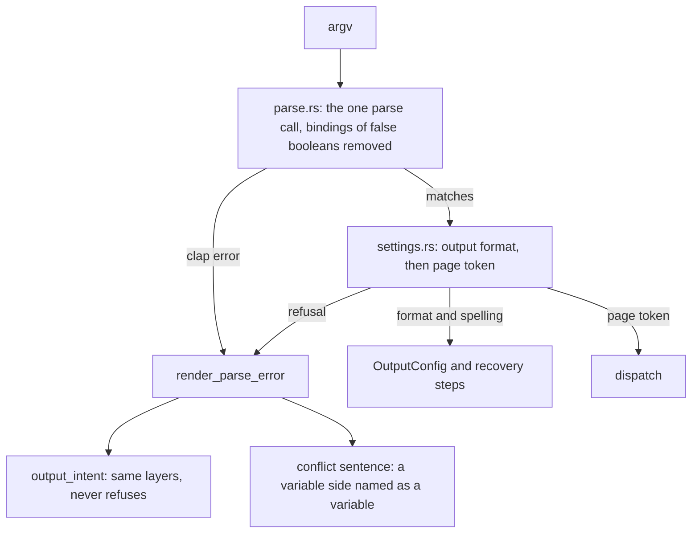
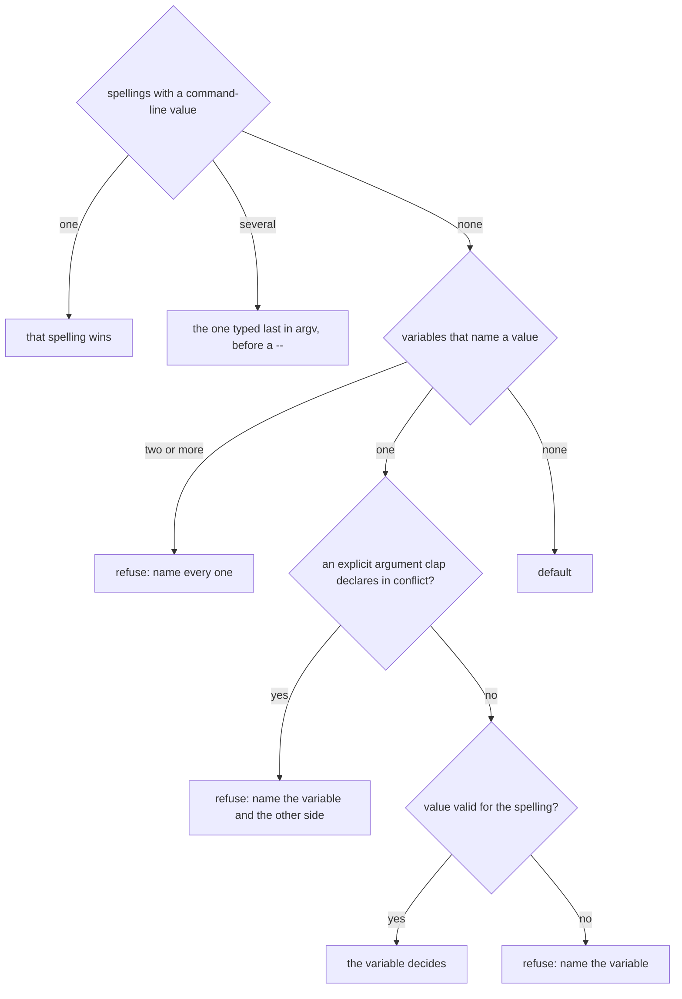

# Flag and Variable Precedence - Plan

## Goal Capsule

- **Objective:** a caller who types an output-format or page-token flag gets that flag's value whatever `XURL_*`
  variables the environment holds, and when `xr` refuses a combination, the message names what the caller actually set.
- **Means:** the two settings with several spellings resolve by layer in `xr`'s own code, with their variables read as
  data (KTD8). Each resolved setting carries the spelling that decided it and that spelling's source (KTD18). Clap keeps
  refusing conflicts between different settings, and one renderer names a variable as a variable (KTD12). Guards read
  clap's relationships, not a list of today's flags (KTD16).
- **Authority:** R-IDs win on behavior and KTDs on mechanism. A unit overrides neither. KTD1 to KTD7 are settled and are
  not reopened. KTD19, KTD20, the single check in KTD13, and the root help line and fixture moves in KTD17 are decisions
  of xurl-rs-prime, the coordinating session, which owns the code calls.
- **Execution profile:** one pull request from a `fix/` branch cut from `dev`, under the branch, commit, and review
  rules in `AGENTS.md` and the contributor's global instructions. It ships in `xr` 4.9.0 (KTD1).
- **Stop conditions:** stop and report when the work needs a change under `crates/xdk`, a new flag, reason, action,
  envelope key, exit code, or environment variable (R12), when a golden fixture other than the 198 help fixtures
  (`help.golden` and the 197 `help-*.golden`) moves, or when evidence contradicts KTD1 to KTD7.
- **Who finishes:** the implementing slot opens the pull request and runs its reviews. The prime merges it to `dev`.
  Release PR #622 is outside this plan.

---

## Product Contract

### Summary

`xr` resolves the output format and the page token by layer: a typed flag first, the last one typed when there are
several, then the setting's variables, then the default. A conflict between two different settings is still refused at
exit 2, and the refusal names an environment variable as an environment variable. A boolean variable that reads false
counts as unset. A guard fails when a later declaration would let a variable refuse a typed flag of its own setting.

### Problem Frame

On `dev` and on released 4.8.0, an `XURL_*` variable bound to a global flag with clap's `env =` refuses a typed flag it
conflicts with. The refusal exits 2 with `invalid-args` and names a flag the caller never typed. Measured on 4.8.0:

- `XURL_OUTPUT=yaml xr --json schema --list` answers `the argument '--json' cannot be used with '--output <OUTPUT>'`.
- `XURL_JSON=0 xr --output json schema --list` is refused the same way, though the variable is false.
- `XURL_OUTPUT=yaml XURL_JSON=0 xr schema --list` is refused with no flag typed at all.
- `XURL_OUTPUT=toml xr --output json schema --list` is refused for the variable's value, though a format is typed.

The cause is upstream [clap-rs/clap#5591](https://github.com/clap-rs/clap/issues/5591), open since 2024. Clap's
validator counts a value read from an `env` binding as explicit (`check_explicit` in `parser/matches/matched_arg.rs`),
so it enters conflict checks, even when its falsey parser reads it as false. A maintainer's proposal in that thread is
the direction this plan takes: a variable counts as given, except a boolean one that reads false.

Typed format flags refuse each other too: `xr --json --output=yaml` exits 2. A wrapper that appends its own format flag
cannot be overridden by its caller.

Clap checks conflicts and overrides one command level at a time and merges global values afterwards
(`ArgMatcher::propagate_globals`). So today the same two flags are refused on one side of the command word and silently
resolved on both: `xr --json schema --list --output yaml` exits 0 and prints JSON, because `effective_output()` ranks
the alias first.

### Requirements

**Spellings of one setting**

- R1. Two settings have several spellings. The output format is `--output`, `--json`, and `--jsonl`, with `XURL_OUTPUT`,
  `XURL_JSON`, and `XURL_JSONL`. The page token is `--cursor` and `--after`, with `XURL_CURSOR` and `XURL_AFTER`.
- R2. A typed spelling beats every variable of its setting.
- R3. Several typed spellings of one setting resolve last-wins, wherever in the invocation each one sits.
- R4. When no spelling of a setting is typed, the setting's variables decide it, and the default applies when none names
  a value.
- R5. Two variables of one setting that both name a value are refused at exit 2 with `invalid-args`, and the message
  names both variables.

**Conflicts between settings**

- R6. Two different settings that conflict are refused at exit 2 with `invalid-args`, whichever layer each came from.
- R7. When a side of a refusal came from a variable, the message names that variable as an environment variable and does
  not name its flag.

**False variables**

- R8. A boolean variable that reads false is unset: it names no value and causes no refusal. The flag's own value parser
  decides what reads false.

**What a caller sees next**

- R9. A recovery step runs in the output format that won.
- R10. A parse-error or refusal envelope renders in the format the same layers pick.

**Protection and surface**

- R11. A new declaration that would bring the defect back fails a guard, and the guard needs no edit.
- R12. The change adds no flag, reason, action, envelope key, exit code, or environment variable. A refusal stays
  `invalid-args` at exit 2. `crates/xdk` is not touched.

### Acceptance Examples

Each row runs offline. `whoami` rows use a store file that cannot be loaded, so the run ends on an `inspect-store` step
and sends nothing.

| ID   | Invocation                                        | Outcome                                                                                       | Covers  |
| ---- | ------------------------------------------------- | --------------------------------------------------------------------------------------------- | ------- |
| AE1  | `XURL_OUTPUT=yaml xr --json schema --list`        | exit 0, JSON                                                                                  | R2      |
| AE2  | `XURL_JSONL=1 xr --output yaml schema --list`     | exit 0, YAML                                                                                  | R2      |
| AE3  | `XURL_JSON=0 xr --output json schema --list`      | exit 0, JSON                                                                                  | R2, R8  |
| AE4  | `XURL_OUTPUT=yaml XURL_JSON=0 xr schema --list`   | exit 0, YAML                                                                                  | R4, R8  |
| AE5  | `XURL_CURSOR=abc xr --page 2 schema --list`       | exit 2, `invalid-args`; names `XURL_CURSOR` as a variable and `--page <N>`; no `--cursor`     | R6, R7  |
| AE6  | `XURL_PAGE=2 xr --after 5 schema --list`          | exit 2, `invalid-args`; names `XURL_PAGE` as a variable and `--after <TOKEN>`; no `--page`    | R6, R7  |
| AE7  | `xr --json --output=yaml schema --list`           | exit 0, YAML                                                                                  | R3      |
| AE8  | `xr --output yaml --json schema --list`           | exit 0, JSON                                                                                  | R3      |
| AE9  | `xr --cursor a --after b` on a command that pages | the request carries page token `b`                                                            | R1, R3  |
| AE10 | `XURL_PAGE=2 xr --cursor abc schema --list`       | exit 2, `invalid-args`; names `XURL_PAGE` as a variable                                       | R6, R7  |
| AE11 | `XURL_OUTPUT=json XURL_JSON=1 xr schema --list`   | exit 2, `invalid-args`; names `XURL_OUTPUT` and `XURL_JSON`; JSON envelope                    | R5, R10 |
| AE12 | `xr --json schema --list --output yaml`           | exit 0, YAML                                                                                  | R3      |
| AE13 | `xr --json --output yaml whoami`                  | `next_step.command` begins `xr --output yaml`                                                 | R9      |
| AE14 | `XURL_OUTPUT=yaml xr --json whoami`               | `next_step.command` begins `xr --json`, and running it in the same environment is not refused | R2, R9  |
| AE15 | `XURL_CURSOR=a XURL_AFTER=b xr schema --list`     | exit 2, `invalid-args`; names both variables                                                  | R5      |
| AE16 | `XURL_JSON=0 XURL_JSONL=0 xr schema --list`       | exit 0, text                                                                                  | R8      |
| AE17 | `XURL_OUTPUT=json xr --output text --bogus`       | exit 2, the text `Error:` line                                                                | R10     |
| AE18 | `XURL_AFTER=x xr --page 2 schema --list`          | exit 2, `invalid-args`; names `XURL_AFTER` as a variable and `--page <N>`; no `--after`       | R6, R7  |

AE1 to AE11 are the brief's cases: its defect list and the examples in its settled decisions. On 4.8.0 every example
except AE12 and AE17 exits 2, and where a variable is set the message names its flag. AE12 prints JSON, and AE17 renders
its error as JSON.

### Scope Boundaries

- Only conflict refusals name their source. A value clap rejects from a variable it still binds, such as
  `XURL_TIMEOUT=abc`, keeps clap's message. Evidence that would change the call: a report of a caller misled by it.
- A typed conflict split across the command word, `xr --cursor a whoami --page 2`, is not refused by clap today and
  stays that way. `--page` is refused at dispatch as `unsupported-pagination` on either side of the word.
- Flags outside the two settings keep clap's rule for a repeat: `xr --app a --app b` is still refused.
- An empty variable clap still binds counts as given. `XURL_PAGE= xr --cursor a schema --list` exits 2 on `dev` and
  stays refused, now naming `XURL_PAGE` as a variable. KTD20 covers the five variables the resolver reads, and taking
  empty values off every binding would change `XURL_APP=`, `XURL_TIMEOUT=`, and the rest beyond R1 to R12. Evidence that
  would change the call: a report of an `ARG`-style empty `XURL_PAGE` refusing a typed page token.
- `xr --help` run with a boolean variable set false omits that flag's `[env: ...]` line, because the binding is gone
  before the parse (KTD10). The root help's `ENVIRONMENT VARIABLES` block still names the variable. Considered and not
  built: a second parse to render help from the untouched command.
- The fix does not wait for clap#5591. A fix offered to clap, clap-rs/clap#6211, is closed without merging, and a
  maintainer marks the issue a breaking change as a precaution, to be argued otherwise before clap v5. When clap changes
  how an `env` value counts, the guards in U5 show what moved.

### Sources

- The brief for this plan, from the coordinating session, with the user's decisions (KTD1 to KTD7).
- [clap-rs/clap#5591](https://github.com/clap-rs/clap/issues/5591): the upstream defect, the maintainers' comments of
  2026-01-05 on why a variable counts as a provided value, and the proposal of 2026-01-21.
  [clap-rs/clap#6211](https://github.com/clap-rs/clap/pull/6211): the fix the uv author offered to clap, closed
  2026-01-05.
- [astral-sh/uv#17321](https://github.com/astral-sh/uv/pull/17321), the policy source (KTD4), read at its merge commit
  `cd55d1ce120f3c4dfe37a9df563e97e25914e1ba`: the description and review thread, the diff, and the files it changes in
  `crates/uv-cli/src`, `crates/uv-settings/src`, `crates/uv/src`, and `crates/uv/tests/it`. Read with it: the two issues
  it closes (uv#13385 and uv#13316), and four later changes to the same code, each from its description and diff:
  uv#19313, uv#19503, uv#20620, and uv#21402. "What this plan takes from uv, and what it leaves" under Alternative
  Approaches Considered gives each call with its reason.
- xurl-rs-prime, the coordinating session, for the decisions marked as its own: the single check in KTD13, the root help
  line and the fixture moves in KTD17, KTD19, and KTD20.
- ctl-core #130 and mlxcel #2612, #2622, #2664, #2668: prior art read for the brief. This plan relies on the brief's
  account of both and did not read them again.
- clap_builder 4.6.7 source, the version `Cargo.lock` pins, for every fact under "Clap facts".
- `xr` 4.8.0, run offline against a scratch token store, for every "today" claim in Problem Frame and Acceptance
  Examples.

---

## Planning Contract

### Key Technical Decisions

KTD1 to KTD7 are the brief's settled decisions. Where the brief names no alternative, the one written is the behavior
the decision rules out.

- KTD1. **The fix ships in `xr` 4.9.0, and release PR #622 stays in draft until it lands.** (session-settled:
  user-directed, chosen over releasing 4.9.0 without the fix: the release waits for the fix.)
- KTD2. **Typed `--output`, `--json`, and `--jsonl` resolve last-wins.** (session-settled: user-directed, chosen over
  keeping the exit-2 refusal: POSIX `ls -C -1` resolves this way and clap's `overrides_with` gives it.) Governs R3.
- KTD3. **A guard protects future flags and new flag categories with no edit to the guard.** (session-settled:
  user-directed, chosen over fixing only today's flags: a new declaration must not bring the defect back.) Governs R11.
- KTD4. **The policy is uv's (astral-sh/uv#17321).** Spellings of one setting resolve by layer, different settings that
  conflict are refused whatever layer each came from with the real source named, and a false variable is unset.
  (session-settled: user-directed, chosen over the ctl-core and mlxcel policy: both let a typed flag silence a variable
  for a different setting.) Governs R2, R4, R6, R7, R8.
- KTD5. **`--cursor` and `--after` are one setting.** (session-settled: user-approved, chosen over keeping the pair a
  refused conflict: `--after` is a documented alias that sends the same page token.) Governs R1, R3.
- KTD6. **A variable for a different setting that conflicts with a typed flag stays refused, and the message names the
  variable.** (session-settled: user-approved, chosen over the typed flag silencing the variable: uv refuses different
  settings whatever layer each came from.) Governs R6, R7.
- KTD7. **Two variables that set one setting are refused, both named, even when they agree.** (session-settled:
  user-approved, chosen over accepting the pair: the refusal clap gives today is kept, with the variables named.)
  Governs R5.
- KTD8. **The two settings resolve in `xr`'s code, and their variables leave clap.** `--output`, `--json`, `--jsonl`,
  `--cursor`, and `--after` drop `env =`. `crates/xurl-cli/src/cli/env.rs` reads the five variables as data, and one
  module applies the layers. This is the brief's mechanism, and it is the shape uv#17321 gives the 18 boolean variables
  it resolves by hand. The layers belong to a setting, not to a spelling: a typed spelling silences every variable of
  its setting. uv#17321 resolves each flag of a `--x` and `--no-x` pair on its own, uv#19310 then reports that `--dev`
  does not override `UV_NO_DEV=1`, and uv#19313 fixes that for every pair with `resolve_flag_pair`, which ignores both
  variables once either flag is typed. The settings table in U3 states that grouping once, for both settings. The
  mechanism was weighed once against keeping the bindings declared and removing them before each parse (see Alternative
  Approaches Considered), and it stays for three reasons. The defect cannot return at a parse site that skips a shared
  path, because the declaration holds no binding. The variable side becomes testable in process with injected data,
  which is how this repo's tests take their environment. And the variables are read where `AGENTS.md` says the CLI reads
  its environment.
- KTD9. **Typed order across the command word comes from argv.** Clap applies `overrides_with` inside one command level,
  then `propagate_globals` merges levels per argument, so after a parse `--json` typed before the word and
  `--output yaml` typed after it both hold a command-line value, with nothing to order them. The resolver takes the
  typed spellings from the matches. Only when more than one survives does it read argv for the last token, before a
  `--`, that spells one of them. That read is exact while every spelling is a long flag with no short form or alias and
  no argument accepts a hyphen-led value, and U5 holds both conditions. The same reader gives the parse-error path its
  typed layer (KTD15). A per-level probe that rebuilds the tree with local copies of the globals was rejected: it
  re-implements clap's propagation to answer one question argv already answers.
- KTD10. **One step removes the binding of any boolean flag whose variable reads as the flag's absent value.** It walks
  every command, takes each argument with an `env` binding whose variable the lookup holds and whose built value parser
  yields a `bool` (`ValueParser::type_id() == std::any::TypeId::of::<bool>()`, through the public `PartialEq<TypeId>` on
  the `AnyValueId` it returns, since `AnyValueId::of` is crate-private), and parses the variable's value with that
  parser. The test is the parser's type, not the action: seven of the eight booleans that stay bound (`--verbose`,
  `--raw`, `--quiet`, `--no-interactive`, `--wait-on-rate-limit`, `--dry-run`, and `auth oauth2 --no-browser`) are `Set`
  with `num_args = 0..=1` and `default_value_t = false`, which is why `xr --quiet=false` parses, and only `--no-pager`
  is `SetTrue`. `ValueParser::parse_ref` is crate-private, so the step runs the parser through a one-argument probe
  command and reads the boolean back. The absent value is the argument's default parsed by the same parser when it
  declares one, else false for `SetTrue` and true for `SetFalse`. When the variable's value equals it, the step removes
  the binding with `Arg::env` reset. A value the parser rejects keeps its binding, so clap reports it. The step names no
  flag and no variable. It analyses a built clone and rewrites the unbuilt command, because `Command::build()` expands
  the help tree where a parse does not. When no variable the lookup holds is bound in the tree it returns the command
  untouched and builds nothing. The analysis runs at most once per run, and each parse site applies its result: a
  parse-error run reaches several of the sites U1 lists (on the debug binary `xr --bogus` takes 0.06 s against 0.01 s
  for `xr schema --list`), and `xr --help`, which builds the whole tree, takes 0.02 s, so a build per site would add a
  tree build to each of those parses. The rule is the one clap-rs/clap#6211 proposes for clap itself, that a value from
  the environment equal to the default is not explicit, kept to boolean flags, where the proposal of 2026-01-21 in
  clap#5591 also draws the line. uv does not need the step, since no boolean it reconciles stays bound in clap, and pays
  for that with a copy of clap's boolish literals (see "What this plan takes from uv, and what it leaves").
- KTD11. **Every argv parse goes through one function.** `crates/xurl-cli/src/cli/parse.rs` owns the only calls that
  hand argv to clap. Each site passes the customization it needs: inert display flags, room for stray words,
  `ignore_errors`. A source guard fails for a parse call anywhere else in production code. Once KTD8 lands, today's tree
  has no boolean variable in a conflict, and one in a requirement: `auth oauth2 --step` `requires` `no_browser`, and on
  `dev` `XURL_NO_BROWSER=0 xr --dry-run auth oauth2 --step 1` is accepted with `no_browser: false`, because the false
  variable counts as given. After the step it is refused at exit 2 for the missing `--no-browser`, which R8 asks for.
  That is the one behavior the funnel changes now. xurl-rs-prime decided it is a fix, filed under `### Fixed`, and not a
  break, with no migration-guide row and no special case in the step: a false variable that satisfies a requirement is
  clap#5591 itself, and correcting what the code got wrong is a fix. It is what makes KTD10 hold for a flag added later.
- KTD12. **One function writes the conflict sentence, for clap's conflicts and for the resolver's.** It takes each side
  as an argument and its source (KTD18): a flag, or a variable. For a clap `ArgumentConflict` it reads the `InvalidArg`
  and `PriorArg` context, finds each argument in the failing command by comparing `Arg::to_string()`, and asks the
  lenient matches for its `value_source`. A side whose source is the environment is written as its variable, from
  `Arg::get_env()`. A string that maps to no argument, and the repeat form where both contexts are equal, keep clap's
  sentence. Clap's usage line and the help pointer stay as `render_invalid_args` writes them. uv's `check_conflicts`
  (`crates/uv-cli/src/options.rs`) writes clap's sentence the same way and names a variable side by kind, as
  `` `UV_FROZEN` (environment variable) ``. A4 holds this plan's wording for that side. The refusal returns through the
  error path every parse refusal takes, so it is the `invalid-args` envelope in every output format. uv#17321 prints the
  sentence and calls `std::process::exit(2)`, and uv#20620 replaces that with a returned error.
- KTD13. **A setting decided by a variable is checked against clap's declared conflicts.** Once the five variables leave
  clap, clap cannot see `XURL_CURSOR` beside `--page`. When a variable decides a setting, the resolver looks for an
  argument that holds an explicit value (command line or environment) and that clap declares in conflict with the
  winning spelling, in either direction. It refuses through KTD12. The check runs once, right after the parse and before
  dispatch, for every command, and reads one view of each argument's source: clap's `value_source` for an argument clap
  binds, and the resolver's own source for the two settings it owns. So `XURL_CURSOR=abc xr --page 2` and
  `XURL_AFTER=x xr --page 2` stay `invalid-args` at exit 2 naming the variable, and neither reaches
  `unsupported-pagination`. A resolver that skips this check would need a conflict call at each command, the wiring this
  plan designs out. The relationship reader is production code, and the guards in U5 use the same one, so a conflict
  declared later is refused without a resolver edit.

  The single check, its one view of sources, and the two refusals above are decided by xurl-rs-prime. uv#17321 is the
  evidence for what the other wiring costs. It drops `conflicts_with` where a partner can come from a variable and calls
  a check where each command resolves its settings: 14 `check_conflicts` calls in `crates/uv/src/settings.rs`, and
  `check_refresh_conflict` from 13 places in `crates/uv/src/lib.rs`. Each call writes its sides' sources by hand, and a
  reviewer on the pull request notes that the pattern "requires to manually call a check function". One call labels a
  source wrong. `resolve_python_preference` checks `--managed-python` against `Flag::from_cli("python-preference")`
  whenever `args.python_preference.is_some()`, and `--python-preference` keeps `env = EnvVars::UV_PYTHON_PREFERENCE` in
  `crates/uv-cli/src/lib.rs`. A reading of that code at the merge commit, not run:
  `UV_PYTHON_PREFERENCE=only-system uv --managed-python` is refused with a message that names `--python-preference`, a
  flag the caller did not type. That is this plan's defect, made by a source written at the call. Here no call writes
  one: the check reads each source from the parse or from the resolver (KTD18), and clap's declared conflicts stay the
  one record of which settings conflict.
- KTD14. **The four new variables travel as data beside `SkillEnv`.** `XURL_JSON`, `XURL_JSONL`, `XURL_CURSOR`, and
  `XURL_AFTER` are read by literal name in `env.rs` into a CLI-owned value. `run_with_env` takes it as a parameter, and
  `run_with_overrides` and `run_with_hooks` pass an empty one. `XURL_OUTPUT` stays on `EnvOverrides.output`, which the
  library already documents as the runner's, so `crates/xdk` is not touched. `EnvOverrides` is not `#[non_exhaustive]`,
  so a field added to it would break `xdk-rs` semver. An in-process run through a data entrypoint therefore reads none
  of the five from the process. uv reads its variables the same way, once, into `EnvironmentOptions`
  (`crates/uv-settings/src/lib.rs`), where each `EnvFlag` keeps the variable's name beside its value for messages. Two
  differences follow from `xr`'s rules. This value holds each variable's string as given, where `EnvFlag` holds a parsed
  boolean, because the flag's own parser reads it (R8). And it arrives as a parameter, where uv reads the process inside
  the constructor, because `xr`'s tests inject their environment.
- KTD15. **The parse-error path picks its format from the same layers and never refuses.** `output_intent` takes the
  typed layer from argv: the last format named before a `--`, with a typed `text` counting as typed. Then it takes the
  variable layer: an alias variable that reads true, `XURL_JSONL` before `XURL_JSON`, then `XURL_OUTPUT`. A resolver
  refusal renders under the same pick. Clap's lenient matches no longer carry the alias variables, so that read goes.
- KTD16. **The guards read relationships and prove it on a fixture.** `crates/xurl-cli/tests/flag_env_guard.rs` holds
  two walks over `xr`'s tree and one test over a `clap::Command` built in the test with categories `xr` lacks. Each walk
  fails when it finds no case. No message carries a `Cause:` line, which `crates/xurl-cli/tests/recipe_guard.rs`
  reserves for recipe walks. Relationship discovery and the false-variable step run in process. A refusal that depends
  on a variable clap binds runs the built binary through `common::xr()` with the variable set on the child, because clap
  reads a binding when `Arg::env()` is called. Each refusal among the acceptance examples also runs once through the
  binary and pins the exit code and the first line of the message, as uv's snapshot tests pin theirs
  (`offline_refresh_conflict` in `crates/uv/tests/it/pip_install.rs`, and the tests uv#19313 adds, which set the
  variable on the child). uv#17321 adds that one refusal test, for two typed flags, and no guard, and the precedence
  defect uv#19313 fixes reaches uv as a user's report. The walks are what this plan adds to uv's tests, and mlxcel #2664
  is the same defect returning where a guard covered overrides only.
- KTD17. **Help names each variable in prose, and the help fixtures are re-blessed.** Dropping `env =` removes clap's
  `[env: ...]` line from five global flags, which every command's help prints. Each of the five flags names its variable
  in its short and long help in clap's bracket form (A6), and the root help's `ENVIRONMENT VARIABLES` block gains
  `XURL_AFTER` and states the precedence rule. 198 help fixtures carry the five lines and move: `help.golden`, the root
  help, and the 197 `help-*.golden`. Each moves only inside those five flags' blocks, and `help.golden` also in its
  `ENVIRONMENT VARIABLES` block and the precedence paragraph under it. xurl-rs-prime decides two points here.
  `XURL_AFTER` gets its line in that block, since the line documents an existing variable and adds no surface: today
  only clap's `[env: ...]` line advertises it, and `test_help_advertises_every_env_var_the_source_reads` fails for a
  variable `env.rs` reads that `xr --help` does not name. And the 198 fixture moves are expected moves.
- KTD18. **A resolved setting carries the spelling that decided it and that spelling's source.** The resolver answers
  once per run with the value, the spelling, and the source: typed, a variable with its name, or the default. Every
  later reader takes that answer and none works a source out again: the conflict sentence names a side from it (KTD12),
  the single check reads it for the two settings the resolver owns (KTD13), and a recovery step is spelled from it (R9,
  U4). Today `FormatSpelling::of` in `crates/xurl-cli/src/cli/rerun.rs` works the spelling out afterwards from
  `cli.json || cli.jsonl`, which cannot tell a typed alias from its variable or say which typed spelling came last. uv
  is the precedent on both parts. uv#17321 removes a second read of `UV_FROZEN` at the message site, which the removed
  code marks with a note to track the source when resolving, and carries `Flag` and `FlagSource`
  (`crates/uv-cli/src/options.rs`) from resolution into the later messages. Its author writes on the pull request that
  tracking the source is an improvement even if clap changes, because error messages can report it. uv#21402 then adds
  the spelling to the source, because "parsing discards which spelling was used", and resolves that source once before
  applying precedence. `xr`'s value has no configuration source, since `xr` reads no configuration file, and holds a
  value of the setting's type where uv's `Flag` holds a boolean.
- KTD19. **A repeated spelling of either setting resolves last-wins.** `xr --output json --output yaml` answers in YAML,
  and `--cursor a --cursor b` sends `b`. Today both are refused as "cannot be used multiple times". Decided by
  xurl-rs-prime, on three grounds. R3 read plainly covers it, since two of one spelling is more than one typed. The
  wrapper that appends `--output json`, the case KTD2 exists for, needs it. And POSIX XBD 12.2, Utility Syntax Guideline
  11, has a repeated option with an argument interpreted in command-line order. Each spelling lists itself in its
  overrides (see "Clap facts"). Flags outside the two settings keep clap's refusal of a repeat (Scope Boundaries).
  Governs R3.
- KTD20. **An empty variable is unset, for the five variables the resolver reads.** `XURL_OUTPUT=` with nothing typed
  answers in text. Today it is refused with `a value is required for '--output <OUTPUT>'`. Decided by xurl-rs-prime, on
  three grounds. uv's `parse_string_environment_variable`, `parse_integer_environment_variable`, and
  `parse_path_environment_variable` (`crates/uv-settings/src/lib.rs`) return `None` for an empty value. `xr`'s own
  `NO_COLOR` read does the same. And an empty boolean already reads false under `FalseyValueParser`. Where uv refuses an
  empty boolean variable, `xr` keeps the flag's own parser (R8). This plan's reading of uv adds a case: uv#19499 reports
  a container build that fails on a variable an `ARG` default leaves set and empty, and uv#19503 lets such a list
  variable be empty. A variable clap still binds keeps clap's reading of an empty value, and the single check in KTD13
  takes its `value_source` as clap gives it (Scope Boundaries). Governs R4.

### Assumptions

Bets the planner made without a person's confirmation. The eng and devex reviews confirm or correct each one. A1 and A2
are decided by xurl-rs-prime and are KTD19 and KTD20, and the four below keep their numbers. Each carries the eng
review's call and its evidence.

- A3. R5 applies where R4 reads the variables. A typed spelling skips its setting's variables altogether (R2), so
  `XURL_OUTPUT=json XURL_JSON=1 xr --output yaml` and `XURL_OUTPUT=toml xr --output json` both succeed. Eng review:
  confirmed. R2 says a typed spelling beats every variable of its setting, Problem Frame counts the refusal of
  `XURL_OUTPUT=toml xr --output json` as the defect, and uv#19313's `resolve_flag_pair` ignores both variables once
  either flag is typed.
- A4. The refusal keeps clap's sentence and writes a variable side as `the environment variable 'XURL_PAGE'`:
  `the argument '--cursor <TOKEN>' cannot be used with the environment variable 'XURL_PAGE'`. A refusal with a variable
  on every side carries no usage line, since no typed flag is at fault. Eng review: confirmed as the mechanism, with the
  subject of a resolver refusal fixed: the variable that decided the setting is the subject
  (`the environment variable 'XURL_CURSOR' cannot be used with '--page <N>'`), and the other sides follow in clap's
  order. The quoting matches clap's own sentence, and uv names the same side by kind. The wording itself is a
  developer-experience call and `/plan-devex-review` may change it. Devex review: the first line stands as the eng
  review fixed it, and every refusal with a variable side gains one `tip:` line in clap's own form, the two-space indent
  and blank lines clap gives `tip: to pass '--bogus' as a value, use '-- --bogus'`, placed after the first line and
  before the usage line. The tip names the edit that clears the refusal, because a caller that inherited the variable
  cannot see where it came from: `tip: unset 'XURL_PAGE', or leave out '--cursor <TOKEN>'` for a variable beside a typed
  flag, `tip: unset one of 'XURL_CURSOR' and 'XURL_AFTER'` for two variables, and
  `tip: unset all but one of 'XURL_OUTPUT', 'XURL_JSON', and 'XURL_JSONL'` for three. Sides follow the settings table's
  order when no variable decided the setting (R5), so AE11 reads
  `the environment variable 'XURL_OUTPUT' cannot be used with the environment variable 'XURL_JSON'`. Two typed flags get
  no tip, as clap gives none today. The tip is message text in the existing `invalid-args` envelope, so R12 holds.
- A5. A variable that names an invalid value is refused only when it decides the setting, and the message names the
  variable with the possible values: `XURL_OUTPUT=toml xr schema --list` exits 2 naming `XURL_OUTPUT`. Eng review:
  confirmed, on A3's evidence. The message keeps the shape of clap's invalid-value sentence with the variable as its
  subject, `invalid value 'toml' for the environment variable 'XURL_OUTPUT'`, then clap's `[possible values: ...]` line,
  and the envelope stays `invalid-args` with no new key (R12). Devex review: the refusal renders as JSON, as clap's
  refusal of the same value renders on 4.8.0 and as the `--output` help promises ("refused at exit 2 with a JSON
  envelope"): KTD15's variable layer reads `XURL_OUTPUT` through `rendering_format` in `classify.rs`, which maps a value
  that names no format to JSON. No tip line: the possible-values line is the fix.
- A6. The per-flag `[env: ...]` line is a fair trade for KTD8. The prose that replaces it also states when the variable
  applies, which the line never did. Eng review: no engineering objection. The 198 fixture moves are mechanical and U3
  checks them by script, and the `[env: X=value]` echo of a set variable's value is what the trade gives up. Whether the
  prose serves a reader is `/plan-devex-review`'s call. Devex review: prose alone does not serve. `xr -h` prints each
  flag's `[env: XURL_X=]` inline after its first help line, and the 13 flags that keep a binding go on doing so, so
  prose placed in long help would leave five flags with no variable in `-h` and break a reader's or agent's scan for
  `env: XURL_`. Each of the five flags therefore declares `help` and `long_help` explicitly. The short help is today's
  first line with "(P2 alias)" dropped, a label no reader can decode, and ends in clap's bracket form without the value
  echo: ``Shorthand for `--output json` [env: XURL_JSON]``. The long help keeps today's text, adds one sentence on when
  the variable applies, and ends in the same bracket as its own paragraph, where clap prints its own. The sentences are
  fixed in U3 step 6. Writing the bracket through `help` and `long_help` attributes keeps it out of the field's doc
  comment, so rustdoc never reads it as a link.

### Clap facts

Verified against clap_builder 4.6.7. Each of the brief's facts is used or corrected here.

| Fact                                                                                                                                                                                                                                                                                                                                                          | Where it is in clap                                                                        | Used by                                                                                                                    |
| ------------------------------------------------------------------------------------------------------------------------------------------------------------------------------------------------------------------------------------------------------------------------------------------------------------------------------------------------------------- | ------------------------------------------------------------------------------------------ | -------------------------------------------------------------------------------------------------------------------------- |
| `Arg.overrides` is crate-private with no getter                                                                                                                                                                                                                                                                                                               | `builder/arg.rs`                                                                           | U5 finds overrides with a parse probe                                                                                      |
| `Command::get_arg_conflicts_with` reads only the argument's own `conflicts`, one direction. For a non-global argument it unrolls a group named there into its members; it misses the siblings of a non-multiple group the argument belongs to and every conflict declared on the other side. For a global argument it panics on a conflict id that is a group | `builder/command.rs`                                                                       | KTD13's reader looks up `arg.clone().global(false)`, reads both directions, and adds group siblings and `exclusive` itself |
| `get_groups()`, `ArgGroup::get_args`, and `Arg::is_exclusive_set` read groups and `exclusive`. `ArgGroup::is_multiple` takes `&mut self`                                                                                                                                                                                                                      | `builder/arg_group.rs`                                                                     | the reader clones a group to ask it                                                                                        |
| `Arg::env()` reads the variable when it is called                                                                                                                                                                                                                                                                                                             | `builder/arg.rs`                                                                           | KTD16: a clap-bound variable is tested through the binary                                                                  |
| `Command::build()` builds with the help tree expanded, and a parse builds without it                                                                                                                                                                                                                                                                          | `builder/command.rs`                                                                       | KTD10 analyses a clone                                                                                                     |
| An override removes its partner only for a command-line value, and an override also counts as a conflict                                                                                                                                                                                                                                                      | `parser/parser.rs` `start_custom_arg`, `parser/validator.rs` `gather_arg_direct_conflicts` | why an override participant must hold no binding (U5)                                                                      |
| A value from the environment counts as explicit                                                                                                                                                                                                                                                                                                               | `parser/matches/matched_arg.rs` `check_explicit`                                           | the upstream defect                                                                                                        |
| Conflicts and overrides run per command level, and global values merge afterwards: the higher source wins, and a tie goes to the deeper level                                                                                                                                                                                                                 | `builder/command.rs` `_do_parse`, `parser/arg_matcher.rs` `fill_in_global_values`          | KTD9                                                                                                                       |
| A repeated `Set` or `SetTrue` argument is refused unless it overrides itself                                                                                                                                                                                                                                                                                  | `parser/parser.rs` `react`                                                                 | KTD19: each spelling lists itself in its overrides                                                                         |
| `ValueParser::parse_ref` is crate-private                                                                                                                                                                                                                                                                                                                     | `builder/value_parser.rs`                                                                  | KTD10's probe command                                                                                                      |
| `ValueParser::type_id` returns an `AnyValueId` whose `of` constructor is crate-private, and `AnyValueId` implements `PartialEq<std::any::TypeId>` publicly                                                                                                                                                                                                    | `util/any_value.rs`                                                                        | KTD10's boolean test compares with `TypeId::of::<bool>()`                                                                  |
| `Arg::is_allow_negative_numbers_set` reads an argument that takes `-<digits>` as a value; such a value cannot spell a long flag                                                                                                                                                                                                                               | `builder/arg.rs`                                                                           | U5's argv-read condition exempts it                                                                                        |
| An `ArgumentConflict` carries `InvalidArg` as a string and `PriorArg` as a string, a list, or nothing (`exclusive`)                                                                                                                                                                                                                                           | `error/mod.rs` `argument_conflict`                                                         | KTD12                                                                                                                      |

The brief's fifth fact, that `build()` on the parsed command moved nine help fixtures, is consistent with the source.
This plan did not rerun it.

### High-Level Technical Design

A run, from argv to an answer:



How one setting resolves:



Who decides each combination:

| One side                     | Other side                        | Same setting | Decided by                          | Outcome                 |
| ---------------------------- | --------------------------------- | ------------ | ----------------------------------- | ----------------------- |
| typed                        | typed, same level                 | yes          | clap `overrides_with`               | last wins               |
| typed                        | typed, across the command word    | yes          | resolver, argv order                | last wins               |
| typed                        | variable                          | yes          | resolver                            | typed wins              |
| variable                     | variable                          | yes          | resolver                            | refused, both named     |
| typed                        | clap-bound variable               | no           | clap, then the conflict sentence    | refused, variable named |
| typed or clap-bound variable | resolver-read variable            | no           | resolver, clap's declared conflicts | refused, variable named |
| any                          | boolean variable that reads false | either       | false-variable step or resolver     | the variable is unset   |

### Alternative Approaches Considered

- **Keep `env =` on the five flags and remove bindings before each parse.** A first parse with the settings' bindings
  removed says what is typed. A second parse keeps the one binding the variable layer picks, and clap then applies the
  value and finds conflicts with other settings natively. Help and its 198 fixtures do not move, and KTD13 and KTD14 are
  not needed. It lost to KTD8 because the declared binding brings the defect back at any parse site that skips the
  shared path, the variable side stays untestable in process, and a declaration that sometimes applies is harder to read
  than one that holds no binding.
- **Strip the binding of every argument a typed flag conflicts with**, which is ctl-core's step. Excluded by KTD4: it
  lets a typed flag silence a variable for a different setting.
- **Derive the settings from clap's override graph at run time.** It would need no table of settings, but
  `Arg.overrides` has no getter, and probing every pair on each run costs hundreds of parses. The table lives in
  production code and U5 holds it to the override relation.

No bake-off ran. The choice between KTD8 and the first alternative rests on evidence already gathered, and it can be
reversed later without changing the contract a caller sees.

#### What this plan takes from uv, and what it leaves

uv#17321 and the four later changes to the same code are read for what serves `xr`'s codebase, which has one parse path,
one dispatcher, a structured error envelope, and no configuration file.

Taken:

- The policy (KTD4).
- Layers that belong to a setting, so a typed spelling silences every variable of its setting (KTD8). uv arrives there
  in uv#19313.
- A resolved value that carries its spelling and source, resolved once and read by every later message (KTD18). uv
  arrives there in uv#17321 and uv#21402.
- A refusal that names a variable side as a variable (KTD12), with the wording open under A4.
- One read of the variables, each value kept beside its variable's name (KTD14).
- A refusal returned through the error path, where uv arrives in uv#20620 (KTD12).
- Tests through the binary with the variable set on the child, pinning the exit code and the sentence (KTD16).
- The rule that a boolean variable equal to the flag's absent value is not explicit, from the fix its author offered to
  clap (KTD10).
- An empty variable read as unset, as uv's string, integer, and path variables are (KTD20).

Left, each with its reason:

- **A conflict check called where each command resolves its settings, with the sources written at the call.** `xr` has
  one place every command passes, so the check runs there once (KTD13). The per-command form is the one that names
  `--python-preference` for a value its variable gave.
- **Dropping `conflicts_with` and holding the conflicting pairs in code.** Clap's declarations stay the one record of
  which settings conflict. Clap keeps refusing two typed flags, and the single check reads the same declarations.
- **Taking `env =` off every boolean flag.** A flag with one spelling has no layers to resolve beyond the ones clap
  applies, so a resolver for it adds code and no behavior. Five spellings leave clap, and the false-variable step covers
  the booleans that stay (KTD10).
- **A copy of clap's boolish literals, and a startup refusal of a boolean variable that matches none.** A copied table
  is a second record of clap's rule, and it is not the rule `--json` and `--jsonl` use: `FalseyValueParser` reads any
  unknown value as true, so `XURL_JSON=maybe` stays true. The flag's own parser decides (R8). A5 holds the question for
  `XURL_OUTPUT`.
- **Hand-written `[env: UV_X=]` text in each flag's help, moved onto its own line by `reformat_env_annotations`.** It
  keeps the annotation in uv's help at the price of a second pass over rendered help that must track clap's layout, and
  the text never shows the variable's value as clap's line does. KTD17 names the variable in prose. Clap lets `help` and
  `long_help` differ, so `xr` could carry the same text with no second pass. That form is not built or measured here,
  and A6 is where the reviews confirm the prose or take it.
- **A refusal of `--x` beside `--no-x` typed on two sides of the command word (`flag()`, citing clap-rs/clap#6049).** It
  answers the per-level limit KTD9 describes by refusing. R3 holds last-wins wherever a spelling sits, and neither
  setting has a negated spelling.
- **A configuration source.** `xr` reads no configuration file, so a source is typed, a variable, or the default.
- **No guard.** uv#17321 ships none. KTD3 requires one, and U5 builds it.

### Risks & Dependencies

| Risk                                                                                                       | Mitigation                                                                                                                          |
| ---------------------------------------------------------------------------------------------------------- | ----------------------------------------------------------------------------------------------------------------------------------- |
| 198 fixtures move at once, and an unrelated change could ride along                                        | U3 checks by script that each fixture's diff sits inside the five flags' blocks. No other golden may move (stop condition)          |
| The argv read in KTD9 misreads a value as a flag                                                           | U5 fails for an argument that accepts hyphen-led values, and for a setting spelling with a short form or an alias                   |
| A later parse site calls clap directly                                                                     | U1's source guard                                                                                                                   |
| The false-variable step rebuilds the tree at every parse site                                              | KTD10 runs the analysis once per run, and the startup gate in the Verification Contract measures it                                 |
| A later reader of `cli.cursor`, `cli.after`, `cli.json`, `cli.jsonl`, or `cli.output` misses the variables | U3's verification finds no reader of the five fields outside `settings.rs`                                                          |
| A clap upgrade changes a crate-private fact above                                                          | the guards probe through public API, so they fail where behavior moves                                                              |
| An in-process caller relied on the process's `XURL_JSON`                                                   | none found: tests never set process variables, and `tests/common/invoke.rs` is the only caller of `run_with_env` outside the runner |

### System-Wide Impact

- Every command's `--help` changes inside the five flags' blocks, and the root help's environment block changes. Shell
  completions may move with the flag descriptions.
- Invocations that exit 2 today start to succeed. Scripts that relied on the refusal to detect a conflicting environment
  lose that signal.
- One invocation accepted today is refused: `XURL_NO_BROWSER=0 xr auth oauth2 --step 1` exits 2 for the missing
  `--no-browser`, since a false variable no longer satisfies `--step`'s requirement (KTD11, R8).
- In-process runs through `run_with_overrides` and `run_with_hooks` stop reading the five variables from the process.
- `AGENTS.md` and `crates/xurl-cli/README.md` both state that clap refuses `--output` beside an alias. Both sentences
  change (U6).

### Sequencing

U1 comes first, and U2 builds on its parse path. Neither changes a declared flag. U3 is the fix and depends on both. U4
depends on U3 and shares its commit boundary: the alias variables leave clap in U3, and `output_intent` learns them in
U4, so the suite is green only with both. U5 depends on U1 to U3. U6 is last.

---

## Implementation Units

### U1. One parse path, with the false-variable step

- **Goal:** every argv parse in production code goes through one function that first removes the binding of any boolean
  flag whose variable reads as the flag's absent value.
- **Requirements:** R8, R11. KTD10, KTD11.
- **Dependencies:** none.
- **Files:**
  - create `crates/xurl-cli/src/cli/parse.rs`, a `pub mod` under the doc-hidden `cli` module so the guards in
    `crates/xurl-cli/tests/` can call the step, with a doc comment on each public item (`#![deny(missing_docs)]` in
    `crates/xurl-cli/src/lib.rs`)
  - modify `crates/xurl-cli/src/cli/mod.rs` (module line), `crates/xurl-cli/src/cli/env.rs` (a lookup of a variable by
    the name a declaration gives), `crates/xurl-cli/src/cli/runner.rs`, `crates/xurl-cli/src/cli/reparse.rs`,
    `crates/xurl-cli/src/cli/classify.rs`, `crates/xurl-cli/src/cli/misplaced_flags.rs`
  - create `crates/xurl-cli/tests/parse_path_guard.rs`
- **Approach:**
  1. `parse.rs` exposes the parse call. It takes argv and the caller's customization of the command, applies the step
     from KTD10, and returns clap's matches or error.
  2. The step takes its variable lookup as a parameter. Production passes the one in `env.rs`, and a test passes its
     own. Its analysis runs once per run and each site applies the result (KTD10).
  3. Move each of the eleven parse sites onto it: the runner's main parse and `help_command_page`, the schema scope
     probe in `render_schema_refusal`, `parse_without_display_flags`, `parse_past_stray_words`, and `lenient_matches` in
     `reparse.rs`, `invoked_help`, `requested_login`, and `parsed_leaf` in `classify.rs`, and both parses in
     `misplaced_flags.rs`.
  4. Sites that read the tree without parsing argv (`render_help`, completions, `takes_value_after_equals`, the schema
     word list) keep calling `Cli::command()`.
- **Patterns to follow:** `command_with_inert_display_flags` in `reparse.rs` for a command customized before a parse.
  `crates/xurl-cli/tests/store_isolation_guard.rs` and `common::production_source::up_to_inline_tests` for a source
  guard that skips inline tests. `up_to_inline_tests` leaves a whole file that `#[cfg(test)] mod name;` declares in
  view, and `crates/xurl-cli/src/cli/parse_tests.rs` is one, with six `Cli::try_parse_from` calls. The guard skips such
  files the way `crates/xurl-cli/tests/port_race_guard.rs` does (its `#[cfg(test)] mod name;` resolver).
- **Test scenarios:**
  - A `SetTrue` flag with a falsey parser, bound to a variable the lookup gives as `0`: the binding is gone, and a parse
    that types a flag it conflicts with succeeds.
  - A `Set` flag with a falsey parser, `num_args = 0..=1`, and `default_value_t = false`, the shape of `--quiet`, with
    the lookup giving `0`: the binding is gone. With `1`: it stays.
  - The same flag with the lookup giving `1`: the binding stays.
  - The lookup giving an empty string under a falsey parser: the binding is gone.
  - A boolish parser with the lookup giving `maybe`: the binding stays, so clap reports the value.
  - A `SetFalse` flag: `true` removes the binding and `false` keeps it.
  - A non-boolean option that takes a value, with its variable equal to its default: the binding stays.
  - A boolean flag declared on a subcommand: handled like a root one.
  - No bound variable set: the command comes back with every binding intact.
  - Integration, through the binary: `XURL_NO_BROWSER=0 xr --dry-run auth oauth2 --step 1` exits 2 with `invalid-args`
    for the missing `--no-browser`. On `dev` it exits 0 with a dry-run envelope, which is its observed failure.
    `XURL_QUIET=0 xr schema --list` is no evidence: it exits 0 on `dev` too.
  - Source guard: a production file other than `parse.rs` that calls `try_get_matches_from`, `get_matches_from`,
    `try_parse_from`, `parse_from`, `try_update_from`, or `update_from`, or one of the entrypoints that read the
    process's own argv (`get_matches()`, `try_get_matches()`, `get_matches_mut()`, `::parse()`, `::try_parse()`), fails
    it. None of the second group is called in production code on `dev`, and each would skip the step. The guard fails
    when it scans no file, and when `parse.rs` holds no call of the first group. `parse_tests.rs` and
    `commands/url_authority_tests.rs` are not scanned.
- **Verification:** the suite passes with no fixture moved, and the source guard reports `parse.rs` as the only file
  that parses argv. The startup gate in the Verification Contract holds.

### U2. Conflict refusals name the real source

- **Goal:** a conflict clap raises names a side that came from a variable as that variable.
- **Requirements:** R6, R7, R12. KTD6, KTD12, KTD18. A4.
- **Dependencies:** U1.
- **Files:**
  - create `crates/xurl-cli/src/cli/conflict_source.rs`
  - modify `crates/xurl-cli/src/cli/mod.rs` (module line), `crates/xurl-cli/src/cli/runner.rs` (`render_invalid_args`)
  - create `crates/xurl-cli/tests/flag_env_precedence_tests.rs`
- **Approach:**
  1. One function writes the sentence from two or more sides, each an argument's display string and its source: typed,
     or a variable with its name (A4). This unit defines that source type, and U3's resolved value carries it (KTD18).
  2. A second function turns a clap `ArgumentConflict` into sides. It walks to the failing command through the lenient
     matches' subcommand chain, maps each context string to an argument there, and takes each source from those matches
     through an injected function, so a test can supply sources.
  3. `render_invalid_args` uses the rewritten first line and keeps the rest of clap's body.
- **Patterns to follow:** `context_string` in `classify.rs` for reading clap's error context. `equals_form_hint` in
  `reparse.rs` for a rendering that edits clap's body in place.
- **Test scenarios:**
  - Covers AE6. `XURL_PAGE=2 xr --after 5 schema --list`, through the binary.
  - Covers AE10. `XURL_PAGE=2 xr --cursor abc schema --list`, through the binary.
  - Both runs pin exit 2, the whole first line of the message in A4's wording (KTD16), and A4's `tip:` line, which sits
    before the usage line.
  - `XURL_PAGE=2 xr schema --list --cursor abc`, with the flag after the command word: the same refusal, and the help
    pointer names `xr schema --help`.
  - `xr --cursor a --page 2 schema --list`, both typed: clap's sentence unchanged, both sides as flags, and no `tip:`
    line.
  - A conflict with two prior arguments, one typed and one from a variable (fixture command, injected sources): each
    side is named by its own source.
  - An `exclusive` argument's conflict, which carries no prior argument (fixture): the subject is named by its source
    and nothing else changes.
  - `xr --app a --app b whoami`: the "cannot be used multiple times" sentence is untouched.
  - A context string that maps to no argument: clap's sentence unchanged.
  - Under `--output json`, AE10's envelope has `reason` `invalid-args`, `exit_code` 2, `next_step.action` `show-help`,
    and no key it lacks today.
- **Verification:** AE6 and AE10 pass against the built binary, and each is first observed failing on `dev`.

### U3. The two settings resolve by layer

- **Goal:** the output format and the page token come from the resolver, the five variables are read as data, and the
  declarations give last-wins.
- **Requirements:** R1, R2, R3, R4, R5, R6, R7, R8, R12. KTD2, KTD4, KTD5, KTD7, KTD8, KTD9, KTD13, KTD14, KTD17, KTD18,
  KTD19, KTD20. A3, A5.
- **Dependencies:** U1, U2.
- **Files:**
  - create `crates/xurl-cli/src/cli/settings.rs`, a `pub mod` with documented public items, since U5's guards call its
    table and its conflict reader from `crates/xurl-cli/tests/`
  - modify `crates/xurl-cli/src/cli/mod.rs` (the five declarations, `ROOT_HELP`, `effective_output`),
    `crates/xurl-cli/src/cli/env.rs`, `crates/xurl-cli/src/cli/runner.rs`, `crates/xurl-cli/src/cli/commands/mod.rs`
    (the token `GlobalFlags.cursor` holds), `crates/xurl-cli/tests/common/invoke.rs` (the `run_with_env` caller)
  - modify `crates/xurl-cli/tests/flag_env_precedence_tests.rs`
  - modify `crates/xurl-cli/tests/cli_tests.rs`: `test_json_and_output_conflict` and `test_json_and_jsonl_conflict`
    assert the exit-2 refusal KTD2 removes, and are rewritten in place to assert last-wins
  - re-bless `crates/xurl-cli/tests/golden/help.golden` and `crates/xurl-cli/tests/golden/help-*.golden`, and regenerate
    `completions/` when it moves
- **Approach:**
  1. Declarations. The five flags drop `env =`. `--output`, `--json`, and `--jsonl` drop their conflicts with each
     other, and each overrides all three, itself included. `--cursor` and `--after` do the same as a pair. `--page`
     keeps `env = "XURL_PAGE"` and its conflict with `--cursor`, and `--after` keeps its conflict with `--page`.
  2. `env.rs` reads `XURL_JSON`, `XURL_JSONL`, `XURL_CURSOR`, and `XURL_AFTER` by literal name into the value KTD14
     describes. `run` and `run_with_store_path` read it from the process.
  3. `settings.rs` holds the table of the two settings (each spelling's clap id and its variable), the layer resolution
     in the flowchart above, the argv order read (KTD9), and the conflict reader (KTD13). A boolean variable is read
     with the flag's own parser through the probe from U1, and `XURL_OUTPUT` with `--output`'s own value parser through
     the same probe, so the `yml` and `ndjson` aliases, the case rule, and the possible-values line A5 prints come from
     clap. An empty variable names no value (KTD20). Each resolution answers once with the value, the spelling that
     decided it, and that spelling's source (KTD18). One function gives the single check its view of a source: the
     resolver's answer for a spelling in the table, and clap's `value_source` for every other argument.
  4. The runner resolves the output format right after the parse and builds `OutputConfig` from the answer. It then
     resolves the page token, before the meta-commands, so a refusal comes on every command as it does today. A refusal
     renders through U2's sentence as `invalid-args`, under the format KTD15 picks, with the help pointer `invoked_help`
     gives.
  5. The output resolver takes over `Cli::effective_output`'s role and `effective_output` is removed. It ranks an alias
     above `--output`, which KTD2's last-wins contradicts (AE8 and AE12). Its one caller, the `OutputConfig`
     construction in `runner.rs`, reads the resolver.
  6. Each of the five flags declares `help` and `long_help` (A6). The short help ends in `[env: <VAR>]`. The long help
     is today's text, then the sentence named here, then `[env: <VAR>]` as its last paragraph.
     - `--output`: short help is today's first paragraph, then `[env: XURL_OUTPUT]`. Long-help sentence:
       `Read from XURL_OUTPUT only when no --output, --json, or --jsonl is typed.`
     - `--json`: short help ``Shorthand for `--output json` [env: XURL_JSON]``. Long-help sentence:
       `Read from XURL_JSON only when no --output, --json, or --jsonl is typed; XURL_JSON=0 is unset.`
     - `--jsonl`: short help ``Shorthand for `--output jsonl` [env: XURL_JSONL]``. Long-help sentence:
       `Read from XURL_JSONL only when no --output, --json, or --jsonl is typed; XURL_JSONL=0 is unset.`
     - `--cursor`: short help is today's first paragraph, then `[env: XURL_CURSOR]`. Long-help sentence:
       `Read from XURL_CURSOR only when neither --cursor nor --after is typed.`
     - `--after`: short help ``Documented alias for `--cursor` [env: XURL_AFTER]``. Long-help sentence:
       `Read from XURL_AFTER only when neither --cursor nor --after is typed.`
     - `ROOT_HELP` gains `XURL_AFTER  Page token, one setting with XURL_CURSOR (same as --after)` after the
       `XURL_CURSOR` line. The sentence `Flags override env vars when both are set.` becomes the paragraph below, and
       the `NO_COLOR` and `--no-pager` sentences after it stay as they are.

       ```text
       A typed flag wins over its env var. --output, --json, and --jsonl outrank
       XURL_OUTPUT, XURL_JSON, and XURL_JSONL; --cursor and --after outrank
       XURL_CURSOR and XURL_AFTER; and of several typed, the last wins. Two env
       vars for one setting are refused, as is an env var beside a typed flag it
       conflicts with (XURL_PAGE with --cursor). XURL_JSON=0 counts as unset.
       ```

- **Execution note:** write the acceptance tests first and run them against `dev`. Each example this unit covers fails
  there, and the failure output goes in the pull request.
- **Patterns to follow:** `from_process` in `env.rs` for a variable read by literal name, which
  `test_help_advertises_every_env_var_the_source_reads` in `crates/xurl-cli/tests/agentic_tests.rs` finds. `SkillEnv`
  for a CLI-owned environment value passed beside `EnvOverrides`. `app_from_env` in `runner.rs` for reading
  `value_source` from the matches.
- **Test scenarios:** in process through `run_with_env` with injected variables, unless marked.
  - Covers AE1, AE2, AE3, AE4, AE7, AE8, AE11, AE12, AE15, AE16.
  - Covers AE5 and AE18. Also `XURL_CURSOR=a XURL_PAGE=2 xr schema --list`, through the binary: refused, both variables
    named. None of the three ends at `unsupported-pagination`.
  - `XURL_JSON=maybe xr schema --list` answers in JSON, as it does today: the flag's own `FalseyValueParser` reads an
    unknown value as true.
  - Covers AE9, against the mock: the request's page-token parameter is `b`. `xr --after b --cursor a` sends `a`, and
    `xr --cursor a <command> --after b` sends `b`.
  - `xr --output yaml schema --list --json` answers in JSON.
  - `xr --output json --output yaml schema --list` answers in YAML, and `xr --json --json schema --list` in JSON.
    Against the mock, `--cursor a --cursor b` sends `b` (KTD19).
  - A typed spelling silences the other spelling's variable, against the mock: `XURL_AFTER=b` with `--cursor a` sends
    `a`, and `XURL_CURSOR=a` with `--after b` sends `b` (KTD8).
  - The resolved answer, as a unit test per setting: a typed spelling answers with that spelling and the typed source, a
    variable answers with its spelling and its name, and neither answers the default (KTD18).
  - Through the binary, AE5, AE11, AE15, and AE18 each pin exit 2, the whole first line of the message in A4's wording
    (KTD16), and A4's `tip:` line. `XURL_OUTPUT=json XURL_JSON=1 XURL_JSONL=1 xr schema --list` pins the three-variable
    tip.
  - `XURL_JSON=1 xr --output text schema --list` answers in text.
  - `XURL_OUTPUT=toml xr schema --list` exits 2 naming `XURL_OUTPUT` and the possible values, in a JSON envelope (A5).
    `XURL_OUTPUT=toml xr --json schema --list` exits 0 in JSON (A3, A5).
  - `XURL_OUTPUT=` with nothing typed answers in text, and `XURL_CURSOR=` alone sends no page token (KTD20).
  - `XURL_OUTPUT=json XURL_JSON=1 xr --output yaml schema --list` exits 0 in YAML (A3).
  - `XURL_OUTPUT=text XURL_JSON=1 xr schema --list` is refused, both named.
  - `XURL_AFTER=b` alone sends `b`. `XURL_CURSOR=` with `XURL_AFTER=b` sends `b`.
  - The argv order read, as a unit test: a spelling after a `--` is not counted, `--output=yaml` counts as `--output`,
    and `--cursor=--json`, which clap accepts as a page token on 4.8.0, counts as `--cursor` and not as `--json`.
  - `xr --output json --json version` exits 0 in JSON and `xr --json --jsonl version` exits 0 in JSONL: the two
    `cli_tests.rs` tests above, rewritten.
  - `test_output_yml_is_yaml` and the `env` case of `test_output_unsupported_format_is_a_json_envelope` in
    `crates/xurl-cli/tests/agentic_tests.rs` keep passing unchanged: `XURL_OUTPUT=yml` answers in YAML, and
    `XURL_OUTPUT=toml` keeps a JSON envelope whose message contains `invalid value 'toml'`.
  - Through the binary, once per variable: `XURL_JSON=1`, `XURL_JSONL=1`, `XURL_CURSOR=a`, and `XURL_AFTER=b` each take
    effect, which proves `env.rs` reads the real name.
  - Every diff in `help.golden` and the `help-*.golden` fixtures sits inside the five flags' blocks or the root
    environment block, checked by script. `xr --help` names `XURL_AFTER`.
- **Verification:** the acceptance examples above pass against the built binary run with `XURL_TOKEN_STORE` on a scratch
  path. `git diff --stat -- crates/xdk` is empty. No golden outside the 198 help fixtures moved. Outside `settings.rs`,
  no production code reads `cli.cursor`, `cli.after`, `cli.json`, `cli.jsonl`, or `cli.output`: on `dev` the readers are
  `commands/mod.rs` (the `GlobalFlags.cursor` assembly), `rerun.rs` (`FormatSpelling::of`), and `mod.rs`
  (`effective_output`), and each moves to the resolver's answer.

### U4. The parse-error path and recovery steps read the same answer

- **Goal:** an envelope for a failed parse renders in the format the layers pick, and a step is spelled from the
  resolver's winner.
- **Requirements:** R9, R10. KTD15, KTD18.
- **Dependencies:** U3, in the same commit boundary.
- **Files:**
  - modify `crates/xurl-cli/src/cli/reparse.rs` (`output_intent`), `crates/xurl-cli/src/cli/classify.rs`
    (`structured_intent`), `crates/xurl-cli/src/cli/rerun.rs` (`FormatSpelling`), `crates/xurl-cli/src/cli/runner.rs`
  - modify `crates/xurl-cli/tests/rerun_env_tests.rs`, `crates/xurl-cli/tests/unknown_command_tests.rs`
- **Approach:**
  1. The argv reader reports a typed `text` as typed and stops at a `--`. It is KTD9's reader in `settings.rs`:
     `structured_intent` in `classify.rs` is replaced by a call to it, so one function scans argv for format spellings.
     `names_output` in `rerun.rs` reads a step's own words, not argv, and stays.
  2. `output_intent` takes the variables as data and applies KTD15. It reads `XURL_JSON` and `XURL_JSONL` through the
     function `settings.rs` reads them with, the flag's own parser through U1's probe, and not through `FALSE_LITERALS`
     in `classify.rs`, which `raw_intent` keeps for `--raw=`.
  3. `FormatSpelling` is read from the resolved output format (KTD18): `Alias` when `--json`, `--jsonl`, or one of their
     variables decided, `Output` otherwise. `FormatSpelling::of(&Cli)`, which works the spelling out from the parsed
     flags after the fact, goes, and the inline test `the_spelling_follows_the_flag_that_chose_the_format` in `rerun.rs`
     moves onto the resolver's answer with the same four rows.
  4. The doc comments in `rerun.rs` that explain the spelling by clap's refusal describe the present rule: the step
     repeats the spelling that decided the format. Once a typed spelling beats every variable, `--output <format>`
     reruns in any environment, so the refusal no longer forces the spelling. `FormatSpelling` stays because R9 and
     the #621 contract in `AGENTS.md` keep the caller's spelling, and dropping it would widen this change; no golden
     fixture pins an alias-spelled step, and `crates/xurl-cli/tests/rerun_env_tests.rs` is where that contract is
     tested.
- **Patterns to follow:** the existing `output_intent` chain, and the `carry` tests in `rerun.rs`.
- **Test scenarios:**
  - Covers AE13, AE14, AE17.
  - `XURL_JSON=true xr auth zzz` renders the `unknown-command` envelope in JSON, and `XURL_JSONL=true` in JSONL (the
    existing test keeps passing).
  - `XURL_OUTPUT=yaml XURL_JSONL=1 xr auth zzz` renders the `unknown-command` envelope in JSONL, and not the variable
    refusal.
  - `xr --json --output text --bogus` renders the text `Error:` line.
  - `xr webhooks listen --bogus -- prog --json` renders in text: a format after the `--` belongs to the child program.
  - `XURL_JSON=1 xr whoami` on an unreadable store carries a step that begins `xr --json` (the existing test keeps
    passing).
  - `xr --json whoami --output json` carries a step that begins `xr --output json`, the spelling that won.
  - AE11's refusal renders as JSON. AE15 under `XURL_OUTPUT=yaml` renders as YAML.
- **Verification:** `crates/xurl-cli/tests/rerun_walk.rs` and `crates/xurl-cli/tests/rerun_env_tests.rs` pass, and every
  step in the new scenarios reruns without a refusal in the environment that made it.

### U5. Guards that read relationships

- **Goal:** a later declaration that would let a variable refuse a typed flag of its own setting, or leave a conflict
  unnamed, fails the suite.
- **Requirements:** R11. KTD3, KTD16.
- **Dependencies:** U1, U2, U3.
- **Files:**
  - create `crates/xurl-cli/tests/flag_env_guard.rs`
- **Approach:**
  1. Override walk. Probe each ordered pair of flags: type the first and then the second, and see whether the first lost
     its command-line value. Clap copies a global argument with its relationships into every command, so pairs of two
     globals are probed once, at the root, and each command probes only the pairs that hold one of its own arguments.
     Per command, the 18 globals alone give 306 ordered pairs, about 61,000 parses over the tree; with the reduction, an
     estimated 15,000 to 21,000 [estimated: the 533 own option lines of the 197 `help-*.golden` fixtures, `--help`
     included, paired with each other and with the 18 globals]. Overrides apply inside one command level (see "Clap
     facts"), so each probe parses a clone of `command_at(path)`, not of the whole tree. The walk's wall-clock is
     measured once on the fixed tree and quoted in the pull request, and stays under the 60 s `slow-timeout` period in
     `.config/nextest.toml`. Each probe starts from `arguments_for(path)` in `crates/xurl-cli/tests/common/invoke.rs`,
     so a required positional or group does not fail it, and a probe that fails for any reason but the pair itself fails
     the walk, naming the command and clap's error, rather than counting as no override. A participant that holds a clap
     `env` binding fails the walk, with a message that names the argument and points at the settings table in
     `settings.rs`. Every override pair must sit inside one setting of that table, and every setting's spellings must
     override one another.
  2. Conflict walk. With the reader from U3, pair every flag with every variable-backed argument it conflicts with,
     where variable-backed means a clap binding or a spelling in the settings table, so the variables the resolver owns
     are in the set (KTD13). A pair of two globals runs once, under `schema --list`, and a pair that holds a command's
     own argument runs at that command with `arguments_for(path)`. Each pair runs through the binary with the flag typed
     and the variable set, and must exit 2 with a message that names the variable as a variable and not its flag. Where
     the variable-backed argument is boolean, a second run with the variable false must not be refused.
  3. Fixture. A `clap::Command` built in the test holds a non-multiple group of three flags that each bind a variable,
     an `exclusive` flag, and an override pair in which one side binds a variable. The reader must report the group's
     six ordered pairs and the exclusive flag against every other argument. The override probe must find the pair, and
     the first walk's check must flag it. The false-variable step, given an injected lookup, must remove a false
     member's binding.
  4. Argv-read conditions. No argument in `xr`'s tree accepts hyphen-led values (`is_allow_hyphen_values_set`) or is a
     trailing variable argument, and no setting spelling has a short form or an alias. A `last = true` positional, such
     as `webhooks listen`'s `PROGRAM`, passes: it takes only words after a `--`, where the argv read stops. An argument
     that allows negative numbers, such as `post --clip-start` and `--clip-end`, passes: `-<digits>` cannot spell a long
     flag.
  5. Each walk counts its cases and fails at zero.
  6. Probe values. A flag that takes a value is typed with its first `get_possible_values` entry, or with the `SAMPLE`
     value the walks in `crates/xurl-cli/tests/common/invoke.rs` use when it declares none. A variable takes the same
     value its flag would, and a boolean variable takes `1` for true and `0` for false.
- **Patterns to follow:** `TREE`, `command_at`, and `arguments_for` in `crates/xurl-cli/tests/common/invoke.rs` for a
  tree built once and an invocation that parses at each command. `crates/xurl-cli/tests/help_claims_guard.rs` for a walk
  that reads clap's declarations. `common::xr()` for a spawn with variables set on the child.
- **Test scenarios:**
  - On `xr`'s tree the override walk finds the pairs of the two settings and no participant with a binding.
  - On `xr`'s tree the conflict walk finds `--cursor` and `--after` against `XURL_PAGE`, and `--page` against
    `XURL_CURSOR` and `XURL_AFTER`, and each is refused with the variable named.
  - On the fixture, each expectation in step 3 holds.
  - Putting `env =` back on `--json` in a scratch edit fails the override walk with a message that names `--json`.
    Observed once during the work and quoted in the pull request, not kept as a test.
  - No message in the file contains `Cause:`, so `recipe_guard` does not count it as a recipe walk.
- **Verification:** the file passes on the fixed tree, and the scratch edit above fails it.

### U6. Documents state the rule

- **Goal:** `AGENTS.md` and the README describe the precedence rule, the refusals, and the guard.
- **Requirements:** R1 to R8, as documentation.
- **Dependencies:** U1 to U5.
- **Files:**
  - modify `AGENTS.md` (§ "Output formats": the paragraph on how a step spells its format, and a paragraph on flag and
    variable precedence that names `settings.rs`, the false-variable step, and `flag_env_guard.rs`. § "Where a change
    goes" rule 2: the variables `env.rs` reads)
  - modify `crates/xurl-cli/README.md` (the environment section near `export XURL_OUTPUT=json`, and the sentence that
    says clap refuses `--output` beside an alias)
- **Approach:** present tense, no history. A contributor adding a flag learns from `AGENTS.md` that a variable-backed
  flag with a second spelling goes in the settings table. The README's machine-readable block, which recommends
  `export XURL_OUTPUT=json`, gains the line a reader runs next, so the rule is shown where the export is:

  ```bash
  export XURL_OUTPUT=json                          # Default to JSON
  xr whoami --jsonl                                # A typed format flag wins: JSONL
  ```

  `--jsonl` and not `--output`, because 4.8.0 already lets a typed `--output` beat `XURL_OUTPUT`; the alias beside the
  variable is the case it refuses.

  The README states the rest in one sentence after the block: two variables for one setting, and a variable beside a
  typed flag it conflicts with, are refused at exit 2 naming the variable, and `XURL_JSON=0` is unset.
- **Test scenarios:** Test expectation: none -- prose only. `crates/xurl-cli/tests/recipe_guard.rs` and the markdown
  hook still pass.
- **Verification:** both documents match what the built binary does for AE1 to AE18.

---

## Verification Contract

| Gate              | Command                                                                                                                                                                   | Applies to       |
| ----------------- | ------------------------------------------------------------------------------------------------------------------------------------------------------------------------- | ---------------- |
| Tests             | `cargo nextest run --workspace`, read from its summary line                                                                                                               | every unit       |
| Doc tests         | `cargo test --doc --workspace`                                                                                                                                            | U1 to U4         |
| Lint and format   | `cargo clippy -- -D warnings`, `cargo fmt --check`                                                                                                                        | every unit       |
| Help fixtures     | `XURL_GOLDEN_BLESS=1 cargo test -p xurl-rs --test golden_tests`, then the scripted diff check                                                                             | U3               |
| Completions       | `scripts/generate-completions.sh`, committed when it changes                                                                                                              | U3               |
| Local CI mirror   | `scripts/hooks/pre-push`                                                                                                                                                  | before the push  |
| Built binary      | each acceptance example run against the built `xr` with `XURL_TOKEN_STORE` on a scratch path                                                                              | U2 to U4         |
| Library untouched | `git diff --stat origin/dev -- crates/xdk` prints nothing                                                                                                                 | the pull request |
| Startup           | `gtime -f '%e s %M KB'` on the built `xr` for `schema --list` and `--bogus`, with `XURL_QUIET=1` set and unset, before and after; the set run adds at most one tree build | U1               |

A new test counts once it has been seen failing against `dev`, and every acceptance example fails there today. The four
CI gates with no hook (completions freshness, the package check, the semver gate, the agent-native audit) run on the
pull request. No run sends a request to X.

---

## Definition of Done

- AE1 to AE18 pass in the suite and against the built binary.
- `crates/xurl-cli/tests/flag_env_guard.rs` and `crates/xurl-cli/tests/parse_path_guard.rs` pass, and each was seen
  failing on a scratch edit that breaks its rule.
- `crates/xdk` is unchanged, and the change adds no flag, reason, action, envelope key, exit code, or environment
  variable.
- Only the 198 help fixtures moved (`help.golden` and the `help-*.golden`), each inside the five flags' blocks or the
  root environment block.
- `AGENTS.md` and `crates/xurl-cli/README.md` state the rule in the present tense.
- The pull request body's Changelog lists, under `xurl-rs` and nothing under `xdk-rs`: under Fixed, a variable no longer
  refuses a typed flag of its own setting, a refusal that a variable causes names the variable, a boolean variable that
  reads false is unset, and a false `XURL_NO_BROWSER` no longer satisfies `auth oauth2 --step`'s need for `--no-browser`
  (KTD11); under Changed, typed and repeated format and page-token flags resolve last-wins, an empty `XURL_OUTPUT`,
  `XURL_JSON`, `XURL_JSONL`, `XURL_CURSOR`, or `XURL_AFTER` is unset, and the five flags' help names its variable
  without echoing the variable's value.
- The reviews the change needs have run and are recorded on the pull request: the code review, and the
  developer-experience review for changed flag behavior and output.
- No probe code, scratch edit, or abandoned approach is left in the diff.

---

## Developer Experience Review

One round of `/plan-devex-review`, mode DX POLISH, product type CLI tool. The review answered its own questions from the
code on `dev` at `c82407b`, the 4.8.0 binary run offline on a scratch store, `AGENTS.md`, the README, and two
`docs/solutions` entries. Each answer and its evidence is recorded here. Web research and an outside voice did not run,
since the review ran in one context. The DX table below covers the developer journey only. A4, A5, A6, U3 step 6, U6,
and the Definition of Done carry the plan changes this review made.

### Developer persona

```text
Who:       an AI coding agent driving xr unattended, often inside a wrapper or a shell profile that exports XURL_*
Context:   the README's machine-readable block recommends `export XURL_OUTPUT=json`; the skill bundle's dry-run gate
           appends `--output json`; the agent then types `--json` or `--cursor` from `xr --help`
Tolerance: one refused call it can repair from the message; it cannot see where an inherited variable came from
Expects:   a typed flag beats the environment, a refusal names what to change, and the step it is handed runs
```

Evidence: `AGENTS.md` § "Output formats" (structured output for agents), README line 787, the 2026-10-29 devex review's
persona for `xr` ("AI coding agent reading --help unattended"), and
`docs/solutions/best-practices/cli-wrapper-flags-before-double-dash-env-aliases-bash32-2026-09-30.md`, which records a
wrapper having to neutralize `XURL_JSON` because the variable acted as a flag.

### Developer perspective

Observed on 4.8.0, except where marked predicted. My shell profile has `export XURL_OUTPUT=json`, as the README
suggests. The help lists `--json` as shorthand, so I run `xr --json whoami`. Exit 2:
`the argument '--json' cannot be used with '--output <OUTPUT>'`. I never typed `--output`. The envelope's step is
`xr --help`, which says "Flags override env vars when both are set", the opposite of what just happened. I drop `--json`
and it works. Predicted: without the export in view, as when a CI job or a wrapper sets it, I retry the same call or
strip flags at random. With `XURL_PAGE=2` inherited and `--cursor abc` typed, the refusal names `--page <N>`, so I hunt
for a `--page` in my own argv that is not there.

After this plan: `xr --json whoami` answers in JSON. `XURL_PAGE=2 xr --cursor abc schema --list` answers
`the argument '--cursor <TOKEN>' cannot be used with the environment variable 'XURL_PAGE'`, followed by
`tip: unset 'XURL_PAGE', or leave out '--cursor <TOKEN>'`.

### Benchmark

The clock runs from a shell holding a format or page-token variable to the first call with a typed flag that answers as
typed. Times are estimates, not measured sessions.

| Tool                | Typed flag beside its own env var      | Conflict names the env var                    | Evidence                                |
| ------------------- | -------------------------------------- | --------------------------------------------- | --------------------------------------- |
| uv, after uv#19313  | flag wins, both env vars of a pair off | yes, `` `UV_FROZEN` (environment variable) `` | source read for this plan (KTD8, KTD12) |
| clap default        | flag wins for one argument             | no: names the flag the env var binds          | clap-rs/clap#5591, 4.8.0 output         |
| `xr` 4.8.0          | refused when the flag is an alias      | no                                            | observed: AE1 to AE11                   |
| `xr` with this plan | flag wins, last typed wins             | yes, with a `tip:` line naming the edit       | AE1 to AE18, A4                         |

Target: Champion. Today an agent needs one refused call, a diagnosis, and a second call (estimated); with this plan it
needs one call. Answered by the review: the plan already reaches the target, so no new vehicle.

### Magical moment

The flag the caller typed is the one that counts, and a refusal names the variable to unset. It is delivered through
existing commands: AE1 and AE14 show the first, and A4's tip line the second. No new surface (R12).

### Journey map

| Stage       | Developer does                                  | Friction found                                      | Status                                |
| ----------- | ----------------------------------------------- | --------------------------------------------------- | ------------------------------------- |
| Discover    | reads `xr --help` and `xr -h`                   | prose-only help would drop five variables from `-h` | fixed: A6, U3 step 6                  |
| Install     | none new                                        | none                                                | ok                                    |
| Hello world | `export XURL_OUTPUT=json`, then `xr --json ...` | refused naming an untyped flag                      | fixed by the plan (AE1)               |
| Real usage  | wrapper appends `--output json`; pages a list   | repeat refused; `--cursor` beside `--after` refused | fixed by the plan (KTD2, KTD5, KTD19) |
| Debug       | reads the refusal                               | no fix line when a variable causes it               | fixed: A4 tip line                    |
| Upgrade     | reads the 4.9.0 changelog                       | DoD listed two of six observable changes            | fixed: Definition of Done             |

### First-time confusion report

```text
Persona: AI agent, XURL_OUTPUT=json inherited from a CI job
T+0:00  runs `xr --json whoami`; exit 2 naming '--output <OUTPUT>'            -> fixed by the plan (AE1)
T+0:20  follows next_step `xr --help`; reads "Flags override env vars"        -> fixed: U3 step 6 rule text
T+0:40  scans `xr -h` for `env: XURL_` to find the culprit                    -> fixed: A6 keeps the bracket in -h
T+1:00  sets XURL_PAGE=2 elsewhere, types --cursor; refusal names --page      -> fixed by the plan (AE10) and A4 tip
T+1:30  XURL_OUTPUT=toml typo; reads possible values in a JSON envelope       -> kept: A5
```

### Decisions this review made

| ID   | Question                                    | Answer                                                                   | Evidence                                                                                     |
| ---- | ------------------------------------------- | ------------------------------------------------------------------------ | -------------------------------------------------------------------------------------------- |
| DX1  | Product type                                | CLI tool                                                                 | the plan's surface is flags, help, and refusals                                              |
| DX2  | Persona                                     | unattended AI agent, with a human scripter second                        | above                                                                                        |
| DX3  | TTHW target                                 | Champion: one call                                                       | benchmark above                                                                              |
| DX4  | Mode                                        | DX POLISH                                                                | a fix to an existing CLI; the stop conditions forbid new surface                             |
| DX5  | A4 wording                                  | eng review's first line, plus one `tip:` line                            | clap's `tip:` form on 4.8.0's `--bogus` refusal; an inherited variable has no visible origin |
| DX6  | A6 help form                                | `[env: VAR]` bracket in short and long help, plus one long-help sentence | `xr -h` on `dev` prints `[env: XURL_X=]` inline for 18 flags                                 |
| DX7  | "(P2 alias)" in `--json` and `--jsonl` help | dropped                                                                  | the blocks move anyway, and the label names an internal tier                                 |
| DX8  | Root help precedence paragraph              | the text in U3 step 6                                                    | the line on `dev` contradicts AE1 on 4.8.0                                                   |
| DX9  | Invalid `XURL_OUTPUT` rendering             | JSON, through `rendering_format`                                         | 4.8.0's `XURL_OUTPUT=toml` refusal; the `--output` help sentence                             |
| DX10 | README teaching                             | `export` line followed by `xr whoami --jsonl`                            | the Learn by Doing principle; README line 787                                                |
| DX11 | Changelog content                           | six bullets, listed in the Definition of Done                            | System-Wide Impact lists each one as observable                                              |

### NOT in scope

- `--page`'s help calls it "Documented alias for `--cursor`" while it is a refusal trap. Its block does not move here,
  and changing it would move all 198 fixtures in a block outside the five (stop condition).
- `XURL_PAGE` is missing from the root `ENVIRONMENT VARIABLES` block. `--page` keeps its `[env: XURL_PAGE=]` line, so
  the agentic guard passes, and the line is not part of this fix.
- A `value` key on `invalid-args` for a refused variable value (R12: no new envelope key).
- A `next_step` other than `show-help` for a refusal caused by a variable (R12: no new action). The tip line carries the
  fix as message text instead.
- The skill bundle's dry-run gate neutralizes `XURL_JSON`. That stays harmless after the fix. Whether to drop it is up
  to the skill repo's owner.

### What already exists

- clap's `tip:` line layout, which `render_invalid_args` already passes through (`--bogus` on 4.8.0).
- `rendering_format` in `classify.rs`, which already picks JSON for a value that names no format.
- `[env: XURL_X=]` lines on the 13 flags that keep a binding, which give the five flags their shape.
- `examples.rs` lines 105 and 341, `XURL_OUTPUT=json xr search ...`, which stay true.
- `test_help_advertises_every_env_var_the_source_reads`, which holds the root help to `env.rs`.

### Error path matrix (agent-ready-v1)

```text
Path                                   | Class | what | fix  | recovery | code | context | trace | redaction | channel | Cap
typed flag + clap-bound var (AE10)     | usage | pass | pass | N/A      | pass | N/A     | N/A   | pass      | pass    | none
two vars of one setting (AE15, AE11)   | usage | pass | pass | N/A      | pass | N/A     | N/A   | pass      | pass    | none
invalid var value (A5, XURL_OUTPUT)    | usage | pass | pass | N/A      | pass | N/A     | N/A   | pass      | pass    | none
false-variable probe fails (KTD10)     | unexp | N/A  | N/A  | N/A      | N/A  | N/A     | N/A   | N/A       | N/A     | none
```

Before this review, the first two rows were `CAP6:fix`. The only fix line they showed was `Try 'xr --help'`, and an
agent that inherited the variable had no edit to make. The tip line in A4 closes that gap. The probe in KTD10 parses one
argument on a command built in process. A rejected value keeps its binding, so clap reports it as `invalid-args`.
Nothing else can fail there, so the step adds no new unexpected path. A panic anywhere still ends at the existing
`internal` envelope. Redaction: no message echoes a variable's value, except the invalid value A5 names, which the
caller typed into the variable. No secret is read from these five variables.

### Implementation tasks

- [ ] **T1 (P1, human: ~1h / CC: ~10min)**: `conflict_source.rs` writes A4's `tip:` line for each refusal with a
  variable side, before the usage line. Surfaced by: Pass 3, CAP6 fix. Files:
  `crates/xurl-cli/src/cli/conflict_source.rs`. Verify: the U2 and U3 binary tests that pin the tip.
- [ ] **T2 (P1, human: ~1h / CC: ~10min)**: the five flags declare `help` and `long_help` per U3 step 6. Surfaced by:
  Pass 4, A6. Files: `crates/xurl-cli/src/cli/mod.rs`. Verify:
  `xr -h | rg 'env: XURL_(OUTPUT|JSON|JSONL|CURSOR|AFTER)\]'` prints five lines, and the fixture diff script passes.
- [ ] **T3 (P2, human: ~15min / CC: ~3min)**: `ROOT_HELP` precedence paragraph and `XURL_AFTER` line per U3 step 6.
  Surfaced by: Pass 4, DX8. Files: `crates/xurl-cli/src/cli/mod.rs`. Verify: `help.golden` diff.
- [ ] **T4 (P2, human: ~15min / CC: ~3min)**: README example and sentence per U6. Surfaced by: Pass 4, DX10. Files:
  `crates/xurl-cli/README.md`. Verify: run the two lines on a scratch store with a mock or `--dry-run`.
- [ ] **T5 (P2, human: ~10min / CC: ~2min)**: the PR body's Changelog per the Definition of Done. Surfaced by: Pass 5.
  Files: the PR body. Verify: six bullets under `xurl-rs`.
- [ ] **T6 (P2, human: ~10min / CC: ~2min)**: test that `XURL_OUTPUT=toml` renders its refusal as JSON. Surfaced by:
  Pass 3, A5. Files: `crates/xurl-cli/tests/flag_env_precedence_tests.rs`. Verify: seen failing first, like every new
  test.

## DX Review Scorecard

```text
+====================================================================+
|              DX PLAN REVIEW - SCORECARD                            |
+====================================================================+
| Dimension            | Score  | Prior  | Trend                     |
|----------------------|--------|--------|---------------------------|
| Getting Started      |  9/10  |  8/10  | up: A6 keeps -h discovery |
| API/CLI/SDK          |  8/10  |  8/10  | flat                      |
| Error Messages       |  8/10  |  6/10  | up: CAP6 fix closed (A4)  |
| Documentation        |  8/10  |  6/10  | up: help text, README     |
| Upgrade Path         |  8/10  |  6/10  | up: full changelog        |
| Dev Environment      |  8/10  |  8/10  | flat                      |
| Community            |  6/10  |  6/10  | flat                      |
| DX Measurement       |  7/10  |  6/10  | up: boomerang named       |
+--------------------------------------------------------------------+
| TTHW                 | 1 call | 2 calls + diagnosis (estimated)    |
| Competitive Rank     | Champion                                    |
| Magical Moment       | designed, via existing commands (AE1, A4)   |
| Product Type         | CLI tool                                    |
| Mode                 | POLISH                                      |
| Overall DX           |  8/10  |  6/10  | up                        |
+====================================================================+
| Zero Friction      | covered (AE1)                                 |
| Learn by Doing     | covered (README example)                      |
| Fight Uncertainty  | covered (tip line, rule paragraph)            |
| Opinionated + Escape Hatches | covered (typed flag beats variable) |
| Code in Context    | covered                                       |
| Magical Moments    | covered                                       |
| Agents Are Users   | covered (-h bracket, JSON envelope)           |
+====================================================================+
```

"Prior" is this plan as it stood before the review, since no earlier DX review covers this plan. Community stays at 6
because the one lever, telling clap-rs/clap#5591 how `xr` solves the defect, is outward-facing and needs a person.
Measurement: after implementation, `/devex-review` runs AE1, AE10, AE14, and `xr -h` against the built binary. No
telemetry is proposed. No TODOs are proposed.

## Engineering Review

One round of `/plan-eng-review` as the skill, in one context, after the hand round and the devex round. Every question
was answered by the reviewer from the code on `dev` at `5483ad6`, the 4.8.0 binary run offline on a scratch store with
`API_BASE_URL` at a closed port, clap_builder 4.6.7's source, `AGENTS.md`, and `docs/solutions`; each answer and its
evidence is below. The hand round's edits stand. The outside voice was skipped at the session's direction. The plan
edits this round made are in KTD10, "Clap facts", U1, U3, U4, and U5.

### Scope record

- **Complexity.** 6 files created (`parse.rs`, `conflict_source.rs`, `settings.rs`, and three test files) and 14
  modified by hand, with the 198 help fixtures and `completions/` regenerated; 3 new modules. Both thresholds trip.
- **Feature cuts.** None proposed: U1 carries R8 through KTD10 and KTD11, U2 carries R7, U3 is the fix, U4 carries R9
  and R10, U5 is KTD3, and U6 is the documentation the change requires.
- **Structure (D1, `plan-eng-review-structure`).** Original arrangement, chosen over folding `conflict_source.rs` into
  `settings.rs`. U2 lands the sentence for clap's conflicts before `settings.rs` exists (Sequencing), the sentence has a
  second caller in clap's own conflicts that owns no setting, and `settings.rs` already holds the table, the layers, the
  argv read, the conflict reader, and the source view, so one more job puts it past the 200-line refactor trigger.
- **Result.** feature answers: none cut; structure: A, original arrangement; accepted scope: U1 to U6 as written, with
  the corrections below; pending remedies: none. Scope accepted as-is.

### Reality rows

| Premise                                                           | Receipt                                                                                               | Verdict                            |
| ----------------------------------------------------------------- | ----------------------------------------------------------------------------------------------------- | ---------------------------------- |
| AE1 and AE3 are refused on 4.8.0 naming an untyped flag           | `xr` 4.8.0 probe: exit 2, `'--json' cannot be used with '--output <OUTPUT>'`                          | true                               |
| AE12 exits 0 printing JSON; AE17 renders JSON                     | `xr` 4.8.0 probe                                                                                      | true                               |
| `XURL_PAGE=` beside `--cursor` is refused; `XURL_OUTPUT=` is too  | `xr` 4.8.0 probe: `cannot be used with '--page <N>'`, `a value is required`                           | true                               |
| A repeated `--output` is refused                                  | `xr` 4.8.0 probe: `cannot be used multiple times`                                                     | true                               |
| `XURL_NO_BROWSER=0 xr --dry-run auth oauth2 --step 1` exits 0     | `xr` 4.8.0 probe: `no_browser: false`, exit 0                                                         | true                               |
| Eleven production parse sites, as U1 lists them                   | `runner.rs:240,774,903`, `reparse.rs:51,66,83`, `classify.rs:30,100,117`, `misplaced_flags.rs:52,155` | true, U1 wording corrected         |
| Readers of the five fields are three                              | `commands/mod.rs:627-629`, `rerun.rs:227`, `mod.rs:3784`                                              | true                               |
| 198 help fixtures carry the five lines and no other golden does   | 197 `help-*.golden` plus `help.golden`; `rg` over the rest finds none                                 | true                               |
| 18 global bindings plus `XURL_NO_BROWSER`                         | 19 `env = "` in `mod.rs`, 18 `global = true`                                                          | true                               |
| No argument accepts a hyphen-led value                            | `mod.rs:1302,1310` set `allow_negative_numbers`                                                       | true for hyphen values; finding Q1 |
| `AnyValueId::of::<bool>()` is callable                            | `clap_builder-4.6.7/src/util/any_value.rs:49`, `util/mod.rs:14`                                       | false, finding A1                  |
| `get_arg_conflicts_with` reads one direction; `parse_ref` private | `builder/command.rs:4036`, `builder/value_parser.rs:235`                                              | true                               |
| The semver gate does not cover `xurl-rs`                          | `.github/workflows/ci.yml:297-318` compares `xdk-rs-v*` tags                                          | true                               |
| The `ci` and `default` profiles end a test after 60 s × 5         | `.config/nextest.toml:19`                                                                             | true                               |
| uv#17321 code readings and the clap#5591 thread                   | not reread by this review                                                                             | unverified                         |

`unverified=2` (both prior-art readings the plan already sources; neither changes a mechanism here).

```text
REALITY: premise-table pass 15 premises, 1 false (A1), unverified=2 clap_builder-4.6.7/src/util/any_value.rs:49
REALITY: already-done pass origin/dev since 2026-11-22 holds no precedence fix; #621 is the contract U4 keeps crates/xurl-cli/src/cli/rerun.rs:207
REALITY: surface-check pass every named command, flag, and function exists; probes ran on 4.8.0 crates/xurl-cli/src/cli/mod.rs:1229
REALITY: binding-decisions pass KTD1-KTD7 and the prime's KTD13/17/19/20 are not reopened docs/plans/2026-11-22-2347-fix-flag-env-precedence-plan.md:178
REALITY: numbers finding U5's 61,000 parses is the unreduced count; 15,000-21,000 estimated after it crates/xurl-cli/tests/golden/help.golden:1
REALITY: deferred-asks pass no linked issue; the brief's decisions KTD1-KTD7 are all carried docs/plans/2026-11-22-2347-fix-flag-env-precedence-plan.md:150
REALITY: pr-count pass one pull request; no .gstack/ship-policy.json, so the default of one holds docs/plans/2026-11-22-2347-fix-flag-env-precedence-plan.md:23
```

### 1. Architecture

Two shapes: the plan's own, KTD8 (the five variables leave clap and one resolver owns the layers), and the first
alternative under Alternative Approaches Considered (keep `env =`, strip bindings before a second parse). KTD8 stays:
`settings.rs` hides the table, the layer order, the argv order, and the conflict check behind one answer per setting
(KTD18), where the second shape spreads the same knowledge across two parses and every parse site. Red-flag screen: the
settings table against clap's overrides is a hand-synced list held by U5's override walk; the variable names in `env.rs`
against the table are held by U3's once-per-variable binary test; the two argv readers are finding A2; no other flag
applies.

- A1. [INFORMATIONAL] (confidence: 9/10) `clap_builder-4.6.7/src/util/any_value.rs:49` — KTD10's test,
  `ValueParser::type_id() == AnyValueId::of::<bool>()`, does not compile outside clap: `pub(crate) fn of<A>()`, and
  `util/mod.rs:14` re-exports the type `pub(crate)`. The same test is public as `== std::any::TypeId::of::<bool>()`
  through `impl PartialEq<std::any::TypeId> for AnyValueId`. Correction, no behavior change: KTD10 and "Clap facts" now
  say so.
- A2. [INFORMATIONAL] (confidence: 7/10) `crates/xurl-cli/src/cli/classify.rs:415` — `structured_intent` scans argv for
  format spellings, and KTD9 adds a second scan in `settings.rs`; KTD9 says one reader serves both, but U4 listed
  `structured_intent` as edited beside it. Two scanners is the "two ways to do one task" flag: a later spelling added to
  one is missed by the other. Correction aligning U4 with KTD9: `structured_intent` is replaced by a call to the
  `settings.rs` reader.

Failure per new path: the false-variable step meeting a value its parser rejects keeps the binding and clap reports it
(U1 scenario); the resolver misordering spellings is held by the argv-read conditions (U5 step 4) and the unit rows; the
single check missing a declared conflict is held by the conflict walk (U5 step 2); `env.rs` reading a misspelled name is
held by the once-per-variable binary test (U3).

Dispositions: A1 accepted as a correction; A2 accepted as a correction.

### 2. Code quality

- Q1. [INFORMATIONAL] (confidence: 9/10) `crates/xurl-cli/src/cli/mod.rs:1302` — `allow_negative_numbers = true` on
  `post --clip-start` and `--clip-end`. U5 step 4 said no argument accepts hyphen-led values; a guard written over every
  hyphen-related setting fails on today's tree. A `-<digits>` value cannot spell a long flag, so the argv read stays
  exact. Correction: U5 step 4 checks `is_allow_hyphen_values_set` and exempts negative numbers by name.
- Q2. [INFORMATIONAL] (confidence: 8/10) `crates/xurl-cli/src/main.rs:9` — `xurl::cli::run_argv()` reaches clap through
  `runner.rs:240`; U1's guard listed only the `*_from` calls. `Parser::parse()`, `try_parse()`,
  `Command::get_matches()`, `try_get_matches()`, `get_matches_mut()`, and `update_from` read argv without the step, and
  none is called in production code on `dev`. Required for KTD11's "a parse call anywhere else" contract, so the names
  join the guard with no new choice.
- Q3. [INFORMATIONAL] (confidence: 7/10) `crates/xurl-cli/src/cli/classify.rs:442` — U3 left `XURL_OUTPUT`'s parser
  unnamed while `rendering_format` and `structured_format` already map spellings for the error path. A hand-written
  match for the resolver would be a second record of `--output`'s aliases (`yml`, `ndjson`) and case rule. Correction:
  U3 step 3 reads `XURL_OUTPUT` with `--output`'s own value parser through U1's probe, which also gives A5 clap's
  possible-values line; `test_output_yml_is_yaml` and the `env` case of
  `test_output_unsupported_format_is_a_json_envelope` (`crates/xurl-cli/tests/agentic_tests.rs:102,251`) hold it.
- Q4. [INFORMATIONAL] (confidence: 9/10) `crates/xurl-cli/src/cli/reparse.rs:51` — U1 step 3 named "the three builders
  and `lenient_matches`"; the file holds three parse calls, in `parse_without_display_flags`, `parse_past_stray_words`,
  and `lenient_matches`. Factual correction.

Dispositions: Q1 to Q4 accepted as corrections.

### 3. Tests

Framework: Rust, `cargo nextest` (the `## Testing` section of `AGENTS.md`).

```text
CODE PATHS                                                  USER FLOWS
[+] parse.rs (U1)                                           [+] Agent with an inherited XURL_* variable
  ├── false boolean, SetTrue / Set / SetFalse  [PLANNED ★★★]  ├── [PLANNED ★★★] typed alias beats variable (AE1, AE2)
  ├── rejected value keeps binding             [PLANNED ★★]   ├── [PLANNED ★★★] refusal names the variable (AE5-AE18)
  ├── no bound variable: untouched             [PLANNED ★★]   └── [PLANNED ★★★] step reruns in the same env (AE14)
  └── source guard, eleven sites               [PLANNED ★★]
[+] conflict_source.rs (U2)                                 [+] Wrapper appending --output json
  ├── variable side named, tip line            [PLANNED ★★★]  ├── [PLANNED ★★★] last typed wins (AE7, AE8, AE12)
  ├── typed sides, repeat form, unmapped       [PLANNED ★★]   └── [PLANNED ★★]  repeat wins (KTD19)
  └── exclusive, two priors                    [PLANNED ★★]
[+] settings.rs (U3)                                        [+] Error states
  ├── layers per setting                       [PLANNED ★★★]  ├── [PLANNED ★★★] two variables refused (AE11, AE15)
  ├── argv order read                          [PLANNED ★★]   ├── [PLANNED ★★★] invalid XURL_OUTPUT as JSON (A5)
  │   └── attached value spelling a flag       [GAP → D3]     └── [PLANNED ★★]  parse error format (AE17)
  ├── XURL_OUTPUT via --output's parser        [★★★ TESTED] agentic_tests.rs:102,251
  └── empty variable unset (KTD20)             [PLANNED ★★]
[+] Existing tests the change moves
  ├── cli_tests.rs:248,257 pin the removed refusal          [GAP → T1, rewritten]
  └── rerun.rs:428 FormatSpelling::of                       [GAP → T2, moved]
[+] flag_env_guard.rs (U5)
  └── override walk cost                                    [GAP → D2, bounded]

COVERAGE: every planned branch has a planned or existing test; 4 gaps, all closed below
QUALITY: no ★ smoke tests proposed  |  E2E: the binary runs in U2, U3, U5 already
```

- T1. [CRITICAL] (confidence: 10/10) `crates/xurl-cli/tests/cli_tests.rs:248` — `test_json_and_output_conflict` and
  `test_json_and_jsonl_conflict` assert `assert_ne!(code, 0, "--json + --output must conflict")`, the refusal KTD2
  removes, and U3 did not list the file, so the suite goes red at U3 under the zero-broken-tests rule. Required proof of
  the approved KTD2 behavior: both are rewritten in place to assert last-wins (JSON for `--output json --json`, JSONL
  for `--json --jsonl`). `Value: protects=last-wins between two alias spellings typed at one level; fails_when=an alias
  loses overrides_with or regains conflicts_with; why_new=no AE row types --json then --jsonl; seam=none;
  no_claim=across-word order (AE12 covers it)`.
- T2. [INFORMATIONAL] (confidence: 9/10) `crates/xurl-cli/src/cli/rerun.rs:428` —
  `the_spelling_follows_the_flag_that_chose_the_format` calls `FormatSpelling::of`, which U4 removes. Correction: the
  test moves onto the resolver's answer with its four rows.
- T3. [INFORMATIONAL] (confidence: 6/10) `crates/xurl-cli/src/cli/classify.rs:420` — 4.8.0 accepts
  `xr --cursor=--json schema --list` as a page token (probe: exit 0, text). The argv reader matches whole tokens today,
  but no row holds an attached value that spells another setting's flag. D3.

Tests made obsolete: none retired; T1 and T2 are rewritten in place.

Dispositions: T1 accepted as required proof of KTD2; T2 accepted as a correction; T3 accepted (D3, answer A).

### 4. Performance

- P1. [INFORMATIONAL] (confidence: 7/10) U5 step 1 — the plan's "about 61,000 parses over the tree" is the count before
  its own reduction. After it, an estimated 15,000 to 21,000 parses: the 197 `help-*.golden` fixtures list 533 own
  option lines, `--help` included, paired with each other and with the 18 globals [estimated]. Each parse that clones
  the whole built tree pays for about 200 commands; overrides apply per command level, so a clone of `command_at(path)`
  is exact and smaller. No measurement ran here. D2.

The false-variable step's build once per run, and the startup gate that measures it, stand as the hand round left them
[measured by the plan: 0.06 s, 0.01 s, 0.02 s on the debug binary; re-measure before the gate].

Dispositions: P1 accepted (D2, answer A).

### Decision ledger

#### R1: how U5's override walk is bounded

Finding: P1, INFORMATIONAL, confidence 7/10, U5 step 1, eng review. Plan baseline: U5 step 1 as the hand round wrote it,
with no parse target and no time bound. Runtime evidence: unknown; no walk exists. `.config/nextest.toml:19` ends a test
after 60 s × 5. Comparison grid:

| Choice          | Current  | A                                        | B        |
| --------------- | -------- | ---------------------------------------- | -------- |
| R1 parse target | unstated | a clone of `command_at(path)`            | unstated |
| R1 time bound   | none     | measured once, quoted, under 60 s period | none     |
| R2 argv row     | pending  | pending                                  | pending  |

Question D2: D2 — Bound the override walk's cost. Project/branch/task: dev, plan review of the flag precedence fix.
ELI10: the guard tries every pair of flags at every command to find which ones override each other; that is many
thousands of parses, and nothing in the plan says how long it may take. Stakes if we pick wrong: a slow guard eats CI
minutes on every PR, or a hung one is killed at five minutes and blocks the merge. Recommendation: A because a leaf
clone is exact for a per-level relation and a measured bound catches a slow walk before it lands. Completeness: A=10/10,
B=7/10. Pros / cons: A) ✅ each probe clones one command instead of about 200, ✅ the PR shows the walk's real time beside
a stated ceiling, ❌ one more number for the implementer to record. B) ✅ no plan change, ✅ the walk may be fast enough
anyway, ❌ its cost is found only when CI runs it. Net: one measured line in the PR against a possible slow test on every
run. Header: Override walk bound Options: A) Leaf clone, measured Each probe parses a clone of `command_at(path)`; the
walk's wall-clock is measured once and quoted in the PR, under the 60 s `slow-timeout` period. (human: ~20 min / CC: ~3
min; no maintenance beyond the test.) B) Leave as written The walk parses as the implementer chooses and its time is not
recorded. (no effort; risk of a slow test found in CI.)

State: approved Actual answer: A, chosen by the reviewer under the session's direction to answer each question from
evidence Accepted scope: U5 step 1 states the reduced count, the leaf-clone parse, and the measured bound History: none

#### R2: a row for an attached value that spells a flag

Finding: T3, INFORMATIONAL, confidence 6/10, `classify.rs:420`, eng review. Plan baseline: U3's argv unit test with two
rows, after a `--` and `--output=yaml`. Runtime evidence: `xr --cursor=--json schema --list` exits 0 on 4.8.0, so the
token reaches the reader. Comparison grid:

| Choice        | Current     | A                                           | B           |
| ------------- | ----------- | ------------------------------------------- | ----------- |
| R1 walk bound | approved, A | approved, A                                 | approved, A |
| R2 argv row   | two rows    | three rows, `--cursor=--json` as `--cursor` | two rows    |

Question D3: D3 — Add one argv-reader row. Project/branch/task: dev, plan review of the flag precedence fix. ELI10: clap
takes `--cursor=--json` as a page token named `--json`; the new reader that decides which format flag came last must not
mistake that value for the `--json` flag. Stakes if we pick wrong: a caller's page token silently changes their output
format. Recommendation: A because it is one row in a table the plan already writes. Completeness: A=10/10, B=8/10. Pros
/ cons: A) ✅ pins the one input where a value reaches the reader looking like a flag, ✅ costs one row in an existing
unit test, ❌ the regression it catches needs a reader that splits tokens badly. B) ✅ nothing to add, ✅ the whole-token
match today already gets it right, ❌ a rewrite of the reader has nothing to fail against. Net: one row against an
unguarded edge. Header: Attached-value row Options: A) Add the row U3's argv-order unit test gains `--cursor=--json`
counting as `--cursor` only. (human: ~10 min / CC: ~2 min.) B) Leave two rows The unit test keeps its two rows. (no
effort.)

State: approved Actual answer: A, chosen by the reviewer under the session's direction to answer each question from
evidence Accepted scope: one row in U3's argv-order unit test History: none

Corrections recorded without a question, since none changes behavior or adds a choice: A1, A2, Q1, Q2, Q3, Q4, T1
(required proof of KTD2), T2.

Approval readiness: PASS. Checked: D1 (structure, A), R1 (D2, A), R2 (D3, A); the corrections carry the approved KTD2,
KTD9, KTD10, KTD11, R11, and A5 contracts.

### NOT in scope

- A per-level probe or `Debug`-output read of `Arg.overrides` in place of U5's pair probe: `Debug` is no stable surface,
  and the probe stays on public API.
- Splitting U5's walk into a nextest test group: not needed unless the measured time from D2 says otherwise.
- The clap#5591 comment, carried from the devex review as a person's call.

### What already exists

- `structured_intent` (`classify.rs:415`) and `names_output` (`rerun.rs:299`): the argv and step-word scanners. The
  first is replaced (A2); the second reads steps and stays.
- `.filter(|token| !token.is_empty())` on the page token (`commands/mod.rs:630`): KTD20's rule for the cursor already
  holds at dispatch.
- `TREE`, `command_at`, `arguments_for` (`tests/common/invoke.rs:105-122`): the built tree and per-command arguments U5
  starts from.
- `up_to_inline_tests` and the `#[cfg(test)] mod name;` resolver (`tests/port_race_guard.rs:171`): U1's guard pattern.

### Failure modes

| Path                   | Realistic failure                                | Test                   | Handling                   | Seen by caller |
| ---------------------- | ------------------------------------------------ | ---------------------- | -------------------------- | -------------- |
| false-variable step    | a parser rejects the variable's value            | U1 `maybe` row         | binding kept, clap reports | clear error    |
| argv order read        | a value token mistaken for a spelling            | U3 rows, D3, U5 step 4 | conditions guarded         | clear (tests)  |
| single conflict check  | a conflict declared later is missed              | U5 conflict walk       | walk fails the suite       | n/a            |
| `env.rs` variable read | a name misspelled, the variable silently ignored | U3 once-per-variable   | binary test fails          | n/a            |
| help fixture re-bless  | an unrelated block moves                         | U3 diff script         | stop condition             | n/a            |

Critical gaps: none.

### Parallelization

Sequential implementation, no parallelization opportunity: every unit edits `crates/xurl-cli/src/cli/`, and U2 to U5
each build on the one before.

### Eng review tasks

- [ ] **ET1 (P1, human: ~20min / CC: ~3min)** — tests — rewrite the two `cli_tests.rs` conflict tests to last-wins
  - Surfaced by: Tests T1 — `cli_tests.rs:248,257`
  - Files: `crates/xurl-cli/tests/cli_tests.rs`
  - Verify: both fail on `dev` with the new assertion, pass after U3
- [ ] **ET2 (P1, human: ~10min / CC: ~2min)** — parse — compare the parser's type with `TypeId::of::<bool>()`
  - Surfaced by: Architecture A1 — `any_value.rs:49`
  - Files: `crates/xurl-cli/src/cli/parse.rs`
  - Verify: `cargo clippy -- -D warnings`
- [ ] **ET3 (P1, human: ~15min / CC: ~3min)** — guard — exempt negative-number arguments from the argv-read condition
  - Surfaced by: Code quality Q1 — `mod.rs:1302,1310`
  - Files: `crates/xurl-cli/tests/flag_env_guard.rs`
  - Verify: the guard passes on the fixed tree
- [ ] **ET4 (P2, human: ~10min / CC: ~2min)** — guard — add the process-argv entrypoints to the parse-path guard
  - Surfaced by: Code quality Q2
  - Files: `crates/xurl-cli/tests/parse_path_guard.rs`
  - Verify: a scratch `Cli::parse()` in `runner.rs` fails it
- [ ] **ET5 (P2, human: ~30min / CC: ~5min)** — cli — replace `structured_intent` with the `settings.rs` argv reader
  - Surfaced by: Architecture A2 — `classify.rs:415`
  - Files: `crates/xurl-cli/src/cli/classify.rs`, `crates/xurl-cli/src/cli/settings.rs`
  - Verify: U4's scenarios and `unknown_command_tests.rs` pass
- [ ] **ET6 (P2, human: ~20min / CC: ~3min)** — cli — read `XURL_OUTPUT` with `--output`'s own parser
  - Surfaced by: Code quality Q3 — `classify.rs:442`
  - Files: `crates/xurl-cli/src/cli/settings.rs`
  - Verify: `agentic_tests.rs` `test_output_yml_is_yaml` and the unsupported-format cases pass
- [ ] **ET7 (P2, human: ~10min / CC: ~2min)** — tests — move the spelling test onto the resolver's answer
  - Surfaced by: Tests T2 — `rerun.rs:428`
  - Files: `crates/xurl-cli/src/cli/rerun.rs`
  - Verify: the four rows pass
- [ ] **ET8 (P2, human: ~10min / CC: ~2min)** — tests — add the `--cursor=--json` argv row
  - Surfaced by: Tests T3, D3
  - Files: `crates/xurl-cli/src/cli/settings.rs`
  - Verify: seen failing against a reader that splits on `--json`, then passing
- [ ] **ET9 (P2, human: ~20min / CC: ~3min)** — guard — parse override probes at a leaf clone and quote the walk's time
  - Surfaced by: Performance P1, D2
  - Files: `crates/xurl-cli/tests/flag_env_guard.rs`
  - Verify: `gtime -f '%e s %M KB'` on the walk, quoted in the PR, under 60 s

Effort assumes the default ratios: tests ~50x, bug fix ~20x.

### Completion summary

- Step 0: Scope Challenge — scope accepted as-is (structure: original arrangement)
- Reality rows: 7/7 applicable rows emitted, 2 unverified premises
- Architecture Review: 2 issues found
- Code Quality Review: 4 issues found
- Test Review: diagram produced, 3 gaps identified
- Performance Review: 1 issue found
- NOT in scope: written
- What already exists: written
- TODOS.md updates: 0 items proposed (no `TODOS.md` in the repo; `TODO.md` is local-only)
- Failure modes: 0 critical gaps flagged
- Unresolved decisions: 0 in this review
- Outside voice: codex, skipped at the session's direction (one context, no subagents)
- Parallelization: 1 lane, 0 parallel / 6 sequential
- Lake Score: 2/2

### Decisions only a person can make

- Whether to post on clap-rs/clap#5591 how `xr` works around the defect, carried from the devex review. This review adds
  none.

## Review log

- 2026-11-22: plan written. Pending: `/plan-eng-review`, `/plan-devex-review`, `/compound-engineering:ce-doc-review`.
- 2026-11-22: uv #17321 prior art folded in at `f43ef76`, with A1 and A2 recorded as KTD19 and KTD20 by xurl-rs-prime.
- 2026-11-23: `/plan-eng-review` started, one round, as its own Opus process.
- 2026-11-23: `/plan-eng-review` round ran by hand; the skill was not registered. It covered architecture, gates, and
  tests against the code on `dev` and the 4.8.0 binary. Changed: KTD10 finds a boolean by its parser's type, since seven
  of eight bound booleans are `Set`, and analyses once per run; KTD11 and System-Wide Impact name the
  `XURL_NO_BROWSER=0` requirement the step changes, and U1 tests it in place of `XURL_QUIET=0`, which passes on `dev`;
  the U1 guard skips whole-file test modules; U5 probes global pairs once and starts each probe from `arguments_for`;
  KTD20 and Scope Boundaries leave an empty clap-bound variable to clap; U3 and U4 name the module visibility, the
  readers of the five fields, the alias-variable read, and why `FormatSpelling` stays; a startup gate joins the
  Verification Contract. A3 to A6 confirmed, A4 and A6 left to the devex review for wording.
- 2026-11-23: `/plan-devex-review` started, one round, as its own Opus process.
- 2026-11-23: `/plan-devex-review` ended, one round, mode DX POLISH, persona an unattended AI agent. Changed: A4 adds a
  `tip:` line in clap's form to every refusal with a variable side, and fixes the sides' order for R5; A5 renders an
  invalid `XURL_OUTPUT` as JSON through `rendering_format`; A6 keeps clap's `[env: VAR]` bracket in short and long help
  and drops "(P2 alias)"; U3 step 6 fixes the five flags' help, the root help precedence paragraph, and the `XURL_AFTER`
  line; U2 and U3 pin the tip and the JSON rendering; U6 adds a README example with a typed alias beside the export; the
  Definition of Done lists six Changelog bullets. The Developer Experience Review section holds the evidence. No web
  research or outside voice ran.
- 2026-11-23: `/plan-eng-review` started as the skill, one round, as its own Opus process, by xurl-rs-prime's call: the
  named review never ran on this plan, and the hand round's edits stay.
- 2026-11-23: `/plan-eng-review` ended as the skill, one round, FULL_REVIEW, scope accepted as-is with the original
  arrangement. Changed: KTD10 compares the parser's type with `TypeId::of::<bool>()`, since `AnyValueId::of` is
  crate-private; "Clap facts" gains that row and the negative-number row; U1 names the eleven parse sites exactly and
  its guard adds clap's process-argv entrypoints; U3 rewrites the two `cli_tests.rs` tests that pin the removed
  refusal, reads `XURL_OUTPUT` with `--output`'s own parser, and adds a `--cursor=--json` argv row; U4 replaces
  `structured_intent` with the one argv reader and moves the `FormatSpelling::of` test; U5 exempts negative-number
  arguments, parses each override probe at a leaf clone, and quotes the walk's time under the 60 s period. The
  Engineering Review section holds the evidence. No outside voice ran.

## GSTACK REVIEW REPORT

| Review         | Trigger               | Why                             | Runs | Status      | Findings                                                       |
| -------------- | --------------------- | ------------------------------- | ---- | ----------- | -------------------------------------------------------------- |
| CEO Review     | `/plan-ceo-review`    | Scope & strategy                | 0    | —           | —                                                              |
| Outside Review | codex (skipped)       | Independent 2nd opinion         | 0    | skipped     | not run: one context, no subagents, at the session's direction |
| Eng Review     | `/plan-eng-review`    | Architecture & tests (required) | 1    | ISSUES OPEN | 10 issues, 0 critical gaps; all folded into the plan           |
| Design Review  | `/plan-design-review` | UI/UX gaps                      | 0    | —           | no UI                                                          |
| DX Review      | `/plan-devex-review`  | Developer experience gaps       | 1    | ISSUES OPEN | score: 6/10 → 8/10, TTHW: 2 calls + diagnosis → 1 call         |

The hand round of the eng review is recorded in the Review log and not in the gstack log, so the Eng row counts this
skill round only.

**OUTSIDE COVERAGE:** codex, plan-review phase, skipped in both the devex round and this one: each ran in one context
with no subagents. No outside findings.

**VERDICT:** Eng and DX reviews done, each with every finding folded into the plan. Neither is CLEAR by the dashboard's
rule, which clears only a review that found nothing: eng review required.

**UNRESOLVED DECISIONS:**

- - 1 unresolved from prior reviews: whether to post on clap-rs/clap#5591 how `xr` works around the defect, from the
  devex review. It is outward-facing and optional, does not block implementation, and is Brett's call.
