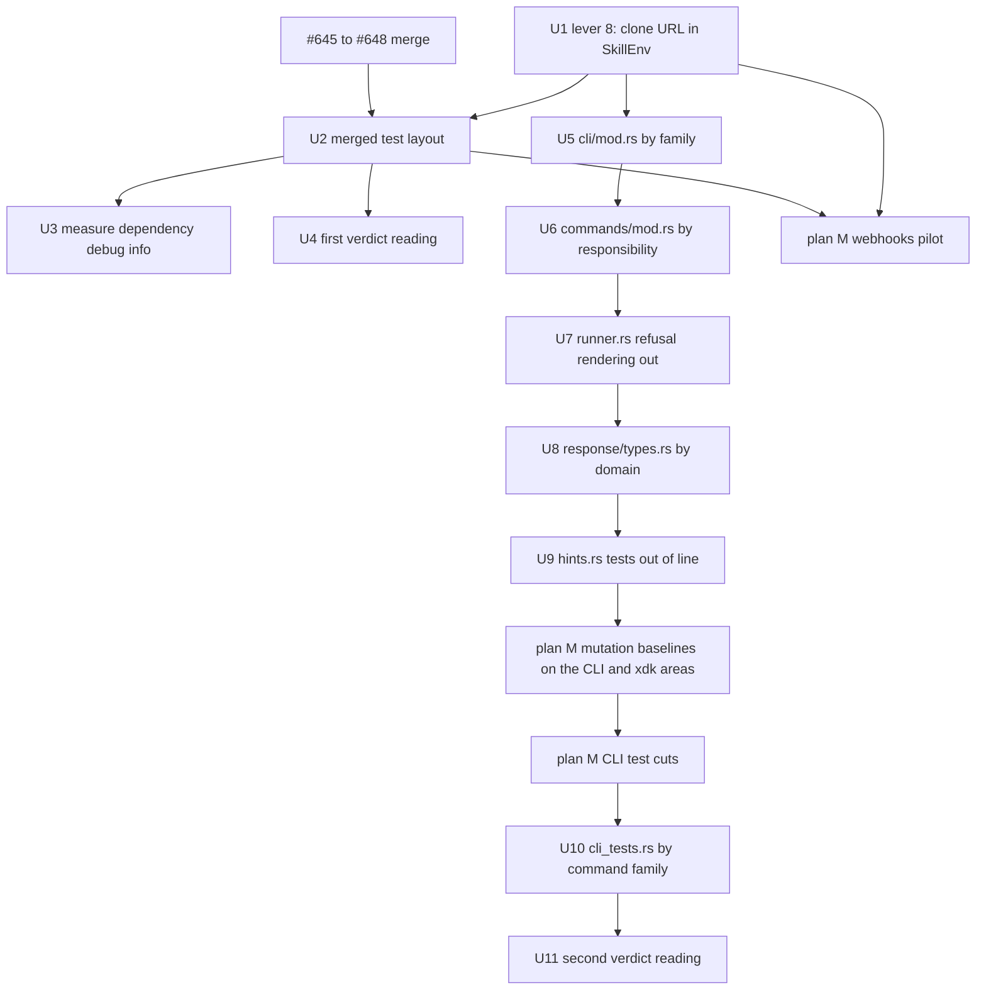

# File Splits and the Merged Test Layout - Plan

**Target repo:** brettdavies/xurl-rs. **Base:** `dev`. Facts are checked against `dev` at `492e187` unless a line names
another commit or run. Unit IDs (U1 to U11) are this plan's own. The CI speed plan's units are written CI-U5 and CI-U6,
and the wall-clock spike's levers are "lever 1" to "lever 9".

## Goal Capsule

- **Objective:** xurl-rs's five largest mixed-purpose files become files that each hold one job. Each crate's
  integration tests build as one binary. The suite reaches no network host when it installs the skill bundle. The PR
  verdict time is read twice against the CI speed plan's 2-minute goal (KD5 there).
- **Means:** pure moves, one PR per file, held byte-identical by the 349 golden fixtures (KTD1). The merged test layout
  is the CI speed plan's CI-U6, taken over with its guards and its measured gain (KTD8 to KTD10). A `SkillEnv` field
  gives the in-process test harness its own clone URL (KTD7). One measurement of dependency debug info runs on the
  merged layout (KTD11). Two readings of a CI run close the measurement (KTD12).
- **Authority:** R-IDs win on behavior and KTDs on mechanism. A unit overrides neither. KD1 to KD6 are Brett's and are
  not reopened here. KTDs are this plan's calls, owned by xurl-plan-prime, the coordinating session.
- **Execution profile:** one session runs every unit inline as stacked PRs to `dev`, on `feat/refactor-NN-<slug>`
  branches. It uses no subagents, workers, or worktrees. Long jobs run in the background under `timeout -k`, and no
  sleep exceeds 10 s. Each unit is one PR unless the unit says otherwise. U4 and U11 are readings with no PR, recorded
  in § Measurements and committed straight to `dev`.
- **Stop conditions:**
  - A split moves a golden fixture, a committed schema under `schema/`, or a completion file under `completions/`.
  - `cargo semver-checks` reports anything for U8.
  - A split needs an edit inside an item's body beyond what KTD1 allows.
  - U2's before and after test lists differ by anything but the module prefix.
  - Any unit would add public surface: an environment variable, a flag, a reason, an envelope key, or a public library
    item. R10 holds the list at none.
  - U2's move commit is ready while one of #645, #646, #647, or #648 is still open.
  - U10 is ready to start before plan M's cut PR for the CLI (its M9) merges.
  - A fix widens a unit past the scope list in Scope Boundaries.

  On any of these, stop and report to xurl-plan-prime.
- **Who ships:** the executing session opens each PR as a draft, runs its reviews (KTD13), and marks it ready. A slot
  never merges. xurl-rs-prime merges the reviewed green stack to `dev`.

---

## Product Contract

### Summary

Four source files split along the jobs they hold, and one file's inline tests move out of line. Each is a pure move
whose output, help text, schemas, completions, and public library API stay as they are. Each crate's integration tests
then build as two binaries, `tests/all/` and `tests/isolated/`, in place of 141. Two new guards catch the two ways that
layout fails silently. A `SkillEnv` field lets the walks install the skill bundle without cloning github.com. One build
setting is measured once, kept on a gain or dropped with its numbers. Last, after plan M cuts the CLI tests,
`cli_tests.rs` splits by command family. Nobody who runs `xr` or embeds `xdk-rs` observes a change. A contributor sees
smaller files, a faster rebuild after an edit, and new commands to run one test file.

### Problem Frame

**Mixed files that every change edits.** Measured at `492e187`:

| File                                      | Lines | Production code           | Commits | What it holds                                                                                                      |
| ----------------------------------------- | ----- | ------------------------- | ------- | ------------------------------------------------------------------------------------------------------------------ |
| `crates/xurl-cli/src/cli/mod.rs`          | 4,284 | ~2,900 + 1,137 help lines | 128     | 70 `*_HELP` consts (lines 67-1009), `Cli` (1010), `Commands` (1308-2105), about 25 family enums (2106-4284)        |
| `crates/xurl-cli/src/cli/commands/mod.rs` | 1,399 | 1,075                     | 95      | routing, input validation, send helpers, list helpers, and account resolution                                      |
| `crates/xurl-cli/src/cli/runner.rs`       | 1,214 | 946                       | 73      | the `run_*` entrypoint layers, and the rendering of argv refusals                                                  |
| `crates/xurl-cli/src/cli/hints.rs`        | 2,430 | 1,065 + 900 test lines    | 41      | about 30 hint builders, then 41 inline tests (lines 1437-2430)                                                     |
| `crates/xdk/src/api/response/types.rs`    | 2,739 | 1,225 + 639 test lines    | 51      | every typed response, then the inline tests (lines 2026-2739)                                                      |
| `crates/xurl-cli/src/cli/family_help.rs`  | 1,554 | —                         | —       | the shared `Verb`/`Example`/`Family` shape (lines 1-103), then one `pub mod` of declarations per family (104-1554) |

`cli/mod.rs`, `commands/mod.rs`, and `runner.rs` are the most-changed CLI files, so every new command and every parallel
slot edits the same file. `cli/mod.rs` and `family_help.rs` split one family across two files that hold every family.

**141 integration-test binaries.** `crates/xurl-cli/tests/` holds 90 test files and `crates/xdk/tests/` 51, and each
links on its own. The spike measured one binary per crate (probe PR #636, run 45581846309, and an ABBA series on the
16-CPU Linux server):

| Measure                                                          | Today                   | One binary per crate    |
| ---------------------------------------------------------------- | ----------------------- | ----------------------- |
| CI workspace-only test build, warm dependency cache, one runner  | 89.5, 91.3 s            | 38.9, 37.3 s (−58%)     |
| Local cold `cargo test --workspace --no-run`, wall / CPU         | 85.9, 74.1 / 826, 815 s | 49.7, 48.4 / 296, 294 s |
| Local rebuild after touching `crates/xdk/src/lib.rs`, wall / CPU | 66.7, 56.5 / 209, 203 s | 5.9, 6.0 / 28, 28 s     |
| Local prebuilt full suite, CI build settings, wall               | 106.7, 106.5 s          | 107.8, 107.5 s (+1 s)   |
| Target directory, CI build settings                              | 9.1 GB                  | 1.7 GB                  |

The local merged-layout figures were taken with #641's dependency opt-level list on, which `dev` carries. The same probe
found 21 tests that fail in the merged layout because they read test files by path or re-run their own binary by test
name (KTD9).

**Live clones in the suite.** `rerun_walk`'s first and fourth cases run `xr skill install` for real. Its hardened
`git clone` of `https://github.com/brettdavies/xurl-rs-skill.git`, the URL `skill.json` names, takes about 10 s on the
Linux server because IPv6 times out first. With levers 1 to 3 in, those two cases (about 28.5 s each) are the local
suite's tail. A suite that clones github.com fails offline and moves with GitHub's availability. Under cargo-mutants the
suite runs about 4,350 times, so these two cases alone would make about 8,700 live clones.

**The 2-minute goal is unread.** The latest green PR run, 45944823191 on #645, took 297 s from start to finish, and its
slowest job, `ci / Tests (1/4)`, took 251 s. The next slowest were `ci / Windows check` (102 s) and
`Windows program target` (90 s). The spike projects about 140 s for the slowest `Tests` job once the merged layout
lands.

### Requirements

**Pure moves**

- R1. Each split and the `hints.rs` test move change no behavior: the 349 golden fixtures (197 help pages and 85 dry
  runs among them), the committed schemas under `schema/`, and the completions under `completions/` stay byte-identical,
  and the suite passes with the same test count.
- R2. The `response/types.rs` split keeps every public path of `xdk-rs` (`xdk::api::Post`, `xdk::api::response::Post`,
  `xdk::api::response::types::Post`, and the rest), and `cargo semver-checks` reports nothing against the latest
  `xdk-rs-v*` tag.
- R3. After the `cli/mod.rs` split, a new command family is one new file under `crates/xurl-cli/src/cli/families/` plus
  one `Commands` variant, beside the recipe's other surfaces.
- R4. `run_subcommand` stays in `crates/xurl-cli/src/cli/commands/mod.rs`, where `dispatch_guard.rs` reads it.
- R5. Every path that a document, a guard's message, a script, or a workflow names for a moved item names its new home
  in the same PR.

**The test harness**

- R6. No test clones github.com. `xr skill install` and `xr skill update` outside the tests clone the URL `skill.json`
  names, under the same hardening.
- R7. Each crate's integration tests build as one binary, plus one for the tests that change process state. The same
  tests run under the same names with a module prefix, and the before and after lists match one for one.
- R8. A test file that no `mod` line declares, a `.rs` file directly under a member's `tests/`, an environment-mutating
  test outside `tests/isolated/`, and a command naming a test target or module that does not exist each fail a guard
  with a stable code.

**Measurement**

- R9. Dependency debug info off is measured once on the merged layout, cold and warm, and kept only on a gain under both
  of KTD11's rules. The PR verdict time is read after U2 and again after U10, against the 2-minute goal. Each number is
  recorded with its run IDs whether the change is kept or not.

**Surface**

- R10. No unit adds an environment variable, a flag, a reason, an action, an envelope key, an exit code, or a public
  library item.

### Key Decisions

- KD1. **R's scope is the list in Scope Boundaries.** (session-settled: user-approved, Brett, 2026-11-26, relayed by
  xurl-plan-prime.) Governs every unit.
- KD2. **`shortcuts.rs` stays as it is.** (session-settled: user-directed, Brett.) It holds 257 near-uniform wrappers,
  AGENTS.md makes it "the list" of shortcuts, and 12 test references name its path.
- KD3. **Source splits land before plan M's mutation baseline on those files.** (session-settled: user-approved.) A
  mutation baseline is keyed by `src` file and line, so a split after it would invalidate it.
- KD4. **Tests are cut before their files are reorganized.** (session-settled: user-approved.) So nothing moves only to
  be deleted: U10 follows plan M's CLI cuts.
- KD5. **The merged layout waits for #645 to #648 to merge.** (session-settled: user-approved for #645 to #647, extended
  to #648 by xurl-plan-prime on 2026-11-27.) #645 edits `crates/xdk/tests/saved_identity_tests.rs`; #647 edits
  `crates/xdk/tests/webhook_forward_tests.rs`, `webhook_receiver_tests.rs`, and
  `crates/xurl-cli/tests/webhooks_tests.rs`; #648 edits `crates/xdk/tests/media_upload_tests.rs`. U2 moves each of
  them. #646 edits only `crates/xdk/src/store/migration.rs` and sits below #647 in the stack.
- KD6. **One session runs the plan as stacked PRs, with no subagents.** (session-settled: user-directed, Brett's
  standing rule in xurl-rs.)

### Success Criteria

- Each split PR merges with no golden fixture, schema, or completion moved, and with the suite's test count unchanged.
- `cargo semver-checks` is clean on U8's head.
- `crates/xurl-cli/src/cli/mod.rs`, `commands/mod.rs`, and `runner.rs` each hold one job, and no file a split creates
  holds more than one.
- `cargo nextest list --workspace` names two integration-test binaries per member, plus the consumer check's, where it
  named 141.
- A walk over every command reaches no host but loopback: no `git` process the suite starts names `github.com`.
- U3's numbers and both verdict readings are in § Measurements with their run IDs.

### Scope Boundaries

In R, all approved by Brett (KD1):

- split `crates/xurl-cli/src/cli/mod.rs` by family (U5);
- split `crates/xurl-cli/src/cli/commands/mod.rs` by responsibility, with `run_subcommand` kept there (U6);
- move the rendering of argv refusals out of `crates/xurl-cli/src/cli/runner.rs` (U7);
- split `crates/xdk/src/api/response/types.rs` by domain, with `pub use` keeping every public path (U8);
- move `hints.rs`'s inline tests to `crates/xurl-cli/src/cli/hints/tests.rs` (U9);
- CI-U6: the merged test layout, its two guards, the 21 guard fixes, and the doc paths (U2);
- lever 8: a clone-URL seam in `SkillEnv` (U1);
- one CI-U5 measurement after the merged layout (U3);
- the PR verdict time after the merged layout and after the test cuts (U4, U11);
- split `crates/xurl-cli/tests/cli_tests.rs` by command family into the merged layout, after plan M's CLI cuts (U10).

Not in R:

- `shortcuts.rs`, which stays as it is (KD2).
- The test-comment sweep the order of events puts in the `cli_tests.rs` PR. The scope list does not name it, and it
  would break U10's pure move.
- The comment sweep over `src`, the order of events' Phase 4.
- Re-running `maintain-formal-verification-skill`, which is plan F's.
- Mutation testing, the test cuts, and the gap tests (plan M), and formal verification (plan F).
- Moving the inline tests out of `credential_step.rs` (423 test lines) and `output/mod.rs` (225).
- Splitting `oauth2_flow_tests.rs`, `api_tests.rs`, `golden_tests.rs`, or `store_tests.rs`.
- A CI `--in-diff` mutation job, a doc-comment accuracy audit, and the media-upload chart.
- The CI speed plan's dropped and tracked items, which its Status section records.
- Grouping the leaf commands' `*_HELP` consts (`POST_HELP` to `EXAMPLES_HELP`) into files by dispatch group. They belong
  to `Commands` variants, not to a family (KTD2).

### Sources

- The order of events for the cleanup (Brett, 2026-11-26): Phases 1, 2, and 6, and "The rules that fix the order".
- The CI speed plan's status read against `dev` at `492e187` (2026-11-26): the unit table and the take, track, and drop
  lists.
- The pstack skills audit (2026-11-26), § "The large files: split or leave?": the measured table, the split constraints,
  the test-files paragraph, the order, and the `hints.rs` move.
- The tests wall-clock spike report (2026-11-25), § 4 (the merged layout's measurements and guard inventory), § 8 (lever
  8), and its decisions 2 and 3.
- Plan M's dependencies on this plan, in M2, M7, M8, and M9:
  `docs/plans/2026-11-27-0033-test-mutation-testing-and-test-cuts-plan.md`.
- `docs/plans/2026-10-27-0058-perf-ci-scoping-and-speed-plan.md`: CI-U5, CI-U6, KTD8, KTD14, Sequencing, and
  "Corrections under existing approvals" (guard scope, the one allowlist owner, and the relative paths).
- `docs/solutions/performance-issues/one-integration-test-binary-per-crate-cuts-the-test-build-by-half-and-the-edit-loop-rebuild-by-nine-tenths.md`:
  the transform, the guard inventory, and the probe's measuring step.
- `docs/solutions/best-practices/rust-module-splitting-srp-not-loc-20260327.md`: module boundaries follow visibility and
  responsibility, not line count.
- `docs/solutions/best-practices/a-source-walk-guard-must-tell-a-test-module-declaration-from-an-inline-test-module.md`:
  why an out-of-line `#[cfg(test)] mod x;` goes last.
- `docs/solutions/developer-experience/anchor-scripted-source-edits-on-item-boundaries-and-read-the-diff.md`: a scripted
  edit that moved a clap doc comment onto the wrong variant, which compiled and moved golden fixtures.

---

## Planning Contract

### Key Technical Decisions

- KTD1. **A pure move moves items verbatim.** Each item keeps its attributes, doc comments, and body. The edits a move
  PR may make are these:
  - `mod`, `use`, and `pub use` lines;
  - a visibility qualifier widened only as far as the new module boundary needs (`pub(super)`, `pub(crate)`);
  - a path prefix inside an attribute or an intra-doc link that the new module needs, such as
    `family_help::lists::FAMILY` becoming `FAMILY` inside the family's own file (KTD2);
  - a module doc comment (`//!`) on each new file, saying what it holds;
  - every path that a test, a guard's message, a document, or a script names for a moved item (R5).

  Nothing else changes. The checks:
  - `cargo nextest run --workspace --no-fail-fast`, with the golden suite run without `XURL_GOLDEN_BLESS`;
  - `schema_tests`, which fails for a committed schema that drifted;
  - `scripts/generate-completions.sh --check`;
  - `cargo semver-checks` for `xdk-rs` (U8 only).

  Each move is made by cutting whole items at item boundaries, not by a scripted line edit, and the diff is read before
  the push: an edit anchored on a line moved a clap doc comment onto the wrong variant and still compiled (Sources).
- KTD2. **`cli/mod.rs` splits into one file per family under `crates/xurl-cli/src/cli/families/`.**
  - A family's file holds its subcommand enums and their argument types and parsers. It also holds the `*_HELP` consts
    those enums and the family's `Commands` variant read, and the family's declaration modules from `family_help.rs`.
  - The file is its root family's declaration module: the body of `family_help::lists` moves to the top level of
    `families/lists.rs`, and its `///` doc line becomes the file's `//!` line. A second family in the same file keeps
    its module and its name, so `list_members` stays `pub mod list_members` inside `families/lists.rs`. Nesting `lists`
    inside `lists.rs` would fail clippy's `module_inception` lint, which `cargo clippy -- -D warnings` turns into an
    error and which the repo does not allow (it has no `clippy.toml` and no lint table).
  - The clap attributes name the new paths: `family_help::lists::FAMILY` becomes `FAMILY` inside `lists.rs`,
    `family_help::list_members::ADD` becomes `list_members::ADD` there, and `Commands::Lists`'s `family_help::lists::`
    becomes `families::lists::` in `cli/mod.rs`. Each is a path substitution, under KTD1. A path that resolves to the
    wrong family's verb still compiles, so the 197 golden help pages are the check.
  - `family_help.rs` keeps the shared shape: `Verb`, `Example`, `Family`, the `Section` alias, and `page_of` (its lines
    1-103). Each family file imports them from `crate::cli::family_help`.
  - `cli/mod.rs` keeps `ColorChoice`, `ROOT_HELP`, `GLOBAL_OPTIONS`, `Cli`, `Commands`, and `CommonFlags`. It also keeps
    the leaf commands' `*_HELP` consts (`POST_HELP` through `EXAMPLES_HELP`), which `Commands` variants read and no
    family owns. It declares `pub mod families;` beside `pub mod family_help;` and re-exports every moved enum and
    argument type with `pub use`. So `crate::cli::ListsCommands` and the rest keep resolving, and every
    `use crate::cli::{...}` line stays as it is: 30 files under `commands/` import from there (`commands/lists.rs:12`,
    `broadcasts.rs:14`, `auth/apps.rs:16`, and the rest), and so does `runner.rs:632`.
  - A help const that moves and that `Commands` still reads (`AUTH_HELP`, `MEDIA_HELP`, `USAGE_HELP`) widens to
    `pub(in crate::cli)`, the narrowest qualifier that reaches `cli/mod.rs` from `families/<family>.rs`.
  - `secret_source` (line 3844) is called by `AuthCommands` and `AppCommands` (lines 3903-3988) and by nothing else, so
    it moves to `families/auth.rs`. `CommonFlags` stays, since most families flatten it.
  - `cli/mod.rs`'s imports that only moved items read move with them: `KNOWN_HOSTS`, `VideoCategory`,
    `WEBHOOK_URL_MAX_CHARS`, and `CHECKPOINT_SHAPE` (lines 39 and 41-43).

| File under `cli/families/` | Enums and types from `cli/mod.rs`                                                                                                      | Help consts                                                                                  | `family_help.rs` modules                                                                                         |
| -------------------------- | -------------------------------------------------------------------------------------------------------------------------------------- | -------------------------------------------------------------------------------------------- | ---------------------------------------------------------------------------------------------------------------- |
| `auth.rs`                  | `AuthCommands`, `AppCommands`, `RedirectUriCommands`, `secret_source`                                                                  | `AUTH_HELP`, `AUTH_OAUTH2_HELP` to `AUTH_DEFAULT_HELP`, `APPS_*_HELP`, `REDIRECT_URI_*_HELP` | none                                                                                                             |
| `media.rs`                 | `MediaCommands`, `SubtitlesCommands`, `ProcessingWait`, `parse_processing_wait`, `video_category_parser`                               | `MEDIA_HELP`, `MEDIA_UPLOAD_HELP` to `MEDIA_ALT_TEXT_HELP`                                   | `media_subtitles`                                                                                                |
| `usage.rs`                 | `UsageCommands`                                                                                                                        | `USAGE_HELP`, `USAGE_CREDITS_HELP`                                                           | none                                                                                                             |
| `skill.rs`                 | `SkillCmd`, `skill_host_parser`                                                                                                        | none                                                                                         | none                                                                                                             |
| `bookmark_folders.rs`      | `BookmarkFoldersCommands`                                                                                                              | none                                                                                         | `bookmark_folders`                                                                                               |
| `lists.rs`                 | `ListsCommands`, `ListMembersCommands`                                                                                                 | none                                                                                         | `lists`, `list_members`                                                                                          |
| `conversations.rs`         | `ConversationsCommands`, `DmEventsCommands`                                                                                            | none                                                                                         | `conversations`, `dm_events`                                                                                     |
| `communities.rs`           | `CommunitiesCommands`                                                                                                                  | none                                                                                         | `communities`                                                                                                    |
| `spaces.rs`                | `SpacesCommands`                                                                                                                       | none                                                                                         | `spaces`                                                                                                         |
| `stream.rs`                | `StreamCommands`, `StreamRulesCommands`                                                                                                | none                                                                                         | `stream_rules`                                                                                                   |
| `news.rs`                  | `NewsCommands`                                                                                                                         | none                                                                                         | `news`                                                                                                           |
| `drafts.rs`                | `DraftsCommands`                                                                                                                       | none                                                                                         | `drafts`                                                                                                         |
| `articles.rs`              | `ArticlesCommands`                                                                                                                     | none                                                                                         | `articles`                                                                                                       |
| `notes.rs`                 | `NotesCommands`                                                                                                                        | none                                                                                         | `notes`                                                                                                          |
| `trends.rs`                | `TrendsCommands`                                                                                                                       | none                                                                                         | `trends`                                                                                                         |
| `broadcasts.rs`            | `BroadcastsCommands`, `ScheduledBroadcastsCommands`, `BroadcastChatCommands`, `SourcesCommands`, `ModeratorsCommands`, `MutesCommands` | none                                                                                         | `broadcasts_own`, `broadcasts_scheduled`, `broadcast_chat`, `broadcasts`, `broadcast_mutes`, `broadcast_sources` |
| `calls.rs`                 | `CallsCommands`, `ScheduledCallsCommands`, `CallDetailsArgs`, `OccurrenceArgs`, `CallScope`, `CallAnswer`                              | none                                                                                         | `calls`, `scheduled_calls`                                                                                       |
| `webhooks.rs`              | `WebhooksCommands`, `SigningSecret`, `WebhookSubscriptionsCommands`, `WebhookStreamLinksCommands`                                      | none                                                                                         | `webhooks`, `webhook_subscriptions`, `webhook_stream_links`                                                      |

The table is the plan's reading of lines 2095-4284 and of `family_help.rs`'s 25 `pub mod` blocks. The first module in
each row's last column whose name matches the file becomes the file's top level, and the rest nest. U5's first step
checks the table against the tree at its base: every enum, type, const, and module lands in exactly one row, or in
`cli/mod.rs`. `Commands` stays whole: R3 gives each family one `Commands` variant, and `dispatch_guard.rs:20-26` reads
`Commands::<Variant>` names in `commands/*.rs`, wherever the family types live.

- KTD3. **`commands/mod.rs` splits by responsibility into four files beside it, and keeps routing.**

| File                   | Holds                                                                                                                                                                                                                                                                                                                                                                                         |
| ---------------------- | --------------------------------------------------------------------------------------------------------------------------------------------------------------------------------------------------------------------------------------------------------------------------------------------------------------------------------------------------------------------------------------------- |
| `commands/mod.rs`      | the `mod` lines, `USER_AGENT`, `make_client`, `run`, `GlobalFlags`, `Run`, `run_raw_mode`, `run_subcommand` (R4), and `#[cfg(test)] mod url_authority_tests;` as the last item                                                                                                                                                                                                                |
| `commands/checks.rs`   | input validation: `Invalid` and its impls, `Checked`, `checked`, `checked_url`, `without_userinfo`, `checked_each`, `From<Invalid> for Error`, `no_checks`, `valid_post_id`, `valid_post`, `valid_window`, `validate_account`                                                                                                                                                                 |
| `commands/sending.rs`  | one request and its dry run and confirmation: `is_interactive`, `confirm_destructive`, `destructive_dry_run_context`, `gate_destructive`, `Confirm` and `Confirm::gate`, `Credential`, `DryRun` and its impl, `credential_value`, `without_unset`, `dry_run_or_validate`, `send_or_report`, `send_validated`, `send_confirmed`, `print_typed`, `with_flags`                                   |
| `commands/paging.rs`   | paged lists: `DEFAULT_PAGE_SIZE`, `effective_limit`, `list_for_user`, `list_mine`, `list_for_post`, `list_paged`, `list_owned_by`                                                                                                                                                                                                                                                             |
| `commands/accounts.rs` | the caller's id and other accounts: `UNRESOLVED_ID`, `my_id_call`, `resolve_my_user_id`, `act_from_me_on_user`, `act_on_user`, `act_on_user_with`, `act_from_me_on_post`, `act_from_me`, `handles_lookup_call`, `resolve_account_ids`, `account_lookup_call`, `resolve_account_id`, `stand_in_ids`, `account_credentials`, `send_to_accounts`, `send_confirmed_to_account`, `send_to_account` |

Notes on KTD3:

- `commands/mod.rs` imports each moved helper back with a private `use`. A private `use` binding is visible to the
  module's descendants, so the group modules' `use super::{...}` lines (`usage.rs:5`, `communities.rs:5`, `news.rs:5`,
  and the rest) stay as they are, and so do `commands/auth/mod.rs:6` and `url_authority_tests.rs:10`
  (`use super::without_userinfo;`).
- The name `sending.rs` keeps the file apart from `sent.rs`, which stays and holds the two wrappers that keep the
  credential beside a 401.
- Each moved helper becomes `pub(super)`, which in a file beside `commands/mod.rs` reaches `commands` and every module
  under it. `destructive_dry_run_context` and `gate_destructive` are `pub(super)` today and stay so: their only callers
  are `commands/auth/mod.rs:296`, `auth/session.rs:239`, and `auth/apps.rs:202`. `make_client` and `run` stay in
  `commands/mod.rs` with their `pub(crate)`.
- Placement follows each helper's callers (counted with `rg -n "\b<name>\b"` over `commands/`). `with_flags` and
  `print_typed` are called by `sending.rs`, `paging.rs`, `accounts.rs`, and six group modules, and they shape one call,
  so they sit with sending. `validate_account` is a `Checked` validator called by `accounts.rs`, `dms.rs`, and
  `webhooks.rs`, so it sits with the checks. `UNRESOLVED_ID`, the stand-in for the caller's id in a dry run, is read by
  `list_owned_by` (line 1045) and by the account helpers (lines 1087-1268), so it sits with the accounts as
  `pub(super)`.
- Each new file stays under 400 lines: routing about 360, checks about 150, sending about 330, paging about 160,
  accounts about 370.

- KTD4. **The rendering of argv refusals moves to `crates/xurl-cli/src/cli/argv_refusal.rs`.**
  - What moves: `is_display`, `render_parse_error`, `provisional_output`, `render_refused`, `render_invalid_args`,
    `unexpected_argument`, `help_command_page`, `render_misplaced_flags`, `render_schema_refusal`, `Suggestion` and its
    impl, `render_unknown_command`, `CLAP_HELP_FOOTER` (line 59, read only by `render_invalid_args` at 834), and the
    inline `mod tests` at line 1188, which tests `render_schema_refusal`. The test module stays inline and last in the
    new file.
  - What stays in `runner.rs`: `run_argv`, `run`, `run_with_store_path`, `run_with_overrides`, `RunHooks`,
    `run_with_hooks`, `run_with_env`, `Environment`, `run_inner`, `Recovery`, `media_credential`, `app_from_env`,
    `no_browser_typed`, `given_as_argument`, `matched_path`, `NO_COMMAND_MESSAGE` (line 56, which `run_inner` reads at
    417), and the `assert_send_sync!` line. `run_inner` calls the renderers at lines 287-438, and they call nothing in
    `run_inner`'s layer.
  - `crates/xdk/src/error.rs:32` names `runner.rs` as the home of `render_unknown_command`, and U7 points it at
    `argv_refusal.rs`.
  - `cli/mod.rs:19` (`pub use runner::{run, run_argv, run_with_store_path};`) and the 14 test files that call
    `xurl::cli::runner::run_with_*` keep their paths.
- KTD5. **`response/types.rs` becomes the directory module `response/types/`, with private domain submodules.**
  - `types/mod.rs` declares each domain as a private `mod` and re-exports it with `pub use <domain>::*;`. Rustdoc and
    `cargo semver-checks` then see every item at `xdk::api::response::types::<Item>`, as today. The two re-export lists
    in `response/mod.rs:9-15` and `api/mod.rs:36-53` stay as they are.
  - `types/mod.rs` also keeps what every domain shares: `ApiResponse`, `Includes`, `ResponseMeta`, `ApiError`,
    `DeletedResult` (returned by 11 shortcuts across eight domains, from `delete_post` to `remove_media_subtitles`),
    `deserialize_response`, and `is_page_with_no_results`.
  - The domain files, from the file's own section markers and the shortcuts that return each type: `posts.rs` (`Post`,
    `PostPublicMetrics`, `ReferencedPost`, `PostCount`, `PostAnalytics`, `AnalyticsBucket`, `AnalyticsMetrics`,
    `LikedResult`, `HiddenResult`, `RepostedResult`, `BookmarkedResult`), `drafts.rs` (the five `PostDraft*` types),
    `users.rs` (`User`, `UserPublicMetrics`, `FollowingResult`, `BlockingResult`, `MutingResult`), `dms.rs` (`DmEvent`,
    `DmSentResult`, `DmBlockResult`), `trends.rs`, `news.rs`, `communities.rs`, `lists.rs` (`List`, `ListUpdatedResult`,
    `ListMemberResult`, `PinnedResult`), `broadcasts.rs` (`Broadcast`, `BroadcastUpdated`, `BroadcastEnded`,
    `ScheduledBroadcast`, `BroadcastChatMessage`, `ChatSentResult`, `ChatMutedResult`, `ChatMute`,
    `ChatModeratorsResult`, the `StreamSource*` types, and `IngestRegion`), `notes.rs` (`Note`, `NoteInfo`,
    `NoteCreated`, `NoteEvaluation`), `articles.rs`, `media.rs` (the seven `Media*` types), `stream_rules.rs`,
    `spaces.rs`, `bookmark_folders.rs`, `calls.rs`, `webhooks.rs`, and `usage.rs`. A type that more than one domain
    returns stays in `types/mod.rs`. U8's first step checks the table against `shortcuts.rs`.
  - The inline tests (lines 2026-2739) move to `types/tests.rs`, declared as the last item of `types/mod.rs`. Their
    `use super::*;` still reaches every type through the glob re-exports. Splitting the tests by domain would edit them,
    so they stay one module.
  - `crates/xdk/tests/spec_validation.rs:40` reads `src/api/response/types.rs` by path (`TYPES_PATH`) in two tests
    (lines 141 and 186), and its `Fix:` line names it. Both read every `.rs` file under `src/api/response/types/`
    instead, through `common::rust_files`, and the message names the directory. The same PR updates
    `spec_types_validation.rs:472`'s message, AGENTS.md's "Typed response" bullet and the shortcut paragraph (lines 301
    and 321), `scripts/open-spec-refresh-pr.sh:145` and `:150` (the spec-refresh runbook), the header of
    `scripts/update-types.sh:14`, and the `//!` lines of `spec_types_validation.rs:6` and
    `crates/xurl-cli/src/cli/commands/validate.rs:6`.
  - Only three intra-doc links sit in the file (`PostAnalytics`, `NewsStory`, `MediaAnalytics`), and each points inside
    its own domain. `cargo doc` with `-D warnings` in pre-push catches any that breaks.
  - `cargo semver-checks` runs only as a PR check (`Public API semver`, `ci.yml:298`), and the pre-push hook has no
    counterpart (AGENTS.md § "Testing"), so U8 runs it locally before the push:
    `cargo semver-checks -p xdk-rs --baseline-rev xdk-rs-v0.9.1`, or whatever `xdk-rs-v*` tag is latest at U8's base.
- KTD6. **`hints.rs`'s inline tests move to `crates/xurl-cli/src/cli/hints/tests.rs`.** The body of
  `#[cfg(test)] mod tests { use super::*; ... }` (lines 1437-2430) moves with `use super::*;` kept and one indent level
  dropped, and `hints.rs` ends with `#[cfg(test)]` and `mod tests;`.
  - The module path (`cli::hints::tests`), access to private items, the unit-test binary, every test name, and the build
    cost stay the same.
  - The declaration stays the last item. `store_isolation_guard.rs:139-158` maps it to `hints/tests.rs` and scans that
    file in full, and it scans `hints.rs` from its first `#[cfg(test)]` marker.
  - The source guards that cut a file at its inline test module (`up_to_inline_tests` in
    `crates/xdk/tests/support/production_source.rs`) read the moved file as production code once it is out of line:
    `test_help_advertises_every_env_var_the_source_reads` (`agentic_tests.rs:408`), `parse_path_guard`,
    `port_race_guard`, and `status_document_guard`. So do `scripts/lint-stdio.sh` (the `Output discipline` job) and
    `http_client_guard`. The test lines hold no `env = "..."`, `env::var(`, print macro, argv parse, port bind,
    `block_on`, `runtime::Builder`, `status: "..."` field, or `"status"` key (read with `rg` at `492e187`), so none of
    them changes its verdict.
  - Precedents: `cli/mod.rs:32` (`parse_tests`), `commands/mod.rs:1398` (`url_authority_tests`), and
    `crates/xdk/src/store/mod.rs:972` (`rehearsal_tests`).
- KTD7. **The clone URL comes from `SkillEnv`, and only the in-process harness sets it.**
  - `SkillEnv` (`crates/xurl-cli/src/cli/skill_install/destination.rs:19`) gains `clone_url: Option<String>`.
    `install_envelope` (`skill_install/mod.rs:333`) and `update_envelope` (`skill_install/update.rs:42`) resolve the URL
    once, `skill_env.clone_url.as_deref().unwrap_or(url)`. They use it both for the clone (`mod.rs:415`,
    `update.rs:120`) and for `command_preview` (`format_clone_command`), so the dry run names what the real run clones.
  - `skill_from_process` (`crates/xurl-cli/src/cli/env.rs:98`) sets `clone_url: None` and reads no variable, and the
    runner's `SkillEnv { home, ..SkillEnv::default() }` (`runner.rs:205`) gets `None` from `Default`. So no user can set
    the field, and it adds no surface (R10). xurl-plan-prime confirmed on 2026-11-27 that a field set only in-process
    needs no decision from Brett.
  - The walks run `xr` in-process, so the field reaches them. `rerun_walk.rs:26` imports `run_xr` from `common::invoke`,
    and `visit` calls it at `rerun_walk.rs:126`. `common/invoke.rs:302` builds the `SkillEnv`, and
    `common/invoke.rs:321` passes it to `xurl::cli::runner::run_with_env`, which hands it to `commands/skill.rs:23`
    (`run_install_multi`) and `:26` (`run_update_multi`). Neither file spawns the binary. `dry_run_guard`,
    `credential_step_walk`, `help_claims_guard`, `validation_value_guard`, `post_id_guard`, and
    `confirmation_context_guard` call the same `run_xr`, so the one setting covers each of them.
  - `run_xr` sets `clone_url` to a `file://` URL under the run's own temporary directory, naming nothing that exists.
    The hardening refuses it before git opens a connection or reads a repository. `GIT_HARDEN_FLAGS` sets
    `protocol.allow=never` and allows only `protocol.https.allow=always` (`skill_install/git.rs:12-23`), and
    `GIT_HARDEN_ENV_SET` points `GIT_CONFIG_GLOBAL` and `GIT_CONFIG_SYSTEM` at `/dev/null` (`git.rs:42-44`), so no other
    config allows `file`. The run answers `git-clone-failed`. Its step is `NextStep::retry(None)`
    (`skill_install/mod.rs:197`), which carries no command, so `rerun_walk` has nothing new to check, and U1's test
    checks that nothing lands in the skill home. A URL that names no repository still fails if the hardening ever allows
    `file`.
  - Considered and not chosen:
    - A local bare repository that the clone succeeds against. The hardening would have to allow `file` on the seam's
      path, which changes the security-relevant flags for a test.
    - A `git` shim first on `PATH`, as `skill_update_tests.rs` uses for spawned runs. An in-process run cannot change
      `PATH` without mutating the process environment, which `env_mutation_guard` refuses.
    - An `https://127.0.0.1:<closed port>` URL. It also stays on the machine, but it opens a socket and depends on the
      port staying closed.
- KTD8. **The merged layout: one binary per crate, plus one for tests that change process state** (CI plan KTD8, with
  its corrections).
  - Each crate's test files move with `git mv` into `tests/all/`, declared as modules of `tests/all/main.rs`, with
    `autotests` left on, so the layout stays Cargo's default discovery (`tests/<name>/main.rs`, as Cargo's own
    `tests/testsuite/main.rs`). Each file's `mod common;` becomes `use crate::common;`. `main.rs` declares
    `#[path = "../common/mod.rs"] mod common;`, so `common` serves both binaries.
  - `tests/isolated/` is the second binary. In `xdk-rs` it holds the tests on `env_mutation_guard`'s mutation allowlist
    (`auth_tests` ×2, `api_tests` ×1, `config_tests` ×3; the three in `src/config/mod.rs` are unit tests and stay). In
    `xurl-rs` it holds `parse_stack_tests`, whose failure aborts the process. A file that mixes the two kinds splits,
    and each test keeps its name. Under a plain `cargo test`, no test in `isolated` can reach or end the rest of the
    crate's run. Tests on the read allowlist change nothing and stay in `all`.
  - `mock_endpoint_coverage` becomes `#[cfg(feature = "testing")] mod mock_endpoint_coverage;` in `xdk`'s
    `tests/all/main.rs`, and its `[[test]]` entry in `crates/xdk/Cargo.toml:107-109` goes. The consumer check's single
    test file stays as it is.
  - `env_mutation_guard`'s allowlist moves into `common`, so the guard and `test_layout_guard` read one list (CI plan,
    "One allowlist owner").
  - The relative paths gain one `../`: `#[path = "../codegen/..."]` in `spec_validation.rs:14`, `streaming_table.rs:3`,
    and `vocabulary_table.rs:7`; `#[path = "support/port_band.rs"]` in `callback_tests.rs:25`;
    `#[path = "support/production_source.rs"]` in `vocabulary_event_guard.rs:10`; `include_str!("fixtures/yaml/...")` in
    `yaml_compat_tests.rs:11-12`; `include_str!("../src/api/shortcuts.rs")` in `spec_bounds.rs:419`; and
    `#[path = "../../xdk/tests/support/port_band.rs"]` in `crates/xurl-cli/tests/oauth2_flow_tests.rs:40`. The CI plan
    counted five; the tree holds nine. `crates/xurl-cli/tests/common/mod.rs:12` stays, because `common/` does not move.
    Paths that are relative to the package root (`read_to_string("tests/fixtures/...")`, `CARGO_MANIFEST_DIR` joins)
    keep working, since cargo runs a test binary with the package root as its working directory.
  - `tests/common/`, `tests/fixtures/`, `tests/golden/`, and `xdk`'s `tests/support/` stay where they are. None has a
    `main.rs`, so none becomes a target.
- KTD9. **The 21 layout-bound tests change in U2's first commit, which passes on today's layout.** The spike's inventory
  (§ 4), with each fix:

| Test                                                                | Count | Why it fails in the merged layout                                                | Fix                                                                                                          |
| ------------------------------------------------------------------- | ----- | -------------------------------------------------------------------------------- | ------------------------------------------------------------------------------------------------------------ |
| `store_isolation_guard`                                             | 2     | its allowlist names `tests/<file>.rs` paths (`store_isolation_guard.rs:40-62`)   | the allowlist entries name the moved paths                                                                   |
| `env_mutation_guard`                                                | 3     | its two allowlists name `tests/<file>.rs` paths (`env_mutation_guard.rs:36-120`) | the allowlists move into `common` (KTD8) and name the moved paths                                            |
| `recipe_guard`                                                      | 2     | AGENTS.md names test files at their old paths                                    | AGENTS.md names the moved paths                                                                              |
| `agentic_tests` `no_test_passes_the_help_flag_itself`               | 1     | it reads its own file at its old path (`agentic_tests.rs:51`)                    | it reads its own source the way `spec_validation` does, below                                                |
| `panic_hook_tests`                                                  | 2     | it re-runs its own binary filtered by a bare test name                           | the filter is the test's full path, built from `module_path!()` with the crate segment dropped               |
| `webhooks_program_tests`                                            | 10    | `probe` passes `--exact probe_<name>` (`webhooks_program_tests.rs:33-44`)        | the same full path from `module_path!()`                                                                     |
| `spec_validation` `every_fixture_is_exercised_by_a_validation_test` | 1     | it reads its own file at its old path (`spec_validation.rs:946`)                 | it reads `concat!(env!("CARGO_WORKSPACE_DIR"), "/", file!())`, the way `schema_tests.rs:610` reads `schema/` |

- The `module_path!()` filter gives `probe_<name>` in a binary of its own and `webhooks_program_tests::probe_<name>` in
  the merged one, so the fix passes on both layouts. The `file!()` fix holds on both the same way.
- The allowlist and AGENTS.md fixes name paths, so they change in the edit commit, beside the move.
- `cargo_inputs_tests` ×3 and `build_info` fail only outside a git checkout, so they do not fail in place.
- The inventory dates from the spike's base (#634). U2 first runs the merged layout with `--no-fail-fast` on a scratch
  branch, then works from the failures it shows, and records any test that has joined the list.
- KTD10. **Two guards close the two silent failures, with KTD14's codes** (CI plan KTD8 and KTD14).
  - `test_layout_guard` walks each member's `tests/` and fails:
    - with `test-layout/undeclared-module` for a `.rs` file under `tests/all/` or `tests/isolated/` that no `mod` line
      reaches from `main.rs`. It follows nested modules too, a `foo.rs` with `mod bar;` reaching `foo/bar.rs`, so U10's
      `cli_tests/` directory needs no guard change. The message names the `mod <name>;` line and the file it goes in.
    - with `test-layout/stray-file` for a `.rs` file directly under a member's `tests/`, which Cargo would build as a
      binary of its own.
    - with `test-layout/isolation` for a test on the mutation allowlist that sits outside `tests/isolated/`.
  - `test_invocation_guard` fails with `test-invocation/unknown-target` for a `cargo test --test <name>` or
    `cargo nextest run --test <name>` naming no real target. It also fails for a `<module>::` filter after `--test all`
    or `--test isolated` that names no module of that binary. It scans the live surfaces: `.github/workflows/`,
    `scripts/` (hooks and the release bats suites included), `.config/nextest.toml`, AGENTS.md, CONTRIBUTING.md,
    `RELEASES*.md`, `KNOWN_DIFFERENCES.md`, CONCEPTS.md, and the READMEs. Plans, `docs/solutions/`, and changelogs
    record history and are not scanned (CI plan, "Guard scope").
  - Each code gets a heading of its own in AGENTS.md § "Testing", written as the code in backticks, as
    `nextest-config/unsafe-retry` has. Each guard holds its codes to those headings the way
    `nextest_config_guard.rs:159` (`each_code_has_a_heading_in_agents_md`) does.
  - Neither guard's message carries `Cause:`. `recipe_guard` reserves that marker for the command-family recipe's walks.
  - Both live in `crates/xurl-cli/tests/all/`, beside `nextest_config_guard`, and walk both members.
- KTD11. **The new commands a developer runs.** Every documented command changes in U2's docs commit:

| Today                                                                                                                                        | After U2                                                                                           |
| -------------------------------------------------------------------------------------------------------------------------------------------- | -------------------------------------------------------------------------------------------------- |
| `cargo nextest run -p xurl-rs --test cli_tests help` (AGENTS.md:512)                                                                         | `cargo nextest run -p xurl-rs --test all -E 'test(/^cli_tests::.*help/)'`                          |
| `XURL_GOLDEN_BLESS=1 cargo test -p xurl-rs --test golden_tests` (AGENTS.md:392)                                                              | `XURL_GOLDEN_BLESS=1 cargo test -p xurl-rs --test all golden_tests::`                              |
| `cargo test --test live_smoke -- --ignored` (`scripts/release/preflight.sh:471`, RELEASES-PREFLIGHT.md:351, `preflight.bats:200` and `:368`) | `cargo test -p xdk-rs --test all live_smoke:: -- --ignored`                                        |
| `cargo test --test spec_types_validation` (`scripts/update-types.sh:44`)                                                                     | `cargo test -p xdk-rs --test all spec_types_validation::`                                          |
| `cargo test --locked -p xurl-rs --test webhooks_program_tests` (`ci.yml:367`, CONTRIBUTING.md:56)                                            | `cargo test --locked -p xurl-rs --test all webhooks_program_tests::`                               |
| `cargo test --locked -p xurl-rs --test webhooks_tests listen_hands_out_a_signed_test_request` (`ci.yml:369`)                                 | `cargo test --locked -p xurl-rs --test all webhooks_tests::listen_hands_out_a_signed_test_request` |

- `-p` comes with every `--test all`: both crates have an `all` target, and a bare `--test all` builds and runs both.
- The first row's filter is the nextest form of the old example, one file's tests narrowed by name. One file's tests
  alone is `cargo nextest run -p xurl-rs --test all cli_tests::`.
- `.config/nextest.toml` needs no filter change: its one override matches tests by name with `test(...)`, and the module
  prefix does not stop a match.
- The paths that only name a file change too. AGENTS.md holds 31 citations of 28 test files (counted with
  `rg -o 'crates/[a-z-]+/tests/[A-Za-z0-9_/.-]+\.rs' AGENTS.md`). The spike counted 32 at #634, and U2 recounts at its
  base. Eleven more sit in other live files: CONTRIBUTING.md (2), CONCEPTS.md (1), RELEASES-PREFLIGHT.md (1),
  `.config/nextest.toml` (1), `.github/tool-versions` (1), `ci.yml` (1), `scripts/generate-response-schemas.sh` (1),
  `scripts/open-spec-refresh-pr.sh` (2), and `scripts/render-vendor-readme.sh` (1).
- `scripts/release/preflight.sh` carries a canonical-version header. Its live-smoke gate is one of the gates the header
  calls this project's own (lines 63-65), so `preflight.sh canon-drift` keeps passing. U2 runs that gate once to
  confirm.
- KTD12. **One measurement of dependency debug info, on the merged layout** (CI-U5, KTD7 there).
  - The setting: `[profile.dev.package."*"] debug = false` in `.cargo/config.toml`, beside the narrow opt-level list
    from #641. CI's cache key hashes that file and not the virtual root manifest (#641's comment, and the spike's
    decision 1), so a change there rebuilds the cache. A package override outranks the profile's own `debug`, so it
    holds under CI's `CARGO_PROFILE_DEV_DEBUG=line-tables-only` too. Workspace crates keep their debug info, so a
    panicking test still names its file and line.
  - Local, ABBA under the shared measurement lock the spike used, with the load average and the count of other cargo,
    rustc, and nextest processes logged at each run's start and end:
    - cold: an empty target directory, then `cargo nextest run --workspace --no-run`;
    - warm: touch `crates/xdk/src/lib.rs`, then the same command;
    - the target directory's size after each.
  - CI: a draft probe PR, `test(probe): dependency debug info off`, on the merged layout. Attempt 1 builds under the new
    cache key and attempt 2 restores it. Read each `Tests` partition's build time the way the spike did (job minus setup
    minus test run) against the base commit's PR run.
  - Disk: check `df` before each cold build against a floor of 40 GB free, and `cargo clean` each scratch target
    directory once it is measured. A disk filled by benchmark target directories once stalled every slot.
  - Keep it only when both hold: the warm compile phase is 5% or more shorter, locally or on CI (CI-U5's threshold); and
    nothing is slower, the cold build included (Brett's merge rule for a perf change).
  - Kept, it lands as its own PR with a comment that names the measurement. Dropped, the numbers go in § Measurements.
    The probe PR closes once measured (`agent-slot close-probe`).
- KTD13. **The PR verdict time is a read of a CI run.**
  - For a green PR run: from the run's `createdAt` to the latest `completedAt` among the checks that
    `.github/rulesets/protect-dev.json` requires (27 at `492e187`), from `gh run view <id> --json createdAt,jobs` and
    the changelog workflow's run on the same head. Record the run ID, that time, and the slowest job with its time.
  - Baseline: run 45944823191 on #645, 297 s, slowest `ci / Tests (1/4)` at 251 s.
  - U4 reads U2's last green run and the next two green PR runs whose diff runs the Rust jobs. U11 reads U10's last
    green run and the next two the same way. Each reports the median beside the three runs.
  - KD5 in the CI speed plan counts the pre-push hook too, and this reading does not. A CI time under 2 minutes meets
    only the CI part of the goal, and each report says so.
  - Nothing is built for it. A miss goes to Brett with the per-job times. The CI plan's tier units, the known lever for
    the verdict, are dropped there, and reopening them is his call.
- KTD14. **`cli_tests.rs` splits into a directory module, one file per command family** (U10).
  - After U2 it is `crates/xurl-cli/tests/all/cli_tests.rs`. It keeps its shared helpers (its "Test helper" section,
    lines 23-101 at `492e187`) and gains one `mod <family>;` line per family. Each family's tests move to
    `tests/all/cli_tests/<family>.rs`.
  - A test goes to the family of the first command word it runs: `auth`, `skill`, `media`, `usage`, and so on, each
    named as its `commands/` module is. A test that runs no command word goes to `raw.rs` for a raw request or `root.rs`
    for root parsing, help, and global flags. A test that walks every command goes to `root.rs`.
  - The family list is drawn from the file plan M leaves, not from today's 221 tests.
  - Test names gain one segment (`cli_tests::auth::<name>`). The nextest override's `test(...)` filters still match, and
    `cargo nextest run -p xurl-rs --test all cli_tests::` still runs the whole file.
  - `store_isolation_guard.rs:52` names `crates/xurl-cli/tests/cli_tests.rs` with the test
    `a_base_dir_env_applies_only_while_skill_home_is_unset`. After U2 that entry names the moved path, and U10 points it
    at the family file. `rust_files` (`common/mod.rs:165`) already walks subdirectories, and `test_layout_guard` follows
    nested modules (KTD10).
- KTD15. **The reviews each PR gets** (agent-slot slot-rules § Reviews, and the global review table).

| Unit        | Reviews                              | Why                                                                          |
| ----------- | ------------------------------------ | ---------------------------------------------------------------------------- |
| U1          | `ce-code-review`, `/cso`             | code, and it changes the URL the hardened `git clone` reads, an egress path  |
| U2          | `ce-code-review`, `/devex-review`    | code, and it changes the commands a contributor runs (KTD11)                 |
| U3, if kept | none, with the reason in the PR body | a two-line build setting whose evidence is the measurement in § Measurements |
| U5 to U10   | `ce-code-review`                     | code moves                                                                   |
| U4, U11     | none                                 | readings recorded in this plan, with no PR                                   |

  Each review runs once on Opus, in its own `claude -p` process from a throwaway clone of the pushed head (slot-rules
  § Reviews), and its verdict goes in a PR comment. Each PR's two Changelog sections stay empty: no user of `xr` and no
  embedder of `xdk-rs` observes a change. Commit types follow: `test(skill)` for U1, `test` for U2, `build` for a kept
  U3, `refactor(cli)` for U5 to U7 and U9, `refactor(xdk)` for U8, and `test(cli)` for U10.

### High-Level Technical Design

The stack runs in one order: U1, U2, U3, then U5 to U9. U4 is a reading. U2's move commit waits for its gate. If U1 is
done and the gate is still closed, U5 to U9 go next, since none of them touches a file #645 to #648 edit. U2 then goes
on top of U9, and U3 and U4 follow it. Either order leaves each later unit's base holding every earlier one.

### Risks & Dependencies

| Risk                                                                                                  | Decision                                                                                                                                                                         |
| ----------------------------------------------------------------------------------------------------- | -------------------------------------------------------------------------------------------------------------------------------------------------------------------------------- |
| A moved clap doc comment or attribute lands on the wrong variant, and the crate still compiles        | Items move whole, at item boundaries; the golden suite fails on any help page that moves; the diff is read before the push (KTD1)                                                |
| A split widens a visibility past what the move needs                                                  | Only `pub(super)` or `pub(crate)` as the new boundary needs; the review reads every visibility change (KTD1)                                                                     |
| A private item that moves becomes reachable from outside the crate                                    | No item gains `pub` without a restriction, except the `families` module and its re-exports, which the doc-hidden `cli` module already exposes through `crate::cli::<Enum>` today |
| The types split changes a public path or rustdoc's view                                               | Private domain modules, glob re-exports, and a local `cargo semver-checks` run before the push (KTD5)                                                                            |
| A test is lost in the merged layout because no `mod` line declares it                                 | The before and after `cargo nextest list` outputs match one for one; `test_layout_guard` fails for the file (KTD10)                                                              |
| An environment-mutating or aborting test reaches the rest of a merged binary under plain `cargo test` | Those tests live in `tests/isolated/`; `test_layout_guard` keeps them there; U2 runs a plain `cargo test --workspace` once                                                       |
| `#[serial]` tests from different files share one process under plain `cargo test`                     | `serial_test` serializes them against one another, which is correct and only slower; nextest runs each test in its own process anyway                                            |
| `Windows program target` compiles the whole merged `xurl-rs` test binary where it compiled two        | U2's run records that job's time against run 45944823191 (90 s); a PR verdict slower than the base run's 297 s stops U2 for a report                                             |
| The Windows job's `--test all` filters run fewer tests than the two old binaries                      | The filters name the same modules (KTD11); the job's log shows the same test count as on the base                                                                                |
| A doc or script names an old `--test` target                                                          | `test_invocation_guard` fails naming it (KTD10)                                                                                                                                  |
| A guard's `Fix:` line or AGENTS.md names a moved helper at its old file, and nothing fails            | Each split greps its moved items' names across the live docs and the guards' messages (U5 to U8 verification); `recipe_guard` only checks that a named file exists               |
| The seam lets a production run clone another URL                                                      | `skill_from_process` sets `None` and reads no variable; the goldens, which spawn the binary, pin the manifest URL in `command_preview` (KTD7)                                    |
| The merged layout collides with the open state-machines stack                                         | U2's move waits for #645 to #648 (KD5); U1 and U5 to U9 touch none of their files                                                                                                |
| Plan M's baseline runs on files a split later moves                                                   | U5 to U9 land before plan M's CLI and `xdk` baselines (KD3); M's webhooks pilot needs only U1 and U2                                                                             |

Plan M (`docs/plans/2026-11-27-0033-test-mutation-testing-and-test-cuts-plan.md`) depends on R. Its pilot on
`crates/xdk/src/webhooks/` (M2) waits for U1 and U2, its run over the rest of `xdk` (M7) for U8, and its CLI run (M8)
for U5 to U7 and U9. Its cut PR for the CLI (M9) lands before U10. Plan F works in `crates/xdk/src/auth/` and
`crates/xdk/src/store/`, and no unit here touches either: `docs/plans/2026-11-27-0031-test-formal-verification-plan.md`.

### Sequencing

1. U1. No gate.
2. U2, after #645 to #648 merge (KD5). Its first commit, the guard rework, passes on today's layout and could start
   before the gate, but it ships in U2's PR.
3. U3, on U2's head.
4. U4, once U2 has a green run.
5. U5 to U9, one PR each, in that order. They may start alongside U3 and U4, or before U2 when its gate is closed
   (High-Level Technical Design).
6. U10, after plan M's cut PR for the CLI (its M9) merges (KD4).
7. U11, once U10 has a green run.

---

## Implementation Units

### U1. Skill clones stay on the machine (lever 8)

- **Goal:** no test clones github.com, and `xr skill install` and `xr skill update` outside the tests clone what they
  clone today.
- **Requirements:** R6, R10. KTD7.
- **Dependencies:** none.
- **Files:**
  - modify `crates/xurl-cli/src/cli/skill_install/destination.rs` (the field and its doc comment),
    `skill_install/mod.rs` (`install_envelope`), `skill_install/update.rs` (`update_envelope`), and
    `crates/xurl-cli/src/cli/env.rs` (`skill_from_process`);
  - modify `crates/xurl-cli/tests/common/invoke.rs` (`run_xr` sets the field);
  - modify `crates/xurl-cli/tests/walk_tests.rs` (the two tests below, and its `//!` line naming `run_xr` beside
    `walk`).
- **Approach:**
  1. Add the field and resolve the URL once in each envelope builder, for the clone and for `command_preview`.
  2. Set `clone_url: None` in `skill_from_process`, and set the refused `file://` URL in `run_xr`.
  3. Write the tests, then stash the two envelope-builder changes, keep the tests, and record the first test's failure
     output before restoring them.
- **Patterns to follow:** `RunHooks` (`runner.rs:183`) and `EnvOverrides` for values a test injects in-process instead
  of through the environment.
- **Test scenarios:**
  - A dry run of `skill install claude_code` through `run_xr` names the seam's URL in `command_preview`. With the
    envelope change stashed it names `https://github.com/brettdavies/xurl-rs-skill.git`, the failure recorded in step 3.
  - A real run through `run_xr` answers `git-clone-failed` at exit 1 and leaves the skill home empty.
  - `skill update claude_code` over an installed bundle answers the same through `run_xr`.
  - The golden fixtures for `skill install`, which spawn the binary, still show the manifest's URL.
- **Verification:**
  - The suite passes.
  - `strace -f -e trace=execve` over `cargo nextest run -p xurl-rs --test rerun_walk` shows no `git` process whose
    arguments name `github.com`.
  - nextest's own times for `rerun_walk`'s first and fourth cases go in § Measurements beside the spike's 28.5 s.

### U2. One integration-test binary per crate (CI-U6)

- **Goal:** each crate's integration tests build as `tests/all/` and `tests/isolated/`, with the same tests, two guards
  that catch the layout's silent failures, and every command and path that names a test file updated.
- **Requirements:** R7, R8, R5, R10. KTD8 to KTD11. KD5.
- **Dependencies:** U1, and #645, #646, #647, and #648 merged to `dev`. Read each PR's state over REST
  (`gh api repos/brettdavies/xurl-rs/pulls/<n> --jq .state`) and never wait on one.
- **Files:**
  - `crates/xdk/tests/` and `crates/xurl-cli/tests/`: every top-level `.rs` file moves into `tests/all/` or
    `tests/isolated/`, each with a new `main.rs`; `common/`, `fixtures/`, `golden/`, and `support/` stay;
  - `crates/xdk/Cargo.toml`: the `mock_endpoint_coverage` `[[test]]` entry goes;
  - the guards in KTD9's table; `env_mutation_guard`'s allowlists move into `crates/xurl-cli/tests/common/`;
  - create `crates/xurl-cli/tests/all/test_layout_guard.rs` and `test_invocation_guard.rs`;
  - every command and path in KTD11: AGENTS.md (§ "Adding a command family", § "Testing", and four new code headings),
    CONTRIBUTING.md, CONCEPTS.md, RELEASES-PREFLIGHT.md, `.config/nextest.toml`, `.github/tool-versions`,
    `.github/workflows/ci.yml`, `scripts/update-types.sh`, `scripts/generate-response-schemas.sh`,
    `scripts/open-spec-refresh-pr.sh`, `scripts/render-vendor-readme.sh`, `scripts/release/preflight.sh`, and
    `scripts/release/tests/preflight.bats`.
- **Approach:**
  1. Record `cargo nextest list --workspace` (every test, qualified by its binary) and
     `cargo test --workspace --no-run --timings` on the base.
  2. On a scratch branch, apply the transform (the solutions doc's script) and run
     `cargo nextest run --workspace --no-fail-fast`. Compare the failures with KTD9's table, and add any new one to the
     table in this plan.
  3. Commit 1, the guard rework that passes on today's layout: the `module_path!()` filters, the `file!()` read, and the
     allowlist move into `common`. Run the suite.
  4. Commit 2, the moves alone, with `git mv`. It does not build alone. That is the price of keeping each file's history
     in `git log --follow`.
  5. Commit 3, the edits: the two `main.rs` files, `mod common;` to `use crate::common;`, the nine relative paths, the
     `Cargo.toml` entry, the split of `auth_tests`, `api_tests`, and `config_tests` between the binaries, and the
     allowlist paths.
  6. Commit 4, the two guards and their AGENTS.md headings.
  7. Commit 5, every command and doc path in KTD11.
  8. Record the list and the timings again, and run a plain `cargo test --workspace` once.
- **Execution note:** the squash merge keeps rename detection, because each moved file's edit is a line or two. The
  separate commits are for review: GitHub shows the move apart from the edits.
- **Patterns to follow:** `nextest_config_guard.rs` for a guard over repo files that names the file and the exact edit
  and holds its codes to AGENTS.md headings; `store_isolation_guard`'s use of `common::rust_files`.
- **Test scenarios:**
  - The before and after `cargo nextest list` outputs match one for one once each file maps to its module.
  - `test_layout_guard` fails for a seeded undeclared file in `tests/all/`, for a seeded undeclared nested file under
    `tests/all/<module>/`, for a seeded `tests/stray.rs`, and for an allowlisted environment-mutating test moved into
    `tests/all/`. Each fails with its code and names its fix.
  - `test_invocation_guard` fails for a seeded `cargo test --test golden_tests` in a scanned document, and for a seeded
    `--test all no_such_module::`.
  - `store_isolation_guard` still fails on a seeded `TokenStore::new()` in a moved test file. `recipe_guard` still finds
    every walk AGENTS.md names.
  - `cargo test -p xdk-rs --features testing --test all mock_endpoint_coverage::` runs the module, and a build without
    the feature leaves it out.
  - `webhooks_program_tests` and `panic_hook_tests` pass in the merged binary, re-running it with the full test path.
  - A plain `cargo test --workspace` passes, with the environment-mutating tests in their own binary.
- **Verification:**
  - The test lists match.
  - Each guard fails on its seeded violations and passes on the moved tree.
  - The compile-phase drop is recorded from the two timing runs.
  - The PR run's `Windows program target` time is recorded beside run 45944823191's 90 s.
  - `scripts/release/preflight.sh canon-drift` passes. It reads agent-skills on GitHub and sends nothing to X.

### U3. Dependency debug info, measured once (CI-U5)

- **Goal:** know whether dropping dependencies' debug info shortens the test build on the merged layout, and keep it
  only if it does without harm.
- **Requirements:** R9. KTD12.
- **Dependencies:** U2.
- **Files:** `.cargo/config.toml` in the probe PR, and in a PR of its own only if kept; this plan's § Measurements.
- **Approach:** KTD12's local ABBA series and CI probe, then the keep rule.
- **Test expectation:** none. A build setting, whose check is the suite passing and a panicking test still naming its
  file and line.
- **Verification:** § Measurements holds the cold, warm, and size figures, with each run's load and the CI run IDs, and
  the decision with its reason.

### U4. First verdict reading

- **Goal:** the PR verdict time on the merged layout, against the 2-minute goal.
- **Requirements:** R9. KTD13.
- **Dependencies:** U2 has a green run.
- **Files:** this plan's § Measurements, committed straight to `dev`.
- **Approach:** KTD13.
- **Test expectation:** none. A reading.
- **Verification:** three run IDs, each with its time and slowest job, and the median, are in § Measurements and in a
  message to xurl-plan-prime.

### U5. `cli/mod.rs` by family

- **Goal:** each command family's clap declarations, help, and example declarations sit in one file.
- **Requirements:** R1, R3, R5. KTD1, KTD2.
- **Dependencies:** U1. It does not wait for U2.
- **Files:**
  - create `crates/xurl-cli/src/cli/families/mod.rs` and the 18 files in KTD2's table;
  - modify `crates/xurl-cli/src/cli/mod.rs` and `crates/xurl-cli/src/cli/family_help.rs`;
  - modify AGENTS.md's "Clap command" bullet (line 328): a new family is a `Commands` variant and a file under
    `crates/xurl-cli/src/cli/families/`, with the shared shape in `family_help.rs`;
  - modify the messages that send a fix to `cli/mod.rs` for a moved item: `help_claims_guard.rs:297` (a command's `-n`
    help, which sits in `cli/mod.rs` for a leaf command and in the family's file otherwise) and
    `broadcast_sources_tests.rs:762` (`families/broadcasts.rs`);
  - modify the comment at `crates/xdk/src/webhooks/checkpoint.rs:24`, which places the webhooks help in `cli/mod.rs`. It
    is edited in place on the same lines, because plan M's webhooks pilot may already hold a baseline keyed on that
    file's lines.
- **Approach:**
  1. Check KTD2's table against the tree at the base, and correct it in the PR body where the tree differs.
  2. Move one family at a time, whole items, and build after each.
  3. Replace each `family_help::<module>::` path in an attribute with its new path (KTD2), one family at a time, and run
     the golden suite after each.
- **Test expectation:** none new. The golden suite and the help tests are the check (KTD1).
- **Verification:**
  - The suite passes with no fixture moved.
  - `scripts/generate-completions.sh --check` passes.
  - `rg` for each moved enum's name across AGENTS.md, CONTRIBUTING.md, and the tests' messages finds no line placing it
    in `cli/mod.rs`.
  - `cli/mod.rs` holds only the items KTD2 keeps there.

### U6. `commands/mod.rs` by responsibility

- **Goal:** routing, input checks, single sends, paged lists, and account resolution each sit in a file of their own.
- **Requirements:** R1, R4, R5. KTD1, KTD3.
- **Dependencies:** U5.
- **Files:**
  - create `crates/xurl-cli/src/cli/commands/checks.rs`, `sending.rs`, `paging.rs`, and `accounts.rs`;
  - modify `crates/xurl-cli/src/cli/commands/mod.rs`;
  - modify AGENTS.md where it places a moved helper in `commands/mod.rs`: lines 196 (`resolve_my_user_id`), 229
    (`checked` and `checked_each`), 331-346 (the dispatch-arm paragraph's helpers), and 431 (the architecture line);
  - modify the `Fix:` lines that name `commands/mod.rs` for a moved helper: `help_claims_guard.rs:188` (`list_paged`,
    `list_owned_by`) and `:365` (`DryRun::sending`), `post_id_guard.rs:60`, and `confirmation_context_guard.rs:150`
    (`Confirm::gate`);
  - modify the comment at `crates/xdk/src/api/request/call.rs:232`, which places `DryRun::sending` in `commands/mod.rs`.
- **Approach:** move by KTD3's table, one file at a time, with `commands/mod.rs` importing each helper back. The group
  modules' imports stay as they are.
- **Test expectation:** none new. `dispatch_guard`, the walks, and the goldens are the check.
- **Verification:**
  - The suite passes with no fixture moved.
  - `dispatch_guard` finds `run_subcommand` in `commands/mod.rs`.
  - `git diff --stat` shows no group module changed.
  - `rg -n 'commands/mod\.rs'` over AGENTS.md, the crate README, `crates/*/tests`, and `crates/*/src` names only what
    still lives there.

### U7. `runner.rs`: argv-refusal rendering out

- **Goal:** `runner.rs` holds the entrypoint layers, and the rendering of a refused argv sits in its own file.
- **Requirements:** R1, R5. KTD1, KTD4.
- **Dependencies:** U6.
- **Files:** create `crates/xurl-cli/src/cli/argv_refusal.rs`; modify `crates/xurl-cli/src/cli/runner.rs`,
  `crates/xurl-cli/src/cli/mod.rs` (its `mod` line), and the comment at `crates/xdk/src/error.rs:32`.
- **Approach:** move KTD4's list with its inline test, which stays the last item.
- **Test expectation:** none new. The moved `a_broken_schema_registry_reports_an_internal_fault`, the
  `unknown_command_tests`, `next_step_tests`, and the goldens are the check.
- **Verification:** the suite passes with no fixture moved, and the unit test runs under its new path
  (`cli::argv_refusal::tests::...`).

### U8. `response/types.rs` by domain

- **Goal:** each domain's response types sit in a file of their own, and `xdk-rs`'s public API is unchanged.
- **Requirements:** R1, R2, R5. KTD1, KTD5.
- **Dependencies:** U7.
- **Files:**
  - create `crates/xdk/src/api/response/types/mod.rs`, the domain files in KTD5, and `types/tests.rs`;
    `crates/xdk/src/api/response/types.rs` goes;
  - modify `crates/xdk/tests/spec_validation.rs` (`TYPES_PATH` becomes a directory read) and
    `crates/xdk/tests/spec_types_validation.rs` (its `//!` line and its message);
  - modify AGENTS.md lines 301 and 321, `scripts/open-spec-refresh-pr.sh:145` and `:150`, `scripts/update-types.sh:14`,
    and the `//!` line of `crates/xurl-cli/src/cli/commands/validate.rs:6`.
- **Approach:**
  1. Check KTD5's table against `shortcuts.rs` at the base.
  2. `git mv types.rs types/mod.rs`, then move each domain out of it.
- **Test expectation:** none new. `spec_validation`, `spec_types_validation`, `schema_tests`, the doc tests, and the
  semver gate are the check.
- **Verification:**
  - The suite and `cargo test --doc --workspace` pass.
  - The committed schemas are unchanged.
  - `cargo semver-checks -p xdk-rs` against the latest `xdk-rs-v*` tag reports nothing, and its output goes in the PR
    body.
  - `spec_validation`'s two tests read every file under `types/`. Seeding a post-vocabulary field without its legacy
    serde `alias` in `types/posts.rs` fails `every_declared_post_vocabulary_field_aliases_its_legacy_spelling`.

### U9. `hints.rs` tests out of line

- **Goal:** `hints.rs` holds only its hint builders.
- **Requirements:** R1. KTD6.
- **Dependencies:** U8.
- **Files:** create `crates/xurl-cli/src/cli/hints/tests.rs`; modify `crates/xurl-cli/src/cli/hints.rs`.
- **Approach:** KTD6.
- **Test expectation:** none new. The 41 tests keep their names under `cli::hints::tests`.
- **Verification:** the unit-test count for `xurl-rs`'s lib target is unchanged, `store_isolation_guard` passes, and
  `scripts/lint-stdio.sh` passes.

### U10. `cli_tests.rs` by command family

- **Goal:** the CLI's largest test file splits by the command family each test drives.
- **Requirements:** R1, R7. KTD14. KD4.
- **Dependencies:** U2, and plan M's cut PR for the CLI (its M9) merged to `dev`.
- **Files:** `crates/xurl-cli/tests/all/cli_tests.rs`, and new files under `crates/xurl-cli/tests/all/cli_tests/`;
  `crates/xurl-cli/tests/store_isolation_guard.rs` (the one path-keyed allowlist entry).
- **Approach:** draw the family list from the file at the base, then move whole tests by KTD14's rule. Comments move
  with their tests and are not edited.
- **Test expectation:** none new.
- **Verification:**
  - `cargo nextest list -p xurl-rs` before and after matches once the new module segment is mapped.
  - `test_layout_guard` passes.
  - No `cli_tests` test name is lost.

### U11. Second verdict reading

- **Goal:** the PR verdict time after the test cuts and the split, against the 2-minute goal. It closes R's measurement.
- **Requirements:** R9. KTD13.
- **Dependencies:** U10 has a green run.
- **Files:** this plan's § Measurements, committed straight to `dev`.
- **Approach:** KTD13, against U4's reading and the baseline.
- **Test expectation:** none. A reading.
- **Verification:** the three runs and their median are in § Measurements, and a message to xurl-plan-prime carries them
  with the gap to 2 minutes and the slowest job.

---

## Verification Contract

| Gate                                                                              | Applies to      | Pass                                                              |
| --------------------------------------------------------------------------------- | --------------- | ----------------------------------------------------------------- |
| `cargo nextest run --workspace --no-fail-fast` and `cargo test --doc --workspace` | every code unit | all pass; the test count is unchanged, U2's module prefixes aside |
| `scripts/hooks/pre-push`, run in the background                                   | every code unit | passes                                                            |
| Golden suite without `XURL_GOLDEN_BLESS`                                          | U5 to U10       | no fixture moves                                                  |
| `schema_tests` and `scripts/generate-completions.sh --check`                      | U5 to U9        | no schema or completion moves                                     |
| `cargo semver-checks -p xdk-rs` against the latest `xdk-rs-v*` tag                | U8              | nothing reported                                                  |
| `cargo nextest list` before and after                                             | U2, U10         | one for one, module prefix mapped                                 |
| `test_layout_guard`, `test_invocation_guard`                                      | U2              | each fails on its seeded violations and passes on the tree        |
| Plain `cargo test --workspace`                                                    | U2              | passes                                                            |
| `strace -f -e trace=execve` over `rerun_walk`                                     | U1              | no `git` process names `github.com`                               |
| The first walk-harness test, with the envelope change stashed                     | U1              | fails, naming the manifest's URL; output recorded in the PR body  |
| PR run's slowest job and start-to-finish time                                     | U2, U4, U11     | recorded; U2 no slower than 297 s                                 |

## Definition of Done

- Every unit's verification is met, or its gate decided it out with the measurement recorded (U3).
- No golden fixture, schema, completion file, or public `xdk-rs` path moved in any unit.
- No unit added public surface (R10).
- § Measurements holds U1's two case times, U2's build timings and `Windows program target` time, U3's numbers and
  decision, and both verdict readings.
- xurl-plan-prime has the two verdict readings, and any miss of the 2-minute goal went to Brett with per-job times.
- No probe PR stays open, and no experimental step or unused seam remains in the tree.

## Measurements

None yet. U1, U2, U3, U4, and U11 record here.

## Engineering Review

Pending.

## Developer Experience Review

Pending.

## Document Review

Pending.

## Review log

- 2026-11-27: plan written, and the CI speed plan closed in the same commit. Pending: `/plan-eng-review`,
  `/plan-devex-review`, `/compound-engineering:ce-doc-review`, one round each, each as its own Opus process.
