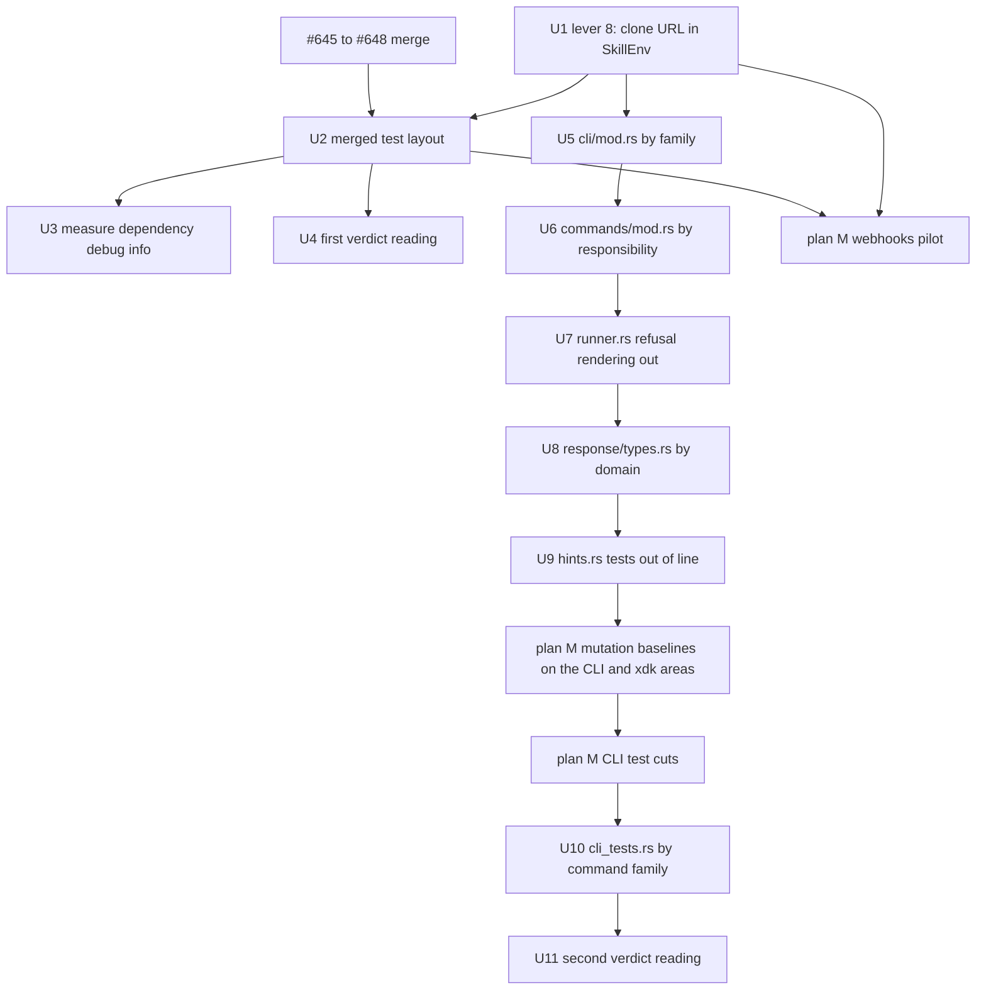

# File Splits and the Merged Test Layout - Plan

**Target repo:** brettdavies/xurl-rs. **Base:** `dev`. Facts are checked against `dev` at `492e187` unless a line names
another commit or run. Unit IDs (U1 to U11) are this plan's own. The CI speed plan's units are written CI-U5 and CI-U6,
and the wall-clock spike's levers are "lever 1" to "lever 9".

## Goal Capsule

- **Objective:** xurl-rs's five largest mixed-purpose files become files that each hold one job. Each crate's
  integration tests build as one binary. The suite reaches no network host when it installs the skill bundle. The PR
  verdict time is read twice against the CI speed plan's 2-minute goal (KD5 there).
- **Means:** pure moves, one PR per file, held byte-identical by the 349 golden fixtures (KTD1). The merged test layout
  is the CI speed plan's CI-U6, taken over with its guards and its measured gain (KTD8 to KTD10). A `SkillEnv` field
  gives the in-process test harness its own clone URL (KTD7). One measurement of dependency debug info runs on the
  merged layout (KTD12). Two readings of a CI run close the measurement (KTD13).
- **Authority:** R-IDs win on behavior and KTDs on mechanism. A unit overrides neither. KD1 to KD6 are Brett's and are
  not reopened here. KTDs are this plan's calls, owned by xurl-plan-prime, the coordinating session.
- **Execution profile:** one session runs every unit inline as stacked PRs to `dev`, on `feat/refactor-NN-<slug>`
  branches. It uses no subagents, workers, or worktrees. Long jobs run in the background under `timeout -k`, and no
  sleep exceeds 10 s. Each unit is one PR unless the unit says otherwise. U4 and U11 are readings with no PR, recorded
  in § Measurements and committed straight to `dev`.
- **Stop conditions:**
  - A split moves a golden fixture, a committed schema under `schema/`, or a completion file under `completions/`.
  - `cargo semver-checks` reports anything for U8.
  - A split needs an edit inside an item's body beyond what KTD1 allows.
  - U2's before and after test lists differ by anything but the module prefix.
  - Any unit would add public surface: an environment variable, a flag, a reason, an envelope key, or a public library
    item. R10 holds the list at none.
  - U2's move commit is ready while one of #645, #646, #647, or #648 is still open.
  - U10 is ready to start before plan M's cut PR for the CLI (its M9) merges.
  - A fix widens a unit past the scope list in Scope Boundaries.

  On any of these, stop and report to xurl-plan-prime.
- **Who ships:** the executing session opens each PR as a draft, runs its reviews (KTD15), and marks it ready. A slot
  never merges. xurl-rs-prime merges the reviewed green stack to `dev`.

---

## Product Contract

### Summary

Four source files split along the jobs they hold, and one file's inline tests move out of line. Each is a pure move
whose output, help text, schemas, completions, and public library API stay as they are. Each crate's integration tests
then build as two binaries, `tests/all/` and `tests/isolated/`, in place of 141. Two new guards catch the two ways that
layout fails silently. A `SkillEnv` field lets the walks install the skill bundle without cloning github.com. One build
setting is measured once, kept on a gain or dropped with its numbers. Last, after plan M cuts the CLI tests,
`cli_tests.rs` splits by command family. Nobody who runs `xr` or embeds `xdk-rs` observes a change. A contributor sees
smaller files, a faster rebuild after an edit, and new commands to run one test file.

### Problem Frame

**Mixed files that every change edits.** Measured at `492e187`:

| File                                      | Lines | Production code           | Commits | What it holds                                                                                                      |
| ----------------------------------------- | ----- | ------------------------- | ------- | ------------------------------------------------------------------------------------------------------------------ |
| `crates/xurl-cli/src/cli/mod.rs`          | 4,284 | ~2,900 + 1,137 help lines | 128     | 70 `*_HELP` consts (lines 67-1009), `Cli` (1010), `Commands` (1308-2105), about 25 family enums (2106-4284)        |
| `crates/xurl-cli/src/cli/commands/mod.rs` | 1,399 | 1,075                     | 95      | routing, input validation, send helpers, list helpers, and account resolution                                      |
| `crates/xurl-cli/src/cli/runner.rs`       | 1,214 | 946                       | 73      | the `run_*` entrypoint layers, and the rendering of argv refusals                                                  |
| `crates/xurl-cli/src/cli/hints.rs`        | 2,430 | 1,065 + 900 test lines    | 41      | about 30 hint builders, then 41 inline tests (lines 1437-2430)                                                     |
| `crates/xdk/src/api/response/types.rs`    | 2,739 | 1,225 + 639 test lines    | 51      | every typed response, then the inline tests (lines 2026-2739)                                                      |
| `crates/xurl-cli/src/cli/family_help.rs`  | 1,554 | —                         | —       | the shared `Verb`/`Example`/`Family` shape (lines 1-103), then one `pub mod` of declarations per family (104-1554) |

`cli/mod.rs`, `commands/mod.rs`, and `runner.rs` are the most-changed CLI files, so every new command and every parallel
slot edits the same file. `cli/mod.rs` and `family_help.rs` split one family across two files that hold every family.

**141 integration-test binaries.** `crates/xurl-cli/tests/` holds 90 test files and `crates/xdk/tests/` 51, and each
links on its own. The spike measured one binary per crate (probe PR #636, run 45581846309, and an ABBA series on the
16-CPU Linux server):

| Measure                                                          | Today                   | One binary per crate    |
| ---------------------------------------------------------------- | ----------------------- | ----------------------- |
| CI workspace-only test build, warm dependency cache, one runner  | 89.5, 91.3 s            | 38.9, 37.3 s (−58%)     |
| Local cold `cargo test --workspace --no-run`, wall / CPU         | 85.9, 74.1 / 826, 815 s | 49.7, 48.4 / 296, 294 s |
| Local rebuild after touching `crates/xdk/src/lib.rs`, wall / CPU | 66.7, 56.5 / 209, 203 s | 5.9, 6.0 / 28, 28 s     |
| Local prebuilt full suite, CI build settings, wall               | 106.7, 106.5 s          | 107.8, 107.5 s (+1 s)   |
| Target directory, CI build settings                              | 9.1 GB                  | 1.7 GB                  |

The local merged-layout figures were taken with #641's dependency opt-level list on, which `dev` carries. The same probe
found 21 tests that fail in the merged layout because they read test files by path or re-run their own binary by test
name (KTD9).

**Live clones in the suite.** `rerun_walk`'s first and fourth cases run `xr skill install` for real. Its hardened
`git clone` of `https://github.com/brettdavies/xurl-rs-skill.git`, the URL `skill.json` names, takes about 10 s on the
Linux server because IPv6 times out first. With levers 1 to 3 in, those two cases (about 28.5 s each) are the local
suite's tail. A suite that clones github.com fails offline and moves with GitHub's availability. Under cargo-mutants the
suite runs about 4,350 times, so these two cases alone would make about 8,700 live clones.

**The 2-minute goal is unread.** The latest green PR run, 45944823191 on #645, took 297 s from start to finish, and its
slowest job, `ci / Tests (1/4)`, took 251 s. The other three `Tests` partitions took 226, 156, and 156 s, and the
slowest jobs outside them were `ci / Windows check` (102 s) and `Windows program target` (90 s) (Eng review D16). The
spike projects about 140 s for the slowest `Tests` job once the merged layout lands.

### Requirements

**Pure moves**

- R1. Each split and the `hints.rs` test move change no behavior: the 349 golden fixtures (197 help pages and 85 dry
  runs among them), the committed schemas under `schema/`, and the completions under `completions/` stay byte-identical,
  and the suite passes with the same test count.
- R2. The `response/types.rs` split keeps every public path of `xdk-rs` (`xdk::api::Post`, `xdk::api::response::Post`,
  `xdk::api::response::types::Post`, and the rest), and `cargo semver-checks` reports nothing against the latest
  `xdk-rs-v*` tag.
- R3. After the `cli/mod.rs` split, a new command family is one new file under `crates/xurl-cli/src/cli/families/` plus
  one `Commands` variant, beside the recipe's other surfaces.
- R4. `run_subcommand` stays in `crates/xurl-cli/src/cli/commands/mod.rs`, where `dispatch_guard.rs` reads it.
- R5. Every path that a document, a guard's message, a script, or a workflow names for a moved item names its new home
  in the same PR.

**The test harness**

- R6. No test clones github.com. `xr skill install` and `xr skill update` outside the tests clone the URL `skill.json`
  names, under the same hardening.
- R7. Each crate's integration tests build as one binary, plus one for the tests that change process state. The same
  tests run under the same names with a module prefix, and the before and after lists match one for one.
- R8. A test file that no `mod` line declares, a `.rs` file directly under `xdk-rs`'s or `xurl-rs`'s `tests/`, an
  environment-mutating test outside `tests/isolated/`, and a command naming a test target or module that does not exist
  each fail a guard with a stable code.

**Measurement**

- R9. Dependency debug info off is measured once on the merged layout, cold and warm, and kept only on a gain under both
  of KTD12's rules. The PR verdict time is read after U2 and again after U10, against the 2-minute goal. Each number is
  recorded with its run IDs whether the change is kept or not.

**Surface**

- R10. No unit adds an environment variable, a flag, a reason, an action, an envelope key, an exit code, or a public
  library item.

### Key Decisions

- KD1. **R's scope is the list in Scope Boundaries.** (session-settled: user-approved, Brett, 2026-11-26, relayed by
  xurl-plan-prime.) Governs every unit.
- KD2. **`shortcuts.rs` stays as it is.** (session-settled: user-directed, Brett.) It holds 257 near-uniform wrappers,
  AGENTS.md makes it "the list" of shortcuts, and 12 test references name its path.
- KD3. **Source splits land before plan M's mutation baseline on those files.** (session-settled: user-approved.) A
  mutation baseline is keyed by `src` file and line, so a split after it would invalidate it.
- KD4. **Tests are cut before their files are reorganized.** (session-settled: user-approved.) So nothing moves only to
  be deleted: U10 follows plan M's CLI cuts.
- KD5. **The merged layout waits for #645 to #648 to merge.** (session-settled: user-approved for #645 to #647, extended
  to #648 by xurl-plan-prime on 2026-11-27.) #645 edits `crates/xdk/tests/saved_identity_tests.rs`; #647 edits
  `crates/xdk/tests/webhook_forward_tests.rs`, `webhook_receiver_tests.rs`, and
  `crates/xurl-cli/tests/webhooks_tests.rs`; #648 edits `crates/xdk/tests/media_upload_tests.rs`. U2 moves each of
  them. #646 edits only `crates/xdk/src/store/migration.rs` and sits below #647 in the stack.
- KD6. **One session runs the plan as stacked PRs, with no subagents.** (session-settled: user-directed, Brett's
  standing rule in xurl-rs.)

### Success Criteria

- Each split PR merges with no golden fixture, schema, or completion moved, and with the suite's test count unchanged.
- `cargo semver-checks` is clean on U8's head.
- `crates/xurl-cli/src/cli/mod.rs`, `commands/mod.rs`, and `runner.rs` each hold one job, and no file a split creates
  holds more than one.
- `cargo nextest list --workspace` names two integration-test binaries for each of `xdk-rs` and `xurl-rs`, plus the
  consumer check's one, where it named 141.
- A walk over every command reaches no host but loopback: no `git` process the suite starts names `github.com`.
- U3's numbers and both verdict readings are in § Measurements with their run IDs.

### Scope Boundaries

In R, all approved by Brett (KD1):

- split `crates/xurl-cli/src/cli/mod.rs` by family (U5);
- split `crates/xurl-cli/src/cli/commands/mod.rs` by responsibility, with `run_subcommand` kept there (U6);
- move the rendering of argv refusals out of `crates/xurl-cli/src/cli/runner.rs` (U7);
- split `crates/xdk/src/api/response/types.rs` by domain, with `pub use` keeping every public path (U8);
- move `hints.rs`'s inline tests to `crates/xurl-cli/src/cli/hints/tests.rs` (U9);
- CI-U6: the merged test layout, its two guards, the 21 guard fixes, and the doc paths (U2);
- lever 8: a clone-URL seam in `SkillEnv` (U1);
- one CI-U5 measurement after the merged layout (U3);
- the PR verdict time after the merged layout and after the test cuts (U4, U11);
- split `crates/xurl-cli/tests/cli_tests.rs` by command family into the merged layout, after plan M's CLI cuts (U10).

Not in R:

- `shortcuts.rs`, which stays as it is (KD2).
- The test-comment sweep the order of events puts in the `cli_tests.rs` PR. The scope list does not name it, and it
  would break U10's pure move.
- The comment sweep over `src`, the order of events' Phase 4.
- Re-running `maintain-formal-verification-skill`, which is plan F's.
- Mutation testing, the test cuts, and the gap tests (plan M), and formal verification (plan F).
- Moving the inline tests out of `credential_step.rs` (423 test lines) and `output/mod.rs` (225).
- Splitting `oauth2_flow_tests.rs`, `api_tests.rs`, `golden_tests.rs`, or `store_tests.rs`.
- A CI `--in-diff` mutation job, a doc-comment accuracy audit, and the media-upload chart.
- The CI speed plan's dropped and tracked items, which its Status section records.
- Renaming `family_help::broadcasts` (the `broadcasts moderators` family) and `broadcasts_own` (the `xr broadcasts`
  family) to names that match their commands. A rename is not a move (KTD1; Eng review B1). It is a rename candidate,
  and a rename that ever happens lands before plan M's CLI baseline (M8), which keys on the file's lines (KD3).
- A guard that holds the process-aborting `parse_stack_tests` in `tests/isolated/` (Eng review B3). R8 names the
  environment-mutating tests only.
- A `test_invocation_guard` rule that refuses `--test all` without `-p` (Eng review B4).
- Grouping the leaf commands' `*_HELP` consts (`POST_HELP` to `EXAMPLES_HELP`) into files by dispatch group. They belong
  to `Commands` variants, not to a family (KTD2).

### Sources

- The order of events for the cleanup (Brett, 2026-11-26): Phases 1, 2, and 6, and "The rules that fix the order".
- The CI speed plan's status read against `dev` at `492e187` (2026-11-26): the unit table and the take, track, and drop
  lists.
- The pstack skills audit (2026-11-26), § "The large files: split or leave?": the measured table, the split constraints,
  the test-files paragraph, the order, and the `hints.rs` move.
- The tests wall-clock spike report (2026-11-25), § 4 (the merged layout's measurements and guard inventory), § 8 (lever
  8), and its decisions 2 and 3.
- Plan M's dependencies on this plan, in M2, M7, M8, and M9:
  `docs/plans/2026-11-27-0033-test-mutation-testing-and-test-cuts-plan.md`.
- `docs/plans/2026-10-27-0058-perf-ci-scoping-and-speed-plan.md`: CI-U5, CI-U6, KTD8, KTD14, Sequencing, and
  "Corrections under existing approvals" (guard scope, the one allowlist owner, and the relative paths).
- `docs/solutions/performance-issues/one-integration-test-binary-per-crate-cuts-the-test-build-by-half-and-the-edit-loop-rebuild-by-nine-tenths.md`:
  the transform, the guard inventory, and the probe's measuring step.
- `docs/solutions/best-practices/rust-module-splitting-srp-not-loc-20260327.md`: module boundaries follow visibility and
  responsibility, not line count.
- `docs/solutions/best-practices/a-source-walk-guard-must-tell-a-test-module-declaration-from-an-inline-test-module.md`:
  why an out-of-line `#[cfg(test)] mod x;` goes last.
- `docs/solutions/developer-experience/anchor-scripted-source-edits-on-item-boundaries-and-read-the-diff.md`: a scripted
  edit that moved a clap doc comment onto the wrong variant, which compiled and moved golden fixtures.

---

## Planning Contract

### Key Technical Decisions

- KTD1. **A pure move moves items verbatim.** Each item keeps its attributes, doc comments, and body. The edits a move
  PR may make are these:
  - `mod`, `use`, and `pub use` lines;
  - a visibility qualifier widened only as far as the new module boundary needs (`pub(super)`, `pub(crate)`);
  - a path prefix inside an attribute or an intra-doc link that the new module needs, such as
    `family_help::lists::FAMILY` becoming `FAMILY` inside the family's own file (KTD2);
  - a module doc comment (`//!`) on each new file, saying what it holds;
  - every path that a test, a guard's message, a document, or a script names for a moved item (R5).

  Nothing else changes. The checks:
  - `cargo nextest run --workspace --no-fail-fast`, with the golden suite run without `XURL_GOLDEN_BLESS`;
  - `schema_tests`, which fails for a committed schema that drifted;
  - `scripts/generate-completions.sh --check`;
  - `cargo semver-checks` for `xdk-rs` (U8 only).

  Each move is made by cutting whole items at item boundaries, not by a scripted line edit, and the diff is read before
  the push: an edit anchored on a line moved a clap doc comment onto the wrong variant and still compiled (Sources).
- KTD2. **`cli/mod.rs` splits into one file per family under `crates/xurl-cli/src/cli/families/`.**
  - A family's file holds its subcommand enums and their argument types and parsers. It also holds the `*_HELP` consts
    those enums and the family's `Commands` variant read, and the family's declaration modules from `family_help.rs`.
  - The file is its root family's declaration module: the body of `family_help::lists` moves to the top level of
    `families/lists.rs`, and its `///` doc line becomes the file's `//!` line. A second family in the same file keeps
    its module and its name, so `list_members` stays `pub mod list_members` inside `families/lists.rs`. Nesting `lists`
    inside `lists.rs` would fail clippy's `module_inception` lint, which `cargo clippy -- -D warnings` turns into an
    error and which the repo does not allow (it has no `clippy.toml` and no lint table).
  - The clap attributes name the new paths: `family_help::lists::FAMILY` becomes `FAMILY` inside `lists.rs`,
    `family_help::list_members::ADD` becomes `list_members::ADD` there, and `Commands::Lists`'s `family_help::lists::`
    becomes `families::lists::` in `cli/mod.rs`. Each is a path substitution, under KTD1. A path that resolves to the
    wrong family's verb still compiles, so the 197 golden help pages are the check.
  - `family_help.rs` keeps the shared shape: `Verb`, `Example`, `Family`, the `Section` alias, and `page_of` (its lines
    1-103). Each family file imports them from `crate::cli::family_help`.
  - `cli/mod.rs` keeps `ColorChoice`, `ROOT_HELP`, `GLOBAL_OPTIONS`, `Cli`, `Commands`, and `CommonFlags`. It also keeps
    the leaf commands' `*_HELP` consts (`POST_HELP` through `EXAMPLES_HELP`), which `Commands` variants read and no
    family owns. It declares `pub mod families;` beside `pub mod family_help;` and re-exports every moved enum and
    argument type with `pub use`. So `crate::cli::ListsCommands` and the rest keep resolving, and every
    `use crate::cli::{...}` line stays as it is: 30 files under `commands/` import from there (`commands/lists.rs:12`,
    `broadcasts.rs:14`, `auth/apps.rs:16`, and the rest), and so does `runner.rs:632`.
  - A help const that moves and that `Commands` still reads (`AUTH_HELP`, `MEDIA_HELP`, `USAGE_HELP`) widens to
    `pub(in crate::cli)`, the narrowest qualifier that reaches `cli/mod.rs` from `families/<family>.rs`.
  - `secret_source` (line 3844) is called by `AuthCommands` and `AppCommands` (lines 3903-3988) and by nothing else, so
    it moves to `families/auth.rs`. `CommonFlags` stays, since most families flatten it.
  - `SCHEDULED_CALLS_PAGE_SIZE` (`cli/mod.rs:954`, `pub(crate)`) moves to `families/calls.rs` and keeps its
    `pub(crate)`. Two readers use it: `ScheduledCallsCommands`'s `-n` help at line 3280 and `commands/calls.rs:13` and
    `:42`. `cli/mod.rs` re-exports it with `pub(crate) use`, so `commands/calls.rs`'s import stays as it is (Eng review
    D5).
  - The top level of `families/broadcasts.rs` is `family_help::broadcasts`, by the matching-name rule below. That module
    is the `xr broadcasts moderators` family (its `FAMILY.path` is `"broadcasts moderators"`), and it holds `root_page`
    and `moderators_page`. The `xr broadcasts` family itself, `broadcasts_own`, nests as `pub mod broadcasts_own`, and
    each module keeps its name (KTD1). The module's `use super::{..., broadcast_chat, ..., page_of}` line drops the five
    sibling modules, which become siblings in the same file (Eng review D6).
  - `cli/mod.rs`'s imports that only moved items read move with them: `KNOWN_HOSTS`, `VideoCategory`,
    `WEBHOOK_URL_MAX_CHARS`, and `CHECKPOINT_SHAPE` (lines 39 and 41-43).

| File under `cli/families/` | Enums and types from `cli/mod.rs`                                                                                                      | Help consts                                                                                  | `family_help.rs` modules                                                                                         |
| -------------------------- | -------------------------------------------------------------------------------------------------------------------------------------- | -------------------------------------------------------------------------------------------- | ---------------------------------------------------------------------------------------------------------------- |
| `auth.rs`                  | `AuthCommands`, `AppCommands`, `RedirectUriCommands`, `secret_source`                                                                  | `AUTH_HELP`, `AUTH_OAUTH2_HELP` to `AUTH_DEFAULT_HELP`, `APPS_*_HELP`, `REDIRECT_URI_*_HELP` | none                                                                                                             |
| `media.rs`                 | `MediaCommands`, `SubtitlesCommands`, `ProcessingWait`, `parse_processing_wait`, `video_category_parser`                               | `MEDIA_HELP`, `MEDIA_UPLOAD_HELP` to `MEDIA_ALT_TEXT_HELP`                                   | `media_subtitles`                                                                                                |
| `usage.rs`                 | `UsageCommands`                                                                                                                        | `USAGE_HELP`, `USAGE_CREDITS_HELP`                                                           | none                                                                                                             |
| `skill.rs`                 | `SkillCmd`, `skill_host_parser`                                                                                                        | none                                                                                         | none                                                                                                             |
| `bookmark_folders.rs`      | `BookmarkFoldersCommands`                                                                                                              | none                                                                                         | `bookmark_folders`                                                                                               |
| `lists.rs`                 | `ListsCommands`, `ListMembersCommands`                                                                                                 | none                                                                                         | `lists`, `list_members`                                                                                          |
| `conversations.rs`         | `ConversationsCommands`, `DmEventsCommands`                                                                                            | none                                                                                         | `conversations`, `dm_events`                                                                                     |
| `communities.rs`           | `CommunitiesCommands`                                                                                                                  | none                                                                                         | `communities`                                                                                                    |
| `spaces.rs`                | `SpacesCommands`                                                                                                                       | none                                                                                         | `spaces`                                                                                                         |
| `stream.rs`                | `StreamCommands`, `StreamRulesCommands`                                                                                                | none                                                                                         | `stream_rules`                                                                                                   |
| `news.rs`                  | `NewsCommands`                                                                                                                         | none                                                                                         | `news`                                                                                                           |
| `drafts.rs`                | `DraftsCommands`                                                                                                                       | none                                                                                         | `drafts`                                                                                                         |
| `articles.rs`              | `ArticlesCommands`                                                                                                                     | none                                                                                         | `articles`                                                                                                       |
| `notes.rs`                 | `NotesCommands`                                                                                                                        | none                                                                                         | `notes`                                                                                                          |
| `trends.rs`                | `TrendsCommands`                                                                                                                       | none                                                                                         | `trends`                                                                                                         |
| `broadcasts.rs`            | `BroadcastsCommands`, `ScheduledBroadcastsCommands`, `BroadcastChatCommands`, `SourcesCommands`, `ModeratorsCommands`, `MutesCommands` | none                                                                                         | `broadcasts_own`, `broadcasts_scheduled`, `broadcast_chat`, `broadcasts`, `broadcast_mutes`, `broadcast_sources` |
| `calls.rs`                 | `CallsCommands`, `ScheduledCallsCommands`, `CallDetailsArgs`, `OccurrenceArgs`, `CallScope`, `CallAnswer`                              | none                                                                                         | `calls`, `scheduled_calls`                                                                                       |
| `webhooks.rs`              | `WebhooksCommands`, `SigningSecret`, `WebhookSubscriptionsCommands`, `WebhookStreamLinksCommands`                                      | none                                                                                         | `webhooks`, `webhook_subscriptions`, `webhook_stream_links`                                                      |

The table is the plan's reading of lines 2095-4284 and of `family_help.rs`'s 25 `pub mod` blocks. The first module in
each row's last column whose name matches the file becomes the file's top level, and the rest nest. U5's first step
checks the table against the tree at its base: every enum, type, const, and module lands in exactly one row, or in
`cli/mod.rs`. `Commands` stays whole: R3 gives each family one `Commands` variant, and `dispatch_guard.rs:20-26` reads
`Commands::<Variant>` names in `commands/*.rs`, wherever the family types live.

- KTD3. **`commands/mod.rs` splits by responsibility into four files beside it, and keeps routing.**

| File                   | Holds                                                                                                                                                                                                                                                                                                                                                                                         |
| ---------------------- | --------------------------------------------------------------------------------------------------------------------------------------------------------------------------------------------------------------------------------------------------------------------------------------------------------------------------------------------------------------------------------------------- |
| `commands/mod.rs`      | the `mod` lines, `USER_AGENT`, `make_client`, `run`, `GlobalFlags`, `Run`, `run_raw_mode`, `run_subcommand` (R4), and `#[cfg(test)] mod url_authority_tests;` as the last item                                                                                                                                                                                                                |
| `commands/checks.rs`   | input validation: `Invalid` and its impls, `Checked`, `checked`, `checked_url`, `without_userinfo`, `checked_each`, `From<Invalid> for Error`, `no_checks`, `valid_post_id`, `valid_post`, `valid_window`, `validate_account`                                                                                                                                                                 |
| `commands/sending.rs`  | one request and its dry run and confirmation: `is_interactive`, `confirm_destructive`, `destructive_dry_run_context`, `gate_destructive`, `Confirm` and `Confirm::gate`, `Credential`, `DryRun` and its impl, `credential_value`, `without_unset`, `dry_run_or_validate`, `send_or_report`, `send_validated`, `send_confirmed`, `print_typed`, `with_flags`                                   |
| `commands/paging.rs`   | paged lists: `DEFAULT_PAGE_SIZE`, `effective_limit`, `list_for_user`, `list_mine`, `list_for_post`, `list_paged`, `list_owned_by`                                                                                                                                                                                                                                                             |
| `commands/accounts.rs` | the caller's id and other accounts: `UNRESOLVED_ID`, `my_id_call`, `resolve_my_user_id`, `act_from_me_on_user`, `act_on_user`, `act_on_user_with`, `act_from_me_on_post`, `act_from_me`, `handles_lookup_call`, `resolve_account_ids`, `account_lookup_call`, `resolve_account_id`, `stand_in_ids`, `account_credentials`, `send_to_accounts`, `send_confirmed_to_account`, `send_to_account` |

Notes on KTD3:

- `commands/mod.rs` imports each moved helper back with a private `use`. A private `use` binding is visible to the
  module's descendants, so the group modules' `use super::{...}` lines (`usage.rs:5`, `communities.rs:5`, `news.rs:5`,
  and the rest) stay as they are, and so do `commands/auth/mod.rs:6` and `url_authority_tests.rs:10`
  (`use super::without_userinfo;`).
- The name `sending.rs` keeps the file apart from `sent.rs`, which stays and holds the two wrappers that keep the
  credential beside a 401.
- Each moved helper becomes `pub(super)`, which in a file beside `commands/mod.rs` reaches `commands` and every module
  under it. `destructive_dry_run_context` and `gate_destructive` are `pub(super)` today and stay so: their only callers
  are `commands/auth/mod.rs:296`, `auth/session.rs:239`, and `auth/apps.rs:202`. `make_client` and `run` stay in
  `commands/mod.rs` with their `pub(crate)`.
- A struct's private fields and an impl's private associated functions stop being visible to the group modules once they
  leave `commands/mod.rs`, so the ones a group module reads become `pub(super)` too (Eng review D1):
  - `Confirm`'s `force` and `prompt`: `webhooks.rs:200` builds a `Confirm { .. }` literal.
  - `Invalid::naming`, `Invalid::unnamed`, and `Invalid::of_input`: `calls.rs:255-256`, `lists.rs:267-268`, and
    `broadcasts.rs:88`.
  - `DryRun::new` and `DryRun::answer`: `broadcasts.rs:32`, `media.rs:119` and `:199`, `usage.rs:25`, and
    `webhooks.rs:98`. `DryRun::sending` and `DryRun::confirming` follow their callers the same way.

  U6 builds after each file moves and widens only what the compiler names. The review reads the list of widened items.
- `commands/mod.rs` imports back only the names that a group module, a sibling new file, or the routing code reads. A
  helper read only inside its own new file stays private there, with no `pub(super)` and no `use` line in
  `commands/mod.rs`. A `use` that nothing reads fails `unused_imports` under clippy's `-D warnings`. At `492e187` that
  is `DEFAULT_PAGE_SIZE` (paging), `is_interactive`, `confirm_destructive`, and `credential_value` (sending), and
  `handles_lookup_call`, `resolve_account_ids`, and `account_credentials` (accounts). They were found with `rg -l` over
  `commands/` and the line ranges of `commands/mod.rs` (Eng review D2).
- Placement follows each helper's callers (counted with `rg -n "\b<name>\b"` over `commands/`). `with_flags` and
  `print_typed` are called by `sending.rs`, `paging.rs`, `accounts.rs`, and six group modules, and they shape one call,
  so they sit with sending. `validate_account` is a `Checked` validator called by `accounts.rs`, `dms.rs`, and
  `webhooks.rs`, so it sits with the checks. `UNRESOLVED_ID`, the stand-in for the caller's id in a dry run, is read by
  `list_owned_by` (line 1045) and by the account helpers (lines 1087-1268), so it sits with the accounts as
  `pub(super)`.
- Each new file stays under 400 lines: routing about 360, checks about 150, sending about 330, paging about 160,
  accounts about 370.

- KTD4. **The rendering of argv refusals moves to `crates/xurl-cli/src/cli/argv_refusal.rs`.**
  - What moves: `is_display`, `render_parse_error`, `provisional_output`, `render_refused`, `render_invalid_args`,
    `unexpected_argument`, `help_command_page`, `render_misplaced_flags`, `render_schema_refusal`, `Suggestion` and its
    impl, `render_unknown_command`, `CLAP_HELP_FOOTER` (line 59, read only by `render_invalid_args` at 834), and the
    inline `mod tests` at line 1188, which tests `render_schema_refusal`. The test module stays inline and last in the
    new file.
  - What stays in `runner.rs`: `run_argv`, `run`, `run_with_store_path`, `run_with_overrides`, `RunHooks`,
    `run_with_hooks`, `run_with_env`, `Environment`, `run_inner`, `Recovery`, `media_credential`, `app_from_env`,
    `no_browser_typed`, `given_as_argument`, `matched_path`, `NO_COMMAND_MESSAGE` (line 56, which `run_inner` reads at
    417), and the `assert_send_sync!` line. `run_inner` calls the renderers at lines 287-438, and they call nothing in
    `run_inner`'s layer.
  - `crates/xdk/src/error.rs:32` names `runner.rs` as the home of `render_unknown_command`, and U7 points it at
    `argv_refusal.rs`.
  - `cli/mod.rs:19` (`pub use runner::{run, run_argv, run_with_store_path};`) and the 14 test files that call
    `xurl::cli::runner::run_with_*` keep their paths.
- KTD5. **`response/types.rs` becomes the directory module `response/types/`, with private domain submodules.**
  - `types/mod.rs` declares each domain as a private `mod` and re-exports it with `pub use <domain>::*;`. Rustdoc and
    `cargo semver-checks` then see every item at `xdk::api::response::types::<Item>`, as today. The two re-export lists
    in `response/mod.rs:9-15` and `api/mod.rs:36-53` stay as they are.
  - `types/mod.rs` also keeps what every domain shares: `ApiResponse`, `Includes`, `ResponseMeta`, `ApiError`,
    `DeletedResult` (returned by 11 shortcuts across eight domains, from `delete_post` to `remove_media_subtitles`),
    `deserialize_response`, `decode`, and `is_page_with_no_results`. `decode` (`types.rs:1980`, `pub(crate)`) keeps its
    path, because `crates/xdk/src/api/request/call.rs:10` imports it as `crate::api::response::types::decode` (Eng
    review D7). The `use crate::auth::credentials::REDACTED;` line goes with the two `Debug` impls that read it
    (`StreamSourceCreated` and `StreamSourceKey`, lines 1452 and 1497), in `broadcasts.rs`.
  - The domain files, from the file's own section markers and the shortcuts that return each type: `posts.rs` (`Post`,
    `PostPublicMetrics`, `ReferencedPost`, `PostCount`, `PostAnalytics`, `AnalyticsBucket`, `AnalyticsMetrics`,
    `LikedResult`, `HiddenResult`, `RepostedResult`, `BookmarkedResult`), `drafts.rs` (the five `PostDraft*` types),
    `users.rs` (`User`, `UserPublicMetrics`, `FollowingResult`, `BlockingResult`, `MutingResult`), `dms.rs` (`DmEvent`,
    `DmSentResult`, `DmBlockResult`), `trends.rs`, `news.rs`, `communities.rs`, `lists.rs` (`List`, `ListUpdatedResult`,
    `ListMemberResult`, `PinnedResult`), `broadcasts.rs` (`Broadcast`, `BroadcastUpdated`, `BroadcastEnded`,
    `ScheduledBroadcast`, `BroadcastChatMessage`, `ChatSentResult`, `ChatMutedResult`, `ChatMute`,
    `ChatModeratorsResult`, the `StreamSource*` types, and `IngestRegion`), `notes.rs` (`Note`, `NoteInfo`,
    `NoteCreated`, `NoteEvaluation`), `articles.rs`, `media.rs` (the seven `Media*` types), `stream_rules.rs`,
    `spaces.rs`, `bookmark_folders.rs`, `calls.rs`, `webhooks.rs`, and `usage.rs`. A type that more than one domain
    returns stays in `types/mod.rs`. U8's first step checks the table against `shortcuts.rs`.
  - The inline tests (lines 2026-2739) move to `types/tests.rs`, declared as the last item of `types/mod.rs`. Their
    `use super::*;` still reaches every type through the glob re-exports. Splitting the tests by domain would edit them,
    so they stay one module.
  - `crates/xdk/tests/spec_validation.rs:40` reads `src/api/response/types.rs` by path (`TYPES_PATH`) in two tests
    (lines 141 and 186), and its `Fix:` line names it. Both read every `.rs` file under `src/api/response/types/`
    instead, and the message names the directory. The read is `std::fs::read_dir` over the flat `types/` directory,
    keeping the `.rs` files and sorting them by name. `common::rust_files` is in xurl-cli's `tests/common/mod.rs:165`,
    and xdk's `tests/common/mod.rs` holds only the OpenAPI helpers (Eng review D8). The same PR updates
    `spec_types_validation.rs:472`'s message, AGENTS.md's "Typed response" bullet and the shortcut paragraph (lines 301
    and 321), `scripts/open-spec-refresh-pr.sh:145` and `:150` (the spec-refresh runbook), the header of
    `scripts/update-types.sh:14`, and the `//!` lines of `spec_types_validation.rs:6` and
    `crates/xurl-cli/src/cli/commands/validate.rs:6`.
  - Only three intra-doc links sit in the file (`PostAnalytics`, `NewsStory`, `MediaAnalytics`), and each points inside
    its own domain. `cargo doc` with `-D warnings` in pre-push catches any that breaks.
  - `cargo semver-checks` runs only as a PR check (`Public API semver`, `ci.yml:298`), and the pre-push hook has no
    counterpart (AGENTS.md § "Testing"), so U8 runs it locally before the push:
    `cargo semver-checks -p xdk-rs --baseline-rev xdk-rs-v0.9.1`, or whatever `xdk-rs-v*` tag is latest at U8's base.
- KTD6. **`hints.rs`'s inline tests move to `crates/xurl-cli/src/cli/hints/tests.rs`.** The body of
  `#[cfg(test)] mod tests { use super::*; ... }` (lines 1437-2430) moves with `use super::*;` kept and one indent level
  dropped, and `hints.rs` ends with `#[cfg(test)]` and `mod tests;`.
  - The module path (`cli::hints::tests`), access to private items, the unit-test binary, every test name, and the build
    cost stay the same.
  - The declaration stays the last item. `store_isolation_guard.rs:139-158` maps it to `hints/tests.rs` and scans that
    file in full, and it scans `hints.rs` from its first `#[cfg(test)]` marker.
  - The source guards that cut a file at its inline test module (`up_to_inline_tests` in
    `crates/xdk/tests/support/production_source.rs`) and do not skip a declared test file read the moved file as
    production code once it is out of line: `test_help_advertises_every_env_var_the_source_reads`
    (`agentic_tests.rs:408`) and `status_document_guard`. So do `http_client_guard` and `scripts/lint-stdio.sh` (the
    `Output discipline` job), which already read the whole file. `parse_path_guard` (`parse_path_guard.rs:57-87`) and
    `port_race_guard` drop every file a `#[cfg(test)] mod x;` declares. The test lines hold one argv parse,
    `crate::cli::Cli::try_parse_from(...)` at `hints.rs:2298`, and `parse_path_guard` skips it once the file is declared
    that way. They hold no `env = "..."`, `env::var(`, print macro, port bind, `Client::new`, `block_on`,
    `runtime::Builder`, `status: "..."` field, or `"status"` key (read with `rg` at `492e187`). So none of the guards
    changes its verdict (Eng review D9).
  - Precedents: `cli/mod.rs:32` (`parse_tests`), `commands/mod.rs:1398` (`url_authority_tests`), and
    `crates/xdk/src/store/mod.rs:972` (`rehearsal_tests`).
- KTD7. **The clone URL comes from `SkillEnv`, and only the in-process harness sets it.**
  - `SkillEnv` (`crates/xurl-cli/src/cli/skill_install/destination.rs:19`) gains `clone_url: Option<String>`.
    `install_envelope` (`skill_install/mod.rs:333`) and `update_envelope` (`skill_install/update.rs:42`) resolve the URL
    once, `skill_env.clone_url.as_deref().unwrap_or(url)`, into a binding of its own (`clone_url`), leaving `url` as it
    is. They use it both for the clone (`mod.rs:415`; `update.rs:118` `replace_with_clone` and `update.rs:120`) and for
    `command_preview` (`format_clone_command`), so the dry run names what the real run clones.
  - The bundle identity check keeps the manifest's URL. `update_envelope` passes `url` to `Occupant::of` (`update.rs:71`
    and `:94`), and `Occupant::of` reads a destination as xr's bundle only when its `origin` names the same repository
    (`skill_install/bundle.rs:55`). An installed bundle's identity is the manifest's repository, and the seam changes
    only where a clone fetches from. If `url` itself is rebound, an installed bundle reads as `NotABundle` under the
    seam, and U1's update scenario answers a refusal instead of `git-clone-failed` (Eng review D3).
  - `skill_from_process` (`crates/xurl-cli/src/cli/env.rs:98`) sets `clone_url: None` and reads no variable, and the
    runner's `SkillEnv { home, ..SkillEnv::default() }` (`runner.rs:205`) gets `None` from `Default`. So no user can set
    the field, and it adds no surface (R10). xurl-plan-prime confirmed on 2026-11-27 that a field set only in-process
    needs no decision from Brett.
  - The walks run `xr` in-process, so the field reaches them. `rerun_walk.rs:26` imports `run_xr` from `common::invoke`,
    and `visit` calls it at `rerun_walk.rs:126`. `common/invoke.rs:302` builds the `SkillEnv`, and
    `common/invoke.rs:321` passes it to `xurl::cli::runner::run_with_env`, which hands it to `commands/skill.rs:23`
    (`run_install_multi`) and `:26` (`run_update_multi`). Neither file spawns the binary. `dry_run_guard`,
    `credential_step_walk`, `help_claims_guard`, `validation_value_guard`, `post_id_guard`, and
    `confirmation_context_guard` call the same `run_xr`, so the one setting covers each of them.
  - `run_xr` sets `clone_url` to a `file://` URL under the run's own temporary directory, naming nothing that exists.
    The hardening refuses it before git opens a connection or reads a repository. `GIT_HARDEN_FLAGS` sets
    `protocol.allow=never` and allows only `protocol.https.allow=always` (`skill_install/git.rs:12-23`), and
    `GIT_HARDEN_ENV_SET` points `GIT_CONFIG_GLOBAL` and `GIT_CONFIG_SYSTEM` at `/dev/null` (`git.rs:42-44`), so no other
    config allows `file`. The run answers `git-clone-failed`. Its step is `NextStep::retry(None)`
    (`skill_install/mod.rs:197`), which carries no command, so `rerun_walk` has nothing new to check, and U1's test
    checks that nothing lands in the skill home. A URL that names no repository still fails if the hardening ever allows
    `file`.
  - Considered and not chosen:
    - A local bare repository that the clone succeeds against. The hardening would have to allow `file` on the seam's
      path, which changes the security-relevant flags for a test.
    - A `git` shim first on `PATH`, as `skill_update_tests.rs` uses for spawned runs. An in-process run cannot change
      `PATH` without mutating the process environment, which `env_mutation_guard` refuses.
    - An `https://127.0.0.1:<closed port>` URL. It also stays on the machine, but it opens a socket and depends on the
      port staying closed.
- KTD8. **The merged layout: one binary per crate, plus one for tests that change process state** (CI plan KTD8, with
  its corrections).
  - Each crate's test files move with `git mv` into `tests/all/`, declared as modules of `tests/all/main.rs`, with
    `autotests` left on, so the layout stays Cargo's default discovery (`tests/<name>/main.rs`, as Cargo's own
    `tests/testsuite/main.rs`). Each file's `mod common;` becomes `use crate::common;`. `main.rs` declares
    `#[path = "../common/mod.rs"] mod common;`, so `common` serves both binaries. An `isolated/main.rs` declares it only
    when a file in that binary reads it. `common/mod.rs`'s `#![allow(dead_code)]` keeps an unread `common` silent, so
    the build would not flag the wasted compile. At `492e187`, `parse_stack_tests` reads no `common`, so `xurl-rs`'s
    `isolated/main.rs` declares no `common`. Of `xdk`'s three files, only `api_tests` declares `mod common;`
    (`api_tests.rs:27`), and its one mutating test decides whether xdk's `isolated` needs it (Eng review D14).
  - `tests/isolated/` is the second binary. In `xdk-rs` it holds the tests on `env_mutation_guard`'s mutation allowlist
    (`auth_tests` ×2, `api_tests` ×1, `config_tests` ×3; the three in `src/config/mod.rs` are unit tests and stay). In
    `xurl-rs` it holds `parse_stack_tests`, whose failure aborts the process. A file that mixes the two kinds splits,
    and each test keeps its name. Under a plain `cargo test`, no test in `isolated` can reach or end the rest of the
    crate's run. Tests on the read allowlist change nothing and stay in `all`.
  - `mock_endpoint_coverage` becomes `#[cfg(feature = "testing")] mod mock_endpoint_coverage;` in `xdk`'s
    `tests/all/main.rs`, and its `[[test]]` entry in `crates/xdk/Cargo.toml:107-109` goes. The consumer check's single
    test file stays as it is.
  - `env_mutation_guard`'s allowlist moves into `common`, so the guard and `test_layout_guard` read one list (CI plan,
    "One allowlist owner").
  - The relative paths gain one `../`: `#[path = "../codegen/..."]` in `spec_validation.rs:14`, `streaming_table.rs:3`,
    and `vocabulary_table.rs:7`; `#[path = "support/port_band.rs"]` in `callback_tests.rs:25`;
    `#[path = "support/production_source.rs"]` in `vocabulary_event_guard.rs:10`; `include_str!("fixtures/yaml/...")` in
    `yaml_compat_tests.rs:11-12`; `include_str!("../src/api/shortcuts.rs")` in `spec_bounds.rs:419`; and
    `#[path = "../../xdk/tests/support/port_band.rs"]` in `crates/xurl-cli/tests/oauth2_flow_tests.rs:40`. The CI plan
    counted five; the tree holds nine. `crates/xurl-cli/tests/common/mod.rs:12` stays, because `common/` does not move.
    Paths that are relative to the package root (`read_to_string("tests/fixtures/...")`, `CARGO_MANIFEST_DIR` joins)
    keep working, since cargo runs a test binary with the package root as its working directory.
  - `tests/common/`, `tests/fixtures/`, `tests/golden/`, and `xdk`'s `tests/support/` stay where they are. None has a
    `main.rs`, so none becomes a target.
- KTD9. **The 21 layout-bound tests change in U2's first commit, which passes on today's layout.** The spike's inventory
  (§ 4), with each fix:

| Test                                                                | Count | Why it fails in the merged layout                                                | Fix                                                                                                          |
| ------------------------------------------------------------------- | ----- | -------------------------------------------------------------------------------- | ------------------------------------------------------------------------------------------------------------ |
| `store_isolation_guard`                                             | 2     | its allowlist names `tests/<file>.rs` paths (`store_isolation_guard.rs:40-62`)   | the allowlist entries name the moved paths                                                                   |
| `env_mutation_guard`                                                | 3     | its two allowlists name `tests/<file>.rs` paths (`env_mutation_guard.rs:36-120`) | the allowlists move into `common` (KTD8) and name the moved paths                                            |
| `recipe_guard`                                                      | 2     | AGENTS.md names test files at their old paths                                    | AGENTS.md names the moved paths                                                                              |
| `agentic_tests` `no_test_passes_the_help_flag_itself`               | 1     | it reads its own file at its old path (`agentic_tests.rs:51`)                    | it reads its own source the way `spec_validation` does, below                                                |
| `panic_hook_tests`                                                  | 2     | it re-runs its own binary filtered by a bare test name                           | the filter is the test's full path, built from `module_path!()` with the crate segment dropped               |
| `webhooks_program_tests`                                            | 10    | `probe` passes `--exact probe_<name>` (`webhooks_program_tests.rs:33-44`)        | the same full path from `module_path!()`                                                                     |
| `spec_validation` `every_fixture_is_exercised_by_a_validation_test` | 1     | it reads its own file at its old path (`spec_validation.rs:946`)                 | it reads `concat!(env!("CARGO_WORKSPACE_DIR"), "/", file!())`, the way `schema_tests.rs:610` reads `schema/` |

- The `module_path!()` filter gives `probe_<name>` in a binary of its own and `webhooks_program_tests::probe_<name>` in
  the merged one, so the fix passes on both layouts. The `file!()` fix holds on both the same way.
- The allowlist and AGENTS.md fixes name paths, so they change in the edit commit, beside the move.
- `cargo_inputs_tests` ×3 and `build_info` fail only outside a git checkout, so they do not fail in place.
- The inventory dates from the spike's base (#634). U2 first runs the merged layout with `--no-fail-fast` on a scratch
  branch, then works from the failures it shows, and records any test that has joined the list.
- KTD10. **Two guards close the two silent failures, with the CI plan's KTD14 codes** (CI plan KTD8 and KTD14).
  - `test_layout_guard` walks `crates/xdk/tests/` and `crates/xurl-cli/tests/` by name. The consumer check's
    `crates/xdk-consumer-check/tests/read.rs` is a target of its own that stays as it is (KTD8), and
    `common::member_dirs()` lists every directory under `crates/`, the consumer check among them. The guard fails:
    - with `test-layout/undeclared-module` for a `.rs` file under `tests/all/` or `tests/isolated/` that no `mod` line
      reaches from `main.rs`. It follows nested modules too, a `foo.rs` with `mod bar;` reaching `foo/bar.rs`, so U10's
      `cli_tests/` directory needs no guard change. The message names the `mod <name>;` line and the file it goes in.
    - with `test-layout/stray-file` for a `.rs` file directly under a member's `tests/`, which Cargo would build as a
      binary of its own. The message names the `git mv` to `tests/all/<name>.rs`, the `mod <name>;` line for
      `tests/all/main.rs`, and the `mod common;` to `use crate::common;` edit (DX review X3).
    - with `test-layout/isolation` for a test on the mutation allowlist whose entry names a file under a member's
      `tests/` but outside `tests/isolated/`. The allowlist's three `crates/xdk/src/config/mod.rs` entries
      (`env_mutation_guard.rs:68`, `:73`, and `:78`) are unit tests in `src` and are outside the rule (Eng review D10).
      The message names the test, the file to move it to under `tests/isolated/`, keeping its name, the `mod` line for
      `tests/isolated/main.rs`, and the allowlist entry whose path changes with it (DX review X3).
  - `test_invocation_guard` fails with `test-invocation/unknown-target` for a `cargo test --test <name>` or
    `cargo nextest run --test <name>` naming no real target. It also fails for a `<module>::` filter after `--test all`
    or `--test isolated` that names no module of that binary. It scans the live surfaces: `.github/workflows/`,
    `scripts/` (hooks and the release bats suites included), `.config/nextest.toml`, AGENTS.md, CONTRIBUTING.md,
    `RELEASES*.md`, `KNOWN_DIFFERENCES.md`, CONCEPTS.md, and the READMEs. Plans, `docs/solutions/`, and changelogs
    record history and are not scanned (CI plan, "Guard scope"). It also scans the `.rs` files under each member's
    `src/` and `tests/`, where a test's failure message or a `//!` usage block hands a reader a command to run
    (`golden_tests.rs:2161` and `agentic_tests.rs:998` at `492e187`). It skips its own file and builds its seeded
    violations at run time (DX review X2).
    - When `<name>` is a module of the package's `all` or `isolated` target, the message names the replacement:
      `<file>:<line>: cargo test --test golden_tests names no test target of xurl-rs; its tests are module golden_tests
      of target all: -p xurl-rs --test all golden_tests:: (AGENTS.md § test-invocation/unknown-target)`. Otherwise it
      names the package's targets, `all` and `isolated` (DX review X3).
  - Each message follows `nextest_config_guard`'s shape (`nextest_config_guard.rs:66-80`). It starts with the code,
    names the file and line, says the fix, and ends with `(AGENTS.md § <code>)` (DX review X3).
  - Each code gets a heading of its own in AGENTS.md § "Testing", written as the code in backticks, as
    `nextest-config/unsafe-retry` has. Each heading says what fails, why, and the fix, as the three existing code
    headings do. Each guard holds its codes to those headings, and its messages to that ending, the way
    `nextest_config_guard.rs:159` (`each_code_has_a_heading_in_agents_md`) does.
  - Neither guard's message carries `Cause:`. `recipe_guard` reserves that marker for the command-family recipe's walks.
  - Both live in `crates/xurl-cli/tests/all/`, beside `nextest_config_guard`, and walk both members.
- KTD11. **The new commands a developer runs.** Every documented command changes in U2's docs commit:

| Today                                                                                                                                        | After U2                                                                                           |
| -------------------------------------------------------------------------------------------------------------------------------------------- | -------------------------------------------------------------------------------------------------- |
| `cargo nextest run -p xurl-rs --test cli_tests help` (AGENTS.md:512)                                                                         | `cargo nextest run -p xurl-rs --test all -E 'test(/^cli_tests::.*help/)'`                          |
| `XURL_GOLDEN_BLESS=1 cargo test -p xurl-rs --test golden_tests` (AGENTS.md:392)                                                              | `XURL_GOLDEN_BLESS=1 cargo test -p xurl-rs --test all golden_tests::`                              |
| `cargo test --test live_smoke -- --ignored` (`scripts/release/preflight.sh:471`, RELEASES-PREFLIGHT.md:351, `preflight.bats:200` and `:368`) | `cargo test -p xdk-rs --test all live_smoke:: -- --ignored`                                        |
| `cargo test --test spec_types_validation` (`scripts/update-types.sh:44`)                                                                     | `cargo test -p xdk-rs --test all spec_types_validation::`                                          |
| `cargo test --locked -p xurl-rs --test webhooks_program_tests` (`ci.yml:367`, CONTRIBUTING.md:56)                                            | `cargo test --locked -p xurl-rs --test all webhooks_program_tests::`                               |
| `cargo test --locked -p xurl-rs --test webhooks_tests listen_hands_out_a_signed_test_request` (`ci.yml:369`)                                 | `cargo test --locked -p xurl-rs --test all webhooks_tests::listen_hands_out_a_signed_test_request` |
| `XURL_GOLDEN_BLESS=1 cargo test --test golden_tests` (the golden suite's failure message, `golden_tests.rs:2161`, and its `//!` line 22)     | `XURL_GOLDEN_BLESS=1 cargo test -p xurl-rs --test all golden_tests::`                              |
| `XURL_GOLDEN_BLESS=1 cargo test -p xurl-rs --test golden_tests` (the `Fix:` line of `agentic_tests.rs:998`)                                  | `XURL_GOLDEN_BLESS=1 cargo test -p xurl-rs --test all golden_tests::`                              |
| `cargo test --test live_smoke -- --ignored` (the `//!` usage block, `live_smoke.rs:10`)                                                      | `cargo test -p xdk-rs --test all live_smoke:: -- --ignored`                                        |
| `cargo test -p xdk-rs [--no-default-features --features native-tls] --test tls_backend -- --ignored` (`tls_backend.rs:12-13`)                | the same with `--test all tls_backend::` in place of `--test tls_backend`                          |

- `-p` comes with every `--test all`: both crates have an `all` target, and a bare `--test all` builds and runs both.
- The last four rows sit in Rust sources, and the golden suite's is the command an agent copies whenever a help page
  moves. Cargo answers the old form with `error: no test target named ...` and a list of the package's targets (observed
  for a missing target at `4d2bf83`), which names `all` but not the module filter. Each is edited in place on its own
  line, which moves no line (KD3). They were found with `rg -n -- '--test[ =][A-Za-z_]+'` over `crates/`, which U2
  reruns at its base, and `test_invocation_guard` scans those files from then on (KTD10; DX review X1, X2).
- The first row's filter is the nextest form of the old example, one file's tests narrowed by name. One file's tests
  alone is `cargo nextest run -p xurl-rs --test all cli_tests::`. AGENTS.md's code block shows both lines, the one-file
  line first (DX review X5).
- A `<file>::` filter matches by substring under both runners. In `xurl-rs`, `schema_tests::` also runs
  `envelope_schema_tests::`, the one in-crate case at `492e187`. The exact form is `-E 'test(/^schema_tests::/)'` (DX
  review X5).
- U2's docs commit adds one paragraph to AGENTS.md § "Testing", beside the code block. It says that each crate's
  integration tests build as two binaries, `tests/all/` and `tests/isolated/`. It says that a new test file goes in
  `tests/all/<name>.rs` with `mod <name>;` in `tests/all/main.rs` and `use crate::common;`, and a test that sets or
  removes a variable goes in `tests/isolated/`. It also says that `-p` goes with every `--test all`, that a `<file>::`
  filter matches by substring, and names `test_layout_guard` and `test_invocation_guard` with their codes. The paragraph
  and the code headings quote no stale `--test <file>` command, since the guard scans AGENTS.md (DX review X4).
- `.config/nextest.toml` needs no filter change: its one override matches tests by name with `test(...)`, and the module
  prefix does not stop a match.
- The paths that only name a file change too. AGENTS.md holds 31 citations of 28 test files (counted with
  `rg -o 'crates/[a-z-]+/tests/[A-Za-z0-9_/.-]+\.rs' AGENTS.md`). The spike counted 32 at #634, and U2 recounts at its
  base. Fourteen more sit in other live files: CONTRIBUTING.md (2), CONCEPTS.md (1), RELEASES-PREFLIGHT.md (1),
  `.config/nextest.toml` (1), `.github/tool-versions` (1), `ci.yml` (1), `scripts/generate-response-schemas.sh` (1),
  `scripts/open-spec-refresh-pr.sh` (2), `scripts/render-vendor-readme.sh` (1), `.cargo/config.toml:10`
  (`parse_stack_tests.rs`, which moves to `tests/isolated/`), the root `Cargo.toml:42` (`release_profile_guard.rs`), and
  `endpoint-decisions.json:2`'s `$comment` (`endpoint_decisions.rs`). The last three were found with
  `rg -o 'crates/[a-z-]+/tests/[A-Za-z0-9_]+\.rs' --hidden` outside `crates/` and `docs/` (DX review X6).
- The crates name test files too, and U2's docs commit edits each in place on its own lines (R5; Eng review D12):
  - The five `Fix:` lines in `crates/xdk/tests/spec_validation.rs` (961, 1346, 1356, 1364, and 1380) name
    `crates/xdk/tests/spec_validation.rs`.
  - Thirteen comments name a test file as `tests/<file>.rs`, counted with `rg -n '[^/a-z]tests/[a-z_]+\.rs'` over
    `crates/*/src` and `crates/*/tests` with the `spec_validation.rs:946` read left out. Six sit in `src`:
    `commands/auth/mod.rs:55`, `output/mod.rs:1105`, `parse_tests.rs:13`, `envelope.rs:11`, and `parse.rs:38` in
    xurl-cli, and `crates/xdk/src/config/mod.rs:451`. Seven sit in the moved tests: `auth_tests.rs:510`,
    `config_tests.rs:5`, `next_step_tests.rs:6`, `unknown_command_tests.rs:7`, and `cli_tests.rs:8`, `:10`, and `:1502`.

  U2 recounts both patterns over `crates/` at its base, as it recounts AGENTS.md. Editing a comment on its own lines
  moves no line, so it keeps plan M's line-keyed baselines whole (KD3).
- `scripts/release/preflight.sh` carries a canonical-version header. Its live-smoke gate is one of the gates the header
  calls this project's own (lines 63-65), so `preflight.sh canon-drift` keeps passing. U2 runs that gate once to
  confirm.
- KTD12. **One measurement of dependency debug info, on the merged layout** (CI-U5, KTD7 there).
  - The setting: `[profile.dev.package."*"] debug = false` in `.cargo/config.toml`, beside the narrow opt-level list
    from #641. CI's cache key hashes that file and not the virtual root manifest (#641's comment, and the spike's
    decision 1), so a change there rebuilds the cache. A package override outranks the profile's own `debug`, so it
    holds under CI's `CARGO_PROFILE_DEV_DEBUG=line-tables-only` too. Workspace crates keep their debug info, so a
    panicking test still names its file and line.
  - Local, ABBA under the shared measurement lock the spike used, with the load average and the count of other cargo,
    rustc, and nextest processes logged at each run's start and end:
    - cold: an empty target directory, then `cargo nextest run --workspace --no-run`;
    - warm: touch `crates/xdk/src/lib.rs`, then the same command;
    - the target directory's size after each.
  - CI: a draft probe PR, `test(probe): dependency debug info off`, on the merged layout. Attempt 1 builds under the new
    cache key and attempt 2 restores it. Read each `Tests` partition's build time the way the spike did (job minus setup
    minus test run) against the base commit's PR run.
  - Disk: check `df` before each cold build against a floor of 40 GB free, and `cargo clean` each scratch target
    directory once it is measured. A disk filled by benchmark target directories once stalled every slot.
  - Keep it only when both hold: the warm compile phase is 5% or more shorter, locally or on CI (CI-U5's threshold); and
    nothing is slower, the cold build included (Brett's merge rule for a perf change).
  - Kept, it lands as its own PR with a comment that names the measurement. Dropped, the numbers go in § Measurements.
    The probe PR closes once measured (`agent-slot close-probe`).
- KTD13. **The PR verdict time is a read of a CI run.**
  - For a green PR run: from the run's `createdAt` to the latest `completedAt` among the checks that
    `.github/rulesets/protect-dev.json` requires (27 at `492e187`), from `gh run view <id> --json createdAt,jobs` and
    the changelog workflow's run on the same head. Record the run ID, that time, and the slowest job with its time.
  - Record beside each run whether its `Cache dependencies` steps restored an entry, read from each job's log. U2 edits
    `.cargo/config.toml` (KTD11) and `crates/xdk/Cargo.toml`, both cache-key inputs, and a pull request that moves the
    key saves nothing (`ci.yml:20-26`), so U2's own runs may build every dependency cold. Whether a comment-only edit
    moves the key depends on whether rust-cache hashes the parsed TOML or the raw file, which this plan has not checked.
    A cold run is recorded and marked cold, and is not compared with the 297 s baseline (DX review X7).
  - A moved key also saves a fresh dependency set for `dev` on the next push. The repository's cache sits at its 10 GB
    limit (10.03 GiB read by xurl-plan-prime on 2026-11-27, the KTD3 reading in the CI plan), so that save evicts the
    least recently used entries. Beside the warm-or-cold flag, each reading records which `dev` and `main` warm entries
    it finds missing (`gh cache list`).
  - Baseline: run 45944823191 on #645, 297 s, slowest `ci / Tests (1/4)` at 251 s.
  - U4 reads U2's last green run and the next two green PR runs whose diff runs the Rust jobs. U11 reads U10's last
    green run and the next two the same way. Each reports the median beside the three runs.
  - KD5 in the CI speed plan counts the pre-push hook too, and this reading does not. A CI time under 2 minutes meets
    only the CI part of the goal, and each report says so.
  - Nothing is built for it. A miss goes to Brett with the per-job times. The CI plan's tier units, the known lever for
    the verdict, are dropped there, and reopening them is his call.
- KTD14. **`cli_tests.rs` splits into a directory module, one file per command family** (U10).
  - After U2 it is `crates/xurl-cli/tests/all/cli_tests.rs`. It keeps its shared helpers (its "Test helper" section,
    lines 23-101 at `492e187`) and gains one `mod <family>;` line per family. Each family's tests move to
    `tests/all/cli_tests/<family>.rs`.
  - A test goes to the family of the first command word it runs: `auth`, `skill`, `media`, `usage`, and so on, each
    named as its `commands/` module is. A test that runs no command word goes to `raw.rs` for a raw request or `root.rs`
    for root parsing, help, and global flags. A test that walks every command goes to `root.rs`.
  - The family list is drawn from the file plan M leaves, not from today's 221 tests.
  - Test names gain one segment (`cli_tests::auth::<name>`). The nextest override's `test(...)` filters still match, and
    `cargo nextest run -p xurl-rs --test all cli_tests::` still runs the whole file.
  - `store_isolation_guard.rs:52` names `crates/xurl-cli/tests/cli_tests.rs` with the test
    `a_base_dir_env_applies_only_while_skill_home_is_unset`. After U2 that entry names the moved path, and U10 points it
    at the family file. `rust_files` (`common/mod.rs:165`) already walks subdirectories, and `test_layout_guard` follows
    nested modules (KTD10).
- KTD15. **The reviews each PR gets** (agent-slot slot-rules § Reviews, and the global review table).

| Unit        | Reviews                              | Why                                                                          |
| ----------- | ------------------------------------ | ---------------------------------------------------------------------------- |
| U1          | `ce-code-review`, `/cso`             | code, and it changes the URL the hardened `git clone` reads, an egress path  |
| U2          | `ce-code-review`, `/devex-review`    | code, and it changes the commands a contributor runs (KTD11)                 |
| U3, if kept | none, with the reason in the PR body | a two-line build setting whose evidence is the measurement in § Measurements |
| U5 to U10   | `ce-code-review`                     | code moves                                                                   |
| U4, U11     | none                                 | readings recorded in this plan, with no PR                                   |

  Each review runs once on Opus, in its own `claude -p` process from a throwaway clone of the pushed head (slot-rules
  § Reviews), and its verdict goes in a PR comment. Each PR's two Changelog sections stay empty: no user of `xr` and no
  embedder of `xdk-rs` observes a change. Commit types follow: `test(skill)` for U1, `test` for U2, `build` for a kept
  U3, `refactor(cli)` for U5 to U7 and U9, `refactor(xdk)` for U8, and `test(cli)` for U10.

### High-Level Technical Design



The stack runs in one order: U1, U2, U3, then U5 to U9. U4 is a reading. U2's move commit waits for its gate. If U1 is
done and the gate is still closed, U5 to U9 go next, since none of them touches a file #645 to #648 edit. U2 then goes
on top of U9, and U3 and U4 follow it. Either order leaves each later unit's base holding every earlier one.

### Risks & Dependencies

| Risk                                                                                                  | Decision                                                                                                                                                                                                                                                     |
| ----------------------------------------------------------------------------------------------------- | ------------------------------------------------------------------------------------------------------------------------------------------------------------------------------------------------------------------------------------------------------------ |
| A moved clap doc comment or attribute lands on the wrong variant, and the crate still compiles        | Items move whole, at item boundaries; the golden suite fails on any help page that moves; the diff is read before the push (KTD1)                                                                                                                            |
| A split widens a visibility past what the move needs                                                  | Only `pub(super)` or `pub(crate)` as the new boundary needs; the review reads every visibility change (KTD1)                                                                                                                                                 |
| A private item that moves becomes reachable from outside the crate                                    | No item gains `pub` without a restriction, except the `families` module and its re-exports, which the doc-hidden `cli` module already exposes through `crate::cli::<Enum>` today                                                                             |
| The types split changes a public path or rustdoc's view                                               | Private domain modules, glob re-exports, and a local `cargo semver-checks` run before the push (KTD5)                                                                                                                                                        |
| A test is lost in the merged layout because no `mod` line declares it                                 | The before and after `cargo nextest list` outputs match one for one; `test_layout_guard` fails for the file (KTD10)                                                                                                                                          |
| An environment-mutating or aborting test reaches the rest of a merged binary under plain `cargo test` | Those tests live in `tests/isolated/`; `test_layout_guard` keeps the environment-mutating ones there (R8), and no guard holds the aborting `parse_stack_tests` there (Eng review D11); U2 runs a plain `cargo test --workspace` once                         |
| `#[serial]` tests from different files share one process under plain `cargo test`                     | `serial_test` serializes them against one another, which is correct and only slower; nextest runs each test in its own process anyway                                                                                                                        |
| `Windows program target` compiles the whole merged `xurl-rs` test binary where it compiled two        | U2's run records that job's time against run 45944823191 (90 s); a PR verdict slower than the base run's 297 s, on a run whose dependency caches restored (KTD13), stops U2 for a report; when no U2 run restores them, U4's first reading applies the check |
| The Windows job's `--test all` filters run fewer tests than the two old binaries                      | The filters name the same modules (KTD11); the job's log shows the same test count as on the base                                                                                                                                                            |
| A doc or script names an old `--test` target                                                          | `test_invocation_guard` fails naming it (KTD10)                                                                                                                                                                                                              |
| A guard's `Fix:` line or AGENTS.md names a moved helper at its old file, and nothing fails            | Each split greps its moved items' names across the live docs and the guards' messages (U5 to U8 verification); `recipe_guard` only checks that a named file exists                                                                                           |
| The seam lets a production run clone another URL                                                      | `skill_from_process` sets `None` and reads no variable; the goldens, which spawn the binary, pin the manifest URL in `command_preview` (KTD7)                                                                                                                |
| The merged layout collides with the open state-machines stack                                         | U2's move waits for #645 to #648 (KD5); U1 and U5 to U9 touch none of their files                                                                                                                                                                            |
| Plan M's baseline runs on files a split later moves                                                   | U5 to U9 land before plan M's CLI and `xdk` baselines (KD3); M's webhooks pilot needs only U1 and U2                                                                                                                                                         |

Plan M (`docs/plans/2026-11-27-0033-test-mutation-testing-and-test-cuts-plan.md`) depends on R. Its pilot on
`crates/xdk/src/webhooks/` (M2) waits for U1 and U2, its run over the rest of `xdk` (M7) for U8, and its CLI run (M8)
for U5 to U7 and U9. Its cut PR for the CLI (M9) lands before U10. Plan F works in `crates/xdk/src/auth/` and
`crates/xdk/src/store/`, and no unit here touches either: `docs/plans/2026-11-27-0031-test-formal-verification-plan.md`.
Plan F's replay tests do meet U2. Its KTD8 puts them in `crates/xdk/tests/saved_identity_tests.rs` and
`auth_pending_tests.rs`, which U2 moves, and in a new `crates/xdk/tests/store_layout_tests.rs`. Plan F calls the merged
layout "plan R's U6", and here it is U2. Before U2's move commit, U2 reads the open PRs whose files fall under
`crates/*/tests/` over REST (`gh api 'repos/brettdavies/xurl-rs/pulls?state=open'`, then each PR's `/files`) and reports
any beyond #645 to #648 to xurl-plan-prime without waiting on them. A plan F file added at the old top level after U2
fails `test-layout/stray-file` loudly, so the guard catches a late rebase (Eng review D4).

### Sequencing

1. U1. No gate.
2. U2, after #645 to #648 merge (KD5). Its first commit, the guard rework, passes on today's layout and could start
   before the gate, but it ships in U2's PR.
3. U3, on U2's head.
4. U4, once U2 has a green run.
5. U5 to U9, one PR each, in that order. They may start alongside U3 and U4, or before U2 when its gate is closed
   (High-Level Technical Design).
6. U10, after plan M's cut PR for the CLI (its M9) merges (KD4).
7. U11, once U10 has a green run.

---

## Implementation Units

A unit that lands after U2 finds each integration-test file under `tests/all/` or `tests/isolated/`. U1 and U5 to U9
name test files at `492e187`'s paths, which hold only when the unit lands before U2 (Eng review D13).

### U1. Skill clones stay on the machine (lever 8)

- **Goal:** no test clones github.com, and `xr skill install` and `xr skill update` outside the tests clone what they
  clone today.
- **Requirements:** R6, R10. KTD7.
- **Dependencies:** none.
- **Files:**
  - modify `crates/xurl-cli/src/cli/skill_install/destination.rs` (the field and its doc comment),
    `skill_install/mod.rs` (`install_envelope`), `skill_install/update.rs` (`update_envelope`), and
    `crates/xurl-cli/src/cli/env.rs` (`skill_from_process`);
  - modify `crates/xurl-cli/tests/common/invoke.rs` (`run_xr` sets the field);
  - modify `crates/xurl-cli/tests/walk_tests.rs` (the three tests below, and its `//!` line naming `run_xr` beside
    `walk`).
- **Approach:**
  1. Add the field and resolve the URL once in each envelope builder, for the clone and for `command_preview`.
  2. Set `clone_url: None` in `skill_from_process`, and set the refused `file://` URL in `run_xr`.
  3. Write the tests, then stash the two envelope-builder changes, keep the tests, and record the first test's failure
     output before restoring them.
- **Patterns to follow:** `RunHooks` (`runner.rs:183`) and `EnvOverrides` for values a test injects in-process instead
  of through the environment.
- **Test scenarios:**
  - A dry run of `skill install claude_code` through `run_xr` names the seam's URL in `command_preview`. With the
    envelope change stashed it names `https://github.com/brettdavies/xurl-rs-skill.git`, the failure recorded in step 3.
  - A real run through `run_xr` answers `git-clone-failed` at git's own exit code, 128 for the refused transport, and
    leaves the skill home empty. `spawn_git_clone` (`skill_install/git.rs:79-80`) passes git's code through.
  - `skill update claude_code` over an installed bundle answers the same through `run_xr`.
  - The golden fixtures for `skill install`, which spawn the binary, still show the manifest's URL.
- **Verification:**
  - The suite passes.
  - `strace -f -e trace=execve` over `cargo nextest run -p xurl-rs --test rerun_walk` shows no `git` process whose
    arguments name `github.com`.
  - nextest's own times for `rerun_walk`'s first and fourth cases go in § Measurements beside the spike's 28.5 s.

### U2. One integration-test binary per crate (CI-U6)

- **Goal:** each crate's integration tests build as `tests/all/` and `tests/isolated/`, with the same tests, two guards
  that catch the layout's silent failures, and every command and path that names a test file updated.
- **Requirements:** R7, R8, R5, R10. KTD8 to KTD11. KD5.
- **Dependencies:** U1, and #645, #646, #647, and #648 merged to `dev`. Read each PR's state over REST
  (`gh api repos/brettdavies/xurl-rs/pulls/<n> --jq .state`) and never wait on one.
- **Files:**
  - `crates/xdk/tests/` and `crates/xurl-cli/tests/`: every top-level `.rs` file moves into `tests/all/` or
    `tests/isolated/`, each with a new `main.rs`; `common/`, `fixtures/`, `golden/`, and `support/` stay;
  - `crates/xdk/Cargo.toml`: the `mock_endpoint_coverage` `[[test]]` entry goes;
  - the guards in KTD9's table; `env_mutation_guard`'s allowlists move into `crates/xurl-cli/tests/common/`;
  - create `crates/xurl-cli/tests/all/test_layout_guard.rs` and `test_invocation_guard.rs`;
  - every command and path in KTD11: AGENTS.md (§ "Adding a command family", § "Testing", and four new code headings),
    CONTRIBUTING.md, CONCEPTS.md, RELEASES-PREFLIGHT.md, `.config/nextest.toml`, `.github/tool-versions`,
    `.github/workflows/ci.yml`, `scripts/update-types.sh`, `scripts/generate-response-schemas.sh`,
    `scripts/open-spec-refresh-pr.sh`, `scripts/render-vendor-readme.sh`, `scripts/release/preflight.sh`,
    `scripts/release/tests/preflight.bats`, `.cargo/config.toml` (its line 10 comment), the root `Cargo.toml` (its line
    42 comment), and `endpoint-decisions.json` (its `$comment`);
  - the commands in the moved tests' messages and `//!` lines: `golden_tests.rs`, `agentic_tests.rs`, `live_smoke.rs`,
    and `tls_backend.rs` (KTD11).
- **Approach:**
  1. Record `cargo nextest list --workspace` (every test, qualified by its binary) and
     `cargo test --workspace --no-run --timings` on the base.
  2. On a scratch branch, apply the transform (the solutions doc's script) and run
     `cargo nextest run --workspace --no-fail-fast`. Compare the failures with KTD9's table, and add any new one to the
     table in this plan.
  3. Commit 1, the guard rework that passes on today's layout: the `module_path!()` filters, the `file!()` read, and the
     allowlist move into `common`. Run the suite.
  4. Commit 2, the moves alone, with `git mv`. It does not build alone. That is the price of keeping each file's history
     in `git log --follow`.
  5. Commit 3, the edits: the two `main.rs` files, `mod common;` to `use crate::common;`, the nine relative paths, the
     `Cargo.toml` entry, the split of `auth_tests`, `api_tests`, and `config_tests` between the binaries, and the
     allowlist paths. A helper that both halves of a split file call moves, unchanged, into a submodule of `xdk`'s
     `tests/common/` that both binaries declare (KTD8), such as `empty_config`, `create_temp_token_store`, and
     `write_store_with_redirect_uri` from `auth_tests.rs` (lines 51, 64, and 488). None is copied.
  6. Commit 4, the two guards and their AGENTS.md headings.
  7. Commit 5, every command and doc path in KTD11.
  8. Record the list and the timings again, and run a plain `cargo test --workspace` once.
- **Execution note:** the squash merge keeps rename detection, because each moved file's edit is a line or two. The
  separate commits are for review: GitHub shows the move apart from the edits.
- **Patterns to follow:** `nextest_config_guard.rs` for a guard over repo files that names the file and the exact edit
  and holds its codes to AGENTS.md headings; `store_isolation_guard`'s use of `common::rust_files`.
- **Test scenarios:**
  - The before and after `cargo nextest list` outputs match one for one once each file maps to its module.
  - `test_layout_guard` fails for a seeded undeclared file in `tests/all/`, for a seeded undeclared nested file under
    `tests/all/<module>/`, for a seeded `tests/stray.rs`, and for an allowlisted environment-mutating test moved into
    `tests/all/`. Each fails with its code and names its fix.
  - `test_invocation_guard` fails for a seeded `cargo test --test golden_tests` in a scanned document, for the same
    command in a seeded `.rs` file's string literal under a member's `tests/`, and for a seeded
    `--test all no_such_module::`. The first message names `-p xurl-rs --test all golden_tests::` (KTD10).
  - Each new message starts with its code and ends with `(AGENTS.md § <code>)`, held by the heading test.
  - `store_isolation_guard` still fails on a seeded `TokenStore::new()` in a moved test file. `recipe_guard` still finds
    every walk AGENTS.md names.
  - `cargo test -p xdk-rs --features testing --test all mock_endpoint_coverage::` runs the module, and a build without
    the feature leaves it out.
  - `webhooks_program_tests` and `panic_hook_tests` pass in the merged binary, re-running it with the full test path.
  - A plain `cargo test --workspace` passes, with the environment-mutating tests in their own binary.
- **Verification:**
  - The test lists match.
  - Each guard fails on its seeded violations and passes on the moved tree.
  - The compile-phase drop is recorded from the two timing runs.
  - The PR run's `Windows program target` time is recorded beside run 45944823191's 90 s, with whether its cache
    restored (KTD13).
  - `scripts/release/preflight.sh canon-drift` passes. It reads agent-skills on GitHub and sends nothing to X.

### U3. Dependency debug info, measured once (CI-U5)

- **Goal:** know whether dropping dependencies' debug info shortens the test build on the merged layout, and keep it
  only if it does without harm.
- **Requirements:** R9. KTD12.
- **Dependencies:** U2.
- **Files:** `.cargo/config.toml` in the probe PR, and in a PR of its own only if kept; this plan's § Measurements.
- **Approach:** KTD12's local ABBA series and CI probe, then the keep rule.
- **Test expectation:** none. A build setting, whose check is the suite passing and a panicking test still naming its
  file and line.
- **Verification:** § Measurements holds the cold, warm, and size figures, with each run's load and the CI run IDs, and
  the decision with its reason.

### U4. First verdict reading

- **Goal:** the PR verdict time on the merged layout, against the 2-minute goal.
- **Requirements:** R9. KTD13.
- **Dependencies:** U2 has a green run.
- **Files:** this plan's § Measurements, committed straight to `dev`.
- **Approach:** KTD13.
- **Test expectation:** none. A reading.
- **Verification:** three run IDs, each with its time and slowest job, and the median, are in § Measurements and in a
  message to xurl-plan-prime.

### U5. `cli/mod.rs` by family

- **Goal:** each command family's clap declarations, help, and example declarations sit in one file.
- **Requirements:** R1, R3, R5. KTD1, KTD2.
- **Dependencies:** U1. It does not wait for U2.
- **Files:**
  - create `crates/xurl-cli/src/cli/families/mod.rs` and the 18 files in KTD2's table;
  - modify `crates/xurl-cli/src/cli/mod.rs` and `crates/xurl-cli/src/cli/family_help.rs`;
  - modify AGENTS.md's "Clap command" bullet (line 328): a new family is a `Commands` variant and a file under
    `crates/xurl-cli/src/cli/families/`, with the shared shape in `family_help.rs`;
  - modify the messages that send a fix to `cli/mod.rs` for a moved item: `help_claims_guard.rs:297` (a command's `-n`
    help, which sits in `cli/mod.rs` for a leaf command and in the family's file otherwise) and
    `broadcast_sources_tests.rs:762` (`families/broadcasts.rs`);
  - modify the comment at `crates/xdk/src/webhooks/checkpoint.rs:24`, which places the webhooks help in `cli/mod.rs`. It
    is edited in place on the same lines, because plan M's webhooks pilot may already hold a baseline keyed on that
    file's lines.
- **Approach:**
  1. Check KTD2's table against the tree at the base, and correct it in the PR body where the tree differs.
  2. Move one family at a time, whole items, and build after each.
  3. Replace each `family_help::<module>::` path in an attribute with its new path (KTD2), one family at a time, and run
     the golden suite after each.
- **Test expectation:** none new. The golden suite and the help tests are the check (KTD1).
- **Verification:**
  - The suite passes with no fixture moved.
  - `scripts/generate-completions.sh --check` passes.
  - `rg` for each moved enum's name across AGENTS.md, CONTRIBUTING.md, and the tests' messages finds no line placing it
    in `cli/mod.rs`.
  - `cli/mod.rs` holds only the items KTD2 keeps there.

### U6. `commands/mod.rs` by responsibility

- **Goal:** routing, input checks, single sends, paged lists, and account resolution each sit in a file of their own.
- **Requirements:** R1, R4, R5. KTD1, KTD3.
- **Dependencies:** U5.
- **Files:**
  - create `crates/xurl-cli/src/cli/commands/checks.rs`, `sending.rs`, `paging.rs`, and `accounts.rs`;
  - modify `crates/xurl-cli/src/cli/commands/mod.rs`;
  - modify AGENTS.md where it places a moved helper in `commands/mod.rs`: lines 196 (`resolve_my_user_id`), 229
    (`checked` and `checked_each`), 331-346 (the dispatch-arm paragraph's helpers), and 431 (the architecture line);
  - modify the `Fix:` lines that name `commands/mod.rs` for a moved helper: `help_claims_guard.rs:188` (`list_paged`,
    `list_owned_by`) and `:365` (`DryRun::sending`), `post_id_guard.rs:60`, and `confirmation_context_guard.rs:150`
    (`Confirm::gate`);
  - modify the comment at `crates/xdk/src/api/request/call.rs:232`, which places `DryRun::sending` in `commands/mod.rs`.
- **Approach:** move by KTD3's table, one file at a time, with `commands/mod.rs` importing each helper back. The group
  modules' imports stay as they are.
- **Test expectation:** none new. `dispatch_guard`, the walks, and the goldens are the check.
- **Verification:**
  - The suite passes with no fixture moved.
  - `dispatch_guard` finds `run_subcommand` in `commands/mod.rs`.
  - `git diff --stat` shows no group module changed.
  - `rg -n 'commands/mod\.rs'` over AGENTS.md, the crate README, `crates/*/tests`, and `crates/*/src` names only what
    still lives there.

### U7. `runner.rs`: argv-refusal rendering out

- **Goal:** `runner.rs` holds the entrypoint layers, and the rendering of a refused argv sits in its own file.
- **Requirements:** R1, R5. KTD1, KTD4.
- **Dependencies:** U6.
- **Files:** create `crates/xurl-cli/src/cli/argv_refusal.rs`; modify `crates/xurl-cli/src/cli/runner.rs`,
  `crates/xurl-cli/src/cli/mod.rs` (its `mod` line), and the comment at `crates/xdk/src/error.rs:32`.
- **Approach:** move KTD4's list with its inline test, which stays the last item.
- **Test expectation:** none new. The moved `a_broken_schema_registry_reports_an_internal_fault`, the
  `unknown_command_tests`, `next_step_tests`, and the goldens are the check.
- **Verification:** the suite passes with no fixture moved, and the unit test runs under its new path
  (`cli::argv_refusal::tests::...`).

### U8. `response/types.rs` by domain

- **Goal:** each domain's response types sit in a file of their own, and `xdk-rs`'s public API is unchanged.
- **Requirements:** R1, R2, R5. KTD1, KTD5.
- **Dependencies:** U7.
- **Files:**
  - create `crates/xdk/src/api/response/types/mod.rs`, the domain files in KTD5, and `types/tests.rs`;
    `crates/xdk/src/api/response/types.rs` goes;
  - modify `crates/xdk/tests/spec_validation.rs` (`TYPES_PATH` becomes a directory read) and
    `crates/xdk/tests/spec_types_validation.rs` (its `//!` line and its message);
  - modify AGENTS.md lines 301 and 321, `scripts/open-spec-refresh-pr.sh:145` and `:150`, `scripts/update-types.sh:14`,
    and the `//!` line of `crates/xurl-cli/src/cli/commands/validate.rs:6`.
- **Approach:**
  1. Check KTD5's table against `shortcuts.rs` at the base.
  2. `git mv types.rs types/mod.rs`, then move each domain out of it.
- **Test expectation:** none new. `spec_validation`, `spec_types_validation`, `schema_tests`, the doc tests, and the
  semver gate are the check.
- **Verification:**
  - The suite and `cargo test --doc --workspace` pass.
  - The committed schemas are unchanged.
  - `cargo semver-checks -p xdk-rs` against the latest `xdk-rs-v*` tag reports nothing, and its output goes in the PR
    body.
  - `spec_validation`'s two tests read every file under `types/`. Seeding a post-vocabulary field without its legacy
    serde `alias` in `types/posts.rs` fails `every_declared_post_vocabulary_field_aliases_its_legacy_spelling`.

### U9. `hints.rs` tests out of line

- **Goal:** `hints.rs` holds only its hint builders.
- **Requirements:** R1. KTD6.
- **Dependencies:** U8.
- **Files:** create `crates/xurl-cli/src/cli/hints/tests.rs`; modify `crates/xurl-cli/src/cli/hints.rs`.
- **Approach:** KTD6.
- **Test expectation:** none new. The 41 tests keep their names under `cli::hints::tests`.
- **Verification:** the unit-test count for `xurl-rs`'s lib target is unchanged, `store_isolation_guard` passes, and
  `scripts/lint-stdio.sh` passes.

### U10. `cli_tests.rs` by command family

- **Goal:** the CLI's largest test file splits by the command family each test drives.
- **Requirements:** R1, R7. KTD14. KD4.
- **Dependencies:** U2, and plan M's cut PR for the CLI (its M9) merged to `dev`.
- **Files:** `crates/xurl-cli/tests/all/cli_tests.rs`, and new files under `crates/xurl-cli/tests/all/cli_tests/`;
  `crates/xurl-cli/tests/all/store_isolation_guard.rs` (the one path-keyed allowlist entry; Eng review D13).
- **Approach:** draw the family list from the file at the base, then move whole tests by KTD14's rule. Comments move
  with their tests and are not edited.
- **Test expectation:** none new.
- **Verification:**
  - `cargo nextest list -p xurl-rs` before and after matches once the new module segment is mapped.
  - `test_layout_guard` passes.
  - No `cli_tests` test name is lost.

### U11. Second verdict reading

- **Goal:** the PR verdict time after the test cuts and the split, against the 2-minute goal. It closes R's measurement.
- **Requirements:** R9. KTD13.
- **Dependencies:** U10 has a green run.
- **Files:** this plan's § Measurements, committed straight to `dev`.
- **Approach:** KTD13, against U4's reading and the baseline.
- **Test expectation:** none. A reading.
- **Verification:** the three runs and their median are in § Measurements, and a message to xurl-plan-prime carries them
  with the gap to 2 minutes and the slowest job.

---

## Verification Contract

| Gate                                                                              | Applies to      | Pass                                                              |
| --------------------------------------------------------------------------------- | --------------- | ----------------------------------------------------------------- |
| `cargo nextest run --workspace --no-fail-fast` and `cargo test --doc --workspace` | every code unit | all pass; the test count is unchanged, U2's module prefixes aside |
| `scripts/hooks/pre-push`, run in the background                                   | every code unit | passes                                                            |
| Golden suite without `XURL_GOLDEN_BLESS`                                          | U5 to U10       | no fixture moves                                                  |
| `schema_tests` and `scripts/generate-completions.sh --check`                      | U5 to U9        | no schema or completion moves                                     |
| `cargo semver-checks -p xdk-rs` against the latest `xdk-rs-v*` tag                | U8              | nothing reported                                                  |
| `cargo nextest list` before and after                                             | U2, U10         | one for one, module prefix mapped                                 |
| `test_layout_guard`, `test_invocation_guard`                                      | U2              | each fails on its seeded violations and passes on the tree        |
| Plain `cargo test --workspace`                                                    | U2              | passes                                                            |
| `strace -f -e trace=execve` over `rerun_walk`                                     | U1              | no `git` process names `github.com`                               |
| The first walk-harness test, with the envelope change stashed                     | U1              | fails, naming the manifest's URL; output recorded in the PR body  |
| PR run's slowest job and start-to-finish time                                     | U2, U4, U11     | recorded; U2 no slower than 297 s on a cache-restored run (KTD13) |

## Definition of Done

- Every unit's verification is met, or its gate decided it out with the measurement recorded (U3).
- No golden fixture, schema, completion file, or public `xdk-rs` path moved in any unit.
- No unit added public surface (R10).
- § Measurements holds U1's two case times, U2's build timings and `Windows program target` time, U3's numbers and
  decision, and both verdict readings.
- xurl-plan-prime has the two verdict readings, and any miss of the 2-minute goal went to Brett with per-job times.
- No probe PR stays open, and no experimental step or unused seam remains in the tree.

## Measurements

None yet. U1, U2, U3, U4, and U11 record here.

## Engineering Review

`/plan-eng-review` round 1, on Opus, over this plan at `d7a04d3`. `origin/dev` is the same commit, and its code equals
`492e187`'s (`git diff --stat 492e187 d7a04d3` lists only `docs/plans/`). The run is unattended under its caller's
brief, so no human answers questions:

- Each question is answered from the code, the repo's docs, `docs/solutions/`, and precedent, and the answer and its
  evidence are recorded below.
- Each recommended remedy is applied to the plan text above and cites its D-number.
- The decisions only Brett can make are listed undecided in § "Decisions only Brett can make".
- No subagent, outside voice, or cross-model pass ran.
- The review edits only this file and commits nothing. So the gstack review log, the QA test-plan file, and the task
  JSONL are not persisted, and their content sits here.

### Scope Challenge

- **What already exists.** Every mechanism the plan needs is in the tree, and the plan reuses each one:
  - out-of-line `#[cfg(test)] mod x;` (`cli/mod.rs:32-33`, `commands/mod.rs:1398-1399`);
  - `pub use` re-export lists (`response/mod.rs:9-15`, `api/mod.rs:36-53`);
  - the `RunHooks` and `EnvOverrides` in-process seams (`runner.rs:183`);
  - the AGENTS.md code-heading guard (`nextest_config_guard.rs:159`);
  - `common::rust_files` and `workspace_name` for guards (`crates/xurl-cli/tests/common/mod.rs:134`, `:165`);
  - the measured transform in the solutions doc
    `performance-issues/one-integration-test-binary-per-crate-cuts-the-test-build-by-half-and-the-edit-loop-rebuild-by-nine-tenths.md`.

  The two guards are the only new behavior. The CI speed plan's approved CI-U6 (KD1) and its KTD14 codes name them.
- **Minimum change.** Brett fixed the scope in KD1. No unit can be cut without leaving an approved item undone. U3 can
  end as a dropped measurement, which KTD12 already allows.
- **Complexity.** The plan changes far more than 8 files and creates about 50 modules: 19 under `cli/families/`, 4
  beside `commands/mod.rs`, `argv_refusal.rs`, about 20 under `response/types/`, `hints/tests.rs`, 4 test-binary roots,
  2 guards, and the `cli_tests/` family files [estimated from KTD2, KTD3, KTD5, KTD8, KTD10, and KTD14]. So the
  complexity gate trips, and D15 settles the arrangement.
- **Search.** No new architecture or concurrency pattern is introduced. Cargo's `tests/<name>/main.rs` discovery is the
  documented default, and Cargo's own `tests/testsuite/` uses it [Layer 1]. No web search ran.
- **TODOS.** The repo has no `TODOS.md`. Nothing here blocks on it, and the review proposes no TODO.
- **Distribution.** No new artifact ships. `xr`'s output, completions, schemas, and `xdk-rs`'s API stay as they are (R1,
  R2).

Scope Challenge findings:

- `[INFORMATIONAL] (confidence: 9/10) docs/plans/...-refactor-file-splits-and-test-layout-plan.md § Risks` — the
  paragraph says plan F's area and this plan's units don't meet. But plan F's KTD8
  (`docs/plans/2026-11-27-0031-test-formal-verification-plan.md:203-205`) writes replay tests into
  `crates/xdk/tests/saved_identity_tests.rs` and `auth_pending_tests.rs`, which U2 moves, and adds
  `crates/xdk/tests/store_layout_tests.rs`. Plan F's line 742 calls the merged layout "plan R's U6", and here it is U2.
  Disposition: accepted, D4.

Scope Challenge result: **scope accepted as-is**. D15 confirms the original arrangement.

Reality rows:

- **premise-table.** The table below checks 34 factual claims against the tree at `d7a04d3` and the GitHub REST API. 33
  hold, and one is corrected: the slowest jobs after `Tests (1/4)` (D16). Two claims that the table doesn't list are
  corrected too: KTD6's "no argv parse" (D9) and KTD5's `common::rust_files` (D8).

  The spike's figures are cited from run 45581846309 and the solutions doc, and this review did not re-measure them.
  unverified=5: the five rows of the Problem Frame's second table.

| Premise                                                                      | Receipt                                                                     | Verdict |
| ---------------------------------------------------------------------------- | --------------------------------------------------------------------------- | ------- |
| File sizes 4,284 / 1,399 / 1,214 / 2,430 / 2,739 / 1,554                     | `wc -l` at `d7a04d3`                                                        | holds   |
| 90 + 51 top-level test files                                                 | `ls crates/{xurl-cli,xdk}/tests/*.rs`                                       | holds   |
| `mock_endpoint_coverage` `[[test]]` at `crates/xdk/Cargo.toml:107-109`       | `Cargo.toml:107`                                                            | holds   |
| No `clippy.toml`, no lint table                                              | `ls`, `rg '\[lints'`                                                        | holds   |
| 30 `commands/` files import from `crate::cli`; `runner.rs:632`               | `rg -l`, `runner.rs:632`                                                    | holds   |
| `secret_source` called only by `AuthCommands`/`AppCommands`                  | `cli/mod.rs:3903-3988`                                                      | holds   |
| `AUTH_HELP`, `MEDIA_HELP`, `USAGE_HELP` read by `Commands`                   | `cli/mod.rs:1822`, `:1993`, `:2002`                                         | holds   |
| KTD3 places every item of `commands/mod.rs`                                  | item list `commands/mod.rs:59-1399`                                         | holds   |
| `destructive_dry_run_context`'s callers                                      | `commands/auth/mod.rs:6`                                                    | holds   |
| KTD4's renderers call nothing in `run_inner`'s layer                         | call sites `runner.rs:287-438`, `:661-1185`                                 | holds   |
| `CLAP_HELP_FOOTER` at 59 read at 834; `NO_COMMAND_MESSAGE` at 56 read at 417 | `runner.rs`                                                                 | holds   |
| `error.rs:32` names `runner.rs`                                              | `crates/xdk/src/error.rs:31-32`                                             | holds   |
| `types.rs` tests at 2026; three intra-doc links                              | `types.rs:2026`                                                             | holds   |
| `spec_validation.rs:40` `TYPES_PATH`, read at 141 and 186                    | `spec_validation.rs`                                                        | holds   |
| AGENTS.md 301 and 321 name `types.rs`                                        | `AGENTS.md:301`, `:321`                                                     | holds   |
| `hints.rs` tests at 1437; 41 tests                                           | `hints.rs:1437`, `rg -c`                                                    | holds   |
| `store_isolation_guard.rs:139-158` maps a declared test file                 | that range                                                                  | holds   |
| `SkillEnv` at `destination.rs:19`; `skill_from_process` at `env.rs:98`       | both files                                                                  | holds   |
| `install_envelope` 333, clone 415; `update_envelope` 42, clone 118-120       | `skill_install/mod.rs`, `update.rs`                                         | holds   |
| `git-clone-failed` → `NextStep::retry(None)`                                 | `skill_install/mod.rs:197`                                                  | holds   |
| Hardening flags and env                                                      | `skill_install/git.rs:12-23`, `:42-44`                                      | holds   |
| `run_xr` builds `SkillEnv` at `invoke.rs:302`                                | `common/invoke.rs:302-325`                                                  | holds   |
| No spawned test clones github.com                                            | goldens `golden_tests.rs:738-775` refuse before the clone or run a git shim | holds   |
| Mutation allowlist: auth ×2, api ×1, config ×3, `src/config` ×3; all serial  | `env_mutation_guard.rs:36-80`; `#[serial]` on each                          | holds   |
| Nine relative paths                                                          | `rg '#\[path\|include_str!'`                                                | holds   |
| `CARGO_WORKSPACE_DIR` is set                                                 | `.cargo/config.toml:6`                                                      | holds   |
| nextest's one override filters by `test(...)` only                           | `.config/nextest.toml`                                                      | holds   |
| AGENTS.md 31 citations of 28 files; 11 more in live files                    | `rg -o` counts                                                              | holds   |
| KTD11's eight command sites                                                  | each cited line                                                             | holds   |
| 27 required checks                                                           | `jq` over `.github/rulesets/protect-dev.json`                               | holds   |
| Run 45944823191: 297 s, `Tests (1/4)` 251 s                                  | `gh run view 45944823191`                                                   | holds   |
| "The next slowest were `Windows check` and `Windows program target`"         | same run: `Tests (2/4)` 226 s, `(3/4)` and `(4/4)` 156 s                    | D16     |
| #645 to #648 edit the files KD5 names                                        | `gh api .../pulls/<n>/files`                                                | holds   |
| Latest `xdk-rs-v*` tag is `xdk-rs-v0.9.1`                                    | `git tag -l 'xdk-rs-v*'`                                                    | holds   |

- **already-done.** `git ls-remote origin refs/heads/dev` is `d7a04d3`, the reviewed commit. `git log 492e187..d7a04d3`
  touches only `docs/plans/`, so no unit has landed.
- **surface-check.** Each command the plan runs exists:
  - `cargo semver-checks --baseline-rev` (`--help`, line 56);
  - `agent-slot close-probe`;
  - `scripts/release/preflight.sh canon-drift` (`preflight.sh:11`);
  - `scripts/generate-completions.sh --check` (`:28`);
  - `cargo nextest list --workspace`, on nextest 0.9.150, which matches `.config/nextest.toml:1`.
- **binding-decisions.** KD1 to KD6 are Brett's. No finding reopens one, and `gstack-decision-search` returns no branch
  decision. D4 adds a report step, not a gate, so KD5 stays as Brett and xurl-plan-prime set it.
- **numbers.** Line counts, test counts, and citation counts are re-derived [measured: `wc`, `rg`, `jq` at `d7a04d3`].
  The 297 s and 251 s baselines are re-read from the run [measured: `gh run view`]. The spike's build figures are cited
  [re-measure before gate: U2 steps 1 and 8].
- **deferred-asks.** No linked issue. The plan's "Not in R" list matches the sources it names.
- **pr-count.** The repo has no `.gstack/ship-policy.json`. The plan states nine PRs (U1, U2, U3 if kept, U5 to U10) and
  two readings with no PR. KD6 and the stack make each PR a gate of its own, and a review row per PR sets its cost
  (KTD15).

```text
REALITY: premise-table finding 34 claims, 3 corrected (D8, D9, D16), unverified=5 docs/plans/2026-11-27-0026-refactor-file-splits-and-test-layout-plan.md:82-86
REALITY: already-done pass origin/dev = d7a04d3; 492e187..d7a04d3 touches docs/plans only d7a04d3
REALITY: surface-check pass every named command resolves scripts/release/preflight.sh:11 scripts/generate-completions.sh:28
REALITY: binding-decisions pass KD1-KD6 unchanged; D4 adds a report, not a gate docs/plans/2026-11-27-0026-refactor-file-splits-and-test-layout-plan.md:140
REALITY: numbers finding D16 corrects the job ranking; spike figures carried as re-measure docs/plans/2026-11-27-0026-refactor-file-splits-and-test-layout-plan.md:98
REALITY: deferred-asks pass no linked issue; the plan's sources are its asks docs/plans/2026-11-27-0026-refactor-file-splits-and-test-layout-plan.md:199
REALITY: pr-count pass nine PRs and two readings, each with its review row docs/plans/2026-11-27-0026-refactor-file-splits-and-test-layout-plan.md:611
```

### 1. Architecture

- `[INFORMATIONAL] (confidence: 9/10) crates/xurl-cli/src/cli/commands/webhooks.rs:200` — `let confirm = Confirm {`
  builds a literal from private fields. `calls.rs:255` calls `Invalid::unnamed(rule)`, and `media.rs:119` calls
  `DryRun::new(ctx).answer(...)`. Once `Confirm`, `Invalid`, and `DryRun` leave `commands/mod.rs`, those fields and
  associated functions are private to the new file. KTD3 widens only "each moved helper". The build fails loudly, so
  nothing is silent, but the review's count of widened items would come in short. D1.
- `[INFORMATIONAL] (confidence: 8/10) crates/xurl-cli/src/cli/commands/mod.rs:59` — `const DEFAULT_PAGE_SIZE` and six
  more helpers are read only inside the file KTD3 sends them to. KTD3's "imports each moved helper back" leaves those
  seven `use` bindings unread, which fails `unused_imports` under `cargo clippy --workspace -- -D warnings`
  (`scripts/hooks/pre-push:186`). Making them `pub(super)` widens past KTD1's boundary rule. D2.
- `[INFORMATIONAL] (confidence: 9/10) crates/xurl-cli/src/cli/skill_install/bundle.rs:55` —
  `if origin_url(path).is_some_and(|origin| same_repository(&origin, url))` decides that a destination is xr's bundle,
  and `update_envelope` passes it the same `url` it clones (`update.rs:71`, `:94`). KTD7's "resolve the URL once"
  doesn't say which `url` the identity check keeps. Rebinding `url` makes an installed bundle read as `NotABundle`, and
  U1's third scenario fails. D3.
- `[INFORMATIONAL] (confidence: 9/10) crates/xurl-cli/src/cli/mod.rs:954` —
  `pub(crate) const SCHEDULED_CALLS_PAGE_SIZE: i32 = 20;` is read by `ScheduledCallsCommands`'s help (line 3280) and by
  `commands/calls.rs:13`, but KTD2's table gives it no row. U5's first step would find it, and the plan names its place
  now. D5.
- `[INFORMATIONAL] (confidence: 8/10) crates/xurl-cli/src/cli/family_help.rs:972` — `pub mod broadcasts {` is the
  `broadcasts moderators` family (line 980), and `broadcasts_own` (line 845, `path: "broadcasts"`) is `xr broadcasts`.
  By KTD2's rule, the moderators family becomes the top level of `families/broadcasts.rs`. A reader of that file sees
  `FAMILY` as `broadcasts moderators`, and an implementer may promote `broadcasts_own` instead, which is a rename. D6,
  and a name call for Brett (B1).
- `[INFORMATIONAL] (confidence: 10/10) crates/xdk/src/api/response/types.rs:1980` —
  `pub(crate) fn decode<T: serde::de::DeserializeOwned>(` is imported by `crates/xdk/src/api/request/call.rs:10`
  (`use crate::api::response::types::{ApiResponse, User, decode};`). KTD5's shared list leaves it out. D7.

**Design twice.** The plan adds modules but no surface other code calls, so this pass is brief:

- The plan's shape for KTD2 keeps each family's clap declarations in `cli/families/<family>.rs` and its dispatch in
  `commands/<group>.rs`.
- The second shape puts each family's clap enum and help in the `commands/` module that runs it, so one family is one
  file. It loses:
  - R3, Brett's, names `cli/families/`;
  - the `commands/` modules are private and don't map one to one onto families (`broadcast_chat.rs`,
    `broadcast_scheduled.rs`, `webhooks_listen.rs`, and the rest);
  - help text that plan M never mutates would then share files with behavior that its baselines key by line (KD3).

  The plan's shape is kept. Its interface is narrower: `crate::cli::<Enum>` through `pub use`, as today.

Red flags:

- (8) The hand-synced `pub use` list in `cli/mod.rs` has a compiler check, since a missing entry breaks the 30 importing
  files.
- (7) `families` is importable, inside a `#[doc(hidden)]` lib that `crates/xurl-cli/src/lib.rs:3-5` calls "not an
  embedder API", and B2 records the surface call.
- No shallow module, pass-through, or split ownership.

Dispositions: D1, D2, D3, D5, D6, D7 accepted (auto-decided, recommended option).

### 2. Code quality

- `[INFORMATIONAL] (confidence: 10/10) crates/xurl-cli/tests/common/mod.rs:165` — `pub fn rust_files(dir: &Path)` is in
  xurl-cli's test `common`. xdk's `tests/common/mod.rs` holds only OpenAPI helpers (`load_spec`, `resolve`, …), and
  `crates/xdk/tests/spec_validation.rs:12` declares that module, so KTD5's "through `common::rust_files`" doesn't
  compile. D8.
- `[INFORMATIONAL] (confidence: 9/10) crates/xurl-cli/src/cli/hints.rs:2298` —
  `crate::cli::Cli::try_parse_from(["xr", "--app", "a", "--app", "b", "whoami"]).is_err(),` is an argv parse in the test
  lines. KTD6 says there is none. The verdict holds, because `parse_path_guard` drops declared test files
  (`parse_path_guard.rs:57-87`), but the claim was wrong. D9.
- `[INFORMATIONAL] (confidence: 9/10) crates/xurl-cli/tests/env_mutation_guard.rs:68` —
  `file: "crates/xdk/src/config/mod.rs",` (and `:73`, `:78`) are mutation-allowlist entries in `src`. As worded,
  `test-layout/isolation` fails each one. D10.
- `[INFORMATIONAL] (confidence: 8/10) docs/plans/...-plan.md § Risks` — "`test_layout_guard` keeps them there" covers
  the aborting `parse_stack_tests` too, but KTD10's isolation rule reads only the mutation allowlist (R8). D11. Adding a
  guard for it is scope (B3).
- `[INFORMATIONAL] (confidence: 9/10) crates/xdk/tests/spec_validation.rs:961` —
  `Fix: add the test to crates/xdk/tests/spec_validation.rs, or remove the fixture.` and four more `Fix:` lines, plus 13
  comments that name `tests/<file>.rs`, are missing from KTD11's path inventory. R5 asks for each of them. D12.
- `[INFORMATIONAL] (confidence: 10/10) docs/plans/...-plan.md § U10` — "`crates/xurl-cli/tests/store_isolation_guard.rs`
  (the one path-keyed allowlist entry)". U10 always follows U2, which moves that file to `tests/all/`. U5, U6, and U8
  name test files at their pre-U2 paths too, while the default order lands U2 first. D13.

Dispositions: D8 to D13 accepted (auto-decided, recommended option).

### 3. Tests

Framework: Rust, cargo-nextest 0.9.150 under `.config/nextest.toml`, libtest for plain `cargo test`, `serial_test`,
`rstest`, and wiremock. AGENTS.md § "Testing" is the authority.

```text
CODE PATHS                                                  USER FLOWS
[+] U1 SkillEnv.clone_url (skill_install/)                  [+] Contributor runs the suite offline
  ├── install_envelope: dry run → command_preview             ├── [★★★ TESTED] walks reach no github.com — U1 strace check
  │   ├── [★★★ PLANNED] seam URL named — U1 scenario 1         └── [★★ PLANNED] rerun_walk case time — § Measurements
  │   └── [★★★ TESTED] manifest URL when unset — goldens
  ├── install_envelope: real run → git refuses file://      [+] xr user installs the skill
  │   └── [★★★ PLANNED] git-clone-failed, home empty — U1 #2   └── [★★★ TESTED] manifest URL, hardened clone — goldens,
  └── update_envelope: Occupant::of keeps manifest URL (D3)                  cli_tests.rs:2017, skill_update_tests
      └── [★★★ PLANNED] installed bundle → git-clone-failed — U1 #3
[+] U2 merged layout                                        [+] Contributor runs one file's tests
  ├── every test still runs → [★★★ PLANNED] nextest list 1:1  ├── [★★ PLANNED] KTD11 commands; test_invocation_guard
  ├── undeclared file / nested file → [★★★ PLANNED] seeded     └── [★★★ PLANNED] stale --test name → unknown-target
  ├── stray tests/<x>.rs → [★★★ PLANNED] seeded
  ├── mutator outside isolated → [★★★ PLANNED] seeded; src/ entries exempt (D10)
  ├── re-run own binary → [★★ PLANNED] panic_hook, webhooks_program pass merged
  ├── feature-gated module → [★★ PLANNED] mock_endpoint_coverage with/without `testing`
  └── plain cargo test → [★★ PLANNED] one run, mutators in isolated
[+] U5–U9 pure moves
  ├── help/dry-run bytes → [★★★ TESTED] 349 goldens without bless
  ├── schemas, completions → [★★★ TESTED] schema_tests, --check
  ├── xdk-rs public paths → [★★★ TESTED] cargo semver-checks (U8)
  ├── run_subcommand stays → [★★★ TESTED] dispatch_guard
  └── spec_validation over types/ → [★★★ PLANNED] seeded alias miss in types/posts.rs (U8)

COVERAGE: 22/22 paths with a ★★ or ★★★ test, existing or planned | GAPS: 0
```

No gap needs a new test beyond the plan's. Each planned test has a value card, written into the test plan below. D3's
identity rule is held by U1's existing third scenario, which fails on the wrong reading. D10's exemption is held by
"passes on the moved tree", since the three `src/config` entries exist there. The regression contract for the pure moves
is the plan's own (goldens, schemas, completions, semver, test lists), so carrying it forward needs no question. Tests
made obsolete: none. The plan retires no test, and plan M owns the cuts.

**Test Plan Artifact** (kept here, since the review run edits only this file).

```markdown
# Test Plan
Generated by /plan-eng-review on 2026-11-27
Branch: HEAD (dev at d7a04d3)
Repo: brettdavies/xurl-rs

## Affected Pages/Routes
- `xr skill install` / `xr skill update` — the clone URL a test run uses (U1)
- every `xr` help page and dry run — byte-identical after U5 to U9

## Key Interactions to Verify
- `xr --dry-run --output json skill install claude_code` through `run_xr` names the seam's URL
- `cargo nextest run -p xurl-rs --test all cli_tests::` runs only `cli_tests`

## Edge Cases
- `skill update` over an installed bundle under the seam answers `git-clone-failed`, not a refusal
  Value: protects=bundle identity keeps the manifest URL; fails_when=Occupant::of gets the seam URL; why_new=no test runs update under a seam; seam=SkillEnv.clone_url; no_claim=a real clone (git refuses file://)
- a mutation-allowlist entry in `crates/xdk/src/config/mod.rs` does not trip `test-layout/isolation`
  Value: protects=the isolation rule reads only tests/ entries; fails_when=the rule reads every allowlist entry; why_new=the guard is new; seam=none; no_claim=none beyond protects

## Critical Paths
- the before and after `cargo nextest list --workspace` match one for one, module prefix mapped
  Value: protects=no test dropped by the merge; fails_when=a moved file lacks its mod line; why_new=layout is new; seam=none; no_claim=that each test still asserts what it did
- golden suite without `XURL_GOLDEN_BLESS` after each split
  Value: protects=help and dry-run bytes; fails_when=a clap attribute lands on the wrong variant; why_new=existing, carried; seam=none; no_claim=behavior the goldens do not render

## Tests to Retire
- none

## Pending Decisions
- none
```

Dispositions: no test findings.

### 4. Performance

- `[INFORMATIONAL] (confidence: 7/10) crates/xurl-cli/tests/common/mod.rs:3` — `#![allow(dead_code)]` means an
  `isolated/main.rs` that declares `common` without reading it compiles all of xurl-cli's test helpers into a second
  binary with no warning. `parse_stack_tests` declares no `common`. D14.
- `[INFORMATIONAL] (confidence: 8/10) docs/plans/...-plan.md § Problem Frame` — the spike's transform (solutions doc, §
  "The transform") builds one binary per crate, but U2 builds two per crate. The table's right column is a projection,
  and U2 steps 1 and 8 already record the figure of record, so the plan needs no change for this. Recorded as a factual
  note (D16 covers the job ranking in the same section).

No queries, caches, or loops are in scope. U3's disk floor and `cargo clean` (KTD12) bound the measurement's footprint.

Dispositions: D14 accepted; the projection note needs no change.

### Outside voice

Not run. The caller's brief says to run no outside voice and no cross-model pass. outside_status: skipped (caller
instruction).

### NOT in scope

- Renaming `family_help::broadcasts` and `broadcasts_own` (B1): a rename, not a move (KTD1).
- A guard that holds process-aborting tests in `tests/isolated/` (B3): R8 names environment-mutating tests only.
- A `test_invocation_guard` rule that refuses `--test all` without `-p` (B4): R8's code set is closed. Without `-p`, the
  run builds both crates and is slower, and it loses no test.
- Extending KD5's gate to plan F's PRs: D4 reports them instead. xurl-plan-prime set KD5's extension once and can again.
- Fixing plan F's "plan R's U6" wording: plan F's file, outside this run's one editable file. Reported to
  xurl-plan-prime under Decisions.

### What already exists

The table in § Scope Challenge. Each unit reuses an existing seam or pattern. U1's seam reuses `SkillEnv` and the
`RunHooks`/`EnvOverrides` precedent. U2's guards follow `nextest_config_guard` and `store_isolation_guard`. U6's
re-imports use Rust's private-`use` visibility. Each split reuses the out-of-line test-module precedent. No shared-code
extraction is proposed, so the extraction rubric has no candidate.

### Failure modes

| New path     | Realistic failure                                                    | Covered by                                                 | User sees                      |
| ------------ | -------------------------------------------------------------------- | ---------------------------------------------------------- | ------------------------------ |
| U1 seam      | identity check reads the seam URL, so an installed bundle is refused | U1 scenario 3 (D3)                                         | a red test, before merge       |
| U1 seam      | a production path sets `clone_url`                                   | `skill_from_process` sets `None`; goldens pin the manifest | nothing ships; review and /cso |
| U2 layout    | a moved file has no `mod` line, and its tests vanish                 | `test-layout/undeclared-module`; list match                | a red guard naming the line    |
| U2 layout    | a plan F file lands at the old top level after U2                    | `test-layout/stray-file` (D4)                              | a red guard naming the file    |
| U2 layout    | a doc keeps `--test golden_tests`                                    | `test-invocation/unknown-target`                           | a red guard naming the command |
| U2 layout    | `parse_stack_tests` moves back to `all`, then a regression aborts it | no guard (D11, B3); nextest isolates per process on CI     | a plain `cargo test` aborts    |
| U5–U9 splits | an attribute path resolves to the wrong family's verb                | 197 golden help pages                                      | a red golden                   |
| U8           | a public `xdk-rs` path changes                                       | local and PR `cargo semver-checks`                         | a red check                    |
| U3           | dependency debug info off slows the cold build                       | KTD12's keep rule                                          | the setting is dropped         |

Critical gaps (no test, no handling, and silent): 0. The `parse_stack_tests` row fails loudly, and only under plain
`cargo test`.

### Parallelization

Sequential implementation, no parallelization opportunity. KD6 (Brett) runs the plan in one session as one stack, with
no workers or worktrees.

### Implementation Tasks

Synthesized from this review's findings. Each fix is already written into the plan text it cites. The tasks are for the
unit that applies it.

- [ ] **T1 (P2, human: ~20min / CC: ~3min)** — U1 — bind the seam's URL apart from `url`, so `Occupant::of` keeps the
  manifest URL
  - Surfaced by: Architecture — D3, `bundle.rs:55`
  - Files: `crates/xurl-cli/src/cli/skill_install/mod.rs`, `update.rs`
  - Verify: U1 scenario 3 answers `git-clone-failed`
- [ ] **T2 (P2, human: ~30min / CC: ~5min)** — U6 — widen the fields and associated functions group modules read, and
  import back only what is read outside its file
  - Surfaced by: Architecture — D1, D2
  - Files: `crates/xurl-cli/src/cli/commands/{mod,checks,sending,paging,accounts}.rs`
  - Verify: `cargo clippy --workspace -- -D warnings`, `git diff --stat` shows no group module
- [ ] **T3 (P3, human: ~10min / CC: ~2min)** — U5 — place `SCHEDULED_CALLS_PAGE_SIZE` in `families/calls.rs` with a
  `pub(crate) use` in `cli/mod.rs`
  - Surfaced by: Architecture — D5
  - Files: `crates/xurl-cli/src/cli/mod.rs`, `families/calls.rs`
  - Verify: `commands/calls.rs` unchanged; goldens
- [ ] **T4 (P3, human: ~10min / CC: ~2min)** — U8 — keep `decode` in `types/mod.rs`; read `types/` with `read_dir` in
  `spec_validation`
  - Surfaced by: Architecture — D7; Code quality — D8
  - Files: `crates/xdk/src/api/response/types/mod.rs`, `crates/xdk/tests/spec_validation.rs`
  - Verify: `call.rs:10` unchanged; the seeded alias miss fails
- [ ] **T5 (P2, human: ~20min / CC: ~3min)** — U2 — scope `test-layout/isolation` to `tests/` entries; declare `common`
  in `isolated/main.rs` only where read
  - Surfaced by: Code quality — D10; Performance — D14
  - Files: `crates/xurl-cli/tests/all/test_layout_guard.rs`, `tests/isolated/main.rs` (both members)
  - Verify: the guard passes on the moved tree
- [ ] **T6 (P2, human: ~30min / CC: ~5min)** — U2 — edit the five `Fix:` lines and 13 comment citations in place, and
  report open PRs under `crates/*/tests/`
  - Surfaced by: Code quality — D12; Scope Challenge — D4
  - Files: the lines D12 lists
  - Verify: `rg -n '[^/a-z]tests/[a-z_]+\.rs'` and `rg -o 'crates/[a-z-]+/tests/[A-Za-z0-9_]+\.rs'` over `crates/` name
    only moved paths

_No new tasks from Tests._ D6, D9, D11, D13, D15, and D16 are plan-text corrections with no build work.

### Decision ledger

Each entry is one independently selectable choice. The caller's brief answers for Brett. Its instruction is to answer
each question from the code and precedent and record the answer, and each answer below is the recommended option. None
is destructive or irreversible. Each plan baseline is the plan text at `d7a04d3`.

- **D1 — KTD3: fields and associated functions the group modules read.** Evidence: `webhooks.rs:200`, `calls.rs:255`,
  `lists.rs:267`, `broadcasts.rs:88`/`:32`, `media.rs:119`, `usage.rs:25`, `webhooks.rs:98`. A) Name them in KTD3 and
  widen them to `pub(super)` (recommended, Completeness 10/10). B) Leave KTD3 as worded and let the compiler find them
  (7/10). State: approved. Answer: A, auto-decided under the brief. Accepted scope: the KTD3 bullet "A struct's private
  fields...".
- **D2 — KTD3: which helpers `commands/mod.rs` imports back.** Evidence: `rg -l` per helper over `commands/`, and
  `pre-push:186`. A) Import back only names read outside their new file, and keep the rest private (recommended, 10/10).
  B) Import every helper back with `#[allow(unused_imports)]` (5/10: it hides real misses and widens visibility). State:
  approved, A. Accepted scope: the KTD3 bullet "`commands/mod.rs` imports back only...".
- **D3 — KTD7: which URL the bundle identity check reads.** Evidence: `update.rs:71`, `:94`, `bundle.rs:55`. A) The
  seam's URL gets its own binding, and `Occupant::of` keeps the manifest URL (recommended, 10/10). B) Rebind `url` and
  make U1's third scenario expect the refusal (4/10: the test then proves the seam changes update's verdict). State:
  approved, A. Accepted scope: KTD7's first two bullets.
- **D4 — Plan F's test files meet U2.** Evidence: plan F lines 203-205 and 741-742. A) Record the overlap, and have U2
  report open PRs under `crates/*/tests/` before its move commit, without waiting (recommended, 9/10). B) Extend KD5's
  gate to plan F's PRs (a gate change, xurl-plan-prime's call, and it could stall U2 behind plan F's Phase 3). C) No
  change (5/10). State: approved, A. Accepted scope: the § Risks paragraph.
- **D5 — KTD2: `SCHEDULED_CALLS_PAGE_SIZE`.** Evidence: `cli/mod.rs:954`, `:3280`, `commands/calls.rs:13`, `:42`. A)
  Move it to `families/calls.rs` with a `pub(crate) use` in `cli/mod.rs` (recommended, 10/10: the family owns its
  default). B) Keep it in `cli/mod.rs` and import it in `families/calls.rs` (10/10, differs in placement only). State:
  approved, A. Accepted scope: the KTD2 bullet.
- **D6 — KTD2: the top level of `families/broadcasts.rs`.** Evidence: `family_help.rs:845`, `:972-980`. A) State that
  the moderators module is the top level under the matching-name rule, with names kept (recommended). B) Promote
  `broadcasts_own` to the top level (a rename, B1). The options differ in kind, not coverage, so there is no
  completeness score. State: approved, A. Accepted scope: the KTD2 bullet.
- **D7 — KTD5: `decode`.** Evidence: `types.rs:1980`, `call.rs:10`. A) Keep it in `types/mod.rs` (recommended, 10/10).
  B) Move it to a domain file and re-export (6/10: it is no domain's). State: approved, A.
- **D8 — KTD5: the directory read in `spec_validation`.** Evidence: `crates/xurl-cli/tests/common/mod.rs:165`, and xdk's
  `common` item list. A) `std::fs::read_dir` over the flat `types/` directory, sorted (recommended, 10/10: the standard
  library, and `types/` has no subdirectories). B) Share `rust_files` into xdk's tests through `#[path]` (8/10: a new
  cross-crate include for one call). State: approved, A.
- **D9 — KTD6: the argv-parse claim.** Evidence: `hints.rs:2298`, `parse_path_guard.rs:57-87`. A factual correction that
  changes no behavior, so no options. State: recorded.
- **D10 — KTD10: the isolation rule's scope.** Evidence: `env_mutation_guard.rs:68`, `:73`, `:78`. A) Limit it to
  entries under a member's `tests/` (recommended, 10/10). B) Move the three `src/config` tests out of `src` (outside R's
  scope). State: approved, A.
- **D11 — § Risks: aborting tests.** Evidence: KTD10, R8. A) Correct the row to say that no guard holds
  `parse_stack_tests` (recommended, 9/10: smallest change, R8 as approved). B) Extend `test-layout/isolation` to an
  `isolated` list that names it (10/10, but it adds guard behavior R8 doesn't name: B3, Brett's). State: approved, A.
- **D12 — KTD11: test-file citations inside the crates.** Evidence: the `rg` lines listed in KTD11. A) U2's docs commit
  edits each in place, and U2 recounts over `crates/` (recommended, 10/10: R5). B) Leave the comments (6/10: stale paths
  that no guard reads). State: approved, A.
- **D13 — Test paths named before U2.** Evidence: U10's file list, and § Sequencing. A) Fix U10's path, and add one note
  that U1 and U5 to U9 name `492e187`'s paths (recommended, 10/10). B) Rewrite every unit's test paths for both orders
  (8/10: more text for the same information). State: approved, A.
- **D14 — `common` in the `isolated` binaries.** Evidence: `common/mod.rs:3`, `parse_stack_tests.rs`, `api_tests.rs:27`.
  A) Declare it only where a file in that binary reads it (recommended, 10/10). B) Always declare it (8/10: a silent
  extra compile). State: approved, A.
- **D15 — Structure (complexity gate).** The plan's arrangement is about 50 new modules across the splits and the
  layout. A) Original arrangement (recommended): R3 (Brett) names one file per family, KTD5 mirrors domains, and KD1
  fixes the list. B) A smaller arrangement, such as grouped family files or fewer domain files, breaks R3 and adds no
  safety. The options differ in kind, not coverage, so there is no completeness score. Pending remedies not decided
  here: none. State: approved, A. Scope record: feature answers none (no cuts proposed, since KD1 fixes the scope);
  structure: A, auto-decided under the brief; accepted scope: the plan as written plus D1 to D14 and D16; pending
  remedies: none.
- **D16 — Problem Frame: the job ranking.** Evidence: `gh run view 45944823191`. A factual correction, so no options.
  State: recorded.

Approval readiness: PASS. D1 to D8 and D10 to D15 are approved under the caller's brief, each with option A. D9 and D16
are factual corrections recorded with their evidence. No accepted remedy lacks an answer.

### Decisions only Brett can make

None of these is decided here. The plan's current text stands until he answers.

- **B1 (a name).** `families/broadcasts.rs`'s top level is the `broadcasts moderators` family
  (`family_help::broadcasts`), and the `xr broadcasts` family is the nested `broadcasts_own`. Renaming them (for example
  `broadcasts` → `broadcast_moderators`, `broadcasts_own` → `broadcasts`) is a rename outside a pure move.
- **B2 (a public surface, a breaking change, a version call).** U5 removes the `xurl::cli::family_help::<family>`
  modules from the published `xurl-rs` library target and adds `xurl::cli::families::*`. The plan reads the
  `#[doc(hidden)]` `cli` module, which `crates/xurl-cli/src/lib.rs:3-5` calls "not an embedder API", as outside R10, the
  Changelog, and a version bump. `cargo semver-checks` gates only `xdk-rs` (`ci.yml:298-319`). Whether that reading
  holds for `xurl-rs` is his call.
- **B3 (scope).** A guard that holds the process-aborting `parse_stack_tests` in `tests/isolated/`. R8 names
  environment-mutating tests only, and D11 corrects the risk row rather than adding one.
- **B4 (scope).** A `test_invocation_guard` rule that refuses a `--test all` with no `-p`. KTD11 says every `--test all`
  carries `-p`, and nothing enforces it.
- **B5 (names).** The new module names that the plan's KTDs chose, with no Brett answer cited: `cli/families/`,
  `commands/checks.rs`, `sending.rs`, `paging.rs`, `accounts.rs`, `cli/argv_refusal.rs`, and the
  `response/types/<domain>.rs` files. `tests/all/` and `tests/isolated/` come from the CI plan's approved CI-U6.

For xurl-plan-prime, not Brett: plan F's KTD8 and line 742 call the merged layout "plan R's U6", and in this plan it is
U2.

**Disposition, by the plan's author after the review.** None of B1 to B5 needs Brett:

- **B2 is settled by the repo's own docs.** The CLI crate's library target "exists for its own tests and is not an API"
  (AGENTS.md line 14), and "is doc-hidden and exists so its integration tests can drive the dispatcher in-process"
  (AGENTS.md § "Where a change goes", rule 3; `crates/xurl-cli/src/lib.rs:3-5`). The only public-API gate is the one on
  `xdk-rs` (`ci.yml:298-319`). Moving `family_help`'s declaration modules under `families` changes no surface R10
  counts, needs no Changelog line, and makes no version call.
- **B3 and B4 are additions the scope list does not name.** Under the smallest-change rule a reviewer's new guard goes
  under "Not in R", and both are listed there. U2 still puts `parse_stack_tests` in `tests/isolated/` (KTD8), and every
  `--test all` the plan writes carries `-p` (KTD11).
- **B1 and B5 are internal module names**, outside R10's public surface and outside the CI plan's approved names. They
  are code calls, which xurl-plan-prime owns. The plan keeps them, and keeps `family_help::broadcasts` and
  `broadcasts_own` as they are under KTD1. The rename B1 describes is listed under "Not in R". xurl-plan-prime, the
  coordinating session, decided both on 2026-11-27: keep every name, for these reasons.

### Completion summary

- Step 0: Scope Challenge — scope accepted as-is
- Reality rows: 7/7 applicable rows emitted (`PLAN_REALITY` below), 5 unverified premises
- Architecture Review: 6 issues found
- Code Quality Review: 6 issues found
- Test Review: diagram produced, 0 gaps identified
- Performance Review: 2 issues found
- NOT in scope: written
- What already exists: written
- TODOS.md updates: 0 items proposed
- Failure modes: 0 critical gaps flagged
- Unresolved decisions: 5 left open by this review (B1 to B5), each settled in the disposition above
- Outside voice: skipped (caller instruction)
- Parallelization: 1 lane, 0 parallel / 9 sequential PRs
- Lake Score: 12/12 (D1 to D5, D7, D8, D10 to D14 scored; D6 and D15 differ in kind; D9 and D16 are corrections)

### Suppressed findings

- (confidence 4/10) KTD2's table range "2095-4284" and the Problem Frame's "2106-4284" differ. 2095 is
  `USAGE_CREDITS_HELP`, so both are readings of the same span.
- (confidence 4/10) `schemars` derives could name a type by module path. The committed schemas key definitions by type
  name, and `schema_tests` would fail on any change (R1), so this was not pursued.

## Developer Experience Review

`/plan-devex-review` round 1, on Opus, over this plan at `4d2bf83`. `origin/dev` is the same commit, and its code equals
`492e187`'s (`git diff --stat 492e187 4d2bf83` outside `docs/plans/` is empty). The run is unattended under its caller's
brief, so no human answers questions:

- Each question is answered from the code, the repo's docs, `docs/solutions/`, and precedent, and the answer and its
  evidence are recorded below.
- Each applied remedy is written into the plan text above and cites its X-number.
- No decision here is one only Brett can make (§ "Decisions only Brett can make").
- No subagent, outside voice, cross-model pass, or web search ran. The peer rows in the benchmark are in-distribution
  knowledge, labeled as reported and not re-checked.
- The review edits only this file and commits nothing. So the gstack review log and the task JSONL are not persisted,
  and their content sits here.

### Step 0 answers

Each is auto-decided under the brief, as the recommended option.

| Question                   | Answer                                                                                                                                                                                                                        | Evidence                                                                                             |
| -------------------------- | ----------------------------------------------------------------------------------------------------------------------------------------------------------------------------------------------------------------------------- | ---------------------------------------------------------------------------------------------------- |
| Product type               | CLI tool, the contributor surface of a Rust workspace: the test commands, the guards' failure messages, and AGENTS.md § "Testing". Documentation second. Nobody who runs `xr` or embeds `xdk-rs` sees a change (R1, R2, R10). | KTD10, KTD11, U2's file list                                                                         |
| Primary persona            | An AI coding agent working an xurl-rs task in an agent slot, with AGENTS.md as its authority. A human contributor following CONTRIBUTING.md is second.                                                                        | KD6, § "Execution profile", CONTRIBUTING.md § "Branch and PR flow" ("testing ... live in AGENTS.md") |
| `/office-hours` design doc | Skipped. No design doc exists, and a refactor plan with Brett's fixed scope (KD1) needs none.                                                                                                                                 | `gstack-design-doc-find` printed none                                                                |
| Empathy narrative          | Accepted as written below.                                                                                                                                                                                                    | `golden_tests.rs:2161`, AGENTS.md:512, cargo's error at `4d2bf83`                                    |
| Clock and target           | Champion (under 2 minutes) on both clocks below.                                                                                                                                                                              | the spike's rebuild figures                                                                          |
| Magical moment and vehicle | The rebuild after an edit, 66.7 s to 5.9 s, delivered by the one-file line in AGENTS.md § "Testing" (KTD11). No new vehicle.                                                                                                  | solutions doc table, row 5                                                                           |
| Mode                       | DX POLISH: an enhancement to an existing workflow, scope fixed by KD1, no scope additions.                                                                                                                                    | KD1, § "Scope Boundaries"                                                                            |

### Developer persona card

```text
TARGET DEVELOPER PERSONA
========================
Who:       an AI coding agent in an xurl-rs agent slot; second, a human contributor from CONTRIBUTING.md
Context:   adds or edits a test, reruns one file's tests after an edit, re-blesses golden fixtures, fixes a red guard,
           rebases an in-flight branch over U2
Tolerance: reads each failure message literally and runs the command it names; one failed copy costs a search of
           AGENTS.md and its tokens, and a second tends to end in a whole-suite run
Expects:   every command in a message or a doc runs as written; a new test file goes where the others are; one file's
           tests run by naming the file
```

### Developer perspective

I'm an agent in a slot, told to add a flag to `xr lists`. AGENTS.md § "Testing" shows me how to run one file (observed:
line 512, `--test cli_tests help`). After U2 that line names `--test all`, so I copy it and it runs. I change a help
string, the golden suite goes red, and its message tells me to run `XURL_GOLDEN_BLESS=1 cargo test --test golden_tests`
(observed, `golden_tests.rs:2161`). Before this review that line was on no list U2 edits, so I paste it and cargo
answers `error: no test target named ...` with the package's targets (observed for a missing target at `4d2bf83`; after
U2 the list would be `all` and `isolated`, predicted). I guess `--test all` with no `-p` and no filter, and cargo builds
both crates' `all` binaries and re-blesses with the whole binary running (predicted). Then I add
`crates/xurl-cli/tests/lists_count_tests.rs`, shaped like every test file I have seen and every one the plans in
`docs/plans/` name. It builds as its own binary and passes, and `test-layout/stray-file` fails. A message that only says
the file is stray leaves me unsure whether to move it, delete it, or add a `[[test]]` entry (predicted). With this
review's changes, the bless line names `--test all golden_tests::`, and the stray-file message names the `git mv`, the
`mod` line, and the `use crate::common;` edit.

### Competitive DX benchmark

Clock A, edit to result: an agent with a warm target directory edits `crates/xdk/src/lib.rs` and runs one file's tests.
Clock B, red golden to re-blessed: the agent reads the golden suite's failure and runs the command it names. Both start
from the documented state, AGENTS.md § "Testing" and the failure message, and neither counts reading the plan.

| Tool                                                    | Start → result               | Time + evidence type                                                                                   | DX choice                                                | Source                                                                                               |
| ------------------------------------------------------- | ---------------------------- | ------------------------------------------------------------------------------------------------------ | -------------------------------------------------------- | ---------------------------------------------------------------------------------------------------- |
| Cargo's own repository                                  | unknown                      | unknown                                                                                                | one integration binary, `tests/testsuite/main.rs`        | rust-lang/cargo's layout, reported, not re-checked                                                   |
| matklad, "Delete Cargo Integration Tests"               | n/a, an essay                | n/a                                                                                                    | one integration binary per crate, for link time          | `https://matklad.github.io/2021/02/27/delete-cargo-integration-tests.html`, reported, not re-checked |
| xurl-rs at `492e187`, clock A                           | lib edit → one file's result | rebuild 66.7, 56.5 s wall, measured by the spike, plus a run of seconds, estimated: about 1 min        | `--test <file>` names one binary                         | solutions doc, row 5                                                                                 |
| xurl-rs after U2, clock A                               | the same                     | rebuild 5.9, 6.0 s for one binary per crate, measured; the two-binary figure is U2 step 8's to measure | `-p <pkg> --test all <file>::`                           | the same row; U2 step 8                                                                              |
| xurl-rs after U2 as written before this review, clock B | red golden → re-blessed      | 3 to 6 min, estimated: one failed copy, a search of AGENTS.md, a retry                                 | the message names a target that no longer exists         | `golden_tests.rs:2161`                                                                               |
| xurl-rs after U2 with X1, clock B                       | the same                     | under 1 min, estimated: the copied command runs                                                        | the message names `-p xurl-rs --test all golden_tests::` | KTD11                                                                                                |

The peers' times are not comparable, since neither publishes the clock, so they are compared by DX choice only. Target:
Champion on both clocks. Clock A already meets it at `492e187` and U2 widens the margin. Clock B misses it only through
the stale command, which X1 and X2 close.

### Magical moment

A contributor edits the library and gets one file's result in seconds where it took a minute. The vehicle is the
one-file line in AGENTS.md § "Testing" (KTD11, X5), with no new surface. Its requirement is that the line runs as
written and that U2 step 8 records the two-binary rebuild figure beside the spike's one-binary 5.9 s, so the claim the
docs imply is the measured one.

### Developer journey

| Stage       | Developer does                                                    | Friction points                                                                                          | Status                              |
| ----------- | ----------------------------------------------------------------- | -------------------------------------------------------------------------------------------------------- | ----------------------------------- |
| Discover    | reads AGENTS.md § "Testing" and CONTRIBUTING.md § "Dev setup"     | no paragraph said where a test file goes once the layout changes                                         | fixed, X4                           |
| Install     | `scripts/dev-setup.sh`, `git config core.hooksPath scripts/hooks` | none from this plan; cargo's `profiles for the non root package will be ignored` warning is pre-existing | ok                                  |
| Hello world | `cargo nextest run -p xurl-rs --test all cli_tests::`             | the old line's replacement was only the narrowed `-E` form; `<file>::` matches by substring              | fixed, X5                           |
| Real usage  | adds a test file; re-blesses goldens                              | stray file's fix unstated; the bless command in the golden message was stale                             | fixed, X1, X3                       |
| Debug       | reads a red guard or a stale command's cargo error                | three of four new codes had no fix line; `test_invocation_guard` did not scan Rust sources               | fixed, X2, X3                       |
| Upgrade     | rebases an in-flight branch over U2                               | a new top-level test file; plans M and F hold no stale `--test` command (`rg` found 0 in each)           | ok, `test-layout/stray-file` and D4 |

### First-time developer confusion report

```text
FIRST-TIME DEVELOPER REPORT
============================
Persona: AI coding agent in a slot, first task after U2 merges
Attempting: change a help string, re-bless, add a test file

CONFUSION LOG (predicted from the plan before this review, grounded in the cited lines):
T+0:00  Reads AGENTS.md § "Testing". The one-file line runs. Addressed: X5 adds the plain one-file form.
T+0:40  Help string edited; golden suite red. Message names `cargo test --test golden_tests`
        (golden_tests.rs:2161). Addressed: X1.
T+1:00  Pasted command fails: cargo lists `all` and `isolated`. Agent runs `--test all` without `-p` or a filter.
        Addressed: X1 removes the cause; X2 keeps it from recurring.
T+2:30  Adds tests/lists_count_tests.rs; `test-layout/stray-file` fires. Addressed: X3 names the git mv, the mod line,
        and the common edit; X4 says where a file goes before the guard has to.
T+3:30  Runs `--test all schema_tests::` and sees envelope_schema_tests run too. Addressed: X5 documents the
        substring match and the anchored form.
T+4:00  Succeeded. With the changes above, the same session ends at about T+1:00.
```

### Pass 1: Getting started

7/10 → 8/10. A contributor's first commands (`scripts/dev-setup.sh`, `cargo nextest run --workspace`) do not change, and
U1 makes the suite pass offline. The gap was the first narrowed run: AGENTS.md:512's replacement was only the `-E` regex
form. X5 puts the one-file line first. The residual point is cargo's pre-existing warning on every `-p xurl-rs`
invocation, outside R (§ "NOT in scope").

### Pass 2: The test commands

6/10 → 8/10. `-p <pkg> --test all <file>::` replaces `--test <file>`, and the plan says `-p` is always needed (KTD11).
Found:

- X5: a `<file>::` filter matches by substring under both runners, so `schema_tests::` also runs
  `envelope_schema_tests::` (both in `crates/xurl-cli/tests/` at `492e187`). Cross-crate pairs (`drafts_tests` and
  `post_drafts_tests`, `property_tests` and `envelope_property_tests`) are split by `-p`. Nothing is lost, and more
  tests run. Applied: documented, with the anchored form.
- `--test all` without `-p` builds both crates. A guard rule for it is Eng review B4, under "Not in R".

### Pass 3: Error messages

5/10 → 8/10. Surface: a test failure under nextest or plain cargo, so the channel is a non-zero exit and the failure
text. All paths are validation errors found before any work, so recovery is fix and rerun with no side effects.

```text
ERROR PATH MATRIX (agent-ready-v1)
Path                              | Class      | what | fix        | recovery | code | context | trace | redaction | channel | Cap before → after
test-layout/undeclared-module     | validation | pass | pass       | N/A      | pass | N/A     | N/A   | pass      | pass    | none
test-layout/stray-file            | validation | pass | fail→pass  | N/A      | pass | N/A     | N/A   | pass      | pass    | CAP6:fix → none
test-layout/isolation             | validation | pass | fail→pass  | N/A      | pass | N/A     | N/A   | pass      | pass    | CAP6:fix → none
test-invocation/unknown-target    | validation | pass | fail→pass  | N/A      | pass | N/A     | N/A   | pass      | pass    | CAP6:fix → none
golden divergence (U2 edits)      | validation | pass | fail→pass  | N/A      | N/A  | N/A     | N/A   | pass      | pass    | CAP6:fix → none
cargo: no test target (unexpected)| dependency | pass | partial    | N/A      | N/A  | pass    | N/A   | pass      | pass    | residual, by design
```

- `CAP6:test-layout/stray-file:fix` — KTD10 gave the code and not the fix. Corrected line:

  ```text
  test-layout/stray-file: crates/xurl-cli/tests/lists_count_tests.rs builds as a binary of its own; git mv it to crates/xurl-cli/tests/all/lists_count_tests.rs, add mod lists_count_tests; to tests/all/main.rs, and change its mod common; to use crate::common; (AGENTS.md § test-layout/stray-file)
  ```

- `CAP6:test-layout/isolation:fix` — the same gap. The message names the test, its file under `tests/isolated/`, the
  `mod` line, and the allowlist entry to repoint.
- `CAP6:test-invocation/unknown-target:fix` — the same gap. The message names the replacement when the old name is a
  module of `all` or `isolated` (KTD10's example), and the package's targets otherwise.
- `CAP6:golden divergence:fix` — `golden_tests.rs:2161` names `cargo test --test golden_tests`, which fails after U2,
  and KTD11 did not list it. `agentic_tests.rs:998`'s `Fix:` line names the same command. Corrected:

  ```text
  ... Re-capture only when the change to what `xr` prints is intended: XURL_GOLDEN_BLESS=1 cargo test -p xurl-rs --test all golden_tests::
  ```

- The last row is cargo's own error for a stale command in a surface no guard scans, such as an old plan. It names the
  target and lists `all` and `isolated` but not the module filter, which AGENTS.md's paragraph covers (X4). Plans are
  history and stay unscanned (CI plan, "Guard scope").
- Shape: each new message follows `nextest_config_guard.rs:66-80` (code first, then file, fix, and
  `(AGENTS.md § <code>)`), and the heading test holds the ending (X3). No path prints a secret. A guard that cannot read
  a file panics naming the path and the I/O error, as `nextest_config_guard.rs:151` does.

### Pass 4: Documentation

6/10 → 8/10. KTD11 rewrote every command and path but added no words on the layout itself, and a contributor's prior is
`tests/<name>.rs`. X4 adds one paragraph to AGENTS.md § "Testing". X6 adds three path sites the inventory missed:
`.cargo/config.toml:10`, `Cargo.toml:42`, and `endpoint-decisions.json:2`. The four code headings follow the three
existing ones: what fails, why, and the fix.

### Pass 5: Upgrade path

7/10 → 8/10. An in-flight branch that adds a top-level test file fails `test-layout/stray-file` with the fix (X3), and
U2 reports open PRs under `crates/*/tests/` (D4). Plans M and F name no `--test <file>` command
(`rg -n -- '--test[ =][a-z_]+'` found 0 in each beyond `--test all`). Their 4 and 9 test-file paths are history once
each executes, and D4 covers plan F's new file. No issues beyond these.

### Pass 6: Developer environment

8/10 → 9/10. The suite stops cloning github.com (U1), the rebuild after an edit falls by about nine tenths (U2), the
target directory falls from 9.1 GB to 1.7 GB, and the Windows job's time is recorded (U2). rust-analyzer and nextest
need no setting for `tests/<name>/main.rs`, Cargo's default discovery. No issues found.

### Pass 7: Community and contributing

7/10 → 7/10. CONTRIBUTING.md's only test-target command (line 56) is in KTD11, and its path citations are in the
inventory. No issues found.

### Pass 8: Measurement

7/10 → 8/10. Clock A is measured by U2 steps 1 and 8, and the verdict by KTD13. Found:

- X7: U2 edits `.cargo/config.toml` (X6) and `crates/xdk/Cargo.toml`, both cache-key inputs, and a pull request that
  moves the key saves nothing (`ci.yml:20-26`). U2's own runs may then build every dependency cold, and the 297 s stop
  rule would fire on a cold run. Whether a comment-only edit moves the key is not checked here: it depends on whether
  rust-cache hashes parsed TOML or raw bytes. Applied: KTD13 records the cache state per run, and only a cache-restored
  run is compared with 297 s.

Clock B needs no measurement once its command runs. `/devex-review` on U2's PR (KTD15) is the boomerang for both clocks.

### Decision ledger

Each entry is one independently selectable choice, recommended option taken under the brief. None is destructive or
irreversible. Each plan baseline is the plan text at `4d2bf83`.

- **X0 — Step 0.** The answers in § "Step 0 answers". State: approved.
- **X1 — KTD11: the commands inside Rust sources.** Evidence: `golden_tests.rs:22`, `:2161`, `agentic_tests.rs:998`,
  `live_smoke.rs:10`, `tls_backend.rs:12-13`. Routine work under KTD11's "every documented command" and R5. No options.
  State: recorded, applied to KTD11 and U2's files.
- **X2 — KTD10: `test_invocation_guard` scans Rust sources.** Evidence: X1's lines, and R8 ("a command naming a test
  target ... that does not exist each fail a guard"). A) Add the `.rs` files under each member's `src/` and `tests/` to
  the scan, skipping the guard's own file (recommended, 10/10: the class X1 fixes once would recur with the next test
  that prints a command). B) Keep the scan list, and rely on X1's one-time edit (7/10). Same code, no new surface.
  Owner: xurl-plan-prime (a KTD). State: approved, A.
- **X3 — KTD10: what each new message says.** Evidence: `nextest_config_guard.rs:66-80` and `:159-177`, AGENTS.md's
  three code headings. Routine under R8 and the precedent. No options. State: recorded, applied.
- **X4 — AGENTS.md § "Testing": one paragraph on the layout.** Evidence: AGENTS.md:506-560 has none, and U2 already
  edits § "Testing". Routine documentation of the layout U2 creates. State: recorded, applied to KTD11.
- **X5 — AGENTS.md's one-file line, and the substring note.** Evidence: AGENTS.md:512, the in-crate
  `schema_tests`/`envelope_schema_tests` pair. A) Two lines, the one-file form first, and a note with the anchored form
  (recommended). B) The `-E` line alone, as KTD11 had it. The options differ in kind, not coverage, so there is no
  completeness score. State: approved, A.
- **X6 — three path sites KTD11 missed.** Evidence: the `rg --hidden` count outside `crates/` and `docs/`. Routine under
  R5. State: recorded, applied.
- **X7 — cache state in the verdict readings.** Evidence: `ci.yml:20-26`, KTD12's cache-key statement. A) Record the
  cache state per run and compare only a restored run with 297 s, moving the check to U4 when no U2 run restores
  (recommended, 9/10). B) Keep the rule as written (5/10: a cold run can stop U2 falsely). Owner: xurl-plan-prime (a KTD
  and a stop rule within it). State: approved, A.

Approval readiness: PASS. X2, X5, and X7 are approved under the brief. X1, X3, X4, and X6 are routine work within
approved contracts, recorded with their evidence.

### Decisions only Brett can make

None. No X-entry touches scope, a public surface, a name, a breaking change, or a version: the guard codes and binary
names come from the CI plan's approved CI-U6 and KTD14, and every change here is a message, a scan list, a doc
paragraph, or a measurement rule. X2 and X7 are code calls for xurl-plan-prime to confirm or overrule.

### NOT in scope

- Cargo's `profiles for the non root package will be ignored` warning, which every `-p xurl-rs` command prints
  (`crates/xurl-cli/Cargo.toml:102`, observed at `4d2bf83`). It is pre-existing, and the root `Cargo.toml:38-41` comment
  explains the copy.
- A guard rule refusing `--test all` without `-p` (Eng review B4).
- Scanning `docs/plans/` for stale commands. Plans record history (CI plan, "Guard scope").
- Renaming `envelope_schema_tests` or `schema_tests` to end the substring overlap. A rename is not a move (KTD1).

### What already exists

- `nextest_config_guard.rs`: the message shape and the code-heading test X3 reuses.
- AGENTS.md's three code headings (`pre-push/nextest-config`, `nextest-config/unsafe-retry`,
  `nextest-config/no-termination`): the heading form.
- Cargo's own error for a missing target, which lists the package's targets.
- nextest's `test(...)` contains-match and `/regex/` filters, which keep `.config/nextest.toml` unchanged and give the
  anchored form.

### TODOS.md updates

None proposed. The repo has no `TODOS.md`, and every finding is applied to the plan.

### Implementation tasks

Synthesized from this review's findings. Each fix is already written into the plan text it cites.

- [ ] **T1 (P2, human: ~20min / CC: ~3min)** — U2 — repoint the six commands in Rust sources
  - Surfaced by: Pass 3, `golden_tests.rs:2161` (X1)
  - Files: `golden_tests.rs`, `agentic_tests.rs`, `live_smoke.rs`, `tls_backend.rs`, under `crates/*/tests/all/`
  - Verify: `rg -n -- '--test[ =][A-Za-z_]+' crates/` names only `--test all` and `--test isolated`
- [ ] **T2 (P2, human: ~1h / CC: ~10min)** — U2 — scan Rust sources in `test_invocation_guard`
  - Surfaced by: Pass 3 (X2)
  - Files: `crates/xurl-cli/tests/all/test_invocation_guard.rs`
  - Verify: the seeded string-literal case fails; the guard passes on its own file
- [ ] **T3 (P2, human: ~1h / CC: ~10min)** — U2 — write the four messages and headings
  - Surfaced by: Pass 3 (X3)
  - Files: `test_layout_guard.rs`, `test_invocation_guard.rs`, AGENTS.md § "Testing"
  - Verify: the heading test checks each code's heading and message ending
- [ ] **T4 (P2, human: ~30min / CC: ~5min)** — U2 — add the layout paragraph and the two command lines
  - Surfaced by: Pass 4, Pass 2 (X4, X5)
  - Files: AGENTS.md § "Testing"
  - Verify: `recipe_guard` and `test_invocation_guard` pass on AGENTS.md
- [ ] **T5 (P3, human: ~10min / CC: ~2min)** — U2 — repoint three path comments
  - Surfaced by: Pass 4 (X6)
  - Files: `.cargo/config.toml`, `Cargo.toml`, `endpoint-decisions.json`
  - Verify: `rg -o 'crates/[a-z-]+/tests/[A-Za-z0-9_]+\.rs' --hidden` outside `crates/` and `docs/` names only moved
    paths
- [ ] **T6 (P2, human: ~15min / CC: ~3min)** — U2, U4 — record cache state with each timing
  - Surfaced by: Pass 8 (X7)
  - Files: this plan's § Measurements
  - Verify: each recorded run names its cache state

### DX implementation checklist

```text
DX IMPLEMENTATION CHECKLIST
============================
[ ] Clock A under 2 min, edit to one file's result (U2 steps 1 and 8)
[x] Installation is one command (scripts/dev-setup.sh, unchanged)
[ ] First run produces meaningful output: the one-file line runs as written (X5)
[ ] Magical moment delivered via AGENTS.md's one-file line, with the measured two-binary rebuild beside it
[ ] Every new guard message meets the agent-ready contract: code, file, fix, heading (X3)
[x] Command naming is guessable: --test all <file>:: mirrors --test <file>
[n/a] Every parameter has a sensible default
[ ] Docs have copy-paste commands that run: KTD11's table, X1's six sites, X4's paragraph
[n/a] Examples show real use cases
[ ] Upgrade path documented: X4's paragraph and the stray-file fix
[n/a] Breaking changes have deprecation warnings: no user-facing change (R10)
[n/a] TypeScript types
[ ] Works in CI without special configuration: the Windows job's filters (KTD11)
[n/a] Free tier
[x] Changelog exists: each PR's Changelog sections stay empty by design (KTD15)
[n/a] Search in documentation
[n/a] Community channel
```

### Completion summary

- Step 0: product type, persona, clock, target, vehicle, and mode answered under the brief (X0)
- Passes: 8 of 8 run; findings in Passes 2, 3, 4, and 8; Passes 1, 5, 6, and 7 found nothing beyond residuals
- Findings: 7 (X1 to X7), all applied to the plan text
- Unresolved decisions: 0 for Brett; X2 and X7 for xurl-plan-prime to confirm
- Outside voice: skipped (caller instruction)
- Not persisted: the gstack review log and the task JSONL (edit-only-this-file brief)

## DX Review Scorecard

```text
+====================================================================+
|              DX PLAN REVIEW: SCORECARD                             |
+====================================================================+
| Dimension            | Score          | Prior          | Trend     |
| ---------------------+----------------+----------------+------     |
| Getting Started      | 8/10           | 7/10           | ↑         |
| API/CLI/SDK          | 8/10           | 6/10           | ↑         |
| Error Messages       | 8/10           | 5/10           | ↑         |
| Documentation        | 8/10           | 6/10           | ↑         |
| Upgrade Path         | 8/10           | 7/10           | ↑         |
| Dev Environment      | 9/10           | 8/10           | ↑         |
| Community            | 7/10           | 7/10           | =         |
| DX Measurement       | 8/10           | 7/10           | ↑         |
+--------------------------------------------------------------------+
| TTHW, clock A        | ~0.2 min, est. | ~1 min, est.   | ↑         |
| TTHW, clock B        | <1 min, est.   | 3-6 min, est.  | ↑         |
| Overall DX           | 8/10           | 6/10           | ↑         |
+--------------------------------------------------------------------+
| Competitive Rank     | Champion                                    |
| Magical Moment       | designed, via AGENTS.md's one-file line     |
| Product Type         | CLI tool (contributor test workflow)        |
| Mode                 | POLISH                                      |
+====================================================================+
| DX PRINCIPLE COVERAGE                                              |
| Zero Friction        | covered (U1 offline suite, X5)              |
| Learn by Doing       | covered (copy-paste commands, X1)           |
| Fight Uncertainty    | covered (X3 messages, X2 scan)              |
| Opinionated + Escape | covered (-E anchored form, X5)              |
| Code in Context      | covered (X4 paragraph)                      |
| Magical Moments      | covered (rebuild figure, U2 step 8)         |
| Agents Are Users     | covered (each message names its fix)        |
+====================================================================+
```

"Prior" is this review's starting score for the plan at `4d2bf83`; no earlier DX review exists (`gstack-review-read`:
`NO_REVIEWS`). Both TTHW rows are estimates around the spike's measured rebuild, and U2 step 8 measures clock A. Every
pass is 7 or more, and none is below 6.

Unresolved decisions: none from this review.

## Document Review

`/compound-engineering:ce-doc-review` round 1, non-interactive, on Opus, over this plan at `575d74f`. Its code equals
`492e187`'s (`git diff --stat 492e187 575d74f` outside `docs/plans/` is empty). The run is unattended under its caller's
brief:

- Each question is answered from the code, the repo's docs, `docs/solutions/`, and precedent, and the answer and its
  evidence are recorded below.
- The decisions only Brett can make are listed undecided in § "Deferred / Open Questions".
- One session applied the coherence, feasibility, and scope lenses inline, with no subagent, outside voice, or
  cross-model pass, so the review is not independent of its lead.
- No other lens activated. U1's seam is set only in-process, and the `cli` paths U5 moves are doc-hidden.
- The review edits only this file and commits nothing.

### Corrections applied

Each correction carries out a decision the plan already makes.

- **E1, the guard's members (KTD10, R8, Success Criteria).** `crates/xdk-consumer-check` is a workspace member
  (`Cargo.toml:3`), and its `tests/read.rs` sits directly under its `tests/`. KTD8 keeps that file as it is, and
  `common::member_dirs()` (`crates/xurl-cli/tests/common/mod.rs:153`) returns every directory under `crates/`. A
  `test-layout/stray-file` rule over "each member's `tests/`" would therefore fail on the moved tree. KTD10 now names
  the two walked directories, R8 names the two crates, and the success criterion counts two binaries for each of them
  plus the consumer check's one.
- **E2, U1's exit code.** `spawn_git_clone` returns `GitCloneFailed { code: status.code().unwrap_or(1) }`
  (`skill_install/git.rs:79-80`), and `InstallError::exit_code` returns that code (`skill_install/mod.rs:126-130`).
  Under `GIT_HARDEN_FLAGS` and `GIT_HARDEN_ENV_SET`, `git clone file://<tmp>/none` prints
  `fatal: transport 'file' not allowed` and exits 128 (observed on the Linux server, git's destination directory
  removed). U1's second scenario named exit 1 and now names git's code.
- **E3, KTD cross-references.** The Goal Capsule named KTD11 for the debug-info measurement (KTD12) and KTD12 for the
  verdict readings (KTD13). "Who ships" named KTD13 for the reviews (KTD15), R9 named KTD11's keep rules (KTD12), and
  KTD10's "KTD14's codes" read as this plan's `cli_tests.rs` split. Each now names the KTD that holds it.
- **E4, U1's test count.** U1's file list said "the two tests below", and its scenarios name three new tests over
  `run_xr`.

### Claims checked that hold

- KTD5's private domain modules lose nothing to `types/tests.rs`. The only non-`pub` items before line 2026 are
  `decode`, `is_page_with_no_results`, and two `Debug` impls, and KTD5 keeps the first two in `types/mod.rs`.
- `spec_validation`'s two `TYPES_PATH` reads (lines 141 and 186) read the whole of `types.rs`, its inline tests
  included. A read of every `.rs` file under `types/` keeps that input, `tests.rs` among the files.
- No item name in `family_help.rs`'s 25 modules matches an item in `cli/mod.rs`, so no family file in KTD2's table holds
  two items of one name (`comm -12` over both item lists).
- Every `mod` line in a top-level test file other than `mod common;` carries a `#[path]`. These lines, the two
  `include_str!` fixtures, and `spec_bounds.rs:419` are KTD8's nine relative paths.
- A successful `skill install` envelope carries no `next_step` (`skill_install/mod.rs:188-200`). `rerun_walk` therefore
  checks nothing on that path that the seam's `git-clone-failed` hides. `the_walk_reaches_each_action_it_can` reaches no
  skill command.
- `run_xr` already owns a temporary directory (`common/invoke.rs:292`) for the seam's `file://` URL. `SkillEnv`'s other
  literals use `..SkillEnv::default()`, except the test helper at `destination.rs:240`, which is in U1's files.
- Plan M names this plan's units (its lines 161-163) as § "Risks & Dependencies" does here. Plan F's "plan R's U6"
  is the one mismatch, which the Eng review already sent to xurl-plan-prime.

### FYI

- U2 splits `crates/xdk/tests/auth_tests.rs`, and the two tests that go to `tests/isolated/` call `empty_config`,
  `create_temp_token_store`, and `write_store_with_redirect_uri`, which the tests left in `all` call too. The plan does
  not say where shared helpers go. U2 will either copy them or put them in a module both halves declare.
- Answered by the author: they go in a submodule of `xdk`'s `tests/common/`, which both binaries declare (KTD8), and
  none is copied. U2's commit 3 says so.

### Not decisions

B3 and B4 are reviewer additions that the scope list does not name. Under the smallest-change rule they stay under "Not
in R", and they need no answer.

## Deferred / Open Questions

Each entry is an item this review left for the author. None blocks implementation, and none is one of the plan's stop
conditions.

### Decided

- **The published `xurl-rs` library's doc-hidden `cli` paths are not public surface** (Eng review B2, doc review P2).
  xurl-plan-prime, the coordinating session, settled it on 2026-11-27 under the documented policy. AGENTS.md line 14
  says the CLI crate's library target "exists for its own tests and is not an API", `crates/xurl-cli/src/lib.rs:3-10`
  calls it "not an embedder API" and marks `cli` `#[doc(hidden)]`, and the only semver gate is the one on `xdk-rs`
  (`ci.yml:298-319`). U5's removal of `xurl::cli::family_help::<family>` and addition of `xurl::cli::families::*`
  therefore fall outside R10, and get no Changelog line and no version call.
- **The module and file names the splits create stand** (Eng review B1 and B5, doc review P3): `cli/families/`,
  `commands/checks.rs`, `sending.rs`, `paging.rs`, and `accounts.rs`, `cli/argv_refusal.rs`, the
  `response/types/<domain>.rs` files, and `family_help::broadcasts` (the `broadcasts moderators` family) as the top level
  of `families/broadcasts.rs` with `broadcasts_own` nested. They are internal module names, so code calls, and
  xurl-plan-prime decided them on 2026-11-27. They are fixed before U5 starts because each is fixed by its split's PR,
  and a later rename is another move PR that, after plan M's baseline, voids that file's line-keyed baseline (KD3).

### Open

None.

## Review log

- 2026-11-27: plan written, and the CI speed plan closed in the same commit. Pending: `/plan-eng-review`,
  `/plan-devex-review`, `/compound-engineering:ce-doc-review`, one round each, each as its own Opus process.
- 2026-11-27: `/plan-eng-review` round 1 started, as its own Opus process on a clone of this commit.
- 2026-11-27: `/plan-eng-review` round 1 ended, on `d7a04d3`, as its own Opus process (`claude-opus-5-5` only, 132
  turns, about 26 minutes). 14 section findings and one scope finding, each answered from the code and applied to the
  plan text (D1 to D16). The review left B1 to B5 open. The author settles B2 from AGENTS.md, puts B3 and B4 under "Not
  in R", and keeps B1 and B5 as code calls for xurl-plan-prime to confirm. No decision goes to Brett.
- 2026-11-27: `/plan-devex-review` round 1 started, as its own Opus process on a clone of this commit.
- 2026-11-27: `/plan-devex-review` round 1 ended, on `4d2bf83`, as its own Opus process (`claude-opus-5-5` only, 63
  turns, about 13 minutes). Seven findings, all in U2, each applied to the plan text (X1 to X7). DX score 6/10 to 8/10.
  No decision goes to Brett, and X2 and X7 go to xurl-plan-prime to confirm. xurl-plan-prime decided B1 and B5 the same
  day: keep the names.
- 2026-11-27: `/compound-engineering:ce-doc-review` round 1 started, as its own Opus process on a clone of this commit.
- 2026-11-27: `/compound-engineering:ce-doc-review` round 1 ended, on `575d74f`, as its own Opus process
  (`claude-opus-5-5` only, 57 turns, about 11 minutes), a lite review run inline with no subagent. Four corrections
  applied (E1 to E4). Its FYI on shared test helpers is answered in U2. It defers two items, the doc-hidden `cli` paths
  (Eng review B2) and the split names (B1, B5), as Brett's, and both go to xurl-plan-prime to route. Under X7, each
  verdict reading also records the cache entries it finds missing, as xurl-plan-prime asked.
- 2026-11-27: xurl-plan-prime settles both deferred items: B2 under the documented policy on the CLI crate's library
  target, and the names as code calls it decided. Neither goes to Brett. The plan holds no open decision.

## GSTACK REVIEW REPORT

| Review         | Trigger               | Why                             | Runs | Status                      | Findings                                                    |
| -------------- | --------------------- | ------------------------------- | ---- | --------------------------- | ----------------------------------------------------------- |
| CEO Review     | `/plan-ceo-review`    | Scope & strategy                | 0    | —                           | —                                                           |
| Outside Review | none (codex)          | Independent 2nd opinion         | 0    | skipped (caller)            | —                                                           |
| Eng Review     | `/plan-eng-review`    | Architecture & tests (required) | 1    | ISSUES OPEN (not persisted) | 14 issues, 0 critical gaps                                  |
| Design Review  | `/plan-design-review` | UI/UX gaps                      | 0    | —                           | —                                                           |
| DX Review      | `/plan-devex-review`  | Developer experience gaps       | 1    | CLEAR (PLAN, not persisted) | score: 6/10 → 8/10, TTHW: ~1 min → ~0.2 min (est.), 7 found |

- **OUTSIDE COVERAGE:** codex, plan-review phase, skipped by the caller's brief for both the eng and the DX round ("run
  no outside voice and no cross-model pass"); no findings.
- **VERDICT:** DX CLEARED on the plan (round 1 at `4d2bf83`: 7 findings, X1 to X7, each applied to the plan text, 0
  decisions for Brett). Eng round 1 found 14 issues and applied each to the plan text, and its review log is not
  persisted. Eng review required.

**UNRESOLVED DECISIONS:**

- None for Brett from either review.
- X2 and X7 are code calls sent to xurl-plan-prime to confirm or overrule. The plan text carries them until then.
- B1 to B5 are settled (§ "Engineering Review", the disposition): B2 from AGENTS.md, B3 and B4 under "Not in R", and B1
  and B5 kept by xurl-plan-prime's decision.
