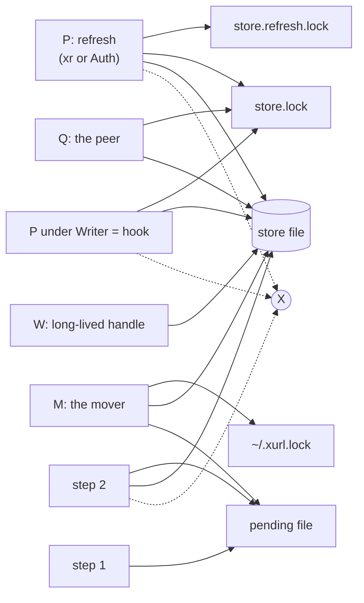
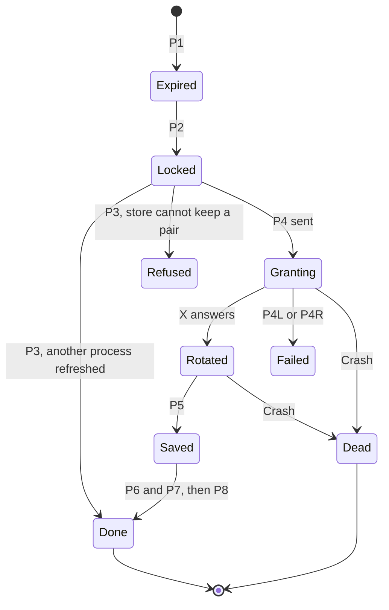
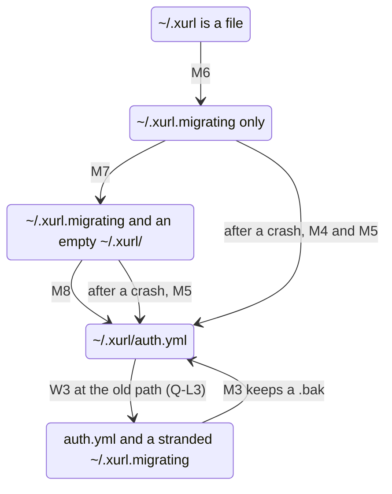
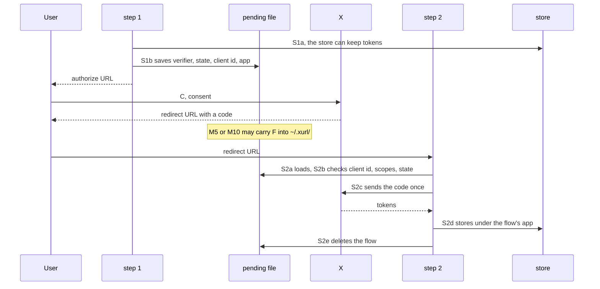

# Formal Verification of the Token Store and Sign-In - Plan

## Goal Capsule

- **Objective:** a login stored with `xr` or `xdk-rs` is not lost, brought back after a clear, or filed under the wrong
  account by any order in which processes refresh it, sign in, clear it, move the store, or die partway. Each order that
  does any of this is found, shown happening in the real code, and fixed with a regression test, or is named as an
  assumption the code cannot close. The next agent who changes this code can check the change against the same rules.
- **Means:** three TLA+ models written from the code and checked with TLC through pstack `statechart`. Each is built
  with `create-formal-verification-skill`, its bug paths are replayed as Rust tests, and it is kept true with
  `maintain-formal-verification-skill` (KTD1, KTD2).
- **Authority:** R-IDs win on behavior, KTDs on mechanism; a unit overrides neither. The Key Decisions are not reopened.
  The code at each model's sync commit is the only source of its actions; `.context/state-machines-2026-11-10.md` is
  never read or used (KD2). Code calls this plan leaves open belong to the repo prime; the model's location (KD5) and
  any public `xdk-rs` API (KD6) are Brett's.
- **Execution profile:** starts once #645, #646, and #647 have merged (order doc rule 4). Several PRs: one `fix(...)` PR
  per confirmed bug (KD4), and one change that adds the verification under option (a) or (b), with none under (c)
  (KTD7). Until Brett picks a location, each model is written in a scratch folder outside the repo, as the `statechart`
  skill asks. Branches, commits, reviews, and merges follow `AGENTS.md` and the contributor's global instructions.
- **Stop conditions:** stop and report when a replay needs a seam in product code (KTD6), when a rule cannot be made to
  fail on its broken variant, when a fix would change a public `xdk-rs` API, or when a bug path does not reproduce and
  the model cannot be shown wrong.

---

## Product Contract

### Summary

Three models: the store's writers under an OAuth2 refresh, the move into the directory layout, and the headless sign-in
composed with the move. Each model states the code's promises as rules, TLC checks every rule in every order of steps
inside the model, and each rule is shown failing on a broken variant of the code. Every counterexample TLC reports is
replayed as a Rust test against the real store, and each one that reproduces gets its own fix PR carrying that test. A
project-local verify skill records what each model covers, so the next agent can rerun it on a change.

### Problem Frame

The bugs in this code cluster where several processes share one file. The fix history shows
it: #555, #556, #558, #559, #564, #565, and #610 in the store and the refresh; #515, #517, #561, #606, #615, and #617 in
the headless sign-in. Most of those fixes came from someone thinking of one more order of steps. A test checks the
orders someone wrote down, and TLC checks every order inside a stated model.

The code's own doc comments name the hard parts:

- a refresh token is single-use, so two processes must not both spend it (`crates/xdk/src/store/lock.rs:113-119`);
- a lock is as strong as the filesystem's `flock` (`crates/xdk/src/store/lock.rs:121-122`);
- deleting a held sidecar lets the next process lock a fresh inode (`crates/xdk/src/store/atomic.rs:12-17`);
- the layout move is two renames that a crash can split (`crates/xdk/src/store/layout.rs:80-83`).

When one of those orders is missed, the harm lands on the user: the store keeps only a refresh token X has already
retired, so the user must sign in again; a cleared credential comes back; or a write lands in a file no later call
reads. Plan M's mutation runs on `auth` and `store` need the fixed code under them, so F's fixes come first.

### Requirements

**Models**

- R1. Each target has a TLA+ model, and each of its actions names the code it stands for at `file:line`, one action per
  step the code performs as a unit: one rename, one locked read-modify-write, one request.
- R2. Each model states its rules (§ "The models") as invariants, each one a sentence with its harm in a second
  sentence, and no rule is weakened to make it hold.
- R3. Crashes, Ctrl-C, lost answers, and deadlines are actions; no model has a clock.
- R4. Each model names its assumptions (A1 to A6), among them X's handling of a spent refresh token and a lock being as
  strong as `flock`.

**Proof that each check can fail**

- R5. Each rule is seen failing on the broken variant of the code that § "The models" names for it, and holding again
  once the variant is dropped.

**Findings**

- R6. Each counterexample is replayed as a Rust test under `crates/xdk/tests/`, on a `tempfile::TempDir` with explicit
  store paths, one test step per model action, with a control run beside it. A replay counts only once it has been seen
  failing on the unfixed code.
- R7. A replay that reproduces is a confirmed bug and gets its own `fix(...)` PR with a changelog entry and the replay
  as its regression test. A replay that does not reproduce means the model is wrong until shown otherwise.
- R8. Each finding of `.context/state-machines-2026-11-26.md` that falls in targets 1 to 3 appears here as a
  counterexample a model must find or as a rule it states (§ "Cross-check").

**Keeping the models true**

- R9. Once a model has passed its break-and-catch run, a project-local verify skill exists for it. It carries
  frontmatter, a coverage record of the files and functions each check covers, the sync commit, one rerun command with a
  pinned TLC, and names `/statechart` without copying its commands.
- R10. `maintain-formal-verification-skill` runs when covered code changes, and once after plan M's cuts if they touched
  covered code.
- R11. Every unit that depends on where the model lives says what it does under each of options (a), (b), and (c).

### Key Decisions

- KD1. Targets 1 to 3 are in; the audit's target 4, media upload and the processing wait, is out. (session-settled:
  user-directed, chosen over modelling all four audit targets: the audit rated target 4 as chart value more than
  bug-finding value) Governs R1.
- KD2. The models are written from the code at the commit each is synced to; `.context/state-machines-2026-11-10.md` is
  never read or used. (session-settled: user-directed, chosen over using that audit's machine map and bug list as spec
  input: it may be out of date and was modelled less well) Governs R1, R8.
- KD3. Every rule is shown failing on a broken variant, and every bug path is replayed as a Rust test. Governs R5, R6.
- KD4. Each confirmed bug gets its own fix PR, and every `auth` and `store` fix merges before plan M's mutation run
  reaches those areas. Governs R7.
- KD5. Where the model lives stays open among (a), (b), and (c) until Brett picks one (§ "Where the model lives").
  Governs R11.
- KD6. The store refresh hook writing a rotated pair over the wrong login (H2/H4 in the 2026-11-26 audit) is modelled,
  and its fix is left to Brett's open decision on the `OnTokenRefreshed` API; this plan proposes no API. Governs R7, R8.

### Scope Boundaries

- Media upload and the processing wait (KD1).
- Code-level verifiers such as Kani: no question here is about one input to one pure function.
- The `url_authority.rs` property test, which belongs to plan M.
- Go `xurl` and hand edits as writers of `~/.xurl/auth.yml`: they take no sidecar lock, so no rule can hold against them
  (A4).
- Two embedder processes refreshing one in-code `OAuth2Credential`: the client keeps that pair in memory, and
  serializing two copies of it is the embedder's job.
- Anything a review suggests beyond this scope.
- Considered and not built: a TLC job that blocks a merge (none of the three options asks for one; a red model run is a
  finding to triage, not a gate), and a fault-injection seam in product code for replays (KTD6 says when one would be
  needed, and that case is a stop condition).

### Success Criteria

- Each model's `report.md` lists every rule under "Rules that hold" or as a break that is replayed and fixed, or as the
  consequence of a named assumption. No rule is left under "Rules not checked".

### Sources

- `~/dev/xurl-rs/.context/2026-11-26-pstack-skills-audit.md`, § "Why formal verification fits xurl-rs
  specifically" through § "How a run would go": targets, candidate rules, and the location options. Its `file:line` refs
  are at `dev` 492e187.
- `docs/solutions/best-practices/model-check-a-request-lifecycle-with-one-request-and-an-abstract-peer.md`: the prior
  run's method and its tooling gotchas.
- `~/github-stars/cursor/plugins/pstack/skills/create-formal-verification-skill/SKILL.md`, `statechart/SKILL.md`, and
  `maintain-formal-verification-skill/SKILL.md`, read through
  `~/github-stars/cursor/plugins/pstack/docs/harness/claude-code.md`.
- `~/dev/xurl-rs/.context/2026-11-26-cleanup-order-of-events.md`: § "The rules that fix the order", Phase 3,
  Phase 5 step 4, Phase 6 step 3, and § "Parallel tracks".
- `~/dev/xurl-rs/.context/state-machines-2026-11-26.md`, read only after the actions and rules below were
  drafted, as a cross-check (§ "Cross-check").
- PR #645 (`fix/state-machines-01-rotated-pair-stored-where-read`), open at the time of writing; it changes
  `refresh_oauth2_token` in `crates/xdk/src/auth/oauth2.rs`.

---

## Planning Contract

### Key Technical Decisions

- KTD1. **TLA+ checked by TLC through pstack `statechart`.** The question in every target is which order of steps breaks
  a rule, which a model checker answers over a small model of the design; `create-formal-verification-skill` makes TLA+
  its default for that, and the prior run used the same tool. TLC is `tla2tools.jar` v1.7.4, verified against the sha256
  the skill pins in `statechart/scripts/run.ts`, run by Java 11 or later from `PATH` through `TLA2TOOLS` and `JAVA`,
  since mise is not installed and the skill's own install path needs it. `statechart` runs under bun or node.
- KTD2. **Three models, with the composition inside model 2.** Model 1 holds the refresh at full grain against an
  abstract peer. Model 2 holds the move at full grain, and carries target 1's refresher only at the grain of its two
  store accesses, the grant between them, and its lock files. Model 3 holds the headless sign-in, and carries model 2's
  mover only where it renames the pending file and the store. The reason is measured (§ "Feasibility"): target 1 alone
  reached 325 states and target 2 alone 708, so the product of the two at full grain passes the 500-state chart budget
  many times over, while the refresh and the move meet only at those store accesses and lock files. The order doc
  sketches targets 1 and 2 as one model; model 2 is that model, with the refresh in it at the grain where the two
  interact.
- KTD3. **One actor in full, plus an abstract peer.** Every other writer of the store collapses into one peer whose each
  act is one locked `TokenStore::update`, as the prior run collapsed every other run of a target into one variable. A
  second full refresher would double the state space and hide the lifecycle in the chart.
- KTD4. **A constant per known bypass, and a config per setting.** Model 1: `Writer` (`"store"` for
  `refresh_oauth2_token`, `"hook"` for the in-code credential with `StoreRefreshHook`) and `RefreshLockHolds` (TRUE on a
  filesystem that honours `flock`, FALSE for one that does not, A2). Model 2: `LongLivedHandle` (TRUE when an embedder,
  an older `xr`, or an `xr` whose own move failed holds a path it located before the move; FALSE when only `xr`
  processes run, which move the store before they open it, `crates/xurl-cli/src/cli/runner.rs:452`). Model 3:
  `SharedClientId` (two stored apps carry one client id). Each model runs every setting, so a break that needs a bypass
  is told apart from one that does not.
- KTD5. **The rules run at full bounds, and the chart from its own config.** When the rules config passes 500 states,
  `statechart` draws only the bug paths and still checks every rule; a second config with tighter bounds draws the
  passing chart. Each reduction is recorded with the counts before and after it and what it gives up (§ "Feasibility"
  shows the first ones, for target 2).
- KTD6. **Replay seams, one per kind of action, in the table below.** Every one runs inside the `AGENTS.md` § "Testing"
  guards: explicit paths under a `TempDir`, `EnvOverrides` instead of the process environment, and no `HOME`. An
  interleaving inside one synchronous function, with no await and no crash between its steps, has no seam. Its replay
  takes the crash-and-restart variant of the path when the model has one that ends in the same state; otherwise it is a
  stop condition, since a seam is a change to product code.

| Model action                                               | How the replay takes the step                                                                                                                                                                  |
| ---------------------------------------------------------- | ---------------------------------------------------------------------------------------------------------------------------------------------------------------------------------------------- |
| A peer writes while a request is out                       | A wiremock `Respond` that writes the store when the request arrives, as `ChangeThenAnswer` does in `crates/xdk/tests/saved_identity_tests.rs`                                                  |
| X rotates, refuses a spent token, or refuses a reused code | A stateful responder that keeps the live refresh tokens and codes and answers `invalid_grant` for a spent one (A1, A3)                                                                         |
| The answer is lost after X acted                           | The responder records the grant, then answers after the client's timeout                                                                                                                       |
| A crash or Ctrl-C at an await                              | Drop the future at that await; the disk is what a kill leaves (A5)                                                                                                                             |
| A crash between two syscalls of one function               | Build the disk state that crash leaves, then take the next action through the public call, as `a_move_interrupted_between_its_renames_is_finished` (`crates/xdk/src/store/layout.rs:421`) does |
| Another process holds a lock                               | The test opens the sidecar and calls `File::lock` on it, as another process does                                                                                                               |
| A long-lived handle                                        | A `TokenStore` opened at the path `locate_store` returned, kept across the move                                                                                                                |

- KTD7. **Verification files never ride in a fix PR.** Specs, configs, views, and the verify skill change in a change of
  their own, as `maintain-formal-verification-skill` says ("Put the verification updates in a change of their own"). A
  fix PR carries the product fix, its replay test, and its changelog entry.
- KTD8. **Where a replay test lives.** A refresh replay goes in `crates/xdk/tests/saved_identity_tests.rs`, beside the
  seam it reuses. A headless replay goes in `crates/xdk/tests/auth_pending_tests.rs`. A layout replay goes in a new
  `crates/xdk/tests/store_layout_tests.rs`, since no `xdk` integration test covers the move today, or in the module that
  takes its place once plan R's U6 (one test binary per crate) has landed. A failing replay never lands on `dev` before
  its fix: the zero-broken-tests rule puts it in the fix PR.
- KTD9. **Line pins.** Refs into `crates/xdk/src/auth/oauth2.rs` are pinned only after #645 merges, against its merge
  commit on `dev`, and that commit is recorded here; until then they are cited by function name and marked "lines pinned
  after #645". Every other ref is pinned at `dev` 492e187. A model's own action table is pinned again at its sync commit
  when the model is written.

### Assumptions

- A1. X retires a refresh token at the grant and gives no grace period, so a second grant with it is refused with
  `invalid_grant`. #645's own comment rests on this ("X retired the refresh token at the grant"). Under it, a process
  that dies, or loses X's answer, between the grant and the rename that saves the pair leaves the login dead, and no
  client code can close that window. A grace period would make the window cost nothing; the models take the stricter
  case. Nobody sends a request to X to find out (the pay-as-you-go rule).
- A2. A lock is as strong as the filesystem's `flock`. A local filesystem honours it; an NFS or SMB mount without lock
  support does not (`crates/xdk/src/store/lock.rs:121-122`, `crates/xdk/src/store/atomic.rs:12-17`). Model 1's
  `RefreshLockHolds = FALSE` config shows what breaks without it.
- A3. X refuses an authorization code sent a second time.
- A4. Every writer of the store takes its sidecar lock. `xr` and `xdk-rs` do; Go `xurl` and hand edits do not, and are
  out of scope.
- A5. A dead process's `flock`s are released, and each file is as its last completed rename left it
  (`crates/xdk/src/store/atomic.rs:1-10`); a temp file it left is swept after 60 s
  (`crates/xdk/src/store/atomic.rs:24-27`, `:58-88`). A dropped future runs destructors a kill skips (the temp-file
  unlink, the unlock), whose effects the OS gives a kill anyway, so the replay's crash at an await matches a kill.
- A6. Ctrl-C on an ordinary command kills the process: `xr` installs a signal handler only for the browser sign-in,
  streaming, and `webhooks listen` (`crates/xurl-cli/src/cli/shutdown.rs`, used at
  `crates/xurl-cli/src/cli/commands/auth/signin.rs:156`), so a Ctrl-C during a refresh or a headless step is the crash
  action.

### High-Level Technical Design

These sketches show the shape of the three models for review. They are directional: the charts `statechart` draws from
the specs replace them, and the action tables in § "The models" are what the specs follow.

Who touches what. A solid arrow takes a lock or writes; a dotted one sends a request.

P's phases under `Writer = "store"`, on the code after #645 (model 1).

What sits on disk during a move (model 2). M3 is the `.bak` kept when a stranded file reappears beside `auth.yml`.

The headless sign-in (model 3), with the move able to carry the pending file between step 1 and step 2.

### The models

Each table maps actions to code. Each model's rules table gives the rule, its harm, and the broken variant that must
make it fail (R5). Rule names are the invariant names in the spec.

#### Model 1: the store writers (target 1)

**Actors.** P is one process refreshing an expired OAuth2 login of one app. Under `Writer = "store"` it runs
`refresh_oauth2_token`; under `Writer = "hook"` it is an embedder's in-code `OAuth2Credential` whose hook is
`StoreRefreshHook`. Q is the abstract peer: every other process writing the same store, each act one locked update. X is
the token endpoint and `/2/users/me`, abstracted to the set of refresh tokens it still accepts.

**State.** The store file: whether it exists, whether the app is in it, and for each slot (the label under refresh, a
second label, the unnamed slot) the token it holds and whether it carries an account id. The app's default user. X's
live set. P's phase, the token it read, and the pair it was given. History variables for the rules: the grants each
refresh token was sent in, and the store as the peer last left it.

| Action | What happens                                                                                                                                              | Code                                                                                                                                                                                                                                                               |
| ------ | --------------------------------------------------------------------------------------------------------------------------------------------------------- | ------------------------------------------------------------------------------------------------------------------------------------------------------------------------------------------------------------------------------------------------------------------ |
| P1     | P finds its login expired on the view it loaded                                                                                                           | `refresh_oauth2_token`, first `stored_oauth2_token` and `is_expired` (`crates/xdk/src/auth/oauth2.rs`, lines pinned after #645)                                                                                                                                    |
| P2     | P checks the store can keep a pair, then takes the refresh lock, waiting while another process holds it                                                   | `TokenStore::refuse_unless_writable` (`crates/xdk/src/store/mod.rs:919-935`); `RefreshLock::acquire_off_runtime` (`crates/xdk/src/store/lock.rs:168-172`, `:137-158`)                                                                                              |
| P3     | P re-reads the store; a pair another process stored meanwhile ends the refresh with that pair, and a store that cannot keep a pair ends it with a refusal | `reload` (`crates/xdk/src/store/mod.rs:800-829`, `load_backing_file` `:242-263`), the second `refuse_unless_writable`, `stored_oauth2_user` (`crates/xdk/src/auth/oauth2.rs`, lines pinned after #645)                                                             |
| P4     | P sends the grant; X retires the token it was sent and answers with a new pair                                                                            | `refresh_grant` (`crates/xdk/src/auth/oauth2.rs`, lines pinned after #645)                                                                                                                                                                                         |
| P4L    | the grant reaches X and X acts, but the answer is lost                                                                                                    | `refresh_grant` returning `Error::Http`                                                                                                                                                                                                                            |
| P4R    | X refuses a token it has retired                                                                                                                          | `token_endpoint::answer` returning `Error::Auth`                                                                                                                                                                                                                   |
| P5     | P stores the pair where the token it was minted from still sits, under the store lock, by rename                                                          | `put_refreshed_oauth2_token`, `write_oauth2_token` (`crates/xdk/src/store/tokens.rs:115-188`), `MintedFrom::destination` (`:830-854`), `TokenStore::update` (`crates/xdk/src/store/mod.rs:745-767`), `write_atomically` (`crates/xdk/src/store/atomic.rs:214-234`) |
| P6     | P asks `/2/users/me` for what the store lacks: a name, or the account id                                                                                  | `fetch_identity` in `refresh_oauth2_token` (lines pinned after #645)                                                                                                                                                                                               |
| P7     | P records the answer on the pair it stored, if that pair is still there                                                                                   | the second `put_refreshed_oauth2_token`, keyed by the rotated token (lines pinned after #645)                                                                                                                                                                      |
| P8     | P releases the refresh lock and returns the new access token                                                                                              | drop of `RefreshLock` (`crates/xdk/src/store/lock.rs:175-179`)                                                                                                                                                                                                     |
| H1     | under `Writer = "hook"`: P finds its in-memory credential expired and sends the grant, with no refresh lock and no re-read                                | `Credentials::refresh_oauth2` (`crates/xdk/src/auth/credentials.rs:181-202`)                                                                                                                                                                                       |
| H2     | the hook stores the pair under the app's default user, else its first OAuth2 user                                                                         | `StoreRefreshHook::on_token_refreshed` (`crates/xdk/src/store/hook.rs:24-66`), `refresh_target_user` (`:95-101`), `TokenStore::update_at` (`crates/xdk/src/store/mod.rs:776-795`)                                                                                  |
| Crash  | P dies at any phase: a crash, a kill, or Ctrl-C (A6)                                                                                                      | A5                                                                                                                                                                                                                                                                 |
| Q1     | the peer signs in under the label P is refreshing                                                                                                         | `exchange_code_for_token` (`crates/xdk/src/auth/oauth2.rs`, lines pinned after #645), `put_oauth2_token` and `put_answered_oauth2_token` (`crates/xdk/src/store/tokens.rs:87-108`)                                                                                 |
| Q2     | the peer clears that login                                                                                                                                | `clear_oauth2_token_for_app` (`crates/xdk/src/store/tokens.rs:697-722`)                                                                                                                                                                                            |
| Q3     | the peer removes the app                                                                                                                                  | `TokenStore::remove_app` (`crates/xdk/src/store/mod.rs:433-443`)                                                                                                                                                                                                   |
| Q4     | the peer empties the store: it clears every credential of the app, or the file is deleted                                                                 | `clear_all_for_app` (`crates/xdk/src/store/tokens.rs:774-781`); a missing file reloads as a fresh store (`crates/xdk/src/store/mod.rs:260`)                                                                                                                        |
| Q5     | the peer refreshes the same login from start to save, while P holds no refresh lock, or at any time under `RefreshLockHolds = FALSE`                      | `refresh_oauth2_token` as a whole                                                                                                                                                                                                                                  |
| Q6     | the peer makes another login the app's default user                                                                                                       | `TokenStore::set_default_user` (`crates/xdk/src/store/mod.rs:568`)                                                                                                                                                                                                 |
| Q7     | the peer makes another app the store's default app, as `xr auth default <app>` does                                                                       | `TokenStore::set_default_app` (`crates/xdk/src/store/mod.rs:450-457`)                                                                                                                                                                                              |
| E1     | the store stops being one a save can write: the file no longer parses, or its directory refuses a temp file                                               | `refuse_if_load_failed` (`crates/xdk/src/store/mod.rs:891-899`), `refuse_unless_writable` (`:919-935`)                                                                                                                                                             |
| Done   | P has returned, failed, or died, and nothing changes                                                                                                      | the end states, so a correct end is not a deadlock                                                                                                                                                                                                                 |

| Rule                    | Sentence                                                                                                                                                | Harm if it breaks                                                                                                      | Broken variant that must break it                                                                                                  |
| ----------------------- | ------------------------------------------------------------------------------------------------------------------------------------------------------- | ---------------------------------------------------------------------------------------------------------------------- | ---------------------------------------------------------------------------------------------------------------------------------- |
| `SingleSpend`           | No refresh token is sent in two grants.                                                                                                                 | The second process's request fails with `invalid_grant`, and the user sees a sign-in error for a login that was fine.  | Drop the `reload()` after the refresh lock (P3). Also breaks under `RefreshLockHolds = FALSE`, which shows A2.                     |
| `LandsWhereRead`        | A rotated pair, and a `/2/users/me` answer, are written only onto the login they were minted from or asked under.                                       | Another login's credential is overwritten, so the user is signed out of it or a request goes out as the wrong account. | Write through `put_oauth2_token`, which skips the `MintedFrom` check. Expected to break under `Writer = "hook"` (H2/H4, KD6).      |
| `PeerWriteStands`       | A login another process signed in or cleared, an app it removed, or a store it emptied while the grant was out stays as that process left it.           | A cleared credential comes back, or a removed app reappears (#558).                                                    | Save without the re-read under the store lock: drop `reload_locked` from `TokenStore::update` (`crates/xdk/src/store/mod.rs:762`). |
| `NoGrantWithoutKeep`    | A grant goes out only after a check made under the refresh lock found the store able to keep its answer.                                                | The refresh token is spent on a pair the store then refuses, and the login is dead (#556, #564).                       | Drop the `refuse_unless_writable` that follows the re-read in P3.                                                                  |
| `RotatedPairSavedFirst` | No other request goes out between X's answer and the save of the pair it gave.                                                                          | A crash or Ctrl-C during that request leaves only the retired token stored, and the user must sign in again.           | The `dev` code before #645, which asks `/2/users/me` before it saves.                                                              |
| `LiveAfterRefresh`      | When a refresh returns success, the store holds, for that login, a refresh token X still accepts, unless another process replaced or cleared the login. | A refresh that reported success left a dead login, and the next one fails.                                             | Save the refresh token that was sent in place of the one X answered with.                                                          |

**Bounds.** One app under `Writer = "store"` and two under `Writer = "hook"`, so Q7 can change the app the hook
resolves; two labels and the unnamed slot; at most two peer acts; X mints at most four tokens. **Expected
states.** The reduced feasibility spec (one label, no hook writer, no Q4, Q6, or E1) reached 325. The full model is
expected between 500 and 2,000 states; its chart config (`Writer = "store"`, `RefreshLockHolds = TRUE`, one label) is
expected under 500.

#### Model 2: the directory-layout move, with a refresher across it (target 2, composed with target 1)

**Actors.** M is an `xr` process running `adopt_directory_layout`, which the next `xr` call runs again after a crash. W
is a long-lived handle under `LongLivedHandle`. It located the store before or during the move and keeps that path: an
embedder's `TokenStore`, an `xr` 4.3.0 or earlier, or an `xr` whose own move failed. W writes through locked updates and
refreshes as target 1 does. R is an `xr` process that started after the move and refreshes the same login through
`~/.xurl/auth.yml`.

**State.** What sits at `~/.xurl` (a file, a directory, or nothing), and which of `~/.xurl.migrating`,
`~/.xurl.migrating.bak`, and `~/.xurl/auth.yml` exist. The writes each file holds, and the refresh token each holds for
the login. For each lock sidecar (`~/.xurl.lock`, `~/.xurl.refresh.lock`, `~/.xurl.migrating.lock`,
`~/.xurl/auth.yml.lock`, `~/.xurl/auth.yml.refresh.lock`), the inode the path names now. For each process, the inode it
opened and whether it holds it. The pending file's location, for model 3. X's live set, as in model 1.

| Action | What happens                                                                                                                                                                                    | Code                                                                                                                                                          |
| ------ | ----------------------------------------------------------------------------------------------------------------------------------------------------------------------------------------------- | ------------------------------------------------------------------------------------------------------------------------------------------------------------- |
| M1     | M finds a single-file store at `~/.xurl` or a stranded `~/.xurl.migrating`, and opens `~/.xurl.lock`                                                                                            | `adopt_directory_layout` (`crates/xdk/src/store/layout.rs:85-96`), `lock_path_for` (`crates/xdk/src/store/lock.rs:30-34`)                                     |
| M2     | M takes `~/.xurl.lock`, waiting for the inode it opened                                                                                                                                         | `StoreLock::acquire` (`crates/xdk/src/store/lock.rs:57-85`)                                                                                                   |
| M3     | M keeps a stranded file as `.bak` when `~/.xurl/auth.yml` exists                                                                                                                                | `finish_interrupted_move` (`crates/xdk/src/store/layout.rs:200-203`), `keep_as_backup` (`:247-259`)                                                           |
| M4     | M creates `~/.xurl/` and takes the stranded file's lock                                                                                                                                         | `crates/xdk/src/store/layout.rs:204-207`                                                                                                                      |
| M5     | M renames the stranded file to `~/.xurl/auth.yml`, releases its lock, and carries both layouts' pending files while removing their lock files                                                   | `crates/xdk/src/store/layout.rs:208-212`, `move_sidecars` (`:264-272`)                                                                                        |
| M6     | M renames `~/.xurl` to `~/.xurl.migrating`, after keeping an older stranded file as `.bak`                                                                                                      | `move_into_directory` (`crates/xdk/src/store/layout.rs:226-231`)                                                                                              |
| M7     | M creates `~/.xurl/`                                                                                                                                                                            | `crates/xdk/src/store/layout.rs:232`, `create_store_dir` (`:309-318`)                                                                                         |
| M8     | M renames `~/.xurl.migrating` to `~/.xurl/auth.yml`                                                                                                                                             | `crates/xdk/src/store/layout.rs:236`                                                                                                                          |
| M9     | a step that fails undoes the ones before it                                                                                                                                                     | `crates/xdk/src/store/layout.rs:232-240`                                                                                                                      |
| M10    | M carries `~/.xurl.pending` into the directory and removes `~/.xurl.lock` and `~/.xurl.refresh.lock` while it still holds the first                                                             | `crates/xdk/src/store/layout.rs:105`, `move_sidecars` (`:264-272`)                                                                                            |
| M11    | M releases `~/.xurl.lock`                                                                                                                                                                       | drop of `StoreLock` (`crates/xdk/src/store/lock.rs:93-100`) at the end of `adopt_directory_layout` (`crates/xdk/src/store/layout.rs:125`)                     |
| MCrash | M dies at any point; the next `xr` call starts at M1                                                                                                                                            | A5; `crates/xurl-cli/src/cli/runner.rs:452`                                                                                                                   |
| W1     | W locates the store once: `~/.xurl` while it is a file, `~/.xurl.migrating` while it is stranded and no `auth.yml` exists, `auth.yml` otherwise                                                 | `locate_store` (`crates/xdk/src/store/layout.rs:63-68`), `path_to_open` (`:143-153`), `is_own_stranded_store` (`:159-171`)                                    |
| W2     | W opens the lock sidecar beside its path, creating it when missing                                                                                                                              | `StoreLock::acquire` (`crates/xdk/src/store/lock.rs:57-78`)                                                                                                   |
| W3     | W runs one locked update once the inode it opened is free: it re-reads its path (a directory is unreadable and refused, a missing file is a fresh store), writes, saves by rename, and releases | `TokenStore::update` (`crates/xdk/src/store/mod.rs:745-767`), `load_backing_file` (`:242-263`), `write_atomically` (`crates/xdk/src/store/atomic.rs:214-234`) |
| W4     | W refreshes: under `<its path>.refresh.lock` it re-reads, sends the grant, then saves through W3                                                                                                | model 1's P2 to P5 at this grain (lines pinned after #645)                                                                                                    |
| R1     | R refreshes the same login through `~/.xurl/auth.yml` under `~/.xurl/auth.yml.refresh.lock`                                                                                                     | as W4, at the new path                                                                                                                                        |
| Done   | every process has returned or died                                                                                                                                                              |                                                                                                                                                               |

| Rule                              | Sentence                                                                                                                             | Harm if it breaks                                                                | Broken variant that must break it                                                                                                            |
| --------------------------------- | ------------------------------------------------------------------------------------------------------------------------------------ | -------------------------------------------------------------------------------- | -------------------------------------------------------------------------------------------------------------------------------------------- |
| `NoLostWrite`                     | Every write a caller saw succeed is in the store the next call opens.                                                                | A credential the user just stored is gone from the store every later call reads. | Drop the wait for the stranded file's lock in `finish_interrupted_move` (`crates/xdk/src/store/layout.rs:207`).                              |
| `StrandedKept`                    | A file that holds a store is never removed or overwritten; once it is no longer the store, it is kept as `.bak` with a warning.      | Credentials vanish without a word.                                               | Drop the `keep_as_backup` before the first rename (`crates/xdk/src/store/layout.rs:226-230`), so the rename replaces an older stranded file. |
| `OneWriterAtATime`                | Two processes never run a read-modify-write of the same store file at once.                                                          | Two interleaved updates lose one of them.                                        | Drop the lock `adopt_directory_layout` takes (`crates/xdk/src/store/layout.rs:96-98`).                                                       |
| `OneStoreAfterCrash`              | After a crash at any point of a move, the next `adopt_directory_layout` leaves one store that holds every credential the store held. | Reads and writes split across two files.                                         | Drop the `finish_interrupted_move` call (`crates/xdk/src/store/layout.rs:99`).                                                               |
| `SingleSpend`, `LiveAfterRefresh` | Model 1's rules, held across the move.                                                                                               | As in model 1.                                                                   | As in model 1.                                                                                                                               |

**Questions this model settles.** These come from reading the code and from the feasibility spec; none has been
replayed, so none is a bug yet.

- Q-L1. `move_sidecars` removes `~/.xurl.lock` while M still holds it (`crates/xdk/src/store/layout.rs:105`, inside the
  lock taken at `:96`). Can a second process then hold a lock on the same store at once, and does any lost write follow?
  This is the open question of the pstack skills audit (§ "Sources"), and `OneWriterAtATime` and `NoLostWrite` answer it.
- Q-L2. A handle that located `~/.xurl` or `~/.xurl.migrating` before the move finished keeps that path. Its next update
  re-reads a missing file as a fresh store (`crates/xdk/src/store/mod.rs:260`) and saves a new file there, which no
  later call reads once `auth.yml` exists. The feasibility spec reached this order and broke `NoLostWrite`.
- Q-L3. `move_into_directory` takes no lock on `~/.xurl.migrating` (`crates/xdk/src/store/layout.rs:225-242`), where
  `finish_interrupted_move` does (`:207`). Can a handle that located the stranded path between M6 and M8 write into it
  after it moved?
- Q-L4. A refresh through the old path holds `~/.xurl.refresh.lock`, which M10 removes. An `xr` process after the move
  refreshes the same login under `~/.xurl/auth.yml.refresh.lock`. Do the two send one refresh token in two grants
  (`SingleSpend`), and does the old path's save fail or land in a fresh file (`LiveAfterRefresh`)?

**Bounds.** One mover with at most one restart; W with at most two writes in the rules config and one in the chart
config; R by config. **Expected states.** The feasibility spec (M plus a generic writer, no refresh) reached 708 at two
writes and 356 at one (§ "Feasibility"). With W as a refresher and R added, the rules config is expected between 1,500
and 5,000 states, so its chart draws bug paths only (KTD5); the chart config (R off, one write) is expected under 500.

#### Model 3: the headless sign-in, composed with the move (target 3)

**Actors.** S1 is a step 1 run: up to two, for two apps. S2 is a step 2 run: up to two on one saved flow. The user
consents in a browser, which X answers with a code bound to the flow. X refuses a reused code (A3). M is model 2's mover
at the grain of its renames of the pending file and the store. A clock event ends the flow's 15-minute window.

| Action  | What happens                                                                                                                                                                                         | Code                                                                                                                                                                                                                                                                                                                    |
| ------- | ---------------------------------------------------------------------------------------------------------------------------------------------------------------------------------------------------- | ----------------------------------------------------------------------------------------------------------------------------------------------------------------------------------------------------------------------------------------------------------------------------------------------------------------------- |
| S1a     | step 1 refuses when the store cannot keep tokens or holds no such app, when the authorize URL is invalid, or when the pending path is a link or a directory, and warns when it replaces a saved flow | `check_remote_step1`, `refuse_unless_store_keeps` (`crates/xdk/src/auth/oauth2.rs`, lines pinned after #645), `check_save_target` (`crates/xdk/src/auth/pending.rs:99-119`)                                                                                                                                             |
| S1b     | step 1 saves the flow (verifier, state, client id, app, scopes, creation time) beside the store, by rename and without a lock                                                                        | `run_remote_step1` (lines pinned after #645), `pending::save` (`crates/xdk/src/auth/pending.rs:127-134`); the path is `pending_path_for_store` of the store `xr` opened (`crates/xurl-cli/src/cli/commands/auth/signin.rs:180-181`), or `default_pending_path` for an embedder (`crates/xdk/src/auth/pending.rs:82-95`) |
| C       | the user consents, and X binds a code to the flow's state and verifier                                                                                                                               | outside the code                                                                                                                                                                                                                                                                                                        |
| S2a     | step 2 loads the flow: missing, expired (and then deleted), of another mode or owner, or not UTF-8 is a refusal                                                                                      | `pending::load` (`crates/xdk/src/auth/pending.rs:150-156`), `read` (`:174-244`), `ensure_fresh` (`:247-257`)                                                                                                                                                                                                            |
| S2b     | step 2 refuses a flow of another client id or other scopes, and a redirect URL whose state differs or that carries no code                                                                           | `check_flow`, `redirect_code` (`crates/xdk/src/auth/oauth2.rs`, lines pinned after #645)                                                                                                                                                                                                                                |
| S2c     | step 2 refuses when the store cannot keep tokens, then sends the code, which X answers once                                                                                                          | `exchange_code_for_token` (lines pinned after #645)                                                                                                                                                                                                                                                                     |
| S2d     | step 2 stores the tokens under the app the run names and promotes it to default when it is the first with credentials                                                                                | `exchange_code_for_token`; `put_oauth2_token`, `put_answered_oauth2_token` (`crates/xdk/src/store/tokens.rs:87-108`)                                                                                                                                                                                                    |
| S2e     | step 2 deletes the flow                                                                                                                                                                              | `run_remote_step2`, `pending::delete` (`crates/xdk/src/auth/pending.rs:266-272`)                                                                                                                                                                                                                                        |
| N       | `xr` hands out the step for a refusal: step 2 again under the saved app, or the sign-in again from step 1                                                                                            | `pending_app_hint` (`crates/xurl-cli/src/cli/hints.rs:1074-1103`), `sign_in_again_hint` (`:944`)                                                                                                                                                                                                                        |
| T       | the flow passes its 15-minute window                                                                                                                                                                 | `PENDING_TTL_SECS` (`crates/xdk/src/auth/pending.rs:22`)                                                                                                                                                                                                                                                                |
| M5, M10 | the move carries the pending file into the directory                                                                                                                                                 | `move_sidecars` (`crates/xdk/src/store/layout.rs:264-268`)                                                                                                                                                                                                                                                              |
| Crash   | any process dies at any point                                                                                                                                                                        | A5, A6                                                                                                                                                                                                                                                                                                                  |

| Rule                 | Sentence                                                                                                     | Harm if it breaks                                                                                                                                                                                                                                                             | Broken variant that must break it                                                        |
| -------------------- | ------------------------------------------------------------------------------------------------------------ | ----------------------------------------------------------------------------------------------------------------------------------------------------------------------------------------------------------------------------------------------------------------------------- | ---------------------------------------------------------------------------------------- |
| `SavedUnderStep1App` | Step 2 stores the tokens only under the app step 1 saved in the flow.                                        | The login lands under another app's name, where `--app` does not find it. The doc comments promise only that step 2 refuses another client id (`crates/xdk/src/auth/pending.rs:34-40`), so a break that needs two apps sharing a client id is a code call for the repo prime. | Drop the client-id comparison in `check_flow`.                                           |
| `CodeOnlyWhenKept`   | The code is sent only when the store can keep the tokens.                                                    | The single-use code is spent on tokens the store refuses, and the user must consent again (#564).                                                                                                                                                                             | Drop `refuse_unless_store_keeps` from `exchange_code_for_token`.                         |
| `RefusalRestarts`    | Every refusal of step 1 or step 2 leaves a state from which the step `xr` hands out succeeds when X answers. | The user follows the step they were given and is refused again (#515, #517, #615).                                                                                                                                                                                            | Delete the flow when step 2 fails, so "step 2 again" has nothing to read.                |
| `FlowSurvivesMove`   | The flow step 1 saved is the flow step 2 reads, across the move.                                             | Step 2 finds no flow and the user starts over, and a stranded file keeps a PKCE verifier on disk.                                                                                                                                                                             | Drop the pending rename from `move_sidecars` (`crates/xdk/src/store/layout.rs:265-268`). |

**Questions this model settles.** Two step 2 runs on one flow. Step 1 for two apps at once, where the second save
replaces the first's flow, since there is one pending file per store. A flow an embedder saves beside the single-file
store (`default_pending_path` reads `locate_store`) while M moves it: `pending::save` takes no lock.

**Bounds.** Two apps, two step 1 runs, two step 2 runs, one consent, the mover with at most one restart. **Expected
states.** Above 500 for the rules config; the chart config (one step 1, one step 2, no mover) is expected under 500.

### What the models leave out

A model checks only what it carries. These are outside all three, each with what stands in for it:

- **Time.** No model has a clock. Expiry is the event P1 reads, the 15-minute window is the event T, and a lost answer
  is P4L. The skew margin, the 60-second temp-file sweep, and every timeout are outside (A5).
- **Token contents and client ids.** A token is a name. Scopes appear only as S2b's comparison. No model compares a
  client id, so a `CLIENT_ID` that overrides an app's stored one (`crates/xdk/src/auth/mod.rs:173-175`) is outside.
- **X beyond its live tokens and codes.** X is the set of refresh tokens and codes it still accepts (A1, A3). Access
  tokens, the account a `/2/users/me` answer names beyond the label it maps to, rate limits, and retries are outside.
- **Other credentials.** OAuth1 pairs and bearer tokens, and the `.twurlrc` import and legacy-format rewrite that run
  when the store opens (`crates/xdk/src/store/migration.rs`, which #646 changes). A load gives the store as it is.
- **Writers that take no lock,** and filesystems without `flock` (A2, A4).
- **File modes, owners, and links.** Step 2's checks of them, and step 1's, appear only as the refusals they end in
  (S1a, S2a).
- **Platforms other than Unix.** Q-L1 rests on an unlinked lock file keeping its inode while a holder keeps it open.
  Windows does not remove a file another handle holds open the same way, so model 2 answers Q-L1 for Unix only.
- **The browser sign-in,** its callback listener and its success page (the audit's P3): model 3 is the headless flow.
- **Two embedder processes on one in-code `OAuth2Credential`** (§ "Scope Boundaries"), and an in-memory view after a
  failed closure or a reentrant update (§ "Cross-check").
- **Dry runs,** which write nothing.

### Cross-check against the 2026-11-26 state-machine audit

The actions and rules above were drafted from the code. The audit was read afterwards, to check that the models reach
everything it found in targets 1 to 3. It added one action, Q7, which H2 needs. Each finding is listed below with the
model that reaches it, and with whether it appears as a counterexample TLC must find or as a rule the model states.
`statechart` checks each rule on its own, so a break of one rule under `Writer = "hook"` does not hide another.

| Audit finding                                                                                                             | Model                          | Counterexample or rule                                                                                                                                                                                                                                                     |
| ------------------------------------------------------------------------------------------------------------------------- | ------------------------------ | -------------------------------------------------------------------------------------------------------------------------------------------------------------------------------------------------------------------------------------------------------------------------- |
| R1: a refresh that must look up its login's account stores nothing until the lookup answers (fixed by #645)               | 1                              | Rule `RotatedPairSavedFirst`. On the code before #645, its broken variant, the counterexample is P4, P6, then Crash, leaving only the retired token stored. The rule holds on the merged code.                                                                             |
| Issue 1, the window between #645's two writes: a sign-in or clear during the lookup stays as the other process left it    | 1                              | Rules `LandsWhereRead` and `PeerWriteStands`, over Q1 or Q2 between P5 and P7. Keying P7 on the spent token in place of the rotated one is a broken variant, the one the audit's test `a_refresh_lookup_answer_is_not_recorded_on_a_login_signed_in_during_it` catches.    |
| H2: the store's hook writes another app's rotated pair over the default app's login (open, Issue 1b)                      | 1, `Writer = "hook"`, two apps | Counterexample of `LandsWhereRead`: H1, then Q7, then H2 writes into the app Q7 made the default.                                                                                                                                                                          |
| H4: the hook writes under a default user whose login was cleared (open, Issue 1b)                                         | 1, `Writer = "hook"`           | Counterexample of `LandsWhereRead` and of `PeerWriteStands`: H1, then Q2 of the default user, then H2 writes under the cleared label and brings it back.                                                                                                                   |
| Issue 1b, the login picked by read precedence (`first_oauth2_user_for_app`), one of the two rules the reverted fix tried  | 1, `Writer = "hook"`           | A broken variant of H2. Its counterexample is a Q2 of the login the client was built from, after which H2 writes over the next login.                                                                                                                                      |
| Issue 1b, refusing an app whose stored client id differs from the credential's, the other rule                            | none                           | Left out: the model carries no client id, and a `CLIENT_ID` that overrides a stored one is outside it (§ "What the models leave out"). Its harm, a spent token left stored when the hook refuses, is the harm of `NoGrantWithoutKeep`, which the hook path already breaks. |
| P8: `Credentials::refresh_oauth2` takes no refresh lock, so a library client and `xr` can spend one refresh token at once | 1, `Writer = "hook"`           | Counterexample of `SingleSpend`: H1 and Q5 send the same refresh token. `NoGrantWithoutKeep` also breaks, since H1 checks nothing before the grant.                                                                                                                        |
| P1, P2: a grant that times out or is killed after X rotated leaves the stored token spent                                 | 1                              | Rule `LiveAfterRefresh`, which covers only a refresh that returned success. P4L and a Crash after P4 reach the path, and the model allows it: the answer never arrived, so no client-side fix exists (A1).                                                                 |
| `exchange_code_for_token` asks `/2/users/me` before it saves the new login                                                | 3                              | Rule `RefusalRestarts`, over a Crash between S2c and S2d. The flow is still saved and the code is spent (A3), so the step a second step 2 hands out must be the sign-in from step 1.                                                                                       |
| The hook drops the account id and names of the login it writes                                                            | 1, `Writer = "hook"`           | Rule `LandsWhereRead`, which holds on it: a slot without an id names no account. The audit calls this the safe outcome.                                                                                                                                                    |
| `auth clear` leaves `default_user` naming the cleared login                                                               | 1                              | Part of H4's counterexample: Q2 leaves the default naming nothing, and only H2 reads it as a login.                                                                                                                                                                        |
| An unnamed login whose `/2/users/me` answer names a label another login holds stays unnamed                               | 1                              | Rule `PeerWriteStands`, over P7 on the unnamed slot after a Q1 that signed in under the label the answer names (`MintedFrom::destination`, `crates/xdk/src/store/tokens.rs:844-847`).                                                                                      |
| S7: the interrupted-move fix (#559) holds; no new finding                                                                 | 2                              | Rules `OneStoreAfterCrash` and `StrandedKept`, whose broken variants drop `finish_interrupted_move` and `keep_as_backup`.                                                                                                                                                  |
| After a failed `update` closure, the view keeps the reloaded state and nothing is saved                                   | none                           | Left out: each locked update is one action that saves all of its writes or none, which is the audit's conclusion.                                                                                                                                                          |
| The reentrant `update` short-circuit applies the closure without a reload                                                 | none                           | Left out: each process holds one view, the audit's own reason that no save is skipped.                                                                                                                                                                                     |
| No expiry skew margin: a token within a second of expiry is sent and may be refused                                       | none                           | Left out: the models have no clock, and expiry is the event P1 reads.                                                                                                                                                                                                      |

The audit's invariants for the same machines map onto the rules too. S3's "at most one process spends a given refresh
token" is `SingleSpend`, "`Granting` only when the store can be written" is `NoGrantWithoutKeep`, and "a save replaces
exactly the token the pair was minted from" is `LandsWhereRead`. S3's "and keeps that token's account id" is not a rule:
the model tracks the id only so that P6 fires when the store lacks it. S3's spawned refresh task
(`crates/xdk/src/api/request/auth_header.rs:189`) means a dropped request future is not a Crash. The model's Crash is the
process dying, and the replay drops the refresh's own future, as a dying process does. S6's re-read under the sidecar
lock is `PeerWriteStands`. S2's "any failure before `Done` keeps the file" and "`Invalid` and `Expired` answer with the
sign-in step" are `RefusalRestarts`, and "consumed only by a step 2 whose client id and scopes match" is
`SavedUnderStep1App` and S2b. S2's checks of mode, owner, and links appear only as S2a's refusals, and its `--dry-run`
peek is left out, since a dry run writes nothing.

Outside targets 1 to 3, and so outside these models: T1 (#646, the `.twurlrc` import at open), W1 (#647, the webhook
receiver), M1 (#648, media), P3 (the callback page of the browser sign-in), and P4 to P7 and P9 to P10.

### Feasibility

A throwaway check ran in a session scratchpad, outside the repo, and nothing from it is committed: `tla2tools.jar`
v1.7.4 (sha256 `936a2620…`, matching `statechart/scripts/run.ts`), OpenJDK 21.0.13, `statechart` under bun 1.4.5 (node
26 gave the same counts), a fresh `--out` folder per run, and `report.md` read in place of the exit status. These are
measured counts from two reduced specs, not the plan's models.

| Spec and config                                                                          | States      | What `report.md` said                                         | Time           |
| ---------------------------------------------------------------------------------------- | ----------- | ------------------------------------------------------------- | -------------- |
| Target 1 reduced, the code                                                               | 325         | every rule holds; chart of 8 states and 14 arrows             | 9.3 s          |
| Target 1 reduced, no re-read after the refresh lock                                      | 313         | `SingleSpend` breaks in 4 steps                               | 12.8 s         |
| Target 1 reduced, lookup before save (`dev` before #645)                                 | 303         | `RotatedPairSavedFirst` breaks in 4 steps                     | 11.5 s         |
| Target 1 reduced, no `MintedFrom` check                                                  | 376         | `PeerWriteStands` breaks in 5 steps                           | 16.8 s         |
| Target 2 reduced, 2 writes, 1 restart                                                    | 1,218       | over budget, bug paths only; `NoLostWrite` breaks in 11 steps | 4.7 s          |
| Target 2 reduced, 1 write, 1 restart                                                     | 550         | over budget                                                   | 4.7 s          |
| Target 2 reduced, 2 writes, no restart                                                   | 306         | chart of 52 states and 125 arrows                             | 7.4 s          |
| Target 2 reduced, 1 write, no restart                                                    | 153         |                                                               | 7.1 s          |
| Target 2, a step with no observable effect folded into its neighbour, 2 writes / 1 write | 1,136 / 517 | over budget                                                   | 9.9 s / 6.9 s  |
| Target 2, the writer's locked update as one action, 2 writes / 1 write                   | 708 / 356   | the second fits the budget                                    | 5.4 s / 10.2 s |

What each reduction of target 2 gives up:

- Dropping the restart loses "the next call finishes an interrupted move", which `OneStoreAfterCrash` needs, so the
  models keep one restart.
- Folding the step with no observable effect gives up nothing a rule reads.
- Making the writer's locked update one action follows R1 (one locked read-modify-write is one action) and keeps opening
  the sidecar as its own step, so the wait on an unlinked inode stays visible. The cost is that two processes holding a
  lock at once is not a state of its own; `OneWriterAtATime` reads it from a history variable set when an update runs
  while another process holds a lock on the same store.
- One write in place of two loses an order in which the same handle writes before the move and again after it. So the
  rules config keeps two writes, and only the chart config drops to one (KTD5).

Two lessons from the check go into U1 to U3. First, the `PeerWriteStands` break did not show until its broken variant
ran: a history variable that the actor under test could reset hid it. Set a history variable only from the actor the
rule protects. Second, a TLA+ action that starts with a bare guard on the `==` line turns its later `/\` lines into
infix operators, so an `ELSE` swallows them; write every action as a bulleted conjunction.

### Where the model lives (open decision)

**What a TLC run can and cannot tell you.** TLC reads the `.tla` spec and its `.cfg`, never the Rust code. A run on an
unchanged spec passes whatever the code does. What catches a model that no longer describes the code is the verify
skill's coverage record and sync commit, when an agent runs the verify skill on a change or
`maintain-formal-verification-skill` after changes that skipped it. Under every option, each confirmed bug's replay test
lands in its fix PR and runs in CI's normal test suite on every PR; that is what keeps a fixed bug fixed.

**The files under any option.** For each model, a `.tla` spec, one `.cfg` per setting (KTD4) plus a chart config (KTD5),
and a `view.mjs` that gives the chart its words; and one verify skill, a `SKILL.md`, covering all three models.

**(a) Commit the spec and the verify skill, with a CI job that runs TLC and never blocks a merge.**

- *Files and who sees them:* the skill and its models under `.claude/skills/<skill name>/`, visible to anyone with the
  repo. `scripts/release/guarded-paths.sh` keeps `docs/plans/`, `docs/solutions/`, `.context/`, and `CONCEPTS.md` off
  `main`, and no `.claude/` path, so the files reach `main` and the public repo at the next release. Committing them
  takes a negation in the repo's `.gitignore` or a force-add, because this machine's global ignore
  (`~/.config/git/ignore:8`) ignores `.claude/` (`git check-ignore -v` shows it). A file under `crates/xdk/` would
  instead land inside the `xdk-rs` package, so the models stay out of the crates.
- *Who runs it, and when:* CI, on a PR that changes a model file or covered code, picked by the `scope` job's path
  filter; an agent also runs the verify skill on its own change.
- *Cost:* a job that sets up Java (an action pinned to a SHA), downloads the jar and checks its sha256, and runs plain
  TLC on each config, asserting each config's expected verdict. The CI runner has no copy of `statechart`. Java and the
  jar are cached under the global CI caching rule, measured cold and warm. `ci.yml` already mixes reusable-workflow
  calls (`ci`, `lint`) with inline jobs (`docs`, `semver`, `release-scripts`), so the job can sit inline beside them.
  Each run is a minute or two of CI time on the PRs it triggers on. Upkeep: the action pins, the jar pin, and the job
  itself.
- *What it guards:* a spec edit that makes a rule fail or stops a broken variant from failing, and a TLC or Java change
  that alters a verdict. *What it cannot guard:* code drift, as above. A red run blocks nothing, so someone has to read
  it.

**(b) Commit them with no CI job, and rerun through `maintain-formal-verification-skill` when store or auth code
changes. Recommended.**

- *Files and who sees them:* as in (a): under `.claude/skills/<skill name>/`, visible in every clone and on `main` after
  the next release, with the same `.gitignore` step.
- *Who runs it, and when:* an agent changing covered code finds the verify skill, since a project skill registers by its
  frontmatter, and runs it. The maintain skill runs when store or auth code changes without that, and once after plan
  M's cuts if they touched covered code.
- *Cost:* on the machine that runs it, Java 11 or later, the pinned jar, and bun or node for `statechart`; a minute or
  so per model. No CI minutes. Upkeep: moving the skill's sync commit forward after each check.
- *What it guards:* everything (a) guards, when someone runs it; nothing reruns it on its own. *What it cannot guard:*
  code drift between runs.
- *Why it is recommended:* the code under the models changes rarely now, and a CI job adds a Java toolchain to CI for
  little gain, since TLC in CI cannot see the code.

**(c) Keep them local, and record the method in `docs/solutions`.**

- *Files and who sees them:* the specs, configs, views, and skill text in the prime checkout's `.context/` on the Linux
  server; a `docs/solutions` entry, published through `sd-commit-doc`, recording the method and the findings.
  `.context/` is in no clone, no slot, and no CI run, and a skill there does not register, so an agent changing the
  covered code in a slot never sees it.
- *Who runs it, and when:* someone working in the prime checkout who knows it is there.
- *Cost:* nothing in the repo. Upkeep: none until someone wants to rerun it, and then the maintain skill must first find
  the files.
- *What it guards:* nothing on its own. The replay tests in CI still guard each fixed bug.

### Sequencing

1. F starts once #645, #646, and #647 have merged (order doc rule 4), and runs alongside plan R, which touches neither
   `crates/xdk/src/auth/` nor `crates/xdk/src/store/`.
2. Models 1 and 2 first (U1, U2), with their replays and fix PRs (U4, U5); then model 3, composed with model 2 (U3),
   with its own.
3. Every `auth` and `store` fix PR merges before plan M's mutation run reaches those areas (order doc Phase 5 step 4;
   KD4).
4. The verify skill (U6) comes once a model has passed its break-and-catch run, and only after Brett picks the location;
   the CI job (U7) only under (a).
5. The maintain skill (U8) runs later: when store or auth code changes, and once after plan M's cuts if they touched
   code the models cover (order doc Phase 6 step 3).

### Risks

| Risk                                                                     | Mitigation                                                                                                                              |
| ------------------------------------------------------------------------ | --------------------------------------------------------------------------------------------------------------------------------------- |
| The model describes code that is not there, so a counterexample is false | R7: every path is replayed, and one that does not reproduce makes the model wrong until shown otherwise                                 |
| A check passes because it cannot fail                                    | R5: every rule is seen failing on a broken variant, and history variables are set only by the actor the rule protects (§ "Feasibility") |
| The composed models pass the chart budget                                | KTD5: rules at full bounds, chart from its own config, each reduction recorded with its cost                                            |
| A replay needs a seam the code does not have                             | KTD6, and a stop condition                                                                                                              |
| #645 moves the refresh path again before it merges                       | KTD9: those refs wait for the merge commit                                                                                              |
| F's fixes move `auth` and `store` lines under plan M's mutation baseline | order doc rule 1: F's fixes land first (KD4)                                                                                            |
| Plan R's U6 moves the test files a replay lands in                       | KTD8: the replay goes where U6 puts that module                                                                                         |
| X allows a grace period after all, or refuses differently                | A1 is the stricter case; a looser X only removes counterexamples                                                                        |

---

## Implementation Units

Units run as the agent-slot skill lays out for a slot: each in a slot of its own, on a branch cut from `dev`, reporting
to the repo prime. Models are written in a scratch folder outside the repo, as the `statechart` skill asks, until U6
gives them their place.

### U1. Model 1: the store writers

- **Goal:** the target 1 model, with every rule held or broken by TLC, and every rule seen failing on its broken
  variant.
- **Requirements:** R1 to R5, R8; KD6.
- **Dependencies:** #645 to #647 merged; KTD9's pins taken at the merge commit.
- **Files:** none in the repo. The spec, one config per setting, the chart config, and `view.mjs` sit in a scratch
  folder.
- **Approach:**
  1. Read the code at the sync commit, and write the action table again with its `file:line` pins.
  2. Write the spec from § "Model 1": the abstract peer (KTD3), the constants (KTD4), history variables set only by the
     actor each rule protects, and `Next` as a disjunction of the named actions, with `Done` for the end states.
  3. Write `view.mjs` in the reader's words: P's phase as the state, nested under "holding the refresh lock", and each
     step as the user sees it happen. Aim for about 20 arrows; give every step on a bug path a label, never `null`.
  4. Run every config through `statechart` with a fresh `--out` folder each time, and read `report.md`.
  5. For each rule, run its broken-variant config, confirm the break, and confirm the rule holds again without the
     variant (R5).
  6. Hand each break that is not an assumption's consequence to U4. The `Writer = "hook"` break of `LandsWhereRead` is
     H2/H4 (KD6).
- **Patterns to follow:** the prior run's peer variable and its deadline-as-event actions
  (`docs/solutions/best-practices/model-check-a-request-lifecycle-with-one-request-and-an-abstract-peer.md`, §
  "Examples"); `create-formal-verification-skill`, § "What makes it good".
- **Test scenarios:**
  `Test expectation: none -- a model; its checks are the break-and-catch runs in step 5, and its Rust tests are U4's.`
- **Verification:** each config's `report.md` lists every rule as holding or as a break, and none under "Rules not
  checked"; each rule has a recorded broken-variant run that broke it; the chart config draws a chart under the budget.

### U2. Model 2: the layout move, with a refresher across it

- **Goal:** the target 2 model, with target 1's refresher at the grain where the two meet, every rule checked, and Q-L1
  to Q-L4 answered.
- **Requirements:** R1 to R5, R8.
- **Dependencies:** U1, for the refresher's actions and rules at their coarse grain.
- **Files:** none in the repo; scratch as in U1.
- **Approach:**
  1. Pin the action table again at the sync commit.
  2. Write the spec from § "Model 2". Lock sidecars are inode identities, so a removed sidecar the mover still holds is
     a new inode for the next opener. `LongLivedHandle` and R switch by config.
  3. Run the rules config at full bounds and the chart config at the reduced ones (KTD5). Record each reduction's counts
     and what it gives up.
  4. Break each rule on its variant, as in U1 step 5.
  5. Answer each of Q-L1 to Q-L4 with the rule that settles it and the report's path or "holds", and hand each break to
     U4.
- **Patterns to follow:** U1; the existing interrupted-move tests in `crates/xdk/src/store/layout.rs` (`:421`, `:441`,
  `:491`) for the on-disk states a crash leaves.
- **Test scenarios:** `Test expectation: none -- a model; U4 holds its replays.`
- **Verification:** as U1, and each of Q-L1 to Q-L4 has an answer.

### U3. Model 3: the headless sign-in, composed with the move

- **Goal:** the target 3 model, with every rule checked and its questions answered.
- **Requirements:** R1 to R5, R8.
- **Dependencies:** U2, for the mover at the grain of its pending-file renames; U4 and U5 for models 1 and 2 done, so
  that model 3 composes with the fixed move.
- **Files:** none in the repo; scratch as in U1.
- **Approach:**
  1. Pin the action table again at the sync commit, including the hint functions in `crates/xurl-cli/src/cli/hints.rs`
     that choose the step a refusal hands out.
  2. Write the spec from § "Model 3", with the mover as model 2's renames and the 15-minute window as event T.
  3. Run, break, and record as in U2, and hand each break to U4.
- **Patterns to follow:** U1 and U2; the step-2 refusal steps in `crates/xurl-cli/src/cli/hints.rs` (`pending_app_hint`,
  `sign_in_again_hint`).
- **Test scenarios:** `Test expectation: none -- a model; U4 holds its replays.`
- **Verification:** as U1.

### U4. Replay each counterexample against the real code

- **Goal:** each break from U1 to U3 either reproduced by a Rust test that fails on the unfixed code, or shown to be a
  modelling error and fixed in the model.
- **Requirements:** R6, R7.
- **Dependencies:** the model whose break it replays.
- **Files:** `crates/xdk/tests/saved_identity_tests.rs` (refresh paths), `crates/xdk/tests/auth_pending_tests.rs`
  (headless paths), and a new `crates/xdk/tests/store_layout_tests.rs` (layout paths), or their places under plan R's U6
  (KTD8). Each test is written on the fix branch of U5; a replay that does not reproduce is not committed.
- **Approach:**
  1. Turn the report's shortest path into test steps, one per action, each step through the seam KTD6 names for its
     kind.
  2. Write the control beside it: the same steps without the step that breaks the rule, ending in the state the rule
     allows.
  3. Run the replay on the unfixed code and quote its failure output. A replay that passes on the unfixed code means the
     model is wrong: find the action that cannot happen in the code, fix the model, and rerun its unit.
  4. Record each verdict: the rule, the path in the code's words, the harm in one sentence, the commit the bug came
     from, and the replay's path.
- **Patterns to follow:** `ChangeThenAnswer` and `NoteTheStoredRefreshToken` in
  `crates/xdk/tests/saved_identity_tests.rs`; `TokenStore::new_with_path` and `Auth::new_with_store_path_and_overrides`
  on a `TempDir` (`AGENTS.md` § "Testing").
- **Test scenarios:** one per counterexample, each with its control. The ones expected, if the models find them:
  - A refresh by `StoreRefreshHook` while another process makes a second app the default writes the rotated pair into
    that app's login (H2). The control has no peer act, and the pair lands on the login it came from. The audit's
    `the_store_hook_leaves_an_app_whose_client_did_not_mint_the_pair` is this replay.
  - The same refresh while another process clears the default user's login brings the cleared login back holding the
    pair (H4); a peer that makes another login the default user (Q6) breaks the rule the same way. The audit's
    `the_store_hook_writes_where_a_request_with_no_user_reads` is this replay.
  - An in-code credential and an `xr` refresh of the same login send one refresh token in two grants, counted by the
    stateful responder (P8). The control runs the in-code refresh alone, and an `xr` call after it finds the stored pair
    fresh and sends no grant.
  - A handle located at `~/.xurl.migrating` keeps writing there after the move finishes, and its write is missing from
    the store a fresh `locate_store` opens (Q-L2). The control is a handle located after the move, whose write is in
    `auth.yml`.
  - A refresh through `~/.xurl` and one through `~/.xurl/auth.yml` send one refresh token in two grants, counted by the
    stateful responder (Q-L4). The control holds both refreshes on one path, and the responder sees one grant.
- **Verification:** each replay's failure on the unfixed code is quoted in its fix PR, and each control passes; the
  guards in `AGENTS.md` § "Testing" pass (`store_isolation_guard`, `env_mutation_guard`).

### U5. One fix PR per confirmed bug

- **Goal:** each confirmed bug fixed in its own PR, carrying its replay as the regression test.
- **Requirements:** R7; KD4, KD6.
- **Dependencies:** U4's verdict for that bug.
- **Files:** the product file the bug lives in under `crates/xdk/src/store/` or `crates/xdk/src/auth/`, and the replay's
  test file (KTD8).
- **Approach:**
  1. One `fix(...)` branch from `dev` per bug, with a `### Fixed` changelog entry in the PR body under `xdk-rs`, and
     under `xurl-rs` too when `xr` users see the change.
  2. Fix the code; the replay goes from failing to passing, its control stays green, and the suite stays green.
  3. Change no model in the PR (KTD7); the model's unit reruns after the merge to confirm the rule now holds on the
     fixed code.
  4. H2/H4 needs a change to the `OnTokenRefreshed` API, which is Brett's decision (KD6), and P8 goes the same way if its
     fix needs one. Their replays wait with them, and no API is proposed here.
  5. Reviews as the global review table and the agent-slot rules give them: `ce-code-review`, plus `/cso` for a change
     to credentials or the store.
- **Patterns to follow:** #555, #558, #559, #564, and #645, each a `fix(store)` or `fix(auth)` PR carrying its
  regression test.
- **Test scenarios:** the replay and its control, from U4.
- **Verification:** the replay fails on the PR's base and passes on its head, with both outputs quoted; CI is green;
  every `auth` and `store` fix PR is merged before plan M's mutation run reaches those areas.

### U6. The verify skill

- **Goal:** a project-local verify skill that lets the next agent tell whether a change touches the modelled code, rerun
  each model, tell a bug from a modelling error, and update a model when a change is meant.
- **Requirements:** R9, R11.
- **Dependencies:** at least one model that has passed its break-and-catch run (U1, U2, or U3), and Brett's choice of
  location; the skill grows a section as each later model passes.
- **Files, by option:**
  - (a) and (b): `.claude/skills/<skill name>/SKILL.md`, with the specs, configs, and views beside it, and the
    `.gitignore` negation that lets `.claude/skills/` be committed.
  - (c): the same files under the prime checkout's `.context/`, and a `docs/solutions/` entry published through
    `sd-commit-doc`.
- **Approach:**
  1. Write the skill as `create-formal-verification-skill`, § "Generate the verify skill" asks. Frontmatter names the
     area and when to use it. The coverage record lists, for each rule, the files and functions it covers. The sync
     commit is the commit last confirmed to match. One rerun command uses the pinned jar (version and sha256). The skill
     tells the agent to read every result with `/statechart`, and copies none of its commands.
  2. Follow the skill once as the next agent would, on a scratch change that breaks a rule in the real code, such as
     removing the `reload()` after the refresh lock. The skill must catch it. Then drop the change and confirm the check
     is back where it started.
  3. Ship it under (a) or (b) as a change of its own (KTD7); under (c), publish the `docs/solutions` entry.
- **Test scenarios:** `Test expectation: none -- a skill and models; step 2's break-and-catch run is its proof.`
- **Verification:** the scratch break was caught and the clean rerun matches the last report; the skill names no
  `statechart` command; under (a) and (b), `git check-ignore` no longer ignores the committed paths.

### U7. Option (a) only: the TLC job

- **Goal:** CI runs TLC on each model config when a model file or covered code changes, and never blocks a merge.
- **Requirements:** R11.
- **Dependencies:** U6 under option (a).
- **Files:** `.github/workflows/ci.yml` (a job and its path filter in the `scope` job).
- **Approach:**
  1. The job sets up Java with an action pinned to a SHA, fetches the jar and checks its sha256, and caches both.
  2. It runs plain TLC on each config and checks each verdict against the one the skill records for it: hold for the
     code configs, break for each broken variant.
  3. It is no required check, so a red run reports and blocks nothing.
  4. Measure it cold and warm, and keep each cache only where it saves time.
- **Test scenarios:** a run with no model change passes; a run on a scratch commit that flips one config's verdict goes
  red without blocking the merge.
- **Verification:** both runs observed; the cold and warm times recorded in the PR.

### U8. Keep the models true

- **Goal:** each model still describes the code after changes that did not rerun it.
- **Requirements:** R10.
- **Dependencies:** U6.
- **Files:** the verification files where U6 put them.
- **Approach:**
  1. Run `maintain-formal-verification-skill` when covered code changes without the verify skill, and once after plan
     M's cuts if they touched covered code (order doc Phase 6 step 3).
  2. Report each check as in sync, updated, bug, or blocked. A bug goes through U4 and U5.
  3. Ship the verification's own changes in a change of their own.
- **Test scenarios:**
  `Test expectation: none -- the maintain skill's own break-and-catch step proves each updated check.`
- **Verification:** the skill's sync commit moved forward only for checks confirmed at the new commit.

---

## Verification Contract

| Gate               | Command or check                                                                                                           | Applies to         |
| ------------------ | -------------------------------------------------------------------------------------------------------------------------- | ------------------ |
| Model check        | `statechart` with `TLA2TOOLS` and `JAVA` set, a fresh `--out` folder per run, `report.md` read in place of the exit status | U1, U2, U3, U6, U8 |
| Break and catch    | each rule's broken-variant config breaks it, and the code config holds it                                                  | U1, U2, U3, U6     |
| Replay fails first | the replay run on the unfixed code, its failure quoted, then on the fix                                                    | U4, U5             |
| One test binary    | `cargo nextest run -p xdk-rs --test <file>`                                                                                | U4, U5             |
| Suite              | `cargo nextest run --workspace` and `cargo test --doc --workspace`                                                         | U5                 |
| Local CI mirror    | `scripts/hooks/pre-push`                                                                                                   | U5, U7             |
| Test guards        | `store_isolation_guard`, `env_mutation_guard`, and `walk_tests` pass                                                       | U4, U5             |
| Reviews            | `ce-code-review`, plus `/cso` for credentials and the store, one round each                                                | U5                 |
| CI                 | every check green on the PR                                                                                                | U5, U6, U7         |

## Definition of Done

- Every rule of every model is listed in its `report.md` as holding, or as a break that U4 replayed and U5 fixed, or as
  an assumption's consequence; none is "not checked".
- Every rule was seen failing on its broken variant.
- Every replay that reproduced is merged in its fix PR, with its failure on the unfixed code quoted there; H2/H4 waits
  on Brett's API decision.
- Every `auth` and `store` fix merged before plan M's mutation run reached those areas.
- The verify skill exists where Brett chose, has passed its own break-and-catch run, and records its sync commit.
- No scratch spec, abandoned replay, or experimental code is left in any branch or PR.

---

## Review log

- 2026-11-27: plan written. Target 1's refs into `crates/xdk/src/auth/oauth2.rs` wait on #645 (open). Pending:
  `/plan-eng-review`, `/plan-devex-review` (the plan adds a verify skill an agent runs, and under option (a) a CI job),
  and `/compound-engineering:ce-doc-review`.
- 2026-11-27: `/plan-eng-review` started, one round, as its own Opus process, on the plan as pushed at `2035cbe`.
